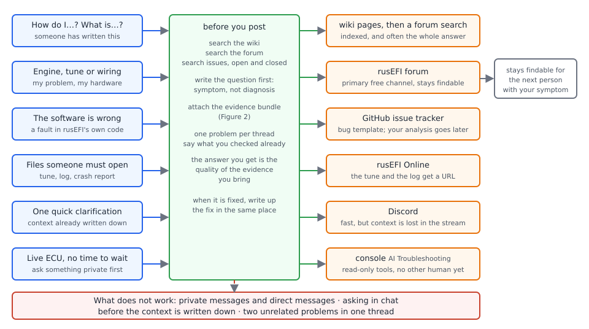

# Getting help

:material-circle:{ .level-basic } Basic → :material-circle:{ .level-advanced } Advanced

> **In one sentence:** rusEFI is a community project with no support desk, so where you ask and what
> you attach decide whether you get an answer — this chapter covers the channels, the evidence to
> gather first, and how to use rusEFI's AI tools without putting an engine at risk.

## Overview

:material-circle:{ .level-basic } Basic

rusEFI is free, open-source and community-driven. The project states plainly that it does not have
the resources to offer free support to end users, and puts help into two routes: technical support
bought by the hour at the rusEFI store, and community support — other people with the same hardware
answering you in public. The list of channels and the reasoning behind it is on the project's Support
page: <https://github.com/rusefi/rusefi/wiki/Support>.
<!-- src: .github/ISSUE_TEMPLATE/config.yml (contact link Support, pointing at the wiki Support page, and the note that the Support route comes before a ticket) -->

Every rusEFI document and error message points at the same two public places when something goes
wrong: the **rusEFI forum** at <https://rusefi.com/forum/> and the **GitHub issue tracker** at
<https://github.com/rusefi/rusefi/issues>. The forum is the primary free support channel; the issue
tracker is for faults in the firmware, the console and the board files, not for your tune.
<!-- src: firmware/tunerstudio/tunerstudio.template.ini (SD card help panel: share the reports in a GitHub issue or on the rusEFI forum, with your board and firmware version); .github/ISSUE_TEMPLATE/bug_report.md (Bug report and Feature request templates); README.md (External Links: Forum, Documentation wiki) -->

Pick the channel by what you have, not by how urgent it feels:

| What you have | Where it goes | Why |
|---|---|---|
| A "how do I…" or "what is…" question | the wiki <https://wiki.rusefi.com>, then a forum search | written down already, indexed by search engines |
| A problem with your engine, tune or wiring | the forum | the primary free channel; the thread stays readable and searchable |
| A quick clarification on something already written down | Discord <https://discord.gg/rCGAUaZJKF> | fast, but context is lost in the stream |
| Something the firmware itself gets wrong | GitHub issues | tracked, linked to the change that fixes it |
| A file somebody needs to look at | rusEFI Online <https://rusefi.com/online/> | tunes and logs get a URL instead of an attachment |
| A live ECU in front of you, right now | the console's **AI Troubleshooting** tab | read-only, no other human involved |
| None of the above working | paid technical support | one-to-one, at cost |

!!! warning "Private messages are not a support channel"
    Direct messages to a developer on Facebook, or private messages on the forum, do not get
    answered — the project says so directly, because private help is invisible to everyone else and
    doubles the work of the few people who answer questions. Ask in public, in the channel above,
    with the evidence attached. The same rule applies to your own notes: keep one problem per thread,
    and do not troubleshoot a BMW on a Mercedes thread.

## Where each question belongs

:material-circle:{ .level-basic } Basic

<figure markdown>
  
  <figcaption>Figure 1 — Where a rusEFI question goes. Search before you post; put the context on the
  forum or in an issue before a chat channel is useful; anything worth keeping ends up in a forum
  thread.</figcaption>
</figure>

### Search before you ask

The project expects it, and it is usually faster than waiting for a reply. Three searches, in this
order, settle a surprising share of questions:

1. **The wiki** — <https://wiki.rusefi.com>, and its own page on searching it. Feature guides,
   trigger patterns, pinouts and wiring practice live there. rusEFI's dialogs link straight into it:
   many settings' help text in TunerStudio is a wiki URL.
   <!-- src: firmware/tunerstudio/tunerstudio.template.ini (webHelp and topicHelp entries pointing at wiki.rusefi.com pages, and SettingContextHelp links) -->
2. **The forum search** — <https://rusefi.com/forum/search.php>. Someone with your exact symptom has
   usually written it up, often with the fix in a later post.
3. **The issue tracker, open *and* closed** — <https://github.com/rusefi/rusefi/issues>. An open
   issue says the behaviour is known and unfixed; a closed one says it was fixed, and usually names
   the release that carries the fix. Settings' help texts and code comments link their issues, so a
   setting's internal name is a good search key.
   <!-- src: .github/ISSUE_TEMPLATE/bug_report.md (issue tracker link); firmware/CHANGELOG.md (Breaking Changes and Unreleased sections per release) -->

The same three searches are how you check whether a feature is settled before you trust it; that
procedure is in [What rusEFI is, and how mature it is](about-rusefi.md).

### Forum, Discord, issue: not interchangeable

- **The forum** is where a project lives. A thread is indexed, stays readable, and lets whoever has
  the same symptom three years from now find the answer. Post the tune and log there (or link them
  from rusEFI Online), one problem per thread.
- **Discord** is a group messenger, good for a quick one-off question or a clarification once the
  background is already written down somewhere. It is a poor place for continued help on a project:
  context disappears in the stream, and nobody can find the answer afterwards. Establish the context
  on the forum or in an issue first, and write up the fix there when the problem is solved.
- **GitHub issues** are for faults in rusEFI's own code — the firmware, the console, the generated
  `.ini`. "My engine stalls at 4 000 rpm" belongs on the forum; "the warning counter increments while
  nothing is wrong" belongs in an issue. The project's own issue template tells you this in its first
  lines: lead with the problem, describe the symptom rather than your suspected cause, and read the
  LLM policy if a model helped you find it.
  <!-- src: .github/ISSUE_TEMPLATE/bug_report.md (template comment: Support route first, BLUF, describe the observed problem, xyproblem.info); .github/ISSUE_TEMPLATE/config.yml (Support and LLM policy links); misc/SoftwareDevelopmentProcess.md (development model: master, pull requests) -->

!!! tip "Answer the question behind the question"
    Describe the problem, not the fix you have in mind. "How do I change the N75 control frequency?"
    is a much harder question to help with than "my boost overshoots to 1.6 bar, and I thought a
    faster valve might help" — the second one can be answered, and might be answered with something
    other than what you asked for. Spell out abbreviations too: rusEFI people work on everything from
    motorcycles to tractors, so "N75 (boost control valve)" gets more answers than "N75".
    <!-- src: .github/ISSUE_TEMPLATE/bug_report.md (Problem statement: what is broken from the user's point of view, symptoms not diagnosis) -->

## Before you ask: the evidence bundle

:material-circle:{ .level-basic } Basic → :material-circle:{ .level-intermediate } Intermediate

A rusEFI problem has three possible causes — firmware behaviour, a setting, or the hardware in front
of the ECU — and the person answering cannot see which of the three you have. That is why every help
request in this community carries the same bundle of files. rusEFI's own documentation asks for it by
name: the basic problem, screenshots of the console *and* of TunerStudio (with the window border,
which carries the versions), a photo of the physical setup, the log, the tune, and the board plus
firmware version. rusEFI's bug template asks for the same set in shorter form: problem statement,
board, engine, firmware version, steps, expected behaviour, and screenshots, tune file or logs.
<!-- src: .github/ISSUE_TEMPLATE/bug_report.md (Hardware, To Reproduce, Expected behavior, Screenshots / logs sections); firmware/tunerstudio/tunerstudio.template.ini (SD card help panel: include your board, firmware version and what happened before the message appeared) -->

<figure markdown>
  
  <figcaption>Figure 2 — What a helper needs, and where each piece comes from. The tune and the log
  must be from the *same* attempt as the failure.</figcaption>
</figure>

Work through the list below before you post. Steps 5 and 6 are the ones people skip.

### 1 · Write the question first

One or two sentences: what is broken, in plain terms, with what you expected instead. Add what
changed just before it started — a firmware update, a new sensor, a new harness, a setting you
edited. If you cannot write that sentence, you are not ready to post yet; the act of writing it often
solves the problem.

### 2 · Write down what you are running

Two lines are enough:

```
Board:     Proteus F7 (Proteus plug-in pack, 4 cylinders)
Firmware:  rusEFI v20261020@1972639898   (from the TunerStudio title bar)
```

The TunerStudio title bar shows the firmware as **rusEFI v**, a date, **@** and a number. The date is
the stamp rusEFI's build robot writes into the source each day; the number is the **signature hash**,
and it is the part that matters. The ECU's full signature, which it sends when a program first
connects, reads `rusEFI master.<date>.<board>.<hash>` and ends with the same hash. It is how the console
and TunerStudio find the `.ini` that describes *your* firmware's settings: an `.ini` whose hash does
not match cannot be used, and rusEFI publishes each build's `.ini` under a path built from that branch,
date, board and hash. The full signature is shown by the console when it connects, and by TunerStudio's
**New Project** page as the **Serial Signature** after **Detect**.
<!-- src: firmware/console/binary/tunerstudio.cpp (TS_HELLO_COMMAND and getTsSignature: the signature identifies the settings layout; the versionInfo reply "%s v%d@%u" with FRONTEND_TITLE_BAR_NAME, getRusEfiVersion and SIGNATURE_HASH); firmware/integration/ts_protocol.txt (versionInfo: only used for the TS title bar); firmware/controllers/engine_controller.cpp (getRusEfiVersion returns VCS_DATE); .github/workflows/set-date.yaml (writes VCS_DATE into firmware/controllers/date_stamp.h); firmware/gen_signature.sh (TS_SIGNATURE: branch, date, board, hash); java_console/shared_io/src/main/java/com/rusefi/core/SignatureHelper.java (branch, date, board and hash taken from the signature, and the URL the matching .ini is fetched from) -->

The console prints the same information when it connects, which is why the community asks for a
screenshot that includes the console's window border: it shows the console version, the board and the
connection state in one image.

<!-- shot: img/ts/getting-help-firmware-identity.png | TunerStudio main window | state: Proteus F7 connected over USB, ignition on (12 V), engine stopped; crop the top of the window so the title bar is fully legible and shows rusEFI v<date>@<hash> from an official build; front page gauges partly visible below | Caption: Figure 3 — The title bar carries the firmware's date stamp and signature hash, which a helper needs in order to match your settings to the right files. -->

!!! warning "A firmware version older than your problem"
    Before you spend an evening describing a fault, check whether it is already fixed. Read the
    changelog's *Breaking Changes* and *Unreleased* sections for the period since your build, and try
    a newer official build if you can do so safely — "it started after I updated, and it stopped
    after I went back to the previous build" is the single most useful sentence in a bug report.
    <!-- src: firmware/CHANGELOG.md (per-release Breaking Changes, Added and Fixed sections; Unreleased); firmware/bundle.mk (bundle file names carry the date, signature hash and source commit) -->

### 3 · Describe the engine

The people who answer work on everything from single-cylinder two-strokes to V12s, so describe the
engine in rusEFI's terms: cylinder count, injection configuration, ignition type, fuel, and
aspiration. Add the trigger wheel you are using and how it is wired, since that is where a large
share of no-start and cut-out problems live.
<!-- src: .github/ISSUE_TEMPLATE/bug_report.md (Hardware: Board, Engine info, Firmware version) -->

### 4 · Save the tune

TunerStudio's tune file is the record of every setting your ECU is using; in rusEFI's naming it is
`CurrentTune.msq`. Fill in the engine name fields in your TunerStudio project before you export or
upload it, then close and reopen the project so the names are written into the file — a tune with no
engine name attached tells a helper almost nothing. Say plainly if you cannot share the tune (a race
engine, a customer car) rather than posting without it.
<!-- src: java_console/shared_io/src/main/java/com/rusefi/ts/TsHelper.java (CURRENT_TUNE_MSQ: CurrentTune.msq, written from the configuration image) -->

### 5 · Log the same attempt

A log is only evidence if it contains the failure. In TunerStudio: **Data Logging ▸ Start Logging**,
do the thing that misbehaves, **Data Logging ▸ Stop**, then **Data Logging ▸ Show DataLog Folder** to
find the file (rusEFI's logs are `.mlg`, opened in TunerStudio or MegaLogViewer). Say in the post
what time in the log to look at.

<!-- shot: img/ts/getting-help-data-logging-menu.png | Data Logging (menu open) | state: Proteus F7 connected over USB, ignition on (12 V), engine stopped; TunerStudio's Data Logging menu fully expanded showing Start Logging, Stop, Show DataLog Folder and the logging layout list, with a green recording indicator on the front page behind it | Caption: Figure 4 — TunerStudio's Data Logging menu: start before the fault, stop after it, then find the file. -->

The rate matters. rusEFI's `.ini` asks TunerStudio for 100 records per second by default, which is
fine for fuelling; cranking, trigger and variable valve timing work needs a much faster log, and the
wiki's advice is to raise the rate in TunerStudio's own **Communications ▸ Data Rate** menu — a log
below about 100 Hz is close to useless for trigger diagnosis. rusEFI can push several hundred
records a second over USB.
<!-- src: firmware/tunerstudio/tunerstudio.template.ini (defaultRuntimeRecordPerSec = 100, maxUnusedRuntimeRange); java_console/io/src/main/java/com/rusefi/binaryprotocol/BinaryProtocolLogger.java (the binary log the ECU streams) -->

### 6 · Take the ECU's own reports too

rusEFI keeps its own record of what went wrong, and it is often the fastest evidence in the whole
bundle:

- **Error codes.** *This is done in the rusEFI console.* The **OBD Codes** tab shows the current code
  and the codes seen recently; the ECU also keeps a history on the SD card when one is fitted.
  <!-- src: java_console/ui/src/main/java/com/rusefi/ui/obd/ObdCodesPane.java (last error code, recently seen codes, Clear history); firmware/controllers/algo/obd_error_codes.h (the code list); docs/AI/sd_card_logging.md (past-codes.csv: up to eight unique codes on the card) -->
- **The ECU's text log.** *This is done in the rusEFI console.* The **Messages** tab shows the
  messages the ECU is reporting, including warnings, Lua `print` output and critical errors — copy
  the lines you find odd into the post, verbatim.
  <!-- src: java_console/ui/src/main/java/com/rusefi/ui/MessagesPane.java (the console's Messages tab); firmware/console/binary/tunerstudio.cpp (TS_GET_TEXT: the ECU's text log stream) -->
- **Crash reports on the SD card.** If the firmware hit a hard fault it wrote a file to the card.
  Open **Controller ▸ SD Card Logger** in TunerStudio: the indicator reads **Error report on SD** when
  a report is waiting. Press **Mount to PC** and open the card on your computer, then look in its root
  folder for `*_fail_*.txt` files, for example `00042_fail_HardFault.txt`. Copy the file out before
  anything clears it; **Remove all fail reports** clears the reminder but not the cause.
  <!-- src: firmware/tunerstudio/tunerstudio.template.ini (SD Card dialog, sdCardCommands with Mount to PC / Mount to ECU / Unmount / Format, sdReportCommands with Remove all fail reports, the Error report on SD indicator, and the sdCardHelp panel text); firmware/hw_layer/mmc_card.cpp (sdModeSelector: the card is exposed to the PC over USB; crash report files scanned at boot); docs/AI/sd_card_logging.md (mode state machine, error report file) -->
- **Logs the ECU logged itself.** With the card mounted to the ECU, rusEFI writes its own `.mlg` log
  to it, so you can record a drive with no laptop in the car and send that log afterwards. The three
  settings that decide what is recorded are in the Settings reference below; they are explained in the
  SD logging part of the Diagnostics chapter.

<!-- shot: img/ts/getting-help-sd-card-logger.png | Controller ▸ SD Card Logger | state: Proteus F7, ignition on (12 V), engine stopped, SD card fitted and mounted to the ECU: SD Card Logging panel with Always start in Logging mode unchecked, SD logger mode Full MLG, MLG logger rate 50, SD commands panel with Mount to PC and Mount to ECU buttons, the ECU logging indicator green and the PC Access indicator off, Fail reports panel with the Error report on SD indicator red, every dropdown closed | Caption: Figure 5 — The SD Card Logger page: what the ECU records on its own, and the buttons that hand the card to your computer so you can read the reports. -->

<!-- shot: img/console/getting-help-ecu-evidence.png | rusEFI console main window ▸ OBD Codes | state: connected to a Proteus F7 on 12 V, engine stopped; OBD Codes tab in front showing last error code and the recently seen code history with two codes listed, Clear history button visible but not pressed, the tab row including Messages visible along the top | Caption: Figure 6 — The console's OBD Codes tab, with the Messages tab beside it: the ECU's own list of what it noticed, which is the first thing a helper asks for. -->

!!! warning "Mount the card the right way round"
    **Mount to PC** hands the card to your computer and stops the ECU logging to it; **Mount to ECU**
    gives it back. Eject the drive on your computer before you mount it back to the ECU, and remove
    the reports only after you have copied them somewhere — a crash report you delete is evidence
    that is gone for good.

### 7 · Put the files where a stranger can fetch them

Upload the tune and the log to rusEFI Online at <https://rusefi.com/online/> and paste the exact URLs
into your post. A link is worth more than an attachment because it survives being forwarded, and
because a helper can open the tune in their own TunerStudio. Give the URL of the specific tune, not
just "I uploaded my tune".
<!-- src: java_console/shared_ui/src/main/java/com/rusefi/tools/online/Online.java (the upload endpoint on rusefi.com/online) -->

### 8 · Screenshot the tools, and photograph the car

Take the screenshot so the window border is in it: that is where the console and TunerStudio show
which version and which ECU you are connected to. On Windows, **Print Screen** and then paste into the
forum post is the shortest path. Then add a photo of the ECU's connectors and the wiring around the
problem — a surprising number of rusEFI faults are a pin in the wrong hole, and a photograph is the
only way anyone can see that.

!!! tip "The five-line version of a good post"
    1. One or two sentences on what is broken and what changed.
    2. Board, engine, firmware identity string, PC operating system.
    3. Links to the tune and the log from that same attempt, with the time of the failure.
    4. Screenshots with window borders, plus a photo of the wiring.
    5. What you have already checked, and what you have already ruled out.

## Examples

:material-circle:{ .level-intermediate } Intermediate

!!! example "Example 1 — a question that gets answered"
    **Post:** "Engine runs fine to about 4 000 rpm, then leans out and cuts out. It started after I
    updated from the June build to the August build; rolling back fixed it. Proteus F7, 2.0 L NA
    four-cylinder, wasted spark, 60-2 trigger wheel, secondary cam input. Firmware
    `rusEFI master.2026.08.07.<board>.<hash>`. Tune: <link>. Logs: cold start and the failing run at
    4 200 rpm: <link> — the fault is at 1:37, MAP collapses from 98 to 42 kPa while TPS holds 60 %.
    Checked: fuel pressure at the rail, injector wiring swapped bank to bank, no error codes on the
    OBD Codes tab. Screenshots of TunerStudio and the console attached, photo of the White connector
    below."

    Why it works: the symptom is stated first, the version that broke it is named, the log points at a
    timestamp, and the obvious hardware causes are already eliminated. A helper can open the tune,
    compare it against a known-good one, and search the issue tracker for what changed between those
    two builds. That is a five-minute answer instead of twenty rounds of questions.

!!! example "Example 2 — the same problem asked badly"
    **Post:** "How do I set the MAP prediction frequency higher?"

    This is the classic trap of asking for your suspected fix instead of the problem: nobody can tell
    whether the setting you want even exists, and if it does you may get it changed in a way that
    makes the engine worse. Rewritten: same facts as Example 1, ending with "I thought making the MAP
    estimate faster might help, is that a thing?" Now a reader can say what actually happened —
    for example that a predicted-MAP setting is not the cause, and the log at 1:37 shows a wiring
    problem instead.
    <!-- src: .github/ISSUE_TEMPLATE/bug_report.md (template comment: describe the actual problem you observed, not your suspected cause or fix; xyproblem.info) -->

## Reporting a bug on GitHub

:material-circle:{ .level-advanced } Advanced

File an issue when the *software* is wrong: a setting that does not do what its help text says, a
warning that appears for no reason, a crash, a compile failure, a `.ini` label that misleads. Search
the tracker first, including closed issues, and link what you find — a duplicate is closed faster
than a new report of an old fault.

Use the **Bug report** template and keep to its order:

| Field | What good looks like |
|---|---|
| Problem statement | One or two sentences, symptom first, no diagnosis. |
| Hardware | Board, engine, firmware version or identity string. |
| To Reproduce | The shortest sequence that does it, every time, numbered. |
| Expected behavior | What the documentation or the help text says should happen. |
| Screenshots / logs | Screenshots with window borders, tune link, log link, `*_fail_*.txt` if there is one. |

Then, in a **comment** rather than the description, add your analysis: the code you read, the lines
you think are involved, and anything a model worked out for you. The template is explicit that
source-level findings and LLM forensics do not belong in the description, because the description is
what every contributor reads and human review is the scarce resource.

Before you file, narrow it down if you can — the difference between "it broke somewhere between the
June build and the August build" and "it broke" is the difference between an afternoon of work for the
maintainer and years of an open issue:

1. Note the firmware identity string of the newest build that worked and the oldest that failed.
2. Read the changelog between them for the subsystem involved, and say in the issue what you found.
3. If a single setting change can reproduce or suppress it, say so; that is a half-fixed bug.

If you fix it yourself, the project wants the change: fork, branch, build, run the unit tests, and
open a pull request against `master`. The development-process note describes the model, and the
`unit_tests` folder is where a fix is expected to be accompanied by a test.
<!-- src: .github/ISSUE_TEMPLATE/bug_report.md (template sections and the comment-only rule for analysis and LLM-assisted findings); .github/ISSUE_TEMPLATE/feature_request.md (Feature request template); misc/SoftwareDevelopmentProcess.md (stable master, pull requests, limited automated testing); firmware/CHANGELOG.md (release sections to compare between two builds) -->

!!! note "Console commands are a debugging tool, not evidence on their own"
    If you use the console's command line to look inside the ECU, paste the command *and* its output
    — a number without the command that produced it cannot be checked. The command list is in the
    Part VII appendix *Console commands*.

## AI assistants

:material-circle:{ .level-intermediate } Intermediate → :material-circle:{ .level-advanced } Advanced

rusEFI is open source, and the project has made itself unusually readable to software assistants: the
firmware source, its generated setting definitions and the wiki text are packaged so a model can
search them, and the console ships an assistant that reads a connected ECU. Two rules apply to all of
it. First, an assistant's answer is only as good as the sources it was given, and the code is still
the authority. Second, an assistant should read from your ECU, not write to it.

### The console's AI Troubleshooting tab

*This is done in the rusEFI console.* The **AI Troubleshooting** tab is a troubleshooting assistant
built into the console: it signs in to a ChatGPT account on your ChatGPT plan, is given a copy of
rusEFI's own source and documentation, and can look at the ECU you are connected to. rusEFI describes
the tab as available in online console sessions for acceptance testing, and it is hidden when the
console is in offline or log-viewer mode.

<figure markdown>
  
  <figcaption>Figure 7 — What the assistant can and cannot reach. Every ECU tool is read-only; the
  ECU's settings are read fresh from its memory, and your own PC keeps the exported case.</figcaption>
</figure>

1. Connect to the ECU, then open **AI Troubleshooting**. The tab first checks a cached copy of the
   rusEFI source; if it is missing, too small or older than a month it shows a **Start Download**
   button and a progress bar. Nothing else is usable until that copy is ready.
   <!-- src: java_console/ui/src/main/java/com/rusefi/ConsoleUI.java (AI Troubleshooting tab added only when not offline and not in log-viewer mode); docs/llm-troubleshooting.md (source ZIP check, Start Download prompt, chat hidden until extraction finishes); java_console/shared_io/src/main/java/com/rusefi/core/net/FirmwareSourceCodeDownloader.java (ZIP refresh rules: missing, under 10 MiB, or older than 30 days) -->
2. Sign in with **Continue with ChatGPT**. This needs a ChatGPT plan, and it opens your browser. If
   the sign-in does not open one, the tab shows a link you can copy; **Cancel sign-in** abandons the
   attempt, and **Add account** appears once a sign-in exists.
   <!-- src: java_console/ui/src/main/java/com/rusefi/ui/llm/LLMTab.java (Continue with ChatGPT, Add account, Cancel sign-in, copyable sign-in link); docs/llm-troubleshooting.md (browser sign-in flow, ChatGPT plan, rusEFI Updater client identity) -->
3. Pick a **Model:** from the list and type the problem in the box under *Describe your problem below
   and hit 'Send'*, then press **Send**.
4. Watch the tool names scroll past. The assistant answers by calling tools, and the ECU tools it has
   are read-only:

   | It can read | Evidence |
   |---|---|
   | `ecu_info` | the firmware signature of the connected ECU |
   | `list_output_channels` | the log channel names, labels, descriptions and units of *your* firmware |
   | `read_live_values`, `diagnostic_snapshot` | a set of channels from one recent poll, plus the warning and error channels |
   | `read_tune_fields` | selected settings, read fresh from the ECU's memory — not from a cached tune |
   | `get_lua` | bounded lines of the Lua script held in the ECU, with citations and a hash |
   | `capture_live_log` | a short series of samples of up to 16 channels |
   | `capture_engine_sniffer` | the next sniffer chart, parsed into events |
   | `read_messages` | console and ECU messages since the conversation started |
   | `search_knowledge`, `read_knowledge` | rusEFI's firmware source and wiki text in the local cache |

   Ask for what a human helper would ask for: a snapshot, then the settings involved, then a short
   capture around the moment the problem happens.
   <!-- src: java_console/ui/src/main/java/com/rusefi/ui/llm/TroubleshootingTools.java (the ECU tools combined with the local knowledge tools); docs/llm-troubleshooting.md (per-tool evidence, bounds and the read-only rule); java_console/ui/src/main/java/com/rusefi/ui/llm/LocalKnowledgeTools.java (search and read of the cached firmware and documentation text) -->
5. Use **Stop** to cancel a turn and **New conversation** to start again. A turn has hard limits, so
   do not expect a single prompt to diagnose a whole car: it is cut off at two minutes, eight model
   requests and 24 tool calls.
6. Ask for a case when you want to hand the problem to a human: *export a diagnostic case*. The
   console writes a JSON report of the findings, hypotheses, next measurements and the exact evidence
   it collected, under `~/.rusefi/llm-access/diagnostic-cases/`. Read it and clean it up before you
   attach it — it contains your tune values and Lua source.
   <!-- src: java_console/ui/src/main/java/com/rusefi/ui/llm/DiagnosticCaseStore.java (case export: findings, hypotheses, next measurements, retained evidence, never overwriting); docs/llm-troubleshooting.md (turn limits, export location and contents, evidence retention) -->

What leaves your computer: your question, the ECU evidence the assistant asked for (which can include
tune values and your Lua source) and the source or wiki text it retrieved are sent to OpenAI under
your ChatGPT account. The ECU connection itself stays read-only — the tab cannot change a setting,
burn, clear faults, write Lua or flash anything. Tokens are kept in `~/.rusefi/llm-access/`, and
conversation history is not written to disk unless you export a case.
<!-- src: docs/llm-troubleshooting.md (what is sent to OpenAI, read-only ECU access, token store and memory-only history); java_console/ui/src/main/java/com/rusefi/ui/llm/ChatGptClient.java (browser sign-in and the streaming request path) -->

!!! info "Advanced"
    Two limits matter when you quote an answer. The knowledge cache is a *snapshot* of rusEFI's source
    and wiki, tagged with revisions; the ECU's identity string identifies its settings layout and
    build, not a source revision, so the assistant keeps the match between its sources and your
    firmware explicitly unverified. That is why an answer may cite code your firmware does not run.
    Quote the file and symbol, then open that file yourself — or ask the assistant for the citation
    and check it against your build.
    <!-- src: docs/llm-troubleshooting.md (knowledge manifest revisions and file hashes, the HELLO signature identifying the INI schema and build, ecu_match unverified) -->

<!-- shot: img/console/getting-help-ai-tab.png | rusEFI console main window ▸ AI Troubleshooting | state: connected to a Proteus F7 over USB on 12 V, engine stopped; sources already prepared, one signed-in account selected, the Model list open or showing the selected model, the prompt box with the label Describe your problem below and hit 'Send', Send, Stop and New conversation buttons visible, terminal empty or showing the rusEFI Troubleshooting header; capture the whole window including the tab row | Caption: Figure 8 — The AI Troubleshooting tab with a live ECU connected: account and model at the top, the terminal in the middle, the prompt and Send at the bottom. -->

### Read the repository yourself, with a model

The rusEFI repository contains documentation written for machine readers: `docs/AI/` holds 21
per-subsystem notes (fueling, ignition, sensors, idle, cold start, scheduling, protection, SD logging,
engine sniffer, Lua, launch control, VVT and others), written as an index into the code rather than as
a manual. The root `CLAUDE.md` is the shared guidance for coding assistants working in the repository,
and `AGENTS.md` points any assistant at it.
<!-- src: AGENTS.md (CLAUDE.md as the shared repository guidance for Codex as well as Claude Code); CLAUDE.md (Project Overview, build commands, current-state documentation rules); docs/AI (per-subsystem notes for AI readers) -->

Those notes are a map, not a promise: they can lag the code they describe. Use them to find the file,
then read the file. Every section of this manual carries hidden source notes naming the file and
function each paragraph came from, for exactly this reason — you can open the same file and check.

If you work with a coding assistant locally, point it at the checked-out repository rather than at
this manual, and ask it for file and symbol names you can verify. rusEFI's bundle, changelog and
generated `.ini` files are all readable text, which is why a model can often tell you which release
changed a behaviour.

### Letting an assistant hold the ECU: the MCP server

Beyond the console's own tab, rusEFI ships a **Model Context Protocol (MCP)** server that a model
client can drive directly: it starts as a separate program, talks JSON-RPC over a stdio pipe, connects
to the ECU the same way the console does, and hands the client a much wider tool catalog — Lua upload
and reset, live data, host-side `.mlg` logging, sniffer capture, SD-card mounting, tune reading and
writing, log conversion, and firmware updates over OpenBLT with the configuration backed up and
migrated. There is also a read-only CAN sniffer server. This is a workshop tool for someone who
understands both MCP and rusEFI, and it is the one place in this chapter where an assistant can change
the ECU.

!!! danger "An assistant must not write to the ECU"
    rusEFI also ships an MCP server (`:mcp_ecu`) that exposes the ECU to model clients such as Claude
    Desktop, Cursor or JetBrains AI over a stdio connection. Unlike the console's tab, that tool
    catalog is **not** read-only: it can upload and reset Lua scripts, write TunerStudio-compatible
    tunes, and update firmware over OpenBLT while migrating the configuration. A model that
    misinterprets your instruction can therefore change the fuel or timing of a running engine, or
    leave an ECU with firmware that does not start. If you use it: keep the ECU on the bench and the
    injector and coil drivers disabled while an assistant is connected, make no engine-affecting write
    without reading the exact value first, and never flash with the engine running. rusEFI's console
    tab and its own read-only tools are the safer default, and the CAN sniffer server is read-only by
    design.
    <!-- src: java_console/mcp_ecu/README.md (MCP server tool catalog: Lua write and reset, tune read and write, update_firmware over OpenBLT with configuration migration); README-mcp.md (available MCP servers and their tools, the read-only CAN sniffer server); java_console/mcp_ecu/src/main/java/com/rusefi/mcp/EcuMcpServer.java (the tool catalog the standalone server exposes) -->

### If an assistant wrote your question

An assistant can help you write a clearer report, and the project's **LLM policy** is blunt about the
limits: humans are the bottleneck in an open-source project, and a wall of generated text gets its
author blocked. The required format is separation — the problem statement in the description, and any
LLM-assisted analysis, log forensics or source-level reading in a comment afterwards. The issue
templates link the policy page and the Support page in their first lines, so read both before you
file: <https://github.com/rusefi/rusefi/wiki/LLM-policy>.
<!-- src: .github/ISSUE_TEMPLATE/bug_report.md (read the LLM policy before filing; LLM forensics and source-level findings prohibited in the description, post them as a comment); .github/ISSUE_TEMPLATE/config.yml (contact link to the LLM policy page) -->

## Troubleshooting

:material-circle:{ .level-basic } Basic → :material-circle:{ .level-advanced } Advanced

| Symptom | Likely cause | What to do |
|---|---|---|
| Nobody answers your post | no evidence attached, or the answer was asked for somewhere it cannot be kept | add the bundle from Figure 2; put context on the forum, not in chat |
| A developer replies "please read the docs" | the answer is already written | search the wiki and the forum before the next post, and say what you searched and what did not fit |
| Issue closed as support rather than a bug | the fault is in the tune or the wiring, not the firmware | take it to the forum with the tune and log; keep the issue link |
| Your analysis is missing from the discussion | it was in the issue description, where maintainers are asked not to read it | move it to a comment |
| A question about a paid-only feature of another product | out of scope | rusEFI works with TunerStudio, MegaLogViewer, CAN dashes and wideband controllers; ask those vendors about their own products |
| **AI Troubleshooting** tab is missing | the console is offline or in log-viewer mode | connect to an ECU over USB first |
| The tab sits on *Checking cached source code…* or shows **Start Download** | no usable local copy of rusEFI's source; the download needs internet access | press **Start Download**; if it fails, check the connection and try again |
| **Continue with ChatGPT** is greyed out | the selected account is already authorised | pick that account and type the question; use **Add account** for a second one |
| Sign-in asks for a plan you do not have | the tab works through a ChatGPT plan | use the forum instead, or read `docs/AI` and the source yourself |
| The assistant quotes code your firmware does not have | its source snapshot is not proven to match your build | give it the firmware identity string, and check the cited file against your build |
| The assistant's answer contradicts this manual | one of them is describing a different version | open the file named in the manual's source note and in the assistant's citation, and compare against your firmware date |
| Console says it cannot find the `.ini` for your ECU | the signature hash of your build has no published `.ini` (a custom or self-built firmware) | use the `.ini` from the bundle your firmware was built from, or from `firmware/tunerstudio/generated/` if you built it |
| TunerStudio cannot connect while the console is open, or the reverse | one serial port, two programs | close one program before the other connects |
| Log comes back useless for a cut-out | logged at the default rate, and the fault was over in a few hundred milliseconds | raise the logging rate in TunerStudio, start logging before the fault, and say in the post where to look |
| Tune uploaded with no engine name | the TunerStudio project's engine fields were blank | fill them in, close and reopen the project, upload again and post the new link |
| `Error report on SD` is red and you pressed **Remove all fail reports** | the report was deleted before it was copied | copy the `*_fail_*.txt` files out first next time; note the file name and date, and mention what you lost |

## Settings reference

The only TunerStudio dialog this chapter tells you to change settings in is the SD-card page, where
the settings decide what the ECU records by itself — evidence you can send without a laptop lead.
The buttons on that page (**Mount to PC**, **Mount to ECU**, **Unmount**, **Format**, **Remove all
fail reports**) are commands, not settings, so they do not appear in the table.
<!-- src: firmware/tunerstudio/tunerstudio.template.ini (dialog sdCard with sdCardCommands and sdReportCommands panels, and dialog sdCardLogging with alwaysWriteSdCard, sdLoggerMode and sdCardLogFrequency) -->

### SD Card Logger (Controller ▸ SD Card Logger)

--8<-- "reference/settings/_sdCardLogging.table.md"

## Related

- [Read this first — safety and disclaimer](../safety.md) — no warranty, and what you are responsible for
- [What rusEFI is, and how mature it is](about-rusefi.md) — the issue tracker, the changelog, and checking a feature's status yourself
- [Your two tools](../part1/two-tools.md) — TunerStudio for tuning, the console for looking after the ECU
- [Troubleshooting guide](../part5/troubleshooting.md) — working through a fault yourself before you post
- [Diagnostics and error codes](../part5/diagnostics.md) — what the ECU records, and how to read it
- [Trigger](../part3/trigger.md) — the evidence matrix to follow for a synchronisation problem
- [Flashing firmware](../part1/flashing-firmware.md) — what a firmware identity string means in practice
- Part VII — *Console commands*, *Error codes* and the console appendix
