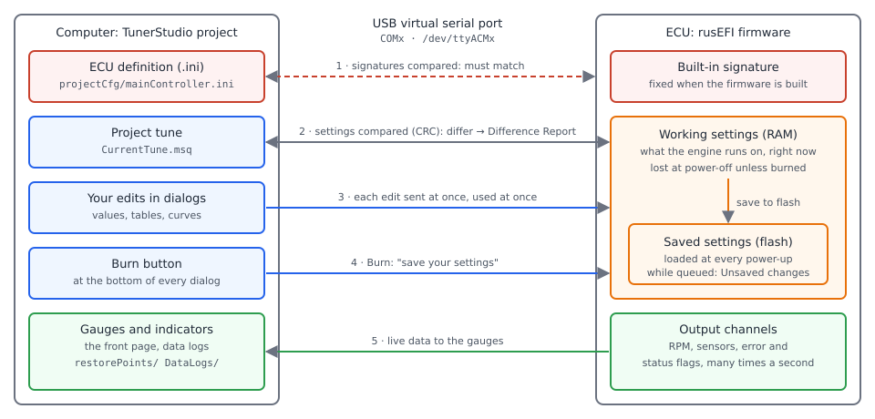

# First connection

:material-circle:{ .level-basic } Basic

> **In one sentence:** you plug the ECU into your computer with a USB cable, create a TunerStudio
> project that uses the `.ini` file from your firmware bundle, go online, and learn to read the
> front page before you change anything.

This chapter assumes rusEFI firmware is already on the ECU (see *Flashing firmware*) and TunerStudio
is installed (see *Installing the software*). Examples use a **Proteus F7** and the `.ini` from its
bundle.

## Overview

:material-circle:{ .level-basic } Basic

TunerStudio is the program you use to set up and tune the engine. To talk to the ECU it needs two
things:

- **a way to reach the ECU** — the USB cable, which appears on your computer as a serial port;
- **a description of the ECU** — the `.ini` file (TunerStudio calls it the *ECU definition*). It lists
  every setting, table, gauge and indicator the firmware has, where each one is stored, and the
  menus and dialogs TunerStudio builds from them.

Both are stored in a **TunerStudio project**, which you create once per ECU. After that, opening the
project connects to the ECU.

The procedure, in order:

1. Connect the ECU over USB and find its port.
2. Create a project: name, `.ini`, port, dashboard.
3. Go online. If the project and the ECU disagree, answer the **Difference Report**.
4. Read the front page: what every indicator means.
5. Change something and **Burn** it, so it survives a power cycle.

!!! warning "Connecting is fine on USB power — calibrating is not"
    The ECU runs from the USB cable alone, which is enough to connect, look around and change
    settings. It is **not** enough to calibrate anything: on USB power the 5 V sensor supplies do
    not reach 5 V, so every sensor voltage you read is wrong. TunerStudio greys out the **Grab** and
    **Auto Calibrate** buttons until the ECU sees ignition voltage (more than 6 V on its ignition or
    battery input). Switch the ignition on before any calibration.
    <!-- src: firmware/tunerstudio/tunerstudio.template.ini (cmd_calibrate_pedal_up, cmd_etb_auto_calibrate enable conditions: hasIgnitionVoltage); firmware/controllers/ignition_controller.cpp (isIgnVoltage: 6 V threshold); firmware/controllers/actuators/main_relay.cpp (hasIgnitionVoltage) -->

## Concepts

:material-circle:{ .level-basic } Basic

<figure markdown>
  
  <figcaption>Figure 1 — What happens over the USB cable. Red is the safety check that must pass
  first, blue is what you send, orange is what the ECU keeps, green is the live data coming back.</figcaption>
</figure>

### The USB port is a serial port

The ECU's USB connection makes it look like a serial port to your computer (a USB "virtual COM
port"). The same USB connection also presents a small USB drive, used for the SD card. Windows names
the serial port **COM** and a number (COM3, COM7…), Linux names it **/dev/ttyACM0** (or ttyACM1, …),
macOS names it **/dev/cu.usbmodem…**. The **baud rate** setting in TunerStudio makes no difference on
this connection: the ECU accepts whatever speed the computer asks for and ignores it, so leave the
default.
<!-- src: firmware/hw_layer/ports/stm32/serial_over_usb/usbcfg.cpp (device descriptor: CDC and MSD interfaces); firmware/ChibiOS/os/hal/src/hal_serial_usb.c (sduRequestsHook: CDC_SET_LINE_CODING stored, not applied); firmware/hw_layer/mass_storage/mass_storage_init.cpp (initUsbMsd, attachMsdSdCard) -->

A serial port can be open in **one program at a time**. If the rusEFI console has the port open,
TunerStudio cannot connect, and the other way round. Close one before you open the other. The split
between the two tools is explained in *Your two tools*.
<!-- src: java_console/io/src/main/java/com/rusefi/io/serial/SerialIoStream.java (openSerial: "Error opening ... maybe no permissions?") -->

### The signature: does the .ini fit the firmware?

Every rusEFI firmware build carries a **signature**, a line of text such as

`rusEFI master.2026.10.19.proteus_f7.1234567890`

made of the branch it was built from, the build date, the board and a number calculated from the
settings layout. The `.ini` built with that firmware carries the same line. When TunerStudio
connects, it asks the ECU for its signature and compares it with the project's `.ini`.
<!-- src: firmware/gen_signature.sh (TS_SIGNATURE: branch, date, SHORT_BOARD_NAME, SIGNATURE_HASH); java_tools/configuration_definition/src/main/java/com/rusefi/ConfigDefinition.java (SIGNATURE_HASH: CRC32 of the config input files); firmware/tunerstudio/tunerstudio.template.ini ([TunerStudio] signature, queryCommand); firmware/console/binary/tunerstudio.cpp (TunerStudio::handleQueryCommand) -->

The number changes whenever the list of settings changes. A `.ini` from a different build may put
a setting at a different place in memory: TunerStudio would show and write the wrong values. That is
why the `.ini` must come **from the same bundle as the firmware on the ECU**. After every firmware
update, the project needs the new bundle's `.ini` (see *Example 2*).
<!-- src: java_console/io/src/main/java/com/rusefi/ts/TsProjectUpdater.java (signature mismatch after firmware update, projectCfg/mainController.ini) -->

### Three copies of your settings

Your settings exist in three places, and most confusion at a first connection comes from mixing them
up:

| Where | What it is | When it changes |
|---|---|---|
| **The project tune** on the computer (`CurrentTune.msq` in the project folder) | TunerStudio's copy | as you edit, and when you choose which copy wins in a Difference Report |
| **The working settings** in the ECU's memory (RAM) | what the engine runs on right now | the moment you change a value in TunerStudio |
| **The saved settings** in the ECU's flash | what the ECU loads at every power-up | only when you **Burn** |

Every edit you make in a TunerStudio dialog is sent to the ECU at once and takes effect at once,
with the engine running or not. It is **not** saved: switch the ECU off and it comes back with the
saved settings. **Burn** tells the ECU to write its working settings to flash.
<!-- src: firmware/console/binary/tunerstudio.cpp (TunerStudio::handleWriteChunkCommand: memcpy into the live configuration; TunerStudio::handleBurnCommand, finishPendingBurn, requestBurn); firmware/controllers/flash_main.cpp (setNeedToWriteConfiguration, readConfiguration); java_console/io/src/main/java/com/rusefi/ts/TsProjectCreator.java (project folder layout: projectCfg/mainController.ini, CurrentTune.msq, restorePoints, DataLogs) -->

When TunerStudio goes online it compares the project tune with the ECU's working settings (a
checksum of the whole settings block). If they differ, it shows the **Difference Report** and asks
which copy should win.
<!-- src: firmware/console/binary/tunerstudio.cpp (TunerStudio::handleCrc32Check); firmware/tunerstudio/tunerstudio.template.ini ([Constants] crc32CheckCommand) -->

## Procedure

:material-circle:{ .level-basic } Basic

### 1 · Connect the ECU and find its port

Plug the USB cable into the ECU and the computer. The ECU powers up from USB. Then find the port it
was given:

=== "Windows"

    Open **Device Manager** and expand **Ports (COM & LPT)**. A new COM port appears when you plug
    the ECU in and disappears when you unplug it — that is the ECU's port. Note its number.

=== "Linux"

    In a terminal, run `ls /dev/ttyACM*` before and after plugging in. The new entry
    (usually `/dev/ttyACM0`) is the ECU. Your user needs permission to open it; on most
    distributions that means membership of the `dialout` group (see *Installing the software*).

=== "macOS"

    In a terminal, run `ls /dev/cu.usbmodem*` before and after plugging in. The new entry is the
    ECU.

If nothing appears, try another cable (many USB cables carry power only) and see *Pitfalls* below.

### 2 · Create the project

In TunerStudio choose **File ▸ Vehicle Projects ▸ New Project**. On the first page:

1. **Project Name** — anything that tells you which car and ECU it is. TunerStudio creates a folder
   of that name under **Project Directory**.
2. **Firmware** — press **Detect**. TunerStudio scans for the ECU and shows the **Serial
   Signature** it reports. This tells you the ECU is answering and which firmware it runs.
3. Tick **Other / Browse** and choose the `.ini` from your firmware bundle — for Proteus F7 it is
   `rusefi_proteus_f7.ini` in the top folder of the bundle. Use the `.ini` from the bundle you
   flashed, not one from the web or an older bundle.
4. Leave **Show Advanced / Offline Setup** unticked and press **Next**.
<!-- src: firmware/console/binary/tunerstudio.cpp (TunerStudio::handlePlainCommand: 'Q' answered during TunerStudio ECU detection); firmware/tunerstudio/tunerstudio.template.ini ([TunerStudio] signature) -->

<!-- shot: img/ts/first-connection-new-project.png | File ▸ Vehicle Projects ▸ New Project (page 1) | Project Name "proteus-first", Detect pressed: Serial Signature shows the official proteus_f7 signature, Other / Browse ticked with the bundle's rusefi_proteus_f7.ini | Figure 2 — The first page of a new project: name, the detected signature, and the bundle's .ini chosen with Other / Browse. -->

<!-- shot: img/ts/first-connection-browse-ini.png | New Project ▸ Other / Browse | file chooser open in the bundle's top folder, rusefi_proteus_f7.ini selected, Files of Type "TunerStudio files (*.ini;*.ecu)" | Figure 3 — Choosing the .ini from the firmware bundle. -->

!!! tip "Why Other / Browse and not just Detect"
    TunerStudio looks the detected signature up in its own library of ECU definitions. rusEFI
    builds come out far more often than that library is updated, so it rarely has an exact match.
    Choosing the bundle's own `.ini` guarantees the signatures agree.

### 3 · Set up communication

The second page sets how TunerStudio reaches the ECU:

| Field | Set to |
|---|---|
| **Driver** | **Standard Protocols Driver** (the default) |
| **Connection Type** | **RS232 Serial Interface** |
| **Com Port** | the port from step 1: COMx on Windows, /dev/ttyACMx on Linux, /dev/cu.usbmodem… on macOS |
| **Baud Rate** | leave the default; it has no effect over USB |

Press **Test Port**. TunerStudio opens the port and talks to the ECU; **Successful!!!** means it
got an answer. If it fails, check that the rusEFI console is closed and the port number is right.
Then press **Next**.
<!-- src: firmware/ChibiOS/os/hal/src/hal_serial_usb.c (sduRequestsHook: line coding not applied); firmware/console/binary/tunerstudio.cpp (TunerStudio::handleQueryCommand) -->

<!-- shot: img/ts/first-connection-comms.png | New Project (page 2: Communication Settings) | Driver "Standard Protocols Driver (Default)", Connection Type "RS232 Serial Interface", Com Port set to the ECU's port, Baud Rate 115200, Test Port pressed showing "Successful!!!" | Figure 4 — Communication settings: the ECU's port, and a successful Test Port. -->

### 4 · Choose a dashboard

The last page offers a **dashboard** — the page of gauges TunerStudio shows when the project is
open. **Default** builds it from the `.ini`'s own front page: eight gauges (RPM, coolant
temperature, throttle position, MAP, air/fuel ratio or lambda, battery voltage, dwell, ignition
timing) and the indicator rows below them. Keep it for now; you can change gauges later by
right-clicking one. Press **Finish**.
<!-- src: firmware/tunerstudio/tunerstudio.template.ini ([FrontPage] gauge1..gauge8, indicators) -->

<!-- shot: img/ts/first-connection-dashboard.png | New Project (page 3: Select Dashboard) | "Default (<project name>)" selected, preview visible | Figure 5 — The default dashboard, built from the rusEFI .ini. -->

### 5 · Go online

TunerStudio opens the project and connects. When it is connected, the status bar at the bottom
left reads **Online:** and the project name, the gauges move, and the window title shows the
firmware version the ECU reports.
<!-- src: firmware/tunerstudio/tunerstudio.template.ini ([TunerStudio] versionInfo); firmware/console/binary/tunerstudio.cpp (TS_GET_FIRMWARE_VERSION: "rusEFI v<version>@<hash>") -->

<!-- shot: img/ts/first-connection-online.png | main window, Gauge Cluster tab | connected, ignition on (12 V), engine stopped, crop below the title bar (the title bar carries the registration name) down to the status bar showing "Online: <project name>" | Figure 6 — Online: gauges live, indicators below them, the status bar shows the connection. -->

If TunerStudio warns about a **signature mismatch** instead, stop: the project's `.ini` does not
belong to the firmware on the ECU. See *Example 2*.

### 6 · Answer the Difference Report

If the project tune and the ECU's settings differ, TunerStudio shows the **Difference Report** as
it goes online. It lists every setting that differs, dialog by dialog: on the left **Current
TunerStudio Settings** (the project tune), on the right **Settings in rusEFI** (the ECU), with each
differing field highlighted. Page through it with **Previous** and **Next**, then choose one of:

| Button | What happens | Use it when |
|---|---|---|
| **Use Controller Settings** | the project tune is replaced by what the ECU has | almost always at a first connection: a new project holds no tune of its own yet, and the ECU's settings are the real ones |
| **Send Current TunerStudio Settings** | the ECU's working settings are overwritten by the project tune | you deliberately want the tune stored in this project on this ECU — for example after replacing an ECU |
| **Exit & Go offline** | nothing changes; TunerStudio stays offline | you are not sure which one is right |

Before it overwrites anything, TunerStudio saves a **restore point** of the project tune, so a wrong
choice can be undone from the project's restore points. Sending settings changes only the ECU's
working settings; **Burn** afterwards if you want to keep them.
<!-- src: firmware/console/binary/tunerstudio.cpp (TunerStudio::handleCrc32Check, handleWriteChunkCommand); java_console/io/src/main/java/com/rusefi/ts/TsProjectCreator.java (restorePoints folder) -->

<!-- shot: img/ts/first-connection-difference-report.png | appears on going online when project tune and ECU differ | one differing setting (e.g. a changed value in Advanced ▸ Electronic Throttle Body actuator), highlighted on both sides; buttons Send Current TunerStudio Settings, Exit & Go offline, Use Controller Settings visible | Figure 7 — The Difference Report: the project tune on the left, the ECU on the right, the differing field highlighted. -->

!!! danger "Sending the wrong tune to a running engine"
    **Send Current TunerStudio Settings** takes effect immediately. A tune from another engine — a
    different trigger, injector size or ignition setup — can stop a running engine or make it run
    dangerously lean or advanced. Only send a tune you know belongs to this engine, and only with the
    engine stopped.

### 7 · Change a setting and Burn it

Open any dialog, change a value, and watch the engine react (or the gauge change) straight away.
Then press **Burn**: the ECU writes its settings to flash. While the save is queued, the front-page
indicator **Settings saved** turns yellow and reads **Unsaved changes**; it returns to **Settings
saved** when the write has finished.

Some ECUs cannot write their flash while the engine is running. On those the save waits until the
engine stops, and **Unsaved changes** stays yellow until then. Do not switch the ECU off while the
indicator is yellow.
<!-- src: firmware/console/status_loop.cpp (updateFlags: needBurn = getNeedToWriteConfiguration); firmware/controllers/storage.cpp (getNeedToWriteConfiguration, storageAllowWriteID: write postponed until the engine is stopped when mcuCanFlashWhileRunning is false); firmware/tunerstudio/tunerstudio.template.ini ([FrontPage] needBurn indicator) -->

!!! note "Unsaved changes is about the ECU, not TunerStudio"
    The indicator reflects a save that the **ECU** has queued after a Burn. It does not light just
    because you changed a value without burning: that change is live in the ECU and will be lost at
    power-off, while the indicator still reads **Settings saved**. Burn whenever you want a change
    to stay.

## Reading the front page

:material-circle:{ .level-basic } Basic

Below the gauges are rows of indicators. Each one has two labels: a white "all is well" label, and
a coloured label when its condition is true — **red** for a fault, **yellow** for something to
notice, **green** (or blue) for something simply switched on.

<!-- shot: img/ts/first-connection-indicators.png | main window, indicator rows only | ignition on (12 V), engine stopped, a Proteus with CLT and IAT wired, no pedal/ETB fault | Figure 8 — The indicator rows with the ignition on and the engine stopped. -->

### Status and faults (first row)

| Off (white) | On | Colour | Meaning |
|---|---|---|---|
| Config Error | Config Error | red | The firmware has a fatal error, a configuration error, or a warning that comes with a message. TunerStudio asks the ECU for the message text and shows it — read it, it says what is wrong. |
| Settings saved | Unsaved changes | yellow | A Burn is queued in the ECU and not yet written to flash (section 7). |
| No warnings | Warning | yellow | A warning was raised within the last few seconds (**warningPeriod** `warningPeriod`, at least 3 s). Brief warnings during cranking are common. |
| No Check Engine | Check Engine | red | At least one error code is active. The list of codes is in the *Diagnostics and error codes* chapter. |
| Trigger OK | Trigger ERR | red | The trigger decoder has just seen an error — the wrong trigger type, noise, or a tooth count it did not expect. |
| Injection OK | Fuel cut: *reason* | yellow, blinking | Fuel is being cut, and why — for example *ign off*, *RPM limit*, *setting disabled*, *engine sync*. |
| Ignition OK | Ign cut: *reason* | yellow, blinking | Spark is being cut, and why (same list). |
| ETB OK | ETB: *reason* | yellow, blinking | The electronic throttle is not being driven, and why (see *Electronic throttle*). |
<!-- src: firmware/tunerstudio/tunerstudio.template.ini ([FrontPage] indicators, fuelIgnCutCodeList, etbCutCodeList, retrieveConfigError); firmware/console/status_loop.cpp (updateTunerStudioState: hasCriticalError, isWarnNow, checkEngine; isTriggerErrorNow; sparkCutReasonBlinker, fuelCutReasonBlinker); firmware/console/binary/tunerstudio.cpp (handleGetConfigErorr); firmware/controllers/gauges/malfunction_central.cpp (WarningCodeState::isWarningNow, hasCodes, refresh); firmware/controllers/limp_manager.h (ClearReason) -->

!!! tip "On USB power, fuel and spark show as cut"
    With only the USB cable connected, the ECU sees no ignition voltage, so **Injection OK** and
    **Ignition OK** blink **Fuel cut: ign off** and **Ign cut: ign off**, and **Main relay off**
    stays white. That is correct: the ECU will not fire injectors or coils with the ignition off.
    <!-- src: firmware/controllers/limp_manager.cpp (LimpManager::updateState: ClearReason::IgnitionOff when !m_ignitionOn); firmware/controllers/actuators/main_relay.cpp (mainRelayState = hasIgnitionVoltage) -->

<!-- shot: img/ts/first-connection-indicators-usb.png | main window, indicator rows only | USB power only (no 12 V), captured in the blink phase showing "Fuel cut: ign off" and "Ign cut: ign off", "Main relay off" | Figure 9 — The same rows on USB power: fuel and spark are cut because the ignition is off. -->

### The Check Engine lamp on the dashboard

The **Check Engine** indicator in TunerStudio and the **Check Engine lamp** wired to the ECU (if you
assign one in **Setup ▸ Check Engine Settings**, **Output** `malfunctionIndicatorPin`) are not the
same thing. The lamp:

- is off while the ignition is off;
- comes on **steadily** when the ignition is switched on and the engine is stopped — a bulb check —
  and goes out once the engine turns;
- when error codes are active, stays on for 5 seconds and then blinks each code out, with a
  2-second pause between codes.
<!-- src: firmware/controllers/modules/malfunction_indicator/malfunction_indicator.cpp (MILController::onSlowCallback: lamp off without ignition, setLamp(isStopped) when no codes, PreludeMs, CodeGapMs); firmware/tunerstudio/tunerstudio.template.ini (malfunctionDialog, celSettings) -->

### Outputs and inputs (second row)

| Off | On | Meaning |
|---|---|---|
| Fan off / Fan 2 off | Fan on / Fan 2 on | the cooling fan output is on |
| Main relay off | Main relay on | the main relay output is on; it follows the ignition voltage |
| Fuel pump off | Fuel pump on | the fuel pump output is on: for the **Prime duration** after the ignition comes on (4 s by default), and whenever the engine is turning |
| No clutch Up / No clutch down / No braking | Clutch Up / Clutch down / Brake down | the clutch and brake switch inputs |
| AC Switch off / AC Relay off | AC Switch on / AC Relay on | the air-conditioning request input and relay output |
| Not idling / Not coasting | Idling / Coasting | the idle controller's state |
| Not decel fuel cut | Decel fuel cut | fuel is cut on a closed throttle at speed |
| No TPS accel | TPS accel active | acceleration enrichment is adding fuel |
<!-- src: firmware/tunerstudio/tunerstudio.template.ini ([FrontPage] second indicator row); firmware/controllers/actuators/main_relay.cpp (mainRelayState); firmware/controllers/modules/fuel_pump/fuel_pump.cpp (FuelPumpController::onSlowCallback: isPrime, engineTurnedRecently); firmware/controllers/algo/defaults/default_base_engine.cpp (startUpFuelPumpDuration = 4) -->

!!! danger "The fuel pump runs when the ignition comes on"
    Switching the ignition on runs the fuel pump for the **Prime duration** and, with a working
    coolant sensor, fires a priming pulse on the injectors shortly after. Before you switch the
    ignition on for the first time, make sure the fuel system is sealed — or the pump unplugged.
    <!-- src: firmware/controllers/modules/fuel_pump/fuel_pump.cpp (FuelPumpController::onSlowCallback: isPrime); firmware/controllers/engine_cycle/prime_injection.cpp (PrimeController::onIgnitionStateChanged, getPrimeDuration) -->

### Sensors and storage (third row)

| Off | On | Meaning |
|---|---|---|
| TPS OK / TPS 2 OK / Pedal OK | TPS error / TPS 2 error / Pedal error | that sensor's reading is invalid. Shown only for a sensor you have set up. |
| CLT OK / IAT OK | CLT error / IAT error | the coolant or intake-air temperature reading is invalid: open or shorted circuit, or a reading out of range |
| Flex OK | Flex error | the ethanol-content sensor has failed (only if one is set up) |
| No SD card | SD card present | an SD card is fitted and readable |
| (blank) | ECU Mode | the ECU is writing a log to the SD card |
| (blank) | PC Mode | the SD card is shown to the computer as a USB drive; the ECU is not logging to it |
| (blank) | Tuning Detected | you edited the VE table in the last few seconds; closed-loop fuel trims pause while you tune |
| No ETB RPM Limit | ETB RPM Limit | the throttle is being closed to limit engine speed |
| WBO0: Ok | WBO0: *state* | the first rusEFI CAN wideband controller reports a fault or is warming up |
<!-- src: firmware/console/status_loop.cpp (updateTempSensors: isCltError, isIatError; updateThrottles: isTpsError, isTps2Error, isPedalError only with hasSensor; isFlexError); firmware/hw_layer/mmc_card.cpp (sd_present, sd_logging_internal); firmware/hw_layer/mass_storage/mass_storage_init.cpp (attachMsdSdCard: sd_msd); firmware/console/binary/tunerstudio.cpp (isTuningVeNow); firmware/tunerstudio/tunerstudio.template.ini ([FrontPage] third indicator row, wboStateList) -->

TunerStudio adds its own indicators at the end, such as **Data Logging**, **Not Connected** and
**Protocol Error**; they describe TunerStudio's connection, not the engine.

## Examples

:material-circle:{ .level-basic } Basic

### Example 1 — A Proteus F7 straight from flashing

You have just flashed a Proteus F7 and it is on the bench on USB power.

1. Device Manager shows a new port, **COM5**.
2. **File ▸ Vehicle Projects ▸ New Project**: name *proteus-first*; **Detect** shows a signature
   ending in `proteus_f7.` and a number; **Other / Browse** → `rusefi_proteus_f7.ini` from the same
   bundle. **Next**.
3. Standard Protocols Driver, RS232 Serial Interface, **COM5**; **Test Port** → **Successful!!!**.
   **Next**, Default dashboard, **Finish**.
4. TunerStudio goes online. A Difference Report appears, because the new project's tune is the
   `.ini`'s blank starting point, not what the ECU holds. Press **Use Controller Settings**.
5. The front page shows **Config Error** white, **No Check Engine**, **Trigger OK**, and **Fuel cut:
   ign off** blinking — expected on USB power. **CLT error** and **IAT error** are red because no
   sensors are connected yet.

Nothing needs burning: you have not changed anything. Close TunerStudio before you open the rusEFI
console.
<!-- src: firmware/config/boards/proteus/board_configuration.cpp (setupDefaultSensorInputs: CLT, IAT inputs assigned by default); firmware/console/status_loop.cpp (updateTempSensors); firmware/controllers/limp_manager.cpp (ClearReason::IgnitionOff) -->

### Example 2 — After a firmware update: signature mismatch

You updated the ECU's firmware and open your existing project. TunerStudio warns that the
controller's signature does not match the project's `.ini`. The new firmware may store settings in a
different layout, so do **not** connect anyway and do not send the project tune.

1. Take the `.ini` from the bundle you just flashed.
2. Point the project at it: in the project's properties, tick **Other / Browse** and choose the new
   `.ini` (or create a new project as in the procedure above).
3. Go online. If a Difference Report appears, choose **Use Controller Settings** — the ECU's settings
   were carried over by the update — and check your key settings before you start the engine.
<!-- src: java_console/io/src/main/java/com/rusefi/ts/TsProjectUpdater.java (project mainController.ini signature no longer matches after a firmware update); firmware/gen_signature.sh (TS_SIGNATURE) -->

<!-- shot: img/ts/first-connection-signature-mismatch.png | open a project whose .ini is from an older bundle than the ECU firmware | TunerStudio's signature-mismatch warning dialog (crop to the dialog; signatures shown must be official builds) | Figure 10 — TunerStudio's warning when the project's .ini does not match the firmware. -->

## Pitfalls and troubleshooting

:material-circle:{ .level-basic } Basic → :material-circle:{ .level-intermediate } Intermediate

| Symptom | Likely cause | Check |
|---|---|---|
| No new port appears when you plug in | charge-only USB cable; ECU not running firmware (bootloader or DFU mode) | another cable; see *Flashing firmware* and *Recovering an ECU* |
| **Test Port** fails | the rusEFI console (or another program) has the port open; wrong port | close the console; pick the port that appears and disappears with the cable |
| Linux: port exists but cannot be opened | no permission for `/dev/ttyACM0` | add your user to the serial-port group (*Installing the software*) |
| Signature mismatch warning | the project's `.ini` is from a different build than the firmware | use the `.ini` from the bundle you flashed (*Example 2*) |
| Difference Report every time you connect | settings changed on the ECU (or in TunerStudio offline) and never reconciled | choose a side once; Burn if you sent settings |
| A change is gone after power-off | not burned | Burn; wait for **Settings saved** |
| **Unsaved changes** stays yellow | the ECU waits for the engine to stop before writing flash | stop the engine; wait for **Settings saved** before switching off |
| **Grab** / **Auto Calibrate** buttons greyed out | no ignition voltage — USB power only | switch the ignition on |
| **Fuel cut: ign off** and **Ign cut: ign off** | no ignition voltage | normal on USB power |
| **Config Error** red | fatal error, configuration error, or a warning with a message | read the message TunerStudio shows; *Diagnostics and error codes* |
| Most setup menus are missing | **Tuning View** in **Setup ▸ Vehicle Information** is set to *Tuning*, which hides setup dialogs | set **Tuning View** `uiMode` to *Full* |
| Gauges frozen, **Not Connected** | cable unplugged, ECU reset, or the console took the port | reconnect; close the console |
<!-- src: java_console/io/src/main/java/com/rusefi/io/serial/SerialIoStream.java (openSerial failure); firmware/tunerstudio/tunerstudio.template.ini (engineChars: uiMode "Tuning View"; menus gated by uiMode == 0 || uiMode == 1; hasIgnitionVoltage gating); firmware/integration/rusefi_config.txt (uiMode); firmware/controllers/storage.cpp (storageAllowWriteID) -->

## Related

- *Installing the software* — TunerStudio, the bundle, USB drivers and serial-port permissions
- *Flashing firmware* — getting firmware and its matching `.ini` onto the ECU
- *Your two tools* — what TunerStudio does and what the rusEFI console does
- *Quick start: from box to first start* — the next steps, in order
- *Diagnostics and error codes* — what the Check Engine and Warning indicators are telling you
- *Tunes and backups* — saving and restoring tunes and restore points
- [Electronic throttle](../part3/electronic-throttle.md) — the ETB indicator and calibration with the ignition on
