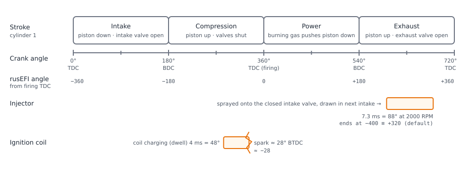
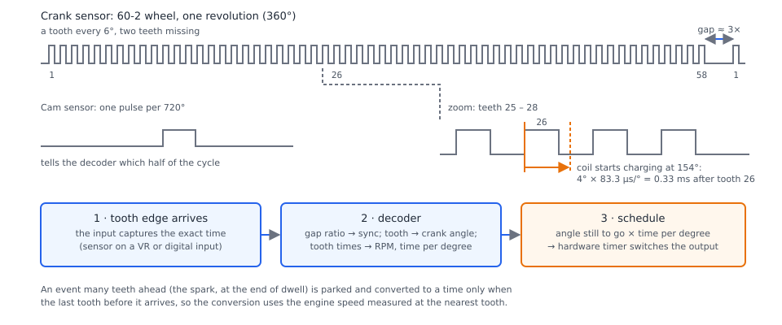

# How EFI works

:material-circle:{ .level-basic } Basic → :material-circle:{ .level-advanced } Advanced

> **In one sentence:** an electronic fuel injection (EFI) computer measures how much air the engine is
> taking in and where the crankshaft is, works out how much fuel to spray and when to fire the spark,
> and switches the injectors and coils at exactly the right crank angle — hundreds of times a second.

## Overview

:material-circle:{ .level-basic } Basic

An engine makes power by burning a mixture of air and fuel. The **engine control unit (ECU)** is the
computer that makes sure the mixture is right and that it is lit at the right moment. It has three jobs:

1. **Measure** — read sensors: engine position and speed, how much air is coming in, temperatures,
   the exhaust mixture, battery voltage.
2. **Decide** — turn those readings into numbers: how many milligrams of fuel each cylinder needs,
   how long to hold each injector open, how many degrees before the top of the stroke to fire the spark.
3. **Drive** — switch the injectors, ignition coils and other outputs at the right moment.

This chapter explains each step the way rusEFI does it, so that the tables and settings in the rest of
the manual make sense. It needs no prior knowledge. The last sections (*Following one engine cycle*,
*Worked examples*) go deeper and can be skipped on a first read.

!!! danger "Fuel and spark can destroy an engine"
    Too little fuel (a lean mixture) or a spark that fires too early (too much advance) can melt a
    piston in seconds under load. Nothing in this chapter asks you to change a setting, but every later
    chapter does: read [Read this first — safety and disclaimer](../safety.md) before you start.

## The four-stroke cycle

:material-circle:{ .level-basic } Basic

Almost every car and motorcycle engine works on the **four-stroke cycle**. A piston moves up and down
in each cylinder, turning the crankshaft. One complete cycle takes **two crankshaft revolutions — 720°**:

| Stroke | Piston | Valves | What happens |
|---|---|---|---|
| Intake | down | intake open | air (and fuel) is drawn into the cylinder |
| Compression | up | both shut | the mixture is squeezed |
| Power | down | both shut | the spark lights the mixture; the burning gas pushes the piston down |
| Exhaust | up | exhaust open | the burnt gas is pushed out |

The top of the piston's travel is **top dead centre (TDC)**, the bottom **bottom dead centre (BDC)**.
Each cylinder passes TDC twice per cycle: once at the end of compression (the **firing TDC**) and once
between exhaust and intake. Spark timing is quoted in **degrees before TDC (BTDC)**: "28° of advance"
means the spark fires when the crank is still 28° short of firing TDC, because the mixture takes a
little time to burn and should reach peak pressure just after TDC.

<figure markdown>
  
  <figcaption>Figure 1 — One cycle of cylinder 1 at 2000 RPM. Both the spark and the injection are tied
  to crank angle. The lower axis shows how rusEFI numbers angles: degrees from that cylinder's firing
  TDC, negative before it.</figcaption>
</figure>

Everything the ECU does is tied to this cycle, which is why it measures **crank angle**, not just time:

- The **spark** must happen at a precise angle before firing TDC. At 6000 RPM the crank turns 36° in
  one millisecond, so a timing error of a fraction of a millisecond is several degrees.
- The **coil** must be charged for a few milliseconds before it fires (the **dwell**), so charging
  starts at an angle earlier still.
- The **injection** must be finished (or at least placed) at a sensible point in the cycle. With port
  injection, rusEFI's factory setting ends the injection 400° before firing TDC — during the exhaust
  stroke, onto the closed intake valve — so the fuel is waiting when the valve opens on the next intake
  stroke.
<!-- src: firmware/integration/rusefi_config.txt (injectionPhase help: angles relative to compression TDC, negative before); firmware/controllers/algo/defaults/defaults.h (PORT_INJECTION_OFFSET); firmware/controllers/algo/defaults/default_fuel.cpp (setDefaultFuel: injectionPhase); firmware/controllers/algo/rusefi_enums.h (InjectionTimingMode, End = 0) -->

A multi-cylinder engine runs the same cycle in every cylinder, offset by the **firing order**. You
wire each injector and coil output to its cylinder number and tell rusEFI the firing order
(**Setup ▸ Vehicle Information ▸ Firing order** `firingOrder`); rusEFI works out the order of events.
<!-- src: firmware/tunerstudio/tunerstudio.template.ini (engineChars dialog firingOrder, injectorOutputSettings "rusEFI handles firing order"); firmware/controllers/math/engine_math.cpp (prepareOutputSignals) -->

## What the ECU measures and what it drives

:material-circle:{ .level-basic } Basic

<figure markdown>
  
  <figcaption>Figure 2 — What the ECU measures, decides and drives. Orange is what is driven; green is
  the lambda sensor, which measures the result of the fuelling and closes the fuel loop.</figcaption>
</figure>

**Inputs** — the sensors rusEFI reads:

| Sensor | Measures | Used for |
|---|---|---|
| Crank position (the **trigger**) | teeth on a wheel on the crankshaft | engine position and speed (RPM) — nothing is fired without it |
| Cam position | a tooth or pattern on the camshaft | which half of the 720° cycle the engine is in; cam angle for variable valve timing (VVT) |
| MAP — manifold absolute pressure | pressure in the intake manifold, kPa | how much air each cylinder takes in (speed density); engine load |
| MAF — mass air flow (if fitted) | mass of air entering, kg/h | air per cylinder in MAF mode |
| TPS / pedal | throttle and accelerator pedal position, % | load in Alpha-N mode, acceleration enrichment, electronic throttle |
| CLT — coolant temperature | engine temperature, °C | warm-up enrichment, cranking fuel, idle speed, fans |
| IAT — intake air temperature | air temperature, °C | air density, timing correction |
| Lambda (wideband O2) | air–fuel ratio in the exhaust | closed-loop fuel correction, logging while tuning |
| Battery voltage | supply voltage | injector dead time, coil dwell |
| Knock sensor | engine noise from detonation | knock retard |
<!-- src: firmware/controllers/sensors/sensor_type.h (SensorType list); firmware/controllers/algo/fuel_math.cpp (getCltFuelCorrection, getIatFuelCorrection); firmware/controllers/algo/fuel/injector_model.cpp (InjectorModelWithConfig::getDeadtime: BatteryVoltage); firmware/controllers/algo/ignition/ignition_state.cpp (getSparkDwell: dwellVoltageCorrection); firmware/init/sensor/init_lambda.cpp (analog and CAN wideband) -->

**Outputs** — what rusEFI drives: the **injectors** and **ignition coils** above all; an **electronic
throttle** or idle valve for idle air; the **main relay** and **fuel pump** relay; **cooling fans**;
**boost** and **VVT** solenoids; air conditioning; a tachometer and the check engine light.
<!-- src: firmware/controllers/actuators/idle_thread.cpp (IdleController); firmware/controllers/actuators/electronic_throttle.cpp (EtbController); firmware/controllers/actuators/main_relay.cpp (MainRelayController); firmware/controllers/modules/fuel_pump/fuel_pump.cpp (FuelPumpController); firmware/controllers/modules/fan_control/fan_control.cpp (FanController); firmware/controllers/actuators/boost_control.cpp (BoostController); firmware/controllers/actuators/vvt.cpp (VvtController); firmware/controllers/modules/tachometer/tachometer.cpp (TachometerModule) -->

On a **Proteus**, for example, these land on 12 ignition outputs (**Ign 1–12**), 16 low-side outputs
(**Lowside 1–16**, the first ones intended for injectors), 4 high-side outputs, two H-bridges for
electronic throttles, two VR crank/cam inputs plus digital trigger inputs, and analog inputs for the
sensors.
<!-- src: firmware/config/boards/proteus/connectors/black35.yaml (Ign, Lowside, Injector 1..9 functions); firmware/config/boards/proteus/connectors/black23.yaml (ETB 1/2, Highside); firmware/config/boards/proteus/connectors/white35.yaml (VR 1/VR 2, Digital, Analog Volt / Analog Temp inputs) -->

## How much air is the engine taking in?

:material-circle:{ .level-basic } Basic → :material-circle:{ .level-intermediate } Intermediate

The right amount of fuel depends on the amount of **air** — petrol burns completely at about 14.7 g of
air per gram of fuel. So the first thing rusEFI works out, for every cylinder and every cycle, is the
**air mass per cylinder**, in grams. How it does that is the **Fuel strategy** `fuelAlgorithm`
(**Setup ▸ Vehicle Information**). There are four:
<!-- src: firmware/tunerstudio/tunerstudio.template.ini (fuelStrategyPanel "Fuel strategy" fuelAlgorithm, engine_load_mode_e_list); firmware/controllers/algo/fuel_math.cpp (getAirmassModel) -->

| Fuel strategy (TunerStudio) | How the air is worked out | Good for |
|---|---|---|
| **Speed Density** (the default) | From MAP and charge temperature with the ideal gas law, times displacement, times the **VE** table | most engines, turbo or not |
| **MAF Air Charge** | From the MAF sensor's flow divided by engine speed; the VE table then acts as a correction | engines with a MAF |
| **Alpha-N** | The VE table, looked up by throttle position and RPM, gives the filling relative to standard air (20 °C, 101.3 kPa), optionally corrected for IAT | individual throttle bodies, where MAP is unsteady |
| **Lua** | A Lua script supplies the air mass | special cases |
<!-- src: firmware/controllers/algo/airmass/speed_density_airmass.cpp (SpeedDensityAirmass::getAirmass); firmware/controllers/algo/airmass/speed_density_base.cpp (idealGasLaw, getAirmassImpl); firmware/controllers/algo/airmass/maf_airmass.cpp (MafAirmass::getAirmassImpl); firmware/controllers/algo/airmass/alphan_airmass.cpp (AlphaNAirmass::getAirmass, alphaNUseIat); firmware/controllers/algo/defaults/default_base_engine.cpp (fuelAlgorithm LM_SPEED_DENSITY) -->

**Volumetric efficiency (VE)** is how well the cylinder fills compared with an ideal one: 100 % means
the cylinder holds its whole displacement of air at the pressure and temperature in the manifold. Real
engines are below 100 % at low speed and can exceed it where the intake and cam are tuned. The **VE**
table (**Fuel ▸ VE**) gives VE against RPM and load, and tuning it is most of fuel tuning.
<!-- src: firmware/controllers/algo/airmass/airmass.cpp (AirmassVeModelBase::getVe); firmware/integration/rusefi_config.txt (veTable, veLoadBins) -->

In speed density, the air mass per cylinder is:

> air mass = VE × displacement × MAP ÷ (Rair × charge temperature) ÷ number of cylinders

with Rair = 0.28705 J/(g·K). The **charge temperature** is an estimate of the air
temperature at the valve, blended from IAT and CLT (**Fuel ▸ Fuel Corrections ▸ Charge temperature
estimation**). Because temperature is already in the formula, the **IAT multiplier** curve defaults
to a flat 1.0.
<!-- src: firmware/controllers/algo/airmass/speed_density_base.cpp (AIR_R, SpeedDensityBase::getAirmassImpl); firmware/controllers/math/speed_density.cpp (IFuelComputer::getTCharge, getTChargeCoefficient); firmware/controllers/algo/engine_configuration.cpp (initTemperatureCurve IAT_FUEL_CORRECTION_CURVE, 1) -->

The result is also rusEFI's **engine load**: in speed density the load axis of the VE, target and
ignition tables is MAP (kPa); in Alpha-N it is TPS (%); in MAF mode it is cylinder filling (% of a
standard charge). Each table's load axis can be overridden in advanced settings.
<!-- src: firmware/controllers/algo/fuel_math.cpp (getBaseFuelMass: fuelingLoad, ignitionLoad); firmware/controllers/algo/fuel/fuel_computer.cpp (IFuelComputer::getLoadOverride); firmware/integration/rusefi_config.txt (veOverrideMode, afrOverrideMode, ignOverrideMode) -->

## From air to injector pulse width

:material-circle:{ .level-basic } Basic → :material-circle:{ .level-intermediate } Intermediate

<figure markdown>
  
  <figcaption>Figure 3 — rusEFI's fuel calculation, from air mass to the time the injector is held
  open. Each box is a table or setting in TunerStudio, covered in later chapters.</figcaption>
</figure>

**Target mixture.** The mixture is described by **lambda (λ)**: 1.0 is the chemically correct
(**stoichiometric**) ratio, below 1.0 is rich (extra fuel), above is lean. rusEFI looks up the **Target
lambda** table (**Fuel ▸ Target lambda**, or **Target AFR** if **Lambda display** is set to AFR) by RPM
and load, and divides the air mass by **Stoichiometric ratio** `stoichRatioPrimary` (14.7 for petrol)
times that target. The result is the **base fuel mass** in milligrams.
<!-- src: firmware/controllers/algo/fuel/fuel_computer.cpp (FuelComputerBase::getCycleFuel, getTargetLambda, getStoichiometricRatio); firmware/tunerstudio/tunerstudio.template.ini (lambdaTableDialog, afrTableDialog, fuelParams) -->

**Corrections.** The base fuel is then multiplied by the running corrections: **Warmup enrichment**
(by coolant temperature — the default adds 12 % at 20 °C and nothing above 80 °C), the **IAT
multiplier**, **After-start enrichment** (extra fuel for the first revolutions after starting),
barometric correction, and launch or anti-lag adders where used. While the engine is **cranking**
(below **Cranking RPM**, default 550 RPM) a separate cranking fuel calculation replaces all of this.
<!-- src: firmware/controllers/algo/fuel_math.cpp (getRunningFuel, getCrankingFuel3, getPostCrankingFuelCorrection, getBaroCorrection); firmware/controllers/algo/defaults/default_fuel.cpp (setDefaultWarmupFuelEnrichment); firmware/controllers/algo/defaults/default_cranking.cpp (cranking.rpm) -->

**Transient fuel.** When the throttle opens quickly, air arrives before the fuel film on the port walls
catches up. **Acceleration enrichment** (**Fuel ▸ AE / Transient fueling**) adds fuel, by one of four
methods (*MS Adder*, *Percent Adder*, *MAP Prediction*, *Lua*); **Wall wetting compensation** models
the fuel film on each injection.
<!-- src: firmware/controllers/algo/fuel_math.cpp (getInjectionMass: accelEnrichmentMode switch); firmware/controllers/engine_cycle/main_trigger_callback.cpp (wallFuel.adjust); firmware/tunerstudio/tunerstudio.template.ini (accelEnrichmentMode labels) -->

**Trims.** The fuel is then multiplied by the **short-term fuel trim** (closed loop, next section), the
**long-term fuel trim** and the per-cylinder **Fuel trim** tables.
<!-- src: firmware/controllers/algo/engine2.cpp (EngineState::periodicFastCallback: bankTrim, cylinderTrim, injectionMass) -->

**Injector model.** Finally the fuel mass becomes a time. **Injector flow** (**Fuel ▸ Injector Setup ▸
Injection configuration**, in cc/min or g/s) says how fast the injector flows; the factory value of
200 cc/min is only a placeholder. An injector also takes time to open, so rusEFI adds the **dead
time** from **Injector deadtime (BatV vs fuel pressure)** — a table by battery voltage and fuel
pressure, because a lower voltage opens the injector more slowly. Optionally the flow is corrected for
fuel pressure (**Injector flow compensation mode**), and small pulses can be corrected separately.
<!-- src: firmware/controllers/algo/fuel/injector_model.cpp (InjectorModelBase::prepare, getBaseDurationImpl, InjectorModelWithConfig::getInjectionDuration, getDeadtime, getInjectorFlowRatio); firmware/controllers/algo/fuel/fuel_computer.h (fuelDensity); firmware/controllers/algo/engine_configuration_defaults.h (INJECTOR_FLOW, INJECTOR_BATT_LAG_CURR) -->

> pulse width = fuel mass ÷ injector flow + dead time

How many pulses there are per cycle depends on the injection **Mode**: *Sequential* (one per cylinder
per cycle, timed for that cylinder), *Batch* (pairs of injectors, twice per cycle, half the fuel each
time), *Simultaneous* (all injectors together) or *Single Point*.
<!-- src: firmware/controllers/algo/fuel_math.cpp (getNumberOfInjections, getInjectionModeDurationMultiplier); firmware/integration/rusefi_config.txt (injectionMode help) -->

## Choosing the ignition timing

:material-circle:{ .level-basic } Basic → :material-circle:{ .level-intermediate } Intermediate

**Advance.** The base timing comes from the **Ignition Table** (**Ignition ▸ Ignition advance**), by
RPM and load. More advance gives more power up to a point; too much causes **knock** (detonation),
which damages engines. The factory table is a rough, conservative starting map — about 28° at
2000 RPM and 50 kPa — not a tune for your engine.
<!-- src: firmware/controllers/algo/ignition/ignition_state.cpp (getRunningAdvance, IgnitionState::getAdvance); firmware/controllers/algo/defaults/default_ignition.cpp (buildTimingMap, getInitialAdvance) -->

**Corrections.** rusEFI then adds the **CLT timing correction** and **IAT timing correction** tables
(the default retards 1° at 40 °C intake air, up to 3° at 60 °C), the idle timing controller, and
subtracts knock retard, the soft rev-limit retard and others; per-cylinder **Ignition trim** tables
come last. While cranking it uses the cranking timing (**Cranking ▸ Cranking settings**, default 6°)
and blends into the running table as the engine speeds up. **Timing Mode** `timingMode` set to *fixed*
locks the timing to one value, for checking with a timing light.
<!-- src: firmware/controllers/algo/ignition/ignition_state.cpp (getAdvanceCorrections, getCltTimingCorrection, getCrankingAdvance); firmware/controllers/algo/engine2.cpp (EngineState::periodicFastCallback: knock retard, getLimitingTimingRetard, getCylinderIgnitionTrim); firmware/controllers/algo/defaults/default_ignition.cpp (setDefaultIatTimingCorrection); firmware/controllers/algo/defaults/defaults.h (DEFAULT_CRANKING_ANGLE) -->

**Dwell.** The coil needs a set charging time, the **dwell**, in milliseconds (**Ignition ▸ Dwell**, by
RPM, with a battery-voltage correction; default 4 ms, and 6 ms while cranking). Because the dwell is a
time, its length in degrees grows with RPM: 4 ms is 48° at 2000 RPM but 144° at 6000 RPM. rusEFI
converts it to an angle and starts charging that many degrees before the spark.
<!-- src: firmware/controllers/algo/ignition/ignition_state.cpp (IgnitionState::getSparkDwell, updateDwell); firmware/controllers/algo/defaults/default_ignition.cpp (setConstantDwell 4); firmware/controllers/algo/defaults/defaults.h (DEFAULT_CRANKING_DWELL_MS); firmware/controllers/engine_cycle/spark_logic.cpp (prepareCylinderIgnitionSchedule: dwellStartAngle) -->

The ignition **Mode** is *Single Coil* (distributor), *Individual Coils*, *Wasted Spark* (one coil fires
two cylinders 360° apart) or *Two Distributors*. With *Individual Coils*, rusEFI fires in wasted-spark
fashion until it knows from the cam which half of the cycle the engine is in.
<!-- src: firmware/integration/rusefi_config.txt (ignitionMode help); firmware/controllers/math/engine_math.cpp (getCurrentIgnitionMode) -->

## Closed loop and open loop

:material-circle:{ .level-basic } Basic → :material-circle:{ .level-intermediate } Intermediate

Everything above is **open loop**: rusEFI calculates the fuel from its tables and trusts them. If the
VE table is wrong, the mixture is wrong. **Closed loop** adds feedback: a wideband lambda sensor
measures the actual mixture, and the **short-term fuel trim (STFT)** nudges the fuel up or down until
the measured lambda matches the target.
<!-- src: firmware/controllers/math/closed_loop_fuel.cpp (ShortTermFuelTrim::getCorrection) -->

In rusEFI, closed loop is **off by default** (**Fuel ▸ Short term fuel trim/Closed loop**, **Short term
fuel trim** `fuelClosedLoopCorrectionEnabled`). When on, it waits 60 s after starting and until the
coolant is above 60 °C, works only while the measured AFR is between 12 and 17, pauses after fuel
cuts and acceleration enrichment, keeps separate corrections for idle, overrun, power and cruise, and
is limited to ±5 % by default. The **long-term fuel trim** learns slowly from it; by default it learns
but does not apply its corrections.
<!-- src: firmware/controllers/algo/defaults/default_fuel.cpp (setDefaultStftSettings, setDefaultLtftSettings); firmware/controllers/math/closed_loop_fuel.cpp (getCorrectionState, getLearningState, computeStftBin) -->

!!! tip "Closed loop corrects a tune; it does not replace one"
    A ±5 % trim cannot fix a VE table that is 20 % out, and at full load you usually want a richer
    target than the trim can safely chase. Tune the VE table first; use closed loop to hold the
    mixture against small day-to-day changes.

## Where rusEFI fits

:material-circle:{ .level-basic } Basic

**rusEFI** is open-source ECU firmware, free software under the GNU General Public License version 3
with additional terms (see [Read this first](../safety.md)). It runs on official rusEFI boards such as
the **Proteus**, the reference board in this manual. You set it up and tune it with **TunerStudio**,
which reads rusEFI's own description of every setting, table and gauge; the **rusEFI console** looks
after the ECU itself (firmware, recovery, logs, diagnostics). The chapter *Your two tools* explains
which tool does what.
<!-- src: license.txt (GPL v3, additional terms); firmware/config/boards/proteus/board_configuration.cpp (Proteus board); firmware/tunerstudio/tunerstudio.template.ini (TunerStudio project definition); firmware/console/binary/tunerstudio.cpp (TunerStudio protocol); java_console/ (rusEFI console) -->

## Following one engine cycle

:material-circle:{ .level-intermediate } Intermediate → :material-circle:{ .level-advanced } Advanced

rusEFI splits its work in two. The **calculations** — air, fuel, timing, dwell, corrections — run 200
times a second regardless of engine position. The **events** — open this injector, start charging that
coil, fire it — are tied to crank teeth. Here is what happens, step by step:
<!-- src: firmware/controllers/core/main_loop.h (FAST_CALLBACK_RATE); firmware/controllers/algo/engine.cpp (Engine::periodicFastCallback); firmware/controllers/algo/engine2.cpp (EngineState::periodicFastCallback) -->

<figure markdown>
  
  <figcaption>Figure 4 — From trigger teeth to an output switched at the right angle.</figcaption>
</figure>

1. **A tooth arrives.** Each edge from the crank sensor is time-stamped by the input hardware.
2. **The decoder finds its place.** It knows the wheel's pattern from **Trigger type** (**Setup ▸
   Trigger**). On a 60-2 wheel the gap after the missing teeth is about three times a normal gap; the
   decoder recognises it by the ratio of successive gaps and from then on knows which tooth is which.
   The cam signal adds which half of the 720° cycle it is. Tooth times give RPM and the time per degree.
   <!-- src: firmware/controllers/trigger/trigger_central.cpp (TriggerCentral::handleShaftSignal); firmware/controllers/trigger/trigger_decoder.cpp (decodeTriggerEvent: gap ratio synchronisation); firmware/controllers/engine_cycle/rpm_calculator.cpp (oneDegreeUs) -->
3. **Events are scheduled.** On each tooth, rusEFI checks which events fall before the next tooth and
   converts the angle still to go into a time: angle × time per degree. A hardware timer then switches
   the output. Events further ahead, such as the spark at the end of a long dwell, are parked and
   converted only when the last tooth before them arrives, so they use a fresh engine speed.
   <!-- src: firmware/controllers/engine_cycle/main_trigger_callback.cpp (mainTriggerCallback); firmware/controllers/engine_cycle/rpm_calculator.cpp (scheduleByAngle); firmware/controllers/system/timer/trigger_scheduler.cpp (TriggerScheduler::scheduleOrQueue, scheduleEventsUntilNextTriggerTooth); firmware/controllers/engine_cycle/spark_logic.cpp (onTriggerEventSparkLogic) -->
4. **The injector opens at its angle** (from the **Injection Timing** table, ending, starting or centred
   on that angle) and closes after the pulse width, by time.
   <!-- src: firmware/controllers/engine_cycle/fuel_schedule.cpp (getInjectionAngleCorrection, InjectionEvent::update); firmware/controllers/algo/fuel_math.cpp (getInjectionOffset) -->
5. **The coil charges and fires.** It starts charging at spark angle minus dwell angle and fires at the
   spark angle. If the fire event were somehow missed, rusEFI fires the coil anyway at 1.5 × the dwell
   to protect it.
   <!-- src: firmware/controllers/engine_cycle/spark_logic.cpp (prepareCylinderIgnitionSchedule, overdwell 1.5f) -->

Without a valid trigger signal there is no position and no RPM, so nothing fires. That makes the
trigger the first thing to get right on a new engine — see the Trigger chapter.

## Worked examples

:material-circle:{ .level-intermediate } Intermediate

### Example 1 — fuel for a 2.0 L four-cylinder at cruise

Speed density, **Displacement** 2.0 L, 4 cylinders, at 2000 RPM, MAP 50 kPa, charge temperature 30 °C,
VE 80 %, target lambda 1.00, warm engine (no corrections), factory injector (200 cc/min, factory dead
time), 14 V, sequential:

| Step | Calculation | Result |
|---|---|---|
| Air mass | 0.80 × 2.0 × 50 ÷ (0.28705 × 303.15) ÷ 4 | 0.230 g per cylinder |
| Fuel mass | 0.230 ÷ (14.7 × 1.00) | 15.6 mg |
| Injector flow | 200 cc/min × 0.72 g/cc ÷ 60 | 2.4 g/s |
| Open time | 15.6 mg ÷ 2.4 g/s | 6.5 ms |
| Dead time | default table at 14 V, 300 kPa reference | 0.82 ms |
| **Pulse width** | 6.5 + 0.82 | **7.3 ms** |
| Duty | 7.3 ms of a 60 ms cycle | 12 % |
<!-- src: firmware/controllers/algo/airmass/speed_density_base.cpp (idealGasLaw, AIR_R); firmware/controllers/algo/fuel/fuel_computer.h (fuelDensity 0.72); firmware/controllers/algo/engine_configuration_defaults.h (INJECTOR_FLOW, INJECTOR_BATT_LAG_CURR, FUEL_REFERENCE_PRESSURE); firmware/controllers/algo/fuel_math.cpp (getInjectorDutyCycle) -->

At 2000 RPM one degree takes 83.3 µs, so 7.3 ms is 88° of crank rotation — the injection in Figure 1.

### Example 2 — the same engine at full power

Now 6000 RPM, MAP 100 kPa, charge 35 °C, VE 95 %, target lambda 0.85 (rich, for safety at full load):
air 0.537 g, fuel 43.0 mg, pulse 17.9 + 0.82 = **18.7 ms**. A cycle at 6000 RPM lasts only 20 ms, so
the injector is open **94 %** of the time. That is the injector's limit: rusEFI cuts fuel if duty stays
above **Sustained injector duty cycle limit** (default 96 %) for 0.5 s, or ever exceeds 110 %. This
engine needs bigger injectors — which is why **Injector flow** must be set to your real injectors.
<!-- src: firmware/controllers/limp_manager.cpp (injector duty cycle cut: maxInjectorDutyInstant, maxInjectorDutySustained); firmware/controllers/algo/defaults/default_fuel.cpp (maxInjectorDutyInstant 110, maxInjectorDutySustained 96, maxInjectorDutySustainedTimeout 0.5) -->

### Example 3 — dwell in degrees

Dwell 4 ms, spark 28° BTDC. At 2000 RPM the dwell is 48°, so charging starts at 76° BTDC. At 6000 RPM
(27.8 µs per degree) the same 4 ms is 144°, so charging starts at 172° BTDC — the coil is charging for
a large part of each revolution, which is why wasted-spark and distributor systems may need less dwell
at high RPM.
<!-- src: firmware/controllers/algo/ignition/ignition_state.cpp (IgnitionState::updateDwell: dwellDurationAngle); firmware/integration/rusefi_config.txt (sparkDwellRpmBins help) -->

## Pitfalls

:material-circle:{ .level-basic } Basic → :material-circle:{ .level-intermediate } Intermediate

| Misconception | What actually happens in rusEFI |
|---|---|
| "The ECU measures fuel." | It measures (or estimates) air and calculates fuel. Wrong air (bad VE, MAP or temperature) means wrong fuel. |
| "Closed loop will sort the mixture out." | It is off by default and limited to ±5 %; it corrects a reasonable tune, not a wrong one. |
| "The injector size in the factory tune is fine." | 200 cc/min is a placeholder; every pulse width depends on the real flow and dead time. |
| "More advance is more power." | Only up to the point of best torque; beyond it, knock and damage. |
| "Dwell is an angle." | Dwell is a time; its angle grows with RPM. |
| "IAT correction should lean the mixture when hot." | In speed density the gas law already accounts for air temperature; the IAT multiplier is flat by default. |
| "The engine will run without a cam sensor in sequential mode." | It needs the cam (or another phase source) to know which half of the cycle it is in; until then coils fire as wasted spark. |
<!-- src: firmware/controllers/algo/defaults/default_fuel.cpp (setDefaultStftSettings, INJECTOR_FLOW via setDefaultFuel); firmware/controllers/algo/engine_configuration.cpp (initTemperatureCurve IAT_FUEL_CORRECTION_CURVE); firmware/controllers/math/engine_math.cpp (getCurrentIgnitionMode) -->

## Related

- Your two tools — TunerStudio and the rusEFI console
- Trigger — crank and cam sensors, trigger types
- Fuel — VE table, target lambda, injector settings and dead time
- Ignition — advance table, dwell, ignition modes
- Cranking and warm-up — cranking fuel, after-start and warm-up enrichment
- Acceleration enrichment and wall wetting
- Closed-loop fuel and long-term fuel trims
- Knock control
- [Electronic throttle](../part3/electronic-throttle.md)
