# Installing the software

:material-circle:{ .level-basic } Basic

> **In one sentence:** you install TunerStudio MS to set up and tune the engine, MegaLogViewer HD to
> read logs, and the rusEFI bundle for your board — the rusEFI console, firmware and drivers in one
> folder — to look after the ECU itself.

## Overview

:material-circle:{ .level-basic } Basic

Three pieces of software go on your computer before you connect an ECU:

| Software | Comes from | You use it for |
|---|---|---|
| **TunerStudio MS** | EFI Analytics | setting up and tuning the engine, dashboards, recording logs |
| **MegaLogViewer HD** | EFI Analytics | opening and analysing the logs |
| **rusEFI bundle** for your board | rusEFI | the rusEFI console (firmware updates, recovery, diagnostics), the firmware files, the Windows drivers |

TunerStudio and MegaLogViewer are made by EFI Analytics and work with many ECUs; rusEFI is one of
them. The rusEFI bundle is rusEFI's own: one zip file per board, rebuilt by rusEFI's build server.
This chapter installs all three on Windows and Linux, with notes for macOS. *Your two tools*
(earlier in Part I) explains which job each tool does; *Flashing firmware* and *First connection*,
which follow, use what you install here.

You need:

- a computer running Windows 10 or 11, or a desktop Linux (the examples use Debian/Ubuntu commands);
- an internet connection for the downloads, and afterwards for the rusEFI console's update check;
- permission to install software (administrator on Windows, `sudo` on Linux);
- the name of your board — this manual's examples use **Proteus F7**.

## Concepts

:material-circle:{ .level-basic } Basic

<figure markdown>
  
  <figcaption>Figure 1 — Where each piece comes from and what talks to the ECU. Blue is a download,
  green is the console's own update check, orange is a USB connection to the ECU.</figcaption>
</figure>

### Lite! and registered

TunerStudio MS and MegaLogViewer HD each come as **one installer**. Without a registration they run
as the free *Lite!* edition — the window title says **TunerStudio MS Lite!** or **MegaLogViewer HD
Lite!**. Entering a registration (bought from EFI Analytics) in the same program unlocks the rest of
its features after a restart; nothing is reinstalled. EFI Analytics' download page says so
(Figure 2), and MegaLogViewer's installer describes what its free edition covers (Figure 12). Which
features each edition has is EFI Analytics' to define; see their website.

### The rusEFI bundle

A **bundle** is a zip file named `rusefi_bundle_<board>.zip` — for a Proteus with an STM32F7,
`rusefi_bundle_proteus_f7.zip`. Inside is a single folder with everything rusEFI ships for that board:
the console, the firmware in the two forms the console flashes, the TunerStudio definition file
(`.ini`) that matches that firmware, the Windows drivers and some scripts. Nothing is installed in
the Windows sense: you unzip the folder and start the console from it.
<!-- src: firmware/bin/upload_bundle.sh (FULL_BUNDLE_FILE, UPDATE_BUNDLE_FILE names); firmware/bin/assemble_universal_bundle.sh (bundle folder layout, launchers copied to the bundle root) -->

The file `console/release.txt` inside the folder tells the console which board and which branch the
bundle is for (`platform=proteus_f7`, `release=development` for the latest development build). The
console uses it to find its own updates, so the folder must stay as it was unzipped.
<!-- src: java_console/shared_io/src/main/java/com/rusefi/core/io/BundleUtil.java (BRANCH_REF_FILE release.txt, parse: platform, release, nextRelease); java_console/shared_io/src/main/java/com/rusefi/core/io/BundleInfo.java (isMaster: development) -->

Bundles come in two kinds:

- **Snapshot** bundles are built from rusEFI's latest development code and published on the build
  server, `https://rusefi.com/build_server/`. Their `release.txt` says `release=development`.
- **Release** bundles belong to a named release branch. They update only within that branch, and
  when rusEFI marks a newer release the console asks *"A new version … is available! Would you like
  to update from … to … now?"*
<!-- src: README.md (build server link); java_console/shared_io/src/main/java/com/rusefi/core/io/BundleInfoStrategy.java (getDownloadUrl: snapshot vs lts branch URL, selectBranchName "Release selection" prompt); java_console/shared_io/src/main/java/com/rusefi/core/net/ConnectionAndMeta.java (BASE_URL_RELEASE, RUSEFI_WIKI_DOWNLOAD_PAGE) -->

### Java

TunerStudio, MegaLogViewer and the rusEFI console are all Java programs. On Linux and macOS the
TunerStudio and MegaLogViewer start scripts run whatever `java` is installed. The rusEFI bundle ships
no Java runtime, so the console needs one on every system, Windows included: its Windows launcher
asks for **Java 11 or newer** and, if it finds none, says *"Please visit https://rusefi.com/s/j/ for
Java (JRE)"*. Java 17 runs all three on Linux; it is the version used for this manual.
<!-- src: misc/console_launcher/rusefi_updater.xml (jre minVersion 11.0, jreNotFoundErr); misc/console_launcher/rusefi_updater.sh (exec java -jar rusefi_console.jar) -->

## Installing TunerStudio MS

:material-circle:{ .level-basic } Basic

Open the EFI Analytics downloads page, **www.tunerstudio.com ▸ Downloads**. It lists TunerStudio MS
and MegaLogViewer for each operating system; beta versions are on a separate *Beta Download Site*
linked from the page.

<figure markdown>
  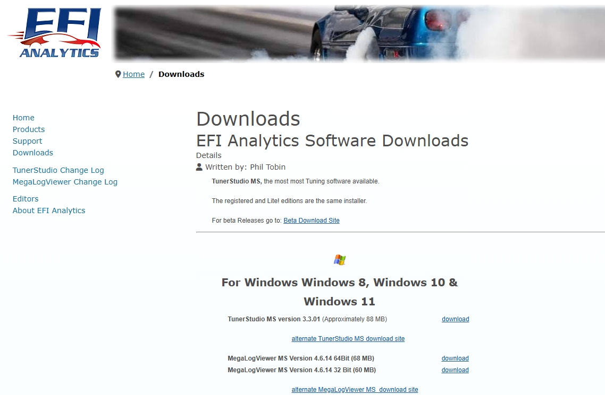
  <figcaption>Figure 2 — The EFI Analytics downloads page. Note the line <i>The registered and Lite!
  editions are the same installer</i>; the Windows downloads follow.</figcaption>
</figure>

=== "Windows"

    1. Under **For Windows**, click **download** next to **TunerStudio MS**, and run the downloaded
       installer.
    2. Windows asks whether to allow the app to make changes. Check that the verified publisher is
       **EFI Analytics, Inc**, then click **Yes**.

        <figure markdown>
          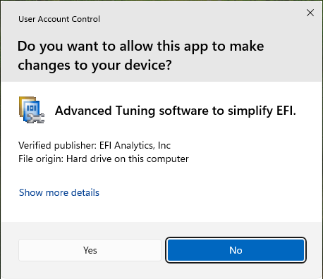{ width="360" }
          <figcaption>Figure 3 — The Windows permission prompt. The publisher must read EFI Analytics, Inc.</figcaption>
        </figure>

    3. **License Agreement**: read it, select **I accept the agreement**, **Next**.

        <figure markdown>
          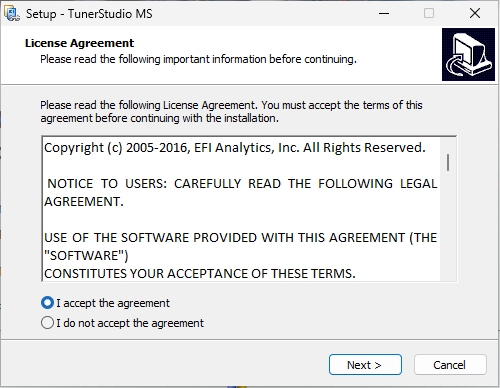{ width="420" }
          <figcaption>Figure 4 — The licence page.</figcaption>
        </figure>

    4. **Select Destination Location**: keep the default,
       `C:\Program Files (x86)\EFIAnalytics\TunerStudioMS`, unless you have a reason not to. The
       installer asks for at least 309 MB of free space. **Next**.

        <figure markdown>
          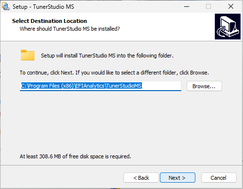{ width="420" }
          <figcaption>Figure 5 — The default install folder.</figcaption>
        </figure>

    5. **Select Start Menu Folder**: keep *EFI Analytics*, **Next**. **Select Additional Tasks**:
       leave **Create a desktop shortcut** ticked if you want one, **Next**.

        <figure markdown>
          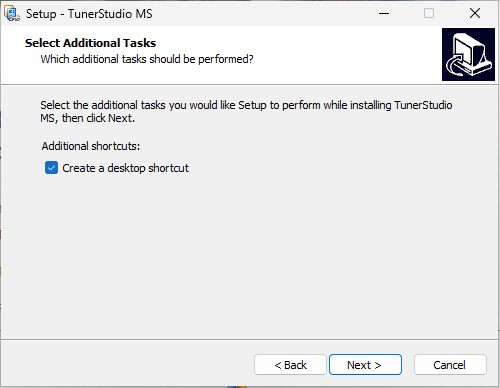{ width="420" }
          <figcaption>Figure 6 — The only optional task is the desktop shortcut.</figcaption>
        </figure>

    6. **Ready to Install** lists your choices. Click **Install** and wait for the files to copy.
    7. On the last page, leave **Launch TunerStudio MS** ticked and click **Finish**.

        <figure markdown>
          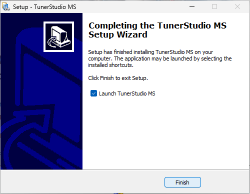{ width="420" }
          <figcaption>Figure 7 — Setup has finished.</figcaption>
        </figure>

=== "Linux"

    The Linux download is a `.tar.gz` archive — for version 3.3.01,
    `TunerStudioMS_v3.3.01.tar.gz`. It contains no Java runtime of its own: install one first.

    1. Install Java and check it:

        ```bash
        sudo apt install openjdk-17-jre
        java -version
        ```

    2. From the **Linux** section of the downloads page, download the TunerStudio MS archive.
    3. Unpack it in your home folder. This creates `~/TunerStudioMS`:

        ```bash
        tar xzf ~/Downloads/TunerStudioMS_v3.3.01.tar.gz -C ~
        ```

    4. Start TunerStudio:

        ```bash
        ~/TunerStudioMS/TunerStudio.sh
        ```

        The script must stay in the TunerStudio folder. To start TunerStudio by name, link it into
        a folder on your `PATH` rather than moving it, as the script itself suggests
        (`ln -s ~/TunerStudioMS/TunerStudio.sh ~/.local/bin/TunerStudio`).

    5. Give your user access to the serial ports — see *Drivers and permissions* below. TunerStudio's
       own `README.TXT` says the same.

=== "macOS"

    TunerStudio's `README.TXT` offers macOS users two ways: the macOS installer from the downloads
    page, or the same `.tar.gz` as Linux, started with `./TunerStudio.sh` from a terminal (the
    script detects macOS and loads its macOS serial driver). With the `.tar.gz`, install a Java
    runtime first. The macOS steps have not been checked for this manual.

### First start and registration

When TunerStudio starts unregistered, the title bar reads **TunerStudio MS Lite!** and the panel on
the right offers **Enter Registration**.

<figure markdown>
  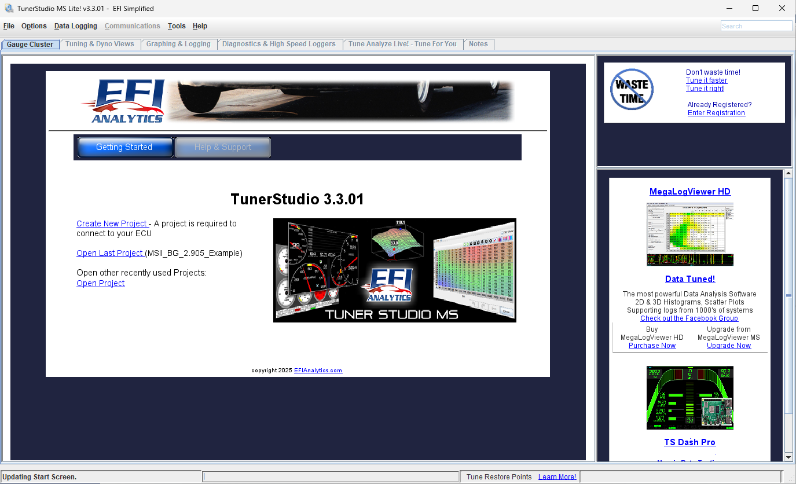
  <figcaption>Figure 8 — First start, unregistered: <b>TunerStudio MS Lite!</b> in the title bar,
  <b>Enter Registration</b> at the top right.</figcaption>
</figure>

If you have bought a registration:

1. Click **Enter Registration**. Fill in **Registered First Name**, **Registered Last Name**,
   **Registered eMail Address** and **Registration Key** exactly as EFI Analytics sent them — or
   choose **Paste Email** and paste the whole registration e-mail. Click **Ok**.

    <figure markdown>
      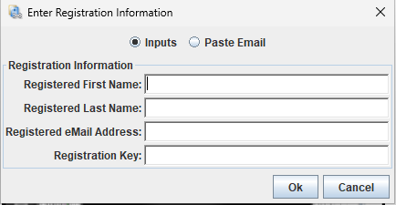{ width="400" }
      <figcaption>Figure 9 — The registration dialog. Type the details or paste the e-mail.</figcaption>
    </figure>

2. TunerStudio says all features will be enabled after a restart. Click **Yes**.

    <figure markdown>
      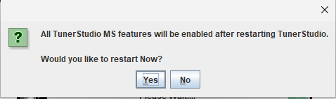{ width="420" }
      <figcaption>Figure 10 — Restart to apply the registration.</figcaption>
    </figure>

3. After the restart the title bar reads **TunerStudio MS** without *Lite!*.

    <figure markdown>
      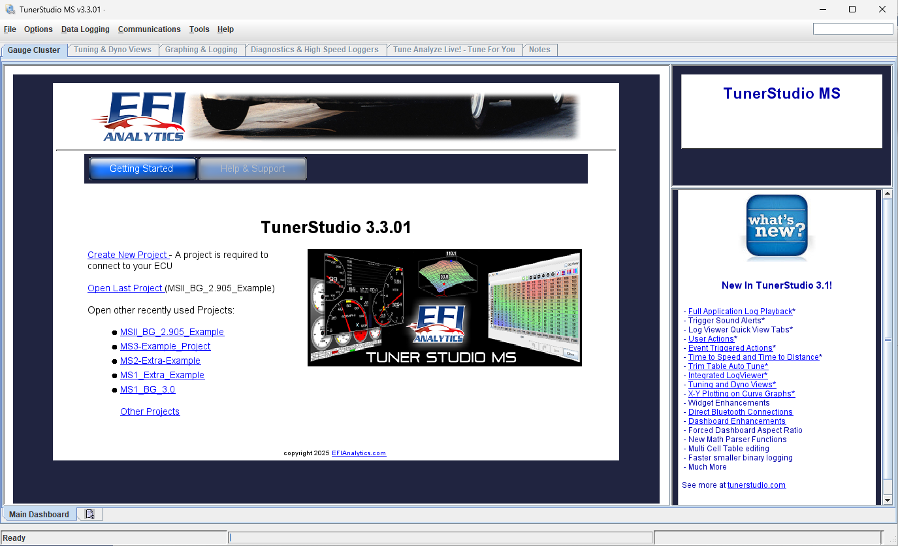
      <figcaption>Figure 11 — Registered: <i>Lite!</i> has gone from the title bar.</figcaption>
    </figure>

Do not create a project yet: *First connection* does that with the ECU plugged in.

## Installing MegaLogViewer HD

:material-circle:{ .level-basic } Basic

MegaLogViewer HD is on the same downloads page (Figure 2). It opens the logs TunerStudio records;
later chapters use it to read them.

=== "Windows"

    1. Under **For Windows**, download **MegaLogViewer** — the **64Bit** version for any current
       Windows; the 32 Bit version only for a 32-bit Windows.
    2. Run the installer. The pages are the same as TunerStudio's: the permission prompt (publisher
       **EFI Analytics, Inc**), the licence, then an **Information** page that describes the free
       and registered editions. **Next**.

        <figure markdown>
          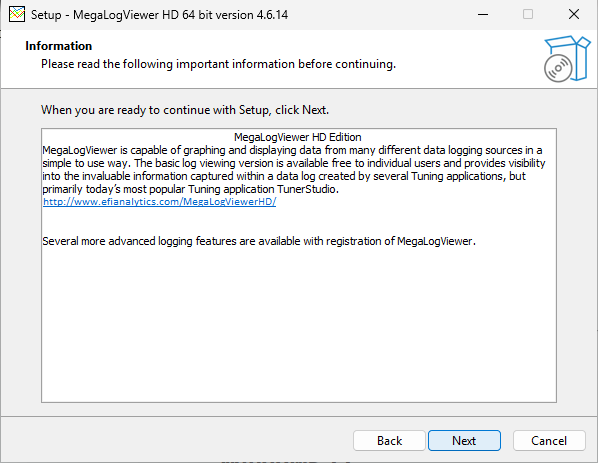{ width="460" }
          <figcaption>Figure 12 — The Information page: basic log viewing is free, more features come
          with registration.</figcaption>
        </figure>

    3. Keep the default folder and Start Menu folder, choose whether you want a desktop shortcut,
       and check the **Ready to Install** page: the program goes to
       `C:\Program Files\EFIAnalytics\MegaLogViewerHD`. Click **Install**.

        <figure markdown>
          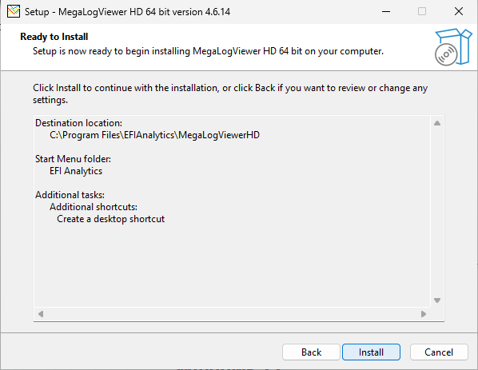{ width="460" }
          <figcaption>Figure 13 — MegaLogViewer's choices, ready to install.</figcaption>
        </figure>

    4. Click **Finish** with **Launch MegaLogViewerHD** ticked.

=== "Linux"

    1. From the **Linux** section of the downloads page, download MegaLogViewer HD and unpack it in
       your home folder, as for TunerStudio. This manual's copy lives in `~/MegaLogViewerHD`.
    2. Start it with the script in that folder:

        ```bash
        ~/MegaLogViewerHD/MegaLogViewer.sh
        ```

        The script uses a Java runtime shipped in a `runtime` folder next to it if the download has
        one, and the system's `java` otherwise. The copy used for this manual had none and ran on
        Java 17.

=== "macOS"

    Download the macOS version from the same page. The macOS steps have not been checked for this
    manual.

### First start, update and registration

1. MegaLogViewer checks for a newer version. If it offers one, click
   **Complete Update**; it downloads and installs the update itself. (The installer used here was
   4.6.14; the first start offered 4.6.16.)

    <figure markdown>
      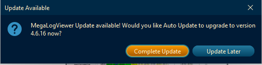{ width="460" }
      <figcaption>Figure 14 — The update offer on first start.</figcaption>
    </figure>

2. Unregistered, the title bar reads **MegaLogViewer HD Lite!** and there is a **Purchase
   Registration** tab, with **Enter Registration** at the top right.

    <figure markdown>
      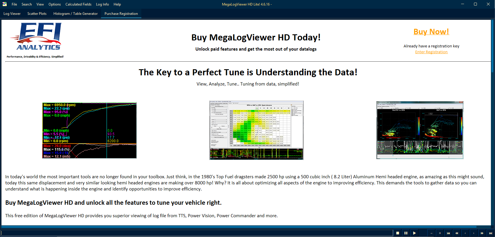
      <figcaption>Figure 15 — MegaLogViewer HD Lite!: tabs <b>Log Viewer</b>, <b>Scatter Plots</b>,
      <b>Histogram / Table Generator</b> and <b>Purchase Registration</b>.</figcaption>
    </figure>

3. To register, click **Enter Registration**. MegaLogViewer offers three ways:
    - **One Time Code**: type your **Registered eMail Address**, click **Email OTC**, and type the
      code from the e-mail it sends into the boxes;
    - **Manually Enter**: the same four fields as TunerStudio;
    - **Paste Email**: paste your registration e-mail.

    <figure markdown>
      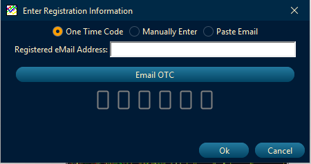{ width="400" }
      <figcaption>Figure 16 — Registering with a one-time code sent to your registered e-mail address.</figcaption>
    </figure>

    <figure markdown>
      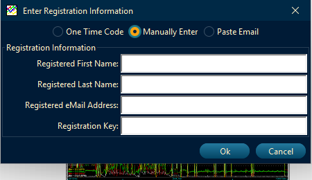{ width="400" }
      <figcaption>Figure 17 — Registering by typing the details.</figcaption>
    </figure>

    Click **Ok**, then **Yes** to restart.

4. MegaLogViewer asks which look you want. **Use New Look** or **Classic Mode** — this is only
   appearance, and you can change it later under **View ▸ Look and Feel ▸ Classic Mode**. (In the
   install shown here the question came after the registration restart.)

    <figure markdown>
      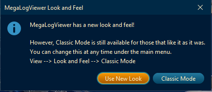{ width="420" }
      <figcaption>Figure 18 — The look-and-feel choice.</figcaption>
    </figure>

5. Registered, the title bar reads **MegaLogViewer HD** without *Lite!*, the **Purchase
   Registration** tab has gone and an **Ignition Log Viewer** tab has appeared.

    <figure markdown>
      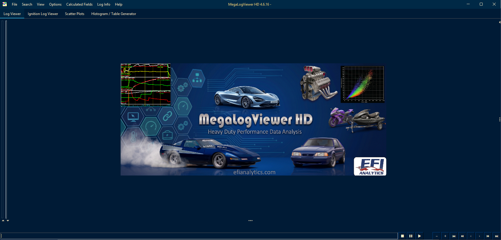
      <figcaption>Figure 19 — Registered MegaLogViewer HD in the new look.</figcaption>
    </figure>

## Installing the rusEFI bundle

:material-circle:{ .level-basic } Basic

### 1 · Download the bundle for your board

The bundle must be the one for **your board**: its firmware and `.ini` are built for that board
alone. rusEFI's download page, `https://wiki.rusefi.com/Download/`, points to the bundles; the
latest snapshot bundles are on the build server, `https://rusefi.com/build_server/`, named
`rusefi_bundle_<board>.zip`. For the Proteus F7 used in this manual, that is
`rusefi_bundle_proteus_f7.zip`.
<!-- src: firmware/readme.md (end users use pre-built firmware, wiki Download page); README.md (build server); firmware/bin/upload_bundle.sh (FULL_BUNDLE_FILE rusefi_bundle_<board>.zip) -->

You download a bundle **once**. After that the console keeps itself and the bundle's firmware files
up to date (section 5).

### 2 · Unzip it

The zip holds one folder, named after the bundle — `rusefi.snapshot.proteus_f7` for the Proteus F7
snapshot. Unzip it somewhere **your own user can write to**, such as your Documents or home folder:
the console downloads its updates into this folder. Do not move or rename files inside it; if
`console/release.txt` is missing, the updater stops with *"Please re-extract the bundle without
moving or renaming files inside it."*
<!-- src: firmware/bin/assemble_universal_bundle.sh (zip of rusefi.snapshot.<platform> folder); java_console/autoupdate/src/main/java/com/rusefi/autoupdate/Autoupdate.java (autoupdate: missing release.txt message, unzipAutoUpdate into the bundle folder) -->

=== "Windows"

    In File Explorer, right-click the zip, choose **Extract All…**, and extract it to, for example,
    `Documents\rusEFI`.

=== "Linux"

    ```bash
    mkdir -p ~/rusefi
    unzip ~/Downloads/rusefi_bundle_proteus_f7.zip -d ~/rusefi
    ```

=== "macOS"

    Double-click the zip in Finder, then move the folder it creates to somewhere in your home folder.

### What is in the folder

| In the bundle folder | What it is |
|---|---|
| `rusefi_updater.exe` | Windows launcher: starts the rusEFI console |
| `rusefi_updater.sh` | the same launcher for Linux and macOS |
| `console/rusefi_console.jar` | the rusEFI console itself |
| `console/release.txt` | which board and branch this bundle is; the console's updates depend on it |
| `rusefi_<branch>_<date>_<board>_….bin` | the firmware, as the image flashed in DFU mode |
| `rusefi_<branch>_<date>_<board>_…_update.srec` | the same firmware, as flashed through the rusEFI bootloader (OpenBLT) |
| `rusefi_<board>.ini` | the TunerStudio definition for this firmware (e.g. `rusefi_proteus_f7.ini`) |
| `drivers/silent_st_drivers2.exe` | Windows drivers for the ST USB devices (see *Drivers and permissions*) |
| `console/STM32_Programmer_CLI/` | ST's programmer, used by the console for DFU flashing on Windows |
| `console/rusefi_ts_plugin_launcher.jar` | rusEFI's TunerStudio plugin; the console copies it into TunerStudio's plugin folder when it updates |
| `console/rusefi_simulator.exe` | the rusEFI simulator for Windows (firmware running on the PC, no ECU) |
| `bin/` | command-line scripts, including `st.rules` for Linux |
| `readme.html` | links to the rusEFI source code and documentation |
<!-- src: firmware/bin/assemble_universal_bundle.sh (bundle contents); misc/console_launcher/rusefi_updater.xml (launcher runs console/rusefi_console.jar); java_console/shared_io/src/main/java/com/rusefi/core/FindFileHelper.java (firmware .bin for DFU, _update.srec, openblt bootloader file names); java_console/ecu_shared/src/main/java/com/rusefi/maintenance/DfuFlasher.java (STM32_Programmer_CLI on Windows, dfu-util on Linux); java_console/autoupdate/src/main/java/com/rusefi/autoupdate/TsPluginInstaller.java (installTsPlugin); java_console/shared_io/src/main/java/com/rusefi/ts/TsHelper.java (TS_ROOT .efiAnalytics) -->

The console keeps its own settings, downloaded updates and earlier firmware files in a `.rusEFI`
folder in your home folder (`C:\Users\<you>\.rusEFI` on Windows, `~/.rusEFI` on Linux).
<!-- src: java_console/shared_io/src/main/java/com/rusefi/core/FileUtil.java (RUSEFI_SETTINGS_FOLDER); java_console/autoupdate/src/main/java/com/rusefi/autoupdate/Autoupdate.java (userHomeSubDirectory updates); java_console/shared_io/src/main/java/com/rusefi/core/FindFileHelper.java (older-fw folder) -->

### 3 · Start the console

This is done in the rusEFI console.

=== "Windows"

    Double-click **`rusefi_updater.exe`** in the bundle folder. It needs Java 11 or newer (see
    *Java* above); without it, it shows *"Please visit https://rusefi.com/s/j/ for Java (JRE)"*.

=== "Linux"

    ```bash
    sh ~/rusefi/rusefi.snapshot.proteus_f7/rusefi_updater.sh
    ```

    Starting it with `sh` works even if your unzip tool dropped the file's execute permission.

=== "macOS"

    In Terminal: `sh <bundle folder>/rusefi_updater.sh`. The console runs on macOS, but its DFU
    flashing is available on Windows and Linux only (see *Flashing firmware*).
<!-- src: misc/console_launcher/rusefi_updater.xml (launch4j: chdir console, jre minVersion 11.0, jreNotFoundErr); misc/console_launcher/rusefi_updater.sh (Linux/macOS counterpart); java_console/ecu_shared/src/main/java/com/rusefi/maintenance/DfuFlasher.java (isDfuProgrammingSupported: Windows or Linux) -->

The console opens on its start screen and starts looking for an ECU. At the same time, in the
background, it checks for a newer bundle (section 5); if it installs one, it restarts itself.
<!-- src: java_console/ui/src/main/java/com/rusefi/Launcher.java (main: runSilentUpdate on a background thread, ConsoleUI.startUi); java_console/ui/src/main/java/com/rusefi/StartupFrame.java (softwareUpdateOutcome UPDATED: restartConsole) -->

!!! note "The Universal Updater banner"
    On Windows, a console started from an unzipped bundle may show a yellow banner: *"You're running
    rusEFI from an extracted bundle. Install Universal Updater for automatic console and ECU firmware
    updates."* The Universal Updater is a Windows installer that wraps a bundle, its own Java runtime
    and Start-menu launchers. This manual uses the unzipped board bundle; the banner can be closed
    with its **X**.
    <!-- src: java_console/ui/src/main/java/com/rusefi/ui/console/MainFrame.java (shouldAnnounceInstaller, showInstallerAnnouncementBanner); java_console/shared_io/src/main/resources/shared_io.properties (universal_updater_installer_url); misc/installer/readme.md (installer scope: bundle, JRE, launchers) -->

### 4 · Drivers and permissions

The ECU appears on your computer as a USB serial port (STMicroelectronics vendor ID `0483`, product
`5740`); when it is switched into its STM32 bootloader for flashing (*DFU mode*), it appears as a
different ST device. Windows needs ST's drivers for DFU mode; Linux needs no driver, but your user
needs permission to open the devices.
<!-- src: firmware/hw_layer/ports/stm32/serial_over_usb/usbcfg.cpp (device descriptor idVendor 0x0483, idProduct 0x5740); java_console/ecu_shared/src/main/java/com/rusefi/maintenance/DfuFlasher.java (STM32 bootloader driver check on Windows, 0483:df11 on Linux) -->

=== "Windows"

    This is done in the rusEFI console.

    1. Unplug the ECU from the vehicle harness. The console asks you to: its confirmation is titled
       *Please disconnect from vehicle*.
    2. On the console's start screen, open the **Connect** tab and click **Install Drivers**, next to
       **Open Device Manager** in the *Connection help* row (Windows only).
    3. Answer **Yes** to *"Do you really want to install ST drivers?"*, and **Yes** to the Windows
       permission prompt that follows.
    4. A window titled *Windows rusEFI ST Drivers* shows progress. The console unpacks
       `drivers/silent_st_drivers2.exe` and installs ST's **virtual COM port**, **ST-LINK** and
       **DFU** drivers silently.

    <!-- shot: img/windows/installing-console-drivers.png | rusEFI console start screen (Windows 11, no ECU connected) | start screen showing the Open Device Manager and Install Drivers buttons | The rusEFI console's start screen on Windows, with Install Drivers. -->

    <figure markdown>
      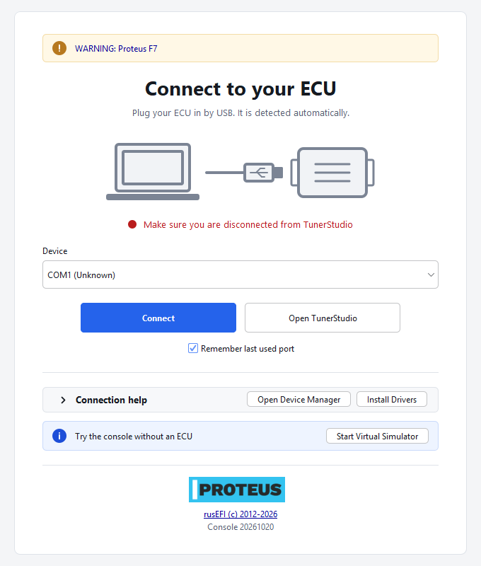
      <figcaption>Figure 20 — The rusEFI console's start screen on Windows, with Install Drivers.</figcaption>
    </figure>

    If you prefer, run `drivers\silent_st_drivers2.exe` yourself: it is a self-extracting archive
    that unpacks to `drivers\silent_st_drivers`, where `silent_install_windows8.bat` installs the
    three drivers on Windows 8 and later. If DFU flashing later reports *"Target device not
    found"*, the console suggests either the **Install Drivers** button or pointing Device Manager at
    `drivers/silent_st_drivers/DFU_Driver`.
    <!-- src: java_console/ui/src/main/java/com/rusefi/maintenance/DriverInstall.java (createButton, installDrivers: silent_st_drivers2.exe -y, Windows 7 / Windows 8 batch); java_console/ui/src/main/java/com/rusefi/StartupFrame.java (helpTools: Open Device Manager, Install Drivers on Windows); misc/install_st/make_package2.bat (archive content: ST-LINK, VCP, DFU drivers); misc/install_st/silent_st_drivers/silent_install_windows8.bat (installs VCP, ST-LINK, DFU); java_console/ecu_shared/src/main/java/com/rusefi/maintenance/DfuFlasher.java (Target device not found advice) -->

=== "Linux"

    1. **Serial port access.** Add yourself to the `dialout` group, which owns the serial ports on
       Debian and Ubuntu, then log out and back in:

        ```bash
        sudo usermod -a -G dialout $USER
        ```

        On other distributions the group can be named differently — `ls -l /dev/ttyACM0` with the
        ECU plugged in shows it. TunerStudio's `README.TXT` mentions the `uucp` and `lock` groups.

    2. **DFU access.** Copy the bundle's udev rule into place and reload the rules. It gives all users
       access to every ST USB device (vendor `0483`), including the bootloader:

        ```bash
        sudo cp ~/rusefi/rusefi.snapshot.proteus_f7/bin/st.rules /etc/udev/rules.d/
        sudo udevadm control --reload-rules
        ```

        Unplug the ECU and plug it in again for the rule to apply.

    3. **DFU tool.** On Linux the console flashes in DFU mode with `dfu-util`, and looks for the
       bootloader with `lsusb`. Install both:

        ```bash
        sudo apt install dfu-util usbutils
        ```
    <!-- src: firmware/setup_linux_environment.sh (usermod -a -G dialout); java_console/bin/st.rules (idVendor 0483 MODE 0666, put into /etc/udev/rules.d); java_console/ecu_shared/src/main/java/com/rusefi/maintenance/DfuFlasher.java (dfu-util on PATH, detectStm32DfuViaLsusb, udev rule advice for 0483:df11) -->

    !!! warning "ModemManager and the first few seconds"
        On Linux desktops that run **ModemManager**, it was seen to open a newly plugged-in ECU's port
        for a few seconds, probing it for a modem. During that time TunerStudio's **Test Port** (and any
        other program) can fail to connect. Wait a few seconds and try again. To stop it for good, tell
        ModemManager to ignore the ECU with a udev rule, for example
        `/etc/udev/rules.d/99-rusefi-mm.rules` containing
        `ATTRS{idVendor}=="0483", ATTRS{idProduct}=="5740", ENV{ID_MM_DEVICE_IGNORE}="1"`, then reload
        the rules and re-plug the ECU.

=== "macOS"

    The ECU's serial port needs no driver. DFU flashing from the console is not available on macOS.
    <!-- src: java_console/ecu_shared/src/main/java/com/rusefi/maintenance/DfuFlasher.java (isDfuProgrammingSupported) -->

### 5 · The console's auto-update

Each time the console starts, it asks the build server whether a newer bundle for **your board and
branch** exists — it compares the size and date of the server's file with the copy it downloaded
last time. If there is one, it downloads it into `.rusEFI/updates`, unpacks it over the bundle
folder (the console, the firmware files and the `.ini`; the drivers and scripts come only with the
full bundle), moves the older firmware files to `.rusEFI/older-fw`, and restarts itself.
<!-- src: firmware/bundle.mk (UPDATE_BUNDLE_FILES: firmware, bootloader, ini, console, and FULL_BUNDLE_CONTENT: drivers, bin); java_console/autoupdate/src/main/java/com/rusefi/autoupdate/Autoupdate.java (runSilentUpdate, performUpdate, downloadAutoupdateZipFileDetailed: hasExistingFile size and lastModified, applyUpdate: unzip into the bundle folder, extractConsoleJarAsPending); java_console/shared_io/src/main/resources/shared_io.properties (auto_update_root_url); java_console/shared_io/src/main/java/com/rusefi/core/FindFileHelper.java (findSrecFile move to older-fw); java_console/ui/src/main/java/com/rusefi/StartupFrame.java (restartConsole after UPDATED) -->

!!! note "The ECU is not updated automatically"
    Auto-update refreshes the files on your computer only. The firmware on the ECU changes only when
    you flash it — see *Flashing firmware*. After an update, the bundle's firmware and `.ini` can be
    newer than what the ECU is running.
    <!-- src: java_console/autoupdate/src/main/java/com/rusefi/autoupdate/Autoupdate.java (class comment: Update ECU is separate from the bundle update) -->

**To turn it off** — this is done in the rusEFI console. Open the **Device** tab and untick
**Auto-update Software**. The choice is saved in the console's preferences and applies from the
next start. With it off, the console still checks quietly and enables **Actions ▸ Update Software**
when a newer bundle is available, so you can update when it suits you.
<!-- src: java_console/ui/src/main/java/com/rusefi/DevicePane.java (autoUpdateBundle checkbox "Auto-update Software", PersistentConfiguration AUTO_UPDATE_BUNDLE); java_console/core_ui/src/main/java/com/rusefi/AutoupdateProperty.java (default true); java_console/ui/src/main/java/com/rusefi/ui/console/MainFrame.java (Actions menu, updateSoftwareItem); java_console/autoupdate/src/main/java/com/rusefi/autoupdate/Autoupdate.java (isAutoUpdateEnabled, runManualUpdate) -->

<!-- shot: img/console/installing-device-autoupdate.png | rusEFI console ▸ Device tab | ECU connected, Auto-update Software ticked (default) | The console's Device tab: Auto-update Software at the top. -->

To skip the check **once** — for example with no internet connection — switch **Caps Lock on**
before starting the console, and off again once it is running.
<!-- src: java_console/autoupdate/src/main/java/com/rusefi/autoupdate/Autoupdate.java (isSkipUpdater: Caps Lock, downloadAutoupdateZipFileDetailed SKIPPED) -->

## Examples

:material-circle:{ .level-basic } Basic

### Example 1 — Windows 11, Proteus F7

1. TunerStudio MS 3.3.01 and MegaLogViewer HD 4.6.14 (64Bit) from the EFI Analytics downloads page,
   default folders and a desktop shortcut for each; MegaLogViewer updated itself to 4.6.16 on first
   start. Both registered afterwards with **Enter Registration**. (This is the install the
   Windows figures in this chapter come from.)
2. For a Proteus F7: `rusefi_bundle_proteus_f7.zip` from the build server, extracted to
   `Documents\rusEFI`, which gives `Documents\rusEFI\rusefi.snapshot.proteus_f7`.
3. A Java runtime (11 or newer — 17 recommended above), then `rusefi_updater.exe` to start the console.
4. **Install Drivers** on the console's start screen, with the ECU unplugged from the vehicle.

### Example 2 — Ubuntu, Proteus F7

```bash
# Java for TunerStudio, MegaLogViewer and the console; DFU tools for the console
sudo apt install openjdk-17-jre dfu-util usbutils

# TunerStudio and MegaLogViewer, downloaded from the EFI Analytics site
tar xzf ~/Downloads/TunerStudioMS_v3.3.01.tar.gz -C ~

# the rusEFI bundle
mkdir -p ~/rusefi
unzip ~/Downloads/rusefi_bundle_proteus_f7.zip -d ~/rusefi

# permissions: serial ports and DFU (log out and in afterwards)
sudo usermod -a -G dialout $USER
sudo cp ~/rusefi/rusefi.snapshot.proteus_f7/bin/st.rules /etc/udev/rules.d/
sudo udevadm control --reload-rules

# start
~/TunerStudioMS/TunerStudio.sh &
sh ~/rusefi/rusefi.snapshot.proteus_f7/rusefi_updater.sh &
```

## Troubleshooting

:material-circle:{ .level-basic } Basic → :material-circle:{ .level-intermediate } Intermediate

| Symptom | Likely cause | Check |
|---|---|---|
| `rusefi_updater.exe` says *Please visit https://rusefi.com/s/j/ for Java (JRE)* | no Java 11 or newer found | install a Java runtime, then start again |
| `TunerStudio.sh` or `rusefi_updater.sh`: *java: not found* | no Java on Linux/macOS | `sudo apt install openjdk-17-jre`; check `java -version` |
| *This script must be located in the TunerStudio directory* | `TunerStudio.sh` was copied out of its folder | run it in place, or link to it with `ln -s` |
| Updater error: *release.txt … is missing or does not describe this bundle* | files inside the bundle were moved or renamed | unzip the bundle again, unchanged |
| Console starts but never updates | auto-update switched off, no internet, or Caps Lock on at start | **Device ▸ Auto-update Software**; network; Caps Lock |
| Linux: *Permission denied* opening `/dev/ttyACM0` | user not in the serial-port group, or not logged in again since | `groups` should list `dialout` |
| Linux: TunerStudio **Test Port** fails just after plugging in, then works | ModemManager probing the new port | wait a few seconds and retry, or the udev ignore rule above |
| Linux: DFU flashing says to grant USB access to `0483:df11` | udev rule missing | copy `bin/st.rules`, reload rules, re-plug |
| Linux: *Unable to run dfu-util* | `dfu-util` not installed | `sudo apt install dfu-util` |
| Windows: DFU flashing says *Target device not found* | ST DFU driver missing | **Install Drivers**, or Device Manager → `drivers/silent_st_drivers/DFU_Driver` |
| Title bar still says *Lite!* after registering | not restarted, or registration details mistyped | restart; re-enter the details exactly, or use **Paste Email** |
<!-- src: misc/console_launcher/rusefi_updater.xml (jreNotFoundErr); java_console/autoupdate/src/main/java/com/rusefi/autoupdate/Autoupdate.java (missing release.txt dialog, isSkipUpdater); java_console/ecu_shared/src/main/java/com/rusefi/maintenance/DfuFlasher.java (udev advice, Unable to run dfu-util, Target device not found) -->

## Related

- *Your two tools* — which job TunerStudio does and which the rusEFI console does
- *Flashing firmware* — putting the bundle's firmware on the ECU
- *First connection* — connecting TunerStudio and creating the project
