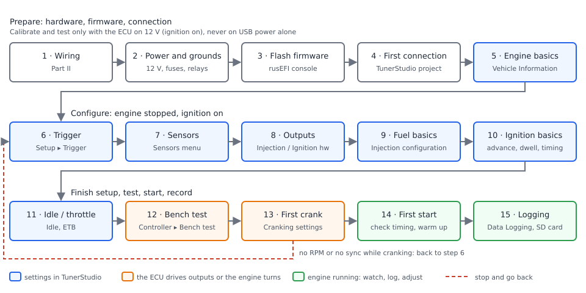
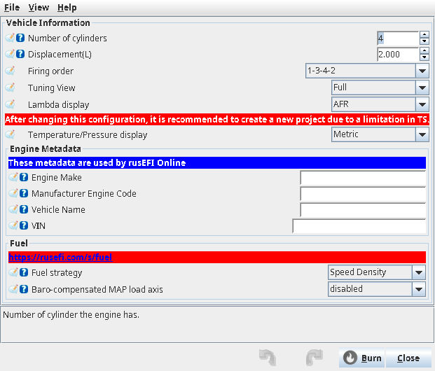
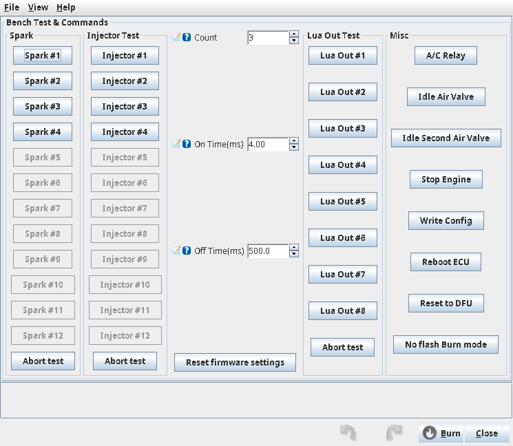

# Quick start: from box to first start

:material-circle:{ .level-basic } Basic

> **In one sentence:** the fifteen steps from an ECU in its box to a running, logged engine, in the
> order to do them, with the TunerStudio dialog for each and the chapter that explains it.

!!! danger "Safety rules — read before every step from 12 on"
    - **Fuel:** switching the ignition on runs the fuel pump for its **Prime duration** and can fire
      a priming pulse on the injectors. Until you are ready for fuel, keep the fuel pump unplugged
      or the system depressurised. Keep a fire extinguisher within reach.
    - **High voltage:** coil outputs reach tens of thousands of volts. Hands off coils and plug
      leads whenever the ECU has 12 V; ground plugs firmly when bench-testing coils.
    - **Moving parts:** the starter, belts and fans can move without warning. Keep clear while the
      engine can crank.
    - **Throttle:** an electronic throttle can snap open by itself. Fingers out of the bore.
    - **Engine damage:** a wrong trigger angle, a lean mixture or too much advance can destroy an
      engine in seconds. First start with your hand on the key.
    - **Calibrate with the ignition on, never on USB power alone** — on USB the 5 V sensor supply
      is low and every reading is wrong; TunerStudio greys out **Grab** and **Auto Calibrate**.

    The full rules are on [Read this first: safety and disclaimer](../safety.md).
    <!-- src: firmware/controllers/modules/fuel_pump/fuel_pump.cpp (FuelPumpController::onSlowCallback: isPrime); firmware/controllers/engine_cycle/prime_injection.cpp (PrimeController::onIgnitionStateChanged); firmware/tunerstudio/tunerstudio.template.ini (hasIgnitionVoltage gating of Grab / Auto Calibrate) -->

## Overview

:material-circle:{ .level-basic } Basic

This page is a checklist. Each step says what to set and where; the chapter named at the end of
the step explains it fully. Do them in order: each step relies on the ones before it. Examples use a
**Proteus F7**.

<figure markdown>
  
  <figcaption>Figure 1 — The quick-start sequence. Blue steps are settings, orange steps make the ECU
  drive outputs or turn the engine, green steps are with the engine running. If cranking shows no
  RPM or no sync, go back to the trigger.</figcaption>
</figure>

## The checklist

:material-circle:{ .level-basic } Basic

### 1 · Wiring

Wire the sensors, injectors, coils, relays and grounds to the ECU's connectors. On Proteus the
factory settings already expect: crank trigger on **Digital 1** (Black23 pin 10), MAP on **Analog
Volt 1** (White 13), TPS on **Analog Volt 2** (White 24), IAT on **Analog Temp 2** (White 30), CLT on
**Analog Temp 3** (White 20), wideband signal on **Analog Volt 10** (White 28); injectors on
**Lowside 1…** (injector 1 on Black35 pin 3), coils on **Ign 1…** (coil 1 on Black35 pin 35); main
relay on **Lowside 12** (Black35 pin 21), fuel pump on **Lowside 10** (Black35 pin 20), fan on
**Lowside 11** (Black35 pin 9). Wiring to those pins saves work in later steps.
*Chapters: Wiring basics, Wiring sensors, Wiring outputs.*
<!-- src: firmware/config/boards/proteus/board_configuration.cpp (setupDefaultSensorInputs, injPins, ignPins, proteus_boardDefaultConfiguration: mainRelayPin, fuelPumpPin, fanPin); firmware/config/boards/proteus_meta.h (PROTEUS_IN_CLT, PROTEUS_IN_IAT, PROTEUS_IN_MAP, PROTEUS_IN_TPS, PROTEUS_DIGITAL_1); firmware/config/boards/proteus/connectors/white35.yaml (Analog Volt/Temp pins); firmware/config/boards/proteus/connectors/black35.yaml (Lowside, Ign pins); firmware/config/boards/proteus/connectors/black23.yaml (Digital 1) -->

### 2 · Power and grounds

Fuse the ECU's supply, wire the main relay, and run power and sensor grounds separately. With 12 V
on, the **Battery** gauge must read your battery voltage. Set the battery and alternator options in
**Setup ▸ Battery and alternator**.
*Chapters: Power, grounds and ground loops; The official boards.*
<!-- src: firmware/tunerstudio/tunerstudio.template.ini (energySystems "Battery and Alternator Settings"; [FrontPage] gauge6 VBattGauge) -->

### 3 · Flash firmware

This is done in the rusEFI console. Flash the firmware from the bundle for your board; keep that
bundle — its `.ini` belongs to that firmware.
*Chapter: Flashing firmware.*

### 4 · First connection

Create a TunerStudio project with the bundle's `.ini`, go online, answer the Difference Report with
**Use Controller Settings**, and learn the front-page indicators. Close the rusEFI console first: only
one program can hold the port.
*Chapter: First connection.*

### 5 · Engine basics

**Setup ▸ Vehicle Information**: **Number of cylinders** `cylindersCount`, **Displacement**
`displacement`, **Firing order** `firingOrder`, **Fuel strategy** `fuelAlgorithm` (Speed Density for
most engines). Leave **Tuning View** on *Full* so every setup menu is shown. Burn.
*Chapter: Engine and vehicle basics.*
<!-- src: firmware/tunerstudio/tunerstudio.template.ini (engineChars, fuelStrategyPanel, uiMode); firmware/controllers/algo/defaults/default_base_engine.cpp (fuelAlgorithm = LM_SPEED_DENSITY) -->

<!-- shot: img/ts/quick-start-vehicle-information.png | Setup ▸ Vehicle Information | 4 cylinders, 2.0 L, firing order 1-3-4-2, Fuel strategy Speed Density, Tuning View Full | Figure 2 — Vehicle Information: the first settings for any engine. -->

<figure markdown>
  
  <figcaption>Figure 2 — Vehicle Information: the first settings for any engine.</figcaption>
</figure>

### 6 · Trigger

**Setup ▸ Trigger**: **Trigger type** `trigger_type` (factory default 60-2), the cam input if you
have one, and leave **Trigger Angle Advance** `globalTriggerAngleOffset` at 0 for well-known trigger
types until you check timing in step 14. Crank the engine with fuel and spark disabled and confirm
RPM appears and **Trigger OK** stays white.
*Chapter: The trigger system.*
<!-- src: firmware/tunerstudio/tunerstudio.template.ini (trigger_primary: Trigger type, Trigger Angle Advance, "For well-known trigger types use '0' trigger angle offset"); firmware/controllers/algo/defaults/default_base_engine.cpp (trigger.type = TT_TOOTHED_WHEEL_60_2) -->

### 7 · Sensors

With the **ignition on**: **Sensors ▸ CLT sensor**, **IAT sensor**, **MAP sensor**, **TPS** (and
**Accelerator pedal** for an electronic throttle), **Analog O2 sensor** or **CAN O2 sensors**. Each
reading must be plausible and **CLT OK**, **IAT OK**, **TPS OK** white.
*Chapters: Sensors and calibration; Electronic throttle.*
<!-- src: firmware/tunerstudio/tunerstudio.template.ini (cltSensor, iatSensorDialog, mapSettings, tpsSensor, pedalSensor, analogEgoSettings, egoSettings); firmware/console/status_loop.cpp (isCltError, isIatError, isTpsError) -->

### 8 · Injector and ignition outputs

**Fuel ▸ Injector Setup ▸ Injection hardware**: one **Injection Output** per cylinder, by cylinder
number — rusEFI applies the firing order. **Ignition ▸ Ignition hardware**: **Mode**, one **Ignition
Cylinder** output per coil. Leave the output mode at its default unless your coils need otherwise:
the dialog warns that a wrong mode can burn out coils.
*Chapter: Outputs and pins.*
<!-- src: firmware/tunerstudio/tunerstudio.template.ini (injectorOutputSettings "rusEFI handles firing order", ignitionOutputs "Output Mode is dangerous and can burn out your coils") -->

### 9 · Fuel basics

**Fuel ▸ Injector Setup ▸ Injection configuration**: **Injection** on, **Mode**, **Injector flow**
`injector_flow` and its units, **Stoichiometric ratio**. Then **Fuel ▸ Injector Setup ▸ Injector
deadtime (BatV vs fuel pressure)**, a first **Fuel ▸ VE** table and **Fuel ▸ Target lambda**.
*Chapter: Fuel.*
<!-- src: firmware/tunerstudio/tunerstudio.template.ini (injectorConfig: baseInjection, injChars, fuelParams; injectorsDeadTime; veTableDialog; lambdaTableDialog) -->

### 10 · Ignition basics

**Ignition ▸ Ignition advance** (a conservative table), **Ignition ▸ Dwell** for your coils. In
**Ignition ▸ Ignition hardware**, set **Timing Mode** `timingMode` to fixed and **Fixed Timing**
`fixedTiming` to a value you can check with a timing light at first start.
*Chapter: Ignition.*
<!-- src: firmware/tunerstudio/tunerstudio.template.ini (ignitionBasic: "Use fixed timing while validating with a timing gun", timingMode, fixedTiming; IgnitionTableDialog; dwellSettings) -->

### 11 · Idle and throttle

**Idle ▸ Idle hardware** for the idle valve or electronic throttle, **Idle ▸ Idle settings** and
**Idle ▸ Idle Target RPM from CLT**. For an electronic throttle, calibrate it with the ignition on in
**Advanced ▸ Electronic Throttle Body actuator** and **Sensors ▸ TPS**.
*Chapters: Idle; [Electronic throttle](../part3/electronic-throttle.md).*
<!-- src: firmware/tunerstudio/tunerstudio.template.ini (idlehw, idleSettings, cltIdleRPMCurve, etbDialog, tpsSensor) -->

### 12 · Bench test the outputs

With the ignition on and the engine stopped, **Controller ▸ Bench test** pulses each output:
**Spark #1…**, **Injector #1…**, fuel pump, fan, idle valve. Check each one moves the right part
on the right cylinder. Test injectors with the fuel system depressurised; ground the plugs for coils.
*Chapter: Bench testing.*
<!-- src: firmware/tunerstudio/tunerstudio.template.ini (ioTest "Bench Test & Commands": testSpark, testInjectors, testOther, testMisc); firmware/controllers/bench_test.cpp (pinbench) -->

<!-- shot: img/ts/quick-start-bench-test.png | Controller ▸ Bench test | 4-cylinder engine: Spark #1–#4, Injector #1–#4 buttons, Count / On Time / Off Time visible | Figure 3 — Bench Test & Commands. -->

<figure markdown>
  
  <figcaption>Figure 3 — Bench Test & Commands.</figcaption>
</figure>

### 13 · First crank

**Cranking ▸ Cranking settings**: **Cranking RPM limit** `cranking_rpm` (default 550 RPM), the
cranking fuel and fixed cranking advance. Reconnect the fuel pump. Crank and watch RPM, **Trigger OK**
and the fuel and spark cut indicators. No RPM or **Trigger ERR**: stop and go back to step 6.
*Chapter: Fuel (cranking); The trigger system.*
<!-- src: firmware/tunerstudio/tunerstudio.template.ini (crankingDialog, crankingFuel, crankingIgnition); firmware/controllers/algo/defaults/default_cranking.cpp (cranking.rpm = 550) -->

### 14 · First start

Let the engine start and idle. Check timing with a timing light against **Fixed Timing**, adjust
**Trigger Angle Advance** until they agree, then set **Timing Mode** back. Watch coolant
temperature, lambda and oil pressure; adjust **Fuel ▸ Warmup enrichment** and the VE table near
idle. Set an RPM limit in **Setup ▸ Limits and protection ▸ Limits and fallbacks** (default 7000 RPM)
before you rev the engine.
*Chapters: Tuning fuel; Tuning ignition; Limits and engine protection.*
<!-- src: firmware/tunerstudio/tunerstudio.template.ini (ignitionBasic, trigger_primary globalTriggerAngleOffset, cltFuelCorrCurveDialog, limitsAndFallback); firmware/controllers/algo/defaults/default_base_engine.cpp (rpmHardLimit = 7000) -->

### 15 · Logging

Record a log every time the engine runs: TunerStudio's **Data Logging** menu on the computer, or the
SD card (**Controller ▸ SD Card Logger**) in the ECU. A log is what lets you, or anyone helping you,
see what happened.
*Chapter: Datalogging and log analysis.*
<!-- src: firmware/tunerstudio/tunerstudio.template.ini (sdCard dialog; [Datalog]); firmware/hw_layer/mmc_card.cpp (sdModeExecuter) -->

## Pitfalls

:material-circle:{ .level-basic } Basic

| Symptom | Likely cause | Go to |
|---|---|---|
| Setup menus missing | **Tuning View** set to *Tuning* | step 5 |
| Calibration buttons greyed | USB power only | switch the ignition on |
| No RPM while cranking | trigger type, input or wiring | step 6 |
| RPM but no start, **Fuel cut** or **Ign cut** shown | the reason in the indicator | step 4 (indicators) |
| Wrong cylinder fires in bench test | output assignment | step 8 |
| Timing light disagrees with **Fixed Timing** | trigger angle | step 14 |
<!-- src: firmware/tunerstudio/tunerstudio.template.ini (uiMode gating; [FrontPage] fuelCutReasonBlinker, sparkCutReasonBlinker) -->

## Settings reference

### Vehicle Information (Setup ▸ Vehicle Information)

--8<-- "reference/settings/_engineChars.table.md"

### Trigger (Setup ▸ Trigger)

--8<-- "reference/settings/_triggerConfiguration.table.md"

### Injection hardware (Fuel ▸ Injector Setup ▸ Injection hardware)

--8<-- "reference/settings/_injectionSettings.table.md"

### Injection configuration (Fuel ▸ Injector Setup ▸ Injection configuration)

--8<-- "reference/settings/_injectorConfig.table.md"

### Ignition hardware (Ignition ▸ Ignition hardware)

--8<-- "reference/settings/_ignitionSettings.table.md"

### Bench test (Controller ▸ Bench test)

--8<-- "reference/settings/_ioTest.table.md"

### Cranking settings (Cranking ▸ Cranking settings)

--8<-- "reference/settings/_crankingDialog.table.md"

### Limits and fallbacks (Setup ▸ Limits and protection ▸ Limits and fallbacks)

--8<-- "reference/settings/_limitsAndFallback.table.md"

## Related

- [Read this first: safety and disclaimer](../safety.md)
- First connection — the step before engine setup
- Bench testing — testing each output safely
- Datalogging and log analysis — what to log and how to read it
