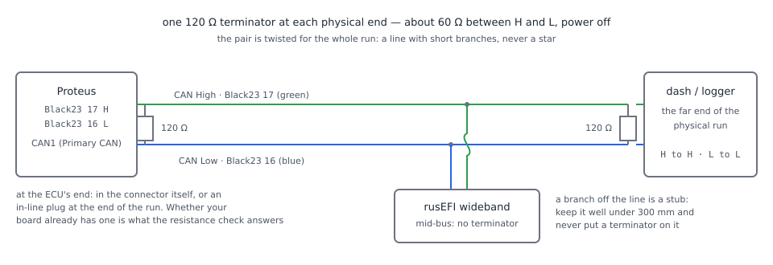

# CAN bus

:material-circle:{ .level-basic } Basic → :material-circle:{ .level-advanced } Advanced

> **In one sentence:** CAN is one twisted pair of wires with a 120 Ω resistor at each physical end of it,
> and every device — the ECU, a dash, a wideband controller, the car's own cluster — hangs off those same
> two wires; laid as a line, terminated at both ends and run at one bit rate, it is the most reliable
> circuit on the engine.

## Overview

:material-circle:{ .level-basic } Basic

**CAN** (controller area network) is a two-wire network rather than a signal wire. The wires are called
**CAN High** and **CAN Low**, they are twisted together, and every device on the network connects to the
same pair. Messages carry an identifier instead of a destination, so all devices hear all traffic and each
one keeps the identifiers it cares about. That is why one pair can carry the dash's RPM, a wideband's
lambda and an exhaust-gas temperature module at the same time.

rusEFI uses CAN for a dash or data logger, a CAN wideband controller, an EGT module, vehicle speed read
from the car's own bus, extra inputs and outputs through an IO expander, and an OEM inertia sensor. What
the ECU sends and receives, and every switch and field for it, is the **CAN configuration** chapter
([CAN configuration](../part3/can.md)). This chapter is the **physical** half: which pins, what cable,
how it is routed, where the two resistors go, and how to prove the network is sound before you blame the
tune.

A Proteus F7 has **two independent CAN buses**, both on the Black 23-way connector:

| Bus | CAN High | CAN Low | TunerStudio calls it |
|---|---|---|---|
| CAN1 | **Black 17** (green) | **Black 16** (blue) | *Primary CAN* |
| CAN2 | **Black 22** (green) | **Black 21** (blue) | *Secondary CAN* |

The pairing is fixed by the board: the official Proteus TunerStudio ini has no RX or TX pin fields on the
CAN panels, because the two buses live on those pins and nowhere else. The CAN pins carry signal only —
no supply and no ground of their own, so a device gets its power where it sits.

<!-- src: firmware/config/boards/proteus/connectors/black23.yaml (pin 17 CAN bus High green, pin 16 CAN bus Low blue, pin 22 CAN2 bus High green, pin 21 CAN2 bus Low blue, all type can); firmware/integration/rusefi_config.txt (EFI_CAN_BUS_COUNT, PRIMARY_CAN_NAME, SECONDARY_CAN_NAME); firmware/config/boards/proteus/prepend.txt (ts_show_can_pins false); firmware/config/boards/proteus/board_configuration.cpp (canRxPin, canTxPin, can2RxPin, can2TxPin); firmware/tunerstudio/tunerstudio.template.ini (canHw1 and canHw2 panels behind the if_ts_show_can_pins switch) -->

!!! danger "An OEM body bus is not yours to join"
    Behind the dashboard the same two wires may carry anti-lock braking, stability control, airbag or
    steering-angle data. Connecting an ECU, a laptop or a dash to that bus — especially with a bit rate
    that does not match — puts error frames on a network the car depends on, and the car can answer with
    warning lights and a bus it switches off. Find out which bus you are holding before you connect
    anything to it, and map its traffic with a proper interface first.

This chapter assumes you have read [Wiring basics](wiring-basics.md): the crimps, seals, routing and
pull-tests there apply to a CAN pair exactly as they do to any other wire.

## Concepts

:material-circle:{ .level-basic } Basic → :material-circle:{ .level-intermediate } Intermediate

### Two wires, one difference

:material-circle:{ .level-basic } Basic

CAN does not send a voltage down one wire. It sends the **difference** between the two:

| State | CAN High | CAN Low | High − Low |
|---|---|---|---|
| Recessive (idle, "1") | about 2.5 V | about 2.5 V | about 0 V |
| Dominant (a bit being sent, "0") | about 3.5 V | about 1.5 V | about 2 V |

A coil, an injector or a spark plug induces a voltage in a nearby wire — but it induces very nearly the
**same** voltage in both wires of a tight pair, and the difference between them is untouched. Twisting the
pair matters for the same reason: every twist hands the "High" job to the other wire, so interference
averages out along the run instead of biasing one conductor. This is why the trigger inputs of
[Wiring sensors](wiring-sensors.md) also want a twisted pair, and why CAN shrugs off an engine bay that
would drown a single-ended signal.

Two consequences for the person wiring it:

- **High must go to High and Low to Low.** Swapping the pair is not a "noise" problem, it is a bus that
  never works at all. Do not trust the other device's wire colours: trust the pin names at both ends.
- **The two wires are one circuit.** Do not run half a pair, do not route one wire of the pair away from
  the other, and do not substitute a single wire plus the car's body.

!!! note "The pair needs a shared ground, not a shared ground *wire*"
    A CAN node reads a voltage difference, but that difference is only meaningful if the two nodes agree
    roughly on what zero is. Devices bolted to the same body, each fed and grounded at their own point,
    can sit a fraction of a volt apart at the pins, and a long pair with no reference is how an
    intermittently dead bus is born. Where the nodes are far apart or fed separately, run a ground
    conductor with the pair (a four-wire sub-bus: High, Low, ground, and supply if the far device needs
    it) and let the two grounds meet at one point — see
    [Power, grounds and ground loops](power-grounds.md).

### Terminators: why 120 Ω, and why exactly two

:material-circle:{ .level-basic } Basic → :material-circle:{ .level-intermediate } Intermediate

CAN cable is made with a characteristic impedance of about 120 Ω. When the travelling wave a node sends
reaches the end of the cable and finds nothing there, it reflects back down the pair and corrupts the bits
behind it. A **120 Ω terminator** at the end of the cable absorbs the wave instead. One terminator at each
**physical end of the run** and nothing in between, and the bus is clean at any reasonable length.

<figure markdown>
  
  <figcaption>Figure 1 — Two ends, two terminators, everything else in the middle. The High stub hops over
  the Low wire because a crossing is not a connection.</figcaption>
</figure>

Two 120 Ω resistors at the ends of the pair sit in parallel as far as your multimeter is concerned, which
gives the single most useful number in this chapter: **about 60 Ω between CAN High and CAN Low with
everything unpowered**.

<figure markdown>
  
  <figcaption>Figure 2 — The termination check. Thirty seconds with a multimeter tells you more about a
  misbehaving CAN bus than any setting in TunerStudio.</figcaption>
</figure>

That also means a terminator is easy to get wrong in **both** directions: fit three and you measure about
40 Ω and the nodes cannot drive the pair hard enough, fit one and you measure 120 Ω and the wave reflects.
Only the two ends count — a device in the middle of the run must not have one.

!!! note "Is a terminator already inside the ECU box?"
    Two official Hellen boards fit a switchable terminator that TunerStudio exposes as a
    **CAN terminator** field, and the firmware drives that resistor from a board-specific setting. Nothing in
    the Proteus board files documents a terminator on either bus, so this manual treats termination as
    something you fit and then **measure**. If your board's documentation says a terminator is fitted
    inside it, use an in-line terminator at the *far* end and let Figure 2 confirm 60 Ω rather than
    assuming either way.
    <!-- src: firmware/config/boards/hellen/hellen_common.cpp (configureHellenCanTerminator); firmware/config/boards/hellen/hellen-112-17/board_config.txt (bit boardUseCanTerminator yes no); firmware/config/boards/hellen/hellen-112-17/board_panel_can_main.ini (field CAN terminator) -->

### One bit rate per bus

:material-circle:{ .level-basic } Basic

CAN has no hand-shake about speed: every node on one bus must be set to the **same bit rate**, because
each one times its bits on its own clock. rusEFI offers **33.33, 50, 83.33, 100, 125, 250, 500 kbps and
1 Mbps** in the **Bitrate** field, and a new tune starts at **500kbps** on both buses. The two Proteus
buses are configured separately, so they may run at different rates — one bus at 500 kbps feeding a dash
and one at 250 kbps reading the car's cluster is a normal arrangement.

The faster you run, the more the bus rewards short, well-terminated wire. In practice, in a car:

| Bit rate | Where it works |
|---|---|
| 500 kbps | rusEFI's default, and the rate almost every aftermarket engine part and OBD-II expects: the whole-car run of a few metres is comfortable |
| 250 kbps / 125 kbps | a long or awkward run, or an older device that only offers these |
| 1 Mbps | short leads and bench work, and the one thing that forces it: rusEFI's Haltech cluster output refuses to run at anything else |
| 33.33 … 100 kbps | rarely worth it on an engine; it does buy length |

<!-- src: firmware/integration/rusefi_config.txt (can_baudrate_e_enum list); firmware/controllers/algo/engine_configuration.cpp (setDefaultCanSettings: B500KBPS on canBaudRate and can2BaudRate); firmware/controllers/can/can_dash_haltech.cpp (criticalAssertVoid canBaudRate == B1MBPS) -->

### A line, not a star

:material-circle:{ .level-intermediate } Intermediate

The bus must be a **line**: one device at each end, others in between, each joined by a short branch
(a **stub**). A star — several devices each running back to one point — is a bundle of long stubs, and
each stub reflects. The rules of thumb:

- **Terminators at the two outermost devices only.** Identify them by the run, not by the type of device:
  the ECU in the engine bay and the dash in the cabin are the ends; a wideband controller bolted to the
  subframe halfway along is not.
- **Stubs well under 300 mm** each. A device 2 m off the trunk line belongs on its own bus, not on a tee.
- **One tee per device at most**, and never a tee that splits the run into two long arms.
- **Route the pair away from noise** the same way [Shielding and noise](shielding-noise.md) describes for
  sensors: clear of coil leads, injector wires and the throttle motor, crossing them at right angles when
  you must. CAN tolerates noise far better than an analogue input, but a bus running 600 mm alongside a
  coil pack is a bus that works in the garage and misbehaves on the road.
- A shielded pair is a good choice; ground the shield at **one** end only, exactly as that chapter says.

### What the ECU does with the pair

:material-circle:{ .level-intermediate } Intermediate

Two firmware facts shape the wiring checks later in this chapter.

The ECU only runs its CAN hardware at all if **CAN read enabled** `canReadEnabled` or **CAN write
enabled** `canWriteEnabled` is on; with both off, neither bus starts and nothing on it works, the sniffer
included. Received frames are picked up by a receive thread per bus that waits 100 ms for a frame and asks
the hardware to recover if nothing arrives.

<!-- src: firmware/hw_layer/drivers/can/can_startup.h (startCan returns false with neither read nor write); firmware/hw_layer/drivers/can/can_hw.cpp (CanRead::ThreadTask, canReceiveTimeout); firmware/controllers/can/can.h (CAN_RX_TIMEOUT) -->

On the transmit side, a successful send is counted in **CAN: Tx OK** `canWriteOk` when the ECU's own CAN
controller has accepted the frame — which is not the same thing as another device having acknowledged it.
Failed sends raise **CAN: Tx err** `canWriteNotOk`. A bus with no other node, or with a node at the wrong
speed, can therefore look alive in the OK counter and sick in the error counter.

<!-- src: firmware/hw_layer/drivers/can/can_msg_tx.h (submitAndWait: success means the controller accepted the frame, not that another node acknowledged it); firmware/hw_layer/drivers/can/can_msg_tx.cpp (recordCanTransmitResult counting canWriteOk and canWriteNotOk and txErrorCount); firmware/console/binary/output_channels.txt (canReadCounter, canWriteOk, canWriteNotOk); firmware/tunerstudio/gauge_declarations.ini (gauge names CAN: Rx, CAN: Tx OK, CAN: Tx err) -->

## Wiring it

:material-circle:{ .level-basic } Basic → :material-circle:{ .level-intermediate } Intermediate

Do steps 1 to 4 **with the battery disconnected** and the ECU unplugged; steps 5 and 6 with the
ECU on **12 V and the ignition on**, never on USB power alone (see
[Power, grounds and ground loops](power-grounds.md) for why a USB-powered ECU reads the world wrong).

### 1 · Plan the line on paper

Write one line per device: the device, which bus it is on, the two Proteus pins, the bit rate, and where
the line ends. You cannot place two terminators until you know which two devices are the ends.

| Device | Bus | Proteus pins | Notes |
|---|---|---|---|
| Dash, in the cabin | CAN1 | Black 17 H, Black 16 L | the far end of the run — carries terminator 2 |
| rusEFI wideband controller, on the subframe | CAN1 | joins the pair en route | a stub, no terminator |
| Proteus, in the engine bay | CAN1 | Black 17 / Black 16 | one end — carries terminator 1 |

For a device on the second bus use **Black 22** (High, green) and **Black 21** (Low, blue); TunerStudio
calls that bus *Secondary CAN* and gives it its own **Bitrate** field.

<!-- src: firmware/config/boards/proteus/connectors/black23.yaml (CAN bus High/Low and CAN2 bus High/Low with colours); firmware/tunerstudio/tunerstudio.template.ini (canHw1 Primary CAN and canHw2 Secondary CAN panels) -->

### 2 · Lay the pair

- Use a **twisted pair made for data**: 120 Ω CAN cable is ideal, and a good twisted pair of 0.5 mm²
  (20 AWG) — the size [Wiring basics](wiring-basics.md) sizes for CAN — is fine for a car-length run at
  500 kbps.
- Keep the twist intact all the way. Where you must untwist to reach a terminal, keep it under about
  50 mm.
- Run it as **one continuous line** with a tee at each device, not as separate wires back to the ECU.
- Label both ends of both conductors before you route anything: High and Low, at each end, with the pin
  they belong to.
- Clip the harness for **strain relief** at each connector, and leave slack where the engine moves
  relative to the body. A CAN pair pulled out of a terminal is an intermittent bus that only fails on a
  bumpy road.

### 3 · Fit the two terminators

Terminators come as **in-line plugs** (a short pigtailed resistor with the correct terminals), as
**terminator connectors** that sit in the socket at the end of a device's harness, or as a resistor fitted
inside the device where the manufacturer provides for it. Put exactly one at each end of the physical
line and remove any that a device brings with it if that device is not an end. A laptop's CAN interface
fitted with a terminator is a classic source of "it worked until I plugged the laptop in": mid-bus, its
terminator must come out.

### 4 · Prove the wiring with a multimeter, before power

With the ECU unplugged and everything unpowered:

1. **Termination:** measure resistance between Black 17 and Black 16 (or 22 and 21). Read **about
   60 Ω**. See Figure 2 for what any other reading means.
2. **Continuity, and no swaps:** at the far end, short High to Low and confirm continuity between Black 17
   and Black 16 — then remove the short, and check Black 17 is continuous with the device's High pin and
   Black 16 with its Low pin. Do it with the meter, not by looking at colours.
3. **No shorts to the car:** neither conductor should show continuity to body ground, and neither should
   show continuity to any 12 V pin.

!!! warning "Two-wire CAN is not single-wire CAN"
   Some manufacturers run CAN over a single wire at 12 V levels rather than over a 120 Ω pair. Connecting
   a standard two-wire high-speed node — a rusEFI board, a dash, a wideband controller — to that circuit
   usually destroys its transceiver. Check what kind of bus you are holding before you splice into one,
   and never route a CAN pair so a chafed jacket can short it to a power wire: a High-or-Low-to-battery
   fault typically takes out the devices at both ends.

### 5 · Make the ECU agree with the devices

Open **CAN-bus ▸ CAN Bus Settings** in TunerStudio. In the **Primary CAN** panel set **Bitrate**
`canBaudRate` to the rate every device on that bus is set to; the **Secondary CAN** panel has its own
**Bitrate** `can2BaudRate`. **CAN read enabled** `canReadEnabled` and **CAN write enabled**
`canWriteEnabled` must be on for the bus to run at all. **Burn**, then switch the ECU off and back on: the
rate is applied when the ECU starts the bus.

<!-- shot: img/ts/can-bus-bitrate.png | CAN-bus ▸ CAN Bus Settings | Proteus F7, ignition on, engine stopped, factory tune, the dialog cropped to the Primary CAN and Secondary CAN panels: Verbose Can unchecked with Bitrate 500kbps in the Primary CAN panel, Verbose Can2 unchecked with Bitrate 500kbps in the Secondary CAN panel, no RX or TX pin fields present, all dropdowns closed | The two panels that have to agree with the hardware: one bit rate per bus, and nothing to move the pins because they are fixed. -->

<!-- src: firmware/tunerstudio/tunerstudio.template.ini (canBusMain dialog with canBus, canHw1 and canHw2 panels, Bitrate fields); firmware/integration/rusefi_config.txt (canBaudRate, can2BaudRate, canReadEnabled, canWriteEnabled); firmware/hw_layer/drivers/can/can_hw.cpp (configureDevice applies the configured rate when the bus starts, restartCanBus) -->

### 6 · Prove it with traffic

With the ignition on and the ECU on 12 V, watch three log channels or gauges:

| Channel | TunerStudio label | What it tells you |
|---|---|---|
| `canReadCounter` | **CAN: Rx** | frames the ECU has received — it must climb whenever anything on the bus is talking |
| `canWriteOk` | **CAN: Tx OK** | frames the ECU's controller accepted |
| `canWriteNotOk` | **CAN: Tx err** | frames it could not send — this is the counter that moves when the bus itself is wrong |

A quiet **CAN: Rx** with a climbing **CAN: Tx err** is the signature of a bus that can talk but cannot
agree with anyone: wrong bit rate, a swapped pair, or the other node unpowered or on the other bus.

To see the frames themselves, open **CAN-bus ▸ CAN Bus sniffer**. **Listen bus (excl. ECU messages)**
`canSniffer1_read` must be **Yes** if you want to see the traffic of the *other* devices — by default the
sniffer shows you only the ECU's own frames, which proves nothing about the far end of the wire. The
sniffer needs **CAN read enabled**; the rest of its switches are the business of
[CAN configuration](../part3/can.md).

<!-- shot: img/ts/can-bus-sniffer.png | CAN-bus ▸ CAN Bus sniffer | Proteus F7, ignition on, engine stopped: Include CAN bus in trace checked, Primary CAN panel with Listen bus (excl. ECU messages) set to Yes and Include frames we send set to Yes, Secondary CAN panel with both set to No, Transmit Frames panel with Sniffer Tx CAN bus set to None, all dropdowns closed | Turning on the one switch that lets you see somebody else's frames: without it the sniffer only echoes the ECU back at you. -->

<!-- src: firmware/tunerstudio/tunerstudio.template.ini (canBusSniffer dialog with canSniffer1_read, canSniffer1_listenOurs, canSnifferTxBus); firmware/controllers/algo/engine_configuration.cpp (canSnifferIncludeBus true and the sniffer channel defaults); firmware/hw_layer/drivers/can/can_hw.cpp (CanRead::ThreadTask feeding canSniffer when canSniffer[i].read, startSniffer only when reading is enabled) -->

!!! info "Advanced"
    This is done in the rusEFI console: the `caninfo` command prints both buses' TX and RX pins, the bit
    rate in use, transmit error and queue-drop counts, listen-only state and the three counters, all in
    one screen. TunerStudio has nothing like it, and it is the fastest way to confirm the ECU is running
    the rate you think you burned.
    <!-- src: firmware/hw_layer/drivers/can/can_hw.cpp (canInfo) -->

## Examples

:material-circle:{ .level-intermediate } Intermediate

### Example 1 — ECU, dash and wideband on one bus

The common arrangement: a Proteus in the engine bay, a dash in the cabin, a rusEFI wideband controller on
the subframe between them, all on **CAN1**.

| Item | Value |
|---|---|
| Bus | CAN1, *Primary CAN*: Black 17 High, Black 16 Low |
| Cable | shielded twisted pair, 0.5 mm², about 4.5 m from ECU to dash, shield grounded at the ECU end only |
| Terminators | in-line 120 Ω at the Black 23 end, terminator connector at the dash |
| Wideband | tee off the trunk 400 mm from the ECU, 150 mm stub into the controller, **no** terminator |
| Bit rate | 500 kbps on the ECU and the dash and the wideband |
| What the meter should say at Black 17/16, power off | about 60 Ω — two terminators in parallel |

The wideband controller must be pointed at the same bus in TunerStudio (**Wideband CAN bus**
`widebandOnSecondBus` selects *CAN1* or *CAN2*), and the ECU must be told to read and write CAN; see
[CAN configuration](../part3/can.md) for those switches. With the ignition on, **CAN: Rx** climbs within a
second of the dash powering up, and **CAN: Tx err** stays flat.

<!-- src: firmware/integration/rusefi_config.txt (widebandOnSecondBus CAN1 CAN2); firmware/config/boards/proteus/connectors/black23.yaml (Black 17/16) -->

### Example 2 — Your sensors on CAN1, the car's cluster on CAN2

A swap engine that keeps its OEM instrument cluster: the cluster is fed on **CAN2**
(**Black 22** High, **Black 21** Low) because that bus can run the cluster's own rate and carry only the
cluster protocol, while your dash and wideband live on **CAN1** at 500 kbps. Two buses means two
independent bit rates, two independent sets of terminators, and no need for the car's modules and your
aftermarket devices to share a network. Treat the OEM pair as somebody else's circuit: identify it, match
its rate, and terminate only if your end is genuinely an end of that line — a bus that already runs to the
car's other modules usually needs **no** terminator at the ECU.

The two buses are separate resources with separate settings, and a device is heard on the bus its pair is
plugged into; nothing here lets one bus stand in for the other.

<!-- src: firmware/integration/rusefi_config.txt (EFI_CAN_BUS_COUNT 2, canBaudRate and can2BaudRate as separate settings); firmware/config/boards/proteus/connectors/black23.yaml (CAN2 bus High pin 22, CAN2 bus Low pin 21); firmware/config/boards/proteus/board_configuration.cpp (can2RxPin, can2TxPin) -->

### Example 3 — A dash that works on the bench and fails in the car

Symptom: the dash is perfect with everything on the bench, and shows dashes for every needle once the
harness is fitted. The readings: about **60 Ω** on the bench with its 1 m of wire, **120 Ω** in the car. The
cause: on the bench the dash and the ECU were the two ends and each terminator was correct, but in the car
a second device — a logger plugged into the same tee in the cabin — sits *beyond* the dash, so the dash is
no longer an end, and the logger's own terminator was removed. The fix is to move the far terminator out
to the outermost device and re-measure at the ECU until it reads 60 Ω again. **CAN: Tx err** climbing with
readings that come and go with the road surface is the same fault seen from the ECU's side.

## Pitfalls and troubleshooting

:material-circle:{ .level-basic } Basic → :material-circle:{ .level-advanced } Advanced

| Symptom | Most likely cause | Check |
|---|---|---|
| **CAN: Rx** stays at zero, nothing answers | High and Low swapped at one end | continuity, pin by pin, at both ends (step 4) |
| Nothing on the bus works at all, sniffer included | **CAN read enabled** and **CAN write enabled** both off, so the ECU never started the hardware | **CAN-bus ▸ CAN Bus Settings**, then burn and power-cycle |
| Bus worked, died after a settings change | a new **Bitrate** is applied when the bus starts | burn, power-cycle, then re-check the rate in use with the console's `caninfo` |
| **CAN: Tx err** climbs, **CAN: Tx OK** barely moves | the frame is never acknowledged: no other node, the other node unpowered, or a bit rate mismatch | the other device's power and its rate, then the 60 Ω check |
| Reads fine, and drops out under load or at high RPM | no ground reference between the nodes, or the pair routed beside coils or injectors | run a ground with the pair, re-route per [Shielding and noise](shielding-noise.md) |
| Works with 1 m leads, fails with the loom fitted | untwisted run, long stubs, star wiring or a missing terminator | Figure 2, stub lengths, and one line rather than a star |
| Three devices are fine one at a time, and fail together | three terminators (about 40 Ω), or the last device hanging off the end of the line | measure 60 Ω, take the terminator out of any mid-bus device |
| It breaks as soon as a laptop interface is connected | the interface added a third terminator, or its traffic is being injected into the bus | remove its terminator mid-bus, set **Sniffer Tx CAN bus** to *None* |
| One bus is perfect, the second silent | the pair is in Black 21/22 while TunerStudio was told the device is on the primary bus, or the second **Bitrate** was left different | the Black 23 pinout, and both **Bitrate** fields |
| Wideband or EGT reads nothing on a bus that is otherwise healthy | usually not the wiring: the device is on the other bus, or the ECU is not allowed to run that feature | [CAN configuration](../part3/can.md) |
| The car's own instruments stop working when the ECU is connected | you are on an OEM body bus, at the wrong rate or unterminated | stop: identify that bus before you go further |

!!! tip "Fix the pair before you touch a setting"
    A CAN bus has one setting that matters to the wiring (the bit rate) and a great many that do not. If
    the resistance is 60 Ω, High is on High, and the bit rate matches, the fault is not in the wire — and
    if those three are not true, no setting in TunerStudio will help.

## Settings reference

### CAN Bus Settings (CAN-bus ▸ CAN Bus Settings)

--8<-- "reference/settings/_canBusMain.table.md"

### CAN Bus sniffer (CAN-bus ▸ CAN Bus sniffer)

--8<-- "reference/settings/_canBusSniffer.table.md"

## Related

- [Wiring basics](wiring-basics.md) — wire sizes, crimps, seals, routing and the pre-power checks
- [Power, grounds and ground loops](power-grounds.md) — feeding and grounding the devices at each end of the bus
- [Shielding and noise](shielding-noise.md) — routing the pair away from the things that spark
- [Wiring sensors](wiring-sensors.md) — why a CAN sensor needs two wires and no supply from the ECU
- [The official boards](official-boards.md) — the Black 23 connector, pin by pin
- [CAN configuration](../part3/can.md) — what the ECU sends and listens for, dash protocols, CAN wideband, CAN EGT, CAN vehicle speed
