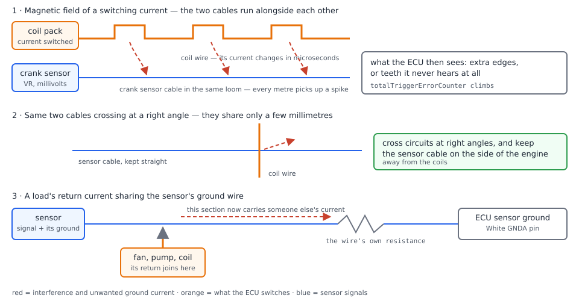
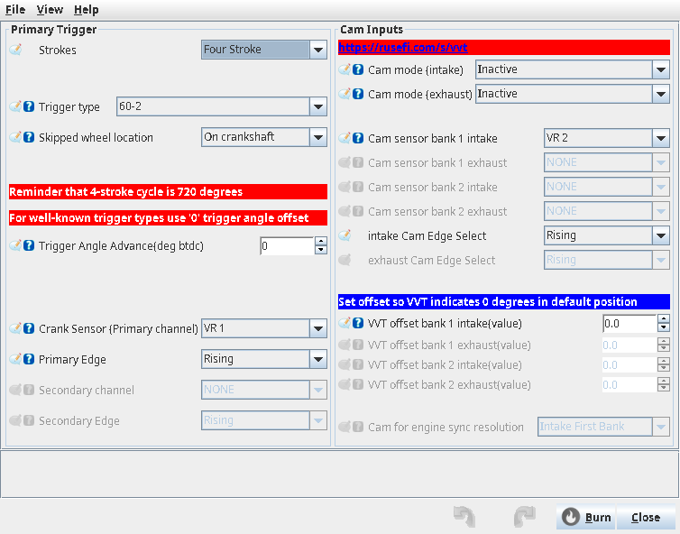
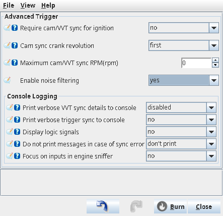
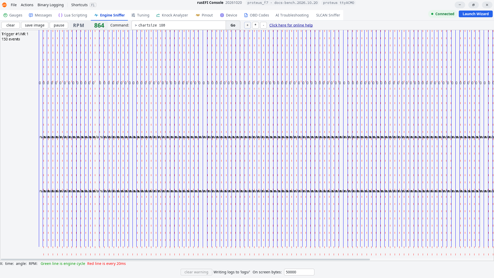

# Shielding and noise

:material-circle:{ .level-basic } Basic → :material-circle:{ .level-advanced } Advanced

> **In one sentence:** an engine bay is full of sparks and switching currents, and the two inputs rusEFI
> is most sensitive on — the crank and cam trigger, and the knock sensor — sit right in the middle of
> them, so those wires must be kept short, twisted, shielded at one end and run away from the coils,
> injectors and throttle motor.

## Overview

:material-circle:{ .level-basic } Basic

Noise is any voltage or current the ECU did not ask for that arrives on one of its inputs. rusEFI
usually notices it in one of two ways:

- **It cannot see the engine.** A crank or cam signal corrupted by interference gives extra edges or
  missing edges. rusEFI counts the mistakes, loses synchronization, and if the signal stops making
  sense altogether it decides the engine has stopped — and cuts fuel and spark.
- **It hears things that are not there.** The knock sensor listens to the engine block, and the
  noisiest moment of the cycle is exactly the moment rusEFI is listening. Interference on that wire
  makes the ECU pull ignition timing for knock that is not happening, or hides knock that is.

Three habits of a quiet harness, and the rest of this chapter is about them:

1. **Distance and direction.** Sensor wires away from coils, injector wires and the throttle motor;
   when a sensor wire must cross one of them, cross at a right angle.
2. **Twist the pair.** A twisted pair receives the same interference on both wires, and the ECU reads
   the *difference* between them, so the interference cancels.
3. **One ground per signal, shields grounded at one end.** Every sensor returns on its own wire to a
   sensor ground pin, and a cable's shield connects at the ECU end only.

This chapter assumes you have read *Wiring basics* (wire, crimps, loom) and *Power, grounds and ground
loops* (power grounds, sensor ground, the star point). The Trigger chapter explains trigger decoding
and its error counters, and the Knock chapter explains knock detection; here the subject is the wire
between the engine and the ECU.

!!! danger "The ignition system is high voltage"
    A coil's secondary circuit is tens of thousands of volts. Never crank the engine with a coil
    lead or plug wire unplugged, keep fingers clear of coil packs and leads while the engine runs,
    and treat a cracked coil or leaking lead as a burn hazard, not a rough-running fault. Work with
    the ignition off whenever the test allows it, and remember belts, fans and the cooling fan's
    automatic start when the ignition is on.

!!! note "rusEFI has software defences — they are a bandage"
    rusEFI can reject some interference in firmware (see *What rusEFI does for you in software*). A
    filter cannot put back a trigger tooth that a weak signal never produced, and it cannot tell a
    real knock event from an injector pulse on the knock wire. Fix the wire first; use the settings
    to cover what remains.

## Concepts

:material-circle:{ .level-basic } Basic → :material-circle:{ .level-intermediate } Intermediate

### How noise gets in

:material-circle:{ .level-basic } Basic

There are only three ways interference reaches a sensor, and each has its own counter-measure.

<figure markdown>
  
  <figcaption>Figure 1 — The three coupling paths. Red is interference and unwanted ground current,
  orange is what the ECU switches, blue is sensor signal. Distance and twisting defeat the first
  path, a right-angle crossing defeats the second, and a dedicated sensor ground defeats the
  third.</figcaption>
</figure>

- **Magnetic field of a changing current.** Every time the ECU switches an injector, a coil or the
  throttle motor, the current in that wire goes from zero to full in microseconds. A wire sitting
  alongside it gets a spike pushed into it. The longer the two wires run side by side, the bigger the
  spike — hence "keep them apart, and cross them at right angles".
- **Electric field of a changing voltage.** A high-voltage wire next to a high-impedance input
  (a VR sensor is just a coil of wire) pushes current through the small capacitance between them.
  A shield, connected at one end, gives that current somewhere better to go.
- **Shared ground returns.** A wire has resistance, so current in it lifts its ends to different
  voltages. If a sensor's ground wire also carries a fan's or a coil's return current, the sensor's
  "zero" is no longer the ECU's zero. That path is covered in *Power, grounds and ground loops*.

### The trigger inputs

:material-circle:{ .level-intermediate } Intermediate

A **VR** (variable reluctance) sensor has two wires and nothing else: it is a small coil and a magnet,
and it makes an alternating voltage whose height grows with engine speed — millivolts at cranking
speed, tens of volts at racing speed. That is a weak, high-impedance analogue source, and it is the
most noise-prone signal in the car. Proteus has two VR inputs on the Black 23-way connector, with a
positive and a negative pin each, plus six digital (Hall-type) inputs:

| TunerStudio name | Pins | Notes |
|---|---|---|
| **VR 1** | Black 5 (+), Black 13 (−) | the board conditions the VR signal on these pins |
| **VR 2** | Black 4 (+), Black 12 (−) | same, second input |
| **Digital 1** | Black 10 | Hall / switch input, factory primary trigger input |
| **Digital 2 … 6** | Black 1, 2, 3, 9, 11 | Hall / switch inputs |

A **Hall** sensor has three wires (supply, ground, signal) and gives a clean square wave at any speed,
so it is far less sensitive to magnetic noise — but it is still a 5 V signal referenced to its own
ground wire. Interference gets in through its supply and through its ground, not through the signal
wire. Feed it from a 5 V sensor supply (**White 9/21/32** or **White 10/22/33**) or the protected 12 V
sensor output (**White 11**), and return it to a sensor ground pin (**White 1–8**) on its own wire.
<!-- src: firmware/config/boards/proteus/connectors/black23.yaml (pins 4, 5, 12, 13 Variable Reluctance positive and negative, ts_name VR 1 and VR 2, Digital 1 to Digital 6) -->
<!-- src: firmware/config/boards/proteus/connectors/white35.yaml (+5 sensor supplies, 12 V protected sensor output, GNDA sensor ground pins) -->

### The knock input

:material-circle:{ .level-intermediate } Intermediate

Proteus has two knock inputs, **White 34** (Knock input 1) and **White 35** (Knock input 2). They are
fixed on the board — there is no pin choice in TunerStudio — and they go to the ECU's fast analogue
input, not to a digital input. rusEFI samples the sensor in a window that starts after each spark
(default 20° after) and lasts 45° of crank, band-passes it at the engine's knock ringing frequency,
and compares the level in decibels against a threshold curve whose factory value is −20 dB at every
RPM.
<!-- src: firmware/config/boards/proteus/connectors/white35.yaml (pins 34 and 35 Knock input 1 and 2) -->
<!-- src: firmware/config/boards/proteus/knock_config.h (the knock ADC channels and sample rate) -->
<!-- src: firmware/controllers/engine_cycle/knock_controller.cpp (startKnockSampling, onKnockSenseCompleted, getKnockThreshold) -->
<!-- src: firmware/controllers/sensors/impl/software_knock.cpp (band-pass filtering and the level calculation) -->
<!-- src: firmware/controllers/algo/engine_configuration.cpp (setDefaultEngineNoiseTable, knockBaseNoise −20 dB, window 20 degrees, duration 45 degrees) -->

That window is the moment when the coil is charging and the injectors have just fired, so the wire's
neighbours are at their loudest. Two failure modes follow:

- **False knock.** Interference inside the window at the knock frequency reads as knock: the ECU
  retards timing and may add fuel, so the engine loses power and runs richer for no reason.
- **Masked knock.** More usually the interference raises the *noise floor*, so the calibrator raises
  the threshold to stop the false events — and then real knock, which is now only a little above the
  floor, never crosses it.

!!! danger "Never silence false knock by raising the threshold"
    Raising the knock threshold above the interference level also raises it above real knock. Detonation
    under boost destroys pistons and head gaskets in seconds, and knock control is the last line of
    defence. Fix the wiring, and set the threshold a few dB above the *quiet* level you measured with
    the interference gone (the Knock chapter explains how).

### How noise shows up in rusEFI

:material-circle:{ .level-intermediate } Intermediate

The firmware counts what it does not like and reports it. Knowing the names turns "runs rough sometimes"
into a measurement.

| What happens in the firmware | Where you see it |
|---|---|
| The number of edges between two sync points is wrong — a tooth was missed, or interference added one. Synchronization is dropped and the error counter is increased by 1. | Warning *primary trigger error: not enough teeth between sync points* (code 9003) or *too many teeth* (code 9002), log channel **Trigger Error Counter** |
| Above 1000 RPM, an edge arriving less than 0.5° after the previous one is ignored as a doubled edge, and a warning is raised. | Warning *doubled trigger edge after … deg* (code 9006) |
| Above 1000 RPM, a tooth whose expected position is off by more than 10° is reported (but kept) — the sign of a signal that arrives late or early. | Warning *tooth #N error of …* |
| The same edge is seen twice in a row, which cannot physically happen. | Log channel **orderingErrorCounter** |
| One gap is over 3000 times the previous one — usually a signal that dropped out entirely — and the error counter is increased by 100 at once. | **Trigger Error Counter** jumps by 100 |
| For 0.3 s after any trigger error the status flag *trigger error* is set, and the ECU's warning LED is lit while it is set. If the decoder reports errors in more than four of the last six samples, it is treated as a standing decoder error. | TunerStudio front page indicator **Trigger OK** / **Trigger ERR**, log channel **Error: Trigger** |
| Every warning is counted and the codes remembered, so a road test can be read afterwards. | The **Warning: counter** gauge, log channels **Warning: counter**, **Warning: last**, **Warning code 1** … **Warning code 8** |
| No usable trigger cycle for a while: the ECU declares the engine stopped, RPM reads 0, fuel and spark stop, and trigger state is reset. | RPM drops to 0, engine stalls or cuts out |
| On knock, each event retards timing (up to the **Max knock retard** table) and can add fuel. | Log channels **Knock: Count**, **Knock: Current level**, **Knock: Cyl N**, **Knock: Retard** |
| An analogue sensor whose reading goes missing is reported as a timeout fault; the throttle controller counts such dropouts and disables the throttle motor past 50. | Warnings *Sensor fault: …*, ETB status *TPS noise* |
<!-- src: firmware/controllers/trigger/trigger_decoder.cpp (onNotEnoughTeeth, onTooManyTeeth, setTriggerErrorState, NOISE_RATIO_THRESHOLD, orderingErrorCounter) -->
<!-- src: firmware/controllers/trigger/trigger_central.cpp (handleShaftSignal doubled-edge rejection at 0.5 degrees above 1000 RPM, tooth timing warning at 10 degrees) -->
<!-- src: firmware/controllers/trigger/trigger_decoder.h (someSortOfTriggerError, 0.3 s window, totalTriggerErrorCounter) -->
<!-- src: firmware/controllers/trigger/trigger_central.cpp (isTriggerDecoderError, triggerErrorDetection) -->
<!-- src: firmware/console/status_loop.cpp (isTriggerErrorNow, warning LED, output channel flags) -->
<!-- src: firmware/controllers/algo/obd_error_codes.h (CUSTOM_PRIMARY_TOO_MANY_TEETH, CUSTOM_PRIMARY_NOT_ENOUGH_TEETH, CUSTOM_PRIMARY_DOUBLED_EDGE) -->
<!-- src: firmware/controllers/engine_cycle/rpm_calculator.cpp (onSlowCallback, setStopSpinning) -->
<!-- src: firmware/console/binary/output_channels.txt (totalTriggerErrorCounter, orderingErrorCounter, warningCounter, lastErrorCode, recentErrorCode, isTriggerError) -->
<!-- src: firmware/tunerstudio/tunerstudio.template.ini (Trigger Error Counter, Error: Trigger, Warning: counter, Warning: last, Warning code entries, Trigger OK and Trigger ERR indicator) -->
<!-- src: firmware/controllers/engine_cycle/knock_controller.cpp (knock counters and levels) -->
<!-- src: firmware/controllers/sensors/sensor_checker.cpp (sensor timeout warnings) -->
<!-- src: firmware/controllers/actuators/electronic_throttle.cpp (ETB_INTERMITTENT_LIMIT, TPS noise status) -->

!!! tip "Take a log before and after every change"
    **Trigger Error Counter**, **Warning: counter** and **Knock: Count** count events since start-up, so
    they only tell a story when you log them across the same drive, at the same RPM and load, before and
    after a change. A counter that stays at its starting value is the result you want.

### What rusEFI does for you in software

:material-circle:{ .level-intermediate } Intermediate

- **Enable noise filtering** `useNoiselessTriggerDecoder` (**Setup ▸ Advanced Trigger**). With it on,
  the ECU keeps a running total of the time since the opposite edge on the same channel and accepts
  an incoming edge only if that total is at least 2/3 and no more than 5/4 of the stored period,
  allowing for the missing-tooth gap. Edges that arrive too early — the classic interference spike —
  are dropped before the decoder sees them. TunerStudio shows the field only for the **60-2** and
  **36-1** wheel types, it filters the crank channel only, and the code's own comment calls the
  2/3 factor an empirical figure: a wheel slowing down faster than that loses teeth.
  <!-- src: firmware/controllers/trigger/trigger_central.cpp (TriggerNoiseFilter::noiseFilter, primary channel only, 2/3 and 5/4 window) -->
  <!-- src: firmware/integration/rusefi_config.txt (useNoiselessTriggerDecoder) -->
  <!-- src: firmware/tunerstudio/tunerstudio.template.ini (Enable noise filtering field, shown for the 60-2 and 36-1 trigger types) -->
- **Doubled-edge rejection.** Always on, above 1000 RPM: an edge less than 0.5° after the previous one
  is thrown away, which is why a little ringing on a clean square wave is harmless.
  <!-- src: firmware/controllers/trigger/trigger_central.cpp (angleSinceLastTooth under 0.5 degrees, CUSTOM_PRIMARY_DOUBLED_EDGE) -->
- **Which edge is read.** **Primary Edge** `invertPrimaryTriggerSignal` (**Setup ▸ Trigger**) selects
  the rising or falling edge of each tooth, and rusEFI even carries a **60-2 Wrong Polarity** trigger
  type for wheels meant to be read the other way round. This is about the wheel and the sensor
  polarity, not about noise: if VR wires have been swapped, the missing-tooth gap of a 60-2 wheel
  looks wrong, the decoder can lock onto the wrong place, and the resulting errors come and go with
  RPM rather than appearing at random.
  <!-- src: firmware/controllers/algo/engine_types.h (TT_TOOTHED_WHEEL_60_2, TT_60_2_WRONG_POLARITY) -->
  <!-- src: firmware/integration/rusefi_config.txt (invertPrimaryTriggerSignal) -->
  <!-- src: firmware/tunerstudio/tunerstudio.template.ini (Primary Edge field, Trigger type list) -->
- **Console logging and the sniffer.** **Print verbose trigger sync to console**
  `verboseTriggerSynchDetails` prints the synchronization decisions as they happen, and the rusEFI
  console's **Engine Sniffer** tab draws the trigger edges — see step 8 below.
  <!-- src: firmware/integration/rusefi_config.txt (verboseTriggerSynchDetails, silentTriggerError, displayLogicLevelsInEngineSniffer, engineSnifferRpmThreshold) -->
  <!-- src: firmware/controllers/trigger/trigger_central.cpp (isEngineSnifferEnabled, engineSnifferRpmThreshold gate) -->
  <!-- src: java_console/ui/src/main/java/com/rusefi/ConsoleUI.java (Engine Sniffer tab) -->

!!! warning "Turning on noise filtering can hide a wiring fault"
    With filtering on, the added edges disappear from the error counters — but the interference is still
    there, and the filter also throws away real teeth if the engine's speed changes faster than the
    fixed 2/3-to-5/4 window allows. Use it as a confirmation that interference was the cause, and as a
    stop-gap on a harness you intend to re-route properly.

## Making the harness quiet

:material-circle:{ .level-basic } Basic → :material-circle:{ .level-intermediate } Intermediate

### 1 · Sort the wires into three groups

Before anything else, decide which wires are **power in** (battery, ignition, main relay), which are
**outputs the ECU switches** (coils, injectors, throttle motor, relays, fans) and which are
**sensor signals** (crank, cam, knock, and all the 5 V sensors). On Proteus the connectors already do
this sorting for you: the Black 35-way carries the coil and injector outputs, Black 23 the VR inputs,
throttle motor outputs and power, and White 35 the analogue sensors and the knock inputs. Plan the
loom so the sensor group and the output group do not share a run.
<!-- src: firmware/config/boards/proteus/connectors/black35.yaml (Smart Ignition Coil outputs, injector and lowside outputs) -->
<!-- src: firmware/config/boards/proteus/connectors/black23.yaml (VR inputs, ETB motor pins 6, 7, 8, 15, ignition power and ground) -->
<!-- src: firmware/config/boards/proteus/connectors/white35.yaml (analogue sensor inputs, Knock 1 and 2) -->

### 2 · Route the sensor loom away from the noise

<figure markdown>
  
  <figcaption>Figure 2 — Same engine, two routes. The green route reaches every sensor without
  passing a coil. The red dashed route reaches the same knock sensor past the fuel rail, the coil
  packs and the throttle motor wires.</figcaption>
</figure>

- Keep crank, cam and knock cables at least **100 mm** away from coil leads, the coil-pack bracket,
  the injector sub-loom and the throttle motor wires, and never tape a sensor cable to the head
  alongside the coils.
- Run the sensor loom on the side of the engine opposite the coils where you can. The knock sensor
  cable in particular should follow the block down and away, not across the top of it.
- When a sensor cable has to cross a coil, injector or throttle motor wire, cross it at **90°**.
- Keep the sensor loom away from the starter cable and the alternator's output, and inside its own
  loom, clipped to the engine at both ends so vibration does not work it about.

### 3 · Twist the pair

For a VR sensor, twist the two signal wires together at one twist every **25 mm to 50 mm** along the
whole run, and keep the twist right up to the connector. Twisting does not stop interference arriving;
it makes it arrive on both wires at once, which the ECU then subtracts out. A VR sensor has no ground
wire of its own — the two wires are the whole signal, so the twist is what protects it.

!!! tip "Buy it made, or twist it yourself"
    Sensor cable sold as *shielded twisted pair* is already pitched for exactly this. If you make up
    a VR extension, twist the pair by hand (three or four turns per 100 mm) before you put the shield
    over it, and never split the pair to add a ground wire.

### 4 · Shield, and ground the shield at one end only

<figure markdown>
  
  <figcaption>Figure 3 — One end, not two. Grounded at the ECU end only, the shield drains the
  interference it collects. Grounded at both ends, the shield and the block form a loop, and the
  current in it is injected straight into the signal pair.</figcaption>
</figure>

1. Use shielded cable for the knock input, for any sensor run longer than about a metre, and for the VR pair if the sensor is far from the ECU.
2. Land the shield **at the ECU end**: on the same ground stud the ECU's Power/Chassis GND wires go
   to (the star point described in *Power, grounds and ground loops*), or on the connector shell if
   the connector has one. The ECU's power ground pins are Black 14, 19 and 20.
3. At the sensor end, cut the shield back, tape or heatshrink it, and make sure it cannot touch the
   sensor body, the bracket or the block.
4. Some knock-sensor harnesses are built with the shield grounded at the sensor body instead. That is
   a single ground too, so it works: the rule is **one end**, not which end. If the cable you have is
   grounded at the sensor, leave it there and do not add a second connection at the ECU.
<!-- src: firmware/config/boards/proteus/connectors/black23.yaml (Power/Chassis GND pins 14, 19, 20, and the VR positive and negative pins) -->

### 5 · Give every signal its own return

:material-circle:{ .level-basic } Basic

- Sensor grounds — Hall trigger sensors included — go to **White 1–8/23/29** and nowhere else: not to
  the block, not to a nearby bracket, not spliced into a coil or injector wire.
- One sensor, one ground wire. Two sensors may share a 5 V supply; they should not share a ground
  path that also carries another sensor's current.
- Power grounds stay at the block star point, each on its own wire.
<!-- src: firmware/config/boards/proteus/connectors/white35.yaml (GNDA sensor ground pins) -->
<!-- src: firmware/config/boards/proteus/connectors/black23.yaml (Power/Chassis GND pins); firmware/config/boards/proteus/connectors/black35.yaml (Power/Chassis GND pins) -->

### 6 · Check which input the sensor is on, and which edge you read

Open **Setup ▸ Trigger** and confirm the sensor is on the input you think it is: **Crank Sensor
(Primary channel)** `triggerInputPins1` must name the pin you wired — *VR 1* for the pair on Black
5/13 — and **Primary Edge** `invertPrimaryTriggerSignal` must match the edge you want to count. If
the VR pair's + and − are reversed, correct the wiring: with the polarity reversed the 60-2
missing-tooth gap reads differently, and synchronization becomes RPM-dependent. Note the timing:
rusEFI's **Trigger Angle Advance** `globalTriggerAngleOffset` may need changing after a swap, so
re-check it with a timing light (the Trigger chapter's procedure).

<!-- shot: img/ts/shielding-noise-trigger-dialog.png | Setup ▸ Trigger | Proteus F7, example values: Trigger type 60-2, Skipped wheel location On crankshaft, Crank Sensor (Primary channel) VR 1, Primary Edge Rising, Cam sensor bank 1 intake VR 2 | The Trigger dialog with the crank sensor on VR 1 -->

<!-- pending-figure
<!-- pending-figure
<!-- pending-figure
<figure markdown>
  
  <figcaption>Figure 4 — A VR crank sensor on **VR 1** and a VR cam sensor on **VR 2**: the input
  names here must match the pins the cable is actually landed on.</figcaption>
</figure>
pending-figure -->
pending-figure -->
pending-figure -->

<!-- src: firmware/tunerstudio/tunerstudio.template.ini (trigger_primary dialog, Crank Sensor (Primary channel), Primary Edge) -->
<!-- src: firmware/config/boards/proteus/board_configuration.cpp (setupDefaultSensorInputs, the factory primary trigger input) -->

### 7 · Add the software filter only once the wiring is right

Open **Setup ▸ Advanced Trigger** and set **Enable noise filtering** `useNoiselessTriggerDecoder` to
*yes*. Burn, then re-log. If the error counters were climbing and now stay flat, interference on the
crank wire was the cause; the filter is a stop-gap until the cable is re-routed (see the warning in
*What rusEFI does for you in software*).

<!-- shot: img/ts/shielding-noise-advanced-trigger.png | Setup ▸ Advanced Trigger | Proteus F7 with Trigger type 60-2 so the noise filtering field is visible: Enable noise filtering yes, Console Logging fields at defaults | The Advanced Trigger dialog with Enable noise filtering set to yes -->

<!-- pending-figure
<!-- pending-figure
<!-- pending-figure
<figure markdown>
  
  <figcaption>Figure 5 — **Enable noise filtering** appears only when the trigger type is **60-2** or
  **36-1**; the panel below it holds the console logging switches used in step 8.</figcaption>
</figure>
pending-figure -->
pending-figure -->
pending-figure -->

### 8 · Prove it: log the counters, then look at the edges

:material-circle:{ .level-intermediate } Intermediate

1. Add to your log: **Trigger Error Counter**, **orderingErrorCounter**, **Error: Trigger**,
   **Warning: counter**, **Warning code 1**, **RPM**, **Knock: Count** and **Knock: Current level**.
2. Drive the condition that used to misbehave — the RPM and load where the errors appeared.
3. Compare **Trigger Error Counter** and **Warning code** against the run you took before the change.
   Zero growth is the goal; a counter that only grows in one RPM band tells you the signal is weak
   there (cranking, or a VR sensor with a large air gap), not that noise is present.
4. This is done in the rusEFI console. Open the **Engine Sniffer** tab and crank or run the engine
   below **Engine Sniffer Threshold** (**Controller ▸ rusEFI console** — the sniffer is disabled above
   that RPM). Turn on **Display logic signals** (**Setup ▸ Advanced Trigger**) to see the raw input
   level rather than only the decoded edges. Look for a doubled edge, or a signal that never crosses
   the switching level while cranking.

<!-- shot: img/console/shielding-noise-engine-sniffer.png | rusEFI console ▸ Engine Sniffer | Proteus F7 on 12 V, engine cranking, Engine Sniffer Threshold above cranking RPM, Display logic signals on | The console's Engine Sniffer tab with crank edges visible while cranking -->

<!-- pending-figure
<!-- pending-figure
<!-- pending-figure
<figure markdown>
  
  <figcaption>Figure 6 — The console's **Engine Sniffer** tab: trigger edges in time order, so an
   interference spike appears as an extra edge, and a weak signal appears as a missing one.</figcaption>
</figure>
pending-figure -->
pending-figure -->
pending-figure -->

<!-- src: firmware/tunerstudio/tunerstudio.template.ini (monitoringSettings dialog, Engine Sniffer Threshold, Display logic signals) -->
<!-- src: java_console/ui/src/main/java/com/rusefi/ConsoleUI.java (Engine Sniffer tab) -->

## Examples

:material-circle:{ .level-intermediate } Intermediate

### Example 1 — 60-2 VR crank sensor, trigger errors above 3000 RPM

Symptom: a 4-cylinder turbo with a 60-2 wheel on **VR 1** runs fine, but the log shows **Trigger Error
Counter** climbing from 0 to 40 in a 20-second pull, **Warning code 1** = 9002 (too many teeth), and
the front page flicks to **Trigger ERR**. Cause: the VR cable had been taped to the coil-pack bracket
for 300 mm alongside two coil leads.

At 4000 RPM a 60-2 tooth is 6° apart, which is 250 µs; doubled-edge rejection only discards an edge
that arrives within 0.5° (about 21 µs) of the last one, so a spike 100 µs later is counted as a real
tooth — the extra tooth is exactly what code 9002 reports.

Fix and check:

| Change | Why |
|---|---|
| Re-route the VR cable down the far side of the block, 250 mm clear of the coil leads | kills the magnetic coupling at source |
| Twist the pair at 30 mm pitch, shield to the ground stud at the ECU end | cancels what is left, drains the rest |
| **Enable noise filtering** left *no* | the counter should be flat without it |
| Log **Trigger Error Counter** on the same pull again | 0 to 0: done |

### Example 2 — false knock on a direct-injection engine

Symptom: **Knock: Count** climbs in normal driving between 1800 and 2500 RPM with light load, and
**Knock: Current level** sits at −13 dB where the factory **Engine Knock Threshold RPM Based** curve
is −20 dB. Timing is being pulled with no audible knock.

Cause and order of work:

1. The knock cable was run in the same loom as the injector sub-loom. Direct-injection events are
   strong, repeat and land inside the sampling window. Re-route the cable along the block and away
   from the rail.
2. Set the knock sensor's cylinder mapping to the channel nearest the sensor if two are wired
   (**Ignition ▸ Knock Control** ▸ *Select the nearest sensor for each cylinder*).
3. Try **second harmonic**: for an 86 mm bore rusEFI computes 6.66 kHz at the first harmonic and
   13.32 kHz at the second, and ignition and injector noise generally carries less energy up there.
   Power-cycle the ECU after the change.
4. Only after the level has fallen, set the threshold curve 3–6 dB above the quiet level at each RPM,
   and confirm **Knock: Count** stops climbing. **Max knock retard**'s factory value of 2° everywhere
   means one false event costs little power, but a hundred of them cost power and a lean-ish mixture
   if knock fuel trim is on.

<!-- src: firmware/controllers/engine_cycle/knock_logic.h (bore2frequency) -->
<!-- src: firmware/controllers/algo/engine_configuration.cpp (setDefaultEngineNoiseTable, default threshold −20 dB) -->
<!-- src: firmware/integration/rusefi_config.txt (knockDetectionUseDoubleFrequency, knockFrequency, knockBankCyl fields) -->
<!-- src: firmware/tunerstudio/tunerstudio.template.ini (Engine Knock Threshold RPM Based curve, Max knock retard table) -->

!!! info "Advanced"
    Knock retard is applied to the whole engine even though the level is measured per cylinder, and it
    is subtracted only when the timing mode is dynamic. A noise-driven retard therefore shows up as
    "no power anywhere, at every cylinder", which is one clue that the knock signal, not the tune, is
    the problem.
    <!-- src: firmware/controllers/algo/engine2.cpp (EngineState::periodicFastCallback, getKnockRetard, TM_DYNAMIC) -->

## Pitfalls and troubleshooting

:material-circle:{ .level-basic } Basic → :material-circle:{ .level-advanced } Advanced

**Do:** keep sensor cables away from coils, injectors and the throttle motor; twist VR pairs; shield
and ground the shield at one end; give every sensor its own return to a White GNDA pin; log the error
counters before and after a change.

**Don't:** run a sensor cable along the ignition wiring; ground a shield at both ends; splice a sensor
ground into a coil or injector wire; use a shield as a signal return; silence knock events by raising
the threshold; trust "the errors stopped" without re-logging the same drive.

| Symptom | Likely cause | Check |
|---|---|---|
| Engine stalls or cuts out at speed, no warning lights | trigger signal lost, ECU decides the engine has stopped | **Error: Trigger**, **Trigger Error Counter**, VR cable routing and air gap |
| **Trigger ERR** appears at high RPM only | interference adding teeth, or a VR signal too weak for the gap | log the counters, **Enable noise filtering** as a test, console sniffer |
| Engine will not start, trigger error counters climbing while cranking | VR output too small at cranking speed, or a doubled edge | cable length, air gap, twist; **Enable noise filtering** |
| Error counters grow only in one RPM band, or only while cranking | weak signal rather than noise | sensor air gap, wheel damage, cable length |
| Trigger errors come and go with the fuel pump or fans switching | shared ground or shared loom | return the sensor to White GNDA alone, move the cable |
| **Knock: Count** climbs in normal driving | interference in the knock window | re-route the knock cable, second harmonic, per-cylinder gain |
| Timing pulled under boost, no audible knock | false knock | **Knock: Current level** against the threshold curve |
| TPS, pedal or MAP readings jump with engine speed | sensor ground carrying another circuit's current, or a 5 V supply dipping | voltage drop test, split sensors across the two 5 V supplies |
| Throttle motor disabled, status *TPS noise* | more than 50 sensor dropouts | TPS wiring and its own ground, sensor calibration |
| Rough running after the harness was re-routed, timing now off | VR + and − swapped | step 6, then re-check **Trigger Angle Advance** with a timing light |
<!-- src: firmware/controllers/actuators/electronic_throttle.cpp (ETB_INTERMITTENT_LIMIT, etbCutCode) -->
<!-- src: firmware/controllers/sensors/impl/software_knock.cpp (per-cylinder band-pass levels) -->
<!-- src: firmware/config/boards/proteus/connectors/white35.yaml (two +5 supplies and GNDA pins) -->

## Settings reference

### Trigger (Setup ▸ Trigger)

--8<-- "reference/settings/_triggerConfiguration.table.md"

### Advanced Trigger (Setup ▸ Advanced Trigger)

--8<-- "reference/settings/_trigger_advanced.table.md"

### Knock Control (Ignition ▸ Knock Control)

--8<-- "reference/settings/_softwareKnock.table.md"

### rusEFI console settings (Controller ▸ rusEFI console)

--8<-- "reference/settings/_monitoringSettings.table.md"

## Related

- Part II — Wiring basics: routing, loom, clips and strain relief
- Part II — Power, grounds and ground loops: sensor ground, star point, voltage-drop testing
- Part II — Wiring sensors (sensor by sensor wiring, supplies and grounds)
- Trigger — wheel types, synchronization, tooth logging and the error counters
- Knock Control — the window, the threshold curve, gains and the Knock Analyzer
- Ignition — coil wiring, dwell and the timing that knock retard subtracts from
