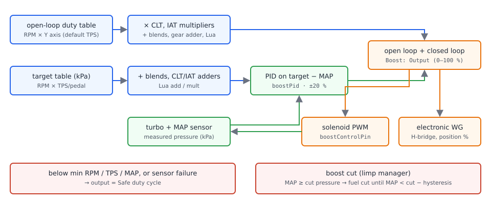

# Boost control

:material-circle:{ .level-basic } Basic → :material-circle:{ .level-advanced } Advanced

> **In one sentence:** boost control drives the wastegate — through a PWM solenoid or an electronic
> wastegate motor — so the turbo makes the boost pressure you ask for, and the ECU cuts fuel if the
> pressure ever goes past a hard limit.

## What it does

:material-circle:{ .level-basic } Basic

A turbocharger's **wastegate** lets exhaust bypass the turbine. The more it opens, the less boost
the turbo makes. A plain wastegate opens at a pressure set by its spring. With boost control the
ECU can hold the wastegate shut for longer, so boost rises above the spring pressure.

rusEFI can drive the wastegate in two ways:

- **A boost solenoid.** A PWM valve that bleeds air from the wastegate actuator. The ECU sets its
  duty cycle (0–100 %).
- **An electronic wastegate.** A wastegate with a DC motor and a position sensor, driven by one of
  the ECU's H-bridges, like an electronic throttle. The ECU sets its position (0–100 %).
<!-- src: firmware/controllers/actuators/boost_control.cpp (BoostController::setOutput, isBoostControlSolenoidMode, setEtbWastegatePosition) -->

There are two control modes:

- **Open Loop.** A table of duty against RPM and throttle. The ECU does not look at the boost
  pressure.
- **Open + Closed Loop.** A second table holds the **target boost** in kPa. A PID controller adds a
  correction to the open-loop duty, based on the gap between target and measured MAP.
<!-- src: firmware/integration/rusefi_config.txt (boostType); firmware/controllers/actuators/boost_control.cpp (BoostController::getSetpoint, getClosedLoopImpl) -->

**Boost cut** is a separate safety limit. It lives in the engine-protection code, not in boost
control. It works even when boost control is switched off.
<!-- src: firmware/controllers/limp_manager.cpp (LimpManager::updateState: boostCutPressure) -->

!!! danger "Overboost destroys engines"
    Too much boost can lift a head gasket, break pistons or rods, and push the engine into knock
    within seconds. Before you raise boost above the wastegate spring pressure:
    set **Boost cut pressure** a little above your highest target, check that the MAP sensor
    reads boost correctly (a 1-bar sensor tops out at about 100 kPa), and make sure the fuel and
    ignition tables cover the higher load. Start with a low duty table and raise it in small steps
    while you log MAP.

## How it works

:material-circle:{ .level-intermediate } Intermediate

<figure markdown>
  
  <figcaption>Figure 1 — The boost controller. Blue is what is asked for, orange is what is driven,
  green is the closed loop, red is the safety path.</figcaption>
</figure>

The controller runs 200 times a second, in the ECU's fast callback.
<!-- src: firmware/controllers/actuators/boost_control.cpp (BoostController::onFastCallback); firmware/controllers/core/main_loop.h (FAST_CALLBACK_RATE) -->

### When it controls at all

Each time, it first checks three gates. Boost is controlled only when RPM is at least **No boost
control below RPM** (default 2000), TPS is at least **No boost control below TPS** (default 30 %),
and MAP is at least **No boost control below MAP** (default 110 kPa). If any gate fails, the output
is the **Safe duty cycle** (default 0 %). The same safe duty is used when a sensor the controller
needs has failed: TPS in either mode, or MAP in closed loop. In open loop a failed MAP sensor does
not stop control.
<!-- src: firmware/controllers/actuators/boost_control.cpp (BoostController::onFastCallback rpmTooLow/tpsTooLow/mapTooLow, setOutput boostControlSafeDutyCycle, observePlant, BoostController::setDefaultConfiguration); firmware/controllers/closed_loop_controller.h (ClosedLoopController::getOutput) -->

### The open-loop part

1. **Boost control duty cycle (open loop)** table: RPM × a Y axis you choose (**Y Axis**, default
   TPS). 8 × 8 cells, 0–100 % in 0.5 % steps.
2. Multiplied by the **CLT boost duty multiplier** and **IAT boost duty multiplier** curves
   (default 1.0 everywhere, 20–100 °C).
3. Plus the **Boost blend tables** (open loop 1 and 2), the **gear adder** curve (needs a detected
   gear) and any Lua adjustment (`setBoostDutyAdd`).
<!-- src: firmware/controllers/actuators/boost_control.cpp (BoostController::getOpenLoop, getBoostControlDutyCycleWithTemperatureCorrections); firmware/controllers/algo/engine_configuration.cpp (setDefaultBoostOpenLoopParameters, initBoostTemperatureCurve); firmware/controllers/lua/lua_hooks.cpp (setBoostDutyAdd) -->

The default open-loop table is all zero: out of the box, boost control asks for 0 % duty.
<!-- src: firmware/controllers/actuators/boost_control.cpp (setDefaultBoostParameters: no open-loop values set) -->

### The closed-loop part

In **Open + Closed Loop** mode:

1. **Boost control target** table: RPM × TPS (or the pedal, if one is fitted) → target pressure in
   kPa absolute, 0–510 kPa in 2 kPa steps.
2. Plus the **closed-loop blend tables**, then the Lua multiplier and adder (`setBoostTargetMult`,
   `setBoostTargetAdd`), then the **CLT boost target adder** and **IAT boost target adder** curves
   (default 0).
3. A PID compares the target with MAP. Its output is limited to **Min adjustment** … **Max
   adjustment** (default −20 … +20 %), and its integral to ±20 %. The PID is held at zero, and
   reset, while the engine is stopped or MAP is below **Enable closed loop above**.
4. The PID output is **added** to the open-loop duty. The open-loop table is still your base.
<!-- src: firmware/controllers/actuators/boost_control.cpp (BoostController::getSetpoint, getClosedLoopImpl, onFastCallback iTermMin/iTermMax, setDefaultBoostParameters boostPid); firmware/integration/rusefi_config.txt (boostTableClosedLoop) -->

!!! warning "The default target table asks for no boost"
    By default every cell of the target table equals its TPS row value read as kPa (0–100 kPa).
    That is below atmospheric pressure, so closed loop pulls duty down. Fill the target table
    before you switch to closed loop.
    <!-- src: firmware/controllers/actuators/boost_control.cpp (setDefaultBoostParameters: boostTableClosedLoop = boostClosedLoopLoadBins) -->

### The output

The final value, clamped to 0–100 %, is shown as **Boost: Output**. If **Boost Control** is
disabled, the output is forced to 0 %.

- With an **Output** pin set, it is the solenoid duty, at **Frequency** (default 33 Hz).
- With no output pin and an H-bridge set to **Wastegate**, it is the electronic wastegate's
  **position target**. The wastegate then runs its own position loop (EWG bias curve plus its own
  PID) on the wastegate position sensor, the same way the throttle does (see
  [Electronic throttle](../part3/electronic-throttle.md)).
<!-- src: firmware/controllers/actuators/boost_control.cpp (BoostController::setOutput, setDefaultBoostParameters boostPwmFrequency); firmware/controllers/actuators/electronic_throttle.cpp (EtbController::getSetpointWastegate, getOpenLoop DC_Wastegate, getPidForDcFunction) -->

!!! warning "Electronic wastegate: higher number means less boost"
    The wastegate position sensor reads 0 % fully **closed** (most boost) and 100 % fully
    **open** (least boost). The boost output is passed straight through as that position. So with
    an electronic wastegate, a *higher* open-loop value means *less* boost, the **Safe duty
    cycle** should be high (wastegate open), and the closed-loop PID acts in the opposite sense to a
    solenoid. The firmware does not invert anything for you. See the report's open questions before
    using closed loop with an electronic wastegate.
    <!-- src: firmware/init/sensor/init_tps.cpp (wastegate LinearSensorUnit: closed voltage → 0 %, open → 100 %); firmware/controllers/actuators/boost_control.cpp (setOutput → setEtbWastegatePosition(boostOutput)) -->

### Boost cut

If **Boost cut pressure** is not 0 and MAP reaches it, the ECU **cuts fuel** (not spark) and raises
the warning *Boost pressure fuel cut* (code 234). Fuel returns when MAP falls below boost cut
pressure minus **Boost cut pressure hysteresis**. Defaults: 300 kPa and 20 kPa, so the cut holds
until MAP is below 280 kPa. The front page shows *Fuel cut: boost cut*.
<!-- src: firmware/controllers/limp_manager.cpp (LimpManager::updateState: m_boostCutHysteresis, ClearReason::BoostCut, OBD_Engine_Overboost); firmware/controllers/max_limit_with_hysteresis.h (MaxLimitWithHysteresis::checkIfLimitIsExceeded); firmware/controllers/actuators/boost_control.cpp (BoostController::setDefaultConfiguration); firmware/controllers/algo/obd_error_codes.h (OBD_Engine_Overboost) -->

## Before you start

:material-circle:{ .level-basic } Basic

You need:

- **A MAP sensor that reads your boost.** Boost control and boost cut both use the MAP sensor, so
  set it up first (see the Sensors chapter).
- **For a solenoid:** a low-side output. Solenoids are inductive, so use one with a flyback diode.
  On Proteus, **Lowside 13** (Black 10), **Lowside 14** (Black 11), **Lowside 15** (Black 12) and
  **Lowside 16** (Black 23) have flyback. Wire 12 V (switched) to the solenoid and its other pin to
  the output.
- **For an electronic wastegate:** a free H-bridge and a position-sensor input. On Proteus the
  second H-bridge is **Black 15** (+) and **Black 8** (−) if throttle 1 uses the first. A spare
  analog input such as **Analog Volt 4** (White 25) for the position sensor, with 5 V and sensor
  ground.
- The ECU on **12 V (ignition on)** for every calibration — never USB power alone.
<!-- src: firmware/config/boards/proteus/connectors/black35.yaml (Lowside 13–16 with flyback); firmware/config/boards/proteus/connectors/black23.yaml (ETB 2 positive/negative); firmware/config/boards/proteus/connectors/white35.yaml (Analog Volt 4) -->

## Setting it up

:material-circle:{ .level-basic } Basic → :material-circle:{ .level-intermediate } Intermediate

Boost lives under **Advanced ▸ Boost Control** and **Advanced ▸ Boost blend tables**; the cut is
under **Setup ▸ Limits and protection ▸ Limits and fallbacks**.

### 1 · Set the boost cut first

Open **Setup ▸ Limits and protection ▸ Limits and fallbacks**. Set **Boost cut pressure** about
20–30 kPa above the highest boost you will ask for, and leave **Boost cut pressure hysteresis** at
20 kPa. Burn.

<!-- shot: img/ts/boost-limits.png | Setup ▸ Limits and protection ▸ Limits and fallbacks | Boost cut pressure 200 kPa, hysteresis 20 kPa | Limits and fallbacks with the boost cut set -->

### 2 · Boost control options

Open **Advanced ▸ Boost Control ▸ Boost control options**:

1. **Boost Control** `isBoostControlEnabled` → *enabled*. The other menu entries appear.
2. **Control Mode** `boostType` → *Open Loop* for now.
3. **Output** `boostControlPin` → the solenoid's output (leave *NONE* for an electronic wastegate).
4. **Output Mode** — leave default unless your solenoid is wired to a high-side.
5. **Bench Test Boost Solenoid** pulses the output using the shared bench-test timing (default
   three 4 ms pulses, 500 ms apart). You should hear it click.
6. **Frequency** `boostPwmFrequency` → the solenoid's frequency (default 33 Hz; check the solenoid's data).
7. **Safe duty cycle** — the duty that gives the *least* boost.
8. **No boost control below RPM / TPS / MAP** — the gates described above.

Burn. Power-cycle after changing the output pin.
<!-- src: firmware/tunerstudio/tunerstudio.template.ini (boostDialog); firmware/controllers/bench_test.cpp (boostValveBench); firmware/controllers/algo/defaults/default_base_engine.cpp (benchTestOnTime, benchTestOffTime, benchTestCount); firmware/controllers/actuators/boost_control.cpp (initBoostCtrl: only initialised once) -->

<!-- shot: img/ts/boost-options.png | Advanced ▸ Boost Control ▸ Boost control options | enabled, Open Loop, output Lowside 13, 33 Hz, safe duty 0 %, gates 2000 RPM / 30 % / 110 kPa | Boost control options for a solenoid -->

### 3 · Open-loop duty table

Open **Advanced ▸ Boost Control ▸ Boost control Open loop base duty cycle**. Choose the **Y Axis**
(TPS is a good start) and fill the table. Start low: a duty of 0 % gives the spring pressure on most
solenoid setups.

<!-- shot: img/ts/boost-open-loop.png | Advanced ▸ Boost Control ▸ Boost control Open loop base duty cycle | Y Axis TPS, table from Example 1 | Open-loop duty table -->

### 4 · Closed loop (optional)

1. Fill **Boost control target** with the pressure you want (kPa absolute).
2. In **Boost control PID**, set **Enable closed loop above** `minimumBoostClosedLoopMap` (for
   example a little above atmospheric), and the PID: **P Gain** is % duty per kPa of error.
   Defaults P 0.5, I 0.3, D 0, adjustment −20 … +20 %.
3. Switch **Control Mode** to *Open + Closed Loop*.
<!-- src: firmware/tunerstudio/tunerstudio.template.ini (boostPidDialog, boostPidHelp); firmware/controllers/actuators/boost_control.cpp (setDefaultBoostParameters) -->

<!-- shot: img/ts/boost-target.png | Advanced ▸ Boost Control ▸ Boost control target | target table from Example 2 | Closed-loop target table -->
<!-- shot: img/ts/boost-pid.png | Advanced ▸ Boost Control ▸ Boost control PID | closed loop above 110 kPa, P 0.5, I 0.3, D 0, −20/+20 | Boost PID settings -->

### 5 · Temperature corrections

**CLT/IAT boost duty multiplier** scale the open-loop duty (1.0 = no change). **CLT/IAT boost
target adder** add kPa to the closed-loop target (negative values pull boost down, e.g. on hot
intake air). The curves have five points.
<!-- src: firmware/controllers/actuators/boost_control_config.txt (cltBoostCorr, iatBoostCorr, cltBoostAdder, iatBoostAdder); firmware/controllers/actuators/boost_control.cpp (getBoostControlTargetTemperatureAdder) -->

### 6 · Electronic wastegate (if fitted)

1. **Advanced ▸ DC motor actuator(s) function**: set the H-bridge to **Wastegate**. Burn and
   power-cycle.
2. **Sensors ▸ Turbo sensors ▸ Electronic Wastegate position sensor**: set **Input**.
3. **Advanced ▸ Electronic Wastegate actuator**: with the ignition on and the engine stopped, press
   **Auto Calibrate EWG**. The motor is driven +50 % for one second (recorded as **Max (fully open,
   least boost)**), then −50 % for one second (**Min (fully closed, most boost)**). If the sensor
   moved less than 0.5 V, it stops with *Auto calibrate failed, check your wiring!*. Check the two
   voltages, then Burn. If the voltages come back the wrong way round, the motor wires are
   reversed.
4. Tune the position loop: **EWG bias curve (feed forward)** and the EWG **P/I/D gain**, **PID min/max**
   (defaults P 1, I 0, D 0, −60 … +60 %).
<!-- src: firmware/controllers/actuators/electronic_throttle_impl.h (EtbImpl::autoCalibrateTps, doAutocal: DC_Wastegate, 0.5 V check); firmware/controllers/bench_test.cpp (TS_EWG_AUTOCAL_0); firmware/controllers/actuators/boost_control.cpp (setDefaultBoostParameters etbWastegatePid); firmware/tunerstudio/tunerstudio.template.ini (ewgDialog, wastegatePosDialog) -->

<!-- shot: img/ts/boost-ewg.png | Advanced ▸ Electronic Wastegate actuator | after Auto Calibrate EWG, ignition on | Electronic wastegate dialog -->
<!-- shot: img/ts/boost-ewg-sensor.png | Sensors ▸ Turbo sensors ▸ Electronic Wastegate position sensor | Analog Volt 4, calibrated voltages | Wastegate position sensor -->

### 7 · Blend tables (optional)

**Advanced ▸ Boost blend tables** has two open-loop and two closed-loop blends. Each adds its own
table (RPM × the controller's Y axis, or a **Y axis override**) scaled by a **bias** curve against a
**Blend parameter** you choose. Example from the dialog: +10 in the table at 50 % bias adds 5. The
open-loop blends add duty %; the closed-loop blends add to the **target** (kPa), although the
dialog text says "%". Blend parameter *Zero* switches a blend off.
<!-- src: firmware/controllers/math/engine_math.h (calculateBlend); firmware/controllers/actuators/boost_control.cpp (getSetpoint, getOpenLoop blends) -->

<!-- shot: img/ts/boost-blend.png | Advanced ▸ Boost blend tables ▸ Open loop 1 bias | Blend parameter set, bias curve visible | Open-loop blend 1 settings -->

## Worked examples

:material-circle:{ .level-intermediate } Intermediate

The numbers below are **illustrative starting points** built from the firmware defaults. They are
not from a measured engine. Your turbo, wastegate spring and solenoid decide the real values.

### Example 1 — Open loop, solenoid, gentle start

| Setting | Value | Why |
|---|---|---|
| Boost Control / Control Mode | enabled / Open Loop | learn the solenoid first |
| Output | Lowside 13 (Black 10) | flyback-protected low-side |
| Frequency | 33 Hz | default; use the solenoid's rating |
| Safe duty cycle | 0 % | least boost on a normally-open solenoid setup |
| Gates | 2000 RPM / 30 % TPS / 110 kPa | defaults |
| Open-loop table | 0 % below 40 % TPS, 20 % at 60 % TPS, 30 % at 100 % TPS | raise in 5 % steps while logging MAP |
| Boost cut pressure / hysteresis | 200 kPa / 20 kPa | ~20 kPa above the expected peak |

### Example 2 — Closed loop, target 180 kPa

Start from Example 1, once the open-loop table already gives close to 180 kPa at full throttle.

| Setting | Value | Why |
|---|---|---|
| Control Mode | Open + Closed Loop | |
| Target table | 100 kPa at ≤ 30 % TPS, 180 kPa at ≥ 80 % TPS | below the gates the target does not matter |
| Enable closed loop above | 120 kPa | stops the PID winding up during spool |
| P / I / D | 0.5 / 0.3 / 0 | defaults |
| Min / Max adjustment | −20 / +20 % | default; keeps the PID's authority small |
| IAT boost target adder | 0 kPa to 40 °C, −10 kPa at 60 °C, −20 kPa at 80 °C | less boost on hot air |
| Boost cut pressure | 210 kPa | |

## Tuning it

:material-circle:{ .level-intermediate } Intermediate → :material-circle:{ .level-advanced } Advanced

Log **MAP**, **Boost: Target**, **Boost: Open loop**, **Boost: Closed loop** and **Boost: Output**.

- **Get open loop right first.** Closed loop only corrects ±20 % by default. Make the open-loop
  table give roughly the target on its own; then the PID only trims.
- **Watch Boost: Closed loop.** If it sits near a limit in steady boost, change the open-loop table
  in that area instead of widening the limits.
- **Overshoot on spool:** raise **Enable closed loop above**, lower I, or lower open-loop duty
  in the spool cells.
- **Slow to reach target:** raise P a little, or raise open-loop duty.

## Diagnostics

:material-circle:{ .level-intermediate } Intermediate

| Channel | What it shows |
|---|---|
| Boost: Target | closed-loop target (kPa) |
| Boost: Open loop | open-loop duty after corrections and adders |
| Boost: Closed loop | PID correction (%) |
| Boost: Output | final duty, or EWG position target |
| Boost PID error / iTerm | PID internals |
| Wastegate position sensor | EWG position (%) |
| WG PID output / error | the EWG position loop |
<!-- src: firmware/controllers/actuators/boost_control.txt (boostControlTarget, openLoopPart, boostControllerClosedLoopPart, boostOutput); firmware/console/binary/output_channels.txt (boostStatus, wastegateDcStatus, wastegatePositionSensor) -->

The blend dialogs show **Boost Control Active** / **No Boost Control** (the gates). A boost cut
shows on the front page as *Fuel cut: boost cut* and as warning code 234.

## Troubleshooting

:material-circle:{ .level-basic } Basic → :material-circle:{ .level-advanced } Advanced

| Symptom | Likely cause | Check |
|---|---|---|
| Boost menu entries greyed | Boost Control disabled | step 2 |
| Output stuck at safe duty | a gate not met, or TPS (or MAP in closed loop) failed | RPM/TPS/MAP gates; sensors |
| Solenoid silent in bench test | wrong output, or no 12 V to the solenoid | wiring; Output setting |
| Closed loop pulls duty to the lower limit | target table still at default (below 100 kPa) | fill the target table |
| Boost oscillates | PID too strong, or closed loop active during spool | Tuning it |
| Engine cuts out at high boost | boost cut reached | MAP log; Boost cut pressure |
| EWG works backwards | position calibration or expectation reversed | 0 % = closed = most boost |
| "Auto calibrate failed" (EWG) | motor or sensor not moving/connected | wiring; step 6 |
| EWG menu missing | no H-bridge set to Wastegate, or boost disabled | step 6 |

## Settings reference

### Boost control options (Advanced ▸ Boost Control ▸ Boost control options)

--8<-- "reference/settings/_boostDialog.table.md"

### Open-loop duty (Advanced ▸ Boost Control ▸ Boost control Open loop base duty cycle)

--8<-- "reference/settings/_boostOpenLoopDialog.table.md"

### Boost PID (Advanced ▸ Boost Control ▸ Boost control PID)

--8<-- "reference/settings/_boostPidDialog.table.md"

### Boost blends (Advanced ▸ Boost blend tables)

--8<-- "reference/settings/_boostOpenBlend1Cfg.table.md"

--8<-- "reference/settings/_boostClosedBlend1Cfg.table.md"

Blends 2 have the same settings.

### Limits and fallbacks (Setup ▸ Limits and protection ▸ Limits and fallbacks)

--8<-- "reference/settings/_limitsAndFallback.table.md"

### Electronic wastegate (Advanced ▸ Electronic Wastegate actuator)

--8<-- "reference/settings/_ewgDialog.table.md"

### Wastegate position sensor (Sensors ▸ Turbo sensors ▸ Electronic Wastegate position sensor)

--8<-- "reference/settings/_wastegatePosDialog.table.md"

### H-bridge function (Advanced ▸ DC motor actuator(s) function)

--8<-- "reference/settings/_dcMotorActuatorFunction.table.md"

## Related

- [Electronic throttle](../part3/electronic-throttle.md) — the same DC-motor position loop the electronic wastegate uses
- Sensors — MAP sensor setup
- Limits and engine protection — other fuel and spark cuts
- Lua scripting — `setBoostTargetAdd`, `setBoostTargetMult`, `setBoostDutyAdd`, `setEwgAdd`
