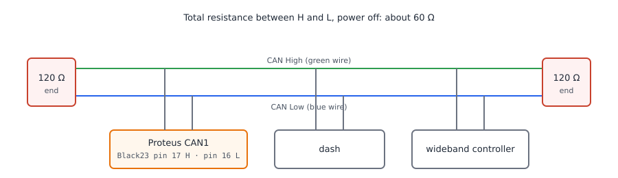

# CAN configuration

:material-circle:{ .level-basic } Basic → :material-circle:{ .level-advanced } Advanced

> **In one sentence:** CAN is the two-wire network the ECU uses to talk to a dash, a wideband
> controller, an EGT gauge, the car's own instrument cluster and extra input/output boxes — one dialog
> turns the network on, a handful more decide what the ECU listens for and what it sends.

## What it does

:material-circle:{ .level-basic } Basic

**CAN** (Controller Area Network) is a bus: two wires, **CAN High** and **CAN Low**, twisted together
and shared by every device on the network. Every message carries an identifier rather than a
destination address, so all devices see all messages and each one keeps the identifiers it cares
about. rusEFI uses CAN in four directions:

- **Listening** — vehicle speed from an OEM dashboard, lambda from a wideband controller, exhaust
  gas temperatures from an EGT module, extra switch and sensor inputs from an IO expander, and
  acceleration from an OEM inertia sensor.
- **Broadcasting** — sending engine data out for a dash or data logger to display, either in
  rusEFI's own format or in a protocol an original equipment cluster expects.
- **Talking to its own accessories** — the rusEFI wideband controller is a CAN device, and the ECU
  tells it how hard to heat the sensor.
- **Being watched** — the built-in CAN sniffer streams the bus to a PC so you can see the traffic.

A Proteus F7 has **two independent CAN buses**. They are wired to fixed connector pins:

| Bus | CAN High | CAN Low |
|---|---|---|
| CAN1 (primary) | **Black23 pin 17** (green) | **Black23 pin 16** (blue) |
| CAN2 (secondary) | **Black23 pin 22** (green) | **Black23 pin 21** (blue) |

On Proteus these pins are fixed by the board: TunerStudio does not offer fields to move them, and
the two buses are always available to the firmware.

<!-- src: firmware/config/boards/proteus/connectors/black23.yaml (CAN bus High/Low and CAN2 bus High/Low pin numbers and wire colours); firmware/config/boards/proteus/board_configuration.cpp (canTxPin, canRxPin, can2TxPin, can2RxPin overrides); firmware/config/boards/proteus/prepend.txt (ts_show_can_pins false) -->

!!! danger "An OEM CAN bus is part of the car's safety system"
    The wires behind the dashboard may carry anti-lock braking, airbag or steering data. Plugging a
    laptop or an ECU into that bus, or setting a bit rate that does not match, can put error frames
    on a network the car relies on. Identify the bus before you connect to it, connect only one
    device at a time while testing, and never inject messages into a bus you have not mapped.

## How it works

:material-circle:{ .level-intermediate } Intermediate

<figure markdown>
  
  <figcaption>Figure 1 — One twisted pair, a terminator at each end. With the power off, measure
  about 60 Ω between CAN High and CAN Low; anything else means a missing or doubled terminator, or a
  short.</figcaption>
</figure>

### The two paths inside the ECU

CAN in rusEFI is two threads, not one.

**Receive.** When **CAN read enabled** is on, the ECU starts one receive thread per bus. Each thread
waits up to 100 ms for a frame and, if it gets nothing, asks the CAN hardware to recover; when a
frame arrives, the ECU passes it down a chain of listeners — the CAN wideband and EGT sensors, the
OEM vehicle-speed decoder, the OBD-II and UDS layers, Lua's `canRxAdd`, the calibration-over-CAN
bridge, and the sniffer. Frames with no interested listener are simply dropped, so a bus full of
traffic from other devices costs you nothing.
<!-- src: firmware/hw_layer/drivers/can/can_hw.cpp (CanRead::ThreadTask, canReceiveTimeout, canHwRecover); firmware/controllers/can/can_rx.cpp (processCanRxMessage, serviceCanSubscribers); firmware/controllers/can/can_listener.h (CanListener::acceptFrame, decodeFrame) -->

**Transmit.** One worker thread serves every bus. It runs on a **5 ms** cycle and, on each round,
sends whatever is due on that cycle: the periodic broadcasts (dash protocol, rusEFI broadcast,
wideband status) and anything queued by Lua or by a request from a sensor. Each bus gets one
non-blocking send attempt per round, so a busy or broken bus cannot stall the other one.
<!-- src: firmware/hw_layer/drivers/can/can_hw.cpp (CanWrite, CAN_CYCLE_FREQ); firmware/controllers/can/can_tx.cpp (CanWrite::ThreadTask, CanWrite::PeriodicTask, computeFlags); firmware/hw_layer/drivers/can/can_msg_tx.cpp (queued transmit, listenOurs echo) -->

Two consequences are worth knowing:

- If **both** CAN read and CAN write are off, the ECU does not start the CAN hardware at all, and
  nothing on either bus works — including the sniffer.
- The transmit worker starts even with **CAN write enabled** off, so a Lua `txCan` or a TunerStudio
  connection over CAN still sends. Only the *periodic* broadcasts stop.
<!-- src: firmware/hw_layer/drivers/can/can_startup.h (startCan, startWriter, startReader, startSniffer); firmware/controllers/can/can_tx.cpp (canWriteEnabled gate on PeriodicTask) -->

<figure markdown>
  
  <figcaption>Figure 2 — What each field on the CAN Bus Settings dialog gates. Green is received
  data, orange is transmitted data, red dashed is the switch that starts that half of the
  network.</figcaption>
</figure>

### Cycles and periods

The transmit worker does not run on arbitrary timers: every 5 ms tick it recomputes which of a fixed
set of cycles (5, 10, 20, 50, 100, 200, 250, 500 and 1000 ms) is due, and each sender picks its
cycle from that list. rusEFI's own broadcast period is your **rusEFI CAN data period** rounded down
to the nearest cycle, so 50 ms sends every 50 ms, 30 ms also sends every 20 ms, and 1 ms sends every
5 ms.
<!-- src: firmware/controllers/can/can.h (CanInterval, CanCycle); firmware/controllers/can/can_tx.cpp (roundTxPeriodToCycle, canSleepPeriodMs) -->

### Which settings need a restart

Burn is not always enough. **CAN read enabled**, **CAN write enabled**, the two listen-mode fields
and **Enable CAN Wideband** / **CAN EGT** are marked as needing an ECU power cycle, and the bit rate
is applied when the CAN peripheral is configured — at start-up, or when a Lua call asks the bus to
restart. The safe habit after any change on the CAN Bus Settings dialog is: **Burn**, then power off
and back on.

<!-- src: firmware/tunerstudio/tunerstudio.template.ini (requiresPowerCycle entries for canReadEnabled, canWriteEnabled, can1ListenMode, can2ListenMode, enableAemXSeries, enableAemXSeriesEgt); firmware/hw_layer/drivers/can/can_hw.cpp (configureDevice, restartCanBus, setCanBaud); firmware/hw_layer/hardware.cpp (stopCanPins, startCanPins on configuration change) -->

## Before you start

:material-circle:{ .level-basic } Basic

- **Wire the pair.** CAN High and CAN Low go to **Black23 pin 17** and **Black23 pin 16** for the primary bus,
  **Black23 pin 22** and **Black23 pin 21** for the secondary. Keep them twisted together for the whole run and
  keep any branch (a *stub*) short.
<!-- src: firmware/config/boards/proteus/connectors/black23.yaml (CAN bus High/Low, CAN2 bus High/Low) -->

- **Terminate both ends.** A CAN bus needs a 120 Ω terminator at each *physical* end and nowhere
  else. With the ECU and every device unpowered, measure between CAN High and CAN Low: about 60 Ω
  means two terminators in place, 120 Ω means one is missing, and much below 60 Ω means one too many
  or a short between the wires.

- **Decide the topology before you set anything in TunerStudio**: which bus each device is on, the
  bit rate every device on that bus will use, and whether the bus is shared with the car's own
  modules. Every device on one bus must use the same bit rate; the two buses are configured
  independently and may differ.

- **Work with 12 V on, not USB power.** Reading a wideband or EGT controller, checking CAN counters
  and reproducing a fault all want the ECU running from the battery with the ignition on, as
  everywhere else in this manual.

!!! note "A rusEFI wideband controller is a CAN device"
    If your wideband is the analogue kind instead, it belongs on an analogue input and the CAN
    wideband switches stay off — see step 3.

## Setting it up

:material-circle:{ .level-basic } Basic → :material-circle:{ .level-intermediate } Intermediate

CAN is a top-level TunerStudio menu on the Proteus ini: **CAN-bus ▸ CAN Bus Settings**,
**CAN-bus ▸ CAN Bus sniffer**, **CAN-bus ▸ CAN Vehicle speed sensor**, **CAN-bus ▸ CAN O2 sensors**,
**CAN-bus ▸ CAN EGT sensors** and **CAN-bus ▸ CAN MS IO-Box Settings**. Wideband and EGT also appear
under **Sensors**, where the same fields sit next to their gauges.

### 1 · Turn the bus on and set the bit rate

Open **CAN-bus ▸ CAN Bus Settings**. The **CAN Bus** panel holds the global switches, the **Primary
CAN** and **Secondary CAN** panels hold one bit rate and one console-verbosity switch each. In a new
tune **CAN read enabled** and **CAN write enabled** are already on and both bit rates are
**500kbps**. Set **Bitrate** to match every other device on that bus, **Burn**, and power-cycle the
ECU.

<!-- shot: img/ts/can-bus-settings.png | CAN-bus ▸ CAN Bus Settings | Proteus F7, ignition on, engine stopped, factory tune: CAN dash type None, Inertia Measurement Unit None, CAN read enabled enabled, CAN write enabled enabled, Enable rusEFI CAN broadcast disabled, Board state broadcast disabled, rusEFI CAN data bus Primary CAN, rusEFI CAN data base address 512, rusEFI CAN data address type 11 bit, rusEFI CAN data period 50 ms, Verbose Can unchecked, Bitrate 500kbps in the Primary CAN panel, Verbose Can2 unchecked with Bitrate 500kbps in the Secondary CAN panel, all dropdowns closed | CAN Bus Settings with the factory defaults: the two switches that start the network, one bit rate per bus, and the optional senders next to them. -->

Field by field, in the order they appear:

- **CAN dash type** `canNbcType` — choose a protocol here when the ECU must feed an *original
  equipment or aftermarket cluster* that expects specific message identifiers and encodings: BMW
  E46, W202, BMW E90, VAG, VAG MQB, Mazda RX8, Fiat, Nissan VQ35, Genesis Coupe, Honda K, Haltech,
  AiM or *MS Simplified Broadcast*. Leave it on **None** for a dash or logger that can be given a
  message list of its own — rusEFI's own broadcast is the cheaper route. Selecting **Haltech** also
  demands a 1 Mbps bit rate.
- **Inertia Measurement Unit** `imuType` — decode an OEM yaw/acceleration sensor instead of a
  board-mounted one. Only the Bosch MM5.10 decoding is implemented in this firmware, so pick
  **MM5.10** for that sensor and leave **None** for anything else.
- **CAN read enabled** `canReadEnabled` — start the receive threads. Off, the ECU ignores every
  frame and the sniffer never starts.
- **CAN write enabled** `canWriteEnabled` — send the periodic broadcasts. Off, a dash goes dead and
  the wideband controller stops being told to heat its sensor.
- **Enable rusEFI CAN broadcast** `enableVerboseCanTx` — send rusEFI's own engine-data set (step 7).
- **Board state broadcast** `enableExtendedCanBroadcast` — send rusEFI's board-status and counter
  frames on the bench-test identifiers; meant for factory test equipment, not for a dash.
- **rusEFI CAN data bus** `canBroadcastUseChannel` — which bus the rusEFI broadcast goes out on:
  *Primary CAN* or *Secondary CAN* (a Proteus has two buses).
- **rusEFI CAN data base address** `verboseCanBaseAddress` — the first identifier of the set; the
  ECU sends base +0 through base +11. The factory value for Proteus is `0x200`, which TunerStudio
  shows as the decimal **512**.
- **rusEFI CAN data address type** `rusefiVerbose29b` — 11-bit standard identifiers, or 29-bit
  extended ones if the standard range is crowded by the vehicle's own traffic.
- **rusEFI CAN data period** `canSleepPeriodMs` — how often the whole broadcast set is sent,
  rounded down to a fixed cycle (50 ms by default).
- **Verbose Can** `verboseCan` and **Verbose Can2** `verboseCan2` — print every frame of the primary
  and secondary bus in the **rusEFI console** as it arrives and leaves. This is done in the rusEFI
  console; TunerStudio has no CAN frame view. Leave these off while driving: printing a line per
  frame on a busy bus buries the console in text and slows it down.

<!-- src: firmware/controllers/algo/engine_configuration.cpp (setDefaultCanSettings: 500 kbps both buses, canReadEnabled, canWriteEnabled, canSleepPeriodMs 50, verboseCanBaseAddress); firmware/controllers/generated/rusefi_generated_proteus_f7.h (CAN_DEFAULT_BASE 0x200, EFI_CAN_BUS_COUNT 2); firmware/controllers/can/can_dash.cpp (updateDash: dash type to protocol mapping); firmware/controllers/can/can_dash_haltech.cpp (canDashboardHaltech 1 Mbps assertion); firmware/controllers/can/can_rx.cpp (processCanRxImu, imuType); firmware/controllers/can/can_verbose.cpp (sendCanVerbose base and offsets); firmware/controllers/can/can_bench_test.cpp (board status frames); firmware/hw_layer/drivers/can/can_hw.cpp (canInfo, listen mode) -->

### 2 · Check that the bus is alive

Log three channels and watch them with the ignition on:

| Channel | What it means |
|---|---|
| **CAN: Rx** `canReadCounter` | frames the ECU has received — it must climb when the bus is talking |
| **CAN: Tx OK** `canWriteOk` | frames sent successfully |
| **CAN: Tx err** `canWriteNotOk` | frames that failed — it must stay flat |

If **CAN: Rx** does not move, check termination (about 60 Ω), that High and Low are not swapped, and
that both devices use the same bit rate. If **CAN: Tx err** climbs, the ECU is the only node
answering for the bus — usually a missing terminator or a node at the wrong bit rate.

<!-- src: firmware/console/binary/output_channels.txt (canReadCounter, canWriteOk, canWriteNotOk); firmware/tunerstudio/gauge_declarations.ini (CAN: Rx, CAN: Tx OK, CAN: Tx err labels) -->

### 3 · A wideband controller on CAN

Open **CAN-bus ▸ CAN O2 sensors** and switch on **Enable CAN Wideband** `enableAemXSeries`. Then,
under **Sensors ▸ CAN O2 sensors**, set each sensor's **UEGO type** `canWbo1_type` /
`canWbo2_type`:

- **RusEFI** — a rusEFI wideband controller. It answers on two 11-bit identifiers that come in a
  pair per sensor, chosen by **RusEFI WBO ID** `canWbo1_reId` and listed in TunerStudio as
  *ID1 0x190/191*, *ID2 0x192/193* and so on. The even identifier carries lambda, the odd one carries
  the controller's diagnostics: heater and pump duty, sensor temperature, Nernst voltage.
- **AEM X-series** — an AEM X-series controller, which uses 29-bit identifiers listed as
  *ID1 0x0000180*, *ID2 0x0000181* and so on, chosen by **AEM ID** `canWbo1_aemId`.
- **Disabled/Analog** — leave this sensor on its analogue input.

Then set **Wideband CAN bus** `widebandOnSecondBus` to the bus the controller is physically wired to
(both wideband controllers must be on the same bus), and **Smoothing Factor**
`afrExpAverageAlpha` — 1 is no filtering, lower values smooth the reading; the default is 1.

!!! warning "Two errors will stop you here, and both are configuration mistakes"
    With CAN wideband on, the analogue wideband input must be **unassigned**: on Proteus the factory
    tune puts an analogue wideband on *Analog Volt 10*, so turning CAN wideband on while it is still
    assigned raises *Please pick either analog AFR or CAN AFR input not both.* Unassign the analogue
    input first. And CAN wideband needs **both** CAN read and CAN write enabled — otherwise the ECU
    raises *CAN read and write are required to use CAN wideband.* Either change needs a burn and a
    power cycle.

<!-- shot: img/ts/can-wideband.png | CAN-bus ▸ CAN O2 sensors | Proteus F7, ignition on, engine stopped, CAN read and write enabled, Enable CAN Wideband checked, Wideband CAN bus CAN1, Smoothing Factor 1, Force O2 sensor heating unchecked, and the analogue wideband input Analog Volt 10 left unassigned on Sensors ▸ Analog O2 sensor so no configuration error is raised, all dropdowns closed | The CAN O2 sensors panel on the CAN-bus menu: one switch, the bus the controller sits on, the smoothing factor and the workshop-only heater switch. -->

<!-- shot: img/ts/can-wideband-sensor.png | Sensors ▸ CAN O2 sensors | Proteus F7, ignition on, engine stopped, Enable CAN Wideband already on so both sensor panels are visible: CAN UEGO 1 panel with UEGO type RusEFI, RusEFI WBO ID ID1 0x190/191, lambda, sensor temperature, heater duty and Nernst voltage gauges, and the indicator column showing AFR Invalid plus Timeout reading when no controller is connected, CAN UEGO 2 panel alongside with ID2 0x192/193, all dropdowns closed | The same settings under the Sensors menu, with one panel per sensor: identifier choice, gauges, and the indicators that say what the controller is doing. -->

The ECU tells a rusEFI controller when it may heat the sensor: every 50 ms it sends its battery
voltage and a heater-allow bit, and the bit is only set while the engine is running — or while
**Force O2 sensor heating** `forceO2Heating` is on. That is why a cold, stopped engine reports
*Heater not allowed* and a wideband reading stays invalid until the engine runs; it is also why the
field is marked as workshop-only.

!!! danger "Force O2 sensor heating is a workshop switch"
    Forcing the heater while the engine is stopped or the exhaust is cold can crack the sensing
    element as condensation passes over it. Use **Force O2 sensor heating** to test a sensor for a
    few minutes, then turn it off and **Burn** before you drive.

<!-- src: firmware/init/sensor/init_lambda.cpp (initLambda: enableAemXSeries, criticalError for read and write, registerCanSensor); firmware/init/sensor/init_sensors.cpp (initOldAnalogInputs: criticalError for analog and CAN AFR); firmware/controllers/sensors/impl/AemXSeriesLambda.cpp (getReCanId, getAemCanId, acceptFrame, decodeRusefiStandard, decodeRusefiDiag, refreshState, sensor_timeout); firmware/controllers/can/rusefi_wideband.cpp (sendWidebandInfo, getWidebandBus); firmware/controllers/algo/engine.cpp (heaterControlEnabled from forceO2Heating or a running engine); firmware/controllers/can/wideband_firmware/for_rusefi/wideband_can.h (WB_DATA_BASE_ADDR, WBO_TX_PERIOD_MS, WB_MSG_ECU_STATUS, wbo::Status) -->

### 4 · Give a rusEFI wideband controller an identifier that fits your bus

A rusEFI controller's default identifiers (0x190 and up) can clash with a car's own traffic. Open
**Sensors ▸ rusEFI Wideband Tools** — it only appears while CAN read and write are on. **Target
device HW ID** `canReWidebandHwIndex` picks the physical controller (each one has a hardware index
from the board it is built on), **Required CAN ID** `canReWidebandCanId` is the identifier pair you
want, listed as *ID1 0x190/191*, *ID2 0x192/193* and so on, and **Set Index**
`cmd_set_wideband_idx_by_id` moves it there; **Ping/Get FW version** confirms a controller is
answering and reports its firmware version and build date.

<!-- shot: img/ts/can-wideband-tools.png | Sensors ▸ rusEFI Wideband Tools | Proteus F7, ignition on, engine stopped, CAN read and write enabled so the menu entry exists, UEGO type RusEFI so both auto remap panels show: 2025/2026 firmware panel with Wideband CAN bus CAN1, Target device HW ID Idx 0, Required CAN ID ID1 0x190/191, Ping/Get FW version and Set Index buttons, FW version and build date readouts at zero, rusEFI Wideband 1 auto remap panel with Auto remap on start checked, rusEFI WBO hardware index Idx 0 and rusEFI WBO CAN ID ID1 0x190/191, no firmware update button pressed | rusEFI Wideband Tools: find the controller with a ping, give it an identifier that fits your bus, and make the mapping permanent with the auto remap panels. -->

For a permanent arrangement, use the *rusEFI Wideband 1 auto remap* panel on the same page: **Auto
remap on start** `canWbo1_enableRemap` makes the ECU re-apply the mapping every time it starts, with
**rusEFI WBO hardware index** `canWbo1_reHwidx` (which controller) and **rusEFI WBO CAN ID**
`canWbo1_reId` (which pair of identifiers). The remap is sent about half a second after start-up.

!!! warning "The firmware-update buttons on this page rewrite the controller"
    **Update to 2026-01 Firmware**, **Flash FW from SD card** and the *Legacy 2023 (stock) firmware*
    button reprogram the wideband controller over CAN. Losing power or unplugging the controller
    during a flash leaves it unusable. Do it on 12 V with a connected battery, one controller
    connected at a time as the page says, and only when the controller's firmware really is the
    problem.

<!-- src: firmware/controllers/can/rusefi_wideband.cpp (setWidebandOffset, setWidebandOffsetNoWait, pingWideband, restartWideband, sendWidebandInfo remap counter); firmware/tunerstudio/tunerstudio.template.ini (canReWidebandTools dialog: canReWidebandHwIndex, canReWidebandCanId, cmd_set_wideband_idx_by_id, cmd_wideband_firmare_update); firmware/integration/rusefi_config.txt (canWbo remap fields) -->

### 5 · EGT modules on CAN

Switch on **CAN EGT (AEM X series of RusEFI)** `enableAemXSeriesEgt` on **CAN-bus ▸ CAN EGT
sensors**, burn and power-cycle. rusEFI then listens for six exhaust-gas-temperature channels,
**EGT1** to **EGT6**, on one identifier per channel, each sent ten times a second; a channel that has
been silent for 300 ms stops reading. Note that the EGT listeners do not use **Wideband CAN bus** —
they accept the frames on either bus.

<!-- shot: img/ts/can-egt.png | CAN-bus ▸ CAN EGT sensors | Proteus F7, ignition on, engine stopped, CAN read enabled on, the text line CAN support EGT1 to EGT6 inputs visible and CAN EGT (AEM X series of RusEFI) checked, all dropdowns closed | CAN EGT sensors: one switch, because an EGT module's six channel identifiers are fixed. -->

<!-- src: firmware/init/sensor/init_egt.cpp (aemEgt1 to aemEgt6, enableAemXSeriesEgt); firmware/controllers/sensors/impl/AemXSeriesEgt.cpp (aem_egt_base 0x000A0305 plus channel index, 10 Hz period, 300 ms timeout); firmware/controllers/can/can_listener.h (acceptFrame default: same identifier accepted on any bus); firmware/controllers/can/can_verbose.cpp (Egts frame carries EGT1 and EGT2) -->

### 6 · Vehicle speed from the car's own bus

Open **CAN-bus ▸ CAN Vehicle speed sensor**. **Enable CAN VSS** `enableCanVss` is only reachable with
CAN read enabled. Choose **CAN VSS type** `canVssNbcType` — the car the bus came out of: *BMW_e46*,
*W202*, *BMW E8x/E9x MK60e5*, *Nissan 350*, *Hyundai PB* or *Honda Civic9*. rusEFI then knows which
identifier to accept and how to decode it; for a Hyundai PB or Nissan it also derives a wheel-slip
ratio from the front and rear wheel speeds. Finally **CAN VSS scaling** `canVssScaling` corrects the
reported speed for tyre size or final drive: 1.1 turns a reported 50 km/h into 55 km/h. The valid
range is 0.5 to 1.5 and the default is 1.0. A speed read over CAN is considered stale after half a
second, so a bus that stops talking makes vehicle speed disappear rather than freeze.

<!-- shot: img/ts/can-vss.png | CAN-bus ▸ CAN Vehicle speed sensor | Proteus F7, ignition on, engine stopped, CAN read enabled on, Enable CAN VSS checked, CAN VSS type BMW_e46, CAN VSS scaling 1.000, vehicle speed gauge reading 0 beside the panel, all dropdowns closed | Reading vehicle speed from an OEM bus: the vehicle type picks the identifier and the decoding, the scaling trims the result. -->

!!! tip "Check the number, not the wiring"
    Compare the ECU's speed against a GPS readout at a steady 100 km/h and set
    **CAN VSS scaling** from the ratio. Vehicle speed feeds gear detection, slip detection and
    speed-based limits, so a wrong scaling quietly degrades all of them. And remember that these
    wheel-speed messages come from the anti-lock braking system: if you are not sure which bus is
    which, use a wheel-speed sensor on a digital input instead.

<!-- src: firmware/controllers/can/can_vss.cpp (look_up_vss_can_id, processBMW_e46, processHyundai, processNissan, canSpeed timeout, canVssScaling, initCanVssSupport, filterRpmCanID); firmware/tunerstudio/tunerstudio.template.ini (speedSensorCan dialog, speedSensorCanHelp, enableCanVss condition on canReadEnabled) -->

### 7 · Broadcast engine data to a dash or logger

Back on **CAN-bus ▸ CAN Bus Settings**, switch on **Enable rusEFI CAN broadcast**. The ECU then
sends twelve frames — base address +0 through +11 — on **rusEFI CAN data bus**, every **rusEFI CAN
data period**, with standard identifiers unless you switch **rusEFI CAN data address type** to
extended. The default base address on Proteus is `0x200`; rusEFI's own database file
`rusEFI_CAN_verbose.dbc` is written for that base, so import it into your dash or logger software
rather than typing identifiers by hand.

<!-- shot: img/ts/can-broadcast.png | CAN-bus ▸ CAN Bus Settings | same dialog cropped to the CAN Bus panel only, with Enable rusEFI CAN broadcast checked, rusEFI CAN data bus Primary CAN, rusEFI CAN data base address 512, rusEFI CAN data address type 11 bit, rusEFI CAN data period 50, Board state broadcast unchecked, CAN dash type None, all dropdowns closed | rusEFI's own broadcast enabled: twelve frames starting at the base address, sent on the selected bus at the selected period. -->

<figure markdown>
  
  <figcaption>Figure 3 — rusEFI's own broadcast enabled: twelve frames starting at the base address, sent on the selected bus at the selected period.</figcaption>
</figure>

What is inside the twelve frames:

| Frame | Contents |
|---|---|
| base +0 | warnings counter, last fault code, rev-limit and output states (main relay, fuel pump, check engine, O2 heater, lambda protection, both fans), detected gear, distance |
| base +1 | engine speed, ignition timing, injection duty, coil duty, vehicle speed in km/h, ethanol percentage |
| base +2 | accelerator pedal, TPS 1, TPS 2, wastegate position, all as percent |
| base +3 | MAP, coolant and intake temperatures, both aux temperatures, MCU temperature, fuel level |
| base +4 | oil pressure, oil and fuel temperatures, battery voltage |
| base +5 | cylinder air mass, estimated airflow, last injection pulse width, knock count |
| base +6 | fuel consumed, fuel flow, short-term fuel trim for both banks |
| base +7 | lambda 1 and 2, low and high fuel pressure |
| base +8 | actual and target cam positions for both banks |
| base +9 | EGT 1 and EGT 2 in 5 °C steps |
| base +10 | per-cylinder knock advance |
| base +11 | brake pedal state |

Temperatures in these frames carry an offset of 40 and several fields are scaled integers; the DBC
file describes every factor, so use it.

<!-- src: firmware/controllers/can/can_verbose.cpp (Status, Speeds, PedalAndTps, Sensors1, Sensors2, Fueling, Fueling2, Fueling3, Cams, Egts, PerCylinderKnock, Status11, sendCanVerbose); firmware/controllers/can/rusEFI_CAN_verbose.dbc (BASE0 to BASE11 at 512, signal scaling and comments); firmware/integration/rusefi_config.txt (verboseCanBaseAddress, canSleepPeriodMs, rusefiVerbose29b, canBroadcastUseChannel) -->

### 8 · An MS-style IO box on CAN

**CAN-bus ▸ CAN MS IO-Box Settings** adds a MegaSquirt-style remote input/output expander on the bus.
**Base CAN identifier** `msIoBox0_id` selects one of three identifier slots (*ID200*, *ID220*,
*ID240*) for the box; the ECU pings it, exchanges configuration, and drives its outputs. **VSS
settings** `msIoBox0_vss` is present for the box's wheel-speed inputs but is not used by this
firmware.

<!-- shot: img/ts/can-iobox.png | CAN-bus ▸ CAN MS IO-Box Settings | Proteus F7, ignition on, engine stopped, MS IO box 1 panel with Base CAN identifier set to ID200 and the VSS settings field visible below it set to VR12, nothing else on the page, all dropdowns closed | The whole MS IO-Box page: a base identifier slot and a VSS field that this firmware does not act on. -->

!!! note "What the IO box does on a Proteus today"
    In this firmware the box's discrete and PWM outputs work; its inputs, analogue inputs and
    wheel-speed capture are marked as not implemented in the driver. The box's extra pins are also
    not offered in the Proteus pin menus, so on this board you can make the ECU talk to a box but not
    yet assign anything to run on it. The board files for the Alphax and MRE families do list
    *MS IO-Box 0 OUT …* and *MS IO-Box 0 VSS…* pin names, and that is where the feature is useful
    today. Another ECU can be made to *be* such a box with the Lua example
    `msio-device.lua`.

<!-- src: firmware/hw_layer/drivers/gpio/can_gpio_msiobox.cpp (initCanGpioMsiobox: msIoBox0.id, CAN_IOBOX_BASE1 0x200 plus 0x20 per slot, ping and whoami state machine, current status comment, TODO list); firmware/controllers/algo/rusefi_enums.h (MsIoBoxId, MsIoBoxVss); firmware/config/boards/microrusefi/connectors/iobox.yaml (iobox connector); firmware/controllers/lua/examples/msio-device.lua (Lua implementation of the box side) -->

### 9 · Watch the bus with the CAN sniffer (optional)

The sniffer streams one of the buses to the PC as plain text over a **second USB serial port**, and
understands the standard SLCAN (Lawicel) commands, so SavvyCAN, `can-utils` or the rusEFI console
can record the traffic. A Proteus F7 provides that second port.

Set the sniffer up in TunerStudio, on **CAN-bus ▸ CAN Bus sniffer**:

- **Listen bus (excl. ECU messages)** `canSniffer1_read` / `canSniffer2_read` — stream frames the
  bus receives. **Off by default**, so out of the box the sniffer shows you only what the ECU itself
  sends.
- **Include frames we send** `canSniffer1_listenOurs` / `canSniffer2_listenOurs` — also echo the
  ECU's own frames; on by default.
- **Include CAN bus in trace** `canSnifferIncludeBus` — prefix each frame with its bus, which lets a
  logger tell CAN1 from CAN2. Turn it **off** for standard SLCAN clients, which do not understand the
  prefix, and reconnect the sniffer after changing it.
- **Sniffer Tx CAN bus** `canSnifferTxBus` — which bus frames you send from the PC go out on.
  **None** by default, and then transmissions are refused.
- **ECU should handle what sniffer say** `canSniffer1_handleInjected` — treat frames you inject from
  the PC as if they had arrived on the bus.

<!-- shot: img/ts/can-sniffer.png | CAN-bus ▸ CAN Bus sniffer | Proteus F7, ignition on, engine stopped, Include CAN bus in trace checked, Primary CAN panel with Listen bus (excl. ECU messages) set to No and Include frames we send set to Yes, Secondary CAN panel identical, Transmit Frames panel with Sniffer Tx CAN bus set to None, ECU should handle what sniffer say rows left at their default, all dropdowns closed | The sniffer's defaults are a frequent surprise: with Listen bus off you see only the ECU's own frames, even on a live bus. -->

!!! danger "Injected frames are real engine control"
    With **ECU should handle what sniffer say** on, anything you type at the PC is processed as if it
    came from a device on the bus. Turn it on only on a bench with the engine off, and turn it off
    before you go near a running engine.

To watch the traffic, use the rusEFI console — TunerStudio has no CAN view. This is done in the
rusEFI console: open its **SLCAN Sniffer** tab, let it find the second port, and it opens the channel
and records. A third-party SLCAN client has to send the canonical sequence — close, then any bit-rate
code, then open — and the rate in that code is ignored, because the **Bitrate** in TunerStudio is what
the hardware actually uses.

<!-- src: firmware/controllers/can/can_sniffer.md (console SLCAN tab and port scan, mandatory S code before O, rate ignored by the ECU) -->

<!-- src: firmware/controllers/can/can_sniffer.cpp (executeCommand, handle_can_message, slcan output framing); firmware/hw_layer/drivers/can/can_hw.cpp (CanSniffer on SDU[1], canSniffer read gate, startSniffer); firmware/config/boards/proteus/board.mk (HAL_USE_USB_CDC_2) -->

## Worked examples

:material-circle:{ .level-intermediate } Intermediate

### Example 1 — a rusEFI wideband controller and a dash, both on CAN1

A Proteus with no analogue wideband fitted, one rusEFI wideband controller and a CAN dash, both on the
primary bus:

| Setting | Value | Why |
|---|---|---|
| CAN read enabled | on | the ECU has to hear the wideband frames |
| CAN write enabled | on | the wideband controller needs the heater-allow message, and the dash needs data |
| Bitrate (primary) | 500kbps | one rate for every device on that bus, and 500 k is the firmware's default |
| CAN dash type | None | the dash accepts a custom message list |
| Enable rusEFI CAN broadcast | on | one message set for the dash to consume |
| rusEFI CAN data base address | `0x200` | rusEFI's own DBC is written for this base |
| rusEFI CAN data period | 50 ms | enough for a dash needle, cheap on the bus |
| Enable CAN Wideband | on | lambda comes from the controller, not an analogue input |
| UEGO type | RusEFI | the controller is rusEFI's own |
| RusEFI WBO ID | *ID1 0x190/191* | the controller's default pair of identifiers |
| Wideband CAN bus | CAN1 | both accessories are on the primary bus |
| Analog wideband input | unassigned | the firmware faults out if both are configured |

Leave **Smoothing Factor** at 1 while logging the raw lambda, then lower it (0.9 to 0.98 is the
usual starting range) only if closed-loop control needs a calmer signal.

<!-- src: firmware/controllers/can/can_verbose.cpp (sendCanVerbose); firmware/controllers/sensors/impl/AemXSeriesLambda.cpp (refreshSmoothedLambda, afrExpAverageAlpha); firmware/init/sensor/init_sensors.cpp (analog and CAN AFR conflict) -->

### Example 2 — keep the OEM cluster working on a swapped engine

The car's instruments stay on the car's own bus; rusEFI joins that bus to read speed and to feed the
cluster tachometer and temperature:

| Setting | Value | Why |
|---|---|---|
| Bitrate (primary) | 500kbps | the OEM powertrain bus rate |
| CAN dash type | BMW E46 (match the car) | this is what the cluster expects to be fed |
| CAN read enabled | on | the ECU must hear the cluster's wheel speeds |
| Enable CAN VSS | on | no extra wheel-speed sensor needed |
| CAN VSS type | BMW_e46 (match the car) | selects the identifier and the decoding |
| CAN VSS scaling | 1.0, then correct against GPS | tyre size and final drive |
| Enable rusEFI CAN broadcast | off | the cluster wants its own format, not rusEFI's |

Put the ECU on that bus as a short stub, keep the car's terminators as they were, and verify
**CAN: Rx** climbs before you drive.

<!-- src: firmware/controllers/can/can_vss.cpp (look_up_vss_can_id: 0x01F0 for BMW_e46, rear-wheel averaging); firmware/controllers/can/can_dash.cpp (canDashboardBmwE46: RPM and coolant frames) -->

### Example 3 — an aftermarket dash on a bus of its own

For a logger or dash that is the only node besides the ECU, rusEFI's broadcast plus the DBC is the
whole job: **CAN dash type** stays on *None*, **Enable rusEFI CAN broadcast** is on, and
**rusEFI CAN data address type** is set to extended identifiers when the standard 11-bit range is
already taken by other devices on that bus. Use **rusEFI CAN data bus** to keep the broadcast on the
bus the dash is wired to, and raise **rusEFI CAN data period** to 100 ms or 200 ms if the bus is
crowded — a period of 50 ms sends twelve frames twenty times a second, which is a real load at
125 kbps.

<!-- src: firmware/controllers/can/can_verbose.cpp (sendCanVerbose: twelve frames, rusefiVerbose29b, canBroadcastUseChannel); firmware/controllers/can/can_tx.cpp (roundTxPeriodToCycle) -->

## Tuning it: choosing what to send

:material-circle:{ .level-intermediate } Intermediate → :material-circle:{ .level-advanced } Advanced

There is no CAN "tuning" in the sensor sense, but three choices decide how much of the bus the ECU
consumes and how usable the data is:

- **One protocol, not three.** rusEFI broadcast, an OEM dash protocol and board-state broadcast all
  send overlapping numbers. Use the rusEFI set for aftermarket dashes and loggers, an OEM protocol
  only when the car's own cluster must be fooled, and leave **Board state broadcast** off — it exists
  for factory test equipment, and at 100 ms and 250 ms it is a busy talker.
- **Period.** 50 ms suits needles and gauges; lambda and knock at 20 ms buy nothing a log does not
  already record better, and cost bus capacity on slow buses.
- **Identifier block.** Pick a base address nobody else on the bus owns. The factory `0x200` sits in
  the middle of the standard range, and OEM traffic is dense there — on a car bus, move it or switch
  to 29-bit identifiers, then tell your dash software the new base.

!!! info "Advanced"
    The transmit worker will not queue unboundedly: with a bus that cannot drain, transmissions are
    dropped and counted, and the rusEFI console's `caninfo` report shows the queue drop count and the
    per-bus error count. If your dash looks stuttery while **CAN: Tx OK** grows slowly, that count is
    the first thing to look at.

<!-- src: firmware/hw_layer/drivers/can/can_msg_tx.cpp (queue drop counting, getQueueDropCount); firmware/hw_layer/drivers/can/can_hw.cpp (canInfo report: per-bus error count, queue drops, listenOnly); firmware/controllers/can/can_bench_test.cpp (board status periods at 100 and 250 ms cycles) -->

## Diagnostics

:material-circle:{ .level-intermediate } Intermediate

Wideband: the panels on **Sensors ▸ CAN O2 sensors** carry the state of each controller.

| Indicator | Meaning | What to check |
|---|---|---|
| AFR: Valid | lambda reading is good | — |
| AFR: Invalid | the controller reports an invalid reading | sensor, wiring, heating stage — normal while cranking |
| Communication ok | frames arriving | — |
| Timeout reading | no frame from the controller for three of its transmit periods (30 ms) | wrong identifier, wrong bus, CAN read off |
| Preheat / Warmup / Closed loop | where the controller's heating cycle is | normal while cold |
| WBO stopped | the ECU is not allowing heating | engine stopped and **Force O2 sensor heating** off |
| Heating failed / Overheat / Underheat | the controller reports a sensor fault | sensor and wiring |

For a rusEFI controller, log the diagnostic channels the same panels use: `wb1stateCode`,
`wb1isValid`, `wb1canSilent`, `wb1allowed`, `wb1WBO: Heater duty`, `wb1WBO: Temperature`,
`wb1WBO: Nernst Voltage`. A protocol mismatch between controller and ECU is reported loudly —
*Wideband controller index 0 has newer protocol version … please update ECU FW!* or the reverse
message asking for the controller to be updated.

<!-- src: firmware/tunerstudio/tunerstudio.template.ini (uegoCan0Indicators, uegoCan0IndicatorsExt, wb1stateCode gauges); firmware/console/binary/output_channels.txt (wb1 live-data block); firmware/controllers/sensors/impl/AemXSeriesLambda.cpp (decodeRusefiStandard protocol mismatch errors, refreshState CanSilent) -->

Other CAN faults you may see:

| Message or symptom | Cause | Fix |
|---|---|---|
| *Please pick either analog AFR or CAN AFR input not both.* | analogue wideband input still assigned with CAN wideband on | unassign the analogue input |
| *CAN read and write are required to use CAN wideband.* | one of the two switches is off | enable both, burn, power-cycle |
| *Haltech requires 1Mbps baud rate* | **CAN dash type** Haltech with a slower **Bitrate** | set 1 Mbps, or change the dash type |
| *CAN1 and CAN2 pins must be set to different devices* | both buses were pointed at the same controller | only reachable where CAN pins are configurable, not on Proteus |
| **CAN: Rx** stays at zero | no termination, swapped High and Low, mismatched bit rate | Figure 1, and the bit rate on every node |
| Dash gauges frozen after a burn | **CAN write enabled** off, or the broadcast switch off | CAN Bus Settings, then power-cycle |

<!-- src: firmware/init/sensor/init_sensors.cpp (analog/AFR conflict); firmware/init/sensor/init_lambda.cpp (read and write requirement); firmware/controllers/can/can_dash_haltech.cpp (1 Mbps assertion); firmware/hw_layer/drivers/can/can_hw.cpp (criticalAssertVoid for duplicated devices) -->

## Troubleshooting

:material-circle:{ .level-basic } Basic → :material-circle:{ .level-advanced } Advanced

| Symptom | Likely cause | Check |
|---|---|---|
| Nothing on either bus works | CAN read **and** CAN write both off, so the hardware was never started | CAN Bus Settings, then power-cycle |
| A feature still behaves the old way after **Burn** | the switch needs a power cycle | turn the ECU off and on |
| **CAN: Rx** flat although the bus is alive | swapped High/Low, missing terminator, wrong bit rate | measure about 60 Ω, check the rate on every node |
| Wideband shows *Timeout reading* | the identifier or the bus selection does not match the controller | **RusEFI WBO ID** / **AEM ID**, **Wideband CAN bus** |
| Wideband valid only when running | normal: the ECU allows heating only while the engine runs | see the wideband indicators under *Diagnostics*; do not fix it with force heating |
| Wideband fault indicator while the engine runs | real sensor or heater fault reported by the controller | log `wb1stateCode`, `wb1WBO: Temperature`, `wb1WBO: ESR` |
| EGT channels read zero | **CAN EGT** switch off, or the module is not sending its six channels | CAN EGT sensors, then power-cycle; log the EGT channels |
| Vehicle speed missing above idle | the OEM bus stopped sending, speed is stale after 500 ms | check the bus, then the vehicle type selection |
| Wheel slip or gear detection wrong after a CAN VSS swap | **CAN VSS scaling** still 1.0 on different tyres | correct it against a GPS reading |
| Sniffer shows only the ECU's own frames | **Listen bus** is off by default | CAN Bus sniffer, then reconnect the sniffer |
| SavvyCAN or `candump` shows garbage | **Include CAN bus in trace** prefixes the frames | turn it off and reconnect |
| Dash reads the wrong values | its identifier list does not match the ECU's base address | **rusEFI CAN data base address**, and import the DBC |
| Data stops when other devices talk | bus is saturated | raise the broadcast period, or move the broadcast to the second bus |
| A feature works until you drive over a bump | bad crimp or a shared ground on the pair | wiggle test with **Verbose Can** printing in the console |

## Settings reference

### CAN Bus Settings (CAN-bus ▸ CAN Bus Settings)

--8<-- "reference/settings/_canBusMain.table.md"

### CAN Bus sniffer (CAN-bus ▸ CAN Bus sniffer)

--8<-- "reference/settings/_canBusSniffer.table.md"

### CAN wideband (CAN-bus ▸ CAN O2 sensors)

--8<-- "reference/settings/_uegoCan.table.md"

### Wideband sensor assignment (Sensors ▸ CAN O2 sensors)

--8<-- "reference/settings/_egoSettings.table.md"

### rusEFI Wideband Tools (Sensors ▸ rusEFI Wideband Tools)

--8<-- "reference/settings/_canReWidebandTools.table.md"

### CAN EGT sensors (CAN-bus ▸ CAN EGT sensors)

--8<-- "reference/settings/_egtInputsCan.table.md"

### CAN vehicle speed (CAN-bus ▸ CAN Vehicle speed sensor)

--8<-- "reference/settings/_speedSensorCan.table.md"

### MS IO-Box (CAN-bus ▸ CAN MS IO-Box Settings)

--8<-- "reference/settings/_msIoBox.table.md"

## Related

- Part II — Wiring (twisted pairs, screening and grounds on a long CAN run)
- [Electronic throttle](../part3/electronic-throttle.md) — an example of a feature whose data appears in the rusEFI broadcast
- Closed loop lambda — what a CAN wideband is actually used for
- Outputs — the pins a CAN IO box would extend
- Your two tools — why CAN frames are watched in the rusEFI console, not in TunerStudio
