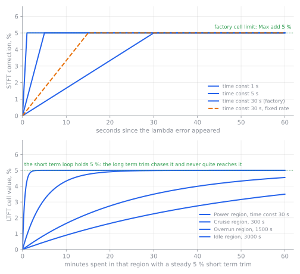

# Closed-loop lambda

:material-circle:{ .level-basic } Basic → :material-circle:{ .level-advanced } Advanced

> **In one sentence:** the ECU reads lambda in the exhaust, compares it with the target from the lambda
> table, and nudges the fuel up or down until the two agree — holding a short-term correction while it
> drives, and learning a long-term correction it keeps between starts.

## What it does

:material-circle:{ .level-basic } Basic

**Lambda** is how far the mixture is from stoichiometric — the ratio of air and fuel that burns
completely. Lambda 1.00 is exactly stoichiometric (14.7:1 on petrol); below 1.00 the mixture is rich,
above 1.00 it is lean. A **wideband** lambda sensor reports a number across that whole range; an older
**narrowband** sensor only says "richer than 1.00" or "leaner than 1.00".

No open-loop fuel table is exact. Fuel pressure changes, injectors wear and foul, the air gets thinner
at altitude, petrol and ethanol carry different amounts of oxygen, and a cold engine puts fuel on the
manifold walls. A lambda sensor is the only thing in the system that measures what actually happened, so
rusEFI uses it to correct the calculated fuel:

- **Short term fuel trim (STFT)** moves quickly, within seconds, and only as far as you allow. It
  forgets everything when the ECU is powered off.
- **Long term fuel trim (LTFT)** moves slowly and *remembers*: it learns the same correction into a
  table against engine speed and load, and saves it to the SD card.
- Both are per **bank** (one lambda sensor can only speak for the cylinders that share its exhaust
  manifold) and per **operating region** (idle, overrun, power, cruise).

rusEFI runs the loop continuously but keeps it out of the places where the sensor cannot be trusted:
cranking, a cold engine, right after deceleration fuel cut, during acceleration enrichment, during launch
control and after any fuel cut. It also corrects only inside a range of measured lambda you set.

Two factory settings matter, and both surprise people:

- **Short term fuel trim** (`fuelClosedLoopCorrectionEnabled`) is **off** at the factory. The wideband
  sensor is read and logged, but it changes nothing until you enable it.
- **Long term fuel trims** are the other way round: **Gathering Data** (`ltft_enabled`) is **on** at the
  factory, while **Apply Correction** (`ltft_correctionEnabled`) is **off**. The ECU learns quietly
  without changing your fuelling, until you decide otherwise.

<!-- src: firmware/controllers/algo/defaults/default_fuel.cpp (setDefaultStftSettings: fuelClosedLoopCorrectionEnabled off; setDefaultLtftSettings: ltft enabled and correctionEnabled) -->

!!! warning "Closed loop is a trim, not a repair"
    A trim that reaches its limit is a symptom, not a solution. If STFT sits at +5 % all the time,
    something is wrong — a vacuum leak, a weak pump, a fouled injector, the wrong injector flow in the
    tune. Letting the loop hide that, and then relying on it, costs you a tune that only works warm and
    at one altitude. Fix the base fuelling first (the Fuel chapter), then turn the loop on.

## How it works

:material-circle:{ .level-intermediate } Intermediate

<figure markdown>
  
  <figcaption>Figure 1 — The lambda loop. Blue is what is asked for, orange is what is driven, green is
  the measurement that closes the loop, red is the safety path. The trim sits at step 8 of the fuel
  calculation chain in the Fuel chapter: it multiplies the base fuel mass on the way to the injector
  model.</figcaption>
</figure>

Everything here runs in the fuel thread, **200 times a second** — 5 ms per step. Both trims are
integrators: they add a little each step, and how fast they add is the whole of their tuning.
<!-- src: firmware/controllers/core/main_loop.h (FAST_CALLBACK_RATE, FAST_CALLBACK_PERIOD_MS); firmware/controllers/algo/engine2.cpp (EngineState::periodicFastCallback) -->

### The error, and where the target comes from

The error is simply *measured lambda minus target lambda*. A positive error means the exhaust is leaner
than you asked for, so fuel is added; a negative error removes fuel.

Target lambda is what the fuel calculation is already aiming at: the **Target lambda** (or **Target AFR**)
table, plus any **Target AFR adder tables**, plus the WOT enrichment adder, converted between lambda and
AFR with the configured **Stoichiometric ratio**. The same number the loop compares against is visible as
the `targetLambda` channel, so a log always shows both sides of the subtraction.

The integration step, from the code:

```
if |measured − target| < Adjustment deadband:   do nothing this step
adjustment += (measured − target) / time constant × 0.005
adjustment is clamped to −Max remove … +Max add, and never past ±25 %
correction = 1 + adjustment            (1.00 means "no change")
```

So **Time const** is exactly what its tooltip says: *how long the loop takes to make most of the
correction it wants to make*. A 30 s time constant with a lambda error of 0.05 adds fuel at
0.05 / 30 = 0.0017 per second — 0.167 % of the fuel per second — and with the factory **Max add** of 5 %
it takes 30 seconds to reach the limit. **Adjustment deadband** (0.5 %) stops the loop twitching over
differences too small to matter.

Turning on **Ignore error magnitude** (`stftIgnoreErrorMagnitude`) replaces the error with a fixed
±0.1, so the trim moves at a constant rate — *0.1 / time constant* per second — no matter how far off the
mixture is. That suits a narrowband sensor, whose output says almost nothing about how far off you are;
leave it off for a wideband.

<!-- src: firmware/controllers/math/closed_loop_fuel_cell.cpp (ClosedLoopFuelCellBase::update, getLambdaError, getMaxAdjustment, getMinAdjustment, getIntegratorGain, MAX_ADJ); firmware/controllers/math/closed_loop_fuel.cpp (ShortTermFuelTrim::getCorrection); firmware/controllers/algo/fuel/fuel_computer.cpp (FuelComputerBase::getCycleFuel, getTargetLambda) -->

### Four regions, two banks

One integrator per region per bank. Which region is active is decided from engine speed and fuelling load:

| Region | Active when | Default boundary |
|---|---|---|
| **Idle** | engine speed below **Idle region RPM** | 1000 RPM |
| **Overrun** | load below **Overrun region load** | 35 (kPa, or % if TPS is the load axis) |
| **Power** | load above **Power region load** | 85 (same units) |
| **Cruise** (shown as **Main** on the dialog, **Normal** in lists) | everything else | — |

The boundaries have small deadbands of their own, so the region does not flicker on a threshold.
Each region has its own **Time const**, **Max add** and **Max remove**, which is why you can let the loop
work briskly at idle and keep a tight grip at full load. The correction *being applied* is always the one
from the region you are in right now, so it steps when you cross a boundary — that is normal.

Alternatively, with the Engine State Machine running and **State based STFT** (`stateBasedStft`) turned
on, the region follows the machine's state instead: Idle, Afterstart and Coasting use the Idle cell,
Overrun the Overrun cell, WOT the Power cell, and everything else the Cruise cell.

Lambda sensor 1 belongs to bank 1 and lambda sensor 2 to bank 2; which cylinder is in which bank is set
by **Cylinder bank selection** (`cylinderBankSelect`) under **Fuel ▸ Injector Setup**. A Proteus F7 has
two fuel trim banks; on a four-cylinder engine with one exhaust, only bank 1 is ever active and the bank 2
columns stay at 1.00 (no correction).
<!-- src: firmware/controllers/math/closed_loop_fuel.cpp (ShortTermFuelTrim::computeStftBin, regionForSmState, getSensorForBankIndex, banks); firmware/controllers/math/closed_loop_fuel.h (FuelingBank, Deadband members); firmware/config/boards/proteus/connectors/black23.yaml -->

!!! info "Advanced"
    The region boundaries in Figure 1 are the same four regions the long term trim uses for its own time
    constants, and the same four the **STFT using** / **STFT learning** channels report. `ft_region_e` is
    the shared enumeration.

### Long term trim: learning it into a table

The long term trim integrates the *short term trim's own output* into a 16 × 16 table with the same
engine-speed and load axes as the VE table, in the cell nearest where the engine is running. Its step is
a lag towards the current STFT value:

```
newTrim = trim + (0.005 / time constant) × weight × (STFT correction − trim)
```

`weight` is 1 dead centre in a cell and falls towards 0 at the corners of it (a cell corner is the
diagonal between four cells), so cell centres fill in first and the seams between cells blend. `trim` is
clamped to **Max add** / **Max remove** (±12.5 % by default) and never past ±25 %.

Three separate switches decide what the long term trim does:

- **Gathering Data** (`ltft_enabled`) — whether it learns at all. On by default.
- **Apply Correction** (`ltft_correctionEnabled`) — whether the table is multiplied into the fuelling.
  Off by default.
- **Apply LTFT to VE and reset** — a one-shot command that writes the learned trims into your VE table and
  clears the trims to zero.

Because it learns only where the short term loop is allowed to work, LTFT fills in gradually: the
cruise cells first, idle last, and never the cells you never visit. The table is stored on the SD card as
`ltft.bin`, and written automatically after every 1000 learning steps. Without an SD card the trims
reset on every start.

<figure markdown>
  
  <figcaption>Figure 2 — What the two time constants mean in practice, replayed from the firmware's own
  integrator with factory settings. Top: a lambda error of 0.05, three time constants, and the
  constant-rate mode. Bottom: with the short term loop holding 5 %, the long term cell reaches it in
  about a minute in the Power region but is still short of it after an hour at idle.</figcaption>
</figure>
<!-- src: firmware/controllers/long_term_fuel_trim.cpp (LongTermFuelTrim::learn, getTrims, getIntegratorGain, SAVE_AFTER_HITS, LtftState::save, applyToVe); firmware/controllers/storage_sd.cpp (getIdFileName: ltft.bin); firmware/controllers/algo/defaults/default_fuel.cpp (setDefaultLtftSettings) -->

### When it stops correcting

There are two sets of gates, and the dialog tells you which one is holding the loop back.

**Correction gates** stop the loop working at all, and the applied correction goes back to 1.00:
the switch is off, TunerStudio is editing the VE table, the engine is not running, the time since
cranking is below **Startup delay**, or coolant is below **Minimum CLT** (or the CLT sensor has failed).

**Learning gates** only pause the integrating; the last correction stays applied. They are: measured
lambda outside **Minimum**/**Maximum AFR for learning**, launch control active, a recent deceleration cut
(within **After DFCO delay**), a recent acceleration enrichment (within **Pause STFT learning after
acceleration**, `noFuelTrimAfterAccelTime`, on the Acceleration enrichment settings dialog), or
any other fuel cut within the last 2 seconds.

The factory AFR window is worth thinking about: **Minimum AFR for learning** 12 means that at full load,
where the default target table asks for lambda 0.73 (10.7:1), learning pauses by itself. You do not need
a separate "off at WOT" switch, and the loop cannot lean out a hot engine by chasing a deliberately rich
target.

A paused trim is a *frozen* trim, not a zeroed one: the cell keeps its value and starts applying it again
the moment the gates open. All cells are cleared only by power-cycling the ECU.

**Detect Tuning and Suspend** (`isTuningDetectorEnabled`, on by default) pauses both trims for 20 seconds
after every write to the VE table, so a live table edit does not get learned into the trims behind your
back.
<!-- src: firmware/controllers/math/closed_loop_fuel.cpp (ShortTermFuelTrim::getCorrectionState, getLearningState); firmware/controllers/algo/rusefi_enums.h (stft_state_e); firmware/console/binary/tunerstudio.cpp (isTuningVeNow); firmware/controllers/algo/defaults/default_fuel.cpp (setDefaultStftSettings: minAfr, maxAfr) -->

### Lambda protection is a different thing

Lambda protection does not correct anything: it cuts fuel. It is there for the case the trims cannot
handle — the mixture going far too lean under load, where a few percent of trim will not save the engine.

Above **Check above load**, **and above TPS** and **and above RPM** at once, the ECU compares measured
lambda with *target lambda plus the **Lambda Difference Table***. If measured lambda is at or above that
limit for longer than **and after delay**, it cuts fuel — the fuel cut code reads **Lambda Prot** — until
load, TPS and engine speed all fall below **Load less than**, **and TPS less than** and **and RPM less
than**. The check is skipped while deceleration cut or any other fuel cut was active recently, and a
failed lambda sensor does not trigger it.

Lambda protection is **disabled** at the factory (`lambdaProtectionEnable`), and its **Lambda Difference
Table** is **all zeros** — which would cut fuel at any lambda at or above target. Fill the table in before
you enable it. The Limits and engine protection chapter covers it as protection; this chapter is only
about the lambda loop.

!!! danger "Do not run a loaded engine with no lean backstop"
    Closed loop works by removing fuel when the mixture goes lean. If the fuel system cannot deliver —
    a failing pump, a blocked filter, an air track in the line — the trim hits its limit and the engine
    keeps running lean under load, which can melt a piston in seconds. Enable **Lambda protection** on
    any engine that carries load, with a difference table that is wide enough not to trip on transients
    and narrow enough to trip before damage.

## Before you start

:material-circle:{ .level-basic } Basic

You need a lambda sensor the ECU can actually read, and it must be wired before any of the settings below
mean anything.

**CAN wideband (the recommended route).** rusEFI wideband modules and AEM X-series controllers talk CAN:

- Proteus F7 **CAN 1**: **Black23 pin 16** (CAN low, blue) and **Black23 pin 17** (CAN high, green).
- Proteus F7 **CAN 2**: **Black23 pin 21** (CAN low, blue) and **Black23 pin 22** (CAN high, green).
- CAN read *and* CAN write must both be enabled (**CAN Bus Settings**); if they are not, enabling CAN
  wideband produces the critical error *CAN read and write are required to use CAN wideband.*

**Analog wideband or narrowband.** A sensor or controller that outputs a proportional voltage goes to an
analog input. On a Proteus F7 the wideband input assigned by the base configuration is **Analog Volt 10**
(**White 28**), with the sensor's 5 V supply on **White 9/10** and sensor ground on **White 1–8**. Check
the sensor's data sheet for its heater fuse: a wideband heater draws real current, most of it while cold.

In both cases the sensor needs real 12 V — its heater is what makes it work at all.

!!! warning "Take readings with the ignition on, never on USB power alone"
    On USB power the ECU runs, but the sensor supplies and the wideband heater do not, so every lambda
    reading you take is wrong and the sensor may never reach its operating temperature. Do the
    configuration with the ignition on, and evaluate the loop only with the engine up to temperature.

You also want:

- The engine already running well, with its base fuelling tuned (the Fuel chapter).
- A working CLT sensor: closed loop will not start before **Minimum CLT**, 60 °C by default.
- An **SD card** if you want the long term trims to survive a power-off; without one they reset every
  start and the ECU prints *LTFT: failed to load calibrations*.

<!-- src: firmware/init/sensor/init_lambda.cpp (initLambda: the critical error, CAN and analog registration); firmware/config/boards/proteus/connectors/black23.yaml (CAN and CAN2 pins); firmware/config/boards/proteus/connectors/white35.yaml (Analog Volt 10, +5 supplies, GNDA); firmware/config/boards/proteus/board_configuration.cpp (afr.hwChannel default); firmware/controllers/long_term_fuel_trim.cpp (LongTermFuelTrim::onSlowCallback) -->

## Setting it up

:material-circle:{ .level-basic } Basic → :material-circle:{ .level-intermediate } Intermediate

The sensor lives under **Sensors**, the trims under **Fuel**, and the safety net under
**Setup ▸ Limits and protection**. Everything below is TunerStudio.

### 1 · Decide how you want it displayed

**Setup ▸ Vehicle Information** has a **Lambda display** switch (`useLambdaOnInterface`). Off, TunerStudio
shows air-fuel ratio; on, it shows lambda everywhere, including the target table and the trim dialogs.
Both edit the same numbers. It is worth switching to lambda before you start this chapter, because the
loop's own numbers — deadband, AFR limits, the difference table — are all lambda-sized.

<!-- src: firmware/tunerstudio/tunerstudio.template.ini (useLambdaOnInterface, afrLambdaLabels) -->

<!-- shot: img/ts/closed-loop-lambda-vehicle-information.png | Setup ▸ Vehicle Information | Proteus F7, ignition on, Number of cylinders 4, Displacement 2.0, Firing order 1-3-4-2, Lambda display set to lambda units, Temperature/Pressure display metric, Tuning View Full | Figure 3 — Lambda display decides whether this chapter's dialogs read in lambda or air-fuel ratio. -->

### 2 · Connect a CAN wideband

Open **Sensors ▸ CAN O2 sensors** (`egoSettings`) and turn on **Enable CAN Wideband** (`enableAemXSeries`).
The dialog then shows one panel per sensor, **CAN UEGO 1** and **CAN UEGO 2**:

- **UEGO type** (`canWbo1_type`) — **RusEFI**, **AEM X-series** or **Disabled/Analog**. Pick what is on the
  bus.
- **RusEFI WBO ID** (`canWbo1_reId`) — the pair of standard CAN ids the module transmits on, **ID1
  0x190/191** by default, through **ID16**.
- **AEM ID** (`canWbo1_aemId`) — the extended id an AEM controller uses instead, **ID1 0x0000180** and up.
- **Wideband CAN bus** (`widebandOnSecondBus`) — **CAN1** or **CAN2**.
- **Smoothing Factor** (`afrExpAverageAlpha`) — 1 is no filtering. It filters the *Smoothed lambda*
  channel that TunerStudio logs as *Smoothed Air/Fuel Ratio*; the trim loop and the lambda gauges read the
  unfiltered value.

Burn, then **power-cycle the ECU**: lambda sensors are registered when the ECU starts, so a newly enabled
CAN sensor is not picked up until then. The status panels then show lambda live next to the module's own
state: **Communication ok**, **AFR: Valid**, and for a rusEFI module **No preheat / Preheat / Warmup /
Closed loop**.

On a rusEFI module the id in **RusEFI WBO ID** must match what the module is set to transmit. If you are
adding a second module, or your bus already carries another node on those ids, set the module's id first
with the tools in step 3.

<!-- src: firmware/init/sensor/init_lambda.cpp (initLambda, registerCanSensor); firmware/controllers/sensors/impl/AemXSeriesLambda.cpp (AemXSeriesWideband::acceptFrame, getReCanId, getAemCanId, refreshState); firmware/tunerstudio/tunerstudio.template.ini (can_wbo_re_id_list, can_wbo_aem_id_list, enableAemXSeries, widebandOnSecondBus, afrExpAverageAlpha) -->

<!-- shot: img/ts/closed-loop-lambda-can-o2-sensors.png | Sensors ▸ CAN O2 sensors | Proteus F7, ignition on, engine idling warm, Enable CAN Wideband on, Wideband CAN bus CAN1, UEGO type RusEFI, RusEFI WBO ID ID1 0x190/191, Smoothing Factor 1, both CAN UEGO panels showing live lambda about 0.99, WBO temperature and heater duty, Communication ok and AFR: Valid green, Force O2 sensor heating off | Figure 4 — CAN O2 sensors with a rusEFI wideband reporting live, and the module's own state panel. -->

### 3 · Set the module's CAN id (rusEFI modules only)

**Sensors ▸ rusEFI Wideband Tools** (`canReWidebandTools`) is the maintenance page for rusEFI wideband
modules; it appears only when CAN read and write are on. Choose **Target device HW ID** (**Idx 0**,
**Idx 1**, …), press **Ping/Get FW version** to find it, then set **Required CAN ID** and press
**Set Index** if the id has to change — which you need before adding a second module, or when the module's
ids collide with other nodes on your bus. **Restart all WBO** reboots the modules; the same page can also
update their firmware.
<!-- src: firmware/controllers/can/rusefi_wideband.cpp (setWidebandOffset, getWidebandBus, handleWidebandCan); firmware/tunerstudio/tunerstudio.template.ini (canReWidebandTools panels, canReWidebandHwIndex, canReWidebandCanId) -->

<!-- shot: img/ts/closed-loop-lambda-wideband-tools.png | Sensors ▸ rusEFI Wideband Tools | Proteus F7, ignition on, CAN read and write enabled, Wideband CAN bus CAN1, Target device HW ID Idx 0, Required CAN ID ID1 0x190/191, FW version and build date filled in after a ping, Set Index and Restart all WBO buttons visible, remap panel for wideband 1 shown | Figure 5 — rusEFI Wideband Tools: ping, set index and firmware updates for the module itself. -->

### 4 · Or use an analog sensor instead

**Enable CAN Wideband** has to be off before these fields become editable — the dialog says so: *Disable
CAN O2 sensor(s) to enable this settings*. Open **Sensors ▸ Analog O2 sensor** (`analogEgoSettings`) and
set:

- **Type** (`afr_type`) — a preset that fills in the four calibration values for you: **BPSX**
  (0 V → 9, 5 V → 19), **Innovate** (0 V → 7.35, 5 V → 22.39), **14Point7** and **PLX**, **AEM**
  (0.5 V → 8.5, 4.5 V → 18), or **Narrow Band** (0.1 V → 15, 0.9 V → 14).
- **low voltage / low value / high voltage / high value** — the two points the voltage is straight-lined
  between. Only edit these for a sensor the presets do not cover.
- **Input channel** — on Proteus, *Analog Volt 10* (White 28) for sensor 1, and the second input for
  sensor 2.
- **Correction** (`egoValueShift`) — an offset added to the reading, in AFR units.
- **Narrowband Heater output** (`o2heaterPin`) — an output rusEFI energises while the engine runs, for
  sensors with a simple heater.

Burn and **power-cycle the ECU**: the analog input channel needs a restart to be re-read.

The conversion is a straight line between your two points, so it is only as good as those points; a
mis-scaled analog wideband is one of the commonest causes of a tune that is consistently rich or lean.
<!-- src: firmware/controllers/sensors/impl/ego.cpp (getAfr linear interpolation between the two points, initEgoSensor preset values); firmware/tunerstudio/tunerstudio.template.ini (the settingSelector options for afr_type: BPSX, Innovate, 14Point7, PLX, Narrow Band, AEM, and requiresPowerCycle afr_hwChannel) -->

<!-- shot: img/ts/closed-loop-lambda-analog-o2.png | Sensors ▸ Analog O2 sensor | Proteus F7, ignition on, CAN wideband disabled so the fields are editable, Type set to AEM with low voltage 0.5 low value 8.5 high voltage 4.5 high value 18, Correction 0, Input channel Analog Volt 10, Narrowband Heater output unassigned, Smoothing Factor 1 | Figure 6 — An analog wideband: the preset fills the two calibration points, and the input channel is the one the base configuration assigns. -->

### 5 · Prove the reading before you trust it

Warm the engine to normal operating temperature and idle it. Lambda must sit close to the target for that
cell — with the factory table at idle that is 1.00 — and it should wave slightly around it, not sit pinned
at one end of the scale. Log **Lambda** (`lambdaValue`) and **Fuel: target lambda** (`targetLambda`)
together; on a two-bank engine log **Lambda 2** as well.

!!! tip "Warm-up is slow on purpose"
    A cold sensor reads lean, and the wideband module runs its own warm-up sequence before it reports
    valid lambda. That is why **Startup delay** defaults to 60 seconds and **Minimum CLT** to 60 °C;
    there is no shortcut that makes an early correction correct.

### 6 · Check what the loop is aiming at

Open **Fuel ▸ Target lambda** (`lambdaTableDialog`). The factory table is one flat row against load:
lambda 1.00 up to about 70 kPa, 0.95 at 80 kPa, and 0.73 at the top of the 250 kPa column, the same at
every engine speed. The loop's error is measured against this table, so a wrong target here makes the loop
"correct" your fuelling in the wrong direction. The Fuel chapter covers the table itself.
<!-- src: firmware/controllers/algo/engine_configuration_defaults.h (DEFAULT_LAMBDA_LOAD_BINS, DEFAULT_LAMBDA_TABLE_ROW); firmware/controllers/algo/defaults/default_fuel.cpp (setDefaultLambdaTable) -->

<!-- shot: img/ts/closed-loop-lambda-target-table.png | Fuel ▸ Target lambda | Proteus F7, ignition on, Lambda display set to lambda, the 16 by 16 table with the factory row (1.00 at low load down to 0.73 at 250 kPa), load axis 30 to 250 kPa, engine speed axis 650 to 6800 rpm, Override AFR table load axis set to None, live target lambda and Lambda gauges | Figure 7 — The target the loop works to. At idle the factory target is stoichiometric. -->

### 7 · Turn on the short term trim

Open **Fuel ▸ Short term fuel trim/Closed loop** (`fuelClosedLoopDialog`) and switch on **Short term fuel
trim**. Read the two panels that follow:

**Conditions** — what the loop needs before it starts:

- **Minimum CLT** (60 °C) and **Startup delay** (60 s) — the warm-up gates.
- **After DFCO delay** (5 s) — how long after a deceleration cut the loop stays paused. The same delay
  pauses the lambda check in lambda protection.
- **Detect Tuning and Suspend** — pause both trims for 20 s after a VE table edit.

**Learning only** — where the loop is allowed to integrate:

- **Minimum AFR for learning** 12 and **Maximum AFR for learning** 17 — measured lambda outside that band
  freezes the trim.
- **Adjustment deadband** 0.5 % — no change while the error is inside it.
- **Ignore error magnitude** — constant-rate mode; on for narrowband, off for wideband.

**Region Configuration** — where the four regions start and stop: **Idle region RPM** 1000, **Overrun
region load** 35, **Power region load** 85. A good rule for the first one is idle speed plus 300 RPM.

**One panel per region** — **Time const** 30 s and **Max add** / **Max remove** ±5 % for each of **Idle
Region**, **Overrun Region**, **Power Region** and **Main Region** by default. The firmware clamps the
result to ±25 % no matter what you enter here.

**Bank 1 / Bank 2** — gauges for the input error and the correction, plus the indicators that say why the
loop is or is not active: *Correction using Idle region* / *Not active: Clt*, and *Tuning Detected*.

Burn, and re-check the same log from step 5: the correction gauge should now move and pull the lambda
reading towards target.
<!-- src: firmware/controllers/math/closed_loop_fuel.cpp (ShortTermFuelTrim::getCorrectionState, getLearningState); firmware/controllers/algo/defaults/default_fuel.cpp (setDefaultStftSettings); firmware/tunerstudio/tunerstudio.template.ini (fuelClosedLoopDialog panels, stftPartitioning) -->

<!-- shot: img/ts/closed-loop-lambda-stft.png | Fuel ▸ Short term fuel trim/Closed loop | Proteus F7, engine idling warm, Short term fuel trim switched on, Minimum CLT 60, Startup delay 60, After DFCO delay 5, Detect Tuning and Suspend on, Minimum AFR for learning 12, Maximum AFR for learning 17, Adjustment deadband 0.5, Ignore error magnitude off, Idle region RPM 1000, Overrun region load 35, Power region load 85, each region panel at Time const 30 and Max add 5 and Max remove 5, bank gauges live and the status indicator reading Correction using Idle region | Figure 8 — Closed loop enabled, with the four region panels below the conditions. -->

### 8 · Set up the long term trims

Open **Fuel ▸ Long term fuel trims** (`fuelLTFCDialog`). The left and right panels are the learned
correction per bank; the middle panel holds the switches:

- **Gathering Data** (on) and **Apply Correction** (off). Leave **Apply Correction** off while you are
  still tuning: the trims then stay a diagnostic instead of silently changing your fuelling.
- **Time const for Idle / Overrun / Power / Cruise region** — 3000, 1500, 30 and 300 seconds by default.
  The idle number is deliberately enormous: idle fuelling is where a tune is most sensitive, so the ECU
  barely learns there.
- **Max add** / **Max remove** 12.5 %, and **Learning deadband** 0.5 %.
- **Reset LTFT trims** and **Apply LTFT to VE and reset**, plus *Gathering data* / *Correcting*
  indicators and the **hits**, **miss** and **deadband** counters.

The learned tables are read-only in TunerStudio: **Fuel ▸ Long Term Fuel Trim Bank 1** and **Bank 2**, with
the same load and engine-speed axes as your VE table, so you can read them side by side with it.

!!! warning "Apply LTFT to VE averages both banks"
    **Apply LTFT to VE and reset** multiplies each VE cell by the *average of the two banks'* trims. On a
    single-bank engine the second bank's table is empty (all zeros), so the amount written into your VE
    table is about half of what the bank 1 table shows. Check the result against your log, and use
    **Reset LTFT trims** afterwards if you only wanted the information.

<!-- src: firmware/controllers/long_term_fuel_trim.cpp (LongTermFuelTrim::learn, applyTrimsToVe, LtftState::applyToVe, reset, LongTermFuelTrim::reset); firmware/tunerstudio/tunerstudio.template.ini (fuelLTFCSettings, ltftIndicators, ltftButtons, ltftBank1Tbl, ltftBank2Tbl) -->

<!-- shot: img/ts/closed-loop-lambda-ltft.png | Fuel ▸ Long term fuel trims | Proteus F7, engine idling warm, Gathering Data on, Apply Correction off, Time const for Idle region 3000, Overrun 1500, Power 30, Cruise 300, Max add 12.5, Max remove 12.5, Learning deadband 0.5, Gathering data green and Not correcting green, hits counter climbing, Reset LTFT trims and Apply LTFT to VE and reset buttons | Figure 9 — Long term trims gather data by default and apply nothing. -->

<!-- shot: img/ts/closed-loop-lambda-ltft-table.png | Fuel ▸ Long Term Fuel Trim Bank 1 | Proteus F7, after a warm drive at steady cruise, the read-only 16 by 16 table with zeros in unvisited cells and learned values of about 2 to 4 percent in the low load 2000 to 3500 rpm cells, load axis identical to the VE table, engine speed axis identical to the VE table | Figure 10 — The learned table after a drive. It uses your VE table's axes, so a column of the LTFT table tells you what that column of the VE table is missing; cells you never drove in are still zero. -->

### 9 · Lean protection

Open **Setup ▸ Limits and protection ▸ Lambda protection** (`lambdaProtection`). Fill the **Lambda
Difference Table** first — it is all zeros, which means "cut at any lambda at or above target" — then set
**Check above load** 60 %, **and above TPS** 50 %, **and above RPM** 2500, **and after delay** 0.5 s, and
the three restore thresholds below them (**Load less than** 30, **and TPS less than** 20, **and RPM less
than** 2000). Then switch on **Lambda protection**.
<!-- src: firmware/controllers/math/lambda_monitor.cpp (LambdaMonitor::getMaxAllowedLambda, LambdaMonitorBase::update, isCurrentlyGood, restoreConditionsMet); firmware/controllers/limp_manager.cpp (LambdaProtection clear reason, warning); firmware/controllers/algo/defaults/default_fuel.cpp (setDefaultLambdaProtection) -->

<!-- shot: img/ts/closed-loop-lambda-protection.png | Setup ▸ Limits and protection ▸ Lambda protection | Proteus F7, ignition on, Lambda protection enabled, Check above load 60, and above TPS 50, and above RPM 2500, and after delay 0.5, restore 30 / 20 / 2000, the Lambda Difference Table filled with 0.10 in every cell | Figure 11 — Lambda protection with a 0.10 lambda margin. The table is all zeros until you fill it in. -->

## Worked examples

:material-circle:{ .level-intermediate } Intermediate

### Example 1 — naturally aspirated four-cylinder, one CAN wideband

A 2.0 litre four-cylinder on a Proteus F7, rusEFI wideband module on CAN 1 (**Black23 pins 16/17**), Speed
Density, idle 800 RPM, lambda display on. These are the values this chapter's screenshots use, and they
are also close to the factory defaults for the two regions that matter most:

| Setting | Value | Why |
|---|---|---|
| Enable CAN Wideband | on | sensor is on the bus |
| UEGO type / RusEFI WBO ID | RusEFI / ID1 0x190/191 | the module's default ids |
| Smoothing Factor | 1 | no filtering; the loop has its own deadband |
| Short term fuel trim | **on** | off at the factory |
| Minimum CLT | 60 °C | correction starts when warm |
| Startup delay | 60 s | wideband warm-up |
| Minimum / Maximum AFR for learning | 12 / 17 | keeps full-load and misfire transients out of the trim |
| Adjustment deadband | 0.5 % | stop twitching around target |
| Idle region RPM | 1000 | idle speed 800 plus about 200 |
| Overrun region load / Power region load | 35 / 85 kPa | vacuum is overrun, near-full throttle is power |
| Time const, all regions | 30 s | calm correction; Figure 2 shows what this costs and buys |
| Max add / Max remove, all regions | ±5 % | enough for a warm idle, small enough to notice a fault |
| Gathering Data | on | learning is free information |
| Apply Correction | **off** | the trims stay a diagnostic while the VE table is being tuned |
| Lambda protection | on, difference table 0.10 | lean backstop above 2500 RPM and 60 % load |

What to expect: after about a minute of warm idle the correction gauge moves off zero and settles — say
+3 % — and the lambda reading comes onto target. After a drive the LTFT table shows small positive values
in the cells you actually drove in. If STFT sits hard against +5 % (its limit) at idle, look for a vacuum
leak or an injector-flow number that does not match the injectors.

### Example 2 — analog wideband on a single-throttle engine

Same Proteus F7, an AEM analog wideband on **Analog Volt 10** (**White 28**):

| Setting | Value | Why |
|---|---|---|
| Type | AEM | 0.5 V → 8.5 AFR, 4.5 V → 18 AFR |
| Input channel | Analog Volt 10 | what the base configuration assigns |
| Correction | 0 | leave it at zero unless you have evidence |
| Smoothing Factor | 1 | it only filters the *Smoothed* lambda channel, not the loop's input |
| Ignore error magnitude | off | it is a wideband; the rate should follow the error |
| Time const, Idle / Main | 30 s | as above |

Two checks pay for themselves here. First, with the engine idling warm, the reading should be about
14.7:1 (lambda 1.00); if it reads a constant 13.5 or 16.0 while the engine clearly runs correctly, the
sensor's calibration points are wrong — not your tune. Second, `egoValueShift` is an AFR offset, not a
multiplier: it shifts the whole line, so use it only for a sensor you know is offset, never to compensate
for fuelling you have not fixed.

!!! info "Advanced"
    The analog path converts the sensor's voltage to AFR and then divides by a fixed 14.7 to get lambda,
    while the fuel calculation uses your configured **Stoichiometric ratio**. On an analog flex-fuel
    setup those two disagree, and the lambda the loop sees is the petrol-referenced one. A CAN wideband
    reports lambda directly and does not have that problem.

### Example 3 — narrowband sensor with constant-rate correction

An older narrowband sensor, using the **Narrow Band** preset (0.1 V → 15 AFR, 0.9 V → 14 AFR):

| Setting | Value | Why |
|---|---|---|
| Type | Narrow Band | 0.8 V covers only 1 AFR of range |
| Ignore error magnitude | **on** | the reading cannot rate the correction |
| Time const, Idle | 10 s | a fixed rate of 0.1 / 10 = 1 % per second |
| Max add / Max remove | ±3 % | a narrowband loop should not be trusted far |

With **Ignore error magnitude** on, the trim always moves at ±0.1 divided by the time constant, so the
time constant *is* the speed: 1 % per second in this example, reaching its 3 % limit in 3 seconds. The
same fixed rate is why this mode tolerates sensor noise better: a one-sample excursion cannot make the
trim lurch.

## Tuning it

:material-circle:{ .level-intermediate } Intermediate → :material-circle:{ .level-advanced } Advanced

Log these while you drive:

| Channel | What it shows |
|---|---|
| Lambda, Lambda 2 (`lambdaValue`, `lambdaValue2`) | what the sensor reports |
| Fuel: target lambda (`targetLambda`) | the other side of the subtraction |
| STFT: Bank 1, STFT: Bank 2 (`stftCorrection1`, `stftCorrection2`) | the correction being applied |
| STFT input lambda error: Bank 1 (`stftInputError1`) | the error being integrated, in % |
| STFT using, STFT learning (`stftCorrectionBinIdx`, `stftLearningBinIdx`) | which region's cell is in play |
| LTFT: Bank 1, LTFT learned accumulator: Bank 1 (`ltftCorrection1`, `ltftAccummulatedCorrection1`) | the learned correction and what has been learned since the last reset |
| LTFT learning: hits / miss / deadband (`ltftCntHit`, `ltftCntMiss`, `ltftCntDeadband`) | whether learning is even possible |
| Lambda protection state (`lambdaCurrentlyGood`, `lambdaMonitorCut`, `lambdaTimeSinceGood`) | the safety path |
| WBO: State code, WBO: Heater duty, WBO: Temperature, WBO: ESR (`wb1stateCode`, …) | the sensor module's own health |
| EGO (`Gego`) | bank 1 correction on the old 100-based scale |

Then work in this order:

1. **Base fuelling first, loop off or capped.** Tune the VE table with the loop off (or with **Max add** /
   **Max remove** at ±2 %) so the table, not the trim, is what makes the engine right.
2. **Make the loop visible before you make it fast.** A 30 s time constant is slow to diagnose. Drop it to
   5 s for a bench session to see what it wants to do, then put it back — a 1 s time constant on a
   wideband makes the trim chase every exhaust wave.
3. **Read the trim limits as a health report.** A trim parked at its limit means the base tune is wrong by
   at least that much; widen the limit only after you know why.
4. **Let LTFT teach you the table.** Drive the same roads repeatedly with **Gathering Data** on and
   **Apply Correction** off, then compare **Long Term Fuel Trim Bank 1** with your VE table. A whole column
   of +4 % says that column of the VE table is 4 % low — fix it there, then **Reset LTFT trims**.
5. **Change one region at a time.** The idle cell is the one most likely to be compensating for a leak;
   the power cell should be nearly unused because the AFR learning gates exclude it.

!!! info "Advanced"
    With the Engine State Machine enabled and **State based STFT** on, the region boundaries stop being
    RPM and load numbers and follow the machine's states, which are themselves gated on throttle rate and
    temperature. Do not use both schemes to reason about a log at once: the *STFT using* channel always
    tells you which cell is live, whichever scheme chose it.

## Diagnostics

:material-circle:{ .level-intermediate } Intermediate

The closed loop dialog's own indicator is the fastest starting point. It names the state, using the same
words as this table:

| Shows | Meaning | What to check |
|---|---|---|
| *Correction using Idle region* | running, in that region | — |
| **Settings** | **Short term fuel trim** is off | the switch |
| **Tuning** | the VE table was just edited | wait 20 s, or turn off **Detect Tuning and Suspend** |
| **RPM** | the engine is not running | normal |
| **Cranking Delay** | inside **Startup delay** | wait, or lower the delay |
| **Clt** | below **Minimum CLT**, or the CLT sensor failed | coolant temperature, CLT calibration |
| **AFR out of range** | measured lambda outside **Minimum**/**Maximum AFR for learning** | at full load this is intended |
| **DFCO** | a deceleration cut happened within **After DFCO delay** | normal |
| **TPS Accel** | acceleration enrichment is still being honoured | normal, or lengthen **noFuelTrimAfterAccelTime** |
| **Fuel Cut** | any other fuel cut within the last 2 s | the cut code channel |
| **Launch** | launch or pre-launch conditions are active | normal |

The last six pause only the *learning*; the correction that was already there stays applied.

For the long term trims, the dialog's indicators say whether it is learning (*Gathering data*) and whether
the table is being applied (*Correcting*). If **hits** is not climbing while the short term loop is
working, the engine is outside the table's axes or inside the learning deadband (**miss** and **deadband**
count those). If the ECU prints *LTFT: failed to load calibrations*, there is no readable `ltft.bin` —
usually no SD card.

For the sensor itself, the WBO state codes are: **preheat**, **warmup**, **closed loop** (all normal), and
**failed to heat**, **overheat**, **underheat**, **not heating**, **CAN silent** (all faults). A rusEFI
module that reports a fault raises a warning such as *Wideband #1 fault: Sensor failed to heat*; a module
whose protocol does not match the ECU stops the sensor entirely until both are updated. "CAN silent" means
the ECU has heard nothing for about 30 ms — a module transmitting at its normal 100 Hz has missed three
frames, so look at wiring, termination, bus load, and whether the ids in **RusEFI WBO ID** match the module.

Lambda protection reports itself as the fuel cut code **Lambda Prot**, and raises the warning
*Lambda protection fuel cut*. Its three channels — `lambdaCurrentlyGood`, `lambdaMonitorCut`,
`lambdaTimeSinceGood` — are enough to see why it tripped in a log.

<!-- src: firmware/controllers/math/closed_loop_fuel.cpp (stft_state_e values returned by getCorrectionState and getLearningState); firmware/tunerstudio/tunerstudio.template.ini (stftStateList indicators, wboStateList); firmware/controllers/sensors/impl/AemXSeriesLambda.cpp (sensor_timeout, WBO_TX_PERIOD_MS, warning, firmwareError on protocol version); firmware/controllers/long_term_fuel_trim.cpp (ltftCntHit, ltftCntMiss, ltftCntDeadband, ltftLoadError); firmware/controllers/limp_manager.cpp (Lambda protection cut and warning); firmware/console/status_loop.cpp (Gego) -->

## Troubleshooting

:material-circle:{ .level-basic } Basic → :material-circle:{ .level-advanced } Advanced

| Symptom | Likely cause | Check |
|---|---|---|
| Lambda gauge stays at 0.00 or flat | sensor not registered: CAN wideband off, wrong ids, or the ECU has not been restarted since the change | steps 2–4; burn and power-cycle |
| Indicator reads **Settings** forever | **Short term fuel trim** is off — it is off at the factory | step 7 |
| Lambda reads rich or lean by a constant amount | analog sensor calibration points wrong | **Type** preset, step 4 |
| Loop never activates on a warm engine | **Minimum CLT** above the actual temperature, or CLT sensor failed | *Clt* state, CLT calibration |
| Loop activates, then stops as load rises | intended: measured lambda left the **Minimum**/**Maximum AFR for learning** band | **AFR out of range** |
| Correction jumps when you accelerate and release | the region changed (Idle / Overrun / Cruise / Power), each cell has its own value | *STFT using* channel — normal |
| Idle is fine only when warm; rough when the loop is switched off | the trim is hiding a vacuum leak or a fuelling error | compare a cold and a warm log, leak-test |
| Lambda jumps around wildly and the trim follows | smoothing off on a noisy analog install, or time constant far too small | **Smoothing Factor**, **Time const** |
| Trim pinned at +5 % or −5 % | base fuelling wrong by more than the limit, or a mechanical fault | widen **Max add** / **Max remove** only to diagnose; fix the cause |
| Trims change when you edit the VE table while driving | tuning detector off, so the loop learned the effect of your own edit | **Detect Tuning and Suspend** |
| LTFT table is empty after a long drive | no SD card, or the loop was paused the whole time | **hits** counter, *LTFT: failed to load calibrations* |
| LTFT table is full but fuelling did not change | **Apply Correction** is off (factory default) | step 8 |
| VE table moved by less than the LTFT table suggested when you applied it | **Apply LTFT to VE and reset** averages the two banks | see the warning in step 8 |
| Engine cuts fuel under hard acceleration, code **Lambda Prot** | lambda protection tripped — check the difference table and the fuel system before disabling it | step 9, **and after delay** |
| WBO indicator shows **CAN silent** | bus wiring, wrong CAN ids, wrong bus selected in **Wideband CAN bus** | step 2 |
| Critical error *CAN read and write are required to use CAN wideband.* | CAN wideband enabled while CAN read or write is off | **CAN Bus Settings** |

## Settings reference

### Short term fuel trim/Closed loop (Fuel ▸ Short term fuel trim/Closed loop)

--8<-- "reference/settings/_fuelClosedLoopDialog.table.md"

### Long term fuel trims (Fuel ▸ Long term fuel trims)

--8<-- "reference/settings/_fuelLTFCDialog.table.md"

### CAN O2 sensors (Sensors ▸ CAN O2 sensors)

--8<-- "reference/settings/_egoSettings.table.md"

### Analog O2 sensor (Sensors ▸ Analog O2 sensor)

--8<-- "reference/settings/_analogEgoSettings.table.md"

### rusEFI Wideband Tools (Sensors ▸ rusEFI Wideband Tools)

--8<-- "reference/settings/_canReWidebandTools.table.md"

### Target lambda (Fuel ▸ Target lambda)

--8<-- "reference/settings/_lambdaTableDialog.table.md"

### Lambda protection (Setup ▸ Limits and protection ▸ Lambda protection)

--8<-- "reference/settings/_lambdaProtection.table.md"

## Related

- Fuel — the calculation chain the trim sits in, the target table, the VE table
- Sensors and calibration — wideband wiring, analog inputs, sensor ground
- Limits and engine protection — lambda protection as a protection feature, and the other cut reasons
- Idle — the idle controller, whose fuelling the idle trim cell corrects
- Knock — the other closed loop that removes fuel, and why both must agree
- CAN configuration — bus termination, ids, and the CAN read/write switches this feature needs
