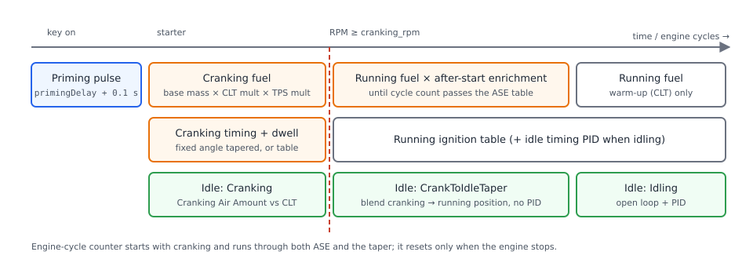
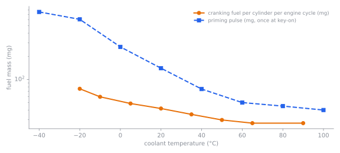

# Cranking and starting

:material-circle:{ .level-basic } Basic → :material-circle:{ .level-advanced } Advanced

> **In one sentence:** while the starter turns the engine, rusEFI uses a separate, simpler set of
> fuel, spark and idle-air settings, then hands over to the running tables with extra fuel that fades
> out as the engine settles.

## What it does

:material-circle:{ .level-basic } Basic

A cranking engine turns at only a few hundred RPM, unevenly, with cold walls that soak up fuel. The
normal running tables are not made for that, so rusEFI treats starting as its own job:

- **Priming pulse** — one squirt from all injectors when you switch the ignition on, to wet the
  intake before the first turn.
- **Cranking fuel** — a fuel mass per cylinder per engine cycle, set by coolant temperature, while
  the engine is below the **Cranking RPM limit**.
- **Cranking spark** — a fixed advance and a fixed dwell.
- **Cranking idle air** — the idle valve or electronic throttle held at a coolant-dependent opening.
- **After-start enrichment (ASE)** — extra fuel for the first engine cycles after it fires.
- **Flood clear** — floor the pedal while cranking and the ECU injects no fuel.
- **Starter control** (optional) — the ECU drives the starter relay from a start button.

You need this chapter for any engine. The factory defaults start many engines, but cold starts and
hot restarts almost always need tuning.

!!! danger "Too much cranking fuel washes the cylinders"
    Fuel that does not burn runs past the rings into the oil and can hydro-lock a cylinder. If an
    engine does not fire within a few seconds, stop: crank in short attempts (the starter also needs
    to cool), use flood clear, and check spark before adding fuel. Petrol vapour from a flooded
    engine is a fire risk — never crank with a fuel leak or an open fuel line.

## How it works

:material-circle:{ .level-intermediate } Intermediate

<figure markdown>
  
  <figcaption>Figure 1 — From key-on to idle. The red line is the moment engine speed first reaches
  the Cranking RPM limit.</figcaption>
</figure>

### Cranking or running?

The engine is **cranking** from the first trigger signal until its speed first reaches the
**Cranking RPM limit** `cranking_rpm` (default **550 RPM**). From then on it is **running**, and it
stays running even if the speed later drops below the limit — the engine must stop completely before
the cranking settings are used again.
<!-- src: firmware/controllers/engine_cycle/rpm_calculator.cpp (RpmCalculator::setRpmValue: RUNNING at cachedRpmValue >= cranking.rpm, CRANKING only from STOPPED/SPINNING_UP; isCranking); firmware/controllers/algo/defaults/default_cranking.cpp (setDefaultCranking: cranking.rpm = 550) -->

rusEFI counts **engine cycles** (one cycle is two crank turns on a four-stroke) from the first turn.
The counter runs through cranking and on into running, and resets only when the engine stops. Both
the cranking fuel table and after-start enrichment use it, so a long cranking attempt uses up part of
the after-start enrichment.
<!-- src: firmware/controllers/engine_cycle/rpm_calculator.cpp (onNewEngineCycle, setStopSpinning: revolutionCounterSinceStart = 0); firmware/controllers/algo/fuel_math.cpp (getCrankingFuel3, getPostCrankingFuelCorrection) -->

### Priming pulse

When the ignition is switched on with the engine stopped, rusEFI waits **Priming delay**
`primingDelay` (default 0.5 s) plus 0.1 s for the fuel pressure and sensors, then opens all injectors
together for the priming mass from the **Priming pulse** curve (mg against coolant temperature),
converted to an injector time with the injector model. It skips the pulse if the coolant sensor has
failed, if the engine is already turning, or if flood clear is on and the throttle is above 90 %.
If you switch the ignition on and off repeatedly without cranking, only the first key-on primes
(the ECU keeps a key-cycle counter in battery-backed memory; after ten skipped key-ons it primes
again).
<!-- src: firmware/controllers/engine_cycle/prime_injection.cpp (PrimeController::onIgnitionStateChanged, onPrimeStart, getPrimeDuration, isPrimeInjectionPulseSkipped); firmware/controllers/algo/defaults/default_base_engine.cpp (primingDelay = 0.5); firmware/controllers/algo/defaults/default_fuel.cpp (setDefaultPriming) -->

### Cranking fuel

Each engine cycle while cranking, every cylinder gets:

**cranking mass = base mass × coolant multiplier × TPS multiplier**

- **Base mass** depends on **Fuel Source For Cranking** `useRunningMathForCranking`:
  *Fixed* (default) uses the **Cranking Base Fuel (Engine Cycle vs CLT)** table, in mg, by coolant
  and cycle count — default 27 mg everywhere. *Fuel Map* uses the normal running base calculation
  (VE table and air model) instead, without warm-up, IAT or after-start corrections.
- **Coolant multiplier** from **Cranking Fuel multiplier** (default 2.8 at −20 °C falling to 1.0
  at 65 °C). If the coolant sensor has failed, 20 °C is used.
- **TPS multiplier** from **Cranking Fuel TPS multiplier**, by pedal position (or TPS without a
  pedal). Default 1.0 everywhere.
<!-- src: firmware/controllers/algo/fuel_math.cpp (getCrankingFuel3, getInjectionMass); firmware/controllers/algo/defaults/default_cranking.cpp (crankingCoef, crankingBins, crankingCycleBaseFuel 27, crankingTpsCoef) -->

The mass is then split into injector pulses by the cranking **Injection mode**
`crankingInjectionMode` (default *Simultaneous*: all injectors fire together, each pulse carrying a
share of the cycle mass) and turned into milliseconds by the injector model.
<!-- src: firmware/controllers/algo/fuel_math.cpp (getInjectionModeDurationMultiplier); firmware/controllers/algo/defaults/default_cranking.cpp (crankingInjectionMode = IM_SIMULTANEOUS) -->

<figure markdown>
  
  <figcaption>Figure 2 — Factory cranking fuel and priming pulse against coolant temperature.
  The defaults are written for cylinders of about 500 cc.</figcaption>
</figure>

### After-start enrichment

Once running, the **After-start enrichment** table `postCrankingFactor` multiplies the running fuel,
by coolant temperature and engine-cycle count. Values below 1.0 are treated as 1.0, and once the
cycle count passes the last column the enrichment ends (1.0), whatever the table says. The default
is **1.2 (+20 %) for the first 150 engine cycles at every temperature** — about 20 seconds at
900 RPM — then it stops in one step. It multiplies together with warm-up enrichment (the CLT
correction), which has no time limit.
<!-- src: firmware/controllers/algo/fuel_math.cpp (getPostCrankingFuelCorrection, getRunningFuel); firmware/controllers/algo/defaults/default_cranking.cpp (postCrankingDurationBins 0..150, postCrankingCLTBins -20..80, postCrankingFactor 1.2) -->

### Cranking spark

**Fixed Cranking Dwell** `ignitionDwellForCrankingMs` (default 6 ms) replaces the dwell table.
**Timing Advance mode** `useSeparateAdvanceForCranking` chooses the advance:

- *Fixed (auto taper)* (default): **Fixed cranking advance** `crankingTimingAngle` (default 6°) at
  the lowest cranking speed, blended towards the running table's advance as speed approaches the
  Cranking RPM limit.
- *Table*: the **Cranking ignition advance** curve against RPM.

Ignition corrections (IAT, CLT, idle timing) are not applied while cranking unless **Use Advance
Corrections for cranking** is on. **Fixed timing** mode overrides all of this.
<!-- src: firmware/controllers/algo/ignition/ignition_state.cpp (getCrankingAdvance, IgnitionState::getAdvance, getSparkDwell); firmware/controllers/algo/defaults/defaults.h (DEFAULT_CRANKING_DWELL_MS, DEFAULT_CRANKING_ANGLE) -->

### Cranking idle air

While cranking, the idle controller ignores everything else and opens the idle valve or throttle to
**Cranking Air Amount vs CLT** `cltCrankingCorr` (default 50 % at every temperature). With an
electronic throttle this is a share of **ETB idle maximum angle** (default 15 %), so 50 % means a
7.5 % throttle opening. After the engine starts, the idle position blends from this value to the
running idle position over **Idle After Start (Crank-to-Run) Taper vs CLT** (default 200 engine
cycles); see the Idle chapter.
<!-- src: firmware/controllers/actuators/idle_thread.cpp (getCrankingOpenLoop, getOpenLoop, getCrankingTaperFraction); firmware/controllers/actuators/electronic_throttle.cpp (getSetpointEtb: etbIdleThrottleRange); firmware/controllers/algo/defaults/default_cranking.cpp (cltCrankingCorr 50, afterCrankingIACtaperDuration 200) -->

### Flood clear

With **Flood clear** `isCylinderCleanupEnabled` on (default), fuel is cut while the engine is not
running and the pedal (or TPS without a pedal) is above **90 %**. Crank with the pedal floored to
blow a flooded engine clear; the front page shows the fuel cut reason *flood clear*.
<!-- src: firmware/controllers/limp_manager.cpp (LimpManager::updateState: FloodClear, CLEANUP_MODE_TPS 90); firmware/controllers/algo/engine_configuration.cpp (isCylinderCleanupEnabled = true); firmware/tunerstudio/tunerstudio.template.ini (fuelIgnCutCodeList) -->

!!! note
    The TunerStudio tooltip says 95 %; the firmware uses 90 %.

### Faster engine spin-up

**Faster engine spin-up** `isFasterEngineSpinUpEnabled` (default on) estimates RPM from the first
~90° of rotation and starts scheduling fuel and spark as soon as the trigger syncs, instead of
waiting for full RPM measurement.
<!-- src: firmware/controllers/engine_cycle/rpm_calculator.cpp (RpmCalculator::setSpinningUp); firmware/controllers/algo/defaults/default_cranking.cpp (isFasterEngineSpinUpEnabled = true) -->

### Starter control

With a **Start/Stop Button input** and a **Starter Control** output set (**Setup ▸ Outputs**), a
press of the button with the engine stopped engages the starter; it disengages as soon as the engine
is running, or after **Start cranking maximum time** `startCrankingDuration` (default 3 s). A press
with the engine running stops it. **Require Foot On Pedal To Crank** can require the brake pressed,
clutch up or clutch down first. The button is ignored on USB power.
<!-- src: firmware/controllers/start_stop.cpp (slowStartStopButtonCallback, startStopButtonToggle, disengageStarterIfNeeded); firmware/controllers/algo/engine_configuration.cpp (startCrankingDuration = 3) -->

## Before you start

:material-circle:{ .level-basic } Basic

- A working trigger (the engine sniffer or the RPM gauge shows RPM while cranking), injectors, coils
  and the injector model (flow and dead time) set up — cranking fuel is a mass, so a wrong injector
  model gives wrong cranking fuel.
- A coolant sensor that reads correctly: nearly every cranking setting is by coolant temperature.
- A TPS or pedal that reads 0 % at rest and above 90 % floored, for flood clear.
- For starter control on Proteus: **Lowside 14 or starter** (Black35 pin 11) drives the starter
  relay coil — never the starter motor or solenoid directly.
<!-- src: firmware/config/boards/proteus/connectors/black35.yaml (pin 11 Lowside 14 or starter) -->

## Setting it up

:material-circle:{ .level-basic } Basic → :material-circle:{ .level-intermediate } Intermediate

All of it is in TunerStudio's **Cranking** menu.

<!-- shot: img/ts/cranking-menu.png | Cranking menu (open) | menu dropped down, all entries visible | The Cranking menu. -->

### 1 · Cranking settings

Open **Cranking ▸ Cranking settings**. Set **Cranking RPM limit** a little above your engine's real
cranking speed — the default 550 RPM suits most engines; a fast-cranking small engine may need more.
Leave **Injection mode** on *Simultaneous* and **Fuel Source For Cranking** on *Fixed* for a first
start. Leave **Flood clear** and **Faster engine spin-up** on.

<!-- shot: img/ts/cranking-settings.png | Cranking ▸ Cranking settings | defaults: 550 RPM, Simultaneous, Fixed, Fixed (auto taper) 6 deg, dwell 6 ms, flood clear enabled | The Cranking Settings dialog with factory defaults. -->

### 2 · Cranking fuel

Open **Cranking ▸ Cranking Base Fuel (Engine Cycle vs CLT)** and **Cranking ▸ Cranking Fuel
multiplier**. The product is the mass per cylinder per cycle (Figure 2). Scale the base table with
cylinder size: the defaults suit about 500 cc per cylinder.

<!-- shot: img/ts/cranking-base-fuel.png | Cranking ▸ Cranking Base Fuel (Engine Cycle vs CLT) | default 27 mg table | Cranking base fuel table, default. -->
<!-- shot: img/ts/cranking-clt-mult.png | Cranking ▸ Cranking Fuel multiplier | default curve 2.8 … 1.0 | Cranking coolant multiplier, default. -->

### 3 · Priming pulse and after-start enrichment

Open **Cranking ▸ Priming pulse** and **Cranking ▸ After-start enrichment**. Keep the defaults for the
first start.

<!-- shot: img/ts/cranking-priming.png | Cranking ▸ Priming pulse | priming delay 0.5 s, default curve | Priming pulse settings. -->
<!-- shot: img/ts/cranking-ase.png | Cranking ▸ After-start enrichment | default table, all 1.2 | After-start enrichment table, default. -->

### 4 · Cranking idle air

Open **Cranking ▸ Cranking Air Amount vs CLT**. Start with the default 50 %; with an ETB, also check
**ETB idle maximum angle** on the same dialog.

<!-- shot: img/ts/cranking-air.png | Cranking ▸ Cranking Air Amount vs CLT | ETB idle maximum angle 15, curve 50 % | Cranking idle air, default. -->

### 5 · Starter control (optional)

Open **Setup ▸ Outputs**. Set **Start/Stop Button input**, **Starter Control** (on Proteus
*Lowside 14 or starter*) and **Start cranking maximum time**, then **Burn** and power-cycle (the button
input needs a restart).
<!-- src: firmware/tunerstudio/tunerstudio.template.ini (startStopDialog; requiresPowerCycle startStopButtonPin) -->

<!-- shot: img/ts/cranking-starter-control.png | Setup ▸ Outputs | Starter Control panel: button input set, Starter Control Lowside 14 or starter, max time 3 s | Starter control settings. -->

!!! danger "The starter can turn the engine by itself"
    Once starter control is set up, the ECU can crank the engine. Keep the gearbox in neutral and
    hands away from belts and fans when testing, and test the relay with **Test Starter Relay** before
    connecting it to the starter.

## Worked examples

:material-circle:{ .level-intermediate } Intermediate

### Example 1 — 2.0 l four-cylinder, cold morning starts

500 cc per cylinder, so the factory masses fit. It starts warm but needs long cranking at 5 °C.

| Setting | Value | Why |
|---|---|---|
| Cranking RPM limit | 550 RPM | default; cranks at about 250 RPM |
| Cranking Fuel multiplier at 5 °C | 1.8 → 2.0 | more fuel when the walls are cold |
| After-start enrichment, −20…20 °C rows | 1.3 for 0–150 cycles | it stumbled about 10 s after a cold start |
| Cranking Air Amount at 5 °C | 50 → 60 % | more air so it does not die on the taper |

### Example 2 — 1.0 l three-cylinder (333 cc per cylinder), hot restart floods

| Setting | Value | Why |
|---|---|---|
| Cranking Base Fuel | 27 → 18 mg | two thirds of the default for two-thirds cylinder size |
| Cranking Fuel multiplier at 90 °C | 1.0 → 0.8 | hot restarts were rich |
| Priming pulse at 80–100 °C | 30 mg | less fuel on a hot key-on |

These are starting points to show the method, not measured calibrations.

## Tuning it

:material-circle:{ .level-intermediate } Intermediate → :material-circle:{ .level-advanced } Advanced

Log every start (cold and hot) with **RPM**, **CLT**, **Fuel: Cranking cycle mass**, **Fuel: cranking
CLT mult**, **Fuel: Post cranking mult**, lambda and **revolutionCounterSinceStart**.

- **Fires, then dies** — too little ASE or idle air during the taper; raise ASE first.
- **Cranks long, then catches with black smoke** — too much cranking fuel at that temperature.
- **Does not catch, plugs wet** — far too rich; reduce the multiplier, use flood clear.
- **Long cranking at very low temperature only** — raise the multiplier at the cold end.
- Use the cycle axis of the **Cranking Base Fuel** table to give more fuel on the first cycles and
  less later, if the engine floods on long attempts.
- Tune one temperature at a time; a cold start can only be repeated once the engine has cooled.

## Diagnostics

:material-circle:{ .level-intermediate } Intermediate

| Channel / message | What it shows |
|---|---|
| Fuel: Cranking cycle base mass, Fuel: Cranking cycle mass | base and final cranking mass (mg) |
| Fuel: cranking CLT mult, Fuel: cranking TPS mult | the two multipliers |
| Fuel: Post cranking mult | after-start enrichment in use |
| revolutionCounterSinceStart | engine cycles since the first turn |
| injectionPrimingCounter | priming pulses fired |
| Fuel: Cut Code = flood clear | flood clear is cutting fuel |
| warning *zero cranking coolant multiplier* / *Cranking fuel value* | the multiplier or the mass is zero or less |
<!-- src: firmware/tunerstudio/tunerstudio.template.ini (crankingFuel_fuel, crankingFuel_baseFuel, running_postCrankingFuelCorrection datalog entries); firmware/controllers/algo/fuel_math.cpp (getCrankingFuel3: CUSTOM_ERR_ZERO_E0_MULT, CUSTOM_ERR_ZERO_CRANKING_FUEL); firmware/controllers/engine_cycle/prime_injection.cpp (injectionPrimingCounter) -->

## Troubleshooting

:material-circle:{ .level-basic } Basic → :material-circle:{ .level-advanced } Advanced

| Symptom | Likely cause | Check |
|---|---|---|
| No fuel while cranking | pedal or TPS reads above 90 % (flood clear) | Fuel: Cut Code; pedal calibration |
| No priming pulse | coolant sensor failed, ignition toggled without cranking, or engine already turning | CLT reading; injectionPrimingCounter |
| Engine runs at 500 RPM on cranking timing | Cranking RPM limit above the engine's idle-speed range | lower the limit |
| Starts, dies after about 20 s | default ASE ends at 150 cycles in one step | extend or taper the ASE table |
| Fuel in oil, smell of petrol | repeated rich cranking | reduce cranking fuel; change the oil |
| Starter does not stop | Starter Control on the wrong output, or engine never reaches running RPM | output assignment; Cranking RPM limit |
| Start button does nothing | USB power only, pedal condition not met, or not power-cycled | ignition on; Require Foot On Pedal To Crank |

## Settings reference

### Cranking settings (Cranking ▸ Cranking settings)

--8<-- "reference/settings/_crankingDialog.table.md"

### Cranking air (Cranking ▸ Cranking Air Amount vs CLT)

--8<-- "reference/settings/_cltCrankingCurveDialog.table.md"

### Priming pulse (Cranking ▸ Priming pulse)

--8<-- "reference/settings/_primingFuelPulsePanel.table.md"

### Starter control (Setup ▸ Outputs)

--8<-- "reference/settings/_startStopDialog.table.md"

## Related

- Idle — the crank-to-idle taper and the idle controller that takes over
- Fuel — injector model, VE table and warm-up enrichment
- Ignition — dwell and the running timing table
- [Electronic throttle](electronic-throttle.md) — ETB idle maximum angle
