# Electronic throttle

:material-circle:{ .level-basic } Basic → :material-circle:{ .level-advanced } Advanced

> **In one sentence:** the electronic throttle controller reads the accelerator pedal, decides how far
> the throttle should be open, and drives the throttle motor until two position sensors agree that it
> is there — and lets go of the throttle the moment anything looks wrong.

## What it does

:material-circle:{ .level-basic } Basic

In an older car a cable runs from the pedal to the throttle, and your foot opens the throttle
directly. An **electronic throttle body (ETB)** has no cable. The pedal is a sensor, the throttle has
its own small electric motor, and the ECU sits between them: it reads the pedal, works out a
**throttle target**, and moves the throttle to it.

Putting the ECU in the middle lets it do things a cable cannot:

- **Idle without a separate idle valve.** The ECU opens the throttle a little to hold idle speed,
  more when the engine is cold or the air conditioning is on.
  <!-- src: firmware/controllers/actuators/electronic_throttle.cpp (EtbController::getSetpointEtb, idle position adder); firmware/controllers/actuators/idle_thread.cpp (IdleController::getRunningOpenLoop) -->
- **Shape the pedal.** A table maps pedal position to throttle position, so the first part of the
  pedal can be made gentle or sharp, and it can change with engine speed.
- **Limit engine speed smoothly** by closing the throttle near a set RPM, and take throttle away for
  traction control.
  <!-- src: firmware/controllers/actuators/electronic_throttle.cpp (EtbController::getSetpointEtb: etbRevLimitStart taper, tcEtbDrop) -->
- **Watch itself.** Both the pedal and the throttle have two sensors each, and the ECU cuts the
  motor if they disagree.

You need this chapter if your engine has an electronic throttle. If it has a throttle cable, the
throttle position sensor is still set up here (section *Setting it up*, step 3), but everything
about the motor does not apply.

!!! danger "A throttle can open by itself"
    An electronic throttle is a motor that can open the throttle with no one touching the pedal.
    Keep fingers out of the throttle bore whenever the ECU has 12 V: calibration snaps the throttle
    fully open and shut. On a running engine, a wrong pedal or throttle calibration can mean the
    engine speeds up on its own. Do the first checks with the engine off, and the first start with
    your hand on the key.

## How it works

:material-circle:{ .level-intermediate } Intermediate

<figure markdown>
  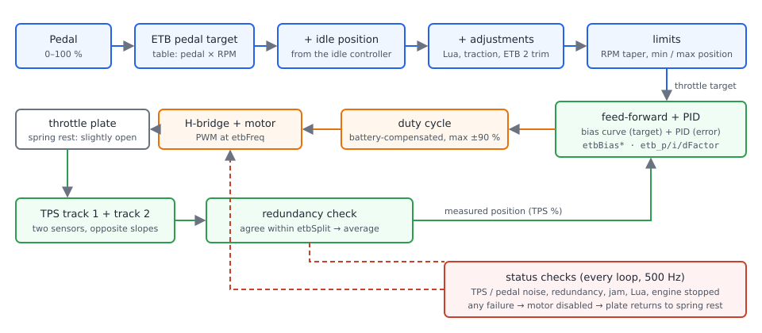
  <figcaption>Figure 1 — The electronic throttle control loop. Blue is what is asked for, orange is
  what is driven, green is the measurement that closes the loop, red is the safety path.</figcaption>
</figure>

The controller runs **500 times a second**, in its own high-priority thread. Each time round it
does the same three things: build a target, drive the motor towards it, and check that everything
is still healthy.
<!-- src: firmware/controllers/actuators/electronic_throttle_impl.h (ETB_LOOP_FREQUENCY); firmware/controllers/actuators/electronic_throttle.cpp (DcThread, EtbController::update) -->

### Building the target

The throttle target is built in this order:

1. **Pedal.** The accelerator pedal position, 0–100 %. If the pedal reading has failed, the
   controller uses **0 %** — the throttle closes to idle rather than letting go, so the engine can
   still idle.
2. **ETB pedal target table.** Pedal position × engine speed → throttle position. The default table
   is one-to-one: 30 % pedal asks for 30 % throttle at every engine speed.
3. **Idle position.** The idle controller's output is added by squeezing the table's 0–100 % into
   *idle position* … 100 %, so a fully released pedal asks for the idle opening, not 0 %. How far
   idle can open the throttle is set by **ETB idle maximum angle** (default 15 %).
4. **Adjustments**: a Lua script (`setEtbAdd`), traction control (the *Traction Control ETB drop*
   table) and, for a second throttle, the *ETB #2 Trim* table (±10 %).
5. **Limits**: the *Electronic Throttle Limiting* taper (close the throttle smoothly above a set
   engine speed), then **Minimum** and **Maximum ETB position**.
<!-- src: firmware/controllers/actuators/electronic_throttle.cpp (EtbController::getSetpointEtb, getSanitizedPedal, setDefaultEtbParameters) -->

### Driving the motor

The motor command is the sum of two parts:

- **Feed-forward** from the **ETB bias curve**: for a given target, roughly how much duty the motor
  needs just to hold the throttle there against its spring. Negative values hold the throttle
  closed against the spring; positive values hold it open.
- **PID** on the position error (target minus measured position), set by **pFactor**, **iFactor**
  and **dFactor**.

The result is limited to ±90 % duty and corrected for battery voltage, then drives the H-bridge at
the **PWM Frequency** (default 800 Hz, maximum 3000 Hz).
<!-- src: firmware/controllers/actuators/electronic_throttle.cpp (EtbController::getOpenLoop, getClosedLoop, setOutput); firmware/controllers/system/dc_motor.cpp (TwoPinDcMotor::set); firmware/controllers/actuators/dc_motors.cpp (DcHardware::start: ETB_HW_MAX_FREQUENCY) -->

!!! tip "The whine is normal"
    The throttle motor is driven by PWM in the audible range, so a whine or buzz from the throttle
    is normal. Raising **PWM Frequency** towards 3000 Hz moves it to a higher, usually less
    intrusive tone.

### Measuring the position: two sensors

An electronic throttle has two position sensors (two *tracks*) on the same shaft, usually running in
opposite directions — one voltage rises as the throttle opens while the other falls. rusEFI converts
each to 0–100 % using its own closed and open voltages, and accepts the position only if the two
agree within the **TPS/PPS Error Detection Threshold** (default 5 %); then it uses their average.
The pedal is checked the same way.
<!-- src: firmware/controllers/sensors/redundant_sensor.cpp (RedundantSensor::get); firmware/init/sensor/init_tps.cpp (initTps, RedundantPair::init: etbSplit, MAX_TPS_PPS_DISCREPANCY) -->

### When it lets go

Every loop, the controller checks its health before driving the motor. The motor is switched off —
and the throttle returns to wherever its spring holds it — if:

- the throttle position cannot be read (a sensor failed, or the two tracks disagree);
- the throttle or pedal sensors keep dropping out (more than 50 separate faults);
- the pedal has no second sensor to check it against;
- jam detection has tripped (see *Diagnostics*), or the engine has a fatal error;
- a Lua script disabled it, or **Disable ETB if engine is stopped** is on and the engine is stopped.
<!-- src: firmware/controllers/actuators/electronic_throttle.cpp (EtbController::checkStatus, setOutput, ETB_INTERMITTENT_LIMIT); firmware/controllers/limp_manager.cpp (LimpManager::allowElectronicThrottle) -->

!!! note "Rest position is not closed"
    With the motor switched off, a throttle does not close: its spring parks it slightly open (the
    "limp home" position), so an engine can still idle if the throttle loses power. On the throttle
    used for this chapter that is about 6 %. A throttle sitting a few percent open with the ETB
    disabled is working correctly.

## Before you start

:material-circle:{ .level-basic } Basic

You need:

- **The throttle body wired to the H-bridge outputs.** On Proteus, throttle 1 is **Black23 pin 7** (motor +)
  and **Black23 pin 6** (motor −); throttle 2 is **Black23 pin 15** (+) and **Black23 pin 8** (−).
- **Both throttle sensors wired**, with a 5 V supply and sensor ground. On Proteus, the suggested
  inputs are **Analog Volt 2** (White 24) for the first track and **Analog Volt 3** (White 14) for the
  second.
- **Both pedal sensors wired**: suggested **Analog Volt 9** (White 17) and **Analog Volt 7** (White 16).
- 5 V sensor supplies on **White 9/21/32** (supply 1) and **White 10/22/33** (supply 2); sensor
  ground on **White 1–8**.
<!-- src: firmware/config/boards/proteus/connectors/black23.yaml (ETB 1/2 positive/negative); firmware/config/boards/proteus/connectors/white35.yaml (Analog Volt 2/3/7/9, +5 supplies, GNDA) -->

Wiring practice for sensors, and why sensor ground matters, is in Part II.

!!! warning "Calibrate with the ignition on — never on USB power alone"
    With only USB connected the ECU runs, but the 5 V sensor supplies do not reach 5 V, so every
    voltage you grab is wrong. TunerStudio's **Grab** and **Auto Calibrate** buttons stay greyed out
    until the ECU sees ignition voltage, for exactly this reason.
    <!-- src: firmware/tunerstudio/tunerstudio.template.ini (cmd_calibrate_pedal_up, cmd_etb_auto_calibrate enable conditions: hasIgnitionVoltage); firmware/controllers/ignition_controller.cpp (isIgnVoltage) -->

## Setting it up

:material-circle:{ .level-basic } Basic → :material-circle:{ .level-intermediate } Intermediate

Everything is in TunerStudio. The throttle settings live under **Advanced**, the sensors under
**Sensors**:

<figure markdown>
  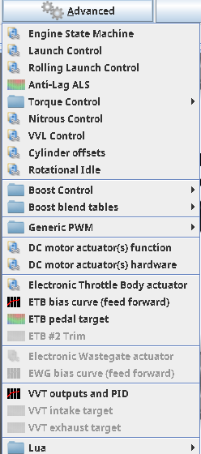
  <figcaption>Figure 2 — The throttle entries in TunerStudio's <b>Advanced</b> menu.</figcaption>
</figure>

### 1 · Choose what each H-bridge drives

Open **Advanced ▸ DC motor actuator(s) function**. A Proteus has two H-bridges; by default the first
drives **Throttle 1** and the second **Throttle 2**. For a single throttle, leave H-Bridge #1 on
*Throttle 1*. Burn, and power-cycle the ECU: this setting only takes effect after a restart.
<!-- src: firmware/controllers/actuators/electronic_throttle.cpp (setDefaultEtbParameters: etbFunctions); firmware/tunerstudio/tunerstudio.template.ini (dcMotorActuatorFunction, requiresPowerCycle etbFunctions1) -->

<figure markdown>
  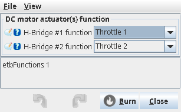
  <figcaption>Figure 3 — H-bridge functions, factory defaults.</figcaption>
</figure>

### 2 · Check the motor direction (bench test)

Open **Advanced ▸ Electronic Throttle Body actuator** and press **Bench Test ETB 1 (open 300ms)**.
The throttle must snap **open** for a moment. This test needs no sensors and no ignition voltage.
If the throttle tries to close instead, swap the two motor wires (ETB+ and ETB−).
<!-- src: firmware/controllers/actuators/electronic_throttle_impl.h (EtbImpl::startBenchTest); firmware/tunerstudio/tunerstudio.template.ini (etbTps1Calib) -->

### 3 · Assign the throttle sensors

Open **Sensors ▸ TPS**. Set **Primary sensor input** and **Secondary sensor input** to the two
tracks — on Proteus, *Analog Volt 2* and *Analog Volt 3*. Leave the voltages for now: the next step
measures them.

On USB power you will see the factory calibration (closed 0 V, open 5 V for the primary; the reverse
for the secondary) and a greyed-out **Auto Calibrate ETB 1**:

<figure markdown>
  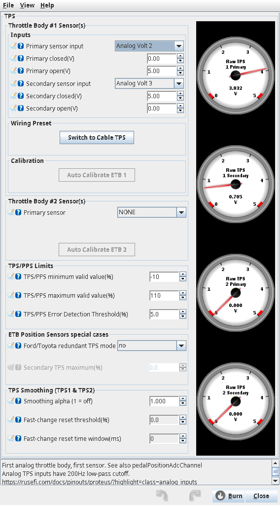
  <figcaption>Figure 4 — The TPS dialog on USB power only. The factory calibration does not match
  any real throttle, and calibration is unavailable until the ignition is on.</figcaption>
</figure>

!!! danger "Do not switch the ignition on with a wrong calibration and the throttle connected"
    With the factory 0–5 V calibration, a throttle whose primary track falls as it opens (very
    common) reads as nearly wide open while it is actually shut. The controller then drives the
    motor hard against the closed stop — on the bench used for this chapter that drew 3.6 A
    continuously. Either calibrate first with the throttle connector unplugged, or enter
    approximately right voltages before switching on, and watch the throttle the first time.

### 4 · Auto-calibrate the throttle

Switch the ignition on. **Auto Calibrate ETB 1** becomes available:

<figure markdown>
  
  <figcaption>Figure 5 — Ignition on: the raw TPS gauges show the throttle at rest and Auto
  Calibrate ETB 1 is available.</figcaption>
</figure>

Keep your hands clear and press **Auto Calibrate ETB 1**. The throttle:

1. opens at +50 % duty for one second — the ECU records both tracks' **open** voltages;
2. closes at −50 % duty for one second — it records the **closed** voltages;
3. lets go, and the spring returns it to rest.

The ECU sends the four voltages to TunerStudio, which puts them in the dialog. Check them, then
**Burn**.
<!-- src: firmware/controllers/actuators/electronic_throttle_impl.h (EtbImpl::doAutocal, ACPhase); firmware/console/binary/tunerstudio_calibration_channel.cpp (tsCalibrationSetData); firmware/tunerstudio/tunerstudio.template.ini (maintainConstantValue tpsMax/tpsMin/tps1SecondaryMax/tps1SecondaryMin) -->

<figure markdown>
  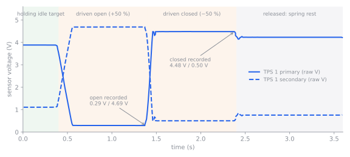
  <figcaption>Figure 6 — Auto-calibration recorded in a TunerStudio datalog. The primary track
  falls as the throttle opens and the secondary rises. Note the rest position after release is
  not the closed position.</figcaption>
</figure>

<figure markdown>
  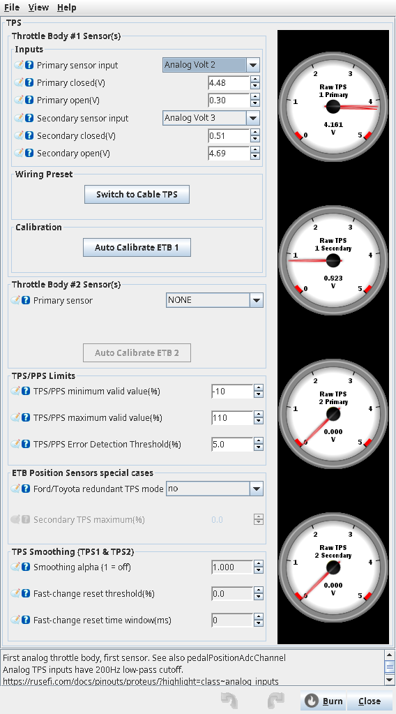
  <figcaption>Figure 7 — The calibration TunerStudio received from the ECU, ready to burn.</figcaption>
</figure>

If the throttle did not move at least 0.5 V between open and closed, the ECU stops with
*"Auto calibrate failed, check your wiring!"* and shows the two voltages it saw. Auto-calibration
also refuses to run while the engine is turning.
<!-- src: firmware/controllers/actuators/electronic_throttle_impl.h (EtbImpl::doAutocal: 0.5 V check, "Not while RPM") -->

### 5 · Calibrate the pedal

Open **Sensors ▸ Accelerator pedal** and set the two sensor inputs (on Proteus, *Analog Volt 9* and
*Analog Volt 7*). Then, with the ignition on:

1. Take your foot off the pedal and press **Grab Idle/Up**.
2. Hold the pedal to the floor and press **Grab WOT/Down**.
3. Check the four voltages, then **Burn**.

Each **Grab** records both pedal tracks at once.
<!-- src: firmware/controllers/sensors/tps.cpp (grabPedalIsUp, grabPedalIsWideOpen); firmware/controllers/bench_test.cpp (handleCommandX14: TS_GRAB_PEDAL_UP/WOT) -->

<figure markdown>
  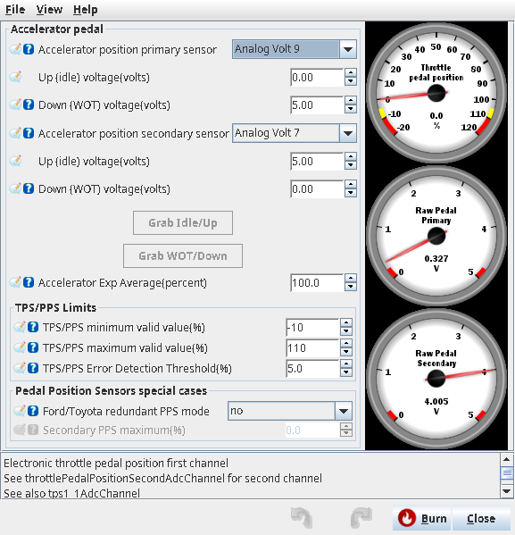
  <figcaption>Figure 8 — The pedal dialog before calibration (factory values, USB power: the Grab
  buttons are unavailable).</figcaption>
</figure>

<figure markdown>
  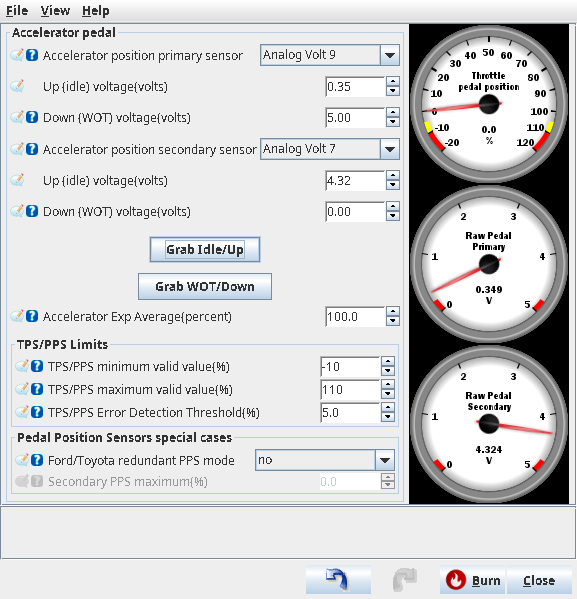
  <figcaption>Figure 9 — After <b>Grab Idle/Up</b> with the pedal released.</figcaption>
</figure>

<figure markdown>
  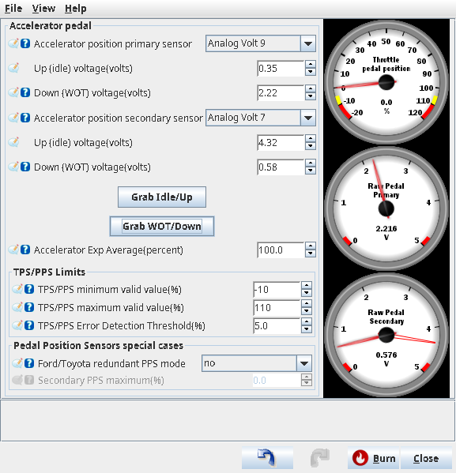
  <figcaption>Figure 10 — After <b>Grab WOT/Down</b> with the pedal on the floor. The two tracks move
  in opposite directions and at different rates: one covers 1.87 V, the other 3.74 V.</figcaption>
</figure>

When the calibration is right, the front page shows **TPS OK**, **TPS 2 OK**, **Pedal OK** and
**ETB OK**, and the throttle follows the pedal through its whole range.

### 6 · Review the ETB settings

Open **Advanced ▸ Electronic Throttle Body actuator**. The defaults suit most throttles for a first
start; the settings are explained in the reference at the end of this chapter.

<figure markdown>
  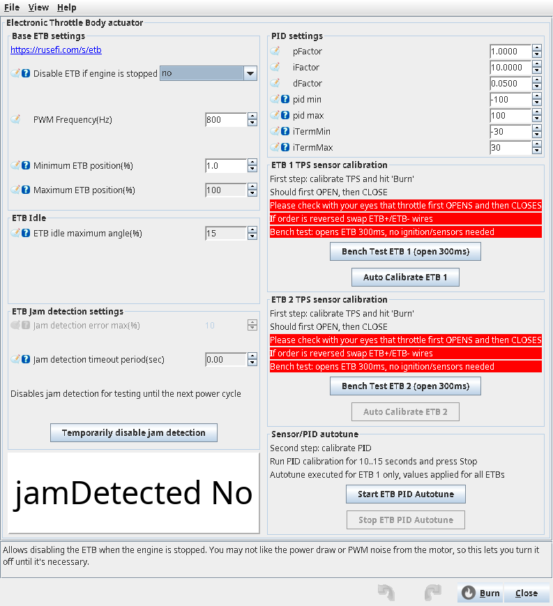
  <figcaption>Figure 11 — The Electronic Throttle Body dialog with its factory defaults.</figcaption>
</figure>

<figure markdown>
  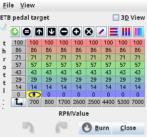{ width="300" }
  <figcaption>Figure 12 — <b>ETB pedal target</b>, default: one-to-one at every engine speed.</figcaption>
</figure>

<figure markdown>
  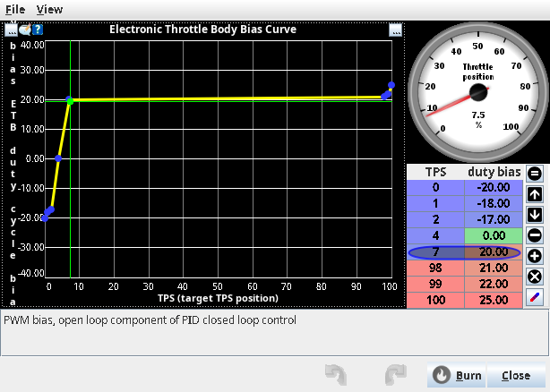
  <figcaption>Figure 13 — <b>ETB bias curve</b> (feed-forward), default. The step around 4 % is where
  the throttle passes its spring's rest position.</figcaption>
</figure>
<!-- src: firmware/controllers/actuators/electronic_throttle.cpp (setDefaultEtbParameters, setDefaultEtbBiasCurve) -->

## Worked examples

:material-circle:{ .level-intermediate } Intermediate

### Example 1 — Proteus with a Bosch 82 mm throttle and Bosch Motorsport pedal

The parts used for this chapter, on a Proteus F7:

- **Throttle:** Bosch 82 mm electronic throttle body (the Porsche application)
- **Pedal:** Bosch Motorsport Accelerator Pedal Module, Bosch part number **0 280 755 051**

Both have two sensor tracks running in opposite directions. The values below were measured on the
bench with the ignition on; use them as a starting point if you have the same parts, then run the
calibration yourself — individual units differ slightly.

| Setting | Value | Why |
|---|---|---|
| H-Bridge #1 function | Throttle 1 | single throttle on the first bridge |
| TPS primary / secondary input | Analog Volt 2 / Analog Volt 3 | Proteus's suggested TPS inputs |
| TPS primary closed / open | 4.48 V / 0.30 V | from Auto Calibrate ETB 1 (primary falls as it opens) |
| TPS secondary closed / open | 0.51 V / 4.69 V | from Auto Calibrate ETB 1 |
| Pedal primary / secondary input | Analog Volt 9 / Analog Volt 7 | Proteus's suggested pedal inputs |
| Pedal primary up / WOT | 0.35 V / 2.22 V | from Grab Idle/Up and Grab WOT/Down |
| Pedal secondary up / WOT | 4.32 V / 0.58 V | as above |
| Everything else | factory default | |

These are exactly the inputs Proteus's own wiring preset uses: the **Switch to PPS TPS** button
(**Sensors ▸ TPS**, or **Setup ▸ Basic Configurations**) sets TPS to Analog Volt 2 and 3 and the pedal
to Analog Volt 9 and 7 in one step.
<!-- src: firmware/config/boards/proteus/board_configuration.cpp (applyProteusBasicConfiguration); firmware/controllers/algo/basic_configuration.cpp (BasicConfigurationAction::PpsTps) -->

### Example 2 — Toyota ETCS-i throttle and pedal

Some Toyota (and Ford) sensors are not linear over their full range: the secondary track stops
changing part-way through travel. For these, turn on **Ford/Toyota redundant TPS mode** (Sensors ▸
TPS) and **Ford/Toyota redundant PPS mode** (Sensors ▸ Accelerator pedal), and set:

| Setting | Value |
|---|---|
| Secondary TPS maximum | about 65 % (Toyota ETCS-i); 53 % for Ford |
| Secondary PPS maximum | about 69 % (Toyota) |

Below that point the two tracks are compared and averaged as usual; above it, rusEFI uses the
primary alone as long as the secondary sits at its maximum.
<!-- src: firmware/controllers/sensors/redundant_ford_tps.cpp (RedundantFordTps::get); firmware/integration/rusefi_config.txt (tpsSecondaryMaximum, ppsSecondaryMaximum help) -->

## Tuning it

:material-circle:{ .level-intermediate } Intermediate → :material-circle:{ .level-advanced } Advanced

Log **TPS**, **ETB: position target**, **ETB: position error** and **ETB: Duty** while you move the
pedal slowly, then quickly. A well-tuned throttle reaches its target quickly, without overshoot,
and holds it with a small, steady error.

- **Bias curve first.** With the PID doing little, the bias curve should hold the throttle close to
  the target on its own. If the throttle sags below target at part throttle, raise the bias there;
  if it creeps above, lower it.
- **Then the PID.** Raise **pFactor** until the throttle responds briskly, back it off if it
  oscillates; use **iFactor** to remove the remaining steady error; **dFactor** damps overshoot.
- **PID autotune.** With the engine stopped and the ignition on, **Start ETB PID Autotune** drives
  throttle 1 back and forth around 50 % for you. Let it run for 10–15 seconds, then press **Stop**:
  TunerStudio receives the suggested pFactor, iFactor and dFactor. Check the result with a log
  before you rely on it, and **Burn** to keep it.
<!-- src: firmware/controllers/actuators/electronic_throttle.cpp (EtbController::getClosedLoopAutotune: relay method, TsCalMode EtbKp/EtbKi/EtbKd); firmware/tunerstudio/tunerstudio.template.ini (etbAutotune dialog) -->

!!! info "Advanced"
    The autotune is a relay (bang-bang) test: ±20 % duty on top of the bias, measuring the period
    and amplitude of the resulting oscillation, then the Åström–Hägglund rules give the three gains.
    It tunes throttle 1 only; the values apply to both throttles.

## Diagnostics

:material-circle:{ .level-intermediate } Intermediate

The front page shows **ETB OK** or the reason the controller is not driving the throttle:

| Shows | Meaning | Check |
|---|---|---|
| ETB OK | controller running | — |
| engine stopped | **Disable ETB if engine is stopped** is on and the engine is stopped | normal |
| TPS error | throttle position unreadable, or the two tracks disagree | TPS wiring, calibration, *TPS/PPS Error Detection Threshold* |
| TPS noise / PPS noise | the throttle or pedal sensor dropped out more than 50 times | intermittent wiring, connector |
| Redundancy | throttle or pedal has no second sensor configured | assign the secondary input |
| TPS Calib | auto-calibration running | wait |
| Autotune | PID autotune running | press Stop when done |
| Lua | a Lua script disabled the throttle | the script |
| Jam | jam detection tripped (see below) | throttle mechanics, PID |
| N/A | no H-bridge is set to drive this throttle | step 1 |
<!-- src: firmware/controllers/limp_manager.h (EtbStatus); firmware/tunerstudio/tunerstudio.template.ini (etbCutCodeList); firmware/controllers/actuators/electronic_throttle.cpp (EtbController::checkStatus, EtbController::init) -->

**Jam detection** compares target and actual position. If the error stays above **Jam detection
error max** (default 10 %) for longer than **Jam detection timeout period**, the throttle is treated
as jammed: the motor is disabled, engine speed is limited to 1500 RPM by cutting fuel, and the
*ETB jam protection active* warning is raised, until the ECU is restarted. Because the timeout
defaults to **0**, jam detection is **off** until you set a timeout.
<!-- src: firmware/controllers/actuators/electronic_throttle.cpp (EtbController::checkJam, setDefaultEtbParameters: etbJamTimeout commented out); firmware/controllers/limp_manager.cpp (LimpManager::reportEtbJammed) -->

Sensor faults are also reported as warnings, such as *Sensor fault: TPS1 …* with codes for the
primary, secondary and correlation (P0122/P0123-style low/high/timeout and correlation codes).
<!-- src: firmware/controllers/sensors/sensor_checker.cpp (SensorChecker::onSlowCallback, getCode) -->

Useful channels to log:

| Channel | What it shows |
|---|---|
| TPS, rawTps1Primary, rawTps1Secondary | throttle position, and each track's voltage |
| Throttle pedal position | pedal position after calibration |
| ETB: position target | the final target (Figure 1) |
| ETB: position error | target minus position |
| ETB: Duty | motor duty from the controller |
| tps1Split, accPedalSplit | how far the two tracks of the throttle and pedal disagree |
<!-- src: firmware/console/binary/output_channels.txt (etb1DutyCycle, rawTps1Primary, tps1Split, accPedalSplit); firmware/tunerstudio/gauge_declarations.ini (etbTargetGauge, etbErrorGauge, etbDutyCycleGauge) -->

!!! note
    Auto-calibration drives the motor directly, outside the controller, so it does not appear in
    *ETB: Duty* — log the raw TPS voltages to see it (Figure 6).

## Troubleshooting

:material-circle:{ .level-basic } Basic → :material-circle:{ .level-advanced } Advanced

| Symptom | Likely cause | Check |
|---|---|---|
| Grab and Auto Calibrate buttons greyed out | no ignition voltage (USB power only) | switch the ignition on |
| Throttle slams shut and the motor draws several amps as soon as the ignition comes on | TPS calibration wrong (factory 0–5 V with a falling track) | Setting it up, step 3–4 |
| Bench test closes the throttle instead of opening it | motor wires reversed | swap ETB+ and ETB− |
| "Auto calibrate failed, check your wiring!" | throttle did not move, or the sensor is not on the assigned input | motor and sensor wiring; the two voltages in the message |
| Throttle sits a few % open and does not follow the pedal; **Pedal error** | pedal calibration wrong or pedal sensor fault — the controller treats the pedal as 0 % | pedal calibration, step 5 |
| **TPS error** after a correct calibration | the two tracks disagree by more than the threshold | calibrate with ignition on; check sensor ground and 5 V supply |
| Throttle 6 % open with the ETB disabled | normal: the spring's rest position | — |
| Throttle hunts or oscillates | PID too aggressive, or bias curve wrong | Tuning it |
| Whine from the throttle | PWM in the audible range | normal; raise PWM Frequency |
| ETB 2 calibration panel is active on a single-throttle engine | H-Bridge #2 defaults to Throttle 2 | set H-Bridge #2 to None if unused |

## Settings reference

### Electronic Throttle Body (Advanced ▸ Electronic Throttle Body actuator)

--8<-- "reference/settings/_etbDialog.table.md"

### TPS (Sensors ▸ TPS)

--8<-- "reference/settings/_tpsSensor.table.md"

### Accelerator pedal (Sensors ▸ Accelerator pedal)

--8<-- "reference/settings/_pedalSensor.table.md"

### H-bridge function (Advanced ▸ DC motor actuator(s) function)

--8<-- "reference/settings/_dcMotorActuatorFunction.table.md"

## Related

- Part II — Wiring sensors (throttle and pedal connectors, sensor ground)
- Idle — the idle controller that adds the idle position
- Limits and engine protection — the RPM limit that jam detection applies
- Lua scripting — `setEtbAdd`, `setEtbDisabled`, `getEtbTarget`
