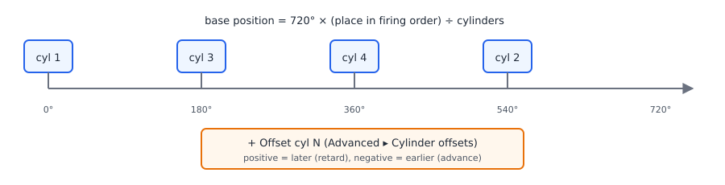
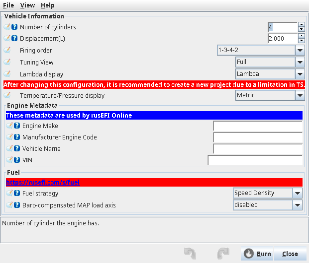
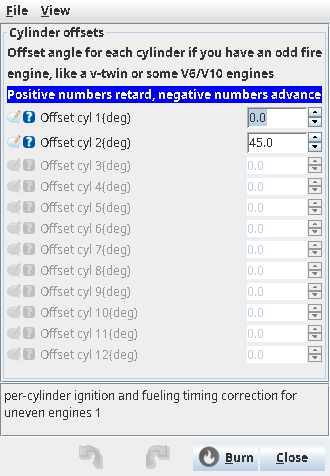
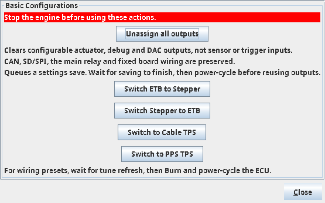

# Engine and vehicle basics

:material-circle:{ .level-basic } Basic → :material-circle:{ .level-advanced } Advanced

> **In one sentence:** before rusEFI can fuel or fire anything it must know how many cylinders the
> engine has, how big it is, in which order the cylinders fire and whether it is a two- or
> four-stroke — and these few settings feed every calculation that follows.

## What it does

:material-circle:{ .level-basic } Basic

**Setup ▸ Vehicle Information** (`engineChars`) holds the facts about your engine that rusEFI cannot
measure: number of cylinders, displacement and firing order. It also holds how TunerStudio shows
values to you (metric or imperial, lambda or AFR, full or reduced menus) and a few names that
identify the vehicle.
<!-- src: firmware/tunerstudio/tunerstudio.template.ini (dialog engineChars, engineMetadata) -->

Next to it, **Setup ▸ Basic Configurations** (`basicConfigurations`) has one-click wiring presets
for the Proteus: clear every output assignment, or switch between an electronic throttle and a
stepper idle valve, or between a cable throttle and an electronic pedal.
<!-- src: firmware/controllers/algo/basic_configuration.cpp (applyBasicConfiguration, unassignOutputs); firmware/config/boards/proteus/board_configuration.cpp (applyProteusBasicConfiguration) -->

Two related settings live elsewhere: **Strokes** (two- or four-stroke) is on the trigger dialog,
and per-cylinder timing offsets for odd-fire engines are under **Advanced ▸ Cylinder offsets**.
<!-- src: firmware/tunerstudio/tunerstudio.template.ini (dialog trigger_primary: twoStroke; dialog ignitionCylExtra) -->

## How it works

:material-circle:{ .level-intermediate } Intermediate

<figure markdown>
  
  <figcaption>Figure 1 — How cylinder count, firing order and cylinder offsets place each cylinder
  in the engine cycle (four cylinders, 1-3-4-2).</figcaption>
</figure>

**Cylinder spacing.** A four-stroke engine cycle is 720° of crank rotation; a two-stroke cycle is
360°. rusEFI spaces the cylinders evenly over that cycle in firing-order sequence: the cylinder in
position *n* of the firing order (counting from 0) sits at cycle × *n* ÷ number of cylinders. For a
four-cylinder, four-stroke engine with firing order 1-3-4-2 that is cylinder 1 at 0°, 3 at 180°,
4 at 360° and 2 at 540°. The cylinder's **Offset cyl N** is then added to both its spark and its
injection timing.
<!-- src: firmware/controllers/math/engine_math.cpp (getPerCylinderFiringOrderOffset, prepareOutputSignals); firmware/controllers/trigger/decoders/trigger_universal.cpp (getEngineCycle); firmware/controllers/engine_cycle/spark_logic.cpp; firmware/controllers/engine_cycle/fuel_schedule.cpp -->

**Firing order must match the cylinder count.** Each firing order has a fixed length. If
**Number of cylinders** does not match it, rusEFI stops with the fatal error *"Wrong cyl count for
firing order, expected X cylinders, got Y"* and will not run the engine until you fix it.
<!-- src: firmware/controllers/math/firing_order.cpp (getCylinderNumberAtIndex: CUSTOM_OBD_WRONG_FIRING_ORDER) -->

**Displacement and air mass.** In speed-density mode rusEFI works out the air in each cylinder from
the ideal gas law: displacement × MAP ÷ (R × intake temperature), times VE, divided by the number of
cylinders. A wrong displacement scales every fuel calculation by the same error.
<!-- src: firmware/controllers/algo/airmass/speed_density_base.cpp (idealGasLaw, getAirmassImpl); firmware/controllers/algo/fuel_math.cpp (getStandardAirCharge) -->

**Two-stroke** halves the cycle to 360° and changes how air flow is calculated (a two-stroke fills
every cylinder every revolution).
<!-- src: firmware/controllers/engine_cycle/rpm_calculator.cpp (lookupOperationMode); firmware/controllers/algo/airmass/speed_density_airmass.cpp (getAirflow) -->

**Odd fire.** If any cylinder offset is not zero, or the cylinder count is odd, a four-stroke
engine uses rusEFI's odd-fire wasted-spark logic.
<!-- src: firmware/controllers/math/engine_math.cpp (prepareOutputSignals: useOddFireWastedSpark) -->

**Display units are TunerStudio-only.** The firmware always stores °C, kPa and km/h. With
**Temperature/Pressure display** set to *Imperial*, TunerStudio converts each value to °F, psi or
mph for display and back when you type. The same holds for **Lambda display** (lambda or AFR).
<!-- src: firmware/integration/rusefi_config.txt (useMetricOnInterface, useLambdaOnInterface; fields scaled with bitStringValue on unitsLabels) -->

## Before you start

:material-circle:{ .level-basic } Basic

You need the engine's cylinder count, displacement in litres and firing order (from the workshop
manual or the cylinder head casting). Connect TunerStudio to the ECU; nothing needs to be wired yet.

!!! warning "Stop the engine before any preset"
    The **Basic Configurations** buttons are greyed out while the engine is turning, and the firmware
    refuses them if it sees engine speed. They rewrite pin assignments.
    <!-- src: firmware/tunerstudio/tunerstudio.template.ini (basicConfigurations: engineTurnedRecently == 0); firmware/controllers/algo/basic_configuration.cpp (handleBasicConfigurationAction: rpmCalculator.isStopped) -->

## Setting it up

:material-circle:{ .level-basic } Basic → :material-circle:{ .level-intermediate } Intermediate

### 1 · Vehicle Information

Open **Setup ▸ Vehicle Information**.

<!-- shot: img/ts/engine-basics-vehicle-information.png | Setup ▸ Vehicle Information | 4 cylinders, 2.0 L, 1-3-4-2, speed density, Tuning View Full, Metric, Lambda | The Vehicle Information dialog with the chapter's example engine -->

<figure markdown>
  
  <figcaption>Figure 2 — The Vehicle Information dialog with the chapter's example engine</figcaption>
</figure>

- **Number of cylinders** `cylindersCount` — 1 to 12. Factory default 4.
- **Displacement** `displacement` — litres, total for the engine. Factory default 2.0 L.
- **Firing order** `firingOrder` — pick the one that matches the count. Factory default 1-3-4-2.
- **Engine Make**, **Manufacturer Engine Code**, **Vehicle Name**, **VIN** — text only. The first
  three are marked *required for rusEFI Online*; the vehicle name must be unique between your
  vehicles. The VIN is readable from Lua with `vin(index)`.
- **Fuel strategy** — how load is measured (speed density by default); covered in the Fuel chapter.
- **Tuning View** `uiMode` — *Full* shows every menu; *Tuning* hides installation-only dialogs (for
  example **Advanced ▸ Generic PWM**, the DC motor dialogs, and the pin fields in some dialogs).
- **Lambda display** — *Lambda* or *AFR*.
- **Temperature/Pressure display** — *Metric* (factory default) or *Imperial*.

**Burn**. After changing the display settings, TunerStudio itself recommends creating a new project
("due to a limitation in TS"), because the project caches units.
<!-- src: firmware/controllers/algo/defaults/default_base_engine.cpp (setDefaultBaseEngine: displacement 2, setInline4, useMetricOnInterface; fuelAlgorithm LM_SPEED_DENSITY); firmware/integration/rusefi_config.txt (cylindersCount, engineMake, engineCode, vehicleName, UiMode_enum); firmware/tunerstudio/tunerstudio.template.ini (engineChars, engineMetadata, uiMode menu conditions) -->

### 2 · Strokes

Two-stroke engines: open the trigger dialog (**Setup ▸ Trigger**) and set **Strokes** to *Two
Stroke*. Everything about the trigger itself is in the Trigger chapter.
<!-- src: firmware/tunerstudio/tunerstudio.template.ini (trigger_primary: Strokes twoStroke) -->

### 3 · Cylinder offsets (odd-fire engines only)

Open **Advanced ▸ Cylinder offsets** (`ignitionCylExtra`). One field per cylinder, in crank degrees
(−720 to 720). Positive values retard (move the cylinder later), negative values advance. Leave all
zero for an even-fire engine.

<!-- shot: img/ts/engine-basics-cylinder-offsets.png | Advanced ▸ Cylinder offsets | 2 cylinders, Offset cyl 1 = 0, Offset cyl 2 = 45 | Cylinder offsets for the 45° V-twin example -->

<figure markdown>
  
  <figcaption>Figure 3 — Cylinder offsets for the 45° V-twin example</figcaption>
</figure>
<!-- src: firmware/tunerstudio/tunerstudio.template.ini (dialog ignitionCylExtra); firmware/integration/rusefi_config.txt (timing_offset_cylinder) -->

### 4 · Basic Configurations (Proteus)

Open **Setup ▸ Basic Configurations**.

<!-- shot: img/ts/engine-basics-basic-configurations.png | Setup ▸ Basic Configurations | engine stopped, all buttons enabled | The Basic Configurations presets -->

<figure markdown>
  
  <figcaption>Figure 4 — The Basic Configurations presets</figcaption>
</figure>

| Button | What it sets on Proteus |
|---|---|
| **Unassign all outputs** | clears every configurable actuator output: injectors, coils, fuel pump, fans, idle valve and stepper, ETB/stepper H-bridge pins, A/C, starter, tach, CEL, boost, VVT, GPPWM, Lua outputs, TCU solenoids, debug and DAC outputs. Not cleared: sensor and trigger inputs, CAN, SD card/SPI, **main relay** and fixed board wiring. It queues its own settings save. |
| **Switch ETB to Stepper** | turns on the stepper idle valve driven by the two H-bridges, sets both H-bridge functions to None, and re-applies the Proteus H-bridge pins. |
| **Switch Stepper to ETB** | the reverse: stepper off, H-bridge #1 = Throttle 1, #2 = Throttle 2. |
| **Switch to Cable TPS** | TPS on Analog Volt 2 only; no second TPS track; no pedal inputs. |
| **Switch to PPS TPS** | TPS on Analog Volt 2 and 3, pedal on Analog Volt 9 and 7. |
<!-- src: firmware/controllers/algo/basic_configuration.cpp (unassignOutputs, applyActuatorDefaults, applyBasicConfiguration); firmware/config/boards/proteus/board_configuration.cpp (setupEtb, applyProteusBasicConfiguration); firmware/config/boards/proteus_meta.h (PROTEUS_IN_TPS, PROTEUS_IN_TPS1_2, PROTEUS_IN_PPS, PROTEUS_IN_PPS2) -->

After **Unassign all outputs**, wait for the save to finish and power-cycle the ECU before reusing the
freed pins. After the four wiring presets, wait for TunerStudio to refresh the tune, then **Burn**
and power-cycle — the dialog says the same.
<!-- src: firmware/tunerstudio/tunerstudio.template.ini (basicConfigurations help lines, tag unassign_outputs) -->

!!! danger "Base Tunes replace everything"
    **Controller ▸ Base Tunes** (`engineTypeDialog`) is different: each button there (for example
    *Small Block Chevy*) resets **every** setting to factory defaults, applies that engine's preset
    and writes it to flash. Your tune is gone. Save a copy of your tune first, and reconnect
    TunerStudio afterwards to read the new values.
    <!-- src: firmware/controllers/bench_test.cpp (applyPreset); firmware/controllers/settings.cpp (setEngineType: resetConfigurationExt, writeToFlashNow); firmware/tunerstudio/tunerstudio.template.ini (engineTypeDialog) -->

## Worked examples

:material-circle:{ .level-intermediate } Intermediate

### Example 1 — 2.0 L inline four

| Setting | Value | Why |
|---|---|---|
| Number of cylinders | 4 | |
| Displacement | 2.0 L | |
| Firing order | 1-3-4-2 | most inline fours |
| Offsets | all 0 | even fire |

At 100 % VE, 100 kPa and 20 °C rusEFI computes 2.0 × 100 ÷ (0.28705 × 293.15) ≈ 2.38 g of air per
cycle, ≈ 0.59 g per cylinder. Entering 1.8 L by mistake would make every fuel pulse 10 % short.
<!-- src: firmware/controllers/algo/airmass/speed_density_base.cpp (AIR_R, idealGasLaw, getAirmassImpl) -->

### Example 2 — 45° V-twin

Two cylinders, firing order 1-2. Evenly spaced, cylinder 2 would sit at 360°. A 45° V-twin fires
the second cylinder 405° after the first (or 315°, depending on which cylinder is called 1), so set
**Offset cyl 2** to +45 (or −45). With a non-zero offset rusEFI switches to odd-fire wasted-spark
logic automatically. Check the result with a timing light on both cylinders.
<!-- src: firmware/controllers/math/engine_math.cpp (getPerCylinderFiringOrderOffset, useOddFireWastedSpark) -->

## Diagnostics

:material-circle:{ .level-intermediate } Intermediate

| Message | Meaning |
|---|---|
| *Wrong cyl count for firing order, expected X cylinders, got Y* | firing order and cylinder count disagree (fatal) |
| *Invalid Number of cylinders* | cylinder count above the firmware's maximum (fatal) |
<!-- src: firmware/controllers/math/firing_order.cpp (getCylinderNumberAtIndex); firmware/controllers/engine_controller.cpp (validateConfig: MAX_CYLINDER_COUNT) -->

## Troubleshooting

:material-circle:{ .level-basic } Basic → :material-circle:{ .level-advanced } Advanced

| Symptom | Likely cause | Check |
|---|---|---|
| Fatal error after changing cylinder count | firing order not changed to match | Setting it up, step 1 |
| A menu you expect is missing | **Tuning View** is *Tuning* | set *Full* |
| Values in odd units, or mixed units after switching | project cached old units | create a new TunerStudio project |
| Fuel uniformly off on all cylinders | wrong displacement | Example 1 |
| One cylinder fires at the wrong time on a V-twin | offset sign or size | Example 2, timing light |
| Basic Configurations buttons greyed out | engine turning | stop the engine |
| Outputs stopped working after Unassign all outputs | expected: they are now unassigned | reassign in the Outputs chapter |

## Settings reference

### Vehicle Information (Setup ▸ Vehicle Information)

--8<-- "reference/settings/_engineChars.table.md"

### Cylinder offsets (Advanced ▸ Cylinder offsets)

--8<-- "reference/settings/_ignitionCylExtra.table.md"

## Related

- Trigger — Strokes and the trigger wheel
- Fuel — fuel strategy and VE
- Outputs and pins — assigning outputs after **Unassign all outputs**
- Electronic throttle — what **Switch to PPS TPS** sets up
- Sensors — vehicle speed sensor, wheel revolutions per km and gear ratios (**Sensors ▸ Chassis sensors ▸ Vehicle speed sensor**)
