# Fuel

:material-circle:{ .level-basic } Basic → :material-circle:{ .level-advanced } Advanced

> **In one sentence:** rusEFI works out how much air each cylinder breathed, turns that into a mass of
> fuel using the target air-fuel ratio, multiplies in the corrections, then converts the mass into the
> milliseconds each injector is held open — and switches injection off when something needs protecting.

Cranking and starting fuel (priming pulse, cranking tables, after-start enrichment) is the
*Cranking* chapter's job. Tuning the volumetric efficiency and target tables on a running engine is
the *Tuning fuel* chapter's job. This chapter is the mechanism and the configuration.

## What it does

:material-circle:{ .level-basic } Basic

An engine makes power from air and fuel. The ECU cannot meter fuel by weight, so it does the next best
thing: it works out how much **air** each cylinder took in, divides by the air-fuel ratio it wants, and
opens each **injector** for just long enough to pass that much fuel.

Two numbers describe the mixture:

- **Air-fuel ratio (AFR)** — parts of air per part of fuel, by mass. Gasoline burns completely at
  about **14.7 : 1**; that is the **stoichiometric** ratio, or **stoich**.
- **Lambda (λ)** — that ratio divided by stoich. λ = 1.00 is stoichiometric, λ = 0.85 is rich,
  λ = 1.10 is lean. rusEFI works in lambda internally and shows whichever of the two you ask for.

rusEFI decides six things every engine cycle:

- **How much air** — from manifold pressure, from a mass-air-flow sensor, or from throttle position,
  depending on the **Fuel strategy** you select.
- **How much fuel that needs** — from the **Target AFR** (or **Target lambda**) table and the
  **Stoichiometric ratio** you entered.
- **What to add or remove** — warm-up enrichment, intake-air temperature, after-start, barometric
  pressure, acceleration enrichment, and the closed-loop trim from the wideband sensor.
- **Which injector, and when** — the injection mode (sequential, batch, simultaneous), the
  **Injection Timing** table and the **Injection timing control mode**.
- **How long to hold the injector open** — the injector's flow rate, its **dead time**, which changes
  with battery voltage and fuel pressure, and its small-pulse behaviour.
- **When not to inject at all** — rev limit, deceleration fuel cut, injector duty-cycle limit, flood
  clear, lambda protection. A cut skips the pulse; it does not shorten it.

<figure markdown>
  
  <figcaption>Figure 1 — The whole fuel calculation, from air mass to pulse width. Blue is what is
  asked for, orange is what is driven at the injector, green is closed-loop feedback, red is the safety
  path.</figcaption>
</figure>

!!! danger "Fuel is flammable, and the rail is pressurised"
    Petrol sprays out of an injector at several bar. It ignites from a hot exhaust manifold, from a
    spark plug you are holding, or from a cigarette. Never smoke, and never have an open flame or
    unshielded spark near the engine while working on fuel. Relieve rail pressure before you disconnect
    anything, and catch fuel from a test injector in a jar or rag, never on the engine. Injection tests
    spray real fuel into a cold engine: run them with the hood open, the area ventilated, and no one
    near moving belts or fans.

## How it works

:material-circle:{ .level-intermediate } Intermediate

### The calculation chain

The order matters, because each step is a separate setting and appears as its own channel in a log:

1. **Air mass per cylinder**, from the selected strategy (see below).
2. **Base fuel mass** = air mass ÷ (stoichiometric ratio × target lambda). The target lambda comes
   from the table, plus any **Target AFR adder tables**, plus the WOT enrichment AFR adder. When a flex
   sensor is present, the stoichiometric ratio is interpolated between **Stoichiometric ratio** (E0)
   and **E100 stoichiometric ratio** according to the ethanol reading.
3. **Running corrections**, multiplied together: barometric pressure × intake-air temperature ×
   coolant (warm-up) × after-start, then anti-lag, launch, rolling launch, nitrous, variable valve
   lift, and whatever a protection limit is asking for.
4. **Deceleration fuel cut** sets the cycle mass to zero when it is active.
5. **Injection mode** divides the cycle mass: sequential keeps the full amount per pulse, batch halves
   it (each injector fires twice per cycle), simultaneous divides by the cylinder count.
6. **Acceleration enrichment** is added per injection — as a percentage of that mass, as extra
   milliseconds converted back to mass, by predicting manifold pressure, or from Lua.
7. **Lua** may multiply and add (`fuelMult`, `fuelAdd`).
8. **Per cylinder**: the bank's short- and long-term fuel trim, the cylinder's own **Fuel trim**
   table, and the knock controller's fuel multiplier.
9. **Wall wetting** adjusts the commanded mass at the injection event itself, so that the fuel film in
   the inlet tract is accounted for.
10. **The injector model** turns mass into milliseconds, then adds dead time.

<!-- src: firmware/controllers/algo/fuel_math.cpp (getBaseFuelMass, getRunningFuel, getInjectionMass, getInjectionModeDurationMultiplier); firmware/controllers/algo/fuel/fuel_computer.cpp (FuelComputerBase::getCycleFuel, getTargetLambda, getStoichiometricRatio); firmware/controllers/algo/engine2.cpp (EngineState::periodicFastCallback: untrimmedInjectionMass, injectionMass per cylinder); firmware/controllers/engine_cycle/main_trigger_callback.cpp (InjectionEvent::onTriggerTooth: wallFuel.adjust, staged injection) -->

### Choosing the air: fuel strategies

**Fuel strategy** (`fuelAlgorithm`) selects the air model. It is on the **Fuel** panel inside
**Setup ▸ Vehicle Information** and again inside **Fuel ▸ VE**.

| Strategy | What it measures | What it needs | Notes |
|---|---|---|---|
| **Speed Density** (default) | Manifold absolute pressure | MAP sensor, plus CLT and IAT for the charge-temperature estimate | Air mass = VE × ideal-gas mass of the cylinder at that pressure |
| **MAF Air Charge** | Air mass flow directly | A mass-air-flow sensor | The VE table becomes a multiplier on the measured air, so a default VE table of 50 % would deliver half the fuel |
| **Alpha-N** | Throttle position | A calibrated TPS only | Cylinder filling is taken from the VE table; air density is assumed standard unless **Alpha-N uses IAT density correction** is on. With a failed TPS there is no fuel at all |
| **Lua** | Whatever your script returns | A script | See the Lua chapter |

Two MAF sensors are summed; if one fails, the other's reading is doubled. In Speed Density, if the MAP
reading is invalid, the firmware substitutes the estimated-MAP table (see *MAP prediction*).

<!-- src: firmware/controllers/algo/fuel_math.cpp (getAirmassModel); firmware/controllers/algo/airmass/speed_density_airmass.cpp (SpeedDensityAirmass::getAirmass, getMap); firmware/controllers/algo/airmass/maf_airmass.cpp (MafAirmass::getMaf, getAirmassImpl); firmware/controllers/algo/airmass/alphan_airmass.cpp (AlphaNAirmass::getAirmass) -->

The speed-density calculation uses the ideal-gas law with the air constant 0.28705 J/(g·K), and the
**estimated charge temperature** rather than the raw IAT reading (see below). The cylinder-count
division in MAF mode is floating point, so it works on three- and five-cylinder engines too.

### Estimated charge temperature

:material-circle:{ .level-intermediate } Intermediate

Air in the inlet tract is warmer than the air measured at the IAT sensor, and warmer air is less
dense. rusEFI interpolates between coolant temperature and intake temperature to estimate the
temperature of the air that actually enters the cylinder, then uses it in the ideal-gas calculation.
The estimate is rate-limited by **Increase rate limit** and **Decrease rate limit**. The coefficient is
0 when the charge is fully heated to coolant temperature and 1 when the air enters at the IAT
temperature. With the factory **Mode** (*RPM/TPS*) at 800 RPM and a small throttle opening, the
coefficient is about 0.25: a 90 °C engine with 20 °C intake air estimates 72.5 °C.

<!-- src: firmware/controllers/math/speed_density.cpp (IFuelComputer::getTCharge, getTChargeCoefficient); firmware/controllers/algo/engine2.cpp (EngineState::updateTChargeK, limitRateOfChange); firmware/controllers/algo/defaults/default_base_engine.cpp (tCharge defaults) -->

### Target air-fuel ratio

The **Target lambda** / **Target AFR** table is a 3D table of lambda against engine speed and load.
Which one TunerStudio shows — lambda or AFR — is the **Lambda display** switch on
**Setup ▸ Vehicle Information**; both edit the same table. The load axis is the fueling load, which in
Speed Density is manifold pressure (or the baro-compensated version of it).

**Override AFR table load axis** (`afrOverrideMode`) replaces that load value with raw MAP, TPS,
accelerator pedal or cylinder filling. It is an advanced switch: if a failed sensor is used as the load
axis, rusEFI falls back to a rich value (200 kPa of MAP, or 100 % pedal) rather than a lean one.

<!-- src: firmware/controllers/algo/fuel/fuel_computer.cpp (FuelComputer::getTargetLambda, getTargetLambdaLoadAxis, getLoadOverride); firmware/controllers/algo/engine_configuration_defaults.h (DEFAULT_LAMBDA_LOAD_BINS, DEFAULT_LAMBDA_TABLE_ROW); firmware/integration/rusefi_config.txt (afrOverrideMode) -->

### From fuel mass to milliseconds

The injector model needs the injector's **Injector flow** at a known pressure:

- Flow is entered in **cc/min** by default, or in **grams per second** if **Injector flow units** is
  set to *grams per second*. Volumetric flow is converted to mass flow with a fixed fuel density of
  0.72 g/cc.
- If the actual fuel pressure differs from **Injector reference pressure** (default 300 kPa), flow is
  scaled by the square root of the pressure ratio — 150 kPa more than the reference is about 22 % more
  flow. Whether rusEFI knows the pressure depends on **Injector flow compensation mode**: *None* (a
  MAP-referenced regulator: pressure above the manifold is constant), *Fixed rail pressure*
  (atmosphere-referenced, typical of a returnless system), *Sensed rail pressure* (a fuel pressure
  sensor) or the GDI *HPFP fuel mass compensation* mode.
- **dead time** is added last. It is the fuel delivered while the injector needle is opening and
  closing, which does not scale with pulse width. rusEFI looks it up in a table of battery voltage
  against fuel pressure.
- For very short pulses a **small-pulse correction** can add or reshape fuel: a polynomial adder below
  a chosen pulse width, or the Ford model, which gives short pulses their own slope.

A commanded mass of zero produces no injection at all. A pulse shorter than about 0.05 ms is dropped:
pulses that short can be reordered by the scheduler and leave an injector stuck open.

<!-- src: firmware/controllers/algo/fuel/injector_model.cpp (InjectorModelBase::prepare, getBaseFlowRate, getInjectorFlowRatio, getFuelDifferentialPressure, getDeadtime, getInjectionDuration, getBaseDurationImpl, correctInjectionPolynomial); firmware/controllers/algo/fuel/fuel_computer.h (fuelDensity); firmware/controllers/engine_cycle/main_trigger_callback.cpp (short-pulse guard) -->

<figure markdown>
  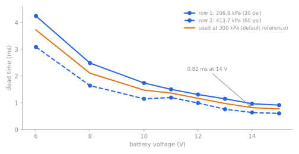
  <figcaption>Figure 2 — The factory dead-time table (from a published Bosch injector lag curve).
  Note how steep it is below 10 V: a sagging battery lengthens every pulse.</figcaption>
</figure>

### Injection mode and phase

:material-circle:{ .level-intermediate } Intermediate

**Mode** (`injectionMode`) decides how many pulses each cylinder gets and how the fuel is split.

<figure markdown>
  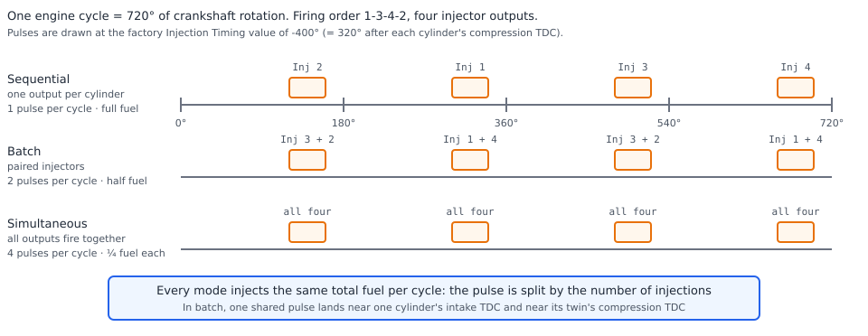
  <figcaption>Figure 3 — Same engine, same total fuel, three modes. Sequential uses one output per
  cylinder; batch pairs cylinders 360° apart and injects half the fuel twice; simultaneous fires every
  injector together and injects a quarter of the fuel each time.</figcaption>
</figure>

The **Injection Timing** table then says *where in the cycle* the pulse sits, in crank degrees relative
to each cylinder's **compression TDC**. Negative is before it, positive after; the table value wraps
through the 720° cycle, so −400° and +320° are the same point. The factory table is a flat
**−400**, which is 40° before each cylinder's intake TDC.

**Injection timing control mode** (`injectionTimingMode`) picks which point of the pulse lands on that
angle: *End of injection* (the default) starts the pulse one full pulse duration earlier,
*Center of injection* half a duration earlier, *Start of injection* not at all. So a longer pulse ends
at the same place in End mode, but begins earlier.

<figure markdown>
  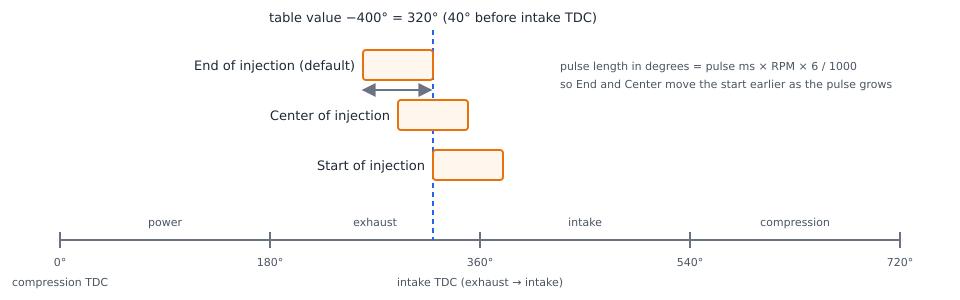
  <figcaption>Figure 4 — Injection phasing at the factory angle. In End mode the pulse finishes 40°
  before intake TDC wherever its length is.</figcaption>
</figure>

rusEFI stops recalculating the opening angle once injector duty cycle reaches 90 %, so that a pulse
already running at or near 100 % duty is not missed while it is being re-scheduled.

<!-- src: firmware/controllers/engine_cycle/fuel_schedule.cpp (InjectionEvent::computeInjectionAngle, getInjectionAngleCorrection, updateInjectionAngle, calculateInjectorOutputMask); firmware/controllers/algo/fuel_math.cpp (getNumberOfInjections, getInjectionOffset); firmware/controllers/algo/engine2.cpp (shouldUpdateInjectionTiming); firmware/controllers/algo/defaults/defaults.h (PORT_INJECTION_OFFSET); firmware/controllers/algo/defaults/default_fuel.cpp (setTable injectionPhase) -->

!!! info "Advanced"
    The injection phase table's axes are the same engine-speed axis as the fuel tables and a load axis
    from 10 to 160 kPa; the table is a phase reference, not a fuel amount. Batch mode on a single
    cylinder injects once, not twice, and keeps the full cycle mass — the twin is the same cylinder.

### Where fuel can be switched off

Fuel is cut, not shortened, by: the **hard RPM limit** (when **Cut fuel on RPM limit** is on), the
**injector duty cycle limiter** (default: cut instantly above 110 % duty, or above 96 % sustained for
0.5 s, and it stays cut until duty falls below 20 %), **deceleration fuel cut**, **flood clear**
(engine not running and throttle above 90 %), **lambda protection** (mixture leaner than the allowed
deviation for longer than the timeout under load), a Lua request, the rev-limit and protection paths in
the limp manager, and the **Injection** master switch.

<!-- src: firmware/controllers/limp_manager.cpp (LimpManager::update: duty cycle limiter, flood clear, lambda protection, Lua cuts); firmware/controllers/algo/fuel/dfco.cpp (DfcoController::cutFuel); firmware/controllers/math/lambda_monitor.cpp (LambdaMonitorBase::update); firmware/controllers/algo/defaults/default_fuel.cpp (maxInjectorDuty defaults, setDefaultLambdaProtection) -->

## Before you start

:material-circle:{ .level-basic } Basic

You need:

- **Injectors wired to injector outputs.** On Proteus, injectors 1 to 4 are **Lowside 1**
  (Black35 pin 3), **Lowside 2** (Black35 pin 15), **Lowside 3** (Black35 pin 4) and
  **Lowside 4** (Black35 pin 16). The outputs are grounded by the ECU; the injectors' other side is
  switched 12 V.
- **Fuel supply at a known pressure.** The factory tune assumes 300 kPa (3 bar, about 43.5 psi) at
  the injectors; set **Injector reference pressure** to what you actually have. High-impedance
  (peak-and-hold or saturated) injectors are driven directly; low-impedance injectors need external
  driver hardware — rusEFI supports smart GDI drivers separately, see the *Outputs and pins* chapter.
- **A MAP sensor** for Speed Density and a **wideband O2 sensor** for closed loop. Both are set up in
  the *Sensors and calibration* chapter.
- **Cylinder count, displacement and firing order** entered first: every fuel number depends on them.

<!-- src: firmware/config/boards/proteus/connectors/black35.yaml (Injector 1 to 4 lowside pins); firmware/config/boards/proteus/board_configuration.cpp (setInjectorPins) -->

!!! warning "Take readings with the ignition on — never on USB power alone"
    On USB power alone the ECU runs but its 5 V sensor supplies do not reach 5 V, so MAP, TPS and
    temperatures are all wrong, and gauges you use to confirm a setting mean nothing. Switch the
    ignition on first.

## Setting it up

:material-circle:{ .level-basic } Basic → :material-circle:{ .level-intermediate } Intermediate

Everything here is in TunerStudio. Fuel settings live under **Fuel**; a few shared ones
(cylinders, strategy, duty-cycle limit, lambda protection) are elsewhere.

<!-- shot: img/ts/fuel-menu.png | Fuel (menu open) | TunerStudio Fuel menu showing VE, VE 3D view, Injector Setup submenu with Injection configuration, Injection hardware, Injector deadtime, Injection Timing, Cylinder bank selection and Injector small-pulse correction, Cylinder fuel trims, Staged injection, VE blend tables, Target AFR, Warmup enrichment, IAT multiplier, Deceleration fuel cutoff, Short term fuel trim/Closed loop and Long term fuel trims | Figure 5 — The <b>Fuel</b> menu on a Proteus F7. The Injector Setup entries are the hardware half of this chapter; the tables above and below are the tuning half. -->

<figure markdown>
  
  <figcaption>Figure 5 — The <b>Fuel</b> menu on a Proteus F7. The Injector Setup entries are the hardware half of this chapter; the tables above and below are the tuning half.</figcaption>
</figure>

### 1 · Engine size and firing order

Open **Setup ▸ Vehicle Information** and set **Number of cylinders**, **Displacement** and
**Firing order**. Displacement is the whole engine in litres, and the firmware divides it by the
cylinder count when it computes air mass, so a wrong cylinder count changes fuelling everywhere at
once.

<!-- src: firmware/controllers/algo/fuel_math.cpp (getStandardAirCharge uses displacement divided by cylindersCount); firmware/controllers/algo/airmass/speed_density_base.cpp (SpeedDensityBase::getAirmassImpl) -->

<!-- shot: img/ts/fuel-vehicle-information.png | Setup ▸ Vehicle Information | Vehicle Information dialog with Number of cylinders 4, Displacement 2.0, Firing order 1-3-4-2, the Fuel panel showing Fuel strategy Speed Density and Baro-compensated MAP load axis disabled, Tuning View, Lambda display AFR | Figure 6 — Vehicle Information. The <b>Fuel</b> panel here is the same one inside <b>Fuel ▸ VE</b>. -->

<figure markdown>
  
  <figcaption>Figure 6 — Vehicle Information. The <b>Fuel</b> panel here is the same one inside <b>Fuel ▸ VE</b>.</figcaption>
</figure>

### 2 · Choose the fuel strategy

On the **Fuel** panel, set **Fuel strategy**. Leave *Speed Density* unless you have a mass-air-flow
sensor or a reason not to trust MAP. In Speed Density, **Baro-compensated MAP load axis** normalises
MAP by barometric pressure *before it is used as a table axis*, so the same table cells are used at
altitude; the physical air-mass calculation still uses measured MAP. It only does anything while there
is a valid barometric pressure reading (see the *Sensors and calibration* chapter), and it is off by
default.

<!-- src: firmware/controllers/algo/airmass/speed_density_airmass.cpp (SpeedDensityAirmass::getCompensatedMap); firmware/integration/rusefi_config.txt (useCompensatedMap help) -->

### 3 · Injector flow, fuel pressure and stoichiometric ratio

Open **Fuel ▸ Injector Setup ▸ Injection configuration**:

- **Injection** (`isInjectionEnabled`) is the master switch, on by default. Off, the ECU never
  injects, and the front page reports a fuel cut of *setting disabled*.
- **Injector flow** (`injector_flow`) is your injector's flow **at the pressure of the running car**.
  The factory value, 200 cc/min, is a placeholder: measure your injectors (a graduated jar and a
  timed run is enough) or use the manufacturer's figure at your rail pressure, and enter it.
- **Injector flow units** selects *cc/min* (default) or *grams per second*.
- **Injector flow compensation mode** — *None* is correct for a MAP-referenced regulator (the common
  sub-atmospheric reference on a port-injected engine), because then the pressure *across* the
  injector tracks the manifold and needs no correction. Choose *Sensed rail pressure* if you have a
  fuel pressure sensor registered; rusEFI then warns you if the mode asks for a sensor that is not
  configured.
- **Injector reference pressure** — the pressure at which the flow figure above is valid, default
  300 kPa (3 bar). A value below 50 kPa is treated as a configuration error.
- **Stoichiometric ratio** — 14.7 for gasoline. For E85 use about 9.9 and enable flex sensing; rusEFI
  interpolates to **E100 stoichiometric ratio** (default 9.0) as ethanol percentage rises.
- **Alpha-N uses IAT density correction** appears only with the Alpha-N strategy.

If **Stoichiometric ratio** is left below 5 the firmware raises a critical error and refuses to run the
fuel calculation, rather than guessing.

<!-- src: firmware/controllers/algo/fuel/fuel_computer.cpp (FuelComputer::getStoichiometricRatio critical error); firmware/controllers/algo/fuel/injector_model.cpp (InjectorModelWithConfig::getInjectorFlowRatio, getFuelDifferentialPressure); firmware/controllers/algo/defaults/default_fuel.cpp (injector.flow, fuelReferencePressure, stoichRatio defaults) -->

<!-- shot: img/ts/fuel-injector-config.png | Fuel ▸ Injector Setup ▸ Injection configuration | Injection configuration dialog with Injection enabled, Mode Sequential, Injector flow 260, Injector flow units cc/min, Injector flow compensation mode None, Injector reference pressure 300, Stoichiometric ratio 14.7 | Figure 7 — Injection configuration with the values used in this chapter's examples. Everything here except Mode is a number the calculation uses directly. -->

<figure markdown>
  
  <figcaption>Figure 7 — Injection configuration with the values used in this chapter's examples. Everything here except Mode is a number the calculation uses directly.</figcaption>
</figure>

### 4 · Injection mode, outputs and firing order

Set **Mode** on the same dialog to **Sequential** if each injector is wired to its own output
(otherwise *Batch* or *Simultaneous*); **Cranking ▸ Cranking settings** has its own **Injection mode**
(`crankingInjectionMode`) for starting, which many builds leave on *Simultaneous*. Then open
**Fuel ▸ Injector Setup ▸ Injection hardware** and assign **Injection Output 1 … N**.

rusEFI's outputs are numbered by **cylinder**, not by firing order: **Injection Output 1** must be the
injector for cylinder 1, and the firmware handles the firing order itself. On Proteus that is
**Lowside 1** for cylinder 1, **Lowside 2** for cylinder 2, and so on. A sequential cylinder with no
output assigned raises a *no_pin_inj* warning naming the missing output.

<!-- src: firmware/controllers/engine_cycle/fuel_schedule.cpp (InjectionEvent::update maps order index to cylinder and warns on an uninitialised output); firmware/tunerstudio/tunerstudio.template.ini (injectionOutputSettings static text: wire each output to the corresponding cylinder number, rusEFI handles firing order) -->

<!-- shot: img/ts/fuel-injection-hardware.png | Fuel ▸ Injector Setup ▸ Injection hardware | Injection hardware dialog with Firing order 1-3-4-2 and Injection Output 1 to 4 assigned to Lowside 1 to Lowside 4, dropdowns closed, Injector Test button panel at right | Figure 8 — Injection outputs, one per cylinder, in cylinder order. -->

<figure markdown>
  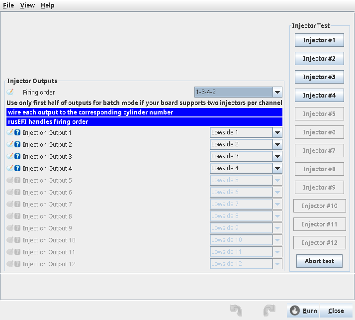
  <figcaption>Figure 8 — Injection outputs, one per cylinder, in cylinder order.</figcaption>
</figure>

### 5 · Injection timing

Open **Fuel ▸ Injector Setup ▸ Injection Timing** (Figure 4 shows what the numbers mean). The factory
value of −400° everywhere suits a typical port-injected engine: the pulse finishes just before the
intake valve opens, so fuel is carried in by the incoming air. Check the **Injection timing control
mode** on **Fuel ▸ Injector Setup ▸ Injection configuration** is *End of injection* unless you have a
reason to change it.

!!! warning "Moving injection later can cost fuel and drivability"
    Injecting onto a closed intake valve leaves fuel on the back of the valve, which makes the mixture
    respond late and unevenly. Do not chase idle quality with this table: it is a 720°-position
    reference, not a fuelling trim.

<!-- shot: img/ts/fuel-injection-timing-table.png | Fuel ▸ Injector Setup ▸ Injection Timing | Injection Timing 3D table with every cell at -400 degrees after compression TDC, engine speed axis 650 to 7000, load axis 10 to 160 kPa | Figure 9 — The factory Injection Timing table: one phase for the whole map. -->

<figure markdown>
  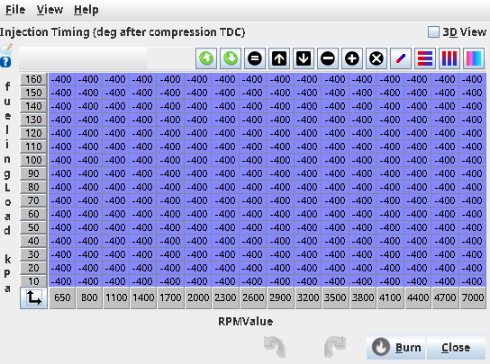
  <figcaption>Figure 9 — The factory Injection Timing table: one phase for the whole map.</figcaption>
</figure>

### 6 · Injector dead time

Open **Fuel ▸ Injector Setup ▸ Injector deadtime (BatV vs fuel pressure)**. This table is per injector
set and is entered against battery voltage across the top and fuel pressure down the side. The factory
table is a two-row curve taken from a published Bosch injector's lag data, and is reasonable for a
mid-size port injector at 206.8 and 413.7 kPa. Where you have measured data — an injector
characterisation sheet, or the dead time at which an injector just stops delivering — enter it here.

<!-- src: firmware/controllers/algo/defaults/default_fuel.cpp (setBosch02880155868, pressure and battery bins); firmware/controllers/algo/engine_configuration_defaults.h (INJECTOR_BATT_LAG_CURR) -->

!!! tip "Dead time matters most where pulses are short"
    At idle a port injector may pulse for only 3 ms, so a 0.85 ms dead time is about a quarter of the
    pulse; at full throttle the pulse may be 15 ms and the same 0.85 ms is 6 %. A wrong dead time shows
    up as an idle that is rich or lean but corrects itself as load rises.

<!-- shot: img/ts/fuel-deadtime-table.png | Fuel ▸ Injector Setup ▸ Injector deadtime (BatV vs fuel pressure) | Injector dead time table dialog: the 8 battery voltage columns (6, 8, 10, 11, 12, 13, 14, 15 volts) and two fuel pressure rows (206.8 and 413.7 kPa) filled with the factory values | Figure 10 — The dead-time table. *Fuel: injector lag* in a log is the value this table produced. -->

<figure markdown>
  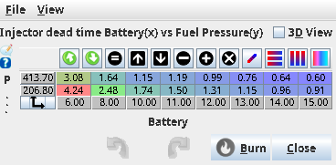
  <figcaption>Figure 10 — The dead-time table. *Fuel: injector lag* in a log is the value this table produced.</figcaption>
</figure>

### 7 · Target AFR table

Open **Fuel ▸ Target AFR** (or **Fuel ▸ Target lambda** with **Lambda display** set to *Lambda*). The
factory table is stoichiometric below about 70 kPa and progressively richer with load, reaching
0.73 λ (about 10.7 : 1) at 250 kPa. It is identical at every engine speed.

The target only says what the ECU *wants*; it is also the reference the wideband is compared against,
and the reference the **Fuel trim** tables and the closed loop work around. If you change it, closed
loop follows the new target.

<!-- shot: img/ts/fuel-target-afr-table.png | Fuel ▸ Target AFR | Target AFR 3D table with stoichiometric values at low load falling to rich at high load, and Override AFR table load axis set to None | Figure 11 — The factory target table. Load here is manifold pressure because the strategy is Speed Density. -->

<figure markdown>
  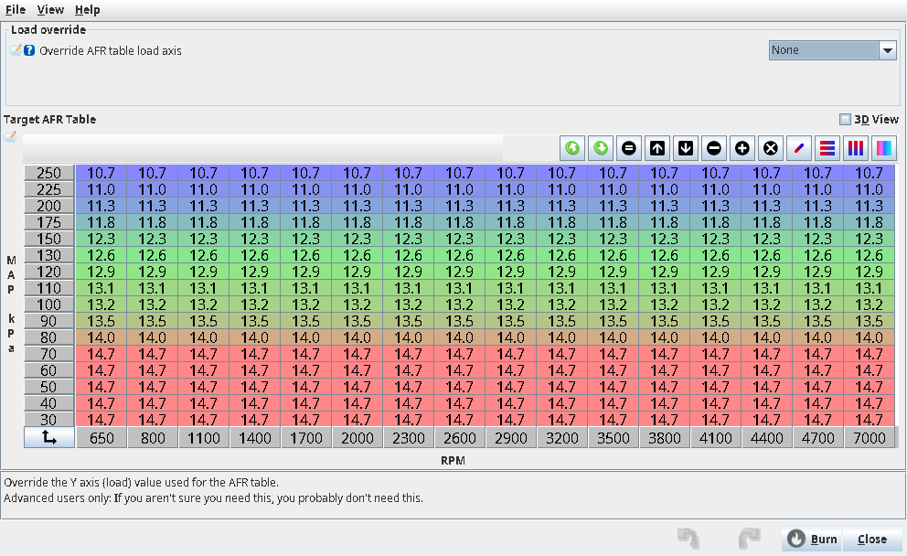
  <figcaption>Figure 11 — The factory target table. Load here is manifold pressure because the strategy is Speed Density.</figcaption>
</figure>

<figure markdown>
  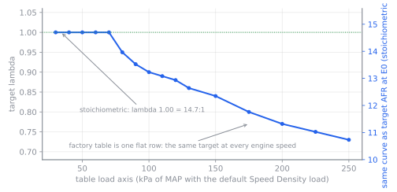
  <figcaption>Figure 12 — The same table as a curve, on both scales.</figcaption>
</figure>

### 8 · The VE table

Open **Fuel ▸ VE**. In Speed Density the VE table is the fuelling table: it says what fraction of the
theoretical cylinder charge actually arrives. The factory table is a generic curve with values from
about 49 % at low load to over 100 % at high load — a placeholder to start from, not a calibration.
**Fuel ▸ VE 3D view** shows the same data in 3D, and **Fuel ▸ Second VE Table** plus the
**VE blend tables** add or switch tables on a condition such as a flex reading.

<!-- shot: img/ts/fuel-ve-table.png | Fuel ▸ VE | Proteus F7, ignition on, 4 cylinders, Fuel strategy Speed Density, Override VE table load axis None, the VE grid filled with the factory values (49 at low load up to about 120 at high load), Fuel: VE gauge alongside, dropdowns closed | Figure 13 — The VE dialog: the strategy panel on the left, the table on the right -->

<figure markdown>
  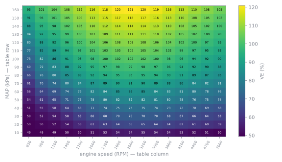
  <figcaption>Figure 14 — The factory VE table. Engine-speed axis 650 to 7000 RPM, load axis
  10 to 160 kPa.</figcaption>
</figure>

!!! note "VE is a fraction, and it absorbs everything"
    Because VE multiplies the ideal gas mass, injector flow errors, an inaccurate MAP sensor and real
    cylinder filling all end up in the same numbers. That is why *Tuning fuel* starts with a known-good
    injector flow and a known-good MAP sensor.

### 9 · Warm-up and IAT multipliers

**Fuel ▸ Warmup enrichment** is a multiplier against coolant temperature: the factory curve commands
1.50× fuel at −40 °C, 1.28× at 0 °C and 1.00× from 80 °C up. **Fuel ▸ IAT multiplier** is a multiplier
against intake temperature; the factory curve is a flat 1.00, so it corrects nothing until you
calibrate it. Both multiply the base mass, and neither applies while cranking, which uses its own
coolant curve (see the *Cranking* chapter).

<!-- src: firmware/controllers/algo/fuel_math.cpp (getCltFuelCorrection, getIatFuelCorrection); firmware/controllers/algo/defaults/default_fuel.cpp (setDefaultWarmupFuelEnrichment); firmware/controllers/algo/engine_configuration.cpp (initTemperatureCurve for the IAT curve) -->

<!-- shot: img/ts/fuel-warmup-enrichment.png | Fuel ▸ Warmup enrichment | Proteus F7, ignition on, engine cold at about 20 C, the 16-point curve from 1.50 at -40 C down to 1.00 from 80 C, Fuel: CLT correction gauge reading about 1.10 | Figure 15 — Warm-up enrichment is a multiplier on base fuel -->

<!-- shot: img/ts/fuel-iat-multiplier.png | Fuel ▸ IAT multiplier | Proteus F7, ignition on, IAT about 20 C, the curve flat at 1.00 across -40 to 110 C, Fuel: IAT correction gauge at 1.00 | Figure 16 — The factory IAT multiplier corrects nothing -->

<figure markdown>
  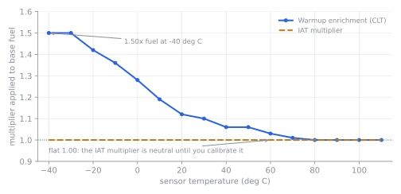
  <figcaption>Figure 17 — Warm-up enrichment does the cold-start work; the IAT multiplier is neutral at
  the factory setting.</figcaption>
</figure>

### 10 · Acceleration enrichment

Open **Fuel ▸ AE / Transient fueling ▸ Acceleration enrichment settings**:

- **Accel Enrichment Mode** selects the strategy: *MS Adder* (default) and *Percent Adder* both add
  fuel from a throttle-position table; *MAP Prediction* instead predicts the pressure the manifold has
  not reached yet; *Lua* takes the extra mass from a script.
- **TPS opening threshold** (default 40) is in TPS percentage points **per 50 ms sample**, not per
  second. A step from 10 % to 20 % is 10 points and does not trigger it; a step from 10 % to 55 % does.
- **TPS history window** is how far back the detector looks for the largest step, in seconds. Zero
  disables the additive modes — and the factory configuration leaves it at zero, so the adder tables do
  nothing until you put a window in (0.3 s is what rusEFI's own engine presets use).
- **Pause STFT learning after acceleration** keeps the wideband trim from undoing your enrichment.
- **Suspend corrections after VE edits** stops enrichment and learning while TunerStudio detects you
  are editing the VE table live.

The adder table is under **Fuel ▸ AE / Transient fueling ▸ TPS / Lua AE calibration**: X is the
throttle position the step started at, Y where it ended, and the value is milliseconds (in *MS Adder*)
or a fraction (in *Percent Adder*) — 0.20 means +20 % in sequential. A separate RPM curve multiplies
the result; the factory curve is a flat 1. **Cycles per fuel portion** and **Fuel portion divisor**
spread one portion over several cycles, imitating a carburettor's acceleration pump.

<!-- src: firmware/controllers/algo/accel_enrichment.cpp (TpsAccelEnrichment::getTpsEnrichment with tpsAccelLookback, onNewValue, onConfigurationChange); firmware/controllers/algo/fuel_math.cpp (the accelEnrichmentMode switch in getInjectionMass); firmware/controllers/algo/defaults/default_fuel.cpp (setMazdaMiataNbTpsTps, tpsAccelEnrichmentThreshold); firmware/config/engines/gm_ls_4.cpp (a preset TPS history window) -->

<!-- shot: img/ts/fuel-accel-enrichment.png | Fuel ▸ AE / Transient fueling ▸ Acceleration enrichment settings | Acceleration enrichment settings dialog with Accel Enrichment Mode MS Adder, Suspend corrections after VE edits enabled, Pause STFT learning after acceleration 1 s, TPS opening threshold 40, TPS history window set to 0.30 s, live gauges for RPM, TPS and the selected TPS event | Figure 18 — Acceleration enrichment settings. The live panel shows which TPS step the ECU picked, which is the fastest way to understand the detector. -->

<figure markdown>
  
  <figcaption>Figure 18 — Acceleration enrichment settings. The live panel shows which TPS step the ECU picked, which is the fastest way to understand the detector.</figcaption>
</figure>

<!-- shot: img/ts/fuel-ae-tps-table.png | Fuel ▸ AE / Transient fueling ▸ TPS / Lua AE calibration | TPS / Lua AE calibration dialog with the TPS-to-TPS enrichment table whose diagonal rises from 10 to 37 ms, RPM correction curve flat at 1, live graph of TPS and injection | Figure 19 — The factory enrichment table: a step ending at full throttle adds up to 37 ms of extra injection, scaled by the RPM curve. -->

<figure markdown>
  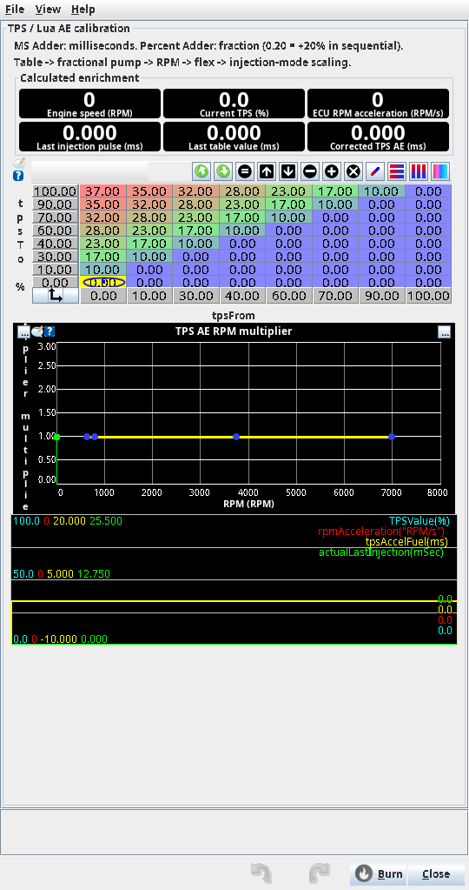
  <figcaption>Figure 19 — The factory enrichment table: a step ending at full throttle adds up to 37 ms of extra injection, scaled by the RPM curve.</figcaption>
</figure>

### 11 · Closed loop (short term fuel trim)

Open **Fuel ▸ Short term fuel trim/Closed loop** and turn on **Short term fuel trim**. rusEFI then
holds the mixture at the target from the AFR table by adding or removing fuel, separately per bank and
per operating region (**Idle**, **Overrun**, **Power**, **Cruise**, bounded by
**Maximum idle region RPM**, **Maximum overrun load** and **Minimum power load**). Correction needs the
engine running, coolant at or above **Minimum CLT** (default 60 °C) and the wideband past
**Startup delay** (default 60 s). Learning additionally needs the measured AFR inside
**Minimum**/**Maximum AFR for learning**, and pauses after deceleration cut, acceleration, launch and
any other fuel cut. Each region's trim moves with its own time constant and is limited by
**Maximum add** and **Maximum remove** (±5 % by default, and never more than ±25 %).

**Fuel ▸ Long term fuel trims** learns the same corrections into 3D tables for the long term;
it needs an SD card, and by default it gathers data without applying it.

<!-- src: firmware/controllers/math/closed_loop_fuel.cpp (ShortTermFuelTrim::getCorrectionState, getLearningState, computeStftBin); firmware/controllers/math/closed_loop_fuel_cell.cpp (ClosedLoopFuelCellBase::update, getMaxAdjustment, getIntegratorGain); firmware/controllers/long_term_fuel_trim.cpp (LongTermFuelTrim::learn, getTrims); firmware/controllers/algo/defaults/default_fuel.cpp (setDefaultStftSettings, setDefaultLtftSettings) -->

<!-- shot: img/ts/fuel-closed-loop.png | Fuel ▸ Short term fuel trim/Closed loop | Short term fuel trim/Closed loop dialog with Short term fuel trim enabled, Minimum CLT 60, Startup delay 60, Minimum AFR 12, Maximum AFR 17, Adjustment deadband 0.5, region settings and bank gauges with the correction state list | Figure 20 — Closed loop. *Correction state* on the dialog names the reason it is not correcting, if it is not. -->

<figure markdown>
  
  <figcaption>Figure 20 — Closed loop. *Correction state* on the dialog names the reason it is not correcting, if it is not.</figcaption>
</figure>

<!-- shot: img/ts/fuel-ltft.png | Fuel ▸ Long term fuel trims | Proteus F7, engine idling with ignition on, Gathering Data enabled, Apply Correction disabled, Time const for Idle region 3000, Max add 12.5, Max remove 12.5, Learning deadband 0.5, Gathering data and Not correcting indicators green, Reset LTFT trims and Apply LTFT to VE and reset buttons visible | Figure 21 — Long term trims gather data by default without applying it -->

### 12 · Deceleration fuel cut, if you want it

**Fuel ▸ Deceleration fuel cutoff (DFCO)** stops injection while the engine is overrunning. **Enable
Fuel Cutoff** turns the feature on; it stays off while coolant is below **No cut below CLT**, while MAP
is above **Cut fuel below MAP**, and it needs engine speed above **Overrun RPM cut above** (restoring
below **Overrun RPM restore below**) with the throttle under **Overrun TPS closed threshold**. Fuel does
not come back instantly: **Fuel cut delay** holds it off, and **Inhibit closed loop fuel after cut**
keeps the wideband trim from reacting to the cut. **Ignition retard during cut** and its ramp-in time
retard timing while cut and for a short while after.

<!-- src: firmware/controllers/algo/fuel/dfco.cpp (DfcoController::commonGuards, overrunActive, cutFuel, getTimingRetard); firmware/controllers/algo/defaults/default_fuel.cpp (setDefaultFuelCutParameters) -->

<!-- shot: img/ts/fuel-dfco.png | Fuel ▸ Deceleration fuel cutoff (DFCO) | Proteus F7, ignition on engine stopped, Enable Fuel Cutoff switched on for the screenshot with the other values left at their factory defaults, Fuel cut on Overrun, No cut below CLT 60, Cut fuel below MAP 30, Overrun RPM cut above 1500, Overrun RPM restore below 1300, Overrun TPS closed threshold 2, Inhibit closed loop fuel after cut 5 | Figure 22 — DFCO entry and release thresholds. The gap between the cut and restore values is what stops the engine flickering between cut and fuel. -->

<figure markdown>
  
  <figcaption>Figure 22 — DFCO entry and release thresholds. The gap between the cut and restore values is what stops the engine flickering between cut and fuel.</figcaption>
</figure>

### 13 · Prove the outputs: injector test

**Controller ▸ Injector test** pulses a chosen injector output: **Iterations** and **On Time** /
**Off Time** per pulse. Use it to prove an injector clicks and sprays the right pattern into a jar
before you trust the wiring.

!!! danger "An injector test sprays fuel into an engine that is not running"
    Fuel will pool in the intake, and can run out onto hot exhaust. Cranking a flooded engine can
    ignite it. Keep the jar under the injector, keep the area clear of sparks and hot metal, and do not
    run more pulses than you need.

<!-- src: firmware/tunerstudio/tunerstudio.template.ini (injTest dialog: benchTestCount, benchTestOnTime, benchTestOffTime, testInjectors buttons); firmware/controllers/bench_test.cpp -->

<!-- shot: img/ts/fuel-injector-test.png | Controller ▸ Injector test | Injector test dialog with Iterations, On Time and Off Time fields, Injector buttons for each cylinder and a battery gauge | Figure 23 — The injector test pulses one output at a time. -->

<figure markdown>
  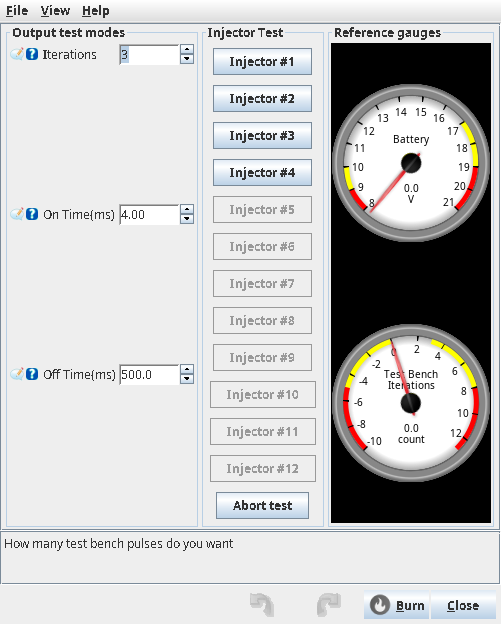
  <figcaption>Figure 23 — The injector test pulses one output at a time.</figcaption>
</figure>

## Worked examples

:material-circle:{ .level-intermediate } Intermediate

### Example 1 — what one cylinder gets at idle

A 2.0 litre four-cylinder, Speed Density, sequential, 260 cc/min injectors at a 300 kPa rail, no fuel
pressure sensor, battery 13.8 V, coolant 90 °C, IAT 20 °C, MAP 40 kPa at 800 RPM, VE 60 % from the
table at that cell.

1. **Charge temperature**: with the factory coefficient of 0.25, the estimate is 90 + 0.25 ×
   (20 − 90) = **72.5 °C**.
2. **Air mass**: ideal gas over 0.5 L at 40 kPa and 345.65 K with the air constant 0.28705 gives
   0.5 × 40 / (0.28705 × 345.65) = 0.2016 g, times VE 0.60 = **0.121 g** of air.
3. **Fuel mass**: the target at 40 kPa is λ 1.00, so 0.121 ÷ 14.7 = **8.2 mg** per cylinder per cycle.
   Corrections are all 1.00 (warm engine, flat IAT curve, no baro correction) and the sequential
   multiplier is 1.
4. **Milliseconds**: 260 cc/min × 0.72 g/cc ÷ 60 = 3.12 g/s. 0.0082 g ÷ 3.12 g/s = 2.64 ms. Add dead
   time interpolated at 13.8 V and the 300 kPa reference, about **0.85 ms**: a **3.5 ms** pulse.
5. **Duty cycle**: 800 RPM is a 150 ms four-stroke cycle, so 3.5 ÷ 150 = **2.3 %**.

Check yourself against a log: *Fuel: base cycle mass* is 8.2 mg, *Fuel: Last inj pulse width* 3.5 ms,
*Fuel: injector lag* 0.85 ms, *Fuel: injector duty cycle* 2.3 %.

<!-- src: firmware/controllers/algo/airmass/speed_density_base.cpp (idealGasLaw with AIR_R 0.28705); firmware/controllers/algo/fuel/fuel_computer.h (fuelDensity 0.72); firmware/controllers/algo/fuel/injector_model.cpp (getInjectionDuration adding getDeadtime); firmware/controllers/math/engine_math.cpp (getEngineCycleDuration doubling for a four-stroke); firmware/controllers/algo/fuel_math.cpp (getInjectorDutyCycle) -->

### Example 2 — batch mode halves the pulse

Same engine in **Batch** mode. Each injector now fires twice per cycle, so the firmware gives each
pulse half the fuel: 4.1 mg instead of 8.2 mg, about 1.3 ms of useful pulse plus the same 0.85 ms dead
time = 2.2 ms, twice per cycle. Notice what changed: the part of the pulse that carries fuel halved
while the fixed dead-time part did not, so dead time is now about 39 % of each pulse instead of 24 %.
Under rusEFI's model the commanded mass is still correct — but any error in the dead-time table or in
flow now moves this engine's fuelling by a larger fraction than before, which is one reason changing
mode means re-checking idle.

<!-- src: firmware/controllers/algo/fuel_math.cpp (getInjectionModeDurationMultiplier returning 0.5 for batch, getNumberOfInjections returning 2); firmware/controllers/algo/fuel/injector_model.cpp (getInjectionDuration adding dead time after the division) -->

### Example 3 — MAF: the VE table becomes a trim

With **MAF Air Charge**, rusEFI takes the measured flow, divides by engine speed and by half the
cylinder count, then **multiplies by the VE table**. At 105 kg/h and 3000 RPM on a four-cylinder that
is 29.2 g/s ÷ 50 rev/s ÷ 2 = 0.29 g of air per cylinder — and the default table would then scale that
by its value, roughly 0.9, before it becomes fuel. With a MAF you normally set the VE table to 100 %
and use it as a correction table instead. The same table also decides the *load* value used by the
target AFR table, expressed as a percentage of the ideal naturally-aspirated cylinder filling.

<!-- src: firmware/controllers/algo/airmass/maf_airmass.cpp (MafAirmass::getAirmassImpl: cylinderAirmass × getVe, airChargeLoad); firmware/controllers/algo/airmass/airmass.cpp (AirmassVeModelBase::getVe) -->

## Tuning it

:material-circle:{ .level-intermediate } Intermediate → :material-circle:{ .level-advanced } Advanced

!!! danger "Tuning fuel is tuning a live engine"
    A lean mixture under load, or a stuck-open injector, damages an engine in seconds. Tune with a
    wideband logged, in a place you can stop, with someone who can pull the fuel pump fuse. If the
    logged lambda goes lean of about 0.75 λ at full throttle, or rich with white smoke, lift off and
    find the cause before continuing.

### Log these channels

| Channel (TunerStudio name) | What it tells you |
|---|---|
| *Fuel: Last inj pulse width* (`actualLastInjection`) | the pulse that was actually scheduled |
| *Fuel: injector duty cycle* (`injectorDutyCycle`) | how much flow headroom is left |
| *Fuel: injector lag* (`m_deadtime`) | the dead time in use right now |
| *Fuel: base cycle mass* (`running_baseFuel`) | after corrections, before trims |
| *Fuel: VE* (`currentVe`), *Fuel: Load* (`fuelingLoad`) | which table cell the ECU used |
| *Fuel: Estimated charge temperature* (`TCharge`) | the temperature the air mass used |
| *AE: TPS enrich* (`tpsAccelFuel`) | acceleration enrichment, ms or fraction |
| *Fuel: CLT correction*, *Fuel: IAT correction* | the warm-up and IAT multipliers |
| *STFT: Bank 1*, *STFT input lambda error: Bank 1* | how hard closed loop is working, and why |
| *Fuel: wall amount*, *Fuel: wall correction* | the fuel-film model's state |
| *Fuel: target lambda*, *fuel: target AFR* | the target being aimed at |
| `fuelCutReason` | why injection is being skipped, as a code |

<!-- src: firmware/console/binary/output_channels.txt (actualLastInjection, injectorDutyCycle, fuelCutReason); firmware/tunerstudio/gauge_declarations.ini (the lag, base mass, VE, charge temperature, acceleration enrichment, wall fuel and target lambda gauges, fuelCutReasonGauge); firmware/live_data_generated/injector_model_generated.h (the dead time held inside the injector model state) -->

### The order of work

1. **Confirm the fixed numbers first**: flow, reference pressure, dead time, cylinder count. A table
   cannot fix a wrong flow rate.
2. **Let closed loop tell you where the VE table is wrong.** With closed loop on, a region's trim that
   sits at +10 % steadily means the VE cells for that region are about 10 % low. Either edit the VE
   cells by that amount or let **Apply LTFT to VE and reset** do it once the long-term trims have
   settled.
3. **Then the transients**: acceleration enrichment is what the wideband dip on tip-in is telling you
   about; deceleration and overrun belong to DFCO and the idle circuit.
4. **Check duty cycle last**: if injector duty climbs past the sustained limit, the injectors are
   simply out of flow, and the limiter's fuel cut is correct behaviour, not a fault.

### Advanced options

- **Staged injection** (**Fuel ▸ Staged injection**) adds a second injector set per cylinder and hands
  it a percentage of the fuel from a table above a threshold. The second set gets its own flow,
  compensation mode and dead-time table, and no small-pulse correction or nonlinearity; the split is
  clamped to 90 % and switches in and out with hysteresis.
  <!-- src: firmware/controllers/algo/fuel_math.cpp (getStage2InjectionFraction); firmware/controllers/algo/fuel/injector_model.cpp (InjectorModelSecondary) -->

<!-- shot: img/ts/fuel-staged-injection.png | Fuel ▸ Staged injection | Proteus F7, ignition on, Enable off, Secondary injector flow 200, Secondary injector flow compensation mode None, the secondary dead-time table shown greyed | Figure 24 — The second injector set has its own flow and dead time -->

<figure markdown>
  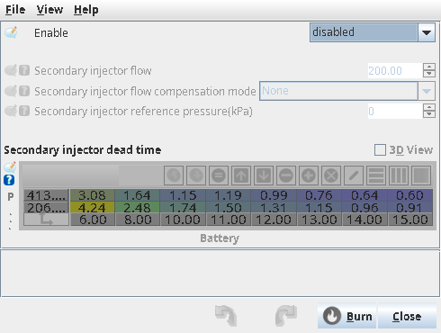
  <figcaption>Figure 24 — The second injector set has its own flow and dead time</figcaption>
</figure>

- **Injector small-pulse correction** (**Fuel ▸ Injector Setup ▸ Injector small-pulse correction**)
  reshapes short pulses: a polynomial added below **Add nonlinearity below pulse**, or the Ford model
  with separate small- and large-pulse slopes and a breakpoint. Both describe a measured injector, so
  enter them from flow-bench data rather than guessing.
  <!-- src: firmware/controllers/algo/fuel/injector_model.cpp (correctInjectionPolynomial, INJ_FordModel small pulse offset); firmware/tunerstudio/tunerstudio.template.ini (injectorNonlinear dialog) -->

<!-- shot: img/ts/fuel-small-pulse-correction.png | Fuel ▸ Injector Setup ▸ Injector small-pulse correction | Proteus F7, ignition on, Small pulse correction mode set to Polynomial, Add nonlinearity below pulse 2 ms, constant offset and the pulsewidth multipliers at zero | Figure 25 — Short-pulse behaviour is a measured property of the injector -->

<figure markdown>
  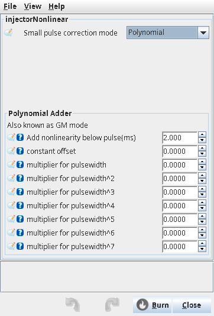
  <figcaption>Figure 25 — Short-pulse behaviour is a measured property of the injector</figcaption>
</figure>

- **WOT Enrichment** (**Fuel ▸ Fuel Corrections ▸ WOT Enrichment**) adds an AFR offset against time
  once the Engine State Machine classifies the state as wide-open, and it moves the target the wideband
  closed loop aims at — which is how a factory tune reaches its full-power lambda after the initial
  enrichment has decayed. It is off by default and needs **Enable Engine State Machine**.
  <!-- src: firmware/controllers/modules/wot_enrichment/wot_enrichment.cpp (WotEnrichment::onSlowCallback, getAfrAdder); firmware/controllers/algo/fuel/fuel_computer.cpp (WotEnrichment adder in getCycleFuel); firmware/controllers/modules/engine_state_machine/engine_state_machine.cpp (setDefaultConfiguration, the WOT throttle threshold) -->

<!-- shot: img/ts/fuel-wot-enrichment.png | Fuel ▸ Fuel Corrections ▸ WOT Enrichment | Proteus F7, ignition on, WOT Enrichment off with Enable Engine State Machine on, Driver throttle WOT threshold 90, the time-to-AFR-adder curve flat at zero | Figure 26 — WOT enrichment changes the target, not the injector pulse -->

<figure markdown>
  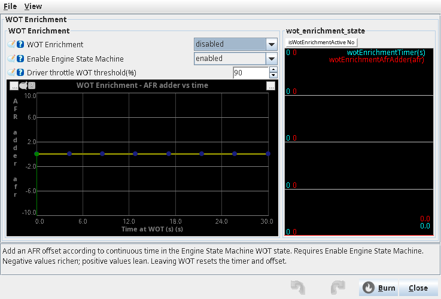
  <figcaption>Figure 26 — WOT enrichment changes the target, not the injector pulse</figcaption>
</figure>

- **Wall wetting compensation** (**Fuel ▸ AE / Transient fueling ▸ Wall wetting compensation**) models
  the fuel film in the inlet tract with two numbers: **Evaporation time constant - tau** and **Fuel
  deposition fraction - beta**, either as constants or as four curves against coolant and MAP. It works
  alongside any acceleration-enrichment mode, and is bypassed while cranking, below 100 RPM, or when
  either number is below 0.01.
  <!-- src: firmware/controllers/algo/wall_fuel.cpp (WallFuel::adjust, WallFuelController::computeTau, computeBeta, onFastCallback) -->

<!-- shot: img/ts/fuel-wall-wetting.png | Fuel ▸ AE / Transient fueling ▸ Wall wetting compensation | Proteus F7, engine idling with ignition on, Wall fueling model type Basic (constants), Evaporation time constant tau 0.30, Fuel deposition fraction beta 0.30, gauges showing Fuel wall amount and Fuel wall correction | Figure 27 — The fuel-film model, with the last calculated wall values next to it -->

!!! tip "Nothing here fixes a wrong flow rate"
    Staged injection, small-pulse correction, wall wetting and WOT enrichment all shape fuel around a
    base that is only as good as **Injector flow**, **Injector reference pressure** and the dead-time
    table. Set those first.

## Diagnostics

:material-circle:{ .level-intermediate } Intermediate

### Fuel cut codes

The front page shows *Injection OK*, or *Fuel cut: <reason>*; the logged `fuelCutReason` holds the
same code.

| Code shown | Cause | What to check |
|---|---|---|
| setting disabled | **Injection** is off | Fuel ▸ Injector Setup ▸ Injection configuration |
| RPM limit / ETB RPM limit | hard limiter with **Cut fuel on RPM limit** | working as configured |
| max injector duty | injector duty-cycle limiter tripped | flow, fuel pressure, the duty-cycle limits (see the *Limits and engine protection* chapter) |
| flood clear | throttle above 90 % while not running | intended behaviour, or a TPS calibration problem |
| engine sync | no trigger phase sync | the *Trigger* chapter |
| Lambda Prot | lambda protection cut | target AFR, fuel pressure, injectors |
| Lua | a script requested the cut | the script |
| stop requested | shutdown requested | normal |

<!-- src: firmware/controllers/limp_manager.cpp (LimpManager::update: ClearReason values); firmware/tunerstudio/tunerstudio.template.ini (fuelIgnCutCodeList, Injection OK indicator) -->

### Why closed loop is not correcting

The dialog's *Correction state* names the reason, using these: **Enabled**, **Settings** (the switch
is off), **Tuning** (VE edits in progress), **RPM** (not running), **Cranking Delay** (within
**Startup delay**), **Clt** (below **Minimum CLT** or the sensor failed), **AFR out of range**,
**DFCO**, **TPS Accel**, **Fuel Cut**, **Launch**. Learning pauses for the last six of those while
correction continues.

<!-- src: firmware/controllers/math/closed_loop_fuel.cpp (stft_state_e values); firmware/tunerstudio/tunerstudio.template.ini (stftStateList, Correction state indicator panel) -->

### Errors and warnings

A **critical error** stops fueling: *Please set Stoichiometric ratio*, *Invalid Fuel strategy*,
*Invalid Injection Mode*, *Invalid Accel Enrichment Mode*, *Impossible fuel reference pressure*.
Warnings are logged for *NaN injection pulse*, *Negative injection pulse*, *Short pulse*,
*Injector duty cycle cut*, *zero cranking coolant multiplier*, and for a compensation mode that asks
for a fuel pressure sensor that is not configured.

<!-- src: firmware/controllers/algo/fuel_math.cpp (firmwareError and warning calls in getAirmassModel and getInjectionMass); firmware/controllers/algo/fuel/injector_model.cpp (criticalError on reference pressure, warning on missing pressure sensor); firmware/controllers/engine_cycle/main_trigger_callback.cpp (injection pulse warnings); firmware/controllers/algo/fuel/fuel_computer.cpp (criticalError messages) -->

## Troubleshooting

:material-circle:{ .level-basic } Basic → :material-circle:{ .level-advanced } Advanced

| Symptom | Likely cause | Check |
|---|---|---|
| Runs only on starter fluid, no fuel click | wrong output assigned to a cylinder | *Injection Output* numbering is by cylinder, step 4 |
| Idle rich, corrects itself as load rises | dead time too long, or injector flow entered at the wrong pressure | dead-time table, **Injector reference pressure**, Figure 2 |
| Idle fine, falls on its face under full load | injector duty-cycle limiter, or the pump cannot keep up | *Fuel: injector duty cycle*, `fuelCutReason` = max injector duty |
| Hesitates or bogs on tip-in | acceleration enrichment too small, or **TPS opening threshold** too high | Figure 18, Figure 19 |
| Pops on overrun | after-start or enrichment still active, or DFCO off | *Fuel: CLT correction*, DFCO thresholds |
| Idle hunts rich then lean at warm idle with closed loop on | trim limits too small, or a vacuum leak the trim is compensating for | *STFT: Bank 1*, then leak-test |
| Engine starts and runs rich only when cold, for a long time | warm-up curve too rich, or **Minimum CLT** for closed loop too high | Figure 17, closed-loop panel |
| Everything is proportionally rich or lean at one altitude | no baro correction, or MAP used as load axis without compensation | **Baro-compensated MAP load axis**, **Fuel ▸ Fuel Corrections ▸ Barometric pressure correction** |
| Wrong fuelling after swapping a MAF | the MAF transfer function, or the VE table not at 100 % | the *Sensors* chapter, Example 3 |
| Runs on raw petrol out the exhaust after a long crank | flood clear did not fire, or a stuck injector | TPS calibration (clear needs throttle above 90 %), injector test, step 12 |
| Sequential engine runs lean at idle in batch by a constant amount | dead time now a much larger share of a shorter pulse | Example 2; re-tune after changing mode |
| *no_pin_inj* warning naming an output | sequential or batch cylinder with no injector output | step 4 |

## Settings reference

### Injection configuration (Fuel ▸ Injector Setup ▸ Injection configuration)

--8<-- "reference/settings/_injectorConfig.table.md"

### Injection hardware (Fuel ▸ Injector Setup ▸ Injection hardware)

--8<-- "reference/settings/_injectionSettings.table.md"

### Injector small-pulse correction (Fuel ▸ Injector Setup ▸ Injector small-pulse correction)

--8<-- "reference/settings/_injectorNonlinear.table.md"

### Staged injection (Fuel ▸ Staged injection)

--8<-- "reference/settings/_stagedInjection.table.md"

### VE (Fuel ▸ VE)

--8<-- "reference/settings/_veTableDialog.table.md"

### Target AFR (Fuel ▸ Target AFR)

--8<-- "reference/settings/_afrTableDialog.table.md"

### Closed loop (Fuel ▸ Short term fuel trim/Closed loop)

--8<-- "reference/settings/_fuelClosedLoopDialog.table.md"

### Long term fuel trims (Fuel ▸ Long term fuel trims)

--8<-- "reference/settings/_fuelLTFCDialog.table.md"

### Deceleration fuel cutoff (Fuel ▸ Deceleration fuel cutoff (DFCO))

--8<-- "reference/settings/_coastingFuelCutControl.table.md"

### Acceleration enrichment settings (Fuel ▸ AE / Transient fueling ▸ Acceleration enrichment settings)

--8<-- "reference/settings/_AccelEnrich.table.md"

### Wall wetting compensation (Fuel ▸ AE / Transient fueling ▸ Wall wetting compensation)

--8<-- "reference/settings/_wallWettingDialog.table.md"

### WOT Enrichment (Fuel ▸ Fuel Corrections ▸ WOT Enrichment)

--8<-- "reference/settings/_wotEnrichmentDialog.table.md"

### Injector duty cycle limiter (Setup ▸ Limits and protection ▸ Limits and fallbacks)

--8<-- "reference/settings/_dutyCycleLimiting.table.md"

### Injector test (Controller ▸ Injector test)

--8<-- "reference/settings/_injTest.table.md"

## Related

- Part III — Cranking: priming, cranking fuel and after-start enrichment
- Part III — Sensors and calibration: MAP, IAT, CLT, MAF and wideband inputs
- Part III — Outputs and pins: injector outputs, main relay and fuel pump control
- Part III — Idle: the idle VE table and the idle circuit
- Part IV — Tuning fuel: VE table, closed loop and long-term trims on the road
- Part IV — Tuning principles: the order in which fuel and ignition are approached
