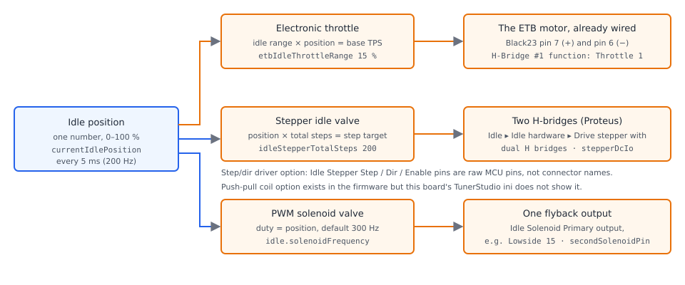

# Idle

:material-circle:{ .level-basic } Basic → :material-circle:{ .level-advanced } Advanced

> **In one sentence:** the idle controller decides how much air the engine gets when the throttle is
> closed — a coolant-dependent opening plus a PID that trims it to hold the target RPM — and can add a
> small amount of ignition advance or retard to react faster than airflow alone.

## What it does

:material-circle:{ .level-basic } Basic

When your foot is off the accelerator, the engine still needs air, and it needs just enough of it to
sit still without stalling or racing. rusEFI's idle controller:

- **Holds a target idle speed** that changes with coolant temperature — higher when cold, lower once
  warm.
- **Knows what you are doing.** It treats cranking, the first seconds after starting, idling,
  coasting with the throttle shut, and normal running as five different situations, and does something
  slightly different in each.
- **Adds air for loads.** Air conditioning, the cooling fans, and (through Lua) transmission range can
  each ask for more air before they ask for engine torque.
- **Drives the hardware you have**: an electronic throttle, a stepper-motor idle valve, or a PWM
  solenoid idle valve — and on some engines, a small throttle dedicated to idle.
- **Trims spark when air is too slow.** Airflow through an idle valve takes a second or two to change
  engine speed; ignition advance reacts in one combustion cycle. rusEFI can run a second, small PID on
  ignition advance to cover the fast part.

Two ways of asking for air:

| Mode (TunerStudio: **Idle ▸ Idle settings ▸ Idle control mode**) | What it does |
|---|---|
| **Open Loop** (factory default) | idle position comes from a table of coolant temperature, plus the adders |
| **Open Loop + Closed Loop** | the same table position, plus a PID correction on RPM error |

!!! danger "A wrong idle setting can hold the engine at high RPM"
    An idle valve that is stuck open, wired backwards, or driven from an open-loop table that is too
    high will hold the engine fast with the throttle shut. Work with the gearbox in neutral and the
    wheels chocked, keep your hands, tools and loose clothing away from the throttle linkage, the
    belts and the cooling fan, and have a way to shut the engine off (the key) in your hand, not on
    the seat. An engine that will not come back to idle is also a danger when you connect or
    disconnect the valve.

## How it works

:material-circle:{ .level-intermediate } Intermediate

<figure markdown>
  
  <figcaption>Figure 1 — The idle control loop. Blue is what is asked for, orange is what is driven,
  green is the measurement and the correction that closes the loop, red is the phase logic that
  decides which parts are active.</figcaption>
</figure>

The controller runs **200 times a second** (every 5 ms) on the firmware's fast callback. Every time
round it computes one number — **idle position, 0 to 100 %** — and hands it to the hardware.
<!-- src: firmware/controllers/core/main_loop.h (FAST_CALLBACK_RATE = Period200hz, FAST_CALLBACK_PERIOD_MS); firmware/controllers/actuators/idle_thread.cpp (IdleController::onFastCallback calls getIdlePosition then applyIACposition) -->

### The five phases

Before any arithmetic, the controller decides what the engine is doing. The phase decides which of the
adders and the PID are allowed.

| Phase | Entered when | Idle position comes from |
|---|---|---|
| **Cranking** | the engine has not yet reached running RPM | the cranking air curve, nothing else |
| **CrankToIdleTaper** | running, but still inside the crank-to-run taper | a blend from cranking air towards the running position |
| **Idling** | throttle at or below **TPS threshold**, RPM below the entry threshold, and either the clutch is down or the vehicle is not moving fast | table position + adders + PID |
| **Coasting** | off throttle, clutch up, RPM above the exit threshold | table position (or the separate coasting table), no PID |
| **Running** | throttle above **TPS threshold**, or the vehicle is moving with the clutch up; also used when the throttle sensor has failed | table position plus the dashpot adder, no PID |

The RPM thresholds have a band between them so the controller does not flicker in and out of idle:
the engine is only called *coasting* above *target + 1.5 ×* **RPM upper limit**, and only returns to
*idling* below *target +* **RPM upper limit**. A clutch-down input (or the Lua clutch flag) lets the
engine be treated as idling whatever the road speed, which is what a stopped-but-in-gear car needs. A
failed throttle sensor makes the controller assume **Running**, so the idle PID stops correcting rather
than guessing.
<!-- src: firmware/controllers/actuators/idle_thread.cpp (IdleController::determinePhase, IdleController::getTargetRpm); firmware/controllers/actuators/idle_thread.h (Phase enum, isIdlingOrTaper); firmware/controllers/algo/engine.cpp (getClutchDownState) -->

### The target RPM

The target is read from **Idle Target RPM from CLT** `cltIdleRpm` against
`cltIdleRpmBins`. The factory curve is 1350 RPM at −30 °C falling to 900 RPM at 90 °C and above, with
the last two bins rising again to 1000 and 1100 RPM.

With the A/C button on, the controller uses whichever is **higher** of that curve and **A/C RPM target**
`acIdleRpmTarget` (default 900 RPM). The A/C value is a whole target, not an addition, so the A/C bump
only appears if you set it above your normal target.

Two more thresholds come from the target: the entry threshold (target + **RPM upper limit**, default
+300 RPM) and the exit threshold (target + 1.5 × that). With **Ramp target on return to idle** on, an
engine re-entering idle starts from the entry threshold and the target ramps down to normal over
**Ramp target duration** (default 3 s), which stops the RPM dipping below idle on the way back down.
Without that option the target is simply the curve value the moment the engine gets back into idle.

<figure markdown>
  
  <figcaption>Figure 2 — The factory curves. Note the target is still 1350 RPM at −30 °C and the
  open-loop position has not reached its low end until the engine is warm.</figcaption>
</figure>
<!-- src: firmware/controllers/algo/engine_configuration.cpp (setDefaultIdleSpeedTarget: cltIdleRpmBins and cltIdleRpm, setDefaultIdleOpenLoopParameters: cltIdleCorrBins and cltIdleCorrTable); firmware/controllers/actuators/idle_thread.cpp (IdleController::getTargetRpm: acIdleRpmTarget, idlePidRpmUpperLimit, idleReturnTargetRampDuration); firmware/controllers/actuators/idle_thread_io.cpp (setDefaultIdleParameters: idlePidRpmUpperLimit 300, idleReturnTargetRampDuration 3) -->

### The open-loop position

The base position comes from **Idle Position from CLT vs Idle Target RPM** — a table whose rows are
coolant temperature and whose columns are the **target** idle speed, not the actual one. The factory
table is 8 coolant rows (−40 … 140 °C) by 6 target-RPM columns whose axis is generated for you as
650, 800, 2200, 3600, 5000 and 7000 RPM — so an engine idling near 900 lives in the first two columns.
Every column holds the same ramp: 75 % at the coldest row falling to 50 % at the hottest. The
factory numbers are deliberately generous: they are meant to start an engine, not to be a finished idle.

On top of that base the controller adds, in order:

- **A/C adder** `acIdleExtraOffset` (default 15 %) — only while idling or in the crank-to-run taper.
- **Fan #1 adder** and **Fan #2 adder** — while the corresponding fan output is on.
- A **Lua adder** (a script calls `setIdleAdd`), and the **Idle modifier when in P or N**
  `idleParkNeutralOffset`, which a script feeds with `setParkNeutral`.
- The anti-lag adder, when anti-lag is active.
- The **dashpot**: when you close the throttle, an extra **Dashpot coasting-to-idle Initial idle
  Adder** `iacByTpsTaper` (default 2 %) is held for **Hold time** then decayed over **Decay time**, so
  the engine catches itself instead of almost stalling.
- If **Separate coasting idle table** is on and the phase is Coasting (or Running with modeled-flow
  idle), that table against RPM replaces the whole base position instead, plus the A/C adder.

Finally, right after starting, the position is blended from the **cranking air** position towards this
running position over **Idle After Start (Crank-to-Run) Taper vs CLT** `afterCrankingIACtaperDuration`
(default 200 engine cycles, about 7 s at 1000 RPM). The cranking position itself comes from
**Cranking Air Amount vs CLT** `cltCrankingCorr` (default 50 % at every temperature) — see the
Cranking chapter.
<!-- src: firmware/controllers/actuators/idle_thread.cpp (IdleController::getRunningOpenLoop, getOpenLoop, getCrankingOpenLoop, getCrankingTaperFraction); firmware/controllers/algo/engine_configuration.cpp (setDefaultIdleOpenLoopParameters, setRpmTableBin for rpmIdleCorrBins, iacCoastingRpmBins); firmware/util/containers/table_helper.h (setRpmBin: first bin is idle RPM minus 150, last bin is the top of the axis); firmware/controllers/lua/lua_hooks.cpp (setIdleAdd, setParkNeutral); firmware/controllers/algo/defaults/default_cranking.cpp (cltCrankingCorr 50, afterCrankingIACtaperDuration 200); firmware/controllers/actuators/electronic_throttle.cpp (idle valve and throttle positions) -->

### The closed-loop correction

The PID is added only when the mode is **Open Loop + Closed Loop**, the throttle sensor is readable,
and the phase is **Idling**. It works on RPM error (target minus measured RPM) and its output is a
percentage of idle position added to or subtracted from the open-loop value. rusEFI's idle PID is the
"industrial" variant: the output is clamped, and the integrator is limited twice — by **iTerm Min** and
**iTerm Max** (default ± 20 %) and by anti-windup against the output clamp.

Around that core:

- **RPM deadzone** `idlePidRpmDeadZone` (default 50 RPM). Inside it the PID does nothing at all and
  the last correction is held, so a small RPM wobble is not chased. The deadzone is ignored for half a
  second after the A/C state changes, so an A/C switch-on is always chased.
- **PID Extra for low RPM** `pidExtraForLowRpm` amplifies the error when RPM is below target, because
  an engine that drifts low is closer to stalling than one that drifts high.
- When the phase leaves **Idling**, the PID is flagged for reset, but the reset only throws away the
  integrator if it is *not* helping hold the engine up (a positive integrator is kept). After a reset
  the PID eases back in over one second.
- **Use IAC PID Multiplier Table** `useIacPidMultTable` scales the whole PID correction by a table of
  load and RPM — 1.0 means the PID works at full gain, 0 turns it off. Useful where idle air is very
  sensitive near the throttle stop and less so further out.
- The correction is faded to zero as the throttle opens, reaching zero at **TPS threshold**
  `idlePidDeactivationTpsThreshold`, so the PID cannot fight the driver.

The factory gains are **P 0.05, I 0.002, D 0**, with the output limited to ±20 % of idle position and
the integrator to ±20 %. The PID's own offset is forced to 0 at start-up on purpose — the open-loop
table is the offset.

Total position is then clamped to 0–100 %.
<!-- src: firmware/controllers/actuators/idle_thread.cpp (IdleController::getClosedLoop, getIdlePosition); firmware/controllers/actuators/idle_thread_io.cpp (setDefaultIdleParameters, startIdleThread: idleRpmPid.offset = 0); firmware/util/math/efi_pid.cpp (PidIndustrial::getOutput: derivative filter, anti-windup against the clamped output); firmware/util/math/efi_pid.h (Pid::updateITerm iTerm limits); firmware/controllers/algo/engine_configuration.cpp (idleRpmPid pFactor 0.05, iFactor 0.002, minValue and maxValue 20, idlePidDeactivationTpsThreshold 5) -->

### Where the position goes: the three actuators

One position, three very different outputs. With an electronic throttle the idle position does not
move a valve; it raises the throttle's rest position. The controller squeezes the pedal-target map into
*idle opening* … 100 %, where a 100 % idle position means
**Electronic throttle idle range** `etbIdleThrottleRange` (default 15 %, limit 45 %) of throttle at a
fully released pedal. So at 25 % idle position the engine's rest opening is 3.75 %, and a 30 % pedal
still ends at 30 % throttle.

<figure markdown>
  
  <figcaption>Figure 3 — How the idle adder is applied to an electronic throttle (default 15 % idle
  range). The idle position moves the whole map's floor, not the top end.</figcaption>
</figure>

- **Stepper valve**: the position is converted to steps
  (`position × `**Stepper total steps** `idleStepperTotalSteps`, default 200) and a separate stepper
  thread walks the valve to that step count one step at a time.
- **Solenoid valve**: the position *is* the PWM duty cycle, at **Idle Solenoid Frequency** (default
  300 Hz on Proteus). In **Double Solenoid Mode** (Subaru and some BMW and Mazda valves, which rest in
  the middle) the two outputs are driven oppositely — one at 1 %+98 %·position, the other at
  1 %+98 %·(100 %−position).
- **Dedicated idle throttle** (VW-style): set **H-Bridge #1 function** or **H-Bridge #2 function** to
  *Idle Valve* and that H-bridge is driven straight with the idle position, in the same closed-loop way
  as a normal electronic throttle. The position sensor for that valve is set up under
  **Sensors ▸ ETB-style Idle valve position sensor**.

With the engine not turning, the solenoid outputs are switched off (silence, and no hot coil), unless
**Keep powered while engine stopped** is on — in which case the valve is held at the cranking position
for one minute after the engine stops, then released anyway. A stepper keeps its position either way,
because position is counted, not held by power.
<!-- src: firmware/controllers/actuators/idle_hardware.cpp (applyIACposition, initIdleHardware, IDLE_SOLENOID_HOLD_TIMEOUT_SEC); firmware/controllers/actuators/electronic_throttle.cpp (EtbController::getSetpointEtb: etbIdleAddition and interpolateClamped, EtbController::getSetpointIdleValve, setDefaultEtbParameters: etbIdleThrottleRange 15); firmware/controllers/generated/rusefi_generated_proteus_f7.h (DEFAULT_SOLENOID_FREQUENCY 300); firmware/tunerstudio/tunerstudio.template.ini (idleValvePosDialog, dc_function_e list with Idle Valve); firmware/integration/rusefi_config.txt (isDoubleSolenoidIdle, keepIdleSolenoidWhenStopped help) -->

### Idle ignition timing

The air path is slow. With **Enable closed loop idle ignition timing** on
(**Idle ▸ Closed-loop Ignition idle timing**), a second PID adds ignition advance while idling:
**Proportional gain** is degrees of advance per RPM of error, the factory 0.1 meaning "10 degrees per
100 RPM", with the adjustment limited to **Min adjustment (retard)** −10° and **Max adjustment
(advance)** +10°, and integral and derivative at 0 by default. It only runs in the **Idling** phase,
and resets the moment you are not idling. **Soft entry time** fades the correction in after the engine
starts, which matters if the gain is aggressive.

Separately, **Separate idle ignition table** (`useSeparateAdvanceForIdle`) replaces the running timing
map with the **Idle Ignition advance** curve while idling, blended back to the normal map as the
throttle passes half and then **TPS threshold**. **Separate idle VE table** does the same for fuelling.
<!-- src: firmware/controllers/actuators/idle_thread.cpp (IdleController::getIdleTimingAdjustment: phase test, reset, soft entry); firmware/controllers/algo/ignition/ignition_state.cpp (timingPidCorrection, idleAdvance blend against idlePidDeactivationTpsThreshold); firmware/controllers/actuators/idle_thread_io.cpp (setDefaultIdleParameters: idleTimingPid 0.1 and minus 10 / plus 10) -->

!!! info "Advanced"
    Three deeper idle features exist and are not needed for a working idle: **modeled flow idle**
    (**Controller ▸ Experimental/Broken**, which forces closed loop and converts the controller's
    demand into an airflow figure using **Idle flow estimate**, handing the fast part of the demand to
    the timing PID through **Idle airmass/timing equivalence**); **Long Term Idle Trim**, which slowly
    learns a coolant-indexed multiplier on the open-loop position from how hard the idle PID is working
    (it is in the firmware but has no TunerStudio dialog); and **rotational idle** (**Advanced ▸
    Rotational Idle**), which raises idle by skipping spark or fuel on a rotating pattern instead of
    admitting more air. See *Tuning it* and the tables at the end.
    <!-- src: firmware/controllers/actuators/idle_thread.cpp (getIdlePosition: modeledFlowIdle airmass and timing split); firmware/controllers/math/closed_loop_idle.cpp (LongTermIdleTrim::update and getLtitFactor); firmware/controllers/engine_cycle/rotational_idle.cpp (RotationalIdle::shouldEngageRotationalIdle and the skip pattern) -->

## Before you start

:material-circle:{ .level-basic } Basic

<figure markdown>
  
  <figcaption>Figure 4 — The three ways rusEFI drives idle air, and where each one plugs into a
  Proteus F7. Note the stepper path reuses the throttle H-bridges.</figcaption>
</figure>

Pick your hardware before you open a dialog:

- **Electronic throttle only** — no extra wiring. Everything is done with
  **Electronic throttle idle range** and the throttle itself; the Electronic Throttle chapter covers
  the throttle, calibration and its limits.
- **PWM solenoid idle valve** — one output. On Proteus use one of the flyback-protected lowside
  outputs (**Lowside 13**, **Lowside 14 or starter**, **Lowside 15**, **Lowside 16** on Black35);
  the board does not dedicate a pin to the idle valve. A two-wire valve needs 12 V on one side and the
  switched output on the other, with the valve body's flyback diode or the board's protection in place.
- **Stepper idle valve (4-wire bipolar)** — Proteus drives one of these with **both** of its
  H-bridges, one coil per bridge. That means a dual-H-bridge stepper and an electronic throttle cannot
  share a Proteus: the two coils need the two bridges that would otherwise drive the throttle motor.
- **Stepper with its own step/direction driver** — the **Idle Stepper Step Pin**, **Idle Stepper Dir
  Pin** and **Idle Stepper Enable Pin** fields ask for a raw MCU pin, not a connector name, so use
  them only if you are deliberately wiring to bare board pins and have the board pinout in front of you.
- **Double solenoid valve** — two outputs, as above, with **Double Solenoid Mode** on.

You also need:

- A **coolant sensor** that reads correctly: the whole open-loop idle schedule is against it.
- A **throttle position sensor** (or accelerator pedal) that reads 0 % at rest. With an electronic
  throttle, the idle logic reads pedal position, and **TPS threshold** should be 1–2 %.
- A **vehicle speed input** and/or a **clutch down** input (**Sensors ▸ Digital**) if you want idle
  detection to be smart about gear and road speed; neither is required for a stationary engine.
- **12 V, ignition on** for anything you measure or calibrate. On USB power alone the 5 V sensor
  supplies sag and every ratiometric reading is wrong.
<!-- src: firmware/config/boards/proteus/connectors/black35.yaml (Lowside 13, Lowside 14 or starter, Lowside 15, Lowside 16, all with flyback); firmware/tunerstudio/tunerstudio.template.ini (idleSolenoid and idleStepperHw fields, allPinsInputs_Digital); firmware/integration/rusefi_config.txt (idlePidDeactivationTpsThreshold help: pedal position when you have a pedal); firmware/init/sensor/init_tps.cpp (driverIntent ProxySensor: the driver's throttle intent is the pedal when one is fitted, otherwise TPS); firmware/controllers/actuators/idle_hardware.cpp (initIdleHardware: the stepper H-bridge option builds two DcMotor phases from stepperDcIo[0] and stepperDcIo[1]) -->

!!! danger "Do not free the H-bridge that drives your throttle"
    Enabling **Drive stepper with dual H bridges** claims both H-bridges — the same two outputs the
    throttle motor uses. If your engine has an electronic throttle, converting to a stepper idle valve
    stops the throttle motor from being driven at all, and the engine then runs on whatever its spring
    leaves open. Only do this conversion on a cable-throttle engine. Check **H-Bridge #1 function** and
    **H-Bridge #2 function** under **Advanced ▸ DC motor actuator(s) function** before and after.

!!! warning "Micro-step modes need their current settings first"
    In the **Micro-Stepping** panel, **Max. Duty Cycle** limits the current through the coils while
    stepping and **Min. Duty Cycle** is the holding current when the valve has stopped. Both are 0 in
    the factory configuration, and the micro-step drive multiplies the whole step waveform by
    **Max. Duty Cycle** — leave it at 0 with a micro-step mode selected and the valve receives no
    current at all and simply does not move. Set the two duties before selecting a micro-step mode.
    <!-- src: firmware/hw_layer/stepper_dual_hbridge.cpp (DualHBridgeStepper::step: dutyMult from stepperMaxDutyCycle, sleep: holding current from the smaller of the two duty settings) -->

## Setting it up

:material-circle:{ .level-basic } Basic → :material-circle:{ .level-intermediate } Intermediate

Everything is in TunerStudio's **Idle** menu except the throttle and actuator-function dialogs, which
live under **Advanced**, and the bench test, which is under **Controller**.

<!-- shot: img/ts/idle-menu.png | Idle (menu open) | menu dropped down showing Idle settings, Idle hardware, Idle Target RPM from CLT, Idle Position from CLT vs Idle Target RPM, Idle After Start (Crank-to-Run) Taper vs CLT, Closed-loop Ignition idle timing, Coasting Idle position, Idle VE and Idle Ignition advance | Figure 5 — The <b>Idle</b> menu on a Proteus F7. IAC PID multiplier appears once the closed-loop mode and the multiplier table are enabled. -->

### 1 · Say which valve you have

Open **Idle ▸ Idle hardware**. The dialog warns that these settings need an ECU reboot. Leave
**Use Stepper** at *no* for a solenoid valve, and set it to *yes* for a stepper.
**Electronic throttle idle range** matters only with an electronic throttle (default 15 %).

<!-- shot: img/ts/idle-hardware.png | Idle ▸ Idle hardware | Use Stepper no, Electronic throttle idle range 15, Idle Valve Hardware panel open, Idle Solenoid Primary output unassigned, Idle Solenoid Frequency 300 | Figure 6 — <b>Idle hardware</b> with the factory settings: no stepper, and no idle valve output assigned. -->

### 2 · Set up the solenoid valve (if you have one)

In the **Solenoid** part of the dialog, set **Idle Solenoid Primary output** to your valve output — on
Proteus, *Lowside 15* in this chapter's example. Leave **Double Solenoid Mode** at *no* unless the
valve is a two-valve Subaru or BMW type, in which case also set **Idle Solenoid Secondary output**.
Leave **Idle Solenoid Frequency** at 300 Hz unless the valve's own documentation says otherwise, and
leave **Keep powered while engine stopped** at *disabled* unless the valve must rest somewhere other
than de-energised.
<!-- src: firmware/controllers/algo/engine_configuration.cpp (idle.solenoidFrequency = DEFAULT_SOLENOID_FREQUENCY); firmware/controllers/generated/rusefi_generated_proteus_f7.h (DEFAULT_SOLENOID_FREQUENCY 300); firmware/tunerstudio/tunerstudio.template.ini (idleSolenoid dialog fields) -->

<!-- shot: img/ts/idle-solenoid-panel.png | Idle ▸ Idle hardware | Use Stepper no; Solenoid panel: Idle Solenoid Primary output Lowside 15, Double Solenoid Mode no, Idle Solenoid output(s) Mode as fitted, Idle Solenoid Frequency 300, Keep powered while engine stopped disabled | Figure 7 — The <b>Solenoid</b> panel for a single PWM idle valve. -->

!!! warning "The idle solenoid is dead at zero RPM"
    With the engine not turning, rusEFI switches the solenoid outputs off, so a bench test you expect
    to hear hum may be silent — the **Idle Air Valve** bench test in step 9 is the way to make it move.
    The Idle hardware dialog repeats this warning on the dialog itself.
    <!-- src: firmware/controllers/actuators/idle_hardware.cpp (applyIACposition: engineMovedRecently test, solenoid duty 0); firmware/tunerstudio/tunerstudio.template.ini (idleSettings dialog field "! Solenoid idle control is disabled at zero RPM") -->

### 3 · Set up the stepper valve (if you have one)

The easy way on Proteus is the built-in preset. With the **engine stopped**, open
**Setup ▸ Basic Configurations** and press **Switch ETB to Stepper**. That sets **Use Stepper** and
**Drive stepper with dual H bridges** on, sets both H-bridge functions to *None*, and fills in the
stepper H-bridge pins with the pins of the board's own throttle driver chips. The board ships with
those pins pre-filled already. The idle hardware is re-created when these settings are applied — the
firmware re-inits it when the stepper or solenoid pins, mode or frequency change — but **not** when an
H-bridge function changed, because throttle-pin ownership is decided at boot. That is what the dialog's
**ECU reboot needed to apply these settings** warning means: burn, then power-cycle the ECU before you
crank.

Then set **Stepper total steps** to the valve's step count (the default 200 suits the common SBC-style
valve), and leave **Stepper reaction time** at 3 ms unless the valve stalls (**Stepper reaction time**
is the pause between steps; raise it for a stiff or slow valve). If the valve overshoots its seat, add
a little to **Stepper parking extra steps, %**.
<!-- src: firmware/hw_layer/stepper.cpp (parking drives 100 + stepperParkingExtraSteps percent of total steps, stepperParkingExtraSteps is a percentage, idleStepperReactionTime is the delay between steps); firmware/controllers/algo/defaults/default_base_engine.cpp (idleStepperTotalSteps 200, idleStepperReactionTime 3 ms); firmware/hw_layer/hardware.cpp (isIdleHardwareRestartNeeded then initIdleHardware on settings apply); firmware/controllers/actuators/idle_hardware.cpp (isIdleHardwareRestartNeeded returns false when an etbFunctions entry changed, ETB pins are boot-only), (initIdleHardware: stepper pins and solenoid frequency) -->

!!! warning "A stepper valve that is not calibrated can crush itself"
    Set **Stepper total steps** to the valve's real step count before the first park. Parking drives
    the valve past the end of its travel by **Stepper parking extra steps, %** on purpose, so a step
    count that is far too high means the valve is being hammered against its seat. If the valve rattles
    or buzzes at start-up, reduce the extra steps and check the total.

<!-- shot: img/ts/idle-stepper-panel.png | Idle ▸ Idle hardware | Use Stepper yes, Drive stepper with dual H bridges yes, Stepper reaction time 3 ms, Stepper total steps 200, Stepper parking extra steps 0, Force parking every restart no | Figure 8 — The stepper part of <b>Idle hardware</b>, after <b>Switch ETB to Stepper</b>. -->

<!-- shot: img/ts/idle-stepper-hbridge-panel.png | Idle ▸ Idle hardware | Stepper H-Bridge Hardware panel: Inverted driver pins no, H-Bridge Hardware No1 and No2 pin fields visible with the board's default driver pins, all dropdowns closed | Figure 9 — The H-bridge pins for a stepper-driven idle valve. Normally you do not touch these on Proteus: the board and the preset already fill them. -->

!!! note "The stepper is counted, not sensed"
    rusEFI parks the valve at one end of its travel at start-up (it steps it in the retracting
    direction, plus **Stepper parking extra steps, %** extra, and calls that position 0), then counts
    steps from there, saving the position in battery-backed memory so the valve does not have to
    re-park at every key-on. If the valve stalls — sticky with varnish, or forced against its seat —
    the count and the real position drift apart, and idle goes wrong without any error being set.
    **Force parking every restart** re-parks at every key-on, at the cost of a few seconds of noise at
    start-up.
    <!-- src: firmware/hw_layer/stepper.cpp (StepperMotorBase::setInitialPosition: parking steps, stepperParkingExtraSteps, stepperForceParkingEveryRestart, STEPPER_PARKING_TPS, loadStepperPos and saveStepperPos in backup RAM, setTargetPosition threshold of one step); firmware/controllers/algo/defaults/default_base_engine.cpp (setupTLE9201IncludingStepper: stepperDcIo pre-filled from the throttle driver pins); firmware/controllers/algo/basic_configuration.cpp (applyActuatorDefaults: useStepperIdle, useHbridgesToDriveIdleStepper, H-bridge functions set to None) -->

### 4 · Set the range for an electronic throttle

With an electronic throttle, set **Electronic throttle idle range** (**Idle ▸ Idle hardware**; the same
setting appears in **Advanced ▸ Electronic Throttle Body actuator** as **ETB idle maximum angle**).
This is the throttle opening a 100 % idle position asks for, and it is also the ceiling on how much air
idle may admit. 15 % is the factory value and more than enough for most engines: an engine idling at
20 % idle position with a 15 % range is running on 3 % throttle.

Do not use a large range to cover up a mechanical problem — the throttle's own rest position, its
linkage and any boost or vacuum leaks decide the lowest idle your engine can make.
<!-- src: firmware/controllers/actuators/electronic_throttle.cpp (setDefaultEtbParameters: etbIdleThrottleRange 15, getSetpointEtb); firmware/tunerstudio/tunerstudio.template.ini (etbDialog field "ETB idle maximum angle") -->

### 5 · Set the target idle speed

Open **Idle ▸ Idle Target RPM from CLT** and set the warm end first — pick the speed you want the hot
engine to sit at, then make the cold end 200–400 RPM higher. Do not chase a driveability problem here;
the target is a wish list, the air is the execution.

<!-- shot: img/ts/idle-target-rpm-curve.png | Idle ▸ Idle Target RPM from CLT | factory curve: 1350 RPM at minus 30 C falling to 900 RPM from 90 C, 16 coolant bins from minus 30 to 120 C, live CLT and RPM gauges alongside | Figure 10 — The idle target curve before it is tuned. -->

### 6 · Fill in the open-loop position

Open **Idle ▸ Idle Position from CLT vs Idle Target RPM** and start near where the engine actually sits
— with a hot engine at your target, log **Idle: Position** and put roughly that value in the warm rows
of the column that applies. Cold rows go up. Also check the two cranking neighbours: **Cranking ▸
Cranking Air Amount vs CLT** and **Idle ▸ Idle After Start (Crank-to-Run) Taper vs CLT**, both covered
in the Cranking chapter, because it is the taper that hands over to these values.

Then, on **Idle ▸ Idle settings**, set the adders you need: **A/C adder** and **A/C RPM target** if the
car has air conditioning, and **Fan #1 adder** if the fans are switched by the ECU.

<!-- shot: img/ts/idle-open-loop-table.png | Idle ▸ Idle Position from CLT vs Idle Target RPM | table with 8 coolant rows from minus 40 to 140 C and the 6 target RPM columns as shipped, cells filled with the factory 75 down to 50, live Idle: Position gauge alongside | Figure 11 — The open-loop idle position table. The RPM axis is the idle <b>target</b>, which is why it rarely moves. -->
<!-- shot: img/ts/idle-taper-curve.png | Idle ▸ Idle After Start (Crank-to-Run) Taper vs CLT | factory 200 cycles at every coolant temperature | Figure 12 — The crank-to-run taper: how long the idle valve stays near its cranking position after firing. -->

### 7 · Choose the control mode, and the thresholds

On **Idle ▸ Idle settings**, set **Idle control mode** to **Open Loop + Closed Loop** if you want the
PID (the factory configuration is **Open Loop**, so nothing is holding your target until you change
it). Then check the **Idle Detection Thresholds** panel:

- **TPS threshold** `idlePidDeactivationTpsThreshold` — 5 % for a cable throttle, 1–2 % for an
  electronic throttle where the reading is pedal position.
- **RPM upper limit** — how far above target still counts as idling; 300 RPM is the default and suits
  most engines.
- **RPM deadzone** — 50 RPM by default; the PID stops working inside it, which prevents a limit-cycle
  wobble.
- **Max vehicle speed** — 0 (disabled) by default. Set it if you want closed-loop idle switched off on
  the move.

The **Closed Loop Idle** panel appears in this mode: **P-factor**, **I-factor**, **D-factor**, **Min**
and **Max** output, **iTerm Min** and **iTerm Max**, **PID Extra for low RPM**, and
**Use IAC PID Multiplier Table**. Leave the factory values for the first run and come back in
*Tuning it*.

<!-- shot: img/ts/idle-settings.png | Idle ▸ Idle settings | Idle control mode Open Loop + Closed Loop, TPS threshold 5, RPM upper limit 300, RPM deadzone 50, Max vehicle speed 0 | Figure 13 — <b>Idle settings</b>, top panel: the mode and the detection thresholds. -->
<!-- shot: img/ts/idle-pid-panel.png | Idle ▸ Idle settings | Closed Loop Idle panel: P-factor 0.05, I-factor 0.002, D-factor 0, Min -20, Max 20, iTerm Min -20, iTerm Max 20, PID Extra for low RPM 0, Use IAC PID Multiplier Table off | Figure 14 — The idle RPM PID with its factory gains and limits. -->
<!-- shot: img/ts/idle-extra-panel.png | Idle ▸ Idle settings | Extra Idle Features panel: Separate idle ignition table disabled, Separate idle VE table disabled, Ramp target on return to idle disabled, Ramp target duration 3, Separate idle tables for cranking taper disabled, Separate coasting idle table disabled, dashpot adder 2, dashpot hold and decay times 0 | Figure 15 — The optional idle features. Each one is a way of not having to work harder with the PID. -->

### 8 · Optional: idle ignition timing

Open **Idle ▸ Closed-loop Ignition idle timing** and switch on **Enable closed loop idle ignition
timing** if your idle air path is slow or your engine idles lumpy — for example an aggressive cam, a
large-bore engine with a small idle valve, or an ETB whose idle range is deliberately tight. Start with
the factory **Proportional gain** 0.1 and the ±10° limits, and read *Idle: Timing adjustment* in a log.

<!-- shot: img/ts/idle-timing-pid-panel.png | Idle ▸ Closed-loop Ignition idle timing | Enable closed loop idle ignition timing on, Proportional gain 0.1, Integral gain 0, Derivative gain 0, Min adjustment -10, Max adjustment 10, Soft entry time 0 | Figure 16 — The idle timing PID: a fast, small correction on the same RPM error. -->

### 9 · Prove the valve moves

With the engine off and the ignition on, open **Controller ▸ Bench test** and press **Idle Air Valve**
(in the Misc part). A solenoid valve is driven for three seconds at the position the idle controller
computes with the engine stopped — which is your **Cranking Air Amount vs CLT** value, 50 % by default.
You should hear and see the valve move. A stepper valve does not need the test: it is driven to that
same fraction of its total steps whenever the ignition is on.
<!-- src: firmware/controllers/bench_test.cpp (handleCommandX14 and BENCH_IDLE_VALVE call startIdleBench); firmware/controllers/actuators/idle_thread_io.cpp (startIdleBench sets timeToStopIdleTest three seconds ahead); firmware/tunerstudio/tunerstudio.template.ini (testMisc "Idle Air Valve" command button); firmware/controllers/actuators/idle_hardware.cpp (applyIACposition: the bench flag only lifts the engine-not-turning guard in the solenoid branch, the stepper branch is not gated by it) -->

<!-- shot: img/ts/idle-bench-test.png | Controller ▸ Bench test | Misc part of the Bench Test & Commands dialog with the Idle Air Valve button and Idle Second Air Valve button visible, engine stopped, ignition on, a single solenoid idle valve configured on an output, all pin dropdowns closed | Figure 17 — The idle valve bench test: on a solenoid valve it keeps the valve driven for three seconds. -->

!!! danger "First start with the idle system you have just set up"
    Stand where you can reach the key, in neutral, with the air boot and intake clamped together and no
    loose hoses: an unmeasured open-loop idle can hold the engine at several thousand RPM. If it will
    not come down, pinch the idle valve's hose or switch the ignition off rather than trying to
    disconnect a live valve.

## Worked examples

:material-circle:{ .level-intermediate } Intermediate

The settings tables below show the method with plausible values for the hardware named. They are
starting points, not measurements taken on a bench — use your own log for the numbers that matter.

### Example 1 — cable-throttle 2.0 l four-cylinder, GM-style PWM idle valve

Cable throttle (TPS on **Analog Volt 2**), one 2-wire idle valve on Proteus **Lowside 15**, warm idle
wanted at 800 RPM.

| Setting | Value | Why |
|---|---|---|
| Use Stepper | no | it is a PWM valve |
| Idle Solenoid Primary output | Lowside 15 | flyback-protected lowside on Black35 |
| Idle Solenoid Frequency | 300 Hz | Proteus default |
| Idle control mode | Open Loop + Closed Loop | hold the target, do not just sit near it |
| Idle Target RPM from CLT | 800 warm (90 °C), 1100 at 0 °C | driveability and fast warm-up |
| Open-loop position, warm rows | 22 % | the position the engine happened to idle at, read from a log |
| TPS threshold | 5 % | cable throttle at rest reads about 0 % |
| RPM upper limit | 300 | default |
| RPM deadzone | 30 | tightened so the PID trims smaller errors |
| A/C adder | 8 % | compressor on; **A/C RPM target** raised to 900 as well |
| Dashpot adder / hold / decay | 6 % / 0.4 s / 1.2 s | it nearly stalled on lift-off |

The warm 22 % row is the one that matters. The symptom it cures is an idle that holds only because the
PID's integrator is pressed up against its **+20 % iTerm Max** limit: put the position the engine really
needs into the table and the PID is left with room to work in both directions.
<!-- src: firmware/config/boards/proteus/connectors/black35.yaml (Lowside 15 with flyback); firmware/controllers/generated/rusefi_generated_proteus_f7.h (DEFAULT_SOLENOID_FREQUENCY 300); firmware/controllers/actuators/idle_thread.cpp (idle PID limits and iTerm behaviour) -->

### Example 2 — electronic throttle, idle air through the throttle

The ETB from the Electronic Throttle chapter: two H-bridges, both already driving throttles, so no idle
valve exists at all.

| Setting | Value | Why |
|---|---|---|
| Use Stepper | no | no valve; the throttle does it |
| Electronic throttle idle range | 12 % | 15 % default was more air than needed, and a tighter range makes the idle PID finer |
| Idle control mode | Open Loop + Closed Loop | essential: an ETB with no idle PID drifts |
| TPS threshold | 2 % | with a pedal this reads pedal position |
| Idle target, warm | 750 RPM | the throttle's own rest position is above the closed stop, so a low target is achievable |
| Open-loop position, warm | 35 % | 35 % of a 12 % range is 4.2 % throttle at rest |
| RPM deadzone | 20 | the ETB is precise; a small deadzone keeps the target tighter |

The arithmetic is worth writing down: **idle position × range ÷ 100** is the throttle opening at a
released pedal (Figure 3). Halving the range halves the idle air you can ask for, and doubles the
resolution of the idle PID.
<!-- src: firmware/controllers/actuators/electronic_throttle.cpp (getSetpointEtb: etbIdleAddition, setDefaultEtbParameters: etbIdleThrottleRange 15); firmware/integration/rusefi_config.txt (idlePidDeactivationTpsThreshold help: 1-2 % with an electronic throttle) -->

### Example 3 — stepper idle valve, cable throttle, both H-bridges

Proteus F7 on a cable-throttle V8 (TPS on **Analog Volt 2**, no throttle motor anywhere): a bipolar
4-wire stepper IAC valve with 200 steps of travel, wired to the two H-bridges because nothing else
needs them.

| Step | What was done |
|---|---|
| 1 | **Setup ▸ Basic Configurations ▸ Switch ETB to Stepper** with the engine stopped. That set **Use Stepper**, **Drive stepper with dual H bridges** and left **H-Bridge #1 function** and **H-Bridge #2 function** at *None*, with the driver pins already filled in by the board. |
| 2 | Coil A to **Black23 pin 7** and **Black23 pin 6**, coil B to **Black23 pin 15** and **Black23 pin 8** |
| 3 | **Stepper total steps** 200, **Stepper reaction time** 3 ms, **Force parking every restart** *yes* while the valve was being proved |
| 4 | Direction check: ignition on, engine off — the valve walked to 50 % of travel (the factory cranking air position). Raising the warm open-loop cell from 50 % to 60 % and burning made it walk further out, in the direction that admits more air. |
| 5 | Idle target 850 RPM warm, open-loop position 50 % warm — step 100 of 200 |

The direction check in step 4 is not optional. rusEFI counts steps and never sees the valve's real
position: wired the wrong way round, a 50 % command closes the valve instead of opening it, and nothing
in the firmware can tell.
<!-- src: firmware/config/boards/proteus/connectors/black23.yaml (Black23 pins 6 and 7 = ETB 1 negative and positive, Black23 pins 8 and 15 = ETB 2 negative and positive); firmware/hw_layer/stepper.cpp (open-loop step counting and parking); firmware/controllers/algo/basic_configuration.cpp (applyActuatorDefaults: stepper flags and H-bridge functions); firmware/controllers/actuators/idle_hardware.cpp (applyIACposition: steps from the idle position) -->

## Tuning it

:material-circle:{ .level-intermediate } Intermediate → :material-circle:{ .level-advanced } Advanced

Log, at idle and through a lift-off: **Idle: Position**, **idle: base value**, **Closed loop**,
**Idle: Target RPM**, **Idle: Entry threshold**, **Idle: Exit threshold**, **Idle: Closed loop active**,
**Idle: idling**, **Idle: dead zone**, RPM, CLT, lambda, and **Idle: Timing adjustment** if you use the
timing PID.

The order that works:

1. **Fix the mechanical idle first.** Vacuum leaks, throttle stop, base timing, fast idle. No idle
   tune survives a leak.
2. **Set the target curve.** Cold and warm targets you actually want.
3. **Put the real warm position in the open-loop table**, and scale the cold rows so the engine sits
   near its cold target with the PID barely working. Read *idle: base value* — that is the table plus
   adders — and *Closed loop*, which is the PID's contribution. If *Closed loop* is pegged near
   **Max**, the table is wrong; fix the table rather than raising the limits.
4. **Then tune the PID.** Raise **P-factor** until RPM responds briskly without ringing; **I-factor**
   clears the residual offset; leave **D-factor** at 0 unless you have a specific overshoot problem.
   Keep **iTerm Min/Max** and **Min/Max** just wide enough — they are what stops the controller
   hoarding a correction it cannot undo. Widen **RPM deadzone** if the valve buzzes and RPM dithers in
   a steady limit cycle.
5. **Use the timing PID** for the fast part (lumpy low-speed idle, or a slow air path), and keep its
   limits small: it is moving combustion timing, not air.
6. **Then the edges**: dashpot times for lift-off, the coasting table if the engine brakes hard and
   fights the return to idle, **Ramp target on return to idle** if RPM dips below the target before it
   recovers, and the **IAC PID multiplier** table (**Idle ▸ IAC PID multiplier**, enabled by
   **Use IAC PID Multiplier Table**) if the correction is far too strong near closed throttle and too
   weak further out.

<!-- shot: img/ts/idle-pid-mult-table.png | Idle ▸ IAC PID multiplier | table with 8 load rows and 8 RPM columns, values between 0 and 1 across the grid, IAC PID multiplier gauge alongside; Idle control mode Open Loop + Closed Loop and Use IAC PID Multiplier Table enabled | Figure 18 — The PID multiplier: idle correction on demand, by load and RPM. -->

!!! info "Advanced"
    **Modeled flow idle** (**Controller ▸ Experimental/Broken ▸ Modeled flow idle**, plus
    **Max idle flow** `idleMaximumAirmass`) changes the arithmetic instead of the settings: the
    controller's position becomes a demanded airmass, the high-frequency part of that demand is routed
    to the timing PID through **Idle airmass/timing equivalence**, and the remaining steady demand is
    converted back to a valve position by **Idle flow estimate**. It forces closed-loop operation, and
    it needs both of those calibration tables filled in.
    <!-- src: firmware/controllers/actuators/idle_thread.cpp (getIdlePosition: idleMaximumAirmass, m_timingHpf, airmassToTiming, idleFlowEstimate); firmware/tunerstudio/tunerstudio.template.ini (parkingLot dialog fields "Modeled flow idle" and "Max idle flow", idleFlowEstimate and idleAirmassTimingEquivalence sub-menus) -->

!!! warning "Rotational idle is not idle air"
    **Advanced ▸ Rotational Idle** raises idle speed by deliberately missing combustion — it skips
    spark, fuel or both on a repeating pattern driven by the three accumulator pairs. It is enabled by
    CLT, by low pedal position, or both. Expect rough running, a rich exhaust on the skipped cycles and
    heavy catalyst loading; use it only on an engine that is built for it. **View ▸
    live_data_rotational_idle** shows the accumulators and which condition is holding it off.
    <!-- src: firmware/controllers/engine_cycle/rotational_idle.cpp (shouldEngageRotationalIdle, calculateSkip and the skip pattern); firmware/controllers/engine_cycle/rotational_idle.txt (cut_mode, auto_engage, auto_engage_clt, accumulators) -->

## Diagnostics

:material-circle:{ .level-intermediate } Intermediate

The idle controller publishes its reasoning, which makes almost every idle problem a log-reading
exercise:

| Channel / indicator | What it tells you |
|---|---|
| Idle: Position (gauge *Idle position*) | the number actually sent to the valve or throttle |
| idle: base value | the open-loop part: table plus adders |
| Closed loop | the PID's contribution; pinned near **Max** or **Min** means the table is wrong |
| idle: iacByTpsTaper portion | how much dashpot is being added right now |
| idle: Lua Adder | what a Lua script is asking for |
| Idle: Target RPM, Idle: Target RPM base, Idle: Target A/C RPM | the target and its two inputs |
| Idle: Entry threshold, Idle: Exit threshold | the idle/coast boundaries in force |
| Idle: idling, Idle: coasting, Idle: cranking, Idle: Closed loop active, Idle: dead zone | which phase and which rule is active |
| Idle: Stepper target position (gauge *Idle steps*) | where the stepper is being told to go |
| Idle: Timing adjustment | what the idle timing PID is adding, in degrees |
| Idle PID output, Idle PID iTerm, Idle PID error | the PID internals |
| Idle: Position sensor | feedback from an ETB-style idle valve position sensor, if fitted |
| etb1 ETB: target with idle | the throttle target after the idle adder |

**View ▸ idle_state** plots those internals against time and lights the phase flags, which is the
quickest way to see *why* closed loop is not doing anything: if **isIdling** is off, the PID is not
running, whatever the gains say. **View ▸ closed_loop_idle** shows the long-term-idle-trim state.
<!-- src: firmware/console/binary/output_channels.txt (idleStatus pid_status_s, idleStepperTargetPosition, idlePositionSensor); firmware/controllers/actuators/idle_state.txt (idleState, baseIdlePosition, iacByTpsTaper, luaAdd, idleClosedLoop, currentIdlePosition and the phase flags); firmware/tunerstudio/tunerstudio.template.ini (datalog entries Idle: Target RPM, Idle: Entry threshold, Idle: Position, Closed loop, idle_stateDialog, closed_loop_idleDialog, idleStatus gauges, timingPidCorrection); firmware/controllers/actuators/idle_thread.cpp (getIdlePosition posting idle output channels) -->

## Troubleshooting

:material-circle:{ .level-basic } Basic → :material-circle:{ .level-advanced } Advanced

| Symptom | Likely cause | Check |
|---|---|---|
| Idle speed nowhere near the target, but steady | the open-loop position is wrong | log *idle: base value* and edit the table |
| Idle hunts slowly in and out of the target | PID too strong, or the deadzone is too small | reduce **P-factor** / **I-factor**, widen **RPM deadzone** |
| Closed loop never active (**Idle: Closed loop active** No) | mode is **Open Loop**, throttle above **TPS threshold**, phase not Idling, or the throttle sensor has failed | **Idle control mode**; pedal or TPS at rest; **badTps** in **View ▸ idle_state** |
| Engine will not drop to idle after starting | cranking air too high, or the crank-to-run taper is too long | **Cranking Air Amount vs CLT**, **Idle After Start (Crank-to-Run) Taper vs CLT** |
| Engine dies on lift-off | no dashpot, or a vacuum leak | dashpot adder, hold and decay times; leak check |
| Stepper valve clicks or buzzes, idle drifts over weeks | stalled steps, wrong total steps, dirty valve | **Stepper total steps**, **Force parking every restart**, clean the valve |
| Stepper does nothing at all with a micro-step mode selected | **Max. Duty Cycle** left at 0 | Micro-Stepping panel |
| Solenoid valve silent at rest, engine idles fine | normal: with the engine not turning the solenoid outputs are switched off | press **Idle Air Valve** in **Controller ▸ Bench test** |
| Idle jumps when the A/C or fans switch on | the adder is bigger than the load it is compensating for | reduce **A/C adder** (default 15 %) and **A/C RPM target**; check the A/C input and its mode |
| RPM dips below target every time you lift off, then recovers | closed-loop target is applied too late | **Ramp target on return to idle** and its duration |
| Idle air fine, but idle timing fights the air tune | idle timing PID limits too wide, or a separate idle timing table | narrow **Min/Max adjustment**, check **Separate idle ignition table** |
| Idle position correct but the engine ignores it | the valve is not where the ECU thinks it is (stepper), or the hose is blocked | inspect the valve and its hose; re-park the stepper |

!!! danger "Fuel and heat around the idle valve"
    Idle valves sit on or beside the intake, near hot exhaust and live fuel lines. If you pinch, remove
    or bypass a valve to diagnose idle, do it on a cold engine with the ignition off, and never leave a
    removed valve hose open on a running engine — the engine will run far too lean and suck debris into
    the intake.

## Settings reference

### Idle settings (Idle ▸ Idle settings)

--8<-- "reference/settings/_idleSettings.table.md"

### Idle hardware (Idle ▸ Idle hardware)

--8<-- "reference/settings/_idlehw.table.md"

### Closed-loop idle ignition timing (Idle ▸ Closed-loop Ignition idle timing)

--8<-- "reference/settings/_idleTimingPidCorrDialog.table.md"

### ETB-style idle valve position sensor (Sensors ▸ ETB-style Idle valve position sensor)

Shown only when an H-bridge is set to *Idle Valve*.

--8<-- "reference/settings/_idleValvePosDialog.table.md"

### Cranking air (Cranking ▸ Cranking Air Amount vs CLT)

The idle position used during cranking; see also the Cranking chapter.

--8<-- "reference/settings/_cltCrankingCurveDialog.table.md"

### Rotational idle (Advanced ▸ Rotational Idle)

--8<-- "reference/settings/_rotIdleMainDialog.table.md"

The Idle menu's remaining entries — **Idle Target RPM from CLT**, **Idle Position from CLT vs Idle
Target RPM**, **Idle After Start (Crank-to-Run) Taper vs CLT**, **IAC PID multiplier**,
**Coasting Idle position**, **Idle VE** and **Idle Ignition advance** — are tables and curves rather
than dialogs of settings, so they have no generated table here.

## Related

- [Electronic throttle](electronic-throttle.md) — the throttle the idle controller lifts, its
  calibration, and **ETB idle maximum angle**
- [Cranking](cranking.md) — cranking air and the crank-to-run taper that hands over to idle
- [Sensors](sensors.md) — coolant temperature, TPS and pedal calibration, clutch and vehicle speed inputs
- [Ignition](ignition.md) — the timing the idle timing PID adds to
- [Fuel](fuel.md) — idle VE and the fuelling side of a stable idle
- [Bench testing](../part5/bench-testing.md) — the idle valve bench test in the Misc panel
- [Tuning principles](../part4/tuning-principles.md) — where idle sits in the tuning order
