# Ignition

:material-circle:{ .level-basic } Basic → :material-circle:{ .level-advanced } Advanced

> **In one sentence:** the ignition system charges each coil for a set time, the **dwell**, and fires
> it at the crank angle given by the timing table and its corrections. This chapter sets up the
> hardware, mode, outputs, dwell and base timing.

Tuning the timing table itself is covered in the *Tuning ignition* chapter.

## What it does

:material-circle:{ .level-basic } Basic

A spark plug fires when its ignition coil's primary current is switched off. Before that, the coil
has to be **charged**: current flows through the primary winding for a few milliseconds. That
charging time is the **dwell**. When the current is cut, the coil's field collapses and the
secondary winding makes the high voltage that jumps the plug gap.

The ECU decides two things for every spark:

- **When to fire.** This is the **ignition advance** (or *timing*), in crank degrees **before top
  dead centre (BTDC)** of that cylinder's compression stroke. It comes from the **Ignition advance**
  table (engine speed × load) plus corrections.
- **When to start charging**, so that the coil has had exactly its dwell time when the spark is due.

To do this the ECU has to know where the crank is (see the Trigger chapter), how many cylinders the
engine has and in what order they fire, and which output drives which coil.
<!-- src: firmware/controllers/engine_cycle/spark_logic.cpp (prepareCylinderIgnitionSchedule, turnSparkPinHighStartCharging, fireSparkAndPrepareNextSchedule); firmware/controllers/algo/ignition/ignition_state.cpp (IgnitionState::getAdvance, getSparkDwell) -->

!!! danger "Ignition coils make tens of thousands of volts"
    A coil's secondary output is tens of kilovolts. Never hold a plug lead, coil or plug while the
    engine cranks or runs, or while you test outputs. Ground any coil you test on the bench through
    a spark plug or a spark tester, never into the air: a coil firing with no path can break down
    its own insulation, and the spark can find a path through you. Keep the coils clear of fuel.

## How it works

:material-circle:{ .level-intermediate } Intermediate

### Building the advance

Each time round, the firmware works out the advance like this:

1. **Timing Mode.** If **Timing Mode** is *fixed*, the advance is **Fixed Timing**, with no table and
   no corrections (used with a timing light, see step 6 of *Setting it up*).
2. **Cranking or running.** Below **Cranking RPM limit** (default 550 RPM) the cranking advance is
   used; above it, the **Ignition advance** table, interpolated on engine speed and ignition load.
3. **Table adjustments while running**: the second ignition table and ignition blend tables, traction
   control, launch and flat-shift retard, nitrous retard, and — if **Separate idle ignition table**
   is on — the idle advance curve while idling.
4. **Corrections**: **IAT timing correction** + **CLT timing correction** + the closed-loop idle
   timing adjustment, minus deceleration and burst-knock retard. They are not applied while cranking
   unless **Use Advance Corrections for cranking** is on.
5. **Knock retard and the soft RPM-limit retard** are subtracted (dynamic timing only).
6. **Per cylinder**: the cylinder's **Ignition trim** table and the **Spark hardware latency
   correction** are added.
<!-- src: firmware/controllers/algo/ignition/ignition_state.cpp (IgnitionState::getAdvance, getRunningAdvance, getAdvanceCorrections, getCrankingAdvance); firmware/controllers/algo/engine2.cpp (EngineState::periodicFastCallback: correctedIgnitionAdvance, cylinderIgnitionAdvance) -->

The cylinder trim and the latency correction are added even in fixed timing mode, so leave both at
zero while you check timing with a light.
<!-- src: firmware/controllers/algo/engine2.cpp (cylinderIgnitionAdvance: "is it OK to apply cylinder trim with FIXED timing?") -->

### From advance to coil events

<figure markdown>
  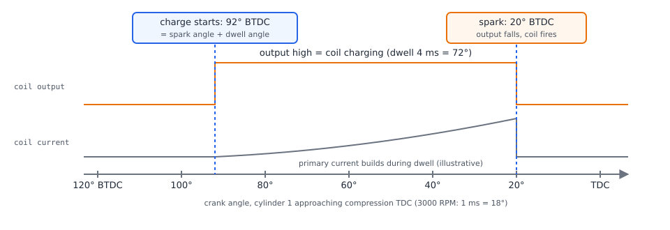
  <figcaption>Figure 1 — One spark on a crank-angle strip. Charging starts at spark angle plus
  dwell angle; the spark happens when the output falls.</figcaption>
</figure>

The dwell is a time, but the firmware schedules in crank degrees, so it converts the dwell to an
angle at the current engine speed (at 3000 RPM one millisecond is 18°). The charge starts at the
spark angle minus that dwell angle (in rusEFI's after-TDC coordinates; in BTDC terms, *advance plus
dwell angle*). Every spark is planned for its cylinder from the firing order, so each cylinder's
event is offset by its place in the cycle.
<!-- src: firmware/controllers/engine_cycle/spark_logic.cpp (prepareCylinderIgnitionSchedule: sparkAngle, dwellStartAngle = sparkAngle - dwellAngleDuration); firmware/controllers/algo/ignition/ignition_state.cpp (IgnitionState::updateDwell: dwellDurationAngle) -->

The output goes **high to charge** and **low to fire**. If the expected trigger tooth for the spark
never arrives (a stalling engine, a noisy trigger), a watchdog fires the coil anyway at 1.5 × the
dwell, so a coil is not left charging. Once a coil has started charging, a spark cut does not stop
it from firing.
<!-- src: firmware/controllers/engine_cycle/spark_logic.cpp (startDwellByTurningSparkPinHigh setHigh, fireSparkBySettingPinLow setLow, scheduleSparkEvent: overdwell at 1.5f * dwellMs, "do not check if spark is limited while scheduling spark down") -->

### Dwell

The running dwell comes from the **Dwell time base** curve (dwell against RPM, 8 points) multiplied
by the **Dwell voltage correction** curve (multiplier against battery voltage). While cranking, the
fixed **Fixed Cranking Dwell** is used instead. **Dwell Duty Mode** replaces both curves with a fixed
percentage of the time between sparks; it exists for modules that expect a square wave (the help
text names Ford TFI).
<!-- src: firmware/controllers/algo/ignition/ignition_state.cpp (IgnitionState::getSparkDwell); firmware/integration/rusefi_config.txt (dwellDutyModeEnabled help) -->

The factory dwell is **4 ms at every engine speed**, with a voltage correction of 1.0 everywhere
(8–15 V), and 6 ms when cranking:
<!-- src: firmware/controllers/algo/defaults/default_ignition.cpp (setDefaultIgnition: setConstantDwell(4), dwellVoltageCorr); firmware/controllers/algo/engine_configuration.cpp (setConstantDwell); firmware/controllers/algo/defaults/defaults.h (DEFAULT_CRANKING_DWELL_MS) -->

<figure markdown>
  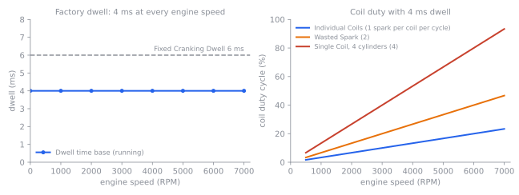
  <figcaption>Figure 2 — Factory dwell, and the coil duty cycle it gives on a 4-cylinder engine. The
  fewer coils share the sparks, the less time each coil has to cool.</figcaption>
</figure>

!!! danger "Too much dwell overheats coils"
    Dwell beyond what the coil needs only heats it. A coil that is charged too long, or charged
    for most of every cycle, can overheat, fail, or damage the output driving it. Use the dwell
    your coil's maker specifies, and on a single coil or wasted spark, check *Ignition: coil duty
    cycle* at your highest RPM (Figure 2). rusEFI warns *dwell angle too long* when the dwell
    angle exceeds half the engine cycle (single coil: the space between sparks, less 10 %).
    <!-- src: firmware/controllers/engine_cycle/spark_logic.cpp (prepareIgnitionSchedule: maxAllowedDwellAngle, CUSTOM_DWELL_TOO_LONG; getCoilDutyCycle) -->

### Ignition modes

| Mode (**Mode** `ignitionMode`) | Coils | Outputs used | Sparks per coil per cycle |
|---|---|---|---|
| **Single Coil** | one coil and a distributor | Ignition Cylinder 1 only | one per cylinder |
| **Individual Coils** | one coil per cylinder (coil-on-plug) | one per cylinder | 1 |
| **Wasted Spark** | one coil per pair of cylinders | the first half of the firing order | 2 |
| **Two Distributors** | two coils, two distributors | the first two cylinders in the firing order | half the cylinders each |
<!-- src: firmware/controllers/engine_cycle/spark_logic.cpp (getIgnitionPinForIndex, getNumberOfSparks); firmware/integration/rusefi_config.txt (ignitionMode help) -->

In **Wasted Spark**, a cylinder and its partner one revolution apart share a coil and spark together
every revolution — one on compression, one on exhaust. On a 4-cylinder with firing order 1-3-4-2,
the output set for **Ignition Cylinder 1** fires cylinders 1 and 4, and **Ignition Cylinder 3**
fires 3 and 2. With **Individually wired Wasted Spark** (`twoWireBatchIgnition`) on, each cylinder
keeps its own coil and output, and both coils of a pair fire together.
<!-- src: firmware/controllers/engine_cycle/spark_logic.cpp (getIgnitionPinForIndex: cylinderIndex % (cylindersCount / 2); prepareCylinderIgnitionSchedule: isTwoWireWasted, secondIndex) -->

**Individual Coils needs to know the engine's phase** (which revolution is compression), which takes
a cam sensor or a cam-synchronised trigger. Until phase is known — and always while the engine is
spinning up — rusEFI runs individual coils as individually wired wasted spark. With a crank-only
trigger it stays that way; the engine runs, but every coil sparks twice per cycle. On some crank
patterns rusEFI does not fire at all until it has cam sync (*Not firing until we get cam sync*).
<!-- src: firmware/controllers/math/engine_math.cpp (getCurrentIgnitionMode: isSpinningUp, hasSynchronizedPhase); firmware/controllers/limp_manager.cpp (noFiringUntilVvtSync) -->

### Default timing table

The factory **Ignition advance** table is a generic starting shape for a MAP-based (speed density)
engine: 16 RPM columns from 650 to 7000 RPM and 16 load rows from 21 to 120 kPa. Advance rises from
about 10–12° at idle to 35° plus up to 7.9° extra at light load, reached at 3000 RPM. **It is not a
tune for your engine.**
<!-- src: firmware/controllers/algo/defaults/default_ignition.cpp (getAdvanceForRpm, getInitialAdvance, buildTimingMap, setDefaultIgnition: setTimingRpmBin(800, 7000), ignitionLoadBins 20..120); firmware/util/containers/table_helper.h (setRpmBin) -->

<figure markdown>
  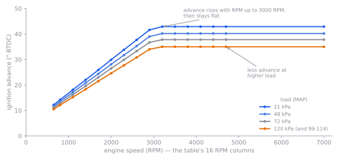
  <figcaption>Figure 3 — The factory timing table, computed as the firmware computes it. Rows at or
  above 100 kPa are identical.</figcaption>
</figure>

!!! danger "Too much advance destroys engines"
    Over-advanced timing causes knock (detonation), which can break pistons, ring lands and head
    gaskets in seconds under load, often without a sound you can hear. The factory table is not
    safe for every engine — particularly boosted, high-compression or low-octane ones. Start from
    known-good timing for your engine and add advance only as the Tuning ignition chapter describes.

## Before you start

:material-circle:{ .level-basic } Basic

You need:

- **The trigger working**, with RPM shown and the trigger set up (Trigger chapter). For individual
  coils with true sequential firing, a cam sensor too.
- **Coils you know**: smart (with a built-in igniter) or plain, and their dwell from the maker.
- **The coils wired** to the ignition outputs. On Proteus, **Ign 1–12** are on the Black 35-pin
  connector: Ign 1 pin 35, Ign 2 pin 34, Ign 3 pin 22, Ign 4 pin 33, Ign 5 pin 32, Ign 6 pin 31,
  Ign 7 pin 30, Ign 8 pin 29, Ign 9 pin 28, Ign 10 pin 27, Ign 11 pin 26, Ign 12 pin 25. Power
  ground is on Black35 pins 17, 18 and 24.
<!-- src: firmware/config/boards/proteus/connectors/black35.yaml (Smart Ignition Coil 1..12, ts_name Ign 1..12, Power/Chassis GND) -->

Proteus's ignition outputs are **signal outputs for smart coils**: its connector files list them as
*Smart Ignition Coil 1–12*. They switch the coil's (or an igniter's) trigger input, not the coil's
primary current. A coil with no built-in igniter needs a separate igniter module between the output
and the coil.
<!-- src: firmware/config/boards/proteus/connectors/black35.yaml (function: Smart Ignition Coil, type: ign) -->

<figure markdown>
  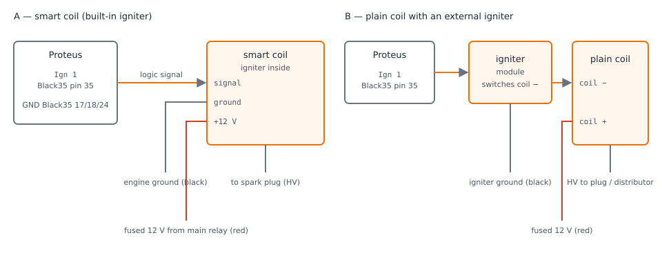
  <figcaption>Figure 4 — Wiring a smart coil (A) and a plain coil through an igniter (B).</figcaption>
</figure>

!!! warning "Never wire a plain coil straight to a Proteus Ign output"
    A plain coil's primary draws several amps and returns a high-voltage spike when it fires. The
    Ign outputs are made to drive a smart coil's or igniter's signal input. Check that your igniter
    accepts a logic-level input that is high to charge.

## Setting it up

:material-circle:{ .level-basic } Basic → :material-circle:{ .level-intermediate } Intermediate

Everything is in TunerStudio's **Ignition** menu, except the cranking timing (**Cranking**) and the
trigger offset (**Setup**).

<!-- shot: img/ts/ignition-menu.png | Ignition (menu open) | menu dropped down showing Ignition advance … Multispark | The Ignition menu -->

<figure markdown>
  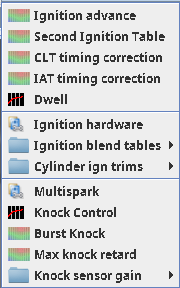
  <figcaption>Figure 5 — The Ignition menu</figcaption>
</figure>

### 1 · Check the engine

Open **Setup ▸ Vehicle Information** and check **Number of cylinders** (`cylindersCount`) and
**Firing order** (`firingOrder`). The factory setting is 4 cylinders, 1-3-4-2. The firing order is
the order the cylinders fire, by the engine maker's cylinder numbering — not the order of the
outputs.
<!-- src: firmware/controllers/algo/defaults/default_base_engine.cpp (setInline4: FO_1_3_4_2); firmware/tunerstudio/tunerstudio.template.ini (engineChars) -->

<!-- shot: img/ts/ignition-vehicle-info.png | Setup ▸ Vehicle Information | 4 cylinders, firing order 1-3-4-2 | Cylinder count and firing order -->

<figure markdown>
  
  <figcaption>Figure 6 — Cylinder count and firing order</figcaption>
</figure>

### 2 · Choose the mode

Open **Ignition ▸ Ignition hardware** (`ignitionSettings`). The outputs half of this dialog shows
only with **Tuning View** set to *Full* (Setup ▸ Vehicle Information).

- **Spark** (`isIgnitionEnabled`) — on by default. Off stops all sparks.
- **Mode** — see *Ignition modes* above. **The factory setting is Single Coil**, so change it for
  coil-on-plug or wasted spark.
- **Spark hardware latency correction** — microseconds, converted to degrees and *added* to the
  advance. Leave at 0 unless you measured a delay.
- **Individually wired Wasted Spark** — only with Wasted Spark, when each cylinder has its own coil.
- **Override ignition table load axis** — leave at *None*: the table then uses the same load as the
  fuel strategy (MAP for speed density).
<!-- src: firmware/tunerstudio/tunerstudio.template.ini (ignitionBasic, ignitionSettings: ignitionOutputs uiMode condition); firmware/controllers/algo/ignition/ignition_state.cpp (getSparkHardwareLatencyCorrection); firmware/controllers/algo/defaults/default_ignition.cpp (isIgnitionEnabled = true) -->

### 3 · Assign the outputs

In the same dialog, set **Ignition Cylinder 1 … N** (`ignitionPins1` …) to the outputs your coils are
wired to. *Cylinder* here is the engine's cylinder number: rusEFI handles the firing order. Proteus
comes with Ign 1 on cylinder 1, Ign 2 on cylinder 2 and so on. TunerStudio shows only the fields the
chosen mode uses: one for Single Coil, the first half of the firing order for Wasted Spark.

The dialog also carries the note *"Output Mode is dangerous and can burn out your coils, 99% installs
is default, some Hondas are default inverted"*. On Proteus the **Ignition Output Mode** field itself
is hidden: outputs go high to charge, which is what smart coils expect.
<!-- src: firmware/config/boards/proteus/board_configuration.cpp (setIgnitionPins); firmware/tunerstudio/tunerstudio.template.ini (ignitionOutputs: ignitionPinMode @@if_ts_show_ignitionPinMode); firmware/integration/rusefi_config.txt (ts_show_ignitionPinMode false) -->

If a cylinder the mode needs has no output, rusEFI warns *Pin Not Assigned check configuration*.
<!-- src: firmware/controllers/engine_cycle/spark_logic.cpp (assertPinAssigned: CUSTOM_OBD_COIL_PIN_NOT_ASSIGNED) -->

<!-- shot: img/ts/ignition-hardware-cop.png | Ignition ▸ Ignition hardware | Tuning View Full; Mode Individual Coils; cylinders 1–4 on Ign 1–4; Timing Mode dynamic | Ignition hardware for four individual coils -->

<figure markdown>
  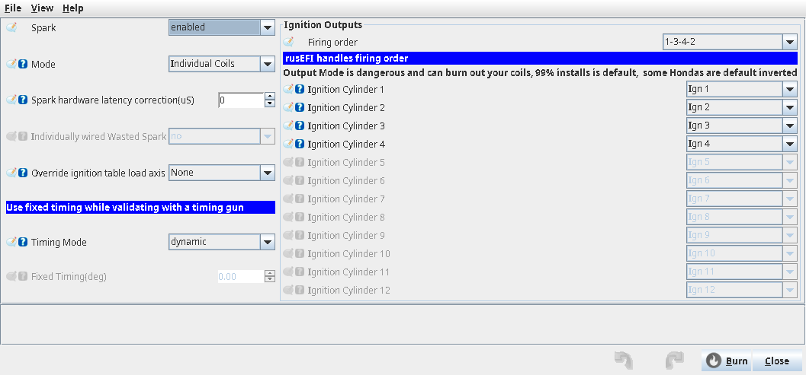
  <figcaption>Figure 7 — Ignition hardware for four individual coils</figcaption>
</figure>

### 4 · Set the dwell

Open **Ignition ▸ Dwell** (`dwellSettings`). Enter your coil's dwell in **Dwell time base** at each
RPM point, and the **Dwell voltage correction** if the maker gives one (more dwell at low voltage,
less at high). Leave **Dwell Duty Mode** off unless your ignition module needs a fixed duty.
<!-- src: firmware/tunerstudio/tunerstudio.template.ini (dwellSettings, dwellCorrection, dwellVoltageCorrection curves) -->

<!-- shot: img/ts/ignition-dwell.png | Ignition ▸ Dwell | factory: 4 ms at 0–7000 RPM, multiplier 1.0 at 8–15 V | The Dwell dialog -->

<figure markdown>
  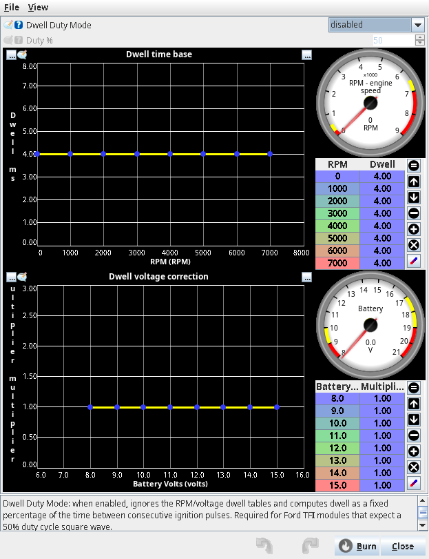
  <figcaption>Figure 8 — The Dwell dialog</figcaption>
</figure>

### 5 · Set cranking timing

Open **Cranking ▸ Cranking settings**, *Ignition* panel:

- **Timing Advance mode** (`useSeparateAdvanceForCranking`): *Fixed (auto taper)* (default) uses
  **Fixed cranking advance** (`crankingTimingAngle`, default 6°) at the lowest cranking speed and
  blends towards the running table as RPM reaches **Cranking RPM limit**. *Table* uses the
  **Cranking ignition advance** curve (advance against RPM; factory 0° everywhere).
- **Fixed Cranking Dwell** (`ignitionDwellForCrankingMs`, default 6 ms).
- **Use Advance Corrections for cranking** (Advanced panel) — off by default; the help says you
  probably do not need it.
<!-- src: firmware/controllers/algo/ignition/ignition_state.cpp (getCrankingAdvance, getSparkDwell isCranking); firmware/controllers/algo/defaults/default_cranking.cpp (setDefaultCranking: crankingAdvance 0, bins 0/200/400/1000) -->

<!-- shot: img/ts/ignition-cranking.png | Cranking ▸ Cranking settings | factory: Fixed (auto taper), 6°, 6 ms | Cranking ignition settings -->

<figure markdown>
  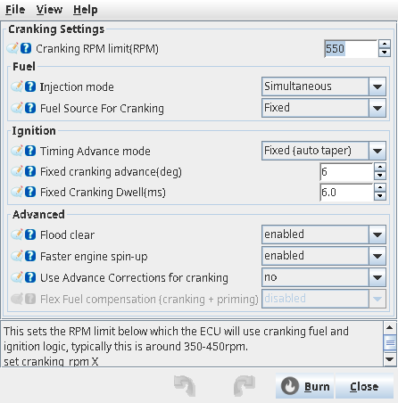
  <figcaption>Figure 9 — Cranking ignition settings</figcaption>
</figure>

### 6 · Check base timing with a timing light

This is what makes the timing the ECU asks for equal the timing the engine gets.

1. In **Ignition ▸ Ignition hardware** set **Timing Mode** (`timingMode`) to *fixed* and **Fixed
   Timing** (`fixedTiming`) to an angle you can read on your timing marks, for example 10°. Burn.
2. Clip a timing light on cylinder 1's lead, start the engine and let it idle.
3. If the marks do not show 10°, change **Trigger Angle Advance** (`globalTriggerAngleOffset`) in
   **Setup ▸ Trigger** until they do (Trigger chapter).
4. Set **Timing Mode** back to *dynamic* and burn.

In fixed mode the timing is the same while cranking and running and no corrections apply (but see
the note on cylinder trims under *How it works*).
<!-- src: firmware/controllers/algo/ignition/ignition_state.cpp (IgnitionState::getAdvance: TM_FIXED returns fixedTiming); firmware/integration/rusefi_config.txt (globalTriggerAngleOffset help HOWTO, timingMode help) -->

!!! warning "Do not drive on fixed timing"
    Fixed timing ignores load, knock and every correction. Use it only while checking timing.

<!-- shot: img/ts/ignition-hardware-fixed.png | Ignition ▸ Ignition hardware | Timing Mode fixed, Fixed Timing 10 | Fixed timing for a timing-light check -->

<figure markdown>
  
  <figcaption>Figure 10 — Fixed timing for a timing-light check</figcaption>
</figure>

### 7 · Review the timing table and corrections

Open **Ignition ▸ Ignition advance** to see the table (Figure 11; Figure 3 plots its factory values), **Ignition ▸ CLT timing
correction** and **Ignition ▸ IAT timing correction**. Correction values are degrees added to the
advance (negative = retard). The factory CLT correction is zero. The factory IAT correction on
Proteus is zero up to 30 °C and pulls up to 3° at 60 °C (2° at the highest load row).
<!-- src: firmware/controllers/algo/defaults/default_ignition.cpp (setDefaultCltTimingCorrection, setDefaultIatTimingCorrection); firmware/config/boards/proteus/prepend.txt (IAT_IGN_CORR_TEMP_COUNT 4); firmware/libfirmware/util/include/rusefi/arrays.h (copyArrayInterpolated) -->

<!-- shot: img/ts/ignition-advance-table.png | Ignition ▸ Ignition advance | factory table | The Ignition advance table -->

<figure markdown>
  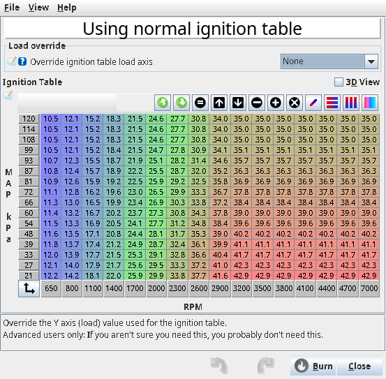
  <figcaption>Figure 11 — The Ignition advance table</figcaption>
</figure>
<!-- shot: img/ts/ignition-clt-corr.png | Ignition ▸ CLT timing correction | factory (all 0) | CLT timing correction -->

<figure markdown>
  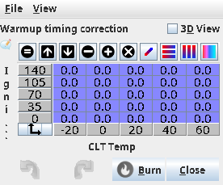
  <figcaption>Figure 12 — CLT timing correction</figcaption>
</figure>
<!-- shot: img/ts/ignition-iat-corr.png | Ignition ▸ IAT timing correction | factory | IAT timing correction -->

<figure markdown>
  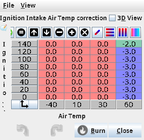
  <figcaption>Figure 13 — IAT timing correction</figcaption>
</figure>

## Worked examples

:material-circle:{ .level-intermediate } Intermediate

### Example 1 — 4 cylinders, individual smart coils, sequential

An inline 4 with coil-on-plug smart coils and a crank and cam sensor:

| Setting | Value | Why |
|---|---|---|
| Number of cylinders / Firing order | 4 / 1-3-4-2 | the engine |
| Mode | Individual Coils | one coil per cylinder |
| Ignition Cylinder 1–4 | Ign 1–4 (Black35 35, 34, 22, 33) | Proteus defaults |
| Dwell time base | coil maker's figure, e.g. 3 ms flat | smart coils need less than the 4 ms default |
| Fixed cranking advance / dwell | 6° / 6 ms | factory |
| Timing Mode | dynamic (after the timing-light check) | |

At 3000 RPM, 3 ms dwell is 54° of crank, and each coil charges once per 720°: 7.5 % duty. Until cam
sync, rusEFI fires coils 1+4 and 3+2 together.
<!-- src: firmware/controllers/math/engine_math.cpp (getCurrentIgnitionMode); firmware/controllers/engine_cycle/spark_logic.cpp (getCoilDutyCycle) -->

### Example 2 — 4 cylinders, wasted spark coil pack

A 4-cylinder with a two-output wasted-spark coil pack with built-in igniters, crank sensor only:

| Setting | Value | Why |
|---|---|---|
| Mode | Wasted Spark | one coil per pair |
| Individually wired Wasted Spark | no | one output per pair |
| Ignition Cylinder 1 | Ign 1 → the pack's cylinder 1/4 input | fires 1 and 4 |
| Ignition Cylinder 3 | Ign 2 → the pack's cylinder 2/3 input | fires 3 and 2 |
| Dwell | coil maker's figure | each coil fires twice per cycle: twice the duty of Example 1 |

Only **Ignition Cylinder 1** and **3** appear in the dialog: they are the first two cylinders of
1-3-4-2. No cam sensor is needed, since each coil fires every revolution.
<!-- src: firmware/controllers/engine_cycle/spark_logic.cpp (getIgnitionPinForIndex IM_WASTED_SPARK); firmware/tunerstudio/tunerstudio.template.ini (ignitionOutputs visibility, FiringOrderTSLogic) -->

<!-- shot: img/ts/ignition-hardware-wasted.png | Ignition ▸ Ignition hardware | Mode Wasted Spark; Cylinder 1 = Ign 1, Cylinder 3 = Ign 2 | Ignition hardware for a wasted-spark coil pack -->

<figure markdown>
  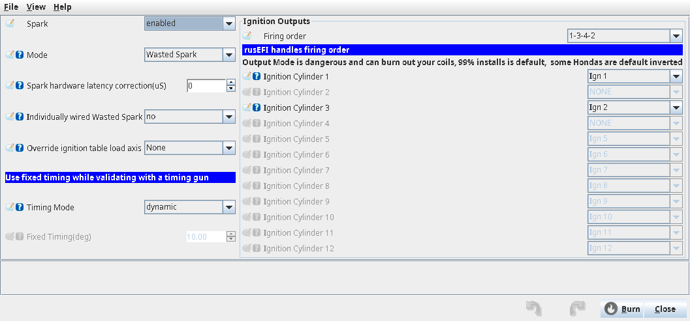
  <figcaption>Figure 14 — Ignition hardware for a wasted-spark coil pack</figcaption>
</figure>

## Tuning it

:material-circle:{ .level-intermediate } Intermediate → :material-circle:{ .level-advanced } Advanced

Timing-table tuning is in the *Tuning ignition* chapter; idle timing (**Idle ▸ Closed-loop Ignition
idle timing**, **Separate idle ignition table**) in the Idle chapter; knock control in the Knock
chapter. The settings below belong to this chapter.

### Spark cut and limits

Spark is suppressed (the cut code shows as *Ign cut*) for the RPM limiter when **Cut spark on RPM
limit** is on (**Setup ▸ Limits and protection ▸ Limits and fallbacks**), launch control, Lua, ignition off, missing engine
sync and fatal errors. Its help warns that spark cut can produce exhaust flames and that fuel cut is
safer. The **Minimum/Maximum timing advance** clamps exist in the firmware but are switched off and
hidden in TunerStudio.
<!-- src: firmware/controllers/limp_manager.cpp (LimpManager::updateState allowSpark.clear reasons); firmware/controllers/engine_cycle/spark_logic.cpp (prepareCylinderIgnitionSchedule: clampF commented out, issue 5894); firmware/integration/rusefi_config.txt (cutSparkOnHardLimit help) -->

### Multispark

**Ignition ▸ Multispark** fires extra sparks after the main one at low RPM. Defaults when enabled:
up to **2** extra sparks, below **1500 RPM**, within **30°** after the main spark, each **1 ms** spark
plus **2 ms** dwell. At 1000 RPM 30° is 5 ms, so one extra spark fits. The dialog itself warns it can
overheat ignition parts and is not recommended for distributor or wasted-spark systems.
<!-- src: firmware/controllers/algo/ignition/ignition_state.cpp (getMultiSparkCount); firmware/controllers/algo/defaults/default_ignition.cpp (setDefaultMultisparkParameters); firmware/tunerstudio/tunerstudio.template.ini (multisparkSettings) -->

<!-- shot: img/ts/ignition-multispark.png | Ignition ▸ Multispark | enabled, factory values | The Multispark dialog -->

<figure markdown>
  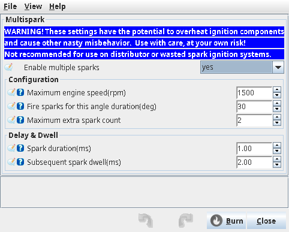
  <figcaption>Figure 15 — The Multispark dialog</figcaption>
</figure>

### Trailing spark

For rotaries and twin-plug engines, **Controller ▸ Rotary** enables **Trailing Sparks** on separate
**Trailing Pin** outputs (up to 4 in the dialog). Each trailing coil charges and fires the
**Trailing spark** table's angle (RPM × load; factory 7–12°) after its primary coil.
<!-- src: firmware/controllers/engine_cycle/spark_logic.cpp (chargeTrailingSpark, fireTrailingSpark, trailingSparkAngle); firmware/controllers/algo/defaults/default_ignition.cpp (setDefaultTrailingSparkTable) -->

<!-- shot: img/ts/ignition-rotary.png | Controller ▸ Rotary | Enable Trailing Sparks yes, factory table | Trailing spark settings -->

<figure markdown>
  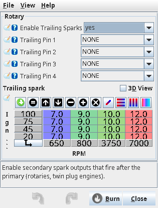
  <figcaption>Figure 16 — Trailing spark settings</figcaption>
</figure>

### Odd-fire engines

**Advanced ▸ Cylinder offsets** gives each cylinder an angle offset for odd-fire engines (positive
retards).
<!-- src: firmware/tunerstudio/tunerstudio.template.ini (ignitionCylExtra) -->

## Diagnostics

:material-circle:{ .level-intermediate } Intermediate

| Channel | What it shows |
|---|---|
| Timing: ignition | final advance (Figure 1's spark angle) |
| Timing: base ignition | advance before knock and limiter retard |
| Ign: Timing Cyl 1 … | per-cylinder final advance |
| Ign: CLT correction, Ign: IAT correction, Idle: Timing adjustment | the corrections |
| Ignition: coil charge time | current dwell (ms) |
| Ign: Dwell voltage correction | dwell multiplier from battery voltage |
| Ignition: coil duty cycle | % of time each coil is charging |
| Ignition: Mode | mode in use right now (shows wasted spark before cam sync) |
| Ign: Cut Code | why spark is cut, if it is |
<!-- src: firmware/console/binary/output_channels.txt (correctedIgnitionAdvance, baseIgnitionAdvance, ignitionAdvanceCyl, sparkDwell, coilDutyCycle, currentIgnitionMode, sparkCutReason) -->

| Warning | Meaning |
|---|---|
| Pin Not Assigned check configuration (6019) | the mode needs an output that is not set |
| dwell is zero? (6032) / invalid dwell (6118) | dwell curve empty or zero |
| dwell angle too long (6033) | dwell longer than the space allows at this RPM |
| cylinder N … overcharge (9351+) | a coil was fired by the over-dwell watchdog |
| looks like skipped spark event (9009) | the same coil scheduled twice in a row |
| Not firing until we get cam sync (6006) | trigger needs cam sync before any spark |
<!-- src: firmware/controllers/algo/obd_error_codes.h (CUSTOM_OBD_COIL_PIN_NOT_ASSIGNED, CUSTOM_ZERO_DWELL, CUSTOM_ERR_DWELL_DURATION, CUSTOM_DWELL_TOO_LONG, CUSTOM_Ignition_Coil_Overcharge_1, CUSTOM_OBD_SKIPPED_SPARK, CUSTOM_SYMMETRICAL_CRANK); firmware/controllers/engine_cycle/spark_logic.cpp (warnings) -->

## Troubleshooting

:material-circle:{ .level-basic } Basic → :material-circle:{ .level-advanced } Advanced

| Symptom | Likely cause | Check |
|---|---|---|
| No spark on any cylinder | Spark off, wrong output, coil power missing, no RPM | *Spark* enabled; outputs; 12 V at coil; trigger |
| Only cylinder 1 sparks | Mode left at factory *Single Coil* | Step 2 |
| Sparks on the wrong cylinders | firing order or output order wrong | Step 1 and 3; coil wiring |
| Timing light shows a different angle than Fixed Timing | trigger offset | Step 6, Trigger Angle Advance |
| Coils hot or failing | dwell too long, or one coil sharing many sparks | Dwell; coil duty cycle |
| Weak spark / misfire at high RPM | dwell too short, or low battery voltage | Dwell curve; voltage correction |
| Individual coils fire in pairs | no cam sync yet (normal while spinning up) | cam sensor; *Ignition: Mode* |
| No spark until the engine has turned a while | trigger needs cam sync | normal for that trigger |
| Knock, high EGT or lost power | timing too far advanced or retarded | Tuning ignition chapter |

## Settings reference

### Ignition hardware (Ignition ▸ Ignition hardware)

--8<-- "reference/settings/_ignitionSettings.table.md"

### Dwell (Ignition ▸ Dwell)

The two curves (*Dwell time base*, *Dwell voltage correction*) are not listed by the generator.

--8<-- "reference/settings/_dwellSettings.table.md"

### Ignition advance (Ignition ▸ Ignition advance)

--8<-- "reference/settings/_IgnitionTableDialog.table.md"

### Cranking (Cranking ▸ Cranking settings)

--8<-- "reference/settings/_crankingDialog.table.md"

### Multispark (Ignition ▸ Multispark)

--8<-- "reference/settings/_multisparkSettings.table.md"

### Trailing spark (Controller ▸ Rotary)

--8<-- "reference/settings/_rotaryDialog.table.md"

### Cylinder offsets (Advanced ▸ Cylinder offsets)

--8<-- "reference/settings/_ignitionCylExtra.table.md"

## Related

- Trigger — crank and cam sensors, Trigger Angle Advance
- Tuning ignition — tuning the timing table
- Idle — idle ignition table and closed-loop idle timing
- Knock control
- Limits and engine protection — RPM limiter and spark cut
- [Safety](../safety.md)
