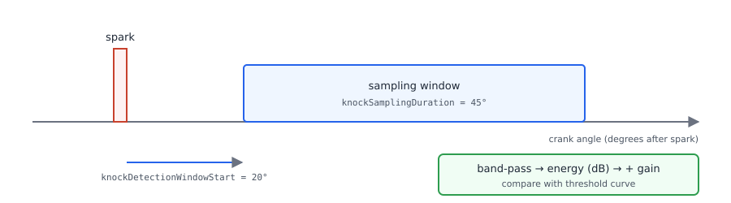
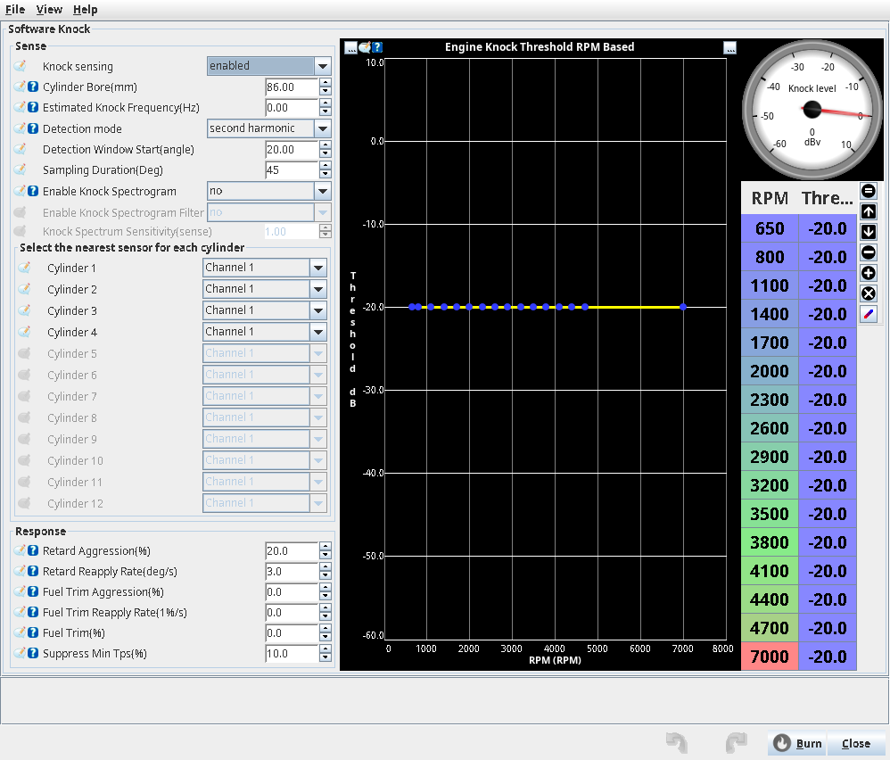
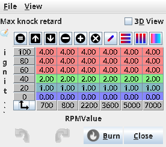

# Knock Control

:material-circle:{ .level-basic } Basic → :material-circle:{ .level-advanced } Advanced

> **In one sentence:** rusEFI listens to the knock sensor for a short window after every spark,
> and when the sound is louder than a threshold it takes ignition timing away, then gives it back
> slowly.

## What it does

:material-circle:{ .level-basic } Basic

Knock (detonation) is fuel-air mixture exploding on its own after the spark, instead of burning
smoothly. It rings the engine block at a frequency set mostly by the cylinder bore. A **knock
sensor** is a small microphone bolted to the block. rusEFI samples it after each spark, filters out
everything but the knock frequency, and compares the energy with a threshold. Too loud means knock:
the ECU retards ignition timing, and optionally adds fuel, then restores both over time.

On Proteus F7 knock sensing is built in and **Knock sensing** is enabled by default.
<!-- src: firmware/config/boards/proteus/board_configuration.cpp (proteus_boardDefaultConfiguration: enableSoftwareKnock); firmware/config/boards/proteus/board.mk (EFI_SOFTWARE_KNOCK) -->

!!! danger "Knock control is a safety net, not a tune"
    Knock destroys pistons and head gaskets within seconds under boost. The default
    **Max knock retard** is only 2° everywhere. Never tune timing up "until knock control catches it":
    tune conservatively, and treat every knock event as a fault to fix.

!!! note "Burst Knock is something else"
    **Ignition ▸ Burst Knock** pulls timing during fast throttle openings using the TPS
    acceleration detector. It does not listen to the knock sensor.
    <!-- src: firmware/controllers/modules/burst_knock/burst_knock.cpp; firmware/integration/rusefi_config.txt (burstKnockEnabled help) -->

## How it works

:material-circle:{ .level-intermediate } Intermediate

<figure markdown>
  
  <figcaption>Figure 1 — The knock window is counted from each spark, in crank degrees.</figcaption>
</figure>

1. **Window.** When a cylinder fires, rusEFI schedules sampling to start **Detection Window
   Start** degrees later (default 20°) and run for **Sampling Duration** degrees (default 45°). The
   duration is converted to time at the current RPM. Sampling only happens while the engine is
   running, and a new window is skipped if the previous one is still being processed.
   <!-- src: firmware/controllers/engine_cycle/knock_controller.cpp (Engine::onSparkFireKnockSense, startKnockSampling); firmware/controllers/engine_cycle/spark_logic.cpp (onSparkFireKnockSense call); firmware/controllers/algo/engine_configuration.cpp (setDefaultEngineNoiseTable) -->
2. **Sampling.** The Proteus F7 samples the knock input on ADC3 at about 281 kHz, into a buffer of
   at most 1800 samples (about 6.4 ms) and at least 100 samples. At low RPM a long window is cut
   short by the buffer.
   <!-- src: firmware/config/boards/proteus/knock_config.h (KNOCK_SAMPLE_RATE, ADC_SAMPLE_84); firmware/hw_layer/ports/stm32/stm32f7/cfg/mcuconf.h (PLL, PPRE2); firmware/controllers/sensors/impl/software_knock.cpp (sampleBuffer, onStartKnockSampling) -->
3. **Filter.** A band-pass filter (Q = 3) centred on the knock frequency. If **Estimated Knock
   Frequency** is above 0 it is used as is; otherwise it is computed from **Cylinder Bore**:
   f = 900 / (π × bore / 2) kHz, doubled if **Detection mode** is *second harmonic*.
   <!-- src: firmware/controllers/sensors/impl/software_knock.cpp (initSoftwareKnock, configureBandpass); firmware/controllers/engine_cycle/knock_logic.h (bore2frequency) -->
4. **Level.** The mean square of the filtered signal, in dB (10·log₁₀), plus the cylinder's
   **Knock gain** table value. This is the *knock level*.
   <!-- src: firmware/controllers/sensors/impl/software_knock.cpp (processLastKnockEvent); firmware/controllers/engine_cycle/knock_controller.cpp (onKnockSenseCompleted, m_gain) -->
5. **Decision.** Knock if the level is above the **Engine Knock Threshold** curve at the current
   RPM (default −20 dB everywhere).
6. **Response.** Each knock event adds retard = (that cylinder's timing + 20°) × **Retard
   Aggression**, limited by the **Max knock retard** table (RPM × load). Every 10 ms retard is
   removed at **Retard Reapply Rate** (°/s). Below **Suppress Min Tps** both retard and fuel trim are
   reset to zero.
   <!-- src: firmware/controllers/engine_cycle/knock_controller.cpp (onKnockSenseCompleted, onFastCallback, getKnockThreshold, getMaximumRetard) -->

!!! warning "Detection is per cylinder; retard is for the whole engine"
    Levels and gains are per cylinder, but there is one knock retard, subtracted from every
    cylinder's timing, and only when timing mode is dynamic.
    <!-- src: firmware/controllers/algo/engine2.cpp (EngineState::periodicFastCallback: getKnockRetard, TM_DYNAMIC, getFuelTrimMultiplier) -->

The optional fuel response adds **Fuel Trim** × **Fuel Trim Aggression** to a fuel multiplier per
event (capped at +30 % in the code), removed at **Fuel Trim Reapply Rate**. It is off by default
(**Fuel Trim** = 0).
<!-- src: firmware/controllers/engine_cycle/knock_controller.cpp (maximumFuelTrim, trimFuelAmount); firmware/controllers/algo/defaults/default_base_engine.cpp (knockFuelTrim = 0) -->

## Before you start

:material-circle:{ .level-basic } Basic

- **Knock sensor wiring:** Proteus **White 34** (Knock input 1) and **White 35** (Knock input 2).
  Use shielded cable. The inputs are fixed; there is no pin choice in TunerStudio.
  <!-- src: firmware/config/boards/proteus/connectors/white35.yaml (pins 34, 35); firmware/config/boards/proteus/knock_config.h (KNOCK_PIN_CH1 F4, KNOCK_PIN_CH2 F5); firmware/controllers/sensors/impl/software_knock.cpp (comment: no ADC channel flexibility) -->
- A running engine with a working trigger and a sensible, conservative ignition table.
- The bore of your engine, in mm.

## Setting it up

:material-circle:{ .level-basic } Basic → :material-circle:{ .level-intermediate } Intermediate

### 1 · Sense

Open **Ignition ▸ Knock Control** (dialog *Software Knock*).

<!-- shot: img/ts/knock-dialog.png | Ignition ▸ Knock Control | Knock sensing enabled, bore 86 mm, frequency 0, window 20/45, defaults otherwise | The Knock Control dialog with the example values -->

<figure markdown>
  
  <figcaption>Figure 2 — The Knock Control dialog with the example values</figcaption>
</figure>

- **Knock sensing** `enableSoftwareKnock` — on. Needs an ECU power cycle.
- **Cylinder Bore** `cylinderBore` — in mm (default 87.5). Needs a power cycle.
- **Estimated Knock Frequency** `knockFrequency` — leave 0 to use the bore. Enter **Hz**, not kHz:
  a value between 0 and 100 stops the engine with *knock frequency setting uses HZ not KHz*.
  <!-- src: firmware/controllers/engine_controller.cpp (validateConfigOnStartUpOrBurn: knockFrequency < 100); firmware/tunerstudio/tunerstudio.template.ini (requiresPowerCycle cylinderBore, knockFrequency, enableSoftwareKnock) -->
- **Detection mode** — *first harmonic* or *second harmonic* (twice the bore frequency, usually
  less background noise). Ignored when a frequency is entered; read only at start-up, so power-cycle.
- **Detection Window Start** / **Sampling Duration** — Figure 1.
- **Enable Knock Spectrogram** and its filter and sensitivity — for the Knock Analyzer (below).
- **Select the nearest sensor for each cylinder** — Channel 1 (White 34) or Channel 2 (White 35)
  per cylinder. Default: all on Channel 1.
  <!-- src: firmware/controllers/engine_cycle/knock_controller.cpp (getCylinderKnockBank) -->

| Bore (mm) | 1st harmonic (kHz) | 2nd harmonic (kHz) |
|---|---|---|
| 78 | 7.35 | 14.69 |
| 83 | 6.90 | 13.81 |
| 86 | 6.66 | 13.32 |
| 87.5 | 6.55 | 13.10 |
| 92 | 6.23 | 12.46 |
| 100 | 5.73 | 11.46 |
<!-- src: firmware/controllers/engine_cycle/knock_logic.h (bore2frequency) -->

### 2 · Response

Same dialog, *Response* panel. Defaults: **Retard Aggression** 20 %, **Retard Reapply Rate**
3 °/s, **Suppress Min Tps** 10 %, **Fuel Trim** 0.
<!-- src: firmware/controllers/algo/defaults/default_base_engine.cpp (knockRetardAggression, knockRetardReapplyRate, knockFuelTrim, knockSuppressMinTps) -->

!!! warning "Set the fuel reapply rate if you use fuel trim"
    **Fuel Trim Aggression** and **Fuel Trim Reapply Rate** have no default (0). With a reapply rate of
    0, a knock fuel trim stays until the throttle drops below Suppress Min Tps.

### 3 · Threshold, maximum retard, gains

- **Engine Knock Threshold RPM Based** (the curve in the same dialog) — dB per RPM, with the live
  knock level as its gauge.
- **Ignition ▸ Max knock retard** — 6×6, RPM × ignition load, default 2° everywhere.
- **Ignition ▸ Knock sensor gain ▸ Knock gain cyl N** — dB per cylinder (RPM × load), default 0.
  Use it to even out cylinders nearer to or further from the sensor.
<!-- src: firmware/controllers/algo/defaults/default_base_engine.cpp (setTable maxKnockRetardTable 2); firmware/tunerstudio/tunerstudio.template.ini (knockThresholdCurve, maxKnockRetardTbl, knockGainTbl1) -->

<!-- shot: img/ts/knock-max-retard.png | Ignition ▸ Max knock retard | example table from Worked example 2 | Max knock retard, RPM × load -->

<figure markdown>
  
  <figcaption>Figure 3 — Max knock retard, RPM × load</figcaption>
</figure>

## Worked examples

:material-circle:{ .level-intermediate } Intermediate

### Example 1 — 4-cylinder, 86 mm bore, naturally aspirated

| Setting | Value | Why |
|---|---|---|
| Cylinder Bore | 86 mm | gives 6.66 kHz |
| Detection mode | first harmonic | start here, compare with second in the Knock Analyzer |
| Window start / duration | 20° / 45° | defaults |
| Threshold | set 3–6 dB above the logged level at each RPM with no knock | see Tuning |
| Max knock retard | 4° above 50 % load, 0–2° below | protects where knock can happen |
| Retard Aggression / Reapply | 10 % / 2 °/s | gentler than the 20 % default |

### Example 2 — turbo engine, 92 mm bore

Second harmonic (12.46 kHz), Max knock retard 6–8° above 100 % load, Retard Aggression 15 %, Fuel
Trim 10 % with Fuel Trim Aggression 10 % and Fuel Trim Reapply Rate 2 %/s. With 15° timing and
15 % aggression one event pulls (15 + 20) × 0.15 = 5.25°, limited by the table.

## Tuning it

:material-circle:{ .level-intermediate } Intermediate → :material-circle:{ .level-advanced } Advanced

1. Set **Max knock retard** to 0 so nothing reacts while you learn the noise floor.
2. Log **Knock: Cyl 1…N**, **Knock: Current level** and RPM across the rev range, at light load
   where the engine does not knock.
3. Set the threshold curve a few dB above the quiet level at each RPM. Even out cylinders with
   the gain tables.
4. Restore Max knock retard and confirm **Knock: Count** stays still in normal driving.

### Knock Analyzer

This is done in the rusEFI console. Open the **Knock Analyzer** tab and press **Start**: this turns
on **Enable Knock Spectrogram** and burns it. The tab shows a spectrogram from about 4.1 kHz to
21 kHz, with **All**, **Sensors** and **Cylinders** views and *Magnitudes at cursor* below. Knock shows
as a bright band at your knock frequency only in knocking cycles; use it to check the bore-based
frequency and choose the harmonic. The frequency axis is calculated when the ECU starts with the
spectrogram enabled, so power-cycle the ECU after pressing **Start**. Press **Stop** when finished.
<!-- src: java_console/ui/src/main/java/com/rusefi/ui/KnockPane.java (toggleStartStop, uploadChanges, tabs All/Sensors/Cylinders); java_console/io/src/main/java/com/rusefi/binaryprotocol/BinaryProtocol.java (uploadChanges: burn); firmware/controllers/sensors/impl/software_knock.cpp (START_SPECTRORGAM_FREQUENCY, FFT_SIZE, initSoftwareKnock) -->

<!-- shot: img/console/knock-analyzer.png | rusEFI console ▸ Knock Analyzer | engine running, Start pressed | The Knock Analyzer spectrogram -->

## Diagnostics

:material-circle:{ .level-intermediate } Intermediate

| Log channel | What it shows |
|---|---|
| Knock: Current level | peak level, all cylinders (dB; the ini labels it "Volts") |
| Knock: Cyl 1…12 | per-cylinder peak level, dB |
| Knock: Threshold | threshold at the current RPM |
| Knock: Retard | timing being removed, ° |
| Knock: Max retard | table limit now |
| Knock: Count | knock events since start-up |
| Knock: Fuel trim when knock | fuel trim added (0 = none) |
| Knock: Detected recently / Retard active | knock in the last 0.5 s / retard above 0 |
<!-- src: firmware/controllers/engine_cycle/knock_controller.txt (knock_controller_s); firmware/controllers/engine_cycle/knock_controller.cpp (hasKnockRecently 0.5 s) -->

The rusEFI CAN broadcast also sends knock count and per-cylinder levels (see the CAN chapter).

## Troubleshooting

:material-circle:{ .level-basic } Basic → :material-circle:{ .level-advanced } Advanced

| Symptom | Likely cause | Check |
|---|---|---|
| Engine will not run, error *knock frequency setting uses HZ not KHz* | frequency typed in kHz | enter Hz, or 0 |
| Levels never change | sensor not wired, or wrong channel for the cylinder | White 34/35, cylinder mapping |
| Constant "knock" at high RPM | threshold too low for mechanical noise | raise the curve at high RPM |
| Knock count rises but timing does not drop | Max knock retard is 0, timing mode fixed, or TPS below Suppress Min Tps | tables, ignition mode, TPS |
| Bore or harmonic change has no effect | read only at start-up | power-cycle the ECU |
| Knock Analyzer: "Not supported by connected ECU" | firmware without spectrogram | Proteus F7 firmware has it |

## Settings reference

### Knock Control (Ignition ▸ Knock Control)

--8<-- "reference/settings/_softwareKnock.table.md"

## Related

- Ignition — the timing table knock retard is subtracted from
- CAN bus configuration — knock data in the rusEFI broadcast
- Lua scripting — reading knock channels with `getOutput`
