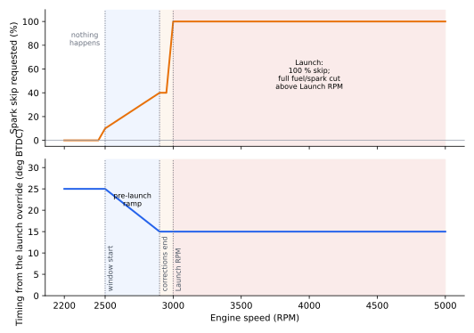
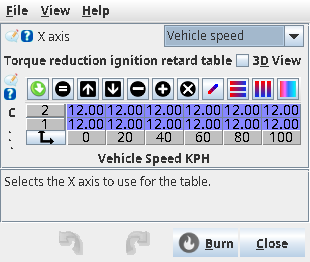
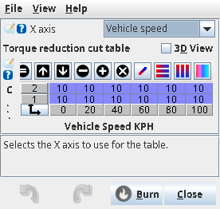
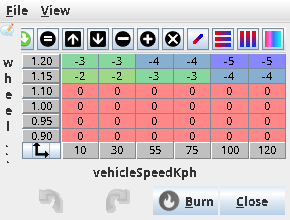
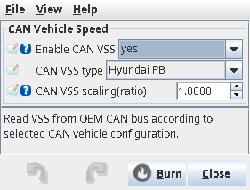
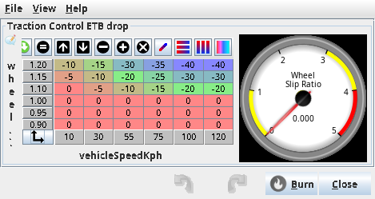
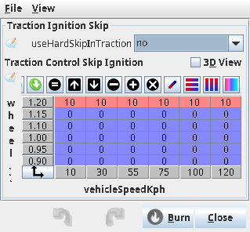

# Launch, shift and traction

:material-circle:{ .level-basic } Basic → :material-circle:{ .level-advanced } Advanced

> **In one sentence:** all three of these take drive torque away from the wheels for a moment — launch
> control holds the engine at a set speed while you pull away, flat shift takes torque out for the instant of
> an upshift, traction control reacts when the wheels start to slide — and rusEFI does it with ignition
> timing, ignition skipping and the throttle, never with the brakes.

## What they do

:material-circle:{ .level-basic } Basic

A car with two driven wheels can only put as much force through them as the tyres can hold. When you ask
for more than that, the wheels spin instead of the car accelerating. These three features are all ways of
keeping the engine on the side of that line:

| Feature | The job | What rusEFI uses |
|---|---|---|
| **Launch control** | a standing start at a fixed engine speed, so the tyres and clutch do the work | ignition timing, ignition skipping, extra fuel, and above a set speed a full fuel and spark cut |
| **Shift torque reduction (flat shift)** | a gear change without lifting off the throttle | an ignition timing value and a percentage of ignition events skipped, for as long as a switch is held |
| **Traction control** | react when the driven wheels outrun the others | throttle opening, ignition timing, ignition skipping |

They are separate features with separate dialogs, but they share one mechanism: each of them produces a
**requested engine speed, a requested timing, a requested skip percentage or a requested throttle
reduction**, and rusEFI applies those requests to the engine. Nothing here touches the brakes, the fuel
pressure or the gearbox.

Launch control is for a standing start with the car not moving. A related feature, **Rolling Launch
Control** (**Advanced ▸ Rolling Launch Control**), holds a captured RPM while the car is already moving, to
keep a turbo spooled; it is not covered in this chapter.

!!! danger "Cutting the spark is not harmless"
    When rusEFI skips ignition events or cuts spark, the fuel is still being injected unless a fuel cut is
    also enabled. Unburned fuel leaves through the exhaust and can light outside the tailpipes, and it loads
    a catalytic converter with fuel it was not designed to burn. rusEFI's own help text for spark cutting
    warns that some engines are known to self-disassemble their valvetrain with a spark cut, and that a fuel
    cut is much safer. Start with timing retard, add spark skipping in small amounts, and never test a launch
    or a flat shift on a lift with the wheels free to spin unless you are certain the drivetrain can take it.
    <!-- src: firmware/integration/rusefi_config.txt (cutSparkOnHardLimit help: unburned fuel, flames, valvetrain warning) -->

## How it works

:material-circle:{ .level-intermediate } Intermediate

<figure markdown>
  
  <figcaption>Figure 1 — The three features, from trigger to output. Everything ends in the same three
  quantities: the timing value, the spark skip ratio and the throttle target.</figcaption>
</figure>

### Where the requests meet the engine

Launch control and shift torque reduction are updated **200 times a second**, alongside the rest of the
engine calculations; traction control's tables are read wherever their output is used. Each feature's
request lands in one of three places:

- **Timing.** The running advance is what the ignition tables say, with corrections added. Traction control
  *adds* a number of degrees to it. Launch control and flat shift *replace* it with a value of their own.
- **A spark skip ratio.** Two limiters exist. The **soft** one never skips two ignition events in a row, so
  it cannot cut the engine completely; the **hard** one can. Lua, traction control, launch control, shift
  torque reduction and rolling launch all add their requests to these limiters; the hard limiter receives
  the launch and flat-shift requests, and the traction request goes to the soft limiter unless
  **useHardSkipInTraction** is set to *yes*.
- **The throttle target.** Traction control's ETB drop is added to the electronic throttle's target position,
  in percent, before the target is clamped and before the throttle's own rev limiter. There is no
  equivalent for a cable throttle.
<!-- src: firmware/controllers/core/main_loop.h (FAST_CALLBACK_RATE Period200hz); firmware/controllers/engine_controller.cpp (PeriodicFastController); firmware/controllers/algo/engine2.cpp (EngineState::updateSparkSkip: soft and hard limiter requests); firmware/controllers/algo/launch_control.cpp (SoftSparkLimiter::updateTargetSkipRatio, shouldSkip); firmware/controllers/algo/ignition/ignition_state.cpp (getRunningAdvance: tractionAdvanceDrop added, launch and flat shift returned instead); firmware/controllers/actuators/electronic_throttle.cpp (EtbController::getSetpointEtb: tcEtbDrop added to targetPosition) -->

A skip ratio is not a fixed pattern of missing cylinders. At each ignition event the limiter draws a random
number and skips the event when that number falls under the requested ratio, so 40 % means roughly four
events in ten, spread at random. The random generator is started from a fixed seed, so the sequence repeats
identically after every restart.
<!-- src: firmware/controllers/algo/launch_control.cpp (SoftSparkLimiter::shouldSkip, initLaunchControl: tinymt32_init) -->

### Launch control: gates first, then one of three RPM states

<figure markdown>
  
  <figcaption>Figure 2 — Launch control's decision. The gates say *may* this happen; the RPM says *how far*
  it has got.</figcaption>
</figure>

The gates, checked every update:

1. **Activation.** **Activation Mode** `launchActivationMode` picks the input: *Launch Button*
   (`launchActivatePin`, read with `launchActivatePinMode`), *Clutch Down Switch*, *Speed Based* (always
   active), *Brake Pedal*, or *Lua* (`setLaunchTrigger(1)`).
2. **Arming.** With **Launch RPM Threshold (0=off)** `launchRpmThreshold` at 0, the activation input is used
   as it is. Above 0, launch arms only if that input turns on while the engine is at or below that RPM, and
   then stays armed while it is held — release the switch and the arm is cleared. This is what lets one
   switch serve both a standing launch and flat shift.
3. **Speed.** **Speed Threshold** `launchSpeedThreshold` blocks launch at or above that vehicle speed; 0
   switches the check off. With no vehicle speed sensor fitted the reading is 0, so the gate passes.
4. **Throttle.** **TPS Threshold** `launchTpsThreshold` requires a valid driver throttle intent *strictly
   above* its value. Driver throttle intent is the accelerator pedal where one is configured, otherwise
   TPS1. The setting is never allowed below 3: a configuration fix-up raises it.

Then the engine speed decides the state. Call the launch speed **R**, the window **W** and the corrections
end distance **E**:

| State | Engine speed | What rusEFI asks for |
|---|---|---|
| NotMet | below R − W | nothing |
| PreLaunch | R − W up to R | skip ratio ramps from **Initial Ignition Cut %** at R − W to **Final Ignition Cut % Before launch** at R − E, then holds; with **Smooth Retard Mode** the timing ramps down to **Absolute Timing at Launch** over the same span |
| Launch | at or above R | skip request 100 %; the absolute launch timing if enabled; the **Fuel Added %** enrichment |

Above R, **Fuel Cut** `launchFuelCutEnable` and **Ignition Cut** `launchSparkCutEnable` additionally ask
the protection manager to switch fuel and spark off completely; the log shows cut code *LaunchCut*. That
full cut starts only above R, not at R, and it has no hysteresis. There is no pre-launch fuel cut, and no
fuel adder during pre-launch.

While launch is active or in its window, closed-loop lambda and long-term trim learning are paused: skipping
spark and adding fuel make the wideband reading meaningless.
<!-- src: firmware/controllers/algo/launch_control.cpp (isInsideSwitchCondition, isInsideSpeedCondition, isInsideTpsCondition, calculateRPMLaunchCondition, calculateLaunchCondition, calculateSparkSkipRatio, getFuelCoefficient, isLaunchFuelRpmRetardCondition); firmware/controllers/algo/ignition/ignition_state.cpp (getRunningAdvance: enableLaunchRetard, launchSmoothRetard, launchTimingRetard); firmware/controllers/limp_manager.cpp (ClearReason::LaunchCut for fuel and spark); firmware/controllers/math/closed_loop_fuel.cpp (stftDisabledLaunch); firmware/controllers/long_term_fuel_trim.cpp (launch pauses learning); firmware/controllers/algo/defaults/default_base_engine.cpp (launchTpsThreshold minimum fix-up); firmware/init/sensor/init_tps.cpp (driverIntent) -->

The factory numbers are not a tune: **Launch RPM** `launchRpm` 3000, **Launch Control Window**
`launchRpmWindow` 500, **Speed Threshold** 30 km/h and **TPS Threshold** 3, with launch control itself
disabled and no timing retard, skip or fuel adder configured.
<!-- src: firmware/controllers/algo/engine_configuration.cpp (setDefaultLaunchParameters block: launchRpm 3000, launchRpmWindow 500, launchSpeedThreshold 30, launchTpsThreshold minimum), firmware/controllers/algo/defaults/default_base_engine.cpp (launchTpsThreshold fix-up) -->

!!! note "No launch boost control"
    rusEFI has no launch-control override of the boost duty or boost target. What holds the engine on launch
    is timing and skipping. Any boost behaviour during a launch comes from the boost controller's own gates
    and tables, or from a Lua script.
    <!-- src: firmware/controllers/actuators/boost_control.cpp (no launch control input to the boost setpoint or duty) -->

<figure markdown>
  
  <figcaption>Figure 3 — What the launch settings ask for, drawn from the firmware's own formulas. Engine
  speed values are the factory defaults (Launch RPM 3000, Window 500); the cut percentages, the corrections
  end and the launch timing are the Example 1 values below.</figcaption>
</figure>

### Shift torque reduction: one trigger, three tables

Flat shift needs its trigger to be held for the length of the shift — a button on the gear lever, or the
clutch switch — and it asks for two things while the trigger is held: a timing value and a percentage of
ignition events skipped. Both come from tables.

All of these must be true at once:

- the trigger is on — **Activation Mode** `torqueReductionActivationMode` selects *Torque Reduction Button*
  `torqueReductionTriggerPin`, *Launch Button* (the launch control switch), *Clutch Down Switch* or
  *Clutch Up Switch* (a closed-until-pressed switch, read inverted);
- the coolant is at or above **Minimal Engine Temperature** `torqueReductionActivationTemperature`
  (default 60 °C; 0 switches the check off). The temperature is only looked at while the trigger is off, so a
  held trigger is not dropped if the coolant reading dips;
- the engine speed is at or above **Torque Reduction Arming RPM** `torqueReductionArmingRpm`;
- the pedal is at or above **Torque Reduction Arming APP** `torqueReductionArmingApp` (default 0, so
  effectively always true) — a failed pedal sensor blocks the reduction;
- the time gate is open, which by default it is: the reduction simply lasts as long as the trigger is held.
  rusEFI also stores a **limitTorqueReductionTime** switch that would cut the reduction short after the
  number of milliseconds in the Time table, but no TunerStudio dialog in the official Proteus ini offers it.

The three tables are all 2 rows by 6 columns. The rows are gears and the columns are whatever you select as
the table's **X axis** — the usual list: *Zero*, *TPS*, *MAP*, *CLT*, *IAT*, *Fuel Load*, *Ignition Load*,
*Accel Pedal*, *RPM*, *Gear (detected)*, *Vehicle speed*, a Lua gauge and so on. **Zero** (the default)
means the value is always 0, which puts the lookup on the first column.

| Table | Unit | What the value becomes |
|---|---|---|
| **Shift Torque Reduction Time table** | ms (1 … 2000) | how long the reduction lasts, only when **limitTorqueReductionTime** is on |
| **Torque Reduction Ignition Retard Table** | degrees (−180 … 180) | the ignition advance itself while the reduction is on |
| **Torque Reduction Ignition Cut Table** | % (0 … 100) | the fraction of ignition events skipped, through the hard limiter |

!!! danger "The retard table is the timing, not the amount to take off"
    **Torque Reduction Ignition Retard Table** values are used as the running advance during a flat shift —
    the ignition tables are ignored entirely while the reduction is on. Its help text calls it "how many
    degrees of timing advance will be reduced", which is not what the code does. A table left at its factory
    zeros therefore asks for **0° of advance** for the whole shift, and a value of −10 asks for 10° after
    top dead centre, not 10° less than the table. Fill both gear rows with the timing you actually want
    during the shift, typically 5 … 15° BTDC.
    <!-- src: firmware/controllers/algo/shift_torque_reduction_controller.cpp (getTorqueReductionIgnitionRetard, update, updateTimeConditionSatisfied, updateRpmConditionSatisfied, updateAppConditionSatisfied, updateTriggerPinState); firmware/controllers/algo/ignition/ignition_state.cpp (getRunningAdvance returns the retard table value instead of the running advance); firmware/integration/rusefi_config.txt (torqueReductionIgnitionRetardTable, torqueReductionIgnitionCutTable, torqueReductionTimeTable ranges and help) -->

The gear rows only mean something if rusEFI knows what gear you are in. Gear detection lives in
**Sensors ▸ Vehicle speed sensor** under **Gear Detection**: **Forward gear count**, one ratio per gear,
**Wheel revolutions per kilometer** and **Final drive ratio**. With the factory gear bins still at 0, a
car with no detected gear (0) lands on the first row and any detected gear lands on the second.

**Sharing one switch with launch control.** The two features are made to share a switch, and the
arbitration depends which switch:

- *Launch Button* on both sides: at or above **Torque Reduction Arming RPM** launch control is switched off
  and the switch belongs to flat shift. Set **Torque Reduction Arming RPM** at or above **Launch RPM** to
  keep the two apart.
- *Clutch Down Switch* on both sides with **Launch RPM Threshold (0=off)** above 0: while launch is armed,
  flat shift is suppressed. Release the clutch to hand the switch back.
- Any other combination: no arbitration. Both features will do what their own gates say.
<!-- src: firmware/controllers/algo/launch_control.cpp (calculateRPMLaunchCondition shared-button guard, ownsSharedTrigger); firmware/controllers/algo/shift_torque_reduction_controller.cpp (update: ownsSharedTrigger, updateTriggerPinState per mode); firmware/controllers/algo/defaults/default_base_engine.cpp (torqueReductionActivationTemperature default 60) -->

### Traction control: slip in, three tables out

<figure markdown>
  
  <figcaption>Figure 4 — Traction control closes its loop through the engine. Note the red box: no wheel
  speeds does not mean no action.</figcaption>
</figure>

rusEFI's traction control is driven by a single measured number, **wheel slip ratio**: front axle speed
divided by rear axle speed. It is produced only by the CAN vehicle speed sensor, and only for the two CAN
types that carry individual wheel speeds (the Hyundai and Nissan types); for those, a front axle that
reads zero, or a rear axle that reads zero, gives a ratio of 1. The value expires one second after the last
CAN message. There is no master enable for traction control: the three tables being empty *is* the off
switch.

| Dialog | Unit | Range | Where it lands |
|---|---|---|---|
| **Controller ▸ Traction Control ETB Drop** | % | −100 … 0 | added to the throttle target, so it closes the throttle |
| **Controller ▸ Traction Control Timing Adjustment** | degrees | −100 … 100 | added to the running advance |
| **Controller ▸ Traction Control Skip Ignition** | % | 0 … 100 | skip ratio; soft limiter, or hard with **useHardSkipInTraction** |

All three use the same two axes, which you edit as the table's axis rows: **slip ratio** bins
`tractionControlSlipBins` (factory 0.9 up to 1.2, six bins, in the ratio unit) and **vehicle speed** bins
`tractionControlSpeedBins` (factory 10 up to 120 km/h, six bins). TunerStudio's label for the speed axis
says RPM; it is vehicle speed. rusEFI checks that each set of bins increases and raises a *Broken axis (must be ascending!)* error if
they do not; an axis still full of zeros is left alone.

A lookup outside the bins is clamped to the nearest one. That matters more than it sounds: with no CAN
wheel speeds, or a sensor that has expired, the slip ratio reads **0**, which is below the lowest slip bin,
so the **lowest row of all three tables applies continuously**, whatever the car is doing. Keep that row at
0 unless you want it always on.
<!-- src: firmware/controllers/can/can_vss.cpp (SLIP_RATIO macro, processHyundai, processNissanSecondVss, wheelSlipRatio StoredValueSensor MS2NT(1000), initCanVssSupport); firmware/controllers/algo/ignition/ignition_state.cpp (tcTimingDropTable and tcSparkSkipTable lookup on wheelSlip and vehicleSpeed); firmware/controllers/actuators/electronic_throttle.cpp (tcEtbDropTable lookup and tcEtbDrop added to the target); firmware/controllers/engine_controller.cpp (ensureArrayIsAscendingOrDefault TC slip and TC speed); firmware/libfirmware/util/include/rusefi/interpolation.h (priv::getBin clamping off-scale low); firmware/integration/rusefi_config.txt (tractionControlEtbDrop, tractionControlTimingDrop, tractionControlIgnitionSkip ranges) -->

## Before you start

:material-circle:{ .level-basic } Basic

- **A switch.** Any of the digital inputs will do. On Proteus, **Digital 1** (Black23 pin 10) is the factory
  crank trigger input, so leave it alone; free ones include **Digital 5** (Black23 pin 9) and **Digital 6**
  (Black23 pin 11). A switch to 12 V uses a *PULLDOWN* input mode; a switch to ground uses *PULLUP*; a normally
  closed switch uses an *INVERTED* mode.
- **A clutch switch is enough for both launch and flat shift** if you set the arming RPM correctly, and it
  is the arrangement most people end up with. Assign it under **Sensors ▸ Misc sensors** (**Clutch Down**,
  **Clutch Up**, **Brake Pedal**), or directly in the launch and flat shift dialogs.
- **A vehicle speed sensor** for the launch speed gate, for traction control's speed axis, and for gear
  detection. See the Sensors and calibration chapter.
- **CAN wheel speeds** only for traction control's slip ratio; nothing else in this chapter needs them.
- **Cable throttle?** Then one of traction control's three levers is missing: the **ETB Drop** table only
  does anything on an engine with an electronic throttle. The timing and skip tables still work — but the
  throttle is the gentlest of the three, so losing it matters.
<!-- src: firmware/controllers/actuators/electronic_throttle.cpp (tcEtbDrop applied inside the ETB target calculation only) -->

- **12 V (ignition on)**, never USB power alone, whenever you are reading sensors or calibrating anything —
  on USB the 5 V sensor supplies do not reach 5 V and every ratiometric reading is wrong.
<!-- src: firmware/config/boards/proteus/connectors/black23.yaml (Digital 1 to Digital 6, Black pins 1, 2, 3, 9, 10, 11); firmware/config/boards/proteus/board_configuration.cpp (triggerInputPins[0] default PROTEUS_DIGITAL_1); firmware/integration/rusefi_config.txt (pin_input_mode_e enum: DEFAULT, PULLUP, PULLDOWN and the INVERTED variants); firmware/tunerstudio/tunerstudio.template.ini (otherSensorInputs: Clutch Down, Clutch Up, Brake Pedal) -->

<!-- shot: img/ts/launch-traction-misc-sensors.png | Sensors ▸ Misc sensors | ignition on, engine stopped: Clutch Down set to Digital 5 with its default mode, Clutch Up unassigned, Brake Pedal unassigned, the rest of the dialog at factory | The clutch and brake inputs live here, whether or not launch control uses them by name -->

!!! danger "A launch test is a load test"
    A launch puts the whole torque of the engine into the clutch, gearbox, differential and tyres at once,
    and a flat shift does it while the engine is still at full throttle. Test with the car pointed straight
    at open space, wheels straight, in an area where leaving the road is not an outcome; a first launch on a
    cold engine with cold oil and cold tyres is not the way to find out what the drivetrain will take. See
    [Safety](../safety.md).

## Setting it up

:material-circle:{ .level-basic } Basic → :material-circle:{ .level-intermediate } Intermediate

Everything here is in TunerStudio: launch control and traction live under **Advanced**, and the shift
tables under **Advanced ▸ Torque Control**.

### 1 · Turn launch control on

Open **Advanced ▸ Launch Control** — the dialog's right-hand half is a live panel that tells you what the
controller is doing, which makes the next step possible.

1. **Launch Control** `launchControlEnabled` → *enabled*.
2. **Activation Mode** `launchActivationMode` → *Launch Button*, *Clutch Down Switch*, *Speed Based*,
   *Brake Pedal* or *Lua*.
3. **Launch Button** `launchActivatePin` and **Launch Button mode** `launchActivatePinMode` — for a button
   mode, pick the input (for example *Digital 5*) and the pull direction that matches your wiring. For
   *Clutch Down Switch* the dialog asks for **Clutch Down** and **Clutch Down mode** instead.
4. **Launch RPM Threshold (0=off)** `launchRpmThreshold` → 0 to start with; set it later if you share a
   switch with flat shift.
5. **Speed Threshold** `launchSpeedThreshold` → 30 km/h (factory) keeps launch out of anything that is
   already moving. 0 disables the gate.
6. **Launch RPM** `launchRpm` and **Launch Control Window** `launchRpmWindow` — the speed you want to hold,
   and how far below it the corrections start.
7. **TPS Threshold** `launchTpsThreshold` → 3 is the minimum and the default; it stops launch being armed
   with a lifted foot.
8. Leave **Use Absolute Timing at Launch**, **Ignition Cut** and **Fuel Cut** off for the first test.
   **Fuel Added %** `launchFuelAdderPercent` can stay at 0 as well.

Burn.
<!-- src: firmware/tunerstudio/tunerstudio.template.ini (smLaunchControlWest fields and their enable conditions) -->

<!-- shot: img/ts/launch-traction-launch-control.png | Advanced ▸ Launch Control | Launch Control enabled, Activation Mode Clutch Down Switch, Clutch Down set to Digital 5 with its default mode, Launch RPM Threshold 0, Speed Threshold 30, Launch RPM 3000, Launch Control Window 500, TPS Threshold 3, Use Absolute Timing at Launch off, Ignition Cut off, Fuel Cut off; the launch_control_state panel on the right is visible | Launch Control with the Example 1 settings and its live state panel -->

<figure markdown>
  
  <figcaption>Figure 5 — Launch Control with the Example 1 settings and its live state panel</figcaption>
</figure>

### 2 · Prove the switch, engine off

With the ignition on and the engine stopped, watch the right-hand panel of the same dialog while you press
the switch or step on the clutch:

- `activateSwitchCondition` is the raw input — it must follow the pedal or button exactly. If it does not,
  the input or its pull mode is wrong.
- `isLaunchLatched` follows the input when the RPM arming threshold is 0.
- `isSwitchActivated`, `isClutchActivated` and `isBrakePedalActivated` say **which mode is selected**, not
  whether the switch is pressed — a common misreading.

There is no bench-test button for these inputs, so this panel is how you prove the wiring: if
`activateSwitchCondition` does not move with the pedal, nothing else in this chapter will work.

<!-- shot: img/ts/launch-traction-launch-state.png | Advanced ▸ Launch Control | ignition on, engine stopped, switch held: launchActivatePinState, activateSwitchCondition and isLaunchLatched lit, isLaunchCondition and isPreLaunchCondition dark, retardThresholdRpm graph at zero on the right-hand panel | The live launch state panel with the switch held: the gates are visible, the output is not -->

### 3 · Give it something to do

Turn on one lever at a time, and only one at first.

- **Timing:** **Use Absolute Timing at Launch** `enableLaunchRetard` → *yes*, **Absolute Timing at Launch**
  `launchTimingRetard` → a real advance figure in degrees BTDC (10 … 15 is a normal starting point; the
  value is absolute, so a negative number means after top dead centre). **Smooth Retard Mode**
  `launchSmoothRetard` ramps down to it instead of arriving there in one step.
- **Skipping:** **Ignition Cut** `launchSparkCutEnable` → *yes*, **Initial Ignition Cut %**
  `initialIgnitionCutPercent` small (5 … 10), **Final Ignition Cut % Before launch**
  `finalIgnitionCutPercentBeforeLaunch` larger (20 … 40). Note that this same switch also enables the full
  spark cut above the launch speed.
- **Fuel:** **Fuel Added %** applies only in the Launch state, never in pre-launch.
- **Corrections end:** **Launch Corrections End RPM** `launchCorrectionsEndRpm` is a distance *below*
  **Launch RPM** at which the ramps finish. Keep it smaller than the window; 50 … 100 RPM is normal.

Burn, then test as in the worked examples below.
<!-- src: firmware/controllers/algo/launch_control.cpp (calculateSparkSkipRatio); firmware/controllers/algo/ignition/ignition_state.cpp (getRunningAdvance: enableLaunchRetard, launchTimingRetard, launchSmoothRetard, launchCorrectionsEndRpm) -->

### 4 · Flat shift

Open **Advanced ▸ Torque Control ▸ Shift Torque Reduction (Flat Shift)**:

1. **Enable Shift Torque Reduction** `torqueReductionEnabled` → *enabled*.
2. **Activation Mode** `torqueReductionActivationMode` → *Launch Button* to share the launch switch, or
   *Clutch Down Switch* / *Clutch Up Switch* / *Torque Reduction Button*, and fill in the pin the panel asks
   for.
3. **Minimal Engine Temperature** `torqueReductionActivationTemperature` → 60 °C (factory) keeps a cold
   engine out of it.
4. **Torque Reduction Arming RPM** `torqueReductionArmingRpm` → the speed above which the switch means
   *shift* and not *launch*. With launch enabled and both features on the launch button, launch stops at
   this RPM.
5. **Torque Reduction Arming APP** `torqueReductionArmingApp` → 0 by default; raise it (say 20 %) if you do
   not want the reduction while you are part-throttle.

<!-- shot: img/ts/launch-traction-flat-shift.png | Advanced ▸ Torque Control ▸ Shift Torque Reduction (Flat Shift) | Enable Shift Torque Reduction enabled, Activation Mode Launch Button, Launch Button set to Digital 6, Minimal Engine Temperature 60, Torque Reduction Arming RPM 4000, Torque Reduction Arming APP 20; the shift_torque_reduction_state panel on the right is visible | Flat shift settings, sharing the launch button, with its live state panel -->

<figure markdown>
  
  <figcaption>Figure 6 — Flat shift settings, sharing the launch button, with its live state panel</figcaption>
</figure>

Then the three tables in the same **Advanced ▸ Torque Control** group. For each one, choose the **X axis**
first: *Gear (detected)* or *Vehicle speed* are the sensible ones, because they describe when you are
shifting; leave the gear rows labelled with the gear numbers you use.

- **Shift Torque Reduction Time table** — milliseconds. Since **limitTorqueReductionTime** has no control in
  the official ini, this table's only practical job is to be non-zero if that switch is ever turned on;
  fill it with the shift length you want to allow, 80 … 150 ms.
- **Torque Reduction Ignition Retard Table** — the advance during the shift, in degrees BTDC. Start at
  10 degrees in both rows.
- **Torque Reduction Ignition Cut Table** — percent of ignition events skipped. Start at 0 and add in steps
  of 5 … 10 %.

<!-- shot: img/ts/launch-traction-time-table.png | Advanced ▸ Torque Control ▸ Shift Torque Reduction Time table | X axis set to Vehicle speed, both gear rows filled, values 120 ms across the row, live graph of the X axis value alongside | The Time table: how long the reduction is allowed to last -->
<!-- shot: img/ts/launch-traction-retard-table.png | Advanced ▸ Torque Control ▸ Torque Reduction Ignition Retard Table | X axis set to Vehicle speed, both gear rows at 12 degrees | The retard table is the timing itself during the shift: 10 degrees BTDC, not 10 degrees less -->

<figure markdown>
  
  <figcaption>Figure 7 — The retard table is the timing itself during the shift: 10 degrees BTDC, not 10 degrees less</figcaption>
</figure>
<!-- shot: img/ts/launch-traction-cut-table.png | Advanced ▸ Torque Control ▸ Torque Reduction Ignition Cut Table | X axis set to Vehicle speed, both gear rows at 10 percent | The ignition cut table: percent of ignition events skipped during the shift -->

<figure markdown>
  
  <figcaption>Figure 8 — The ignition cut table: percent of ignition events skipped during the shift</figcaption>
</figure>

If you use the gear rows, set gear detection first: **Sensors ▸ Vehicle speed sensor**, the **Gear
Detection** half of the dialog — **Forward gear count** and one ratio per gear (transmission ratio × final
drive), plus **Wheel revolutions per kilometer** and **Final drive ratio**. rusEFI picks the gear whose
ratio is closest to the measured RPM-over-speed ratio.

<!-- shot: img/ts/launch-traction-gear-detection.png | Sensors ▸ Vehicle speed sensor | Gear Detection panel visible: Speed Source Main Vehicle Speed, Forward gear count 5, five gear ratios filled with transmission times final drive values, live Vehicle Speed and gear readouts | Gear detection: the flat shift tables' gear rows only work if these ratios are right -->

### 5 · Traction control

Only do this with a car that gives rusEFI individual wheel speeds over CAN.

1. **CAN-bus ▸ CAN Vehicle speed sensor**: **Enable CAN VSS** `enableCanVss` → *yes*, **CAN VSS type**
   `canVssNbcType` → the type that matches the car (one of the two that carry individual wheel speeds,
   *Hyundai PB* or *Nissan 350*), **CAN VSS scaling** `canVssScaling` for the tyre size.
   CAN receive must be enabled on the CAN Bus Settings page.
2. **Controller ▸ Traction Control ETB Drop**: leave the lowest slip row at 0, and start with small negative
   numbers in the higher rows: −5 % around a slip ratio of 1.05, −20 % at 1.15.
3. **Controller ▸ Traction Control Timing Adjustment**: leave the low rows at 0; 2 … 5 degrees of retard
   (negative) at the slip ratios where the throttle drop is not enough on its own.

<!-- shot: img/ts/launch-traction-tc-timing.png | Controller ▸ Traction Control Timing Adjustment | table with 0 in the four lowest slip rows and -2 to -5 degrees in the top two rows, six speed columns | Traction Control Timing Adjustment: degrees added to the advance, so negative means retard -->

<figure markdown>
  
  <figcaption>Figure 9 — Traction Control Timing Adjustment: degrees added to the advance, so negative means retard</figcaption>
</figure>
4. **Controller ▸ Traction Control Skip Ignition**: 0 in the low rows; small percentages in the top rows, and
   leave **useHardSkipInTraction** at *no* until you know what the softer version does.

Burn, and log the wheel slip ratio on every run so the tables mean something afterwards.
<!-- src: firmware/tunerstudio/tunerstudio.template.ini (speedSensorCan fields enableCanVss, canVssNbcType, canVssScaling); firmware/controllers/can/can_vss.cpp (initCanVssSupport: canReadEnabled required for the filters) -->

<!-- shot: img/ts/launch-traction-can-vss.png | CAN-bus ▸ CAN Vehicle speed sensor | CAN read enabled, Enable CAN VSS yes, CAN VSS type Hyundai PB, CAN VSS scaling 1.0 | CAN vehicle speed: the only source of the wheel slip ratio traction control uses -->

<figure markdown>
  
  <figcaption>Figure 10 — CAN vehicle speed: the only source of the wheel slip ratio traction control uses</figcaption>
</figure>
<!-- shot: img/ts/launch-traction-tc-etb.png | Controller ▸ Traction Control ETB Drop | the Example 3 table: 0 in the three lowest slip rows, −5 … −30 at 1.15 and −10 … −40 at 1.20, Wheel Slip Ratio gauge alongside | Traction Control ETB Drop: the gentlest lever, and the one an electronic throttle needs -->

<figure markdown>
  
  <figcaption>Figure 11 — Traction Control ETB Drop: the gentlest lever, and the one an electronic throttle needs</figcaption>
</figure>
<!-- shot: img/ts/launch-traction-tc-skip.png | Controller ▸ Traction Control Skip Ignition | useHardSkipInTraction at no, table with 0 in the low rows and 10 in the top row | The skip table and the hard-versus-soft limiter switch -->

<figure markdown>
  
  <figcaption>Figure 12 — The skip table and the hard-versus-soft limiter switch</figcaption>
</figure>

## Worked examples

:material-circle:{ .level-intermediate } Intermediate

These are **starting points built from the firmware's own defaults and rules**, not values measured on a
car. Every one of them needs proving up on your engine, logged, one change at a time.

### Example 1 — Naturally aspirated car, standing launch, clutch pedal

A 2.0-litre front-wheel-drive car, clutch-down switch on **Digital 5** (Black23 pin 9). The aim is a launch that
holds 3000 RPM and pulls away without spinning the front wheels.

| Setting | Value | Why |
|---|---|---|
| Launch Control | enabled | |
| Activation Mode | Clutch Down Switch | the pedal is already wired and is impossible to press by accident at speed |
| Clutch Down / mode | Digital 5 (Black23 pin 9), default mode | a free Proteus input; Digital 1 is the crank trigger |
| Launch RPM Threshold | 0 | one feature, one job: the switch is launch only |
| Speed Threshold | 30 km/h | factory: launch is off once you are moving |
| Launch RPM | 3000 | factory default, and a safe place for a NA twin-cam to start |
| Launch Control Window | 500 | corrections begin at 2500 RPM |
| TPS Threshold | 3 | minimum: full clutch with a lifted foot must not launch |
| Use Absolute Timing at Launch | yes, 15 degrees | retard first: it is smooth and it costs nothing in the exhaust |
| Smooth Retard Mode | enabled | so timing arrives at 15 degrees by the end of the window, not at 2500 RPM |
| Launch Corrections End RPM | 100 | ramps finish at 2900 RPM, just before the hold |
| Ignition Cut | yes, Initial 10 %, Final 40 % | a small skip ramp before the hold, so the engine is already soft when it hits 3000 |
| Fuel Cut | no | a full spark or fuel cut at 3000 RPM is a jolt, not a launch |
| Fuel Added % | 0 | learn what the timing does before adding fuel |

Figure 3 is what these settings ask the engine for: 10 % of ignition events skipped at 2500 RPM rising to
40 % by 2900 RPM, timing easing from whatever the ignition tables say down to 15 degrees at 2900 RPM, and a
100 % skip request from 3000 RPM up.

### Example 2 — Turbo car, one button for launch and flat shift

Same car with a turbo and a gear-lever button on **Digital 6** (Black23 pin 11), which is also used for launch.

| Setting | Value | Why |
|---|---|---|
| Launch Control / Activation Mode | enabled / Launch Button | one switch for both features |
| Launch RPM / Window | 4000 / 500 | corrections start at 3500 RPM |
| Launch RPM Threshold | 2000 | press the button standing still and launch arms; press it at 6000 RPM and it does not |
| Speed Threshold | 30 km/h | launch stays a standing-start feature |
| Enable Shift Torque Reduction | enabled | |
| Activation Mode (flat shift) | Launch Button | the same input |
| Torque Reduction Arming RPM | 4000 | at or above the launch speed, launch stands down and the button means *shift* |
| Torque Reduction Arming APP | 20 % | no reduction while part-throttle shifting |
| Minimal Engine Temperature | 60 °C | factory |
| Time table | 120 ms | roughly the shift time, for the day the time limit is used |
| Retard table | 12 degrees, both rows | absolute advance during the shift — not "12 degrees less" |
| Ignition cut table | 0 % to start, then 10 % | the retard does most of the work; skipping is the last resort |

Both features are now reachable from one button: below 4000 RPM the button belongs to launch control, at and
above 4000 RPM it belongs to flat shift. If you use the clutch switch for both instead, the launch arming
threshold takes over the arbitration — see Figure 1's lane 2 and *Sharing one switch*.

### Example 3 — Traction control on a car with CAN wheel speeds

A rear-wheel-drive car whose ABS data reaches rusEFI over CAN (CAN VSS type *Hyundai PB*), with an
electronic throttle. The factory axes (slip 0.9 … 1.2, speed 10 … 120 km/h) are kept as they are.

| Slip row | 10 km/h | 30 km/h | 55 km/h | 75 km/h | 100 km/h | 120 km/h |
|---|---|---|---|---|---|---|
| 0.90 | 0 | 0 | 0 | 0 | 0 | 0 |
| 0.95 | 0 | 0 | 0 | 0 | 0 | 0 |
| 1.00 | 0 | 0 | 0 | 0 | 0 | 0 |
| 1.10 | 0 | −5 | −10 | −15 | −20 | −20 |
| 1.15 | −5 | −10 | −20 | −25 | −30 | −30 |
| 1.20 | −10 | −15 | −30 | −35 | −40 | −40 |

That is the **ETB Drop** table, in percent off the throttle target. Reasoning:

- the bottom three rows stay at 0 because a slip ratio near 1.0 is normal gripped driving, and because that
  lowest row also applies whenever the slip sensor is missing or expired;
- a slip ratio of 1.15 means the driven axle is 15 % faster than the other: −20 % of throttle is enough to
  answer it without spoiling the drive;
- at low speed the correction is gentler, because a moment of lost torque at 10 km/h is a jerk, while at
  100 km/h it is a safety margin;
- the timing table stays at 0 until the throttle proves too slow, and then only in the top rows, 2 … 5
  degrees;
- the skip table stays at 0 until the last two rows need 5 … 10 %, and **useHardSkipInTraction** stays at
  *no* — the soft limiter guarantees an ignition event between skips, which is the polite version.

## Tuning it

:material-circle:{ .level-intermediate } Intermediate → :material-circle:{ .level-advanced } Advanced

Log all three features at once: **Launch Control Triggered**, `isPreLaunchCondition`,
**Launch: Retard threshold RPM**, **Ign: Cut Code**, **Fuel: Cut Code**, `isFlatShiftConditionSatisfied`,
**Wheel Slip Ratio**, **Traction: timing correction**, **etb1ETB traction control** and **Ign: Lua Spark
Skip**, plus engine speed, vehicle speed, throttle position and MAP.

- **Launch: raise the speed, not the violence.** Start with retard only, at a launch speed 500 RPM below
  where the tyres break loose. Raise **Launch RPM** in 200 RPM steps until the wheels just begin to spin,
  then back off one step. Only after that does a skip percentage earn its place, and only in small steps:
  skipping is abrupt, retard is not.
- **Watch what the skip actually does.** The request is a probability, so a 25 % request will not look like
  a metronome in a log — look at the average over a second.
- **Keep the ramps sane.** **Launch Corrections End RPM** must be smaller than **Launch Control Window**, or
  the ramps have no room to finish. A window of 0 means there is no pre-launch at all.
- **Flat shift: lengthen before you harden.** A harsh shift is usually too much timing removal or too high a
  skip percentage; try less of both first, since the point of flat shift is a fast gear change, not a hard
  one. Confirm the trigger's state in the live panel: `torqueReductionTriggerPinState` and
  `isFlatShiftConditionSatisfied` tell you whether the ECU saw the shift at all.
- **Traction: change one row at a time** and log the slip ratio. If the ratio never rises above the row you
  filled in, that row is doing nothing whatever it contains; if it sits in the top row all the way through a
  corner, the row below is too weak.

!!! info "Advanced"
    The skip requests of all features are simply added together before the limiters see them, and the sum is
    not clamped, so a launch at 100 % plus a traction request is still a full cut — and Lua's
    `setSparkSkipRatio` (soft) and `setSparkHardSkipRatio` (hard) add to the same totals. The limiter that
    receives each request is fixed by the feature: launch, flat shift and rolling launch always use the hard
    limiter; traction uses the soft one unless **useHardSkipInTraction** is *yes*.
    <!-- src: firmware/controllers/algo/engine2.cpp (updateSparkSkip: hard limiter gets launch, shift and rolling launch ratios); firmware/controllers/algo/launch_control.cpp (updateTargetSkipRatio: no clamping of the sum); firmware/controllers/lua/lua_hooks.cpp (setSparkSkipRatio, setSparkHardSkipRatio); firmware/controllers/engine_cycle/spark_logic.cpp (soft and hard limiter shouldSkip per event, luaIgnitionSkip) -->

## Diagnostics

:material-circle:{ .level-intermediate } Intermediate

Both dialogs carry a live state panel. Reading it is quicker than reading a log.

| State field | What it means | If it is wrong |
|---|---|---|
| `activateSwitchCondition` | the raw activation input | input assignment or pull mode |
| `isLaunchLatched` | the arming latch from **Launch RPM Threshold** | the switch was pressed above the arming RPM; release and press again |
| `speedCondition` | the vehicle-speed gate passed | speed sensor, or Speed Threshold too low |
| `tpsCondition` | the pedal gate passed | pedal or TPS calibration, TPS Threshold too high |
| `rpmLaunchCondition`, `rpmPreLaunchCondition` | the RPM state, after the shared-button guard | **Launch RPM**, the window, or **Torque Reduction Arming RPM** stealing the switch |
| `isPreLaunchCondition`, **Launch Control Triggered** | the combined activity states | all four gates plus the RPM at once |
| `retardThresholdRpm` | the RPM above which the full cut applies (equals **Launch RPM**) | normal, despite the name |
| `launchActivatePinState`, `isValidInputPin` | the cached button reading; the second is not maintained by the code | ignore it, check the input itself |
| `torqueReductionTriggerPinState` | the flat shift trigger as the ECU reads it | pin, mode, or the temperature gate `isBelowTemperatureThreshold` |
| `isRpmConditionSatisfied`, `isAppConditionSatisfied`, `isTimeConditionSatisfied` | the flat shift gates | Arming RPM, Arming APP, the Time table |
| `isFlatShiftConditionSatisfied` | the reduction is active | any one of the above |
| **Wheel Slip Ratio** | what traction control is steering by | CAN wheel speeds, CAN VSS type, expiry |
<!-- src: firmware/controllers/algo/launch_control_state.txt (state fields and their log labels); firmware/controllers/algo/shift_torque_reduction_state.txt (flat shift state fields); firmware/controllers/actuators/electronic_throttle.txt (tcEtbDrop, logged as ETB traction control); firmware/controllers/algo/ignition/ignition_state.txt (tractionAdvanceDrop, luaIgnitionSkip); firmware/controllers/algo/engine_state.txt (tractionControlSparkSkip) -->

A launch cut shows up as the code **LaunchCut** in **Ign: Cut Code** and **Fuel: Cut Code**. The skip
decision for each individual event is logged as **Ign: Lua Spark Skip**, whatever asked for it.

Useful channels:

| Channel | What it shows |
|---|---|
| Launch Control Triggered | the Launch state is active |
| isPreLaunchCondition | the pre-launch window is active |
| Launch: Retard threshold RPM | the full-cut boundary RPM |
| Ign: Cut Code / Fuel: Cut Code | which protection or feature cut fuel or spark |
| isFlatShiftConditionSatisfied | flat shift is active |
| trqRedCutXaxisValue, trqRedTimeXaxisValue, trqRedIgnRetXaxisValue | the live X-axis value each of the three tables was read at |
| Wheel Slip Ratio | the traction input |
| Traction: timing correction | degrees the timing table added |
| etb1ETB traction control | percent added to the throttle target |
| Ign: Lua Spark Skip | this event was skipped by a limiter |
<!-- src: firmware/console/binary/output_channels.txt (sparkCutReason Ign: Cut Code, fuelCutReason Fuel: Cut Code, wheelSlipRatio); firmware/controllers/algo/launch_control_state.txt; firmware/controllers/algo/shift_torque_reduction_state.txt; firmware/controllers/algo/ignition/ignition_state.txt; firmware/controllers/actuators/electronic_throttle.txt -->

## Troubleshooting

:material-circle:{ .level-basic } Basic → :material-circle:{ .level-advanced } Advanced

| Symptom | Likely cause | Check |
|---|---|---|
| Nothing happens when the switch is pressed | input not assigned, or the pull/invert mode does not match the wiring | step 2: `activateSwitchCondition` |
| `activateSwitchCondition` yes but launch never arms | the switch was pressed above **Launch RPM Threshold**; the latch needs a fresh press | release, then press below the threshold |
| Launch blocked on the line, with the pedal flat down | speed gate: a moving car above **Speed Threshold**, or a noisy speed sensor reading high | `speedCondition`; Speed Threshold |
| Launch blocked when stationary with no speed sensor | not the speed gate (a missing sensor reads 0 and passes): it is the pedal gate | `tpsCondition`, TPS Threshold, pedal calibration |
| Launch engages but the engine behaves normally | none of the levers is switched on: timing, skip and cuts are all independent | step 3 |
| Engine is cut completely at the launch speed | **Fuel Cut** or **Ignition Cut** is on and the engine is above **Launch RPM** | the two cut switches; see *Diagnostics* for cut code LaunchCut |
| Timing collapses to nothing during a flat shift | the retard table is still at zeros, and its value *is* the timing | danger box in *Shift torque reduction* |
| Flat shift does not fire on a clutch-triggered setup, but launch works | launch is armed and owns the shared clutch switch | **Launch RPM Threshold**, `isLaunchLatched` |
| Flat shift fires at part throttle | **Torque Reduction Arming APP** is 0 (factory) | raise it |
| Flat shift never fires on a cold engine | **Minimal Engine Temperature** (default 60 °C) with `isBelowTemperatureThreshold` | coolant reading, or set the threshold to 0 |
| Traction control reacts with gripped tyres, or before the car moves | the lowest slip row is non-zero and slip reads 0 without CAN wheel speeds | the ETB Drop and Skip tables' lowest row |
| Traction tables do nothing at all | the slip ratio never reaches the rows you filled, or CAN data has expired (**Wheel Slip Ratio** goes stale after one second) | log the ratio; CAN receive enabled, CAN VSS type |
| **ETB Drop** has no effect but timing does | no electronic throttle on this engine | *Before you start* warning |
| Traction behaves as if one row is missing at high speed | the speed bins stop at 120 km/h by default, so the lookup clamps to the last column | raise **tractionControlSpeedBins** |
| The speed axis looks wrong in TunerStudio | its label says RPM; it is km/h | known label problem, see the note above |

## Settings reference

### Launch Control (Advanced ▸ Launch Control)

--8<-- "reference/settings/_smLaunchControl.table.md"

### Shift Torque Reduction (Flat Shift) (Advanced ▸ Torque Control ▸ Shift Torque Reduction (Flat Shift))

--8<-- "reference/settings/_ShiftTorqueReductionDialog.table.md"

### Shift Torque Reduction Time table (Advanced ▸ Torque Control ▸ Shift Torque Reduction Time table)

--8<-- "reference/settings/_torqueReductionTimeDialog.table.md"

### Torque Reduction Ignition Retard Table (Advanced ▸ Torque Control ▸ Torque Reduction Ignition Retard Table)

--8<-- "reference/settings/_torqueReductionIgnitionRetardDialog.table.md"

### Torque Reduction Ignition Cut Table (Advanced ▸ Torque Control ▸ Torque Reduction Ignition Cut Table)

--8<-- "reference/settings/_torqueReductionIgnitionCutDialog.table.md"

The three tables above each hold one setting — the **X axis** selection. Their 2 × 6 grid, and the traction
control tables below, are edited on the table itself, and their axes come from these stored values:

| Table | Rows (Y) | Columns (X) | Values |
|---|---|---|---|
| Torque reduction time / retard / cut | `torqueReduction…GearBins`, gear number 0 … 20, two rows | `torqueReduction…XBins`, −30000 … 30000, six columns | ms 1 … 2000 / deg −180 … 180 / % 0 … 100 |
| Traction control (all three) | `tractionControlSlipBins`, ratio 0 … 6.50 in TunerStudio's units, six rows | `tractionControlSpeedBins`, km/h (labelled RPM in TunerStudio) | ETB drop −100 … 0 % / timing −100 … 100 deg / skip 0 … 100 % |
<!-- src: firmware/integration/rusefi_config.txt (torqueReductionTimeTable, torqueReductionIgnitionRetardTable, torqueReductionIgnitionCutTable, the XBins and GearBins, tractionControlSlipBins, tractionControlSpeedBins, tractionControlEtbDrop, tractionControlTimingDrop, tractionControlIgnitionSkip) -->

### Traction Control Skip Ignition (Controller ▸ Traction Control Skip Ignition)

This dialog holds the table plus one switch, shown with its internal name: **useHardSkipInTraction**
`useHardSkipInTraction`. *yes* moves the traction skip request from the soft limiter to the hard one.
<!-- src: firmware/tunerstudio/tunerstudio.template.ini (tractionIgnitionSkipDialog shows useHardSkipInTraction without a label); firmware/integration/rusefi_config.txt (useHardSkipInTraction) -->

### Vehicle speed sensor and gear detection (Sensors ▸ Vehicle speed sensor)

--8<-- "reference/settings/_speedSensor.table.md"

### CAN Vehicle Speed (CAN-bus ▸ CAN Vehicle speed sensor)

--8<-- "reference/settings/_speedSensorCan.table.md"

### Misc sensors — clutch and brake inputs (Sensors ▸ Misc sensors)

--8<-- "reference/settings/_otherSensorInputs.table.md"

## Related

- [Electronic throttle](../part3/electronic-throttle.md) — the throttle target that the traction ETB drop
  is added to
- [Ignition](ignition.md) — the running advance that launch, flat shift and traction all edit
- [Limits and engine protection](limits-protection.md) — the rev limiters, which work independently of the
  launch cuts, and the spark-cut warning
- [Sensors and calibration](sensors.md) — vehicle speed sensor, pedal and TPS calibration
- [Engine and vehicle basics](engine-basics.md) — gear ratios and final drive for gear detection
- [Boost control](boost.md) — what the turbo is doing during a launch
- [Safety](../safety.md) — before any launch or flat shift test
- Lua scripting — `setLaunchTrigger()`, `setSparkSkipRatio()`, `setSparkHardSkipRatio()`
