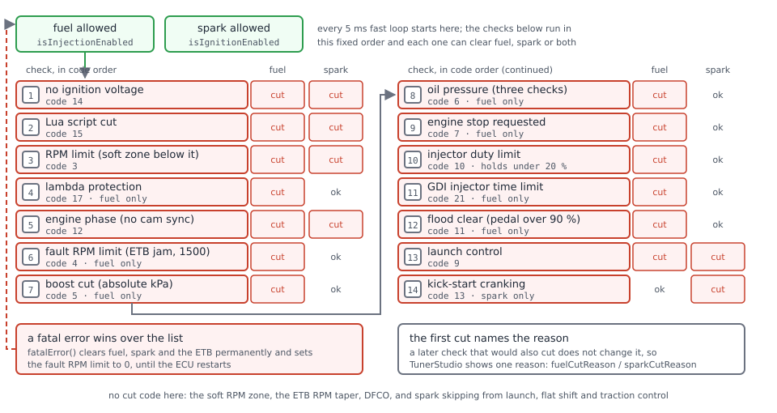
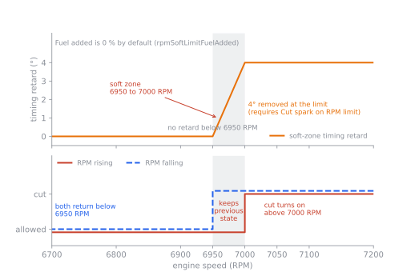

# Limits and engine protection

:material-circle:{ .level-basic } Basic → :material-circle:{ .level-advanced } Advanced

> **In one sentence:** the protection manager watches engine speed, boost, oil pressure, lambda and
> injector duty, and cuts fuel, spark or both the moment one of them goes outside the limits you set.

## What it does

:material-circle:{ .level-basic } Basic

An engine can destroy itself in seconds: too many revolutions bend valves, too much boost lifts a
head gasket, no oil pressure spins a bearing, a lean mixture melts a piston. rusEFI has one central
**protection manager** (in the firmware, `LimpManager`) that decides, about 200 times a second,
whether the injectors and the coils are allowed to fire. Every protection described here feeds it.
<!-- src: firmware/controllers/limp_manager.cpp (LimpManager::updateState, LimpManager::onFastCallback); firmware/controllers/limp_manager.h (ClearReason) -->

It provides:

- **An RPM limit** — constant, or from a coolant-temperature curve — that cuts fuel, spark or both,
  with a soft zone just below it that pulls timing and/or adds fuel.
- **Boost cut** — fuel cut above a MAP pressure.
- **Oil pressure protection** — fuel cut if pressure does not build after start, falls too low, or
  rises too high.
- **Lambda protection** — fuel cut when the mixture is leaner than allowed under load.
- **Injector duty limit** — fuel cut when the injectors run out of time.
- **Fault limits** — for example 1500 RPM after a jammed electronic throttle.
- **Deceleration fuel cut-off (DFCO)** — not a protection, but a fuel cut while coasting; it is set
  up here because it shares the same ideas.
- **Misfire detection** at idle — a diagnosis that lights the check-engine light.

When something cuts, TunerStudio's front page shows **Fuel cut: …** or **Ign cut: …** with the reason.
<!-- src: firmware/tunerstudio/tunerstudio.template.ini (fuelIgnCutCodeList, indicator fuelCutReasonBlinker) -->

!!! danger "Protection is a last line of defence"
    These limits cut fuel or spark when a limit is already exceeded. They do not make a bad tune
    safe. Set the RPM limit below what your valvetrain survives, and check every protection on the
    dyno or on a datalog before you rely on it.

## How it works

:material-circle:{ .level-intermediate } Intermediate

<!-- TODO figure not drawn yet:
<figure markdown>
  
  <figcaption>Figure 1 — How the protection manager decides. Red checks cut; the first one to cut an
  output names the reason you see in TunerStudio.</figcaption>
</figure>
-->

Every fast loop (5 ms) the protection manager starts with fuel and spark allowed (unless injection
or ignition is switched off in the settings) and runs its checks in a fixed order. Each check can
clear fuel, spark or both. **The first check that clears an output records the reason**; later
checks that would also have cut do not change it. So the cut code tells you *one* reason, not all of
them. A **fatal error** is a separate, permanent cut that always wins and lasts until the ECU
restarts.
<!-- src: firmware/controllers/limp_manager.cpp (LimpManager::updateState order, allowInjection, allowIgnition, fatalError); firmware/controllers/limp_manager.h (Clearable::clear keeps first reason) -->

The order is: ignition off → Lua cut → **RPM limit** → **lambda protection** → engine phase (no cam
sync yet) → **fault RPM limit** → **boost cut** → **oil pressure** → stop requested → **injector duty**
→ GDI limits → flood clear → **launch control** → kick-start.
<!-- src: firmware/controllers/limp_manager.cpp (LimpManager::updateState) -->

A fuel cut stops new injections from being scheduled. A spark cut stops new coil charges, but a coil
that is already charged is still fired safely.
<!-- src: firmware/controllers/engine_cycle/main_trigger_callback.cpp (handleFuel: limitedFuelState); firmware/controllers/engine_cycle/spark_logic.cpp (limitedSparkState) -->

Some things reduce power **without** a cut code: the soft RPM zone (timing and fuel only), the
electronic-throttle RPM taper, DFCO (fuel mass set to zero), and spark *skipping* from launch, flat
shift, traction control and Lua. Look at their own channels (see *Diagnostics*).
<!-- src: firmware/controllers/algo/fuel_math.cpp (getInjectionMass: DfcoController cutFuel); firmware/controllers/algo/launch_control.cpp (SoftSparkLimiter); firmware/controllers/actuators/electronic_throttle.cpp (EtbController::getSetpointEtb) -->

### The RPM limit and its soft zone

The limit **L** is **RPM hard limit**, or — with **Use Engine Temperature RPM limit curve** on — the
value read from the coolant curve. The curve *replaces* the constant; it is not the lower of the two.
If the coolant sensor has failed, the curve is read at **0 °C**.
<!-- src: firmware/controllers/limp_manager.cpp (LimpManager::updateRevLimit: interpolate2d Clt, Sensor::getOrZero) -->

The cut turns on when RPM goes **above L** and stays on until RPM falls **below L − hysteresis**
(**RPM limit hysteresis**). Between those two points nothing changes.
<!-- src: firmware/controllers/limp_manager.cpp (m_revLimitHysteresis.test, resumeRpm); firmware/controllers/hysteresis.h (Hysteresis::test strict comparisons) -->

Across the same window, from L − hysteresis up to L, the soft zone ramps in:

- **Timing retard** — up to this many degrees *removed* from the timing (only if **Cut spark on RPM
  limit** is on, and only in dynamic timing mode);
- **Fuel added** — up to this many percent *added* to running fuel (only if **Cut fuel on RPM limit**
  is on).

The ramp follows current RPM, not the cut: at L it is at full strength even before the cut starts.
<!-- src: firmware/controllers/limp_manager.cpp (updateRevLimit: interpolateClamped resumeRpm..m_revLimit; getLimitingTimingRetard, getLimitingFuelCorrection); firmware/controllers/algo/engine2.cpp (corrections: TM_DYNAMIC, getLimitingTimingRetard); firmware/controllers/algo/fuel_math.cpp (getRunningFuel: getLimitingFuelCorrection) -->

<!-- TODO figure not drawn yet:
<figure markdown>
  
  <figcaption>Figure 2 — The factory-default limiter (7000 RPM, 50 RPM hysteresis, 4° retard), drawn
  from the firmware defaults. The retard ramps over the hysteresis window; the cut has the same window
  as its on/off gap.</figcaption>
</figure>
-->
<!-- src: firmware/controllers/algo/defaults/default_base_engine.cpp (rpmHardLimit 7000, rpmHardLimitHyst 50, rpmSoftLimitTimingRetard 4, cutFuelOnHardLimit, cutSparkOnHardLimit) -->

!!! warning "Fill the coolant curve before you switch it on"
    The four RPM values of the **Engine Temperature RPM Limit** curve are **0** by default (only the
    temperature axis −20, 0, 40, 80 °C is filled). Switching the curve on without filling it sets a
    0 RPM limit: the engine cuts as soon as it turns.
    <!-- src: firmware/controllers/algo/defaults/default_base_engine.cpp (cltRevLimitRpmBins only) -->

!!! note "The soft-zone fields disappear in coolant-curve mode"
    TunerStudio hides **Timing retard** and **Fuel added** when the coolant curve is selected, but
    the firmware still applies whatever values are stored there, around the curve's limit.
    <!-- src: firmware/tunerstudio/tunerstudio.template.ini (limitsAndFallbackLeft softRpmLimitSettings visibility); firmware/controllers/limp_manager.cpp (updateRevLimit) -->

### Electronic throttle RPM taper

With an electronic throttle you can also close the throttle smoothly near the limit: above **Soft
limiter start** the throttle target is reduced, reaching zero (in practice **Minimum ETB position**)
at start + **Soft limiter range**. It has no hysteresis and is independent of the RPM limit above. A
start of 0 switches it off. Details are in the [Electronic throttle](electronic-throttle.md) chapter.
<!-- src: firmware/controllers/actuators/electronic_throttle.cpp (EtbController::getSetpointEtb: etbRevLimitStart, etbRevLimitRange); firmware/controllers/algo/defaults/default_base_engine.cpp (etbRevLimitRange 250) -->

### Fuel, spark, or both?

Fuel cut is smoother and keeps unburnt fuel out of the exhaust. Spark cut is faster but sends
unburnt mixture into the exhaust, which can bang and flame. rusEFI's own help text warns that some
engines are known to damage their valvetrain on a spark cut. Both are on by default.
<!-- src: firmware/integration/rusefi_config.txt (cutFuelOnHardLimit, cutSparkOnHardLimit help) -->

### The other protections

**Boost cut.** When **Boost cut pressure** is not 0, fuel is cut once MAP goes above it, and restored
when a valid MAP reading falls below cut pressure − **Boost cut pressure hysteresis**. It cuts fuel
only, never spark. The pressure is **absolute** MAP (kPa), not gauge boost: 100 kPa of boost at sea
level is about 200 kPa. Boost control itself is in the Boost chapter.
<!-- src: firmware/controllers/limp_manager.cpp (boostCutPressure, m_boostCutHysteresis, "limiting spark bends valves"); firmware/controllers/max_limit_with_hysteresis.h (checkIfLimitIsExceeded) -->

**Injector duty limit.** Duty is injection time per cycle divided by cycle time. Fuel is cut when duty
goes above **Instantaneous injector duty cycle limit** (default 110 %), or stays above **Sustained
injector duty cycle limit** (default 96 %) for longer than **Sustained injector duty cycle delay**
(default 0.5 s). The cut holds until duty falls **below 20 %** — in practice, until you lift off.
<!-- src: firmware/controllers/limp_manager.cpp (maxInjectorDutyInstant, maxInjectorDutySustained, isUnderLowDuty < 20); firmware/controllers/algo/fuel_math.cpp (getInjectorDutyCycle); firmware/controllers/algo/defaults/default_fuel.cpp (maxInjectorDuty* defaults) -->

**Oil pressure** (needs an oil pressure sensor, Sensors chapter). Three checks, each a fuel cut:

- *After start:* if **After start Minimum oil pressure** is above 0, pressure must rise above it within
  **5 seconds** of start, or fuel is cut for the rest of that run.
- *Running low:* with **Running engine Low oil pressure** on, pressure must stay above the
  **Minimum oil pressure** curve (pressure vs RPM); below it for longer than **Running engine
  protection timeout** (default 0.5 s), fuel is cut. While the 5-second after-start window is running
  (only when the after-start check is enabled) this check waits.
- *Running high:* if the **Maximum oil pressure** curve has a value above 0 at the current RPM,
  pressure at or above it for longer than **High oil pressure protection timeout** cuts fuel.

All three reset when the engine stops.
<!-- src: firmware/controllers/limp_manager.cpp (minOilPressureAfterStart, getSecondsSinceEngineStart > 5, enableOilPressureProtect, minimumOilPressureValues, maximumOilPressureValues, m_hadOilPressureAfterStart reset); firmware/controllers/algo/defaults/default_base_engine.cpp (minimumOilPressureTimeout 0.5) -->

**Lambda protection** (needs a wideband). When on, above **Check above load**, **and above TPS** and
**and above RPM**, measured lambda must stay below *target lambda + the Lambda Difference Table*. Lean
for longer than **and after delay** cuts fuel, until load, TPS and RPM all fall below the *restore*
values. Checking pauses for 2 s after any other cut and after DFCO. Tuning it is covered in the
Closed-loop lambda chapter.
<!-- src: firmware/controllers/math/lambda_monitor.cpp (LambdaMonitor::getMaxAllowedLambda, isCurrentlyGood, restoreConditionsMet); firmware/controllers/algo/defaults/default_fuel.cpp (setDefaultLambdaProtection) -->

**Fault RPM limit.** If the electronic throttle's jam detection trips, fuel is cut above
**1500 RPM** until the ECU restarts, whatever the RPM limit settings say (cut code *ETB RPM limit*).
<!-- src: firmware/controllers/limp_manager.cpp (LimpManager::reportEtbJammed, setFaultRevLimit, m_faultRevLimit) -->

**Knock** does not cut fuel or spark: the knock controller retards timing (Knock chapter). There is no
knock cut code.
<!-- src: firmware/controllers/limp_manager.h (ClearReason: no knock reason); firmware/controllers/algo/engine2.cpp (KnockController getKnockRetard) -->

### Deceleration fuel cut-off (DFCO)

When you lift off at speed, fuel is not needed. DFCO sets the injected fuel to zero. In *Overrun*
mode it starts when the pedal (or TPS) is below **Overrun TPS closed threshold**, RPM above **Overrun
RPM cut above** and speed at or above **Overrun vehicle speed cut above**; it stops when the pedal
opens, RPM falls below **Overrun RPM restore below** or speed falls below the restore speed. In every
mode it is blocked when coolant is at or below **No cut below CLT**, or MAP is above **Cut fuel below
MAP** (±1 kPa). **Fuel cut delay** waits before cutting; **Ignition retard during cut** pulls timing
while cut and ramps it back afterwards. *Decel* mode uses the Engine State Machine instead.
<!-- src: firmware/controllers/algo/fuel/dfco.cpp (DfcoController::commonGuards, overrunActive, getState, cutFuel, getTimingRetard); firmware/controllers/algo/defaults/default_fuel.cpp (coastingFuelCut* defaults); firmware/integration/rusefi_config.txt (dfcoFuelCutMode help) -->

### Misfire detection

On F7 boards, misfire detection times each cylinder's power stroke from the crank trigger and flags a
stroke that is much slower than the running average. It works **at idle only**, cuts nothing, and
latches the check-engine light (P0300) once the count reaches **Count threshold** (0 = monitor only).
<!-- src: firmware/controllers/algo/misfire_detection.cpp (MisfireController::onEnginePhase idle gate, evaluateSegment, registerMisfire); firmware/config/stm32f7ems/efifeatures.h (EFI_MISFIRE_DETECTION) -->

## Before you start

:material-circle:{ .level-basic } Basic

- A running engine with a known safe RPM limit for its valvetrain.
- For boost cut: a MAP sensor that reads the full boost range.
- For oil protection: an oil pressure sensor set up in **Sensors** (see the Sensors chapter).
- For lambda protection: a working wideband and a sensible target lambda table.
- For DFCO: a coolant sensor (DFCO never runs with a failed coolant sensor) and, for the speed
  conditions, a vehicle speed sensor.
<!-- src: firmware/controllers/algo/fuel/dfco.cpp (commonGuards: clt invalid returns false) -->

## Setting it up

:material-circle:{ .level-basic } Basic → :material-circle:{ .level-intermediate } Intermediate

Everything is under **Setup ▸ Limits and protection**, except DFCO which is **Fuel ▸ Deceleration
fuel cutoff (DFCO)**.

### 1 · RPM limit, boost cut and injector duty

Open **Setup ▸ Limits and protection ▸ Limits and fallbacks** (`limitsAndFallback`).

1. **Cut fuel on RPM limit** / **Cut spark on RPM limit** — choose one or both.
2. **RPM hard limit** — your limit, in RPM. **0 is not "off"**: it cuts at any RPM.
3. **RPM limit hysteresis** — how far RPM must drop before fuel/spark return (steps of 10 RPM).
   100–200 RPM gives a steady limiter; 50 RPM (default) is a sharp one.
4. **Timing retard** / **Fuel added** — the soft zone (see *How it works*). 0 turns each off.
5. **Boost cut pressure** — absolute kPa; 0 turns boost cut off. **Boost cut pressure hysteresis** —
   how far MAP must drop before fuel returns.
6. **Injector duty** limits — leave the defaults unless your injectors are known to work above them.
7. **Soft limiter start / range** — electronic throttle only.
8. Burn.
<!-- src: firmware/tunerstudio/tunerstudio.template.ini (limitsSettings, softRpmLimitSettings, etbLimits, dutyCycleLimiting) -->

<!-- shot: img/ts/limits-protection-limits.png | Setup ▸ Limits and protection ▸ Limits and fallbacks | cut fuel + cut spark on, RPM hard limit 6800, hysteresis 100, timing retard 5, fuel added 0, boost cut 250 kPa, hysteresis 20 | The Limits and fallbacks dialog with Example 1's values. -->

To limit by temperature, turn on **Use Engine Temperature RPM limit curve**: the **Engine Temperature
RPM Limit** curve appears. Fill **all four** RPM values first.

<!-- shot: img/ts/limits-protection-clt-curve.png | Setup ▸ Limits and protection ▸ Limits and fallbacks | Use Engine Temperature RPM limit curve on; curve -20/0/40/80 °C → 4000/4500/5500/6800 RPM | The coolant-based RPM limit curve, filled. -->

### 2 · Oil pressure

Open **Setup ▸ Limits and protection ▸ Low oil pressure protection** (`lowOilPressureProtection`). Set
**After start Minimum oil pressure** (or 0 to skip), turn on **Running engine Low oil pressure**, set the
**Running engine protection timeout**, and fill the **Minimum oil pressure** curve (pressure vs RPM).
Then, if wanted, **High oil pressure protection** (`highOilPressureProtection`): the timeout and the
**Maximum oil pressure** curve (leave it at 0 to disable).

<!-- shot: img/ts/limits-protection-oil-low.png | Setup ▸ Limits and protection ▸ Low oil pressure protection | after-start 70 kPa, running check on, timeout 0.5 s, curve 100 kPa at idle rising to 250 kPa at 6000 RPM | Low oil pressure protection with Example 2's values. -->
<!-- shot: img/ts/limits-protection-oil-high.png | Setup ▸ Limits and protection ▸ High oil pressure protection | timeout 1.0 s, curve 0 (disabled) | High oil pressure protection, disabled by its zero curve. -->

!!! danger "Test oil protection before you need it"
    A wrong sensor calibration either cuts a healthy engine or never cuts a dying one. With the
    engine idling, watch the oil pressure gauge against a mechanical gauge before enabling the cut.

### 3 · Lambda protection

Open **Setup ▸ Limits and protection ▸ Lambda protection** (`lambdaProtection`). Fill the **Lambda
Difference Table** first — it is all zeros by default, which would cut at any lambda above target —
then switch on **Lambda protection** and set the check and restore thresholds.
<!-- src: firmware/controllers/math/lambda_monitor.cpp (getMaxAllowedLambda); firmware/tunerstudio/tunerstudio.template.ini (lambdaProtection) -->

<!-- shot: img/ts/limits-protection-lambda.png | Setup ▸ Limits and protection ▸ Lambda protection | enabled, load 60, TPS 50, RPM 2500, delay 0.5 s, restore 30/20/2000, difference table 0.10 everywhere | Lambda protection with a 0.10 lambda margin. -->

### 4 · DFCO

Open **Fuel ▸ Deceleration fuel cutoff (DFCO)** (`coastingFuelCutControl`). Turn on **Enable Fuel
Cutoff**, leave **Fuel cut on** at *Overrun*, and check the thresholds: the defaults are cut above
1500 RPM, restore below 1300 RPM, pedal below 2 %, MAP below 30 kPa, coolant above 60 °C.
<!-- src: firmware/controllers/algo/defaults/default_fuel.cpp (coastingFuelCut* defaults) -->

<!-- shot: img/ts/limits-protection-dfco.png | Fuel ▸ Deceleration fuel cutoff (DFCO) | enabled, Overrun, defaults, retard 5°, ramp-in 0.5 s | The DFCO dialog with the factory thresholds. -->

### 5 · Misfire detection (optional)

Open **Setup ▸ Limits and protection ▸ Misfire Detection** (`misfireDetectionDialog`). Set **Window
start** and **Window end** (degrees after each cylinder's TDC) first: a window narrower than one
trigger tooth stops detection with a configuration error. Then enable it and watch the live panel on
the right at idle.
<!-- src: firmware/controllers/algo/misfire_detection.cpp (onEnginePhase: windowWidth < toothSpacing configError) -->

<!-- shot: img/ts/limits-protection-misfire.png | Setup ▸ Limits and protection ▸ Misfire Detection | enabled, threshold 50, window 10–90°, other fields default; engine idling | Misfire Detection with its live state panel. -->

## Worked examples

:material-circle:{ .level-intermediate } Intermediate

### Example 1 — Naturally aspirated four-cylinder, 6800 RPM limit

| Setting | Value | Why |
|---|---|---|
| Cut fuel / Cut spark on RPM limit | yes / yes | fast and firm |
| RPM hard limit | 6800 RPM | 200 RPM under the valvetrain's limit |
| RPM limit hysteresis | 100 RPM | fuel and spark return at 6700 RPM |
| Timing retard | 5° | at 6750 RPM 2.5° is already removed, 5° at 6800 RPM |
| Fuel added | 0 % | not needed |
| Boost cut pressure | 0 | no turbo |

At 6801 RPM both outputs cut (code *RPM limit*); they stay cut down to 6700 RPM and return at 6699 RPM.
<!-- src: firmware/controllers/limp_manager.cpp (updateRevLimit, m_revLimitHysteresis) -->

### Example 2 — Turbo engine with a 250 kPa boost cut and oil protection

| Setting | Value | Why |
|---|---|---|
| Boost cut pressure | 250 kPa | target is 220 kPa absolute (about 1.2 bar boost) |
| Boost cut pressure hysteresis | 20 kPa | fuel returns below 230 kPa |
| After start Minimum oil pressure | 70 kPa | the engine shows 150 kPa within 2 s of a warm start |
| Running engine Low oil pressure | on, 0.5 s | |
| Minimum oil pressure curve | 100 kPa at idle → 250 kPa at 6000 RPM | half the measured warm pressure |

## Tuning it

:material-circle:{ .level-intermediate } Intermediate → :material-circle:{ .level-advanced } Advanced

- **A limiter that "bounces"** hard on and off: raise the hysteresis, or add a few degrees of soft
  retard so torque drops before the cut.
- **Turbo engines**: a spark cut with a lot of fuel in the exhaust is hard on the turbo and the
  catalyst; prefer fuel cut, or fuel + a little soft retard.
- **Electronic throttle**: start the throttle taper 200–300 RPM below the hard limit so the throttle
  does most of the limiting and the cut rarely triggers.
- **Lambda protection**: start with a generous difference (0.10–0.15 lambda) and a 0.5–1 s delay;
  tighten only after logging full-load pulls.

## Diagnostics

:material-circle:{ .level-intermediate } Intermediate

The front-page indicators show **Injection OK** / **Ignition OK**, or blink **Fuel cut: …** /
**Ign cut: …** with the reason. In a log the codes are **Fuel: Cut Code** (`fuelCutReason`) and **Ign:
Cut Code** (`sparkCutReason`):
<!-- src: firmware/console/binary/output_channels.txt (fuelCutReason, sparkCutReason); firmware/console/status_loop.cpp (fuelCutReasonBlinker); firmware/tunerstudio/tunerstudio.template.ini (fuelIgnCutCodeList) -->

| Code | Shows | Meaning |
|---|---|---|
| 0 | None | not cut |
| 1 | fatal error | permanent cut until restart |
| 2 | setting disabled | injection or ignition switched off in the settings |
| 3 | RPM limit | main RPM limit |
| 4 | ETB RPM limit | 1500 RPM limit after an ETB jam |
| 5 | boost cut | MAP above Boost cut pressure |
| 6 | oil pressure | any of the three oil checks |
| 7 | stop requested | engine stop button, Lua or command |
| 9 | launch control | launch full cut (Launch chapter) |
| 10 | max injector duty | injector duty limit |
| 11 | flood clear | pedal above 90 % while cranking, with flood clear enabled |
| 12 | engine sync | waiting for cam sync before firing |
| 14 | ign off | no ignition voltage |
| 15 | Lua | a Lua script cut fuel or spark |
| 17 | Lambda Prot | lambda protection |
<!-- src: firmware/controllers/limp_manager.h (ClearReason); firmware/controllers/limp_manager.cpp (FloodClear CLEANUP_MODE_TPS 90) -->

Boost cut, injector duty, lambda protection and ETB jam also raise a warning (P0234, a
too-long-injection code, P0171, P0638), at most one every 30 seconds.
<!-- src: firmware/controllers/limp_manager.cpp (shouldReportCutWarning, warning OBD_Engine_Overboost, OBD_System_Too_Lean_Bank_1) -->

Other channels: **Fuel: injector duty cycle**, **dfcoActive**, **DFCO: Timing retard**,
**lambdaMonitorCut**, **lambdaCurrentlyGood**, **lambdaTimeSinceGood**, and the misfire panel
(**Misfire: total count**, **Misfire: MIL latched**). The RPM limit itself and the soft-zone retard
have no dedicated channel: compare **baseIgnitionAdvance** and **correctedIgnitionAdvance** (the
difference also includes knock retard).
<!-- src: firmware/console/binary/output_channels.txt (injectorDutyCycle, dfcoActive); firmware/controllers/math/lambda_monitor.txt (lambdaMonitorCut); firmware/controllers/algo/misfire_detection_state.txt -->

## Troubleshooting

:material-circle:{ .level-basic } Basic → :material-circle:{ .level-advanced } Advanced

| Symptom | Likely cause | Check |
|---|---|---|
| Engine cranks, fires once, cut code *RPM limit* | RPM hard limit 0, or coolant curve on with zero RPM values | Setting it up, step 1 |
| Limit lower than set, only when cold or hot | coolant curve active; failed CLT reads the 0 °C point | the curve, the CLT sensor |
| Cut stays on below the limit | normal hysteresis | RPM must fall below limit − hysteresis |
| Car stumbles at high boost, code *boost cut* | Boost cut pressure set as gauge pressure | it is absolute kPa |
| Fuel cut at full load, code *max injector duty*, only clears when you lift | injectors too small, or a fuel tune far too rich | injector size; log duty |
| Engine dies 5 s after start, code *oil pressure* | after-start pressure not reached, or sensor wrong | oil sensor calibration |
| Code *Lambda Prot* everywhere under load | Lambda Difference Table left at 0 | Setting it up, step 3 |
| Code *ETB RPM limit*, engine won't rev above 1500 | electronic throttle jam detected | Electronic throttle chapter; restart the ECU |
| DFCO never happens | coolant below threshold, MAP too high, no VSS with speed threshold above 0 | dfcoActive and each threshold |
| Misfire detection shows a configuration error | window narrower than one trigger tooth | widen Window start/end |

## Settings reference

### Limits and fallbacks (Setup ▸ Limits and protection ▸ Limits and fallbacks)

--8<-- "reference/settings/_limitsAndFallback.table.md"

### Low oil pressure protection

--8<-- "reference/settings/_lowOilPressureProtection.table.md"

### High oil pressure protection

--8<-- "reference/settings/_highOilPressureProtection.table.md"

### Lambda protection

--8<-- "reference/settings/_lambdaProtection.table.md"

### Misfire Detection

--8<-- "reference/settings/_misfireDetectionDialog.table.md"

### Deceleration fuel cutoff (Fuel ▸ Deceleration fuel cutoff (DFCO))

--8<-- "reference/settings/_coastingFuelCutControl.table.md"

## Related

- [Electronic throttle](electronic-throttle.md) — throttle RPM taper and jam detection
- Launch, flat shift and traction control — launch full cut and spark skipping
- Boost control — keeping boost below the boost cut
- Closed-loop lambda — the target that lambda protection compares against
- Knock control — timing retard on knock
- Lua scripting — `setFuelDisabled`, `setIgnDisabled`, `setDfcoDisabled`
