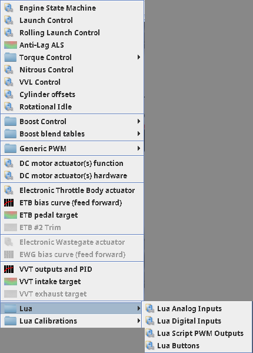

# Lua scripting

:material-circle:{ .level-basic } Basic → :material-circle:{ .level-advanced } Advanced

> **In one sentence:** rusEFI runs a small Lua interpreter inside the ECU, so a plain-text script you
> edit in the rusEFI console can read any sensor, drive spare outputs, and add to — or take away from —
> the fuel, spark, idle, boost and throttle the firmware is already calculating.

## What it does

:material-circle:{ .level-basic } Basic

An ECU cannot ship a table for every idea a builder has: run the fan after the ignition is off, hold
a relay for three seconds, read a temperature off the CAN bus, add a little idle air when the A/C
compressor clicks in. **Lua scripting** is rusEFI's way of letting you write those few lines yourself
instead of waiting for a setting to exist.

The firmware contains a full Lua 5.4 interpreter. Your script is stored inside the ECU, in its own
settings page — on a Proteus F7 that page holds up to **48 000 bytes** of text, which is a great deal
of script. rusEFI starts a separate thread for it at boot; every tick, that thread hands the script a
chance to run:

```lua
function onTick()
    if getSensor("Clt") > 100 then
        setPwmDuty(0, 1)
    end
end
```

What a script can do falls into four groups:

- **Read anything the ECU knows**: sensor values, raw volts, switch inputs, raw pins, SENT values and
  CAN messages.
- **Publish values** the rest of the firmware and TunerStudio can use: eight numbered Lua gauges, or a
  whole sensor — coolant temperature from a CAN gauge becomes the ECU's coolant sensor.
- **Adjust the firmware's own numbers**: add or multiply fuel and timing, add idle air, move a boost
  target or a throttle target.
- **Say no**: cut fuel, cut spark, disable the electronic throttle, stop the engine.
<!-- src: firmware/controllers/lua/lua_hooks.cpp (the registered hooks: getSensor, setLuaGauge, setFuelMult, setIgnDisabled); firmware/controllers/lua/lua_class_adapters.cpp (Sensor class); firmware/controllers/lua/lua_can_rx.cpp (onCanRx) -->

What it cannot do matters just as much. There is no hook that opens one injector or fires one coil by
itself: Lua does not schedule anything on the crankshaft, it only changes the numbers the fuel and
ignition calculations hand to the scheduler. The number of values you can publish is fixed (eight Lua
gauges, plus any known sensor type via `Sensor.new`). And a script that takes 200 ms per tick does not
make the engine slower — it makes only the script slower.
<!-- src: firmware/controllers/lua/lua_hooks.cpp (enumerateMainRusefiLuaHooks: the complete list of hooks); firmware/init/sensor/init_aux.cpp (luaGauges array sized by LUA_GAUGE_COUNT) -->

!!! note "TunerStudio Lua is a different thing"
    TunerStudio has its own Lua engine for dashboards and one-click tools, which runs on your laptop
    and talks to the ECU over the serial link. rusEFI's Lua runs *in* the ECU and keeps working when no
    laptop is attached. This chapter is about the ECU one; the counters behind TunerStudio's Lua
    buttons are the one place the two meet.

!!! danger "A script can out-rule your judgement"
    Lua adjustments are applied on top of the tune with no rate limit and no sanity check:
    `setFuelMult(2)` doubles the fuel, `setTimingAdd(15)` moves every spark 15 degrees early,
    `setIgnDisabled(true)` stops the engine, `startCrankingEngine()` engages the starter. The ECU's own
    protections (RPM limit, lambda protection, over-boost cut, limp modes) still work, so leave them
    switched on. Never test a fuel, timing or throttle script on a running engine without a datalog
    running, and never test an output script with fuel lines, the throttle bore or moving parts within
    reach.

## How it works

:material-circle:{ .level-intermediate } Intermediate

<figure markdown>
  
  <figcaption>Figure 1 — The Lua thread's life. Green is the repeating loop, red is the reset path
  that tears the interpreter down and wipes the script's effect on the engine.</figcaption>
</figure>

### The loop

rusEFI starts one Lua virtual machine (VM), loads your text into it, and runs the top-level part of
the script **once** — that is where `local` variables, helper functions, `Sensor.new(...)`,
`canRxAdd(...)` filters and `startPwm(...)` belong. Then, forever:

1. **CAN receive callbacks.** Any CAN frame that matched one of your filters is handed to its
   callback, or to `onCanRx` if you registered no callback for it.
2. **One interactive command**, if you typed one into the console's command box.
3. **`onTick()`**, your main function.
4. **Sleep** until the next tick — **5 ms** by default, i.e. 200 ticks a second, changed by
   `setTickRate(hz)` (clamped to 1 … 2000 Hz).

Each loop's duration is published as the logged channel *Lua: Last tick duration*, and every tick
increments *Lua: Tick counter* — that counter is how you prove a script is alive.
<!-- src: firmware/controllers/lua/lua.cpp (LuaThread::ThreadTask, runOneLua, doLuaCanRx, doInteractive, invokeTick, luaTickPeriodUs = MS2US(5), lua_setTickRate, luaInvocationCounter) -->

Frames that do not match a filter never reach Lua, so a script that expects `onCanRx` for a message it
has not registered sees nothing. On Proteus F7 the Lua queue holds 256 frames; when it is full the
frame is dropped and counted, and `getCanRxDropped()` reads that count.
<!-- src: firmware/controllers/lua/lua_can_rx.cpp (processLuaCan filter check, LUA_canFrameCount 256 on STM32F7 and H7, dropRxCount); firmware/controllers/lua/lua_hooks.cpp (getCanRxDropped) -->

### What a reset clears

The script's text is one thing; the state it left in the engine is another. Whenever the VM is
restarted — you press **Write to ECU**, or **More… ▸ Reset Lua**, or the console sends `luareset` — the
firmware closes the VM, releases the Lua output pins, drops every CAN filter, and then clears every
number a script may have written into the engine: fuel add 0 and fuel multiplier 1, timing add 0 and
multiplier 1, idle add 0 and the Park/Neutral flag, boost target and duty adds, the "disable electronic
throttle" and "disable A/C" flags, the fuel and ignition cuts, the deceleration-fuel-cut override, the
engine torque value and the script's acceleration enrichment. A script that never ran again cannot
keep an old adjustment alive — but only a reset clears one that already happened.
<!-- src: firmware/controllers/algo/engine.cpp (Engine::resetLua); firmware/controllers/lua/lua.cpp (resetLua, luaDeInitPins, engine->resetLua after each run); firmware/controllers/lua/can_filter.cpp (resetLuaCanRx) -->

!!! warning "An error does not undo what the script already did"
    A failing `onTick` is reported and skipped; the next tick still runs, and any value the script had
    already written stays in the engine. So if a script sets `setFuelMult(1.4)` and then throws an
    error on the next line, that 40 % stays. Write scripts so the adjustment is the last thing the tick
    does, or re-apply it at the top of every tick.

### Errors, and how the script is stored

rusEFI protects every call into your script. A Lua error — a typo, a nil value, an out-of-range
argument — raises a warning **C6730** and writes the message to the console log
(`LUA onTick failed: …`), and the engine keeps running the rest of the firmware. If the script does
not even parse, rusEFI says `ERROR loading script: …` and then **waits**: the Lua thread stops
re-trying until you send a reset, so a broken script does not spam the ECU.

The script text lives on a settings page of its own, not in the ordinary tune page. That is why the
rusEFI console can read it, change it in RAM and test it *before* you commit it to flash, and why
**Burn to ECU** is a separate step.

<figure markdown>
  
  <figcaption>Figure 2 — Two different actions: *Write to ECU* makes the script run now, *Burn to ECU*
  makes it come back after a power cycle. Both use the ECU's own Lua page.</figcaption>
</figure>

The limits worth knowing:

| Limit | Value on Proteus F7 | Where it bites |
|---|---|---|
| Script size | 48 000 bytes, plain ASCII | the console refuses a longer script and says by how much |
| Tick rate | 200 Hz (5 ms) by default, clamped to 1 … 2000 Hz | `setTickRate(1000)` on a script with a slow `onTick` just makes late ticks |
| Interactive command | 100 characters, one at a time | long expressions belong in the script |
| `print()` line | about 245 characters reach the log | long strings are cut, not wrapped |
| Log queue | 24 lines can be queued | a `print` loop drops lines, it does not slow the engine |
| Lua gauges | 8 | `setLuaGauge(9, …)` does nothing |
<!-- src: firmware/config/boards/proteus/prepend_proteus_f7.txt (LUA_SCRIPT_SIZE 48000); firmware/controllers/generated/rusefi_generated_proteus_f7.h (LUA_GAUGE_COUNT 8, LUA_SCRIPT_SIZE); firmware/controllers/lua/lua.cpp (luaTickPeriodUs, interactiveCmd buffer size, CMD_LUA_RESET); firmware/controllers/lua/lua_hooks_util.cpp (print limits comment: line length and 24 queued lines) -->

## Before you start

:material-circle:{ .level-basic } Basic

- **The rusEFI console is where scripts are edited.** TunerStudio shows the script's *pins, tables and
  numbers*, and its own Lua dialogs even say so ("Use rusEFI console for Lua script editing"), but the
  text itself is edited in the console. Every step below says which tool it belongs to.
- **TunerStudio stays in charge of configuration.** Before a script can use a spare input or output,
  that pin has to be assigned in TunerStudio, like any other output.
- **Back up the tune.** The script is part of the ECU's settings pages; a tune backup is also a backup
  of your script.
- **A fresh tune may already have a script.** Resetting the configuration to defaults installs rusEFI's
  own short starting script (an empty `onTick` and `onCanRx`, plus a CAN printing helper), and some
  engine types install their own. Read what is there before you overwrite it.
- **Work on 12 V with the ignition on**, as everywhere else in this manual: on USB power alone the 5 V
  sensor supplies sag, so `getSensor(...)`, `getAuxAnalog(...)` and every ratiometric reading in the
  console is wrong.
<!-- src: firmware/tunerstudio/tunerstudio.template.ini (luaOutputs and scriptSetting dialogs: the "Use rusEFI console for Lua script editing" note); firmware/controllers/algo/engine_configuration.cpp (setDefaultEngineConfiguration includes default_script.lua); firmware/controllers/algo/default_script.lua (the factory script body); firmware/controllers/settings.cpp (setLuaScript writes the Lua page) -->

!!! tip "Keep a version marker in the script"
    A `print("my script v7")` at the top level tells you, in the console log, which script is actually
    running after you pressed **Write to ECU**. The console's own reset confirmation can go unverified
    when a chatty script floods the log, so the version line is the reliable proof.

## Setting it up

:material-circle:{ .level-basic } Basic → :material-circle:{ .level-intermediate } Intermediate

### 1 · Open the script

This is done in the rusEFI console: connect to the ECU and open the **Lua Scripting** tab. The tab
reads the script from the ECU as soon as it opens, so what you see is what is running.

The left half is a monospaced editor; the right half is the ECU's message log, which is where your
`print` output and any Lua error appear. Along the top: **Write to ECU**, **Burn to ECU**, **More…**,
a **Command** box and the **Lua Wiki** link.

<figure markdown>
  <!-- shot: img/console/lua-console-tab.png | rusEFI console ▸ Lua Scripting | Proteus F7 connected, ignition on, tab freshly opened so the editor shows the factory script with printPacket, onCanRx and onTick, buttons Write to ECU Burn to ECU More… visible, Command box empty, message pane showing the connection log | The Lua Scripting tab: your script on the left, the ECU's log on the right, the two write actions along the top. -->
  <figcaption>Figure 3 — The Lua Scripting tab: your script on the left, the ECU's log on the right, the two write actions along the top.</figcaption>
</figure>

### 2 · Run it, then keep it

1. Edit the text and press **Write to ECU**. The console writes the script into the ECU's Lua page and
   immediately sends a reset, so the new script starts running within milliseconds. Nothing is saved
   to flash yet — a power cycle brings back the old script.
2. Watch the message pane: the ECU answers `LUA loading script length: …`, then `script loaded
   successfully!` or the error text.
3. When it behaves, press **Burn to ECU** to write the page to flash. Until you do, the script lives
   only in RAM.

**More… ▸ Reset Lua** does the reset on its own, without touching the text — that is also the quickest
way to clear a script's effect on the engine, since a reset wipes every Lua adjustment.
<!-- src: java_console/ui/src/main/java/com/rusefi/ui/lua/LuaScriptPanel.java (writeScriptToEcu: writeInBlocks then resetLua, burn button, Reset Lua menu item, readFromECU on connect); firmware/controllers/lua/lua.cpp (loadScript messages, CMD_LUA_RESET) -->

### 3 · Keep the text in a file

Scripts get long, and editing them in a text box is not how software is kept. The console supports two
comment lines that make a file the source of truth:

```lua
-- scriptname my_engine.lua
-- include can_sensors.lua
   ... this text is replaced by the contents of can_sensors.lua ...
-- endinclude
```

Pick the folder with **More… ▸ Select Working Folder**, then **More… ▸ Reload my_engine.lua** pulls the
file (with its `-- include` bodies inlined) into the editor and writes it to the ECU. **More… ▸ Format
Script** re-indents what is in the editor.
<!-- src: java_console/ecu_shared/src/main/java/com/rusefi/ui/lua/LuaIncludeSyntax.java (scriptname, include and endinclude handling); java_console/ui/src/main/java/com/rusefi/ui/lua/LuaScriptPanel.java (reloadFromDisc, formatScript, SCRIPT_FOLDER_CONFIG_KEY) -->

### 4 · Give the script pins to use

This is done in TunerStudio. A script can only touch a pin you have named in the **Advanced ▸ Lua**
group; rusEFI then owns that pin for as long as the script runs and releases it on a reset.

<figure markdown>
  <!-- shot: img/ts/lua-advanced-menu.png | Advanced ▸ Lua | the Advanced menu with the Lua group open showing Lua Analog Inputs, Lua Digital Inputs, Lua Script PWM Outputs and Lua Buttons, and the Lua Calibrations group below it | The Lua half of the Advanced menu: pin assignments on top, the numbers your script reads on the bottom, and no script text anywhere in TunerStudio -->
  
  <figcaption>Figure 4 — The Lua half of the <b>Advanced</b> menu: pin assignments on top, the numbers
  your script reads on the bottom. There is no script text anywhere in TunerStudio.</figcaption>
</figure>

**Advanced ▸ Lua ▸ Lua Analog Inputs** names up to eight analog inputs as **ADC #1 … ADC #8**; the
script reads them as `getAuxAnalog(0)` … `getAuxAnalog(7)`, in volts. On Proteus, *Analog Volt 5*
(White 35 pin 15) and *Analog Volt 6* (White 35 pin 26) are the board's spare analog inputs.

<figure markdown>
  <!-- shot: img/ts/lua-analog-inputs.png | Advanced ▸ Lua ▸ Lua Analog Inputs | Proteus F7, ignition on, engine stopped, ADC #1 = Analog Volt 5, ADC #2 = Analog Volt 6, ADC #3 to ADC #8 unassigned, dropdowns closed | The eight Lua analog inputs; #1 here is what getAuxAnalog(0) reads, in volts. -->
  <figcaption>Figure 5 — The eight Lua analog inputs; #1 here is what getAuxAnalog(0) reads, in volts.</figcaption>
</figure>

**Advanced ▸ Lua ▸ Lua Digital Inputs** names up to eight switch inputs as **Digital #1 … Digital #8**
with a **Mode** for each (DEFAULT, PULLUP, PULLDOWN and the INVERTED variants); the script reads them
as `getAuxDigital(0)` … `getAuxDigital(7)`, and gets `nil` for one you have not assigned. An example
input is *Digital 1* on **Black23 pin 10**.

<figure markdown>
  <!-- shot: img/ts/lua-digital-inputs.png | Advanced ▸ Lua ▸ Lua Digital Inputs | Proteus F7, ignition on, engine stopped, Digital #1 = Digital 1 with Mode #1 = PULLUP, Digital #2 to Digital #8 unassigned, dropdowns closed | The eight Lua digital inputs and their pull-up modes; the script reads Digital #1 as getAuxDigital(0). -->
  <figcaption>Figure 6 — The eight Lua digital inputs and their pull-up modes; the script reads Digital #1 as getAuxDigital(0).</figcaption>
</figure>

**Advanced ▸ Lua ▸ Lua Script PWM Outputs** names up to eight outputs, labelled **output #0 …
output #7** — the same zero-based numbers `startPwm` uses. Pick an output the rest of the tune does not
already own; on Proteus, *Lowside 16* (Black35 pin 23, with flyback protection) is a spare.
`startPwm(0, 100, 0)` then drives output #0 at 100 Hz.

<figure markdown>
  <!-- shot: img/ts/lua-outputs.png | Advanced ▸ Lua ▸ Lua Script PWM Outputs | Proteus F7, ignition on, engine stopped, output #0 = Lowside 16, output #1 to output #7 unassigned, the note "Use rusEFI console for Lua script editing" visible at the top of the dialog, dropdowns closed | Lua output #0 is the pin startPwm(0, …) will drive; the dialog itself points you at the console for the script. -->
  <figcaption>Figure 7 — Lua output #0 is the pin startPwm(0, …) will drive; the dialog itself points you at the console for the script.</figcaption>
</figure>

!!! warning "Point a Lua output at a pin nothing else uses"
    An injector, ignition, fuel pump or fan pin that is already assigned elsewhere belongs to that
    feature. Assign the Lua output to a genuinely spare driver, and use one of the flyback-protected
    low-sides (Lowside 13 … 16 on Proteus) for a relay or any inductive load.

### 5 · Give the script numbers you may want to change

A script should not hide its important numbers in text. Put them in the tune, where TunerStudio can
show, log and compare them:

- **Advanced ▸ Lua Calibrations ▸ Lua Script Settings** — a name and a value per row (**Name #1**,
  **Setting #1**, and so on). `findSetting("Nitrous arm speed", 0)` returns that value, or the default
  you pass if no row has that name.
- **Script Table #1 … #4** and **Script Curve #1 … #6** — a named 2-D table or 1-D curve, read with
  `table3d(index, x, y)` or `curve(index, x)`. `findTableIndex("Nitrous by gear")` turns a name into
  the number you pass. Proteus F7 gives you four tables (two floating-point 8 × 8 and two byte-sized,
  8 × 8 and 10 × 8) and six curves (16 points for #1 and #2, 8 points for #3 … #6).

<figure markdown>
  <!-- shot: img/ts/lua-script-settings.png | Advanced ▸ Lua Calibrations ▸ Lua Script Settings | Proteus F7, ignition on, Name #1 = A/C idle bump with Setting #1 = 2.00, Name #2 = Fan on volts with Setting #2 = 2.50, Name #3 and Name #4 blank, remaining rows blank | Lua Script Settings: the script asks for these by name, so a calibrator can change them without opening the script. -->
  <figcaption>Figure 8 — Lua Script Settings: the script asks for these by name, so a calibrator can change them without opening the script.</figcaption>
</figure>

<figure markdown>
  <!-- shot: img/ts/lua-script-table1.png | Advanced ▸ Lua Calibrations ▸ Script Table #1 | Proteus F7, ignition on, Name = A/C bump by rpm, RPM bins 500 1000 1500 2000 3000 4000 5000 6000, load bins 20 to 90, cells 2 at the top left falling to 0 above 3000 RPM, dropdowns closed | Script Table #1: any named table you can fill in TunerStudio and read with table3d. -->
  <figcaption>Figure 9 — Script Table #1: any named table you can fill in TunerStudio and read with table3d.</figcaption>
</figure>

!!! tip "Six settings are shown, eight exist"
    Proteus's dialog exposes **Name #1 … #6** and **Setting #1 … #6**, while the firmware holds eight
    script settings. `findSetting` by name works for all eight, so name the last two in a script even
    though TunerStudio's dialog does not show them.

### 6 · Prove it is running

This is done in the rusEFI console, on the same **Lua Scripting** tab. Type a single expression in the
**Command** box and press **Go**: the ECU runs it inside the live VM and prints the returned value.
The command is limited to 100 characters, and only one can be waiting at a time.

```
Command: lua getSensor("Clt")
LUA: interactive returned number: 87.500000
```

That is the fastest way to check a pin, a sensor name or a value mid-test, without editing the script.

<figure markdown>
  <!-- shot: img/console/lua-interactive-command.png | rusEFI console ▸ Lua Scripting | Proteus F7 on 12 V with ignition on, engine warm, Command box contains lua getSensor("Clt") and the message pane below shows LUA loading script length, script loaded successfully and LUA: interactive returned number: 87.500000 | One expression, evaluated in the running VM: the answer comes back in the message pane. -->
  <figcaption>Figure 10 — One expression, evaluated in the running VM: the answer comes back in the message pane.</figcaption>
</figure>

Three more checks:

- Log **Lua: Tick counter** and **Lua: Last tick duration** in TunerStudio. The counter must climb at
  about 200 per second by default; if it stops, the script is not running or the tick is blocked.
- **Controller ▸ Bench test** has a *Lua Out Test* row of buttons, **Lua Out #1 … Lua Out #8**, that
  pulse one Lua output a few times each — with the engine off, that is how you confirm the pin you
  assigned is really the pin you wired. Note these buttons count from 1 while `startPwm` counts from 0:
  **Lua Out #1** pulses *output #0*.
- `getTsButtonCount(1)` … `(10)` reads the counters behind **Advanced ▸ Lua ▸ Lua Buttons**
  (**Lua Button #1 … #10**). Each press increments its counter; the counters are never cleared, so a
  script compares against the value it saw last tick rather than reading a state.

<figure markdown>
  <!-- shot: img/ts/lua-bench-test-luaout.png | Controller ▸ Bench test | Proteus F7, ignition on, engine stopped, Lua Out Test panel with buttons Lua Out #1 to Lua Out #8 and Abort test visible, Count 3 On Time 10 Off Time 100, other panels scrolled out of view, dropdowns closed | The Lua Out Test buttons pulse the pins assigned in Lua Script PWM Outputs, one button per output. -->
  <figcaption>Figure 11 — The Lua Out Test buttons pulse the pins assigned in Lua Script PWM Outputs, one button per output.</figcaption>
</figure>

<figure markdown>
  <!-- shot: img/ts/lua-buttons.png | Advanced ▸ Lua ▸ Lua Buttons | Proteus F7, engine stopped, dialog showing the ten buttons Lua Button #1 to Lua Button #10 | Ten buttons whose press counters a script reads with getTsButtonCount. -->
  <figcaption>Figure 12 — Ten buttons whose press counters a script reads with getTsButtonCount.</figcaption>
</figure>

## Worked examples

:material-circle:{ .level-intermediate } Intermediate

### Example 1 — a switch that switches a spare output, with a delay

Wire a switch to **Black23 pin 10** (*Digital 1*) and a relayed accessory to **Black35 pin 23**
(*Lowside 16*). In TunerStudio set **Lua Digital Inputs ▸ Digital #1** = *Digital 1* (Mode PULLUP for
a switch to ground), and **Lua Script PWM Outputs ▸ output #0** = *Lowside 16*. Then, in the console:

```lua
-- scriptname accessory.lua

startPwm(0, 100, 0)                  -- output #0, 100 Hz, off to start with

local ON_AFTER = findSetting("Accessory delay", 3)   -- seconds, tunable in TunerStudio
local timer = Timer.new()
local armed = false

function onTick()
    if getAuxDigital(0) then
        if not armed then
            armed = true
            timer:reset()
        end
        if timer:getElapsedSeconds() > ON_AFTER then
            setPwmDuty(0, 1)         -- 100 % — accessory on
        end
    else
        armed = false
        setPwmDuty(0, 0)             -- off the moment the switch opens
    end
end
```

Why it is written this way: `startPwm` is called once at load, so the pin is taken over when the
script loads and released again if the script is reset; the duty is re-applied every tick, so a script
error can never leave a stale command that the next tick does not correct; the delay comes from a Lua
Script Setting, so it can be changed in TunerStudio without touching the text. Set
**Lua Script Settings ▸ Setting #1** to 3 and name it *Accessory delay* to match. Because
`findSetting` is called once here, at load, a change made in TunerStudio only takes effect after
**More… ▸ Reset Lua**; move the call inside `onTick` if you want the value live.
<!-- src: firmware/controllers/lua/lua_hooks.cpp (lua_startPwm: 0-based index into luaOutputPins, frequency clamped 1..1000 Hz, duty 0..1; lua_setPwmDuty; lua_getAuxDigital; findSetting); firmware/controllers/lua/lua_class_adapters.cpp (Timer class: reset, getElapsedSeconds); firmware/config/boards/proteus/connectors/black23.yaml (Digital 1 = pin 10); firmware/config/boards/proteus/connectors/black35.yaml (Lowside 16 with flyback = pin 23) -->

### Example 2 — a small idle bump, sized in TunerStudio

An electric fan or A/C compressor drags idle down the moment it engages. Take the load's own switched
feed as a switch input and add a couple of percent of idle air when it is on. Proteus: the load's
switched feed is watched on **Black23 pin 10** (*Digital 1*, set as **Digital #1**), idle air comes
from the electronic throttle's idle controller.

```lua
-- scriptname idle_bump.lua

function onTick()
    if getAuxDigital(0) then
        setIdleAdd(findSetting("Idle bump", 2))     -- percent of throttle opening
    else
        setIdleAdd(0)
    end
end
```

The idle adder is added to the idle controller's output, in the same units as its own position, and it
**persists** until a Lua reset — which is exactly why the `else` branch is there: a script that only
adds when the switch is on would keep the bump after the switch goes off.

| Setting | Value | Why |
|---|---|---|
| Lua Digital Inputs ▸ Digital #1 | Digital 1 (Black23 pin 10), Mode PULLUP | the load's switched feed |
| Lua Script Settings ▸ Name #1 / Setting #1 | `Idle bump` / 2.00 | two percent, adjustable without re-editing the script |
| Everything else | factory default | |
<!-- src: firmware/controllers/lua/lua_hooks.cpp (setIdleAdd, setParkNeutral); firmware/controllers/actuators/idle_thread.cpp (running idle plus luaAdd); firmware/controllers/algo/engine.cpp (Engine::resetLua clears IdleController luaAdd); firmware/integration/rusefi_config.txt (idleParkNeutralOffset help describing the Lua Park/Neutral flag) -->

### Example 3 — a value that only exists on CAN, published as a sensor

A dash or gauge package already measures oil temperature and broadcasts it. Register a filter, decode
the bytes, and hand the result to rusEFI as a real sensor so tables, gauges and warnings all see it:

```lua
local oil = Sensor.new("OilPressure")     -- see the caveats below

canRxAdd(1, 0x720, function(bus, id, dlc, data)
    local value = data[1] * 0.1           -- byte 0, 0.1 bar per count, as the sender documents it
    oil:set(value)                        -- publish it as the ECU's oil-pressure sensor
    setLuaGauge(1, value)                 -- and log it, while you check the decoding
end)
```

The parts that are fixed by the firmware, and must be respected:

- A frame is only delivered if you registered a filter for its ID — `canRxAdd(id)`,
  `canRxAdd(bus, id)`, `canRxAdd(id, callback)` or `canRxAddMask(id, mask)`, with `bus` counted from 1.
  Callbacks run from the Lua loop, not the CAN interrupt, so at the default 200 Hz tick you get them
  in batches.
- `Sensor.new("name")` claims a sensor rusEFI does not already have. If a coolant or oil sensor is
  already registered — configured in TunerStudio, or registered by another script — it raises a Lua
  error instead. Names are matched case-insensitively against rusEFI's own sensor names.
- A published sensor goes **stale after 100 ms** of no `set()` call, and rusEFI treats a stale sensor
  as a failed one: warnings, default values, whatever the normal sensor-fault behaviour is.
  `setTimeout(ms)` changes that, and `invalidate()` forces the stale state.

Get the message ID, byte order and scaling from the device's own documentation; the `0x720` and
`0.1` above are placeholders for whatever your sender transmits.

!!! info "Advanced"
    A published value can also drive firmware features that take a Lua gauge as an input.
    `setLuaGauge(3, x)` fills **Lua Gauge 3**; the eight gauges are selectable as a **General Purpose
    PWM** output's control input, and as the arming input for nitrous (**greater than** or **less than**
    a value you set). Log them as *Lua: Gauge 1* … *Lua: Gauge 8*; each holds its value for five seconds
    and then reads stale.
    <!-- src: firmware/integration/rusefi_config.txt (nitrousLuaGauge, nitrousLuaGaugeMeaning, nitrousLuaGaugeArmingValue); firmware/tunerstudio/generated/rusefi_proteus_f7.ini (gppwm_channel_e_enum with Lua Gauge 1 and Lua Gauge 2); firmware/init/sensor/init_aux.cpp (luaGauges registered with a 5000 ms timeout) -->

## The API you will use

:material-circle:{ .level-intermediate } Intermediate → :material-circle:{ .level-advanced } Advanced

rusEFI registers just over a hundred functions and six helper classes into the VM. You do not need most
of them. The useful ones, grouped:

**Reading inputs**

| Function | Notes |
|---|---|
| `getSensor("Clt")` | a sensor's engineering value, or `nil` when that sensor has no valid reading; unknown name is a Lua error |
| `getSensorByIndex(i)`, `getSensorRaw(i)`, `hasSensor(i)` | the same by numeric `SensorType` index, and the raw pre-conversion value |
| `getAuxAnalog(0…7)` | the eight Lua analog inputs, in volts |
| `getAuxDigital(0…7)` | the eight Lua digital inputs; `nil` if that input is not assigned |
| `getDigital(i)` | firmware-interpreted switches: 0 clutch down, 1 clutch up, 2 brake, 3 A/C request |
| `readPin("PA0")` | the physical level on any named MCU pin — for debugging, not for wiring |
| `getEngineState()` | 0 stopped, 1 cranking or spinning up, 2 running |
| `getAirmass()`, `getCalibration("name")`, `getOutput("channel")` | the ECU's own calculations; `getOutput` answers in TunerStudio's engineering units |
<!-- src: firmware/controllers/lua/lua_hooks.cpp (getSensor, getSensorByIndex, getSensorRaw, hasSensor, getAuxAnalog, getAuxDigital, getDigital, readPin, getEngineState, getCalibration, getOutput); firmware/controllers/sensors/core/sensor.cpp (findSensorTypeByName case-insensitive lookup) -->

**Publishing values**

| Function | Notes |
|---|---|
| `setLuaGauge(1…8, value)` | fills a Lua gauge: loggable, and selectable as a General Purpose PWM control input or a nitrous arming input |
| `Sensor.new("Clt")` then `:set(v)`, `:invalidate()`, `setTimeout(ms)`, `setRedundant(b)` | registers a sensor of rusEFI's own name list; 100 ms staleness by default |
| `setAirmass(grams, loadPercent)` | feeds the fuel calculation when the engine's air model is **Lua**; airmass is clamped to 0…10 g and load to 0…1000 % |
| `setDashLight(0…4, state)` | 0 left turn, 1 right turn, 2 check engine, 3 high beams, 4 parking brake |
<!-- src: firmware/controllers/lua/lua_hooks.cpp (setLuaGauge, setAirmass, setDashLight index list); firmware/controllers/lua/lua_class_adapters.cpp (LuaSensor with MS2NT(100) staleness, set, invalidate, setTimeout, setRedundant); firmware/init/sensor/init_aux.cpp (LuaGauge sensors) -->

**Adjusting what the firmware decided**

| Function | Applied where | Persists? |
|---|---|---|
| `setFuelAdd(grams)`, `setFuelMult(coef)` | base injection mass, before the downstream trims | until changed or reset |
| `setTimingAdd(deg)`, `setTimingMult(coef)` | total advance | until changed or reset |
| `setIdleAdd(pct)`, `setIdleRpm(rpm)`, `setParkNeutral(bool)` | running idle position / idle target curve | until changed or reset |
| `setBoostTargetAdd(v)`, `setBoostTargetMult(v)`, `setBoostDutyAdd(v)` | closed-loop target and open-loop duty | until changed or reset |
| `setEtbAdd(pct)`, `setEwgAdd(pct)` | throttle / electronic wastegate position | **expires after 0.2 s** without a refresh, so a hung script cannot hold the throttle open |
| `setAccelEnrichment(grams)` | extra grams per cylinder per cycle, only in **Lua** acceleration-enrichment mode | **expires after 200 ms** |
| `setSparkSkipRatio(r)`, `setSparkHardSkipRatio(r)` | ignition skipping used by launch and traction style cuts | until changed or reset |
<!-- src: firmware/controllers/lua/lua_hooks.cpp (the setters above); firmware/controllers/algo/engine2.cpp (fuelMult and fuelAdd applied to injection mass); firmware/controllers/algo/ignition/ignition_state.cpp (advance times luaTimingMult plus luaTimingAdd); firmware/controllers/actuators/idle_thread.cpp (idleAdd); firmware/controllers/actuators/boost_control.cpp (luaTargetAdd, luaOpenLoopAdd); firmware/controllers/actuators/electronic_throttle.cpp (getLuaAdjustment with a 0.2 second timeout); firmware/controllers/algo/accel_enrichment.h (Lua enrichment 200 ms timeout) -->

**Cutting and stopping**

| Function | Notes |
|---|---|
| `setFuelDisabled(true)`, `setIgnDisabled(true)` | full cut of one or the other; both appear as **"Lua"** in the ECU's cut-reason readouts |
| `setEtbDisabled(true)` | releases the throttle motor; the front page shows **Lua** as the reason |
| `stopEngine()`, `isEngineStopRequested()`, `startCrankingEngine()` | request a stop; ask; engage the starter until the engine runs or **Start cranking maximum time** (`startCrankingDuration`, default 3 s) expires |
| `setDfcoDisabled(true)`, `setAcDisabled(bool)`, `setBrakePedalState(b)`, `setClutchUpState(b)`, `setClutchDownState(b)`, `setAcRequestState(b)`, `setTorqueReductionState(b)` | pretend a driver control or a feature state |
<!-- src: firmware/controllers/lua/lua_hooks.cpp (setIgnDisabled, setFuelDisabled, setEtbDisabled, stopEngine, startCrankingEngine, setDfcoDisabled, the switch-state setters); firmware/controllers/limp_manager.cpp (luaFuelCut and luaIgnCut consulted for fuel and ignition cuts); firmware/controllers/algo/engine.cpp (Engine::resetLua); firmware/controllers/start_stop.cpp (doStartCranking, disengageStarterIfNeeded and the startCrankingDuration timeout) -->

!!! danger "`startCrankingEngine()` turns the engine over"
    It raises the starter output and holds it until the engine reaches running speed or the cranking
    timeout expires. There is no check that the engine is stopped, and calling it while already
    cranking does not extend the timeout. Only use it where a real start-stop strategy belongs, with
    the wiring and the cranking fuel you would need for any start.
    <!-- src: firmware/controllers/lua/lua_hooks.cpp (startCrankingEngine comment: no check that the engine is stopped) -->

**Outputs**

| Function | Notes |
|---|---|
| `startPwm(0…7, hz, duty)` | takes over the pin named in **Lua Script PWM Outputs**; frequency 1…1000 Hz, duty 0…1 |
| `setPwmDuty(0…7, duty)`, `setPwmFreq(0…7, hz)` | update a running channel |
| `getFan()`, `getFan2()`, `getAcRelay()`, `getGpPwm(i)`, `getEtbTarget()` | read what the firmware is already doing |
<!-- src: firmware/controllers/lua/lua_hooks.cpp (lua_startPwm, lua_setPwmDuty, lua_setPwmFreq, getFan, getAcRelay, getGpPwm, getEtbTarget) -->

**CAN bus**

| Function | Notes |
|---|---|
| `txCan(id, {b0, b1, …})` or `txCan(bus, id, isExt, {…})` | up to 8 data bytes in a 1-indexed Lua table; bus counted from 1; the ID is checked against standard (0x7FF) or extended limits |
| `canRxAdd(id)`, `canRxAdd(bus, id)`, `canRxAdd(id, cb)`, `canRxAdd(bus, id, cb)`, `canRxAddMask(id, mask, cb)` | a frame that matches nothing is never delivered |
| `onCanRx(bus, id, dlc, data)` | the fallback callback for filters registered without one |
| `getCanRxDropped()`, `enableCanTx(b)`, `canSetBaud(bus, baud)`, `canSetListenMode(bus, b)` | overflow count, transmit gate, baud and listen-only at run time |
| `crc8_j1850({…}, length)` | the checksum some vehicles expect on messages you build |

Above 150 ticks a second the firmware suggests `enableCanRxWorkaround()`; that switches CAN data into a
single `global_can_data` table instead of allocating a table per frame.
<!-- src: firmware/controllers/lua/lua_hooks.cpp (lua_txCan, lua_canRxAdd, lua_canRxAddMask, getCanRxDropped, enableCanTx, canSetBaud, canSetListenMode, crc8_j1850, enableCanRxWorkaround); firmware/controllers/lua/lua_can_rx.cpp (per-frame table, global_can_data path); firmware/controllers/lua/lua.cpp (lua_setTickRate recommending luaCanRxWorkaround above 150 Hz) -->

**Tune values and helpers**

| Function | Notes |
|---|---|
| `curve(1…6, x)`, `table3d(1…4, x, y)` | the named script curves and tables from **Lua Calibrations** |
| `findCurveIndex("name")`, `findTableIndex("name")`, `findSetting("name", default)` | name to number, or `nil` / your default; resolve them once, at load |
| `setCalibration("name", value, burnFlag)` | change a tune value from a script (RAM only unless the flag or `burnConfig()` is used) |
| `burnConfig()`, `getGlobalConfigurationVersion()` | write the tune to flash; notice when someone else changed it |
| `print(msg)`, `interpolate(x1, y1, x2, y2, x)`, `random()` | logging and small maths |
| `Timer.new()`, `Pid.new(p, i, d, min, max)`, `IndustrialPid.new(…)`, `Biquad.new()`, `SignalDebounce.new(sec)` | helper classes with state that survives ticks |
| `setTickRate(hz)` | how often `onTick` runs |
| `selfStimulateRPM(rpm)` | bench testing: run the trigger simulator so the ECU thinks the engine is turning; 0 stops it |
<!-- src: firmware/controllers/lua/lua_hooks.cpp (curve, table3d, findSetting, getCalibration, setCalibration, burnConfig, getGlobalConfigurationVersion, selfStimulateRPM); firmware/controllers/lua/lua_hooks_util.cpp (print, interpolate, findCurveIndex, findTableIndex, findSetting); firmware/controllers/lua/lua_class_adapters.cpp (Timer, Pid, IndustrialPid, Biquad, SignalDebounce registration); firmware/controllers/lua/lua.cpp (lua_setTickRate) -->

!!! info "Advanced — indexing is not consistent, so check the label"
    Lua arrays start at 1. rusEFI's API mixes conventions on purpose: Lua outputs, sensor indices,
    Lua digital and analog inputs and `vin(i)` are **0-based**, while CAN buses, script curves, script
    tables, Lua gauges, TunerStudio Lua buttons and the *bench test* Lua Out buttons are **1-based**.
    TunerStudio labels its Lua outputs **#0 … #7** and its Lua Out buttons **#1 … #8**, so read the
    label, not the number.
    <!-- src: firmware/controllers/lua/lua_hooks.cpp (the "what a mess" comment near luaL_checkPwmIndex and HUMAN_OFFSET conversions); firmware/controllers/bench_test.cpp (doRunBenchTestLuaOutput humanIndex 1..8); firmware/tunerstudio/tunerstudio.template.ini (luaOutputs dialog fields output #0..#7 and the Lua Out #1..#8 buttons) -->

## Testing it

:material-circle:{ .level-intermediate } Intermediate → :material-circle:{ .level-advanced } Advanced

Treat a script like a tune: change one thing, log it, compare.

1. **Bench first, engine off.** Assign a spare output, pulse it from TunerStudio's *Lua Out Test*
   buttons and from your own `setPwmDuty`, and watch the console's reply to
   `lua getAuxDigital(0)`. This is done with the ignition on and the engine stopped.
2. **Then fake a running engine.** `selfStimulateRPM(3000)` gives a script an RPM signal on the bench —
   with no fuel, no spark and no engine — so you can watch what your logic does through the whole rev
   range.
3. **Then the car, logging.** Add the channels the script writes (*Lua: Gauge 1* …) plus the ones it
   reads, and log a run before you trust it. A script that changes fuel or timing deserves the same
   wideband-and-knock attention as a table change.
4. **Check the cost.** In the console, `luainfo` prints the longest tick seen, the CAN receive counters
   and dropped frames, and the Lua heap's state. If your tick duration approaches the tick period,
   slow the script down (do less per tick, or keep a `local` cache) instead of raising the tick rate.
<!-- src: firmware/controllers/lua/lua.cpp (luainfo: maxLuaDuration, rx totals, dropped, heap info); firmware/controllers/lua/lua_hooks.cpp (selfStimulateRPM); firmware/console/binary/output_channels.txt (Lua channels) -->

## Diagnostics

:material-circle:{ .level-intermediate } Intermediate

| You see | What it means | Where |
|---|---|---|
| `LUA: …` lines | your own `print` output | console log |
| `ERROR loading script: …` | the text does not parse or a top-level line failed; Lua stays stopped until a reset | console log |
| `LUA onTick failed: …` and warning **C6730** | your `onTick` raised an error; the tick was abandoned, its side effects remain | console log, TunerStudio warnings |
| `LUA: interactive returned …` | the answer to the last command you typed | console log |
| `LUA CAN rx missing function onCanRx ID=…` | a filter matched but you never defined `onCanRx` | console log |
| `MEMORY LEAK DETECTED: … bytes used after teardown` | the VM could not free its memory at reset; rusEFI resets its heap and carries on | console log |
| `Failed to start Lua interpreter: not enough memory` | too much script and too few free globals; Lua is not running | console log, warning **C6730** |
| Front page **ETB … Lua** | the throttle controller is disabled because the script asked | TunerStudio front page |
| Cut reason **Lua** | fuel or spark was cut by the script rather than by a limit | TunerStudio |
<!-- src: firmware/controllers/lua/lua.cpp (loadScript, MEMORY LEAK DETECTED, setup failure warning); firmware/controllers/lua/lua_can_rx.cpp (missing onCanRx message); firmware/controllers/lua/lua_hooks.cpp (interactive reply text); firmware/controllers/algo/obd_error_codes.h (CUSTOM_LUA_ERROR 6730); firmware/controllers/limp_manager.cpp (luaIgnCut, luaFuelCut); firmware/tunerstudio/tunerstudio.template.ini (etbCutCodeList and fuelIgnCutCodeList entries naming Lua) -->

Channels worth logging, and what to look for:

| Channel | Look for |
|---|---|
| Lua: Tick counter | climbing steadily; the step per second is your real tick rate |
| Lua: Last tick duration | how long your script takes, in the firmware's internal time units; compare it with the tick period |
| Lua: Gauge 1 … Gauge 8 | whatever your script publishes |
<!-- src: firmware/console/binary/output_channels.txt (luaInvocationCounter, luaLastCycleDuration, luaGauges); firmware/tunerstudio/generated/rusefi_proteus_f7.ini (Datalog entry names Lua: Tick counter, Lua: Last tick duration, Lua: Gauge 1) -->

## Troubleshooting

:material-circle:{ .level-basic } Basic → :material-circle:{ .level-advanced } Advanced

| Symptom | Likely cause | Check |
|---|---|---|
| Nothing happens after **Write to ECU** | the script did not load | the message pane: `ERROR loading script: …`, and your version line |
| Script works, then is gone after a battery disconnect | you never burned it | **Burn to ECU**, then reopen the tab and confirm the text |
| Your adjustment stays after the script stopped making it | side effects are not rolled back | **More… ▸ Reset Lua**; re-apply the value every tick |
| `getAuxDigital(0)` is `nil` | that Lua digital input is not assigned | TunerStudio **Advanced ▸ Lua ▸ Lua Digital Inputs** |
| Output does nothing | pin not assigned to that Lua output, or `startPwm` never called | **Lua Script PWM Outputs**, and `startPwm` at load time |
| `setPwmDuty invalid channel 8` | outputs are numbered 0…7 | use `startPwm(0, …)` for *output #0* |
| **Lua Out #1** pulses the wrong wire | those buttons count from 1, the outputs from 0 | *Lua Out #1* is *output #0* |
| Sensor reads wrong in the console | USB power only | 12 V with the ignition on |
| `onCanRx` never runs | no filter registered for that ID | `canRxAdd(id)` or `canRxAddMask(...)` at load |
| CAN data arrives late or in bursts | callbacks run once per tick | raise `setTickRate`, and check `getCanRxDropped()` |
| Missing `print` lines in the log | more than 24 lines queued, or a line over about 245 characters | print less, print shorter |
| Script will not be accepted | too long for the 48 000-byte page | the console says by how much; cut comments and helper text |
| `Tried to create a Lua sensor of type …, but one was already registered` | that sensor exists — it is configured in TunerStudio or another part of the script claimed it | publish it as a Lua gauge instead |
| Warning **C6730** and the script half-works | a Lua error mid-script; earlier writes still applied | fix the error, then reset |

## Settings reference

### Lua Analog Inputs (Advanced ▸ Lua ▸ Lua Analog Inputs)

--8<-- "reference/settings/_auxInputsDialog.table.md"

### Lua Digital Inputs (Advanced ▸ Lua ▸ Lua Digital Inputs)

--8<-- "reference/settings/_luaDigitalInputsDialog.table.md"

### Lua Script PWM Outputs (Advanced ▸ Lua ▸ Lua Script PWM Outputs)

--8<-- "reference/settings/_luaOutputs.table.md"

### Lua Script Settings (Advanced ▸ Lua Calibrations ▸ Lua Script Settings)

--8<-- "reference/settings/_scriptSetting.table.md"

### Script Table #1 (Advanced ▸ Lua Calibrations ▸ Script Table #1)

The other three tables and all six curves have the same shape — a **Name** field plus the bins and
cells — and are reached from the same menu group.

--8<-- "reference/settings/_scriptTable1TblSettings.table.md"

--8<-- "reference/settings/_scriptCurve1Settings.table.md"

### Bench test (Controller ▸ Bench test)

--8<-- "reference/settings/_ioTest.table.md"

The **Lua Buttons** dialog (**Advanced ▸ Lua ▸ Lua Buttons**) has no settings at all: it is ten
buttons whose press counters `getTsButtonCount(1…10)` reads.

## Related

- Electronic throttle — `setEtbAdd`, `setEwgAdd`, `setEtbDisabled`, `getEtbTarget`
- Idle — `setIdleAdd`, `setIdleRpm`, `setParkNeutral`
- Fuel and Cranking — where `setFuelAdd`, `setFuelMult` and `setAccelEnrichment` land
- Ignition and Limits and engine protection — `setTimingAdd`, `setTimingMult` and the protections that
  still apply to a script's requests
- Boost — `setBoostTargetAdd`, `setBoostTargetMult`, `setBoostDutyAdd`
- Launch, shift and traction — `setLaunchTrigger`, `setRollingIdleTrigger`, `setSparkSkipRatio`
- CAN configuration — the buses, baud and filters that Lua CAN calls rely on
- Sensors and calibration — `getSensor`, `Sensor.new` and what a stale published sensor means
- Your two tools — why the script is edited in the rusEFI console and its pins in TunerStudio
