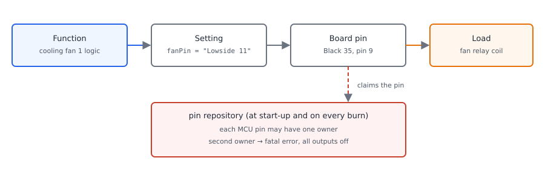
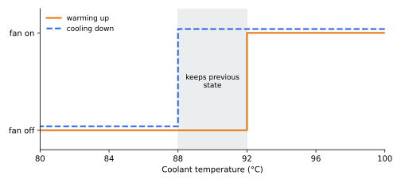

# Outputs and pins

:material-circle:{ .level-basic } Basic → :material-circle:{ .level-advanced } Advanced

> **In one sentence:** an output is a job the ECU has to do — run the fuel pump, switch the cooling fan,
> blink the check engine lamp — and every job names one connector pin that the ECU switches; the firmware
> gives each pin exactly one owner and stops the engine rather than let two jobs fight over it.

## What it does

:material-circle:{ .level-basic } Basic

Injectors and coils get their own chapters. This chapter is about the rest of the wires: the outputs that
run the fuel pump, the cooling fans, the main relay, an external tachometer and the check engine light.
None of them need a feedback sensor: the ECU decides on/off (or a speed, or a pulse train), and drives a
pin.

Almost all of them drive a **relay**. A relay is a small electrically-controlled switch: its *coil* needs
a modest current, and its *contacts* carry the big current the fan or pump actually needs. The ECU only
switches the coil.

<figure markdown>
  
  <figcaption>Figure 1 — There is no separate "pin configuration" step. You set the *output's* pin, in the
  output's own dialog, and the board translates that name into a connector pin.</figcaption>
</figure>

rusEFI has one setting per output, and you set it in the dialog of the feature that uses it:

| Output | Setting | Where TunerStudio asks for it | Proteus F7 factory pin | What it switches |
|---|---|---|---|---|
| Main relay | `mainRelayPin` | **Setup ▸ Outputs** | Lowside 12 · Black35 pin 21 | main relay coil |
| Fuel pump | `fuelPumpPin` | **Setup ▸ Fuel Pump Control** | Lowside 10 · Black35 pin 20 | fuel pump relay coil |
| Cooling fan 1 | `fanPin` | **Setup ▸ Cooling Fans** | Lowside 11 · Black35 pin 9 | fan relay coil |
| Cooling fan 2 | `fan2Pin` | **Setup ▸ Cooling Fans** | not assigned | second fan relay coil |
| Check engine light | `malfunctionIndicatorPin` | **Setup ▸ Check Engine Settings** | not assigned | the MIL bulb, or a lamp relay |
| Tachometer | `tachOutputPin` | **Setup ▸ Outputs** | not assigned | pulses for an analogue tachometer |
| Speedometer | `speedometerOutputPin` | **Setup ▸ Outputs** | not assigned | pulses for a dash or odometer |
| Starter control | `starterControlPin` | **Setup ▸ Outputs** | not assigned | starter relay or solenoid |
| Starter disable | `starterRelayDisablePin` | **Setup ▸ Outputs** | not assigned | starter inhibit relay |
| A/C compressor | `acRelayPin` | **Setup ▸ Air Conditioning** | not assigned | compressor relay |

The factory pins come from the board itself, not from a generic default: the Proteus board code assigns
Lowside 12, 11 and 10 to the main relay, fan and fuel pump as soon as a fresh tune is created. Everything
else on that list starts unassigned, and its feature simply does nothing until you give it a pin.
<!-- src: firmware/config/boards/proteus/board_configuration.cpp (proteus_boardDefaultConfiguration: mainRelayPin, fanPin, fuelPumpPin) -->

Other outputs — boost solenoids, idle valves, VVT solenoids, general-purpose PWM, Lua outputs, TCU
solenoids — are set up in their own chapters' dialogs, but they work the same way: a **Output** field naming
a pin, plus a pin list built from the board's connector files.<!-- src: firmware/config/boards/proteus/connectors/generated_outputs.h (the assignable output pins and the names TunerStudio shows); firmware/tunerstudio/generated/rusefi_proteus_f7.ini (output_pin_e_list) -->

!!! danger "These outputs move real hardware"
    Every button in this chapter energises a real wire. **Test Fuel Pump** pressurises a fuel system: a
    loose line sprays fuel that a hot exhaust will ignite. A fan bench test starts a fan next to your
    fingers and the belt. A starter test turns the engine over. Do the first tests with the engine off,
    the fuel lines and fittings checked, and nothing loose near the fan.

## How it works

:material-circle:{ .level-intermediate } Intermediate

### A setting, not a pin map

rusEFI does not have a screen where you label the connector. Instead:

1. the firmware has one *variable* per output — `fanPin`, `fuelPumpPin`, `mainRelayPin`, …;
2. its value is one of the board's output pins, named by the board's own connector files
   (*Lowside 11*, *Highside 3*, …);
3. the board files say which MCU pin and which connector pin that name is, so *Lowside 11* is Black 35
   pin 9 and nothing else.

The names in the dropdowns are the names on the board's own pinout, which is what makes a wiring mistake
findable.
<!-- src: firmware/config/boards/proteus/connectors/black35.yaml (Lowside 11 = pin 9, Lowside 10 = pin 20, Lowside 12 = pin 21); firmware/config/boards/proteus/connectors/generated_outputs.h (name to MCU pin) -->

### Who owns a pin, and when

Every output the firmware knows about is registered in one list. At start-up, and again every time a new
tune is applied (a **Burn**), the firmware releases the pins whose setting changed and initialises the newly
configured ones — so after changing a pin you burn, and the ECU takes over the new pin without a restart.
A few settings are the exception and say so in their help text: **Control mode**, pins and PWM frequency of
the fuel pump must be burned before the pump is used.
<!-- src: firmware/hw_layer/hardware.cpp (startHardware is called on ECU start and on configuration change and calls enginePins.startPins); firmware/controllers/system/efi_gpio.cpp (EnginePins::unregisterPins, EnginePins::startPins, RegisteredOutputPin::init and unregister, isPinConfigurationChanged); firmware/controllers/modules/fuel_pump/fuel_pump_engineConfiguration.txt (fuelPumpMode help) -->

Each MCU pin may have exactly one owner. When two features are given the same pin, the ECU raises a fatal
error naming both owners and stops driving outputs — the check engine output is the one exception, it is
allowed to go on so the dash tells you something is wrong:

```text
Pin "PB7" (Lowside 11) required by "Fuel pump Relay" but is used by "Fan Relay"
```

rusEFI sorts problems into three sizes, and it matters for outputs:

| Size | What the ECU does | Example here |
|---|---|---|
| warning | keeps running the engine, tells you | an invalid fan PWM frequency: the fan falls back to 250 Hz |
| config error | keeps TunerStudio alive, refuses to run that one subsystem | an output pin requested on a chip the board does not have |
| fatal error | fatal LED on, outputs shut down, engine cannot run | two features claiming one pin; a pin that comes up in the wrong state |
<!-- src: firmware/hw_layer/pin_repository.cpp (brain_pin_markUsed raises the two-owners critical error naming both), firmware/controllers/system/efi_gpio.cpp (turnAllPinsOff lets checkEnginePin go ON), firmware/controllers/core/error_handling.h (the warning / configError / firmwareError levels and criticalShutdown), firmware/controllers/modules/fan_control/fan_control.cpp (invalid PWM frequency falls back to 250 Hz with a warning) -->

### Output mode: which way round the pin is

Next to most **Output** fields is **Output mode**, with four choices:
*default*, *default inverted*, *open collector*, *open collector inverted*. "Inverted" means the ECU's
logical decision and the electrical level on the pin are opposite: a logical "on" leaves the pin off and a
logical "off" drives it. Use it when the load is wired to the plus side instead of to ground, or when an
external driver inverts the signal. Open-collector modes drive only in one direction, for loads that
provide their own pull-up.

Before it enables an output, the firmware sets the pin to its resting level, then reads it back to confirm
it really is there. If the pin comes up wrong — shorted to plus, or driven by something else — it raises
*"HARDWARE VALIDATION FAILED"* and releases that output rather than hold it.
<!-- src: firmware/tunerstudio/tunerstudio.template.ini (pin_output_mode_e_enum: default, default inverted, open collector, open collector inverted); firmware/controllers/system/efi_gpio.h (getElectricalValue macros), firmware/controllers/system/efi_output.h (OutputPin::initPin and setDefaultPinState), firmware/controllers/system/efi_gpio.cpp (rest state before enabling; the startup state self-check) -->

!!! info "Advanced"
    The pin is claimed once, under one name. A feature that drives the same pin with PWM — the fan in PWM
    mode, the fuel pump in pressure-control mode, the tachometer — starts its PWM on the pin that the
    generic registration already claimed, precisely so the ownership check does not see two owners.
    <!-- src: firmware/controllers/modules/fan_control/fan_control.cpp (initPwm comment: do not re-initPin under a second name), firmware/controllers/modules/tachometer/tachometer.cpp (startSimplePwm on enginePins.tachOut) -->

## The output pins of a Proteus F7

:material-circle:{ .level-basic } Basic

<figure markdown>
  
  <figcaption>Figure 2 — A low-side output completes the load's ground path; a high-side output supplies
  plus to it. On Proteus the high-side drivers are fed from Black23 pin 23, so they are dead until the
  main relay closes.</figcaption>
</figure>

Proteus has three kinds of output on Black 35, and the board's own names tell you what each is for:

| Pins | Black 35 connector pins | What the board files call them |
|---|---|---|
| Lowside 1 … Lowside 9 | 3, 15, 4, 16, 5, 6, 7, 19, 8 | injector outputs 1–9 |
| Lowside 10, 11, 12 | 20, 9, 21 | "Injector #10 or Fuel Pump relay", "Injector #11 or radiator fan relay", "Injector #12 or Main relay" |
| Lowside 13 … Lowside 16 | 10, 11, 12, 23 | low-side outputs *with flyback*; Lowside 14 is also offered as the starter output |
| Highside 1 … Highside 4 | 2, 1, 13, 14 | general high-side outputs (Highside 1 = pin 2, Highside 2 = pin 1) |
| Ign 1 … Ign 12 | 35, 34, 22, 33, 32, 31, 30, 29, 28, 27, 26, 25 | smart ignition coil drivers; usable as outputs for other jobs |
<!-- src: firmware/config/boards/proteus/connectors/black35.yaml (pin numbers, ts_name, type and the function text of every output pin) -->

Three consequences of that table:

- **Lowside 13–16 are the easy relay outputs.** The board marks them *with flyback*: when the ECU stops
  conducting, the coil's current has somewhere to go. A relay coil hung on another kind of output still
  needs its own diode across the coil, band to the plus side.
- **Lowside 10–12 are shared with injection.** They exist as injector outputs 10–12 on a V12. Assign the
  fuel pump, fan or main relay to them only if your cylinder count does not need those injectors; if two
  features end up owning one of them the ECU will tell you, not let you find out on the road.
- **High-side outputs need their supply.** Black23 pin 23 is the "power supply from main relay" input, and
  the board files state that it supplies the electronic throttle drivers and the high-side outputs. Wire
  it to your main relay's switched output, or Highside 1…4 do nothing at all.
<!-- src: firmware/config/boards/proteus/connectors/black23.yaml (pin 23 function text: supplies ETB drivers and high side outputs) -->

White 35 pins 11 and 12 are 12 V outputs for sensors, protected on the board; they are not software
outputs and never appear in an **Output** list. Six further assignable pins are offered under the names
*STM32 PD8* … *STM32 PD13*; they are raw MCU pins with no relay-rated driver behind them, and belong to
signal-level jobs only.
<!-- src: firmware/config/boards/proteus/connectors/white35.yaml (12V protected output for sensors, pins 11 and 12, with no pin id and no ts_name); firmware/config/boards/proteus/connectors/black23.yaml (PD8…PD13 entries); firmware/config/boards/proteus/connectors/generated_outputs.h -->

!!! warning "A relay coil is not a lamp"
    A fan or pump relay coil is what these outputs expect. Driving a solenoid, an injector or a big lamp
    directly from an output the board does not rate for it will kill the driver — and the ECU will not
    warn you before it happens, only after. Use a relay, or the driver the load was designed for.

## Before you start

:material-circle:{ .level-basic } Basic

- **12 V, ignition on — not USB.** Everything here is judged against the ignition input, and the fuel pump
  and main relay follow it. With only USB connected the ECU runs but never sees ignition, so it will look
  as if the outputs are dead.
  <!-- src: firmware/controllers/ignition_controller.cpp (isIgnVoltage: digital ignition input if assigned, otherwise IgnKeyVoltage or battery voltage above 6 V) -->
- **Battery sense must be fed.** Black23 pin 18 is *Battery Sense*: "connect this pin to the output of
  your ignition switch". Without it the ECU cannot decide that the ignition is on.
  <!-- src: firmware/config/boards/proteus/connectors/black23.yaml (pin 18 Battery Sense) -->
- **Grounds.** Black35 pins 17, 18 and 24 and Black23 pins 14, 19 and 20 are power/chassis ground. An
  output switching to ground only works if the load's ground path returns to those.
  <!-- src: firmware/config/boards/proteus/connectors/black35.yaml (ground pins 17/18/24); firmware/config/boards/proteus/connectors/black23.yaml (ground pins 14/19/20) -->
- **Engine stopped, fuel and fan checked.** The bench tests in this chapter drive the outputs directly.

## Setting it up

:material-circle:{ .level-basic } Basic → :material-circle:{ .level-intermediate } Intermediate

### 1 · Read the pin map you already have

**Controller ▸ Full pinout - Output** is not where you configure features — it is a one-screen overview of
every output setting the tune holds, put there to catch conflicts. Open it and look for two features
pointing at the same pin before you start.

<!-- shot: img/ts/outputs-full-pinout.png | Controller ▸ Full pinout - Output | Proteus F7, ignition on, engine stopped, factory tune: Tachometer output Fuel Pump output Lowside 10, Fan Pin Lowside 11, Main Relay Pin Lowside 12, Starter Control Pin unassigned, all dropdowns closed | The Full pinout - Output overview: every output setting in one place, which is how a double-assigned pin gets found. -->

### 2 · Assign the fuel pump

Open **Setup ▸ Fuel Pump Control** and check the **Fuel Pump** panel:

- **Control mode** `fuelPumpMode` — *Single relay* is the normal choice; the pump is one relay, on or off.
- **Output** `fuelPumpPin` — on Proteus leave the factory *Lowside 10* (Black35 pin 20) unless your wiring
  says otherwise.
- **Output mode** `fuelPumpPinMode` — *default* for a relay coil switched to ground.
- **Prime duration** `startUpFuelPumpDuration` — how long the pump runs when the ignition comes on, before
  you crank: the factory 4 seconds builds pressure in a normal road-car tank and line set.

The right-hand **Status** panel shows what the pump is doing, and **Test Fuel Pump** energises the output
for three seconds.

<!-- shot: img/ts/outputs-fuel-pump.png | Setup ▸ Fuel Pump Control | Proteus F7, ignition on for under four seconds so priming is still active, engine stopped, Control mode Single relay, Output Lowside 10, Output mode default, Prime duration 4 seconds, Status panel with the *Pump requested* indicator lit, dropdowns closed | Fuel Pump Control with the factory single-relay setup; the pump indicator is lit here because the shot is taken inside the four-second prime. -->

What the firmware does with it: the pump comes on for the prime duration after the ignition is detected,
and stays on while the trigger wheel says the engine is moving. If the engine stops, the pump stops. If the
firmware has any fatal error, the pump is switched off.
<!-- src: firmware/controllers/modules/fuel_pump/fuel_pump.cpp (FuelPumpController::onSlowCallback: isPrime from startUpFuelPumpDuration, engineTurnedRecently, hasFirmwareError); firmware/controllers/algo/defaults/default_base_engine.cpp (startUpFuelPumpDuration 4 s) -->

!!! danger "Fuel under pressure"
    Check every line, fitting and clamp before the first prime. A pinhole in a hot fuel line is an engine
    fire. Prime with the exhaust already hot enough to ignite fuel, and anyone standing by the car
    understands that the pump may run the moment the ignition goes on.

### 3 · Assign the main relay

Open **Setup ▸ Outputs** and set the **Main relay output** panel: **Output** `mainRelayPin` (Proteus factory:
Lowside 12, Black35 pin 21), **Output mode**, and **Main Relay Disable Time** `mainRelayDisableTime`
(default 1 s). **Test Main Relay** pulses it.

<!-- shot: img/ts/outputs-main-relay.png | Setup ▸ Outputs | Proteus F7, ignition on, engine stopped, Main relay output panel: Output Lowside 12, Output mode default, Main Relay Disable Time 1, Test Main Relay button visible, dropdowns closed | The main relay half of the Outputs dialog: the relay follows the ignition input, so the only decisions here are which pin and how long it stays in. -->

The main relay is not a switch you control from the dashboard — it follows the ignition input. The relay is
on while the ECU sees ignition voltage, plus for **Main Relay Disable Time** after it disappears. That
delay is deliberate: the voltage of a cranking engine dips hard, and the relay must not drop out at the
moment the starter loads the battery.
<!-- src: firmware/controllers/actuators/main_relay.cpp (MainRelayController::onSlowCallback: mainRelayState = hasIgnitionVoltage or a requested delayed shutoff; needsDelayedShutoff uses mainRelayDisableTime); firmware/controllers/algo/defaults/default_base_engine.cpp (mainRelayDisableTime 1 s); firmware/controllers/ignition_controller.cpp (isIgnVoltage) -->

!!! warning "Wire the main relay around itself"
    On a typical Proteus installation the main relay's switched output feeds **Black23 pin 23**, which
    powers the high-side drivers and the throttle drivers, and feeds the injectors and coils. If you test
    the main relay output before that wire is in place, the high-side outputs and the throttle drivers have
    no supply and everything downstream of the relay looks dead.

### 4 · Assign the cooling fan

Open **Setup ▸ Cooling Fans**. **Fan 1** and **Fan 2** panels side by side, a **Status** column between them,
and **Test Fan 1** / **Test Fan 2** along the bottom (fan 1 is held on two seconds, fan 2 three).

<!-- shot: img/ts/outputs-cooling-fans.png | Setup ▸ Cooling Fans | Proteus F7, ignition on, engine warm and idling, Fan 1 panel: Output Lowside 11, Output mode default, A/C control mode Disabled, Disable when engine stopped no, Disable above vehicle speed 0, Idle adder 0, Fan 1 On/Off panel On temperature 92 Off temperature 88, Enable PWM mode no, Status column with the hot and On indicators lit for a warm idling engine, Fan 2 column with Output unassigned, dropdowns closed | Cooling Fans: both fans' settings, the status column that says why a fan is running, and the two test buttons along the bottom. -->

For an on/off fan relay, on Proteus, **Output** *Lowside 11* (Black35 pin 9) with **Output mode**
*default* is the factory wiring; *Lowside 13* (Black35 pin 10) is a good free choice with a fan relay coil
across it. Then:

- **On temperature** `fanOnTemperature` — factory 92 °C, **Off temperature** `fanOffTemperature` — factory
  88 °C. The fan comes on above the first, off below the second, and between them it keeps doing what it
  was doing. Without that gap a fan would chatter on and off every few seconds.
- **Disable when engine stopped** `disableFan1WhenStopped` — factory *no*: a stopped hot engine keeps its
  fan running. Set *yes* if you want the fan to run only with the engine running.
- **Disable above vehicle speed** `disableFan1AtSpeed` — factory 0 (check disabled). Above that road speed
  the fan is inhibited because the airflow is enough, with **Disable speed hysteresis** (factory 5) letting
  it back on once you have slowed.
- **Idle adder** `fan1ExtraIdle` — factory 0. When the fan is running, the idle controller opens the
  throttle this much more so the extra drag does not disturb idle; see the Idle chapter.
- **A/C control mode** `fan1AcMode` — *Relay* runs the fan whenever the A/C compressor is commanded on,
  *Pressure* uses an A/C pressure sensor instead of the compressor request.

<figure markdown>
  
  <figcaption>Figure 3 — Fan 1's factory on/off pair, 92 °C on and 88 °C off. The band between them holds
  the previous state, which is what stops the fan cycling.</figcaption>
</figure>
<!-- src: firmware/controllers/modules/fan_control/fan_control.cpp (FanController::getState: hot above fanOnTemperature, cold below fanOffTemperature, otherwise keeps the last state; setDefaultConfiguration: 92/88 and 95/91, disableFan1AtSpeedHysteresis 5), firmware/controllers/modules/fan_control/fan_control.h (FanControl1::getPin: enginePins.fanRelay) -->

The fan has fixed priorities over its own wishes. It is held off while the engine is cranking, while the
engine is stopped if you asked for that, and above the disable-at-speed threshold, whatever the coolant
temperature says. A failed coolant sensor sends the fan **on** — an ECU that cannot read the temperature runs
the fan rather than risk overheating.
<!-- src: firmware/controllers/modules/fan_control/fan_control.cpp (isHardInhibited: cranking, engine stopped, vehicle too fast, board status; getState: brokenClt forces the fan on) -->

### 5 · Assign the check engine light

Open **Setup ▸ Check Engine Settings**. Set **Output** `malfunctionIndicatorPin` (unassigned at factory) to
a high-side output for a 12 V bulb, or to a flyback-protected low-side output for a lamp relay coil, and
**Output mode** to match. Then **Test Check Engine** blinks the lamp for sixteen seconds — long enough to
walk around to the dashboard.

<!-- shot: img/ts/outputs-check-engine.png | Setup ▸ Check Engine Settings | Proteus F7, ignition on, engine stopped, Settings panel: Output Highside 1, Output mode default, Minimum battery voltage 6.0 Maximum battery voltage 18.0, Minimum MAP voltage 0.2 Maximum MAP voltage 4.80, IAT and TPS limits at 0.2 and 4.80, Test Check Engine button, the raw voltage readouts on the right, dropdowns closed | Check Engine Settings: the lamp pin on the left and the four voltage range monitors that decide when to light it. -->

With a pin assigned, the lamp is solid **on** with the ignition on and the engine stopped, and off while a
healthy engine runs. When there are stored error codes it blinks them out digit by digit: five seconds
steady first, a two-second pause, then one more flash than the digit's value for each digit, two seconds
between codes.
<!-- src: firmware/controllers/modules/malfunction_indicator/malfunction_indicator.cpp (MILController::onSlowCallback: setLamp while the engine is stopped with no codes; PreludeMs 5000, CodeGapMs 2000; startDigit: digit plus one pulses), firmware/controllers/bench_test.cpp (milBench: 500 ms on, 500 ms off, 16 pulses) -->

The same dialog also sets four range monitors — **Minimum/Maximum battery voltage** (default 6.0 / 18.0 V),
and the raw voltage limits for MAP, IAT and TPS (default 0.2 / 4.8 V each). A reading outside its window for
one second raises an error code, which then lights the lamp and appears in the log. That is the ECU's cheap
way of catching a cut sensor wire.
<!-- src: firmware/controllers/modules/check_engine_light/check_engine_light.cpp (CheckEngineLight::setDefaultConfiguration: 6.0/18.0 and 0.2/4.8; updateRange with a one-second debounce), firmware/controllers/modules/check_engine_light/check_engine_config.txt (the cel_* fields and units) -->

### 6 · Assign the tachometer

Analogue tachometers count pulses, so the ECU has to produce the pulse rate the gauge expects. In **Setup ▸
Outputs**, the **Tachometer output** panel:

- **Output** `tachOutputPin` and **Output mode** — any output pin; a 12 V tach wants a high-side output, and
  *Lowside 15* works for a gauge that expects a switched-ground signal.
- **Pulse per Rev** `tachPulsePerRev` — factory 1. The output frequency is
  **RPM × Pulse per Rev ÷ 60** hertz, counted against crank revolutions, so at 3000 RPM with 2 the pin
  outputs 100 Hz. Set this to whatever your tachometer is calibrated for.
- **Pulse Mode** `tachPulseDurationAsDutyCycle` — *Constant time* keeps the pulse a fixed length in
  milliseconds (factory 0.5 ms); *Duty cycle* makes it a fixed percentage of the period.
- **Pulse duration** `tachPulseDuractionMs` — the 0.5 ms or the percentage, depending on the mode above.

The ECU refuses a **Pulse per Rev** of 0 or above 10 with a fatal error, and stops the output rather than
run it below 1 Hz.
<!-- src: firmware/controllers/modules/tachometer/tachometer.cpp (TachometerModule::onFastCallback: period from 60000/RPM divided by tachPulsePerRev, firmwareError for 0 or above 10, stop below 1 Hz; init: startSimplePwm on enginePins.tachOut); firmware/controllers/algo/defaults/default_base_engine.cpp (tachPulseDuractionMs 0.5, tachPulsePerRev 1); firmware/integration/rusefi_config.txt (tachPulsePerRev range and tachPulseDurationAsDutyCycle) -->

<!-- shot: img/ts/outputs-tach.png | Setup ▸ Outputs | Proteus F7, ignition on, engine stopped, Tachometer output panel: Output Lowside 15, Output mode default, Pulse Mode Constant time, Pulse duration 0.50, Pulse per Rev 2, Main relay and fuel pump panels visible alongside, dropdowns closed | The Tachometer output panel with a two-pulse-per-revolution setting. -->

### 7 · Prove every output: bench tests

Each test button lives in the dialog that owns the output: **Test Main Relay** in **Setup ▸ Outputs**,
**Test Fuel Pump** in **Setup ▸ Fuel Pump Control**, **Test Fan 1** and **Test Fan 2** in
**Setup ▸ Cooling Fans**, **Test Check Engine** in **Setup ▸ Check Engine Settings**.
**Controller ▸ Bench test** holds the rest of the bench tests and the **Count**, **On Time** and **Off Time**
fields used by the pulsing ones.

A bench test owns the pin for its duration: while a test is running the ECU ignores every command that the
feature itself sends to that output, so what you see is the pin, not the feature's decision. The fuel pump
holds for three seconds, the main relay for one second, fan 1 for two seconds, fan 2 for three seconds, and
the check engine lamp blinks at 1 Hz sixteen times. A working test therefore proves the output stage, the
wiring and the load — and nothing about the sensor that normally triggers it.
<!-- src: firmware/controllers/system/efi_gpio.cpp (OutputPin::setValue ignores the feature's command while getOutputOnTheBenchTest is this pin); firmware/controllers/bench_test.cpp (pinbench, fuelPumpBench, mainRelayBench, fanBench/fan2Bench, milBench); firmware/controllers/generated/rusefi_generated_proteus_f7.h (BENCH_FAN_DURATION 2000, BENCH_FUEL_PUMP_DURATION 3000, BENCH_MAIN_RELAY_DURATION 1000) -->

<!-- shot: img/ts/outputs-bench-test.png | Controller ▸ Bench test | Proteus F7, ignition on, engine stopped, dialog open with the Misc panel showing the A/C Relay and idle valve buttons, the Count 3, On Time and Off Time fields of the other panel visible, all pin dropdowns closed | The Bench Test & Commands dialog: the pulsing tests use its Count, On Time and Off Time fields. -->

!!! warning "Bench tests ignore the safety logic"
    A test drives the pin while the feature's own gating is bypassed. Never test a starter output with a
    gear engaged, never test the fuel pump with a line open, and do not leave a test running on a coil-type
    load: the output is held on, not pulsed at its working rate.

## Worked examples

:material-circle:{ .level-intermediate } Intermediate

### Example 1 — four-cylinder, one fan, analogue tachometer

A naturally aspirated 2.0 litre four with a in-tank pump on a relay, one electric fan on a relay, a 12 V
check-engine bulb and an analogue tachometer that wants two pulses per revolution:

| Setting | Value | Why |
|---|---|---|
| Main relay — **Output** | Lowside 12 (Black35 pin 21) | the factory choice; it doubles as injector 12, which a four-cylinder does not need |
| Main relay — **Main Relay Disable Time** | 1 s | factory value is enough for a normal cranking voltage dip |
| Fuel pump — **Control mode** / **Output** | Single relay / Lowside 10 | factory; relay coil to ground |
| Fuel pump — **Prime duration** | 4 s | fills the lines before the first crank |
| Fan 1 — **Output** | Lowside 11 (Black35 pin 9) | factory |
| Fan 1 — **On / Off temperature** | 98 / 92 °C | this engine runs 91 °C; the 6 °C gap keeps the fan off at warm idle and stops cycling |
| Fan 1 — **Disable when engine stopped** | no | the fan must still cool a hot stationary engine |
| Fan 1 — **Disable above vehicle speed** | 60 km/h (37 mph) | on the highway airflow does the work |
| Fan 1 — **Idle adder** | 2 % | the fan's drag costs a few idle rpm |
| Check engine — **Output** | Highside 1 (Black35 pin 2), mode *default* | a 12 V bulb needs the plus side; Highside 1 is fed from Black23 pin 23 |
| Tachometer — **Output** | Lowside 15 (Black35 pin 12) | flyback-marked and free on a four |
| Tachometer — **Pulse per Rev** | 2 | the gauge is calibrated for 2; at 3000 RPM the pin outputs 100 Hz |
| Tachometer — **Pulse Mode / duration** | Constant time / 0.50 ms | factory values suit a pulse-counting gauge |

Every pin above is free on a four-cylinder, and none of them collides with an injector or coil output.

### Example 2 — two fans, one of them PWM, with A/C assistance

A turbo engine with a primary fan and a smaller secondary fan, an A/C system whose compressor relay the ECU
controls, and a fan speed controller that accepts a 250 Hz PWM command:

| Setting | Value | Why |
|---|---|---|
| Fan 1 — **Output** | Lowside 11 (Black35 pin 9) | factory |
| Fan 1 — **Enable PWM mode** | yes | the fan has a speed controller, not just a relay |
| Fan 1 — **PWM frequency** | 250 Hz | factory value and the controller's input rate |
| Fan 1 — **PWM duty for fan OFF / FULL speed** | 0 % / 100 % | the straight case; if your controller wants an inverted command, put 100 and 0 and the firmware interpolates the other way |
| Fan 1 — **Soft-start time** | 2 s | ramps the demand, so the fan does not stamp on at full speed and stress the wiring |
| Fan 1 — **A/C control mode** | Relay | the fan goes to full demand whenever the compressor is commanded |
| Fan 2 — **Output** | Lowside 13 (Black35 pin 10) | flyback-marked, free on a four-cylinder |
| Fan 2 — **On / Off temperature** | 95 / 91 °C | factory second-fan pair: the second fan joins later |
| Fan 2 — **A/C control mode** | Pressure, on 1800 kPa / off 1400 kPa | needs an A/C pressure sensor; the fan follows head pressure whether or not the compressor is engaged |

In PWM mode the **On temperature** / **Off temperature** fields are not used at all — the **Fan 1 Speed
Demand Curve** (**Setup ▸ Fan 1 Speed Demand Curve**, visible only with PWM mode on) is the whole story:
factory bins run 0 % at 80 °C up to 100 % at 110 °C for fan 1, and 85→115 °C for fan 2.
<!-- src: firmware/controllers/modules/fan_control/fan_control.cpp (onSlowCallbackPwm: the curve is the only source of speed demand, soft-start slew in demand space, min/max duty interpolation, AC and pressure taking the maximum demand), firmware/controllers/modules/fan_control/fan_control_engineConfiguration.txt (fan1PwmEnabled, fan1TempBins, fan1PwmValues, fan1MinPwm/fan1MaxPwm, fan1AcMode help) -->

<!-- shot: img/ts/outputs-fan-demand-curve.png | Setup ▸ Fan 1 Speed Demand Curve | Proteus F7, ignition on, engine stopped, Fan 1 PWM mode enabled so the menu entry exists, curve at factory: 8 bins from 80 to 110 degrees C and demand 0 to 100 percent, the three Fan 1 PWM status gauges alongside showing speed target, speed applied and duty | The Fan 1 Speed Demand Curve: in PWM mode this curve, not the on and off temperatures, decides fan speed. -->

!!! danger "A pressure-controlled pump is a closed loop on a flammable system"
    **PWM pressure control** (`fuelPumpMode`) regulates low fuel pressure with a PID from a low pressure
    sensor. It needs a pump and driver rated for PWM at the frequency you set, a working pressure sensor,
    and the duty limits (**Minimum active duty**, **Maximum / prime duty**) set before you enable it. With a
    failed pressure sensor the pump falls back to its open-loop map and then to the minimum duty — check the
    pressure gauge by hand at rest, at idle and at load before trusting it on the road.
    <!-- src: firmware/controllers/modules/fuel_pump/fuel_pump.cpp (FuelPumpController::onFastCallback: observePlant, getOpenLoop, getClosedLoop; setOutput clamps to min/max duty), firmware/controllers/modules/fuel_pump/fuel_pump_engineConfiguration.txt (fuelPumpPwmFrequency help: use a compatible pump controller or power driver and its specified frequency) -->

### Example 3 — the check engine lamp and a spare output

If you have no check-engine bulb, leave `malfunctionIndicatorPin` unassigned: the ECU still reports the
logical state on the **checkEngine** output channel, and TunerStudio's front page shows "Check Engine". You
lose nothing but the bulb — and the lamp blinking out stored codes is a diagnostic you can replace by
reading the codes in TunerStudio.

A high-side output with nothing else to do makes a good 12 V accessory output. rusEFI has no
"switch this on when…" rule builder for the named outputs above: for a custom rule, use one of the
general-purpose outputs — a general-purpose PWM channel, an auxiliary valve output or a Lua output — driven
from a Lua script (see the Lua scripting chapter), rather than reassigning a fuel pump or fan pin.
<!-- src: firmware/integration/rusefi_config.txt (auxValves Gpio array, gppwm pin fields and the Lua output pins); firmware/controllers/actuators/gppwm/ (general-purpose PWM channels) -->

## Tuning the behaviour of an output

:material-circle:{ .level-intermediate } Intermediate → :material-circle:{ .level-advanced } Advanced

**Fan thresholds.** Log **Coolant temperature**, **fan1m_state** and **fan1radiatorFanStatus** on a hot day
in traffic. The fan should come on once, run until the temperature has fallen back through the *off*
threshold, and stay off. If it cycles in one–two second bursts, widen the gap (the *off* threshold is what
to lower, not the *on* one to raise). If it comes on too early for the A/C's sake, use the A/C mode instead
of lowering the temperature thresholds.
<!-- src: firmware/controllers/modules/fan_control/fan_control.cpp (getState, onSlowCallbackPwm); firmware/console/binary/output_channels.txt (fan1-prefixed fan channels) -->

**Fan and idle interact.** A big fan starting at idle loads the engine and the idle controller reacts. Set
the fan's **Idle adder** to compensate at the point the fan joins rather than raising the idle target for
the whole warm-up, and set **On temperature** above the idle target's temperature band if you can.

**PWM fans with inverted commands.** **PWM duty for fan OFF** may be numerically larger than **PWM duty for
fan FULL speed**: the firmware interpolates between the two in either order, precisely so an inverting
driver stage (a transistor plus pull-up, where a high duty means "off") can be described without inverting
the whole output. Check which way round your fan controller's command is before driving it at 100 % demand.
<!-- src: firmware/controllers/modules/fan_control/fan_control.cpp (pwmAppliedPwm = minPwm + demand × (maxPwm − minPwm); the comment on min > max for inverting hardware), firmware/controllers/modules/fan_control/fan_control_engineConfiguration.txt (fan1MinPwm help) -->

**Fuel pump modes.** In *Dual relay* mode the second pump joins only when **Activation RPM**,
**Activation load** and **Activation TPS** are all exceeded together, and it drops out when any one of them
falls below its threshold minus its hysteresis — factory 3000 rpm, load 100, TPS 50 %, releasing 500 rpm /
10 / 10 % earlier. Do not set a dual-pump threshold you cannot verify on the road: the point is to add flow
at high load, not to double the flow at idle.
<!-- src: firmware/controllers/modules/fuel_pump/fuel_pump.cpp (updateDualRelay: all three thresholds and their hystereses); firmware/controllers/modules/fuel_pump/fuel_pump_engineConfiguration.txt (secondaryFp* fields and defaults in setDefaultConfiguration) -->

<!-- shot: img/ts/outputs-fuel-pump-dual.png | Setup ▸ Fuel Pump Control | Proteus F7, ignition on, engine stopped, Control mode Dual relay so the Secondary relay panel is visible: Output Lowside 13, Output mode default, Activation RPM 3000, Activation load 100, Activation TPS 50, RPM hysteresis 500, load and TPS hysteresis 10, dropdowns closed | Dual relay mode stages a second pump on RPM, load and throttle angle together. -->

<!-- shot: img/ts/outputs-fuel-pump-pwm.png | Setup ▸ Fuel Pump Control | Proteus F7, ignition on, engine stopped, Control mode PWM pressure control so the PWM panel is visible: PWM frequency 100, Minimum active duty 0, Maximum / prime duty 100, P gain 0.1, I and D gain 0, Minimum PID correction -50 Maximum 50, integral limits -30 and 30, Low-demand pressure relief off, Status panel with the low pressure gauge and Fuel pressure target gauge, dropdowns closed | PWM pressure control replaces the relay's on/off with a pressure loop; the duty limits are the safety net. -->

**Tachometer pulse width.** A pulse-counting gauge cares only about the rate. A needle-damping gauge or an
optocoupler input may want a wider pulse: switch **Pulse Mode** to *Duty cycle* and set a percentage so the
pulse stays a fixed fraction of the period at every engine speed.

## Diagnostics

:material-circle:{ .level-intermediate } Intermediate

The two messages to recognise on this chapter's topics:

| Message | Means | Fix |
|---|---|---|
| `Pin "…" (…​) required by "Fan Relay" but is used by "Fuel pump Relay"` | two features own one pin; fatal, outputs shut down | unassign one of them in its dialog, burn |
| `HARDWARE VALIDATION FAILED …​: unexpected startup pin state` | the output could not be set to its resting level; that output was released | the load is held by other wiring, or the pin is also wired somewhere else |
<!-- src: firmware/hw_layer/pin_repository.cpp (brain_pin_markUsed message), firmware/controllers/system/efi_gpio.cpp (the startup state check), firmware/controllers/algo/obd_error_codes.h (CUSTOM_OBD_PIN_CONFLICT) -->

The feature names in the first message are the firmware's own names for the outputs — "Fan Relay",
"Fuel pump Relay", "Main Relay", "checkEnginePin", "tachOut" — which map to `fanPin`, `fuelPumpPin`,
`mainRelayPin`, `malfunctionIndicatorPin` and `tachOutputPin`.
<!-- src: firmware/controllers/system/efi_gpio.cpp (the EnginePins constructor: registration names and their settings by naming convention) -->

The **Cooling Fans** dialog's **Status** column shows why a fan is doing what it is doing: the cranking,
engine-stopped, above-hot-threshold, below-cold-threshold, broken-CLT, A/C and disabled-by-speed indicators
light up as each condition becomes true, and **On** shows the result. **View ▸ fan_control0** shows the same
flags plus the fan's speed demand in PWM mode.

Channels worth putting in your log:

| Channel | Shows |
|---|---|
| `checkEngine` | the MIL's logical state, with or without a pin assigned |
| `mainRelayState` | what the main relay output is commanded to do |
| `isFuelPumpOn`, `isSecondaryPumpOn`, `fuelPumpDuty`, `fuelPressureTarget` | the pump's state and, in PWM mode, its duty and target |
| `fan1m_state`, `fan1radiatorFanStatus` | fan 1 on/off, and which rule decided |
| `fan1hot`, `fan1cold`, `fan1brokenClt`, `fan1disabledWhileEngineStopped`, `fan1disabledBySpeed`, `fan1enabledForAc` | one flag per condition |
| `fan1fanSpeedTarget`, `fan1fanSpeedApplied`, `fan1pwmAppliedPwm` | in PWM mode: demand before the soft-start ramp, after it, and the raw duty on the pin |
| `isFpPidActive`, `isFpReliefActive` | whether the fuel-pressure loop and the pressure relief are working |
<!-- src: firmware/console/binary/output_channels.txt (checkEngine and the fan and fuel pump state fields); firmware/controllers/modules/fan_control/fan_control.txt (the fan state fields and their live-data names); firmware/controllers/modules/fuel_pump/fuel_pump_control.txt (isFuelPumpOn, isSecondaryPumpOn, fuelPumpDuty, fuelPressureTarget); firmware/controllers/actuators/main_relay.txt (mainRelayState) -->

To see which feature owns a pin *right now*, including features whose dialog is buried in another chapter,
read the ECU's pinout. This is done in the rusEFI console: its pinout view marks each connector pin with
its owner, taken from the ECU rather than from the tune file.
<!-- src: java_console/ui/src/main/java/com/rusefi/ui/PinoutPane.java (the console's connector pinout view); firmware/controllers/system/efi_gpio.cpp (EnginePins::debug lists every registered output and its state) -->

## Troubleshooting

:material-circle:{ .level-basic } Basic → :material-circle:{ .level-advanced } Advanced

| Symptom | Likely cause | Check |
|---|---|---|
| Nothing happens on any output, ECU otherwise alive | ignition is never detected: Black23 pin 18 unfed, or USB power only | **View ▸ main_relay** shows *Has IGN voltage*; the ignition wiring |
| Main relay clicks, then drops out when cranking starts | **Main Relay Disable Time** too short for the voltage dip, or the battery sense input is downstream of the relay it drives | raise the disable time; check what feeds Black23 pin 18 and pin 23 |
| Fan never runs | pin unassigned, or **Disable when engine stopped** is on and the engine is not running, or the temperature has not passed the on threshold | the fan's **Status** indicators |
| Fan runs the moment the ignition comes on | coolant sensor broken or unplugged — the fan-on fail-safe | **brokenClt** indicator; sensor wiring and calibration |
| Fan chatters on and off every few seconds | on/off thresholds too close together | widen the gap by lowering **Off temperature** |
| Fan runs at 100 % and the demand curve does nothing | PWM mode is off, so the on/off pair rules | **Enable PWM mode**, and the curve dialog |
| Fan at half speed when you want full, or the reverse | min/max PWM duties reversed for your driver | **PWM duty for fan OFF** / **FULL speed** order |
| Fuel pump runs only for the prime, then stops | the pump stays on only while the trigger wheel says the engine is moving — with the engine stopped that is correct behaviour, so the real question is why there are no trigger events | log **isFuelPumpOn**; the Trigger chapter for the trigger wheel itself |
| Fuel pump keeps running with the engine off | **Main Relay Disable Time** extended, or a module asking for delayed shutoff | log **isFuelPumpOn**; the pump always shuts off on a fatal error |
| Pump and fan both dead at once | one pin assigned to both, so the ECU raised a fatal error | the two-owners message; **Controller ▸ Full pinout - Output** |
| High-side outputs do nothing at all | Black23 pin 23 has no supply, so the high-side drivers are unpowered | the main relay wiring |
| Tachometer reads half (or twice) the real rpm | **Pulse per Rev** does not match the gauge's calibration | set it to what the gauge expects; verify with the 100 Hz at 3000 rpm calculation |
| Tachometer needle jittery at low rpm | 0.5 ms pulses are too narrow for the gauge | **Pulse Mode** *Duty cycle* with a wider pulse |
| Check engine lamp stays on with a healthy engine | the lamp is unassigned but codes exist and you are reading the **checkEngine** channel, or a range monitor is tripped | read the stored codes; review **Minimum/Maximum … voltage** limits |
| Check engine lamp blinks when you did nothing | it is blinking out the stored codes on purpose | stop and read the codes in TunerStudio |
| A test button does nothing | the output has no pin assigned: the test drives an unassigned output | assign the pin and burn |

## Settings reference

### Outputs (Setup ▸ Outputs)

Main relay, fuel pump, tachometer, starter control, starter disable and speedometer outputs.

--8<-- "reference/settings/_outputsDialog.table.md"

### Fuel Pump Control (Setup ▸ Fuel Pump Control)

--8<-- "reference/settings/_fuelPumpSettings.table.md"

### Cooling Fans (Setup ▸ Cooling Fans)

Fan 1 and Fan 2, including their On/Off and PWM panels. The **Fan 1 Speed Demand Curve** and **Fan 2 Speed
Demand Curve** dialogs hold the 8-point temperature→speed curves and have no scalar settings.

--8<-- "reference/settings/_fanSettings.table.md"

### Check Engine Settings (Setup ▸ Check Engine Settings)

--8<-- "reference/settings/_malfunctionDialog.table.md"

### Bench test (Controller ▸ Bench test)

--8<-- "reference/settings/_ioTest.table.md"

### Full pinout - Output (Controller ▸ Full pinout - Output)

Every output setting in one table — useful as the pin map of a tune.

--8<-- "reference/settings/_allPinsOutputs.table.md"

## Related

- Part II — wiring outputs and relay coils: fusing, flyback diodes, ground paths
- Fuel — the pump's place in the fuel system, pressure sensors and the pressure target table
- Idle — the fan and A/C idle adders
- Electronic throttle — the A/C and fan inputs, and the throttle-body supply on Black23 pin 23
- Sensors and calibration — why a failed coolant sensor runs the fan
- Limits and engine protection — fatal errors, warnings and what each one shuts down
- Lua scripting — driving outputs from custom logic
- Controller settings — the full pinout dialogs and status LEDs
