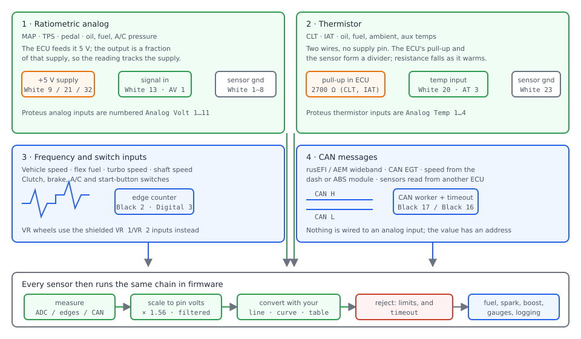
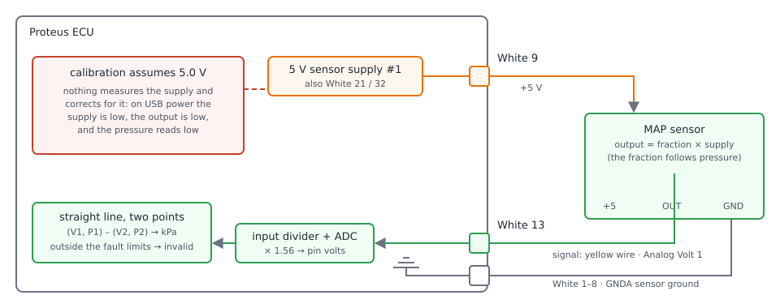
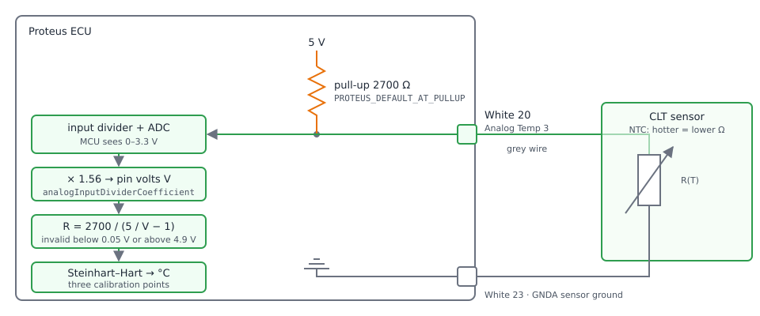
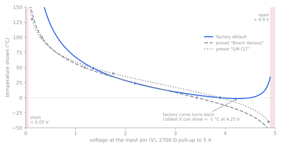
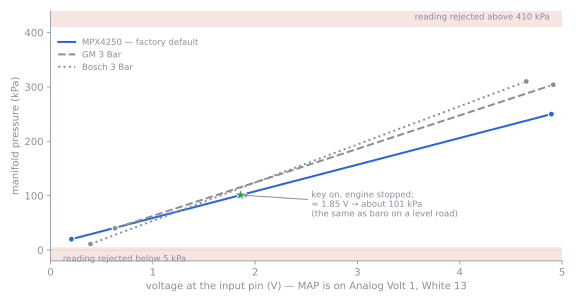

# Sensors and calibration

:material-circle:{ .level-basic } Basic → :material-circle:{ .level-advanced } Advanced

> **In one sentence:** every sensor is turned into a physical unit by a calibration you supply —
> three resistance points for a temperature sensor, two voltage points for a pressure sensor, a
> tooth count for a speed sensor — and none of it means anything unless the ECU is running on
> 12 V with the ignition on while you set it up.

This chapter covers the sensors on TunerStudio's **Sensors** menu: what each kind of sensor is, how
rusEFI turns it into a number, which dialog configures it, and how to check the result. The crank
and cam sensors are in the *Trigger* chapter; the electronic throttle's position and pedal sensors
are calibrated in [Electronic throttle](../part3/electronic-throttle.md), and this chapter does not
repeat that procedure.

## What the ECU measures

:material-circle:{ .level-basic } Basic

A sensor is not a voltage; it is a voltage *plus a calibration*. rusEFI groups its inputs by how the
sensor is wired and what it has to do to get a unit out:

| Kind of sensor | Examples | What the ECU measures | Where you set it up |
|---|---|---|---|
| Ratiometric analog, three wires | MAP, throttle position, pedal, oil, fuel and A/C pressure | a voltage that is a fraction of the ECU's 5 V supply | two voltage points on the sensor's dialog |
| Thermistor, two wires | coolant (CLT), intake air (IAT), oil, fuel, ambient, compressor discharge, AuxTemp | resistance, through a resistor inside the ECU | three temperature-and-resistance pairs |
| Frequency, square wave | vehicle speed, flex fuel, turbo speed, input and output shaft speed | pulses per second | tooth count and gearing |
| Switch, on or off | clutch, brake pedal, A/C request, start button | which state the pin is in, and what "active" means | input and inverted/pull settings |
| CAN message | rusEFI and AEM wideband, CAN EGT, speed read from the dashboard, sensors from another ECU | a message with an address and a time stamp | the bus and the sensor's address |
<!-- src: firmware/init/sensor/init_sensors.cpp (initNewSensors: which sensors get configured at start-up); firmware/tunerstudio/tunerstudio.template.ini ([Menu] Sensors entries and their dialogs) -->

Every one of them ends at the same place in the firmware: a measured quantity, a scaling, a
calibration, and a check that the answer is possible.

<figure markdown>
  
  <figcaption>Figure 1 — How each family reaches the firmware, with the Proteus pins named. Watch the
  difference between families 1 and 2: family 1 is fed 5 V by the ECU, family 2 is not fed anything —
  it sits in the middle of a divider built inside the ECU.</figcaption>
</figure>

!!! note "The Sensors menu is long because rusEFI supports many cars"
    On a Proteus F7 the menu has around thirty entries, several of them inside groups
    (**Chassis sensors**, **Oil sensors**, **Fuel sensors**, **Turbo sensors**, **Aux sensors**).
    A typical engine uses six or seven of them: CLT, IAT, MAP, TPS, wideband and, if the car has a
    gearbox or a dash, vehicle speed. The rest stay unassigned and cost nothing — an input with no
    pin chosen is simply not initialised.
    <!-- src: firmware/init/sensor/init_thermistors.cpp (configureTempSensor returns when the channel is unassigned); firmware/init/sensor/init_fluid_pressure.cpp (initFluidPressure returns early for an unconfigured channel) -->

## How a sensor becomes a number

:material-circle:{ .level-intermediate } Intermediate

Analog inputs are sampled by the microcontroller's ADC, and the sampled value is turned into the
voltage that was actually present **at the connector pin**. Proteus feeds each analog input through
a resistor divider (5.6 kΩ in series, 10 kΩ to ground), so the firmware multiplies what the chip
sees by **1.56** — the setting **analog input divider coefficient** `analogInputDividerCoefficient`,
set in the board file and not normally changed. The chip's own reference on Proteus is 3.3 V
(`adcVcc`).
<!-- src: firmware/config/boards/proteus/board_configuration.cpp (setupVbatt: 1.56 coefficient, adcVcc 3.3 V); firmware/hw_layer/adc/adc_inputs.cpp (adcGetScaledVoltage: raw volts × divider coefficient) -->

Analog sensors are then read **500 times a second** from the main loop, each one through its own
software low-pass filter: 200 Hz for throttle position and pedal, 100 Hz for MAP and fuel level,
50 Hz for MAF, 10 Hz for oil and fuel pressure, 2 Hz for temperature sensors. The cutoff belongs to
the *use* of the sensor: a coolant sensor never moves quickly, so it is filtered hard and reads
steadily, while a MAP sensor must follow an engine cycle.
<!-- src: firmware/controllers/core/main_loop.h (MAIN_LOOP_RATE and ADC_UPDATE_RATE); firmware/hw_layer/adc/adc_subscription.cpp (SubscribeSensor lowpassCutoff and sensorVolts); firmware/init/sensor/init_tps.cpp (lowpassCutoffHz 200); firmware/init/sensor/init_thermistors.cpp (cutoff 2 Hz); firmware/init/sensor/init_map.cpp (cutoff 100 Hz); firmware/init/sensor/init_maf.cpp (cutoff 50 Hz); firmware/init/sensor/init_fluid_pressure.cpp (cutoff 10 Hz) -->

!!! info "Advanced"
    MAP is also wired into a separate, DMA-driven fast ADC so that a sample is available inside a
    single engine cycle; the pressure sensors, MAF and everything else are on the ordinary inputs.
    Each sensor has a time limit on how old its last reading may be — 200 ms for fast MAP, 50 ms for
    MAP and the pressure sensors, 10 ms for the thermistors, 500 ms for vehicle speed, 30 s for flex
    — and a reading older than that is reported as a timeout rather than used.
    <!-- src: firmware/hw_layer/adc/adc_inputs.cpp (configureInputs adds the MAP channel to the fast ADC); firmware/init/sensor/init_map.cpp (MapAverager MS2NT(200), slow MAP MS2NT(50)); firmware/init/sensor/init_vehicle_speed_sensor.cpp (MS2NT(500)); firmware/init/sensor/init_flex.cpp (MS2NT(30000)); firmware/controllers/sensors/core/stored_value_sensor.h (timeout becomes UnexpectedCode::Timeout) -->

### Ratiometric sensors: MAP, TPS and the pressure sensors

:material-circle:{ .level-intermediate } Intermediate

A three-wire analog sensor is given 5 V and sensor ground, and its signal wire returns some fraction
of that 5 V. "Ratiometric" means the fraction — not the absolute voltage — is what follows the
measured quantity, and rusEFI's calibration for these sensors is a **straight line through two
voltage points**. That is why the supply matters so much: if the supply is low, the output is low by
the same ratio, and the firmware does not measure the supply to correct for it.
<!-- src: firmware/controllers/sensors/converters/linear_func.cpp (LinearFunc::configure and convert: two points, a line, and the too-low/too-high check) -->

<figure markdown>
  
  <figcaption>Figure 2 — The ratiometric chain, from the 5 V supply at White 9 to the pressure in kPa.
  The red box is the reason for the rule in *Calibrate with the ignition on* below.</figcaption>
</figure>

Because the conversion is only a straight line, rusEFI lets you specify the line either by picking a
sensor model from a built-in list, or by giving the two points yourself. Every built-in model is
just a pair of points; MAP models from the factory list are drawn in Figure 5.

### Thermistors: coolant, intake air and the other temperatures

:material-circle:{ .level-intermediate } Intermediate

A thermistor has two wires and no supply pin of its own. Inside the ECU the input is pulled up to
5 V through a resistor; the sensor pulls the input down towards sensor ground. The voltage at the
pin therefore tells the firmware the sensor's resistance, and the resistance tells it the
temperature.

On Proteus that pull-up is **2700 Ω**, and it is the value the firmware uses for the coolant and
intake air inputs by default. Other thermistor dialogs (**Oil temp sensor**, **Fuel temp sensor**,
**Ambient temp sensor**, **Compressor discharge temp**, **AuxTemp1/2**) ask you for the
**Pullup resistor** of the input you use: enter the value that input really has, because the whole
scale depends on it.
<!-- src: firmware/config/boards/proteus_meta.h (PROTEUS_DEFAULT_AT_PULLUP 2700); firmware/config/boards/proteus/board_configuration.cpp (proteus_boardConfigOverrides sets the CLT and IAT bias resistor); firmware/controllers/algo/engine_configuration.cpp (clt.config bias_resistor default) -->

<figure markdown>
  
  <figcaption>Figure 3 — A thermistor on Proteus. Everything to the left of the connector is inside the
  ECU; the only thing you control is the three temperature-and-resistance pairs.</figcaption>
</figure>

rusEFI fits a **Steinhart–Hart** curve through the three pairs you enter, which is why three pairs
and not two: a thermistor is strongly curved, and two points would leave large errors between them
and outside them. Two limits are applied to every thermistor reading: below **−50 °C** the sensor is
rejected as implausibly cold, and above 250 °C as implausibly hot. Below 0.05 V the input is treated
as a short to ground, and above 98 % of the supply as an open circuit — that is how a broken wire is
told apart from a very cold engine.
<!-- src: firmware/controllers/sensors/converters/thermistor_func.cpp (configure fits the curve, convert rejects below −50 C and above CLT_UPPER_VALIDATION_LIMIT); firmware/controllers/sensors/converters/resistance_func.cpp (short below 0.05 V, open above 98 percent of supply) -->

Calibration errors are checked when the firmware starts: the three temperatures must be in ascending
order, and the resulting curve must still rise and fall sensibly at the 10 % and 90 % points. A
pair set that fails either check stops the ECU with *"Thermistor configuration has failed 90% test"*
rather than reporting nonsense temperatures.
<!-- src: firmware/init/sensor/init_thermistors.cpp (validateThermistorConfig: ascending temperatures); firmware/controllers/sensors/converters/thermistor_func.cpp (configure: the 10 and 90 percent tests) -->

<figure markdown>
  
  <figcaption>Figure 4 — What the calibration does to the reading. Note how different the same voltage
  looks under different calibrations: the wrong preset can be tens of degrees out, and can even turn
  back on itself so the coldest reading it can produce is above freezing.</figcaption>
</figure>

!!! tip "Measure resistance, not temperature, while calibrating"
    The firmware publishes **CLT: measured resistance** `cltResistance` and **IAT: measured
    resistance** `iatResistance` — the resistance it computed from the pin voltage. With a
    multimeter on the sensor you can compare like with like: measure the sensor in a pot of iced
    water and boiling water, and enter those pairs rather than trusting a catalogue curve.
    <!-- src: firmware/console/binary/output_channels.txt (cltResistance, iatResistance); firmware/init/sensor/init_thermistors.cpp (getThermistorResistance returns what ResistanceFunc measured) -->

### Frequency and switch inputs

:material-circle:{ .level-intermediate } Intermediate

A toothed wheel and a pickup make a square wave; rusEFI counts the edges and divides by the time
between them, then converts pulses per second into speed using three numbers you supply: how many
wheel revolutions make a kilometre, the ratio between the shaft the sensor is on and the wheels, and
how many teeth the wheel has. Multiplying them gives pulses per kilometre, which is the whole
calibration.
<!-- src: firmware/controllers/sensors/frequency_sensor.cpp (onEdge: one over the elapsed time); firmware/controllers/sensors/converters/vehicle_speed_converter.h (driveWheelRevPerKm × vssGearRatio × vssToothCount) -->

Switch inputs — clutch, brake pedal, A/C request — are not measured on the ADC. The firmware reads
the level and applies the input's mode: pulled up or down, and normal or inverted, so a switch that
goes to ground when pressed and a switch that feeds battery voltage both work.
<!-- src: firmware/controllers/sensors/allsensors.cpp (ButtonDebounce for the A/C request); firmware/integration/rusefi_config.txt (clutchDownPinMode and the other pin input modes) -->

### Sensors that arrive on CAN

:material-circle:{ .level-intermediate } Intermediate

A wideband controller on the CAN bus needs no analog input at all: rusEFI listens for its messages,
decodes them, and treats a wideband that has stopped talking as a fault. rusEFI's own wideband
sends its state (preheat, warmup, closed loop, heating failed, overheat, underheat, not heating,
CAN silent) as well as the mixture, so TunerStudio can show exactly what the controller is doing.
<!-- src: firmware/controllers/sensors/can_sensor.h (CanSensorBase: a sensor fed by a CAN frame with a timeout); firmware/controllers/sensors/impl/AemXSeriesLambda.cpp (acceptFrame for address filtering by bus and type, refreshState for silent after a few missing frames); firmware/tunerstudio/tunerstudio.template.ini (wboStateList) -->

!!! warning "CAN sensors need CAN enabled before they appear"
    **CAN-bus ▸ CAN Bus Settings**: **CAN read enabled** and **CAN write enabled** must be on for the
    CAN wideband to work at all — with them off rusEFI stops with *"CAN read and write are required
    to use CAN wideband"*. Vehicle speed from the CAN bus needs **CAN read enabled** as well.
    <!-- src: firmware/init/sensor/init_lambda.cpp (initLambda: criticalError when CAN read or write is off); firmware/tunerstudio/tunerstudio.template.ini (speedSensorCan field guards on canReadEnabled) -->

## Calibrate with the ignition on — never on USB power

:material-circle:{ .level-basic } Basic

!!! danger "Calibrate with the ignition on"
    Every calibration in this chapter, and every reading you use to make a decision, must be taken
    with the ECU on **12 V and the ignition switched on** — engine stopped unless a step says
    otherwise. With only the USB cable connected, the ECU runs fine and TunerStudio connects, but the
    5 V sensor supplies cannot reach 5 V; on the bench they come within about 0.5 V of it at best.
    A ratiometric sensor then outputs a proportionally lower voltage, so a throttle position, pedal
    or MAP calibration grabbed on USB power is recorded too low, and the engine will be driven with
    those numbers for years.

rusEFI decides "the ignition is on" from the ignition feed (on Proteus the **Battery Sense** input,
Black 18): the ignition is counted as on while that input reads above 6 V, and a dip shorter than
0.2 s — the cranking dip — is ignored. TunerStudio uses exactly that flag to enable the calibration
buttons on the throttle and pedal dialogs: **Auto Calibrate ETB 1**, **Grab Idle/Up** and
**Grab WOT/Down** are greyed out until it is set.
<!-- src: firmware/controllers/ignition_controller.cpp (isIgnVoltage: above 6 V, 0.2 s debounce, ignition key input or battery sense); firmware/tunerstudio/tunerstudio.template.ini (hasIgnitionVoltage guards on cmd_etb_auto_calibrate and cmd_calibrate_pedal_up); firmware/config/boards/proteus/connectors/black23.yaml (pin 18 Battery Sense) -->

!!! warning "The cable-throttle Grab buttons are not greyed out"
    **Grab Closed** and **Grab Fully Open** on the TPS dialog do *not* check the ignition flag. On USB
    power they will happily store whatever the pin is doing at the time. Switch the ignition on
    first, and check the numbers against a multimeter.
    <!-- src: firmware/tunerstudio/tunerstudio.template.ini (cmd_calibrate_tps_closed and cmd_calibrate_tps_open are guarded only by the throttle not being an ETB); firmware/controllers/bench_test.cpp (the grab commands are executed without checking ignition state) -->

## Before you start

:material-circle:{ .level-basic } Basic

Proteus F7 supplies and inputs, from the board's own connector files:

| What | Connector and pin | Notes |
|---|---|---|
| 5 V sensor supply | **White 9**, **21**, **32** (supply 1) · **White 10**, **22**, **33** (supply 2) | feed ratiometric sensors from these |
| Sensor ground (GNDA) | **White 1–8**, **23**, **29** | never share with a fuel pump or injector return |
| Analog inputs | **Analog Volt 1…11**, White 13–18 and 24–28 | the numbers TunerStudio shows |
| Thermistor inputs | **Analog Temp 1…4**, White 19, 30, 20, 31 | already pulled up inside the ECU |
| 12 V protected outputs for sensors | **White 11**, **12** | for sensors that want 12 V, not 5 V |
| Digital inputs | **Digital 1…6**, Black 10, 1, 2, 3, 9, 11 | Black 2 is suggested for vehicle speed, Black 1 for a cam |
| Variable reluctance inputs | **VR 1** Black 5 (+) / 13 (−) · **VR 2** Black 4 (+) / 12 (−) | shielded twisted pair, see *Trigger* |
| Ignition feed | **Black 18** Battery Sense | this is what "ignition on" means |
| CAN | **Black 17** high / **Black 16** low · **Black 22** / **21** (CAN2) | wideband, EGT, dash |
<!-- src: firmware/config/boards/proteus/connectors/white35.yaml (pin functions and ts_name for the analog and temp inputs, +5 supplies, GNDA); firmware/config/boards/proteus/connectors/black23.yaml (digital and VR inputs, battery sense, CAN) -->

The factory defaults are sensible starting points for a Proteus: coolant on **Analog Temp 3**
(White 20), intake air on **Analog Temp 2** (White 30), MAP on **Analog Volt 1** (White 13), throttle
position on **Analog Volt 2** (White 24), and an analog wideband on **Analog Volt 10** (White 28).
If you wire a sensor somewhere else, that is fine — the pin you choose is what you type into the
dialog.
<!-- src: firmware/config/boards/proteus/board_configuration.cpp (setupDefaultSensorInputs: CLT, IAT, TPS, MAP, wideband channels) -->

!!! note "Sensor ground is not power ground"
    Why the return wire of a sensor must go back on the sensor ground, and how a shared earth makes
    a 0.1 V error out of a fuel-pump current, is covered in Part II's *Wiring basics* and
    *Power and grounds*.

## Setting it up

:material-circle:{ .level-basic } Basic → :material-circle:{ .level-intermediate } Intermediate

Everything here is done in TunerStudio. Open the **Sensors** menu; the entries you need depend on
your engine, but the order below is the order that lets each step check the one before it. Burn
after each step.

<!-- shot: img/ts/sensors-menu.png | Sensors (menu opened) | Proteus F7 with CLT, IAT, MAP, TPS configured, ignition on (12 V), engine stopped; show the Chassis sensors, Oil sensors, Fuel sensors, Turbo sensors and Aux sensors submenus | Figure 6 — The Sensors menu on a Proteus F7. -->

### 1 · Look at the raw numbers before you change anything

With the ignition on, the raw channels tell you whether the wiring is right before a calibration can
hide the problem. Log or gauge **rawClt** and **rawIat** (volts at the temperature inputs),
**rawMap** (volts at the MAP input), **rawTps1Primary**, **rawOilPressure** and **rawBattery**. A
temperature input sitting at about 5 V with a sensor connected is an open circuit; one sitting at
0 V is a short.
<!-- src: firmware/console/binary/output_channels.txt (rawClt, rawIat, rawMap, rawTps1Primary, rawOilPressure, rawBattery) -->

### 2 · Coolant and intake air

Open **Sensors ▸ CLT sensor**. Set **Input channel**, then either pick a preset from the **Common CLT
Sensors** list (**GM CLT**, **Miata NA**, **Miata NB**, **Bosch Various**) or fill in the three pairs
yourself: **Lowest temperature** and **Resistance @ LT**, **Middle temperature**, **Highest
temperature**. rusEFI wants typical spread — around −40 °C, 0 °C and 100 °C for a water engine.

Leave **Linear characteristic** off: it throws the third pair away and uses a straight line through
the first two, which is only right for a sensor that is actually linear.
<!-- src: firmware/tunerstudio/tunerstudio.template.ini (cltSensor dialog, Common CLT Sensors presets); firmware/init/sensor/init_thermistors.cpp (configureTempSensorFunction: the linear path uses two points) -->

<!-- shot: img/ts/sensors-clt.png | Sensors ▸ CLT sensor | Input channel Analog Temp 3, Bosch Various preset selected, Lowest 0 °C / 5896 Ω, Middle 50 °C / 834 Ω, Highest 100 °C / 187 Ω, Linear characteristic off, coolant gauge near 20 °C, ignition on | Figure 7 — A Bosch-style coolant sensor, calibrated from the preset. -->

**Sensors ▸ IAT sensor** is identical, with its own preset list (**GM IAT**, **Miata NA/NB**,
**Miata MSM IAT2**, **Bosch Various**). The intake sensor is the one people get wrong: it is measuring
the air in the manifold, not the engine, so a sane reading is within a few degrees of ambient when
the car has been sitting.
<!-- src: firmware/tunerstudio/tunerstudio.template.ini (Common IAT Sensors presets) -->

<!-- shot: img/ts/sensors-iat.png | Sensors ▸ IAT sensor | Input channel Analog Temp 2, factory three pairs (-20 °C / 18000 Ω, 23.9 °C / 2100 Ω, 120 °C / 100 Ω), IAT gauge reading ambient temperature, ignition on | Figure 8 — The intake air sensor with its factory curve. -->

!!! tip "Set the sensor before the wire"
    If the coolant sensor reads plausible warm temperatures while the engine is stone cold, suspect a
    calibration preset for a different sensor (see Figure 4) before you suspect the wiring — and the
    other way round if it reads a hard error.

### 3 · Manifold absolute pressure

Open **Sensors ▸ MAP sensor**. Choose **Input pin**, then either pick a **Sensor model** from the list
or select **Custom** and fill in **Low point voltage**, **Low point pressure**, **High point
voltage**, **High point pressure**. The factory default model is **MPX4250** (0.204 V → 20 kPa,
4.896 V → 250 kPa); the same list serves the baro dialog.
<!-- src: firmware/init/sensor/init_map.cpp (getMapCfg: the built-in model points); firmware/controllers/algo/engine_configuration.cpp (map.sensor.type default MT_MPX4250); firmware/tunerstudio/tunerstudio.template.ini (mapSensorAnalog and mapCustomCal panels) -->

<figure markdown>
  
  <figcaption>Figure 5 — Three of the built-in MAP models. The two points are the calibration; the red
  bands are the fault limits rusEFI applies on top. With the key on and the engine stopped, the star
  is roughly where a healthy MAP sensor sits.</figcaption>
</figure>

**Fault detection** on the same dialog sets the limits Figure 5 shows: **Fault if reading below**
(5 kPa by default) and **Fault if reading above** (410 kPa). Set them just outside what your sensor
can produce, not wide open: a MAP wire that has gone open circuit reads about 5 V, which is a plausible
boost pressure without the limit.

**Advanced** holds **Measure Map Only In One Cylinder** (for individual throttle bodies, where one MAP
sensor sees only one runner), **Samples per cycle** (default 1; the number of windowed averages kept
and the smallest of them used) and **Input smoothing (EMA alpha)** (0 to 1, 1 means no smoothing).
<!-- src: firmware/init/sensor/init_map.cpp (configureMapFunction passes the two fault limits to the converter); firmware/controllers/modules/map_averaging/map_averaging.cpp (the running buffer takes the minimum of the window averages, filterMapValue applies alpha); firmware/integration/rusefi_config.txt (mapMinBufferLength and measureMapOnlyInOneCylinder help) -->

**Sensors ▸ MAP sampling** turns the windowing on and off (**Window averaging**) and defines where in
the engine cycle the window sits: **MAP Sampling Start Angle** and **MAP Sampling Duration** against
engine speed, 100–130° and 50° by default. Leave it alone until you have a reason: MAP averaging is on
in the factory configuration and the window is clamped to less than one cylinder period.
<!-- src: firmware/controllers/algo/engine_configuration.cpp (isMapAveragingEnabled default on); firmware/controllers/modules/map_averaging/map_averaging.cpp (MapAveragingModule::onFastCallback reads the two curves and clamps the duration); firmware/tunerstudio/tunerstudio.template.ini (map_samplingAngleCurve, map_samplingWindowCurve) -->

<!-- shot: img/ts/sensors-map.png | Sensors ▸ MAP sensor | Input pin Analog Volt 1, Sensor model MPX4250, Fault if reading below 5 kPa and above 410 kPa, MAP gauge near 100 kPa, ignition on engine stopped | Figure 9 — MAP with the factory model and fault limits. -->
<!-- shot: img/ts/sensors-map-custom.png | Sensors ▸ MAP sensor | Sensor model Custom, Low point voltage 0.5, Low point pressure 0, High point voltage 4.5, High point pressure 300, ignition on | Figure 10 — A sensor that is not in the list: the same two points, entered by hand. -->
<!-- shot: img/ts/sensors-map-sampling.png | Sensors ▸ MAP sampling | Window averaging enabled, alpha 0.3, MAP Sampling Start Angle 100 at low rpm rising to 130, MAP Sampling Duration 50 across the range | Figure 11 — MAP sampling; the two curves are read at the current engine speed. -->

### 4 · Barometric pressure

**Sensors ▸ Baro sensor** has two panels. The analog panel takes **Baro input**, **Low Value**,
**High Value** and **Type**, and works exactly like MAP. The digital panel names the two pins of an
I²C barometer (LPS2x); rusEFI only probes the digital sensor when no analog baro is assigned.
Absolute-pressure MAP sensors can also serve as a baro — **Sensors ▸ Analog input settings** has
**Grab baro value from MAP**, which reads MAP once at start-up and uses it as the altitude reading.
That dialog carries its own warning: an **ECU reboot is needed** before the change takes effect.
<!-- src: firmware/init/sensor/init_baro.cpp (initBaro: the digital sensor is only probed when there is no analog baro); firmware/init/sensor/init_map.cpp (the baro channel and converter); firmware/integration/rusefi_config.txt (useFixedBaroCorrFromMap help: read MAP at start-up as baro) -->

<!-- shot: img/ts/sensors-baro.png | Sensors ▸ Baro sensor | Analog Baro input unassigned, LPS2x Baro SCL and SDA shown with their assigned pins, ignition on | Figure 12 — The two ways to get altitude. -->

!!! note "Baro is a fuel input, not a curiosity"
    Air density at 1500 m is about 15 % lower than at sea level. If nothing measures it, rusEFI has
    nothing to correct with, and the fuel calculation substitutes standard atmosphere. The barometric
    correction tables are in the *Fuel* and *Tuning* chapters.
    <!-- src: firmware/controllers/algo/fuel_math.cpp (getBaroPressureCorrelationCoefficient: value_or standard atmosphere when no baro reading) -->

### 5 · Throttle position on a cable throttle

:material-circle:{ .level-basic } Basic

An electronic throttle is calibrated in [Electronic throttle](../part3/electronic-throttle.md). A
cable throttle is simpler: you tell rusEFI the two end voltages.

1. On **Sensors ▸ TPS**, choose **Primary sensor input** (on Proteus, **Analog Volt 2**) and leave
   **Secondary sensor input** unassigned. The **Wiring Preset** panel offers **Switch to Cable TPS**,
   which assigns the board's suggested TPS input and clears the pedal inputs in one click; the
   reverse is **Switch to PPS TPS**. Both are refused while the engine has been turning recently.
2. With the ignition on and the throttle shut, press **Grab Closed**.
3. Hold the throttle fully open and press **Grab Fully Open**.
4. Check the two voltages, then **Burn**.

rusEFI will not accept a nonsense TPS calibration: if **Grab Closed** and **Grab Fully Open**
are less than 0.5 V apart it reports *"open/closed cal values are too close together. Check your
calibration and wiring!"* instead of guessing.
<!-- src: firmware/init/sensor/init_tps.cpp (LinearSensorUnit::configure: 0.5 V minimum split, the calibration error message); firmware/controllers/algo/basic_configuration.cpp (BasicConfigurationAction CableTps and PpsTps); firmware/controllers/sensors/tps.cpp (grapTps1PrimaryIsClosed and grapTps1PrimaryIsOpen); firmware/tunerstudio/tunerstudio.template.ini (tpsNum1UseCable, Grab Closed, Grab Fully Open) -->

The **TPS/PPS Limits** panel rejects positions outside **TPS/PPS minimum valid value** and
**TPS/PPS maximum valid value** — −10 % and 110 % by default — and the same two settings apply to
the pedal. **TPS/PPS Error Detection Threshold** is how far the two tracks of one sensor may disagree
(see [Electronic throttle](../part3/electronic-throttle.md)).
<!-- src: firmware/controllers/algo/engine_configuration.cpp (tpsErrorDetectionTooLow and TooHigh defaults); firmware/integration/rusefi_config.txt (tpsErrorDetectionTooLow help: also used for the pedal) -->

<!-- shot: img/ts/sensors-tps-cable.png | Sensors ▸ TPS | Primary sensor input Analog Volt 2, Secondary sensor input unassigned, Grab Closed and Grab Fully Open enabled, Primary closed 0.45 V, Primary open 4.52 V, ignition on, throttle on the bench | Figure 13 — A cable throttle after both grabs. -->

### 6 · Oil pressure and fuel pressure

Oil and fuel pressure use the same idea as MAP: two points. **Sensors ▸ Oil sensors ▸ Oil pressure**
asks for **Oil Pressure input**, then **low voltage**, **low pressure**, **high voltage**,
**high pressure**. The factory default is 0.5 V → 0 kPa and 4.5 V → 689.48 kPa (100 psi), which suits
the common 0–100 psi sender; a 0–5 V sensor with a different range simply needs different numbers.

**Sensors ▸ Fuel sensors ▸ Fuel pressure** has a panel for a low-pressure (tank or rail) sensor and one
for a high-pressure sensor, plus a **sensor type** choice: **Absolute** (reads about 100 kPa with no
fuel pressure), **Gauge** (reads 0 with no fuel pressure — the usual case) or **Differential**. Getting
this wrong skews every fuel-pressure-based calculation, so check the key-on reading against the type
you chose.
<!-- src: firmware/init/sensor/init_fluid_pressure.cpp (initFluidPressure: the two-point line, and the allowance for −5 kPa so a stopped engine does not fault); firmware/controllers/algo/engine_configuration.cpp (oilPressure defaults); firmware/integration/rusefi_config.txt (fuelPressureSensorMode help); firmware/tunerstudio/tunerstudio.template.ini (oilp_settings, fuellop_settings) -->

!!! tip "Pressure sensors fail loudly if you let them"
    With the engine stopped, a gauge pressure sensor must read 0 kPa (± a few kPa) and an absolute one
    about 100 kPa. If it does not, fix the calibration or the wiring before you use the reading for
    tuning — rusEFI lets a pressure reading go as low as −5 kPa without complaining, precisely so that
    a stopped engine does not look broken.

<!-- shot: img/ts/sensors-oil-pressure.png | Sensors ▸ Oil sensors ▸ Oil pressure | Oil Pressure input Analog Volt 5, low voltage 0.5, low pressure 0, high voltage 4.5, high pressure 689.48, oil pressure gauge 0 kPa with the engine stopped, ignition on | Figure 14 — Oil pressure with the factory points. -->
<!-- shot: img/ts/sensors-fuel-pressure.png | Sensors ▸ Fuel sensors ▸ Fuel pressure | Analog input assigned for the low pressure sensor, sensor type Gauge, high pressure sensor unassigned, fuel pressure gauge near 0 with the pump priming, ignition on | Figure 15 — Fuel pressure: the sensor type decides what 0 means. -->

### 7 · Wideband: CAN first, analog second

The mixture sensor comes in two flavours and rusEFI supports both; only one can be used at a time.

**On CAN** — **Sensors ▸ CAN O2 sensors**: turn on **Enable CAN Wideband**, pick **Wideband CAN bus**
(CAN1 or CAN2) and set the per-sensor **UEGO type** (**RusEFI**, **AEM X-series** or
**Disabled/Analog**) and its address. CAN read and write must be enabled. **Smoothing Factor**
(`afrExpAverageAlpha`) trades response for a readable gauge: 1 is unfiltered. **Force O2 sensor
heating** is for the bench only — with it on, the sensor heats before the engine has started, and
condensation in a cold exhaust can crack the element. rusEFI's own widebands are configured further
on **Sensors ▸ rusEFI Wideband Tools**, where you can ping a controller, set its index and address,
and update its firmware.
<!-- src: firmware/init/sensor/init_lambda.cpp (initLambda: enableAemXSeries registers the CAN sensors, otherwise the analog channel is used); firmware/controllers/sensors/impl/AemXSeriesLambda.cpp (acceptFrame, sensor timeout, isHeaterAllowed); firmware/tunerstudio/tunerstudio.template.ini (uegoCan dialog fields, canReWidebandTools, forceO2Heating help) -->

!!! danger "Never force the wideband heater outside the workshop"
    Heating a cold wideband while the exhaust is cold and wet shortens its life, and a cracked
    element gives a wrong reading that you may then tune the engine towards. Turn
    **Force O2 sensor heating** on to prove a wiring job, and off again before you drive.

**On an analog input** — **Sensors ▸ Analog O2 sensor**: pick **Type** (**BPSX**, **Innovate**,
**14Point7**, **PLX**, **AEM**, **Custom**), or fill in the **low voltage / low value / high voltage /
high value** points yourself, set **Input channel** (the Proteus default is **Analog Volt 10**,
White 28), **Correction** `egoValueShift` if your controller sits a little off, and
**Narrowband Heater output** if the heater is switched by the ECU — that output is on while the
engine runs and off while it is stopped or cranking. A second sensor goes on **Input channel** in
**O2 Sensor 2 I/O**. On a freshly reset ECU the analog wideband is configured as a 14Point7-style
sensor: 0 V → 9.996 AFR and 5 V → 19.992 AFR.
<!-- src: firmware/init/sensor/init_lambda.cpp (analog lambda registration); firmware/controllers/sensors/impl/ego.cpp (initEgoSensor: 14Point7 0 V to 9.996 and 5 V to 19.992); firmware/controllers/algo/engine_configuration.cpp (setEgoSensor default); firmware/integration/rusefi_config.txt (o2heaterPin help); firmware/config/boards/proteus/board_configuration.cpp (afr.hwChannel default Analog Volt 10) -->

<!-- shot: img/ts/sensors-wideband-can.png | Sensors ▸ CAN O2 sensors | Enable CAN Wideband on, Wideband CAN bus CAN1, UEGO type RusEFI with its index, Smoothing Factor, Force O2 sensor heating off, valid AFR gauge with engine idling | Figure 16 — A CAN wideband: nothing is wired to an analog input. -->
<!-- shot: img/ts/sensors-wideband-analog.png | Sensors ▸ Analog O2 sensor | Type 14Point7, Input channel Analog Volt 10, low 0 V / 9.996 AFR and high 5 V / 19.992 AFR, Narrowband Heater output unassigned, Smoothing Factor, ignition on | Figure 17 — The same job on an analog input. -->

### 8 · Flex fuel

**Sensors ▸ Fuel sensors ▸ Flex** takes **Flex fuel sensor** — a digital input, not an analog one —
and **Flex Signal** (Normal or Inverted). The sensor is a square wave: **50 Hz is gasoline and 150 Hz
is pure ethanol**, with the percentage interpolated between them. rusEFI rejects the sensor below
45 Hz and above 155 Hz, so an unplugged or shorted sensor is a fault rather than "very strong E85".
The same signal's pulse width is also read as fuel temperature (1000 µs = −40 °C, 5000 µs = 125 °C),
and an impossible pulse width raises *"flex low"* or *"flex high"*. A flex reading older than 30
seconds is treated as timed out — deliberately long, so cranking does not look like a broken sensor.
<!-- src: firmware/init/sensor/init_flex.cpp (exti on the flex pin, 30 s timeout); firmware/controllers/sensors/flex_sensor.h (FlexConverter: 45 Hz and 155 Hz limits, 50 to 150 Hz mapping); firmware/controllers/sensors/flex_sensor.cpp (pulse width to fuel temperature, flex low/high warnings) -->

<!-- shot: img/ts/sensors-flex.png | Sensors ▸ Fuel sensors ▸ Flex | Flex fuel sensor Digital 5, Flex Signal Normal, flex gauge 0 % on gasoline with the engine idling, ignition on | Figure 18 — A three-wire flex sensor on a digital input. -->

### 9 · Vehicle speed

**Sensors ▸ Chassis sensors ▸ Vehicle speed sensor** takes **Input** (a digital input; Black 2 is
labelled for it), **Filter parameter** — the number of sensor pulses the reading is averaged over,
larger is smoother and slower — and the three calibration numbers: **Wheel revolutions per
kilometer**, **Speed sensor gear ratio** and **Speed sensor tooth count**. The dialog also holds
**Gear Detection**, which needs an output-shaft pulse input and your gear ratios.

Speed from the car's own CAN bus is configured on the same dialog: turn on **Enable CAN VSS**, pick
**CAN VSS type**, and adjust **CAN VSS scaling** if the reported speed needs a correction factor.
<!-- src: firmware/init/sensor/init_vehicle_speed_sensor.cpp (vssFilterReciprocal becomes the filter parameter); firmware/controllers/sensors/converters/vehicle_speed_converter.h (the three calibration numbers); firmware/tunerstudio/tunerstudio.template.ini (speedSensor dialog, speedSensorCan panel, gearDetection panel) -->

<!-- shot: img/ts/sensors-vss.png | Sensors ▸ Chassis sensors ▸ Vehicle speed sensor | Input Digital 3, Filter parameter 20, Wheel revolutions per kilometer 504, Speed sensor gear ratio 3.73, Speed sensor tooth count 17, speed gauge 0 km/h stationary, ignition on | Figure 19 — A transmission-output speed sensor. -->

### 10 · Everything else on this menu

:material-circle:{ .level-intermediate } Intermediate

:material-circle:{ .level-advanced } Advanced

- **MAF** — **Sensors ▸ MAF sensor** takes **MAF ADC input** (and a second one) and
  **MAF filter parameter** (0 disables the manifold-volume filter; larger means a larger plenum).
  The sensor itself is decoded by **Sensors ▸ MAF transfer function**, a table of voltage to
  air flow in kg/h: it is not a straight line, and the manufacturer's curve is what belongs there.
  rusEFI rejects an input above 5 V or below 0. <!-- src: firmware/init/sensor/init_maf.cpp (MafVoltageCheck, TableFunc over mafDecoding, MafFilter); firmware/controllers/sensors/impl/maf.cpp (built-in Bosch curves) -->
- **Extra temperatures** — **Oil temp sensor**, **Fuel temp sensor**, **Ambient temp sensor**,
  **Compressor discharge temp**, **AuxTemp1/2 sensor**: the same three pairs, plus the
  **Pullup resistor** of the input you use. rusEFI warns if you put the pairs in the wrong order.
- **Extra pressures** — **A/C Pressure** and **Aux Sensors**: two points, in whatever unit you like,
  because **Low value** and **High value** have no fixed unit.
- **Fuel level** — **Sensors ▸ Fuel level sensor**: input, **Low threshold** and **High threshold**
  volts, and an eight-point curve of voltage to percent, because tank senders are not linear and the
  firmware averages the sloshing reading on a period you choose.
- **EGT** — **Sensors ▸ Turbo sensors ▸ EGT**: CAN EGT (AEM X-series or rusEFI) or thermocouple
  converters on an SPI bus with one chip-select per channel.
- **Switch inputs** — **Sensors ▸ Chassis sensors ▸ Misc sensors**: clutch, brake pedal, turbo speed
  and the two extra pressure inputs; every switch input has a mode so that grounded-when-active and
  battery-when-active both work.
<!-- src: firmware/init/sensor/init_fuel_level.cpp (fuel level input, 100 Hz); firmware/controllers/sensors/converters/fuel_level_func.cpp (thresholds and the eight-point interpolation); firmware/init/sensor/init_egt.cpp (CAN EGT or MAX3185x SPI); firmware/init/sensor/init_fluid_pressure.cpp (aux linear sensors and A/C pressure); firmware/tunerstudio/tunerstudio.template.ini (otherSensorInputs, auxLinearSensors, egtInputs, fuelLevelDialog) -->

<!-- shot: img/ts/sensors-maf.png | Sensors ▸ MAF sensor | MAF ADC input Analog Volt 5, MAF 2 ADC input unassigned, MAF filter parameter 0, ignition on | Figure 20 — A mass air flow sensor input. -->
<!-- shot: img/ts/sensors-maf-curve.png | Sensors ▸ MAF transfer function | Bosch 0280218037 style curve: about 10.5 kg/h at 1.39 V, 105.3 kg/h at 2.91 V, 387.5 kg/h at 4.26 V | Figure 21 — The MAF table is the calibration; a wrong table is a wrong air meter. -->
<!-- shot: img/ts/sensors-misc.png | Sensors ▸ Chassis sensors ▸ Misc sensors | Clutch Down Digital 4 with mode, Clutch Up unassigned, Brake Pedal Digital 6 with mode, Turbo Speed Sensor unassigned, ignition on | Figure 22 — Switch inputs, each with its own input mode. -->
<!-- shot: img/ts/sensors-aux-linear.png | Sensors ▸ Aux sensors ▸ Aux Sensors | Aux Linear Sensor #1 Input Analog Volt 6, low 0.5 V / 0, high 4.5 V / 100, Aux Speed Input 1 unassigned | Figure 23 — One more two-point input, with a unit of your choosing. -->
<!-- shot: img/ts/sensors-fuel-level.png | Sensors ▸ Fuel sensors ▸ Fuel level sensor | Input channel assigned, low and high threshold volts, eight-point curve filled, fuel level gauge with the tank half full, ignition on | Figure 24 — A tank sender: thresholds plus a curve. -->

## Worked examples

:material-circle:{ .level-intermediate } Intermediate

### Example 1 — a carburetted V8 gets its first five sensors

A naturally aspirated small-block on a Proteus F7 needs four sensors to run, and all four are on the
menu covered above. The values below are what rusEFI uses when you take the presets and the factory
defaults unchanged:

| Sensor | Dialog | Settings |
|---|---|---|
| Coolant | **Sensors ▸ CLT sensor** | **Input channel** Analog Temp 3 (White 20); preset **Bosch Various**: 0 °C / 5896 Ω, 50 °C / 834 Ω, 100 °C / 187 Ω |
| Intake air | **Sensors ▸ IAT sensor** | **Input channel** Analog Temp 2 (White 30); factory 0 V pairs −20 °C / 18000 Ω, 23.9 °C / 2100 Ω, 120 °C / 100 Ω |
| MAP | **Sensors ▸ MAP sensor** | **Input pin** Analog Volt 1 (White 13); **Sensor model** MPX4250; faults 5 and 410 kPa |
| Throttle | **Sensors ▸ TPS** | **Primary sensor input** Analog Volt 2 (White 24); **Grab Closed** and **Grab Fully Open** with the ignition on |
| Wideband | **Sensors ▸ CAN O2 sensors** | **Enable CAN Wideband** on, bus CAN1, controller on Black 17 / 16 |
<!-- src: firmware/config/boards/proteus/board_configuration.cpp (default sensor channels); firmware/tunerstudio/tunerstudio.template.ini (the presets above); firmware/init/sensor/init_map.cpp (MPX4250 points); firmware/controllers/algo/engine_configuration.cpp (fault defaults) -->

With the ignition on and the engine cold, expect: CLT and IAT both within a couple of degrees of the
garage temperature, MAP about 100 kPa (Figure 5), TPS holding its **Grab Closed** value at idle
position and reaching **Grab Fully Open** by hand, and a wideband that goes from *warmup* to
*closed loop* a minute or two after starting.

### Example 2 — vehicle speed from a transmission output shaft

A BorgWarner T56 with the GM-style output sensor, 3.73 final drive and 225/50 R16 tyres:

- **Speed sensor tooth count** 17 (the GM output sensor's wheel).
- **Speed sensor gear ratio** 3.73 — the sensor is on the output shaft, so the wheels turn 1/3.73 as
  often; the ratio the firmware wants is turns of the sensor per turn of the wheels.
- **Wheel revolutions per kilometer** 504 — a 631 mm outside-diameter tyre rolls 1.98 m per turn.

The calibration therefore says 504 × 3.73 × 17 ≈ 32 000 pulses per kilometre, so at 100 km/h the
input is a 890 Hz square wave, comfortably inside what a digital input counts. **Filter parameter**
20 averages over 20 pulses, about 22 ms at that speed — responsive enough for a gear-driven reading
and smooth enough on a rough road.
<!-- src: firmware/controllers/sensors/converters/vehicle_speed_converter.h (pulses per kilometre from the three settings); firmware/init/sensor/init_vehicle_speed_sensor.cpp (the filter reciprocal becomes averaging over that many teeth); firmware/integration/rusefi_config.txt (vssGearRatio, vssToothCount, driveWheelRevPerKm help) -->

### Example 3 — E85 on a flex sensor

A Continental/GM three-wire flex sensor on **Digital 5**, **Flex Signal** Normal:

| Fuel | Sensor output | rusEFI reports |
|---|---|---|
| Gasoline | 50 Hz | 0 % ethanol |
| E30 | about 80 Hz | 30 % |
| E85 | about 135 Hz | 85 % |
| Ethanol | 150 Hz | 100 % |
| Anything below 45 Hz or above 155 Hz | — | fault: flex sensor low or high |

Check it with the engine idling on gasoline: the **Flex** gauge should sit at 0 % and **Flex error**
must stay off. If it reads a hard 100 % you have the signal and ground swapped, or
**Flex Signal** needs **Inverted**.

!!! info "Advanced"
    Flex corrections do not stop at fueling: with **flexCranking** enabled and a flex sensor present,
    the cranking fuel multiplier and the priming pulse are read from tables over coolant *and*
    ethanol percentage instead of the plain coolant curves. See the *Cranking* chapter.
    <!-- src: firmware/controllers/algo/fuel_math.cpp (flexCranking: the flex-aware cranking path); firmware/integration/rusefi_config.txt (flexCranking, primeFlexTable, crankingFuelFlexTable help) -->

## Checking your work

:material-circle:{ .level-intermediate } Intermediate

Before you drive, spend five minutes proving the calibration is not lying:

| Check | How | What is wrong if it fails |
|---|---|---|
| Coolant against intake | Key on after the car has stood overnight; the two readings should agree within a few °C | a wrong thermistor curve, or an IAT warmed by the engine bay |
| Sensor resistance | Log **CLT: measured resistance** and compare with a multimeter at the sensor | the pull-up value, or the sensor wiring |
| MAP at key on | Engine stopped: MAP ≈ the baro reading, not 0 and not 300 kPa | two-point calibration the wrong way round, or the 5 V supply low (USB power) |
| TPS ends | Watch **rawTps1Primary** at both stops of the pedal or throttle | grabbed voltages, or a cable with no slack |
| Pressure at rest | Gauge sender reads about 0 kPa, absolute sender about 100 kPa | **sensor type**, or the two points |
| Battery voltage | Compare the gauge with a multimeter at the battery | the battery divider coefficient |
| Speed | Compare the gauge with a phone GPS on a straight road | tooth count, gear ratio or wheel revolutions |
| Wideband state | The front page shows *WBO0: closed loop* at idle, not *CAN silent* | bus, address, or CAN read/write disabled |
<!-- src: firmware/console/binary/output_channels.txt (the channels to log); firmware/console/status_loop.cpp (the sensor validity flags behind the front-page indicators); firmware/integration/rusefi_config.txt (vbattDividerCoeff help) -->

!!! tip "One channel answers most wiring questions"
    Log the raw voltage channel next to the engineering value: **rawMap** beside **MAP**,
    **rawOilPressure** beside **Oil Pressure**, **rawClt** beside **CLT**. If the voltage is right and
    the value is wrong, the calibration is wrong. If the voltage is wrong, the wire or the supply is.

## Diagnostics

:material-circle:{ .level-intermediate } Intermediate

rusEFI checks configured sensors continuously and reports two things: an indicator on TunerStudio's
front page, and a stored fault with a code. The front page shows **CLT error**, **IAT error**,
**TPS error**, **TPS 2 error**, **Pedal error** and **Flex error**, red whenever that sensor's reading
is not currently valid; **Check Engine** is lit whenever any fault is active.
<!-- src: firmware/console/status_loop.cpp (isCltError and the other validity flags); firmware/tunerstudio/tunerstudio.template.ini (the front-page indicators) -->

The stored faults and the console warnings they produce are:

| What the ECU found | Typical cause |
|---|---|
| *Sensor fault: CLT input too high* | open circuit, or the sensor leg not connected to sensor ground |
| *Sensor fault: CLT input too low* | short to ground, water in the connector, or a very hot engine above 250 °C |
| *Sensor fault: IAT has timed out* | the input is not being read — wrong pin chosen, or the input is not an analog input |
| *Sensor fault: TPS1 input too high / too low* | TPS outside **TPS/PPS minimum/maximum valid value** |
| *Sensor fault: TPS1 is inconsistent* | the two throttle tracks disagree by more than the error threshold |
| *Sensor fault: MAP input too high / too low* | reading outside **Fault if reading above/below** |
| *Sensor fault: flex fuel sensor…* | below 45 Hz or above 155 Hz; *flex low* and *flex high* come from the pulse width |
<!-- src: firmware/controllers/sensors/sensor_checker.cpp (getCode chooses the fault code per sensor and per failure, the warning wording is "Sensor fault: …"); firmware/controllers/sensors/flex_sensor.cpp (flex low and flex high warnings) -->

When a sensor fails, rusEFI does not stop — it substitutes something. That keeps you driving home,
and it is also why a failed sensor can quietly ruin a tune:

| Sensor | What the fuel calculation uses instead |
|---|---|
| CLT | 20 °C for the coolant correction, and 90 °C for wall wetting |
| Barometric pressure | standard atmosphere |
| Flex | 50 % ethanol when cranking with a flex sensor present |
| MAP (fast) | the slow MAP reading on the same pin |
<!-- src: firmware/controllers/algo/fuel_math.cpp (coolant correction value_or 20, baro value_or standard atmosphere, cranking flex value_or 50); firmware/controllers/algo/wall_fuel.cpp (value_or 90); firmware/init/sensor/init_map.cpp (FallbackSensor MapFast over MapSlow) -->

Useful channels to log when a sensor is misbehaving:

| Channel | What it shows |
|---|---|
| rawClt, rawIat, rawMap, rawMapFast, rawTps1Primary, rawOilPressure, rawAfr | volts at the pin, before any calibration |
| cltResistance, iatResistance | the resistance the ECU computed |
| rawFlexFreq | flex input activity |
| vssEdgeCounter | counted speed pulses |
| mapPerCylinder | the windowed MAP for each cylinder |
<!-- src: firmware/console/binary/output_channels.txt (raw* channels, cltResistance, rawFlexFreq, vssEdgeCounter, mapPerCylinder) -->

## Troubleshooting

:material-circle:{ .level-basic } Basic → :material-circle:{ .level-advanced } Advanced

| Symptom | Likely cause | Check |
|---|---|---|
| Every sensor reads about 10 % low | the ECU is on USB power; the 5 V supplies are low | ignition on, 12 V, before you believe any reading |
| CLT and IAT both show errors with sensors connected | pull-up value, or the thermistor wired to an analog-volt input instead of an Analog Temp input | **Input channel**, and the pull-up for the input used |
| Temperature reads plausible but wrong | calibration preset for a different sensor | compare **cltResistance** with a multimeter |
| *"Thermistor configuration has failed 90% test"* | the three pairs are in the wrong order or mis-typed | re-enter the pairs, coldest first |
| TPS or pedal reports error at one end of travel | **TPS/PPS minimum/maximum valid value**, or a calibration grabbed on USB power | re-grab with the ignition on |
| MAP reads boost with the engine off | the two points are reversed, or the fault limits are too wide | **Fault if reading above** |
| Wideband never leaves *CAN silent* | CAN read/write off, wrong bus, wrong address | **CAN-bus ▸ CAN Bus Settings**, **UEGO type** |
| Analog wideband reads a fixed 10 or 20 AFR | the sensor is unpowered, or **Type** does not match the controller | supply, then **Type** and the four scaling values |
| Flex gauge jumps around at idle | the reading is filtered by design (50–150 Hz with a 30 s timeout) — a wiring problem is more likely than a fuel change | log the input frequency; check the 12 V supply to the sensor |
| Speed gauge reads double or half the true speed | tooth count or gear ratio | the three VSS numbers, and a GPS comparison |
| A sensor reads fine but the ECU still reports a fault | the reading is stale rather than wrong — the timeout passed | the sensor's update rate and the wiring that intermittently breaks |
| Nothing changes after **Burn** | you edited a different TunerStudio project or the ECU did not accept the burn | **needBurn** indicator, and the ini signature at connection |

## Settings reference

### CLT sensor (Sensors ▸ CLT sensor)

--8<-- "reference/settings/_cltSensor.table.md"

### IAT sensor (Sensors ▸ IAT sensor)

--8<-- "reference/settings/_iatSensorDialog.table.md"

### MAP sensor (Sensors ▸ MAP sensor)

--8<-- "reference/settings/_mapSettings.table.md"

### MAP sampling (Sensors ▸ MAP sampling)

--8<-- "reference/settings/_mapCurves.table.md"

### Baro sensor (Sensors ▸ Baro sensor)

--8<-- "reference/settings/_baroSettings.table.md"

### TPS (Sensors ▸ TPS)

--8<-- "reference/settings/_tpsSensor.table.md"

### Accelerator pedal (Sensors ▸ Accelerator pedal)

--8<-- "reference/settings/_pedalSensor.table.md"

### Oil pressure (Sensors ▸ Oil sensors ▸ Oil pressure)

--8<-- "reference/settings/_oilPressureSensor.table.md"

### Oil temp sensor (Sensors ▸ Oil sensors ▸ Oil temp sensor)

--8<-- "reference/settings/_oilTempSensor.table.md"

### Fuel pressure (Sensors ▸ Fuel sensors ▸ Fuel pressure)

--8<-- "reference/settings/_fuelPressureSensor.table.md"

### Flex (Sensors ▸ Fuel sensors ▸ Flex)

--8<-- "reference/settings/_flexSensorDialog.table.md"

### Fuel temp sensor (Sensors ▸ Fuel sensors ▸ Fuel temp sensor)

--8<-- "reference/settings/_fuelTempSensor.table.md"

### Fuel level sensor (Sensors ▸ Fuel sensors ▸ Fuel level sensor)

--8<-- "reference/settings/_fuelLevelDialog.table.md"

### Vehicle speed sensor (Sensors ▸ Chassis sensors ▸ Vehicle speed sensor)

--8<-- "reference/settings/_speedSensor.table.md"

### CAN vehicle speed sensor

--8<-- "reference/settings/_speedSensorCan.table.md"

### CAN O2 sensors (Sensors ▸ CAN O2 sensors)

--8<-- "reference/settings/_egoSettings.table.md"

### Analog O2 sensor (Sensors ▸ Analog O2 sensor)

--8<-- "reference/settings/_analogEgoSettings.table.md"

### rusEFI Wideband Tools (Sensors ▸ rusEFI Wideband Tools)

--8<-- "reference/settings/_canReWidebandTools.table.md"

### MAF sensor (Sensors ▸ MAF sensor)

--8<-- "reference/settings/_mafSettings.table.md"

### Misc sensors (Sensors ▸ Chassis sensors ▸ Misc sensors)

--8<-- "reference/settings/_otherSensorInputs.table.md"

### Ambient temp sensor (Sensors ▸ Chassis sensors ▸ Ambient temp sensor)

--8<-- "reference/settings/_ambientTempSensor.table.md"

### A/C Pressure (Sensors ▸ Chassis sensors ▸ A/C Pressure)

--8<-- "reference/settings/_acPressureSensor.table.md"

### Compressor discharge temp (Sensors ▸ Turbo sensors ▸ Compressor discharge temp)

--8<-- "reference/settings/_compressorDischargeTemperature.table.md"

### EGT (Sensors ▸ Turbo sensors ▸ EGT)

--8<-- "reference/settings/_egtInputs.table.md"

### Aux sensors (Sensors ▸ Aux sensors ▸ Aux Sensors)

--8<-- "reference/settings/_auxLinearSensors.table.md"

### AuxTemp1 sensor (Sensors ▸ Aux sensors ▸ AuxTemp1 sensor)

--8<-- "reference/settings/_auxTempSensor1Sensor.table.md"

### Analog input settings (Sensors ▸ Analog input settings)

--8<-- "reference/settings/_analogInputSettings.table.md"

## Related

- [Electronic throttle](../part3/electronic-throttle.md) — throttle and pedal sensor calibration, and why the ETB's calibration buttons are gated on ignition voltage
- Part II — *Wiring basics* and *Power and grounds*: sensor ground, screening, and why sensor returns are separate
- [Your first connection](../part1/first-connection.md) — why the ECU runs on USB but must not be calibrated that way
- *Trigger* — crank and cam inputs, VR and Hall sensors, and their own dialogs
- *Fuel* and *Tuning principles* — what MAP, IAT, CLT and lambda do to the fuel calculation, and the barometric correction tables
- *Error codes* — the stored fault codes raised by the sensor checks
- *Settings: Sensors menu* — every setting on this menu in one reference
