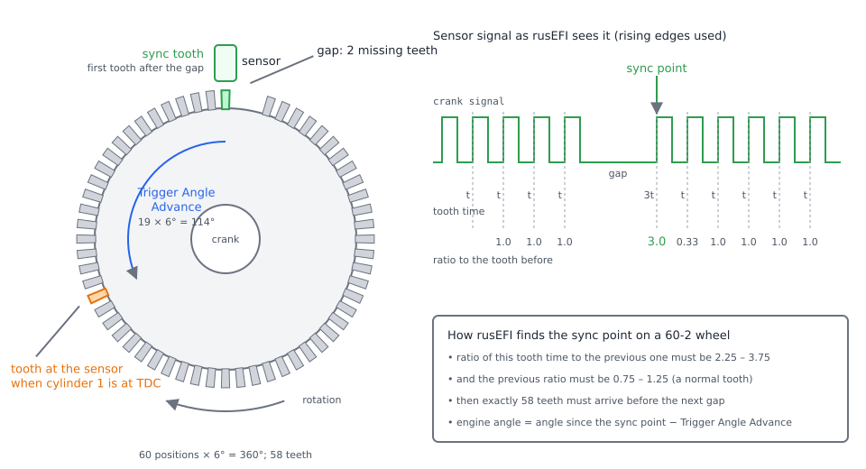
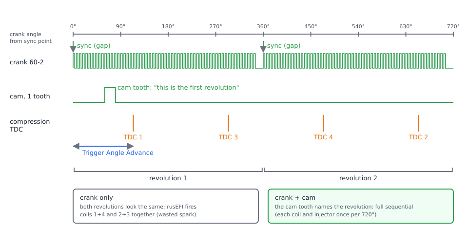
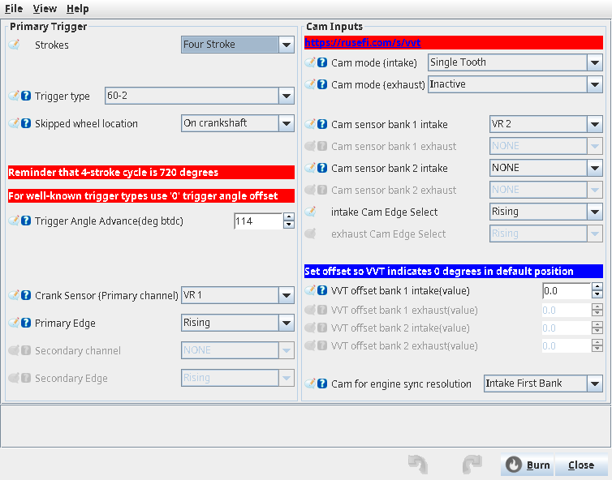
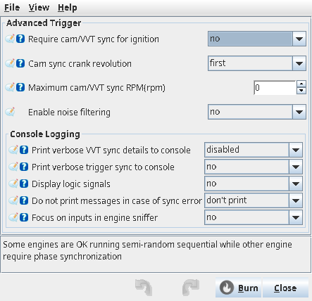
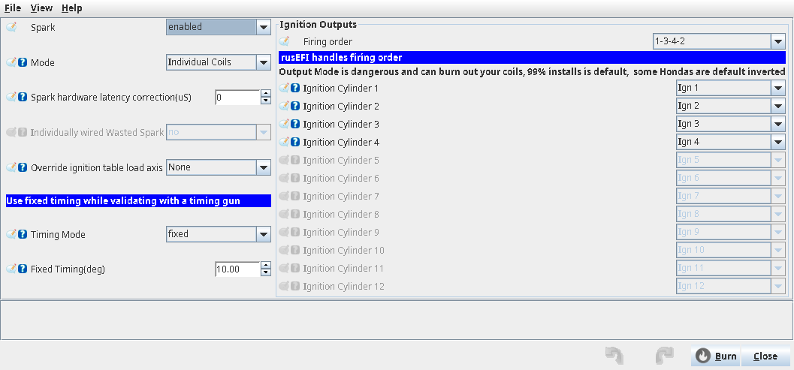
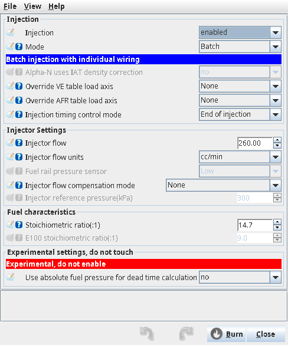
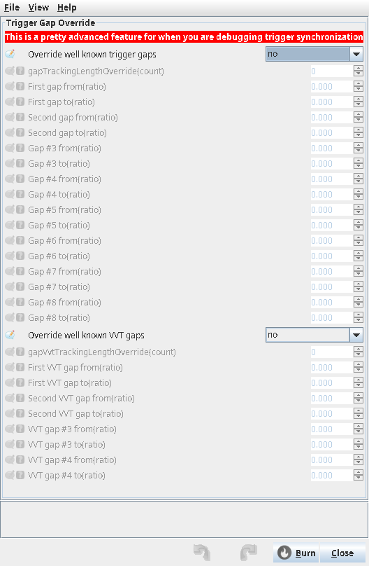

# Trigger

:material-circle:{ .level-basic } Basic → :material-circle:{ .level-advanced } Advanced

> **In one sentence:** the trigger system reads the crank (and cam) sensors, works out exactly where
> the engine is in its cycle and how fast it turns, and gives every injection and spark event its
> angle.

## What it does

:material-circle:{ .level-basic } Basic

The ECU cannot fire a spark plug or open an injector at the right moment unless it knows where the
pistons are. It learns this from a **trigger wheel**: a toothed wheel on the crankshaft (or camshaft)
that passes a sensor. Each tooth makes a pulse; the time between pulses gives engine speed, and the
tooth count since a known reference gives the angle.

To know *which* tooth is which, the wheel has a pattern. The most common is a **missing-tooth wheel**:
**60-2** has 60 equally spaced positions (6° apart) with two teeth left out, **36-1** has 36 positions
(10° apart) with one left out. The gap is the reference: rusEFI calls the first tooth after it the
**sync point**.
<!-- src: firmware/controllers/trigger/decoders/trigger_universal.cpp (initializeSkippedToothTrigger, addSkippedToothTriggerEvents); firmware/controllers/trigger/decoders/trigger_structure.cpp (TriggerWaveform::initializeTriggerWaveform: TT_TOOTHED_WHEEL_60_2, TT_TOOTHED_WHEEL_36_1) -->

<figure markdown>
  
  <figcaption>Figure 1 — A 60-2 wheel. The gap makes one tooth time three times as long as the
  others; the tooth that ends it is the sync point. The angle from there to TDC of cylinder 1 is
  what you set as <b>Trigger Angle Advance</b>.</figcaption>
</figure>

A crank wheel turns twice for every four-stroke cycle (720°), so on its own it cannot tell the
compression stroke of cylinder 1 from its exhaust stroke. A **cam sensor**, turning once per cycle,
settles that. With crank and cam the ECU can run **full sequential** (each injector and coil once per
cycle, at its own cylinder); with the crank alone it runs **wasted spark** and batch-style fuelling.
<!-- src: firmware/controllers/trigger/decoders/trigger_structure.cpp (TriggerWaveform::needsDisambiguation); firmware/controllers/math/engine_math.cpp (getCurrentIgnitionMode) -->

!!! danger "Moving parts"
    Trigger setup means cranking and running the engine with the bonnet open and a timing light near
    belts and fans. Keep hands, leads and the light clear of moving parts, and disable fuel (pull the
    fuel pump fuse or relay) for the first cranking checks.

## How it works

:material-circle:{ .level-intermediate } Intermediate

### From sensor to angle

Every edge from a trigger input raises an interrupt that records its time. rusEFI applies the
**Primary Edge** setting (which input edge counts as "rising"), passes the edge to the tooth logger,
drops edges the decoder does not use (a 60-2 or 36-1 uses only rising edges), and hands the rest to
the decoder.
<!-- src: firmware/hw_layer/digital_input/trigger/trigger_input_exti.cpp (shaft_callback); firmware/controllers/trigger/trigger_central.cpp (handleShaftSignal: invertPrimaryTriggerSignal, LogPrimaryTriggerTooth, isUsefulSignal) -->

### Finding the gap: gap ratios

For every tooth the decoder divides this tooth time by the previous one. On a 60-2 the sync point is
where that ratio lies between **2.25 and 3.75** (nominal 3) *and* the ratio before it lies between
**0.75 and 1.25** (a normal tooth). On a 36-1 the window is **1.5–2.5** (nominal 2), with the same check
on the tooth before. The windows are the nominal gap ±25 %, so the wheel can speed up or slow down
between teeth (compression strokes while cranking) without losing the gap.
<!-- src: firmware/controllers/trigger/trigger_decoder.cpp (TriggerDecoderBase::isSyncPoint, decodeTriggerEvent: triggerSyncGapRatio); firmware/controllers/trigger/decoders/trigger_structure.h (TRIGGER_GAP_DEVIATION); firmware/controllers/trigger/decoders/trigger_universal.cpp (initializeSkippedToothTrigger: setTriggerSynchronizationGap, setSecondTriggerSynchronizationGap) -->

### Staying in sync

After the first sync point the decoder counts teeth. At every gap it checks that exactly the expected
number arrived (58 on a 60-2). If not — a tooth was missed or noise added one — it counts a **trigger
error**, raises a warning, drops sync, and waits for the next clean gap before scheduling anything
again. Too many teeth without a gap does the same. More than one second without any edge also drops
sync: the engine has stopped.
<!-- src: firmware/controllers/trigger/trigger_decoder.cpp (decodeTriggerEvent: getEventCountersError, onNotEnoughTeeth, onTooManyTeeth, previousEventTimer > 1 s) -->

Above 1000 RPM rusEFI also checks that each tooth arrives near where it expected it: an edge less than
0.5° after the previous one is ignored as a doubled edge, and an error of more than 10° is reported
as bad tooth timing. **Enable noise filtering** (60-2 and 36-1 only) adds a filter that ignores
edges arriving too early compared with the previous tooth period.
<!-- src: firmware/controllers/trigger/trigger_central.cpp (TriggerCentral::isToothExpectedNow, TriggerNoiseFilter::noiseFilter) -->

### Crank and cam: 360° and 720°

<figure markdown>
  
  <figcaption>Figure 2 — One engine cycle. The crank gap appears twice; the cam tooth appears once and
  tells rusEFI which revolution is the first.</figcaption>
</figure>

With a crank wheel on a four-stroke engine rusEFI builds the 720° cycle from two revolutions and
guesses which one is first. A cam tooth then confirms or corrects the guess: if it arrives in the
"wrong" revolution, rusEFI shifts its idea of the cycle by 360° (counted in **sync: Phase Re-Sync
Counter**). Only one cam is used for this — the one chosen in **Cam for engine sync resolution**;
any others only measure VVT position. Cam teeth are decoded only once the crank is in sync.
<!-- src: firmware/controllers/trigger/trigger_central.cpp (adjustCrankPhase, syncEnginePhaseAndReport, handleVvtCamSignal: engineSyncCam); firmware/controllers/trigger/trigger_decoder.cpp (PrimaryTriggerDecoder::syncEnginePhase: phaseResyncCounter) -->

### Before the cam has synced

Until phase is known, ignition set to **Individual Coils** runs as wasted spark: each spark event also
fires the partner coil 360° away. Fuel is *not* held back: sequential injection fires in the guessed
phase, which is wrong half the time until the cam is seen. If **Require cam/VVT sync for ignition**
is on, rusEFI instead cuts **both fuel and spark** until the cam has synced.
<!-- src: firmware/controllers/math/engine_math.cpp (getCurrentIgnitionMode); firmware/controllers/engine_cycle/spark_logic.cpp (isTwoWireWasted); firmware/controllers/limp_manager.cpp (noFiringUntilVvtSync, ClearReason::EnginePhase) -->

### Where TDC is: Trigger Angle Advance

The decoder knows angles relative to the sync point. **Trigger Angle Advance** tells it how far the
sync point is *before* TDC of cylinder 1 (negative if after). rusEFI subtracts it from every tooth
angle, so everything else — timing tables, injection phase — is in degrees from TDC. For a generic
60-2 or 36-1 you must set it; for most named trigger types the shape already includes TDC and the ini
says to leave it at 0. Setting **Cam sync crank revolution** to *second* is the same as adding 360°.
<!-- src: firmware/controllers/math/engine_math.h (tdcPosition: globalTriggerAngleOffset, camSyncOnSecondCrankRevolution); firmware/controllers/trigger/trigger_central.cpp (TriggerCentral::handleShaftSignal: currentEngineDecodedPhase); firmware/integration/rusefi_config.txt (globalTriggerAngleOffset) -->

### Engine speed

RPM is measured once per engine cycle from the time between cycle starts. If **Skipped wheel
location** is wrong (crank wheel set as cam, or the reverse), the shown RPM is double or half the real
value.
<!-- src: firmware/controllers/engine_cycle/rpm_calculator.cpp (rpmShaftPositionCallback, lookupOperationMode) -->

## Before you start

:material-circle:{ .level-basic } Basic

**Sensor types.** A **VR** (variable reluctance) sensor has two wires and makes an AC voltage that grows
with speed; it needs a VR conditioner. A **Hall** sensor has three wires (supply, ground, signal) and
makes a clean on/off signal at any speed.

Proteus F7 trigger inputs (Black connector):

| TunerStudio name | Pins | Use |
|---|---|---|
| VR 1 | Black 5 (+, blue), Black 13 (−, white) | VR sensor, via the on-board conditioner |
| VR 2 | Black 4 (+, blue), Black 12 (−, white) | VR sensor, via the on-board conditioner |
| Digital 1 | Black 10 (yellow) | Hall / digital; the factory primary trigger input |
| Digital 2 | Black 1 (green) | Hall; suggested for a Hall cam sensor |
| Digital 3–6 | Black 2, 3, 9, 11 | Hall / digital |

Hall sensors take power from a 5 V supply (White 9/21/32 or 10/22/33) or the 12 V protected sensor
output (White 11), and ground from sensor ground (White 1–8) — use whichever the sensor needs.
<!-- src: firmware/config/boards/proteus/connectors/black23.yaml (VR 1/2, Digital 1-6); firmware/config/boards/proteus/connectors/white35.yaml (+5 supplies, 12V protected output, GNDA); firmware/config/boards/proteus/board_configuration.cpp (setupDefaultSensorInputs: triggerInputPins[0] = PROTEUS_DIGITAL_1) -->

Also have ready: cylinder count and firing order set (**Setup ▸ Vehicle Information**), a TDC mark on
the crank pulley, and an inductive timing light.

## Setting it up

:material-circle:{ .level-basic } Basic → :material-circle:{ .level-intermediate } Intermediate

### 1 · Primary trigger

Open **Setup ▸ Trigger**. The left half, *Primary Trigger*:

<!-- shot: img/ts/trigger-dialog.png | Setup ▸ Trigger | Example 1: Four Stroke, 60-2, On crankshaft, Trigger Angle Advance 114, Crank Sensor VR 1, Primary Edge Rising; Cam mode (intake) Single Tooth, Cam sensor bank 1 intake VR 2 | The Trigger dialog set up for a 60-2 crank on VR 1 and a single-tooth cam on VR 2 -->

<figure markdown>
  
  <figcaption>Figure 3 — The Trigger dialog set up for a 60-2 crank on VR 1 and a single-tooth cam on VR 2</figcaption>
</figure>

1. **Strokes** `twoStroke` — Four Stroke for car engines.
2. **Trigger type** `trigger_type` — your wheel (*60-2*, *36-1*, a named engine pattern, or *custom
   toothed wheel* with **Total tooth count** and **Missing/skipped tooth count**).
3. **Skipped wheel location** `skippedWheelOnCam` — *On crankshaft* or *On camshaft*. Shown only for
   wheels that can be either.
4. **Trigger Angle Advance** `globalTriggerAngleOffset` — start with an estimate (step 5), then set it
   exactly with a timing light (step 6).
5. **Crank Sensor (Primary channel)** `triggerInputPins1` (labelled *Cam Sensor* when the wheel is on
   the cam) — the input the sensor is wired to.
6. **Primary Edge** `invertPrimaryTriggerSignal` — *Rising* by default; *Falling* makes rusEFI use the
   other edge of each tooth.
<!-- src: firmware/tunerstudio/tunerstudio.template.ini (trigger_primary dialog); firmware/integration/rusefi_config.txt (twoStroke, skippedWheelOnCam, invertPrimaryTriggerSignal) -->

### 2 · Cam inputs

The right half, *Cam Inputs*. Set **Cam mode (intake)** `vvtMode1` to your cam pattern (for one tooth
per cycle: *Single Tooth*), **Cam sensor bank 1 intake** `camInputs1` to its input, and **intake Cam
Edge Select** `invertCamVVTSignal`. **VVT offset bank 1 intake** `vvtOffsets1` only shifts the reported
VVT angle (set it so **VVT: bank 1 intake** reads 0 at rest); it does not affect sync. Leave **Cam for
engine sync resolution** on *Intake First Bank* unless your sync cam is another one.
<!-- src: firmware/controllers/trigger/trigger_central.cpp (handleVvtCamSignal: vvtOffsets, engineSyncCam, invertCamVVTSignal) -->

### 3 · Advanced Trigger

Open **Setup ▸ Advanced Trigger**. The defaults suit most engines:

<!-- shot: img/ts/trigger-advanced.png | Setup ▸ Advanced Trigger | factory defaults | The Advanced Trigger dialog -->

<figure markdown>
  
  <figcaption>Figure 4 — The Advanced Trigger dialog</figcaption>
</figure>

- **Require cam/VVT sync for ignition** `isPhaseSyncRequiredForIgnition` — *no*: run (wasted spark,
  guessed-phase fuel) until the cam syncs. *yes*: no fuel and no spark until it does. Never set *yes*
  without a cam sensor: the engine would never fire.
- **Cam sync crank revolution** `camSyncOnSecondCrankRevolution` — *first* or *second*: which crank
  revolution the cam tooth falls in. If the engine ran in wasted spark but will not run in full
  sequential, flip this (it moves everything 360°).
- **Maximum cam/VVT sync RPM** `maxCamPhaseResolveRpm` — above this, cam teeth no longer correct the
  phase (still measured for VVT). 0 (default) = always.
- **Enable noise filtering** `useNoiselessTriggerDecoder` — see *How it works*.
<!-- src: firmware/controllers/limp_manager.cpp (noFiringUntilVvtSync); firmware/controllers/math/engine_math.h (tdcPosition); firmware/controllers/trigger/trigger_central.cpp (adjustCrankPhase: maxCamPhaseResolveRpm) -->

### 4 · First crank: check sync

With fuel disabled, crank the engine. Watch **RPM** and the front-page **Trigger OK** indicator. RPM
should be steady and plausible (typically 150–300 when cranking), and *Trigger ERR* must not appear.
Then capture a tooth log (*Diagnostics*).

### 5 · Estimate Trigger Angle Advance

Turn the engine to TDC of cylinder 1 and count tooth pitches from the first tooth after the gap to the
tooth now at the sensor. Multiply by 6° (60-2) or 10° (36-1). Enter that.
<!-- src: firmware/controllers/trigger/decoders/trigger_universal.cpp (addSkippedToothTriggerEvents: oneTooth = engineCycle / totalTeethCount) -->

### 6 · Set it exactly with a timing light

1. Open **Ignition ▸ Ignition hardware**, set **Timing Mode** `timingMode` to *fixed* and **Fixed
   Timing** `fixedTiming` to e.g. 10°. In fixed mode rusEFI uses this value always, with no
   corrections.
2. Start the engine (or crank), light on cylinder 1.
3. Change **Trigger Angle Advance** by (light reading − 10°). Example: light shows 6° → reduce by 4°.
   The change applies as soon as TunerStudio sends it.
4. When the light reads 10°, set **Timing Mode** back to *dynamic* and **Burn**.
<!-- src: firmware/controllers/algo/ignition/ignition_state.cpp (IgnitionState::getAdvance: TM_FIXED); firmware/controllers/trigger/trigger_central.cpp (onConfigurationChangeTriggerCallback: globalTriggerAngleOffset) -->

<!-- shot: img/ts/trigger-ignition-fixed-timing.png | Ignition ▸ Ignition hardware | Mode Individual Coils, Timing Mode fixed, Fixed Timing 10 | Fixed timing for checking the trigger angle with a timing light -->

<figure markdown>
  
  <figcaption>Figure 5 — Fixed timing for checking the trigger angle with a timing light</figcaption>
</figure>

!!! danger "Never drive on fixed timing"
    Fixed timing ignores the timing table and all corrections. Use it only for the check, and return to
    *dynamic* before any load.

!!! warning
    A timing light cannot tell compression TDC from exhaust TDC. A 360° phase error shows up only as an
    engine that will not run in full sequential — see **Cam sync crank revolution**.

## Worked examples

:material-circle:{ .level-intermediate } Intermediate

### Example 1 — 60-2 crank on VR 1, single-tooth cam on VR 2, 4 cylinders, full sequential

| Setting | Value | Why |
|---|---|---|
| Trigger type / Skipped wheel location | 60-2 / On crankshaft | 58 teeth, 6° pitch |
| Crank Sensor (Primary channel) | VR 1 | VR sensor on Black 5/13 |
| Trigger Angle Advance | 114 (start) | sensor at tooth 20 after the gap at TDC: 19 × 6°; then timing light |
| Cam mode (intake) / Cam sensor bank 1 intake | Single Tooth / VR 2 | one cam pulse per cycle, Black 4/12 |
| Ignition Mode / Injection Mode | Individual Coils / Sequential | full sequential after cam sync |
| Advanced Trigger | defaults | wasted spark until the cam tooth arrives |

The cam tooth must not sit within 7° of the crank sync point, or rusEFI warns *VVT sync position too
close to trigger sync* — the order of the two could flip with belt stretch.
<!-- src: firmware/controllers/trigger/trigger_central.cpp (handleVvtCamSignal: CUSTOM_VVT_SYNC_POSITION); firmware/controllers/trigger/trigger_central.cpp (adjustCrankPhase: VVT_SINGLE_TOOTH) -->

<!-- shot: img/ts/trigger-dialog-36-1-hall.png | Setup ▸ Trigger | Example 2: 60-2 replaced by 36-1, On crankshaft, Crank Sensor Digital 1, Cam mode Inactive | Crank-only 36-1 on a Hall input -->

<figure markdown>
  
  <figcaption>Figure 6 — Crank-only 36-1 on a Hall input</figcaption>
</figure>

### Example 2 — 36-1 crank only, Hall sensor on Digital 1, wasted spark

| Setting | Value | Why |
|---|---|---|
| Trigger type / location | 36-1 / On crankshaft | 35 teeth, 10° pitch |
| Crank Sensor (Primary channel) | Digital 1 | Hall on Black23 pin 10; power 5 V or 12 V as the sensor needs |
| Trigger Angle Advance | 90 (start) | sensor at tooth 10 after the gap at TDC: 9 × 10°; then timing light |
| Cam mode (intake) | Inactive | no cam sensor |
| Ignition Mode | Wasted Spark | phase is never known |
| Mode (**Fuel ▸ Injector Setup ▸ Injection configuration**) | Batch | sequential would fire in a guessed phase |
| Require cam/VVT sync for ignition | no | *yes* would never fire |

<!-- shot: img/ts/trigger-injection-batch.png | Fuel ▸ Injector Setup ▸ Injection configuration | Mode Batch | Batch injection for a crank-only trigger -->

<figure markdown>
  
  <figcaption>Figure 7 — Batch injection for a crank-only trigger</figcaption>
</figure>

## Tuning it

:material-circle:{ .level-intermediate } Intermediate → :material-circle:{ .level-advanced } Advanced

There is nothing to tune once sync is clean and the angle is right. Recheck the angle with the light
at a higher engine speed: if timing drifts with RPM, see **Spark hardware latency correction** in the
Ignition chapter.

!!! info "Advanced — Trigger Gap Override"
    **Setup ▸ Trigger Gap Override** replaces the built-in gap windows (up to 8 consecutive ratios, and
    up to 4 for the first cam). It is for debugging a trigger in the field; read the actual ratios
    from the tooth logger or the console's verbose sync output first.
    <!-- src: firmware/controllers/trigger/trigger_central.cpp (applyTriggerGapOverride, applyCamGapOverride) -->

<!-- shot: img/ts/trigger-gap-override.png | Setup ▸ Trigger Gap Override | defaults (override off) | The Trigger Gap Override dialog -->

<figure markdown>
  
  <figcaption>Figure 8 — The Trigger Gap Override dialog</figcaption>
</figure>

## Diagnostics

:material-circle:{ .level-intermediate } Intermediate

**Trigger OK / Trigger ERR** (front page) shows *ERR* for 0.3 s after any trigger error, and stays on
while more than 4 of the last 6 cycles had a tooth-count error. *Trigger OK* does not mean synced —
check RPM.
<!-- src: firmware/console/status_loop.cpp (isTriggerErrorNow); firmware/controllers/trigger/trigger_decoder.h (someSortOfTriggerError); firmware/controllers/trigger/trigger_central.cpp (isTriggerDecoderError) -->

Channels to log: **Trigger Error Counter**, **orderingErrorCounter** (the same edge twice in a row),
**sync: Phase Re-Sync Counter**, **trgSync: Trigger Latest Ratio**, **Sync: trigger angle error**,
**VVT: bank 1 intake**. **View ▸ trigger_state_primary** shows whether crank and phase are synced.
<!-- src: firmware/controllers/trigger/trigger_decoder.cpp (orderingErrorCounter, phaseResyncCounter); firmware/tunerstudio/tunerstudio.template.ini (trigger gauges, trigger_state_primaryDialog) -->

| Warning | Code | Meaning |
|---|---|---|
| primary trigger error: not enough teeth between sync points | 9003 | missed teeth (weak VR signal, wrong wheel type) |
| primary trigger error: too many teeth between sync points | 9002 | extra edges (noise) or gap not recognised |
| doubled trigger edge | 9006 | two edges within 0.5° above 1000 RPM (noise, Hall bounce) |
| tooth … error of … | 9007/9008 | tooth more than 10° from expected, above 1000 RPM |
| VVT sync position too close to trigger sync | 6675 | cam tooth within 7° of the crank sync point |
| No Camshaft Position Sensor signals | 341 (P0341) | fewer than 60 cam events in 256 cycles |
| VVT: event on … but no mode | 6727 | cam input assigned but Cam mode Inactive |
| Phase sync required per Setting | 6005 | waiting for cam (Require cam/VVT sync on) |
<!-- src: firmware/controllers/algo/obd_error_codes.h (CUSTOM_PRIMARY_*, CUSTOM_VVT_*, CUSTOM_NEED_PHASE, OBD_Camshaft_Position_Sensor_Circuit_Range_Performance); firmware/controllers/trigger/trigger_central.cpp (validateCamVvtCounters) -->

### Tooth and composite loggers

In TunerStudio, open the **Diagnostics & High Speed Loggers** tab and choose **Primary Tooth Time
Logger** (time between crank rising edges) or **Composite Logger** (crank, cam, sync, TDC, coils and
injectors against time). Both record only below **Engine Sniffer Threshold** (**Controller ▸ rusEFI
console**, default 2500 RPM).
<!-- src: firmware/tunerstudio/tunerstudio.template.ini (LoggerDefinition, monitoringSettings); firmware/console/binary/tooth_logger.cpp (LogTriggerTooth: isEngineSnifferEnabled); firmware/controllers/algo/engine.cpp (isEngineSnifferEnabled) -->

- **Good 60-2 tooth log:** a flat row of bars with one bar about 3× taller every 58 teeth (2× every
  35 on a 36-1). Cranking makes the row wavy (compression); that is normal.
- **Good composite log:** *Sync* goes high and stays high; the cam pulse appears once every two crank
  gaps at the same place; *TDC* toggles once per cycle.
- **Bad:** tall bars in the wrong places or none at all (wrong trigger type), random short bars
  (noise), a gap that looks short next to a long tooth (VR polarity, below), *Sync* dropping.
<!-- src: firmware/console/binary/tooth_logger.cpp (LogTriggerSync, LogTriggerTopDeadCenter); firmware/controllers/engine_cycle/rpm_calculator.cpp (tdcMarkCallback) -->

<!-- shot: img/ts/trigger-tooth-logger-good.png | Diagnostics & High Speed Loggers ▸ Primary Tooth Time Logger | 60-2 at about 800 RPM from the stimulator, synced | A clean 60-2 tooth log -->
<!-- shot: img/ts/trigger-composite-logger.png | Diagnostics & High Speed Loggers ▸ Composite Logger | 60-2 + single tooth cam, synced | Composite log: crank, cam, sync and TDC -->
<!-- shot: img/ts/trigger-tooth-logger-bad.png | Diagnostics & High Speed Loggers ▸ Primary Tooth Time Logger | trigger type 36-1 while the wheel is 60-2: no sync | A tooth log that never syncs -->

### Engine sniffer (console)

This is done in the rusEFI console. The **Engine Sniffer** tab draws crank, cam, TDC and output edges
together; the `triggerinfo` command prints the trigger type, edge counters, error counts and gap
window. It is limited by the same Engine Sniffer Threshold.
<!-- src: java_console/ui/src/main/java/com/rusefi/ConsoleUI.java (Engine Sniffer tab); firmware/controllers/trigger/trigger_central.cpp (triggerInfo) -->

<!-- shot: img/console/trigger-engine-sniffer.png | rusEFI console ▸ Engine Sniffer | 60-2 + cam, synced | Crank and cam in the engine sniffer -->

!!! danger "Trigger simulation fires the outputs"
    **Controller ▸ ECU stimulator ▸ Enable internal trigger simulation** feeds the decoder a synthetic
    trigger so you can test settings with no engine turning. Injectors and coils fire as if the engine
    ran: disconnect them or the fuel pump first.
    <!-- src: firmware/controllers/trigger/trigger_central.cpp (hwHandleShaftSignal: directSelfStimulation) -->

## Troubleshooting

:material-circle:{ .level-basic } Basic → :material-circle:{ .level-advanced } Advanced

| Symptom | Likely cause | Check |
|---|---|---|
| No RPM while cranking | wrong input, no signal, wrong trigger type | input assignment; tooth logger shows teeth?; Hall power and ground |
| Teeth logged but no sync | trigger type wrong; gap outside the window | tooth logger gap ratio vs 2.25–3.75 (60-2) / 1.5–2.5 (36-1) |
| RPM double or half | Skipped wheel location wrong | crank vs cam |
| Intermittent sync loss, rising error counter | noise, weak VR signal at cranking, loose wiring | shielded twisted pair for VR; route away from coils; Enable noise filtering |
| VR: odd gap (short gap, long tooth before it), timing shifts with RPM | VR wires reversed | swap VR + and −, or change Primary Edge, then reset the timing |
| Runs in wasted spark, not after cam sync | phase 360° out | flip Cam sync crank revolution |
| Never fires with a cam fitted | Require cam/VVT sync on, cam not seen | cam input, Cam mode, *No Camshaft Position Sensor signals* |
| Timing light disagrees with commanded timing | Trigger Angle Advance wrong | Setting it up, step 6 |
<!-- src: firmware/controllers/trigger/decoders/trigger_vw.cpp (setVwConfiguration: 60-2 with shifted last tooth, "60-2 Wrong Polarity"); firmware/controllers/trigger/trigger_central.cpp (handleShaftSignal) -->

## Settings reference

### Trigger (Setup ▸ Trigger)

--8<-- "reference/settings/_triggerConfiguration.table.md"

### Advanced Trigger (Setup ▸ Advanced Trigger)

--8<-- "reference/settings/_trigger_advanced.table.md"

### Trigger Gap Override (Setup ▸ Trigger Gap Override)

--8<-- "reference/settings/_triggerConfiguration_gap.table.md"

### Ignition hardware, basic part (Ignition ▸ Ignition hardware)

--8<-- "reference/settings/_ignitionBasic.table.md"

### Injection (Fuel ▸ Injector Setup ▸ Injection hardware)

--8<-- "reference/settings/_baseInjection.table.md"

### rusEFI console settings (Controller ▸ rusEFI console)

--8<-- "reference/settings/_monitoringSettings.table.md"

### ECU stimulator (Controller ▸ ECU stimulator)

--8<-- "reference/settings/_ecuStimulator.table.md"

## Related

- Part II — Wiring sensors (shielding VR sensors)
- Ignition — coil modes, dwell, latency correction
- Fuel — injection modes and injection phase
- VVT — closed-loop cam control using the cam inputs set here
