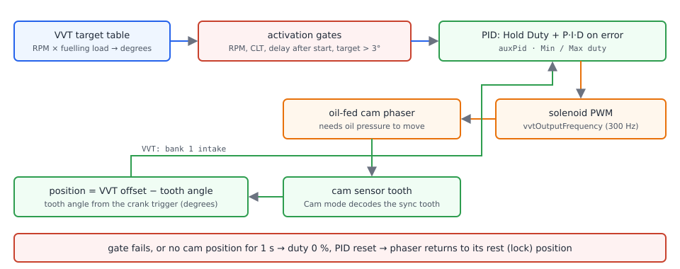
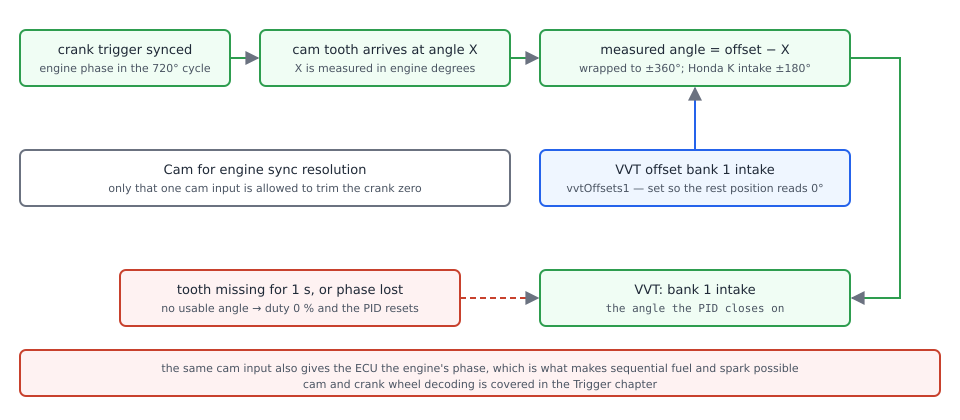
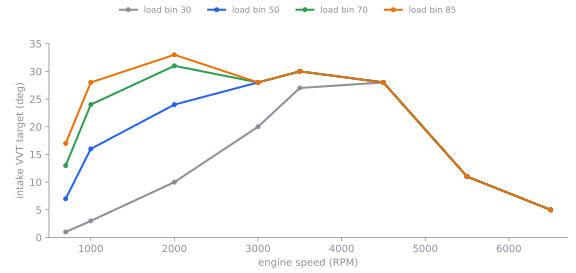

# Cam and valve control

:material-circle:{ .level-basic } Basic → :material-circle:{ .level-advanced } Advanced

> **In one sentence:** rusEFI reads where a camshaft actually is, compares that with where a table says it
> should be, and trims the phaser's solenoid until the two agree — and lets go of the solenoid whenever it
> cannot see the cam.

## What it does

:material-circle:{ .level-basic } Basic

Many engines can rotate one or both camshafts a little inside the engine. The part that does it is a
**cam phaser**: a housing on the end of the camshaft with vanes inside, pushed by engine **oil pressure**
and held by a spool valve — the **VVT solenoid** — that the ECU pulse-width modulates. Rotating the intake
cam towards "advance" opens the intake valves earlier; rotating it back (towards "retard", often called the
**rest** or **lock** position) opens them later. Mechanics and oil do the work; the ECU only moves the
valve.

Putting the ECU in charge gives it:

- **A position closed on real feedback.** rusEFI measures where the cam is from the cam sensor and the
  crank trigger, not from a duty guess.
- **A target you can tune.** A table of degrees by engine speed and load, one for the intake cams and one
  for the exhaust cams.
- **Safe defaults.** The solenoid is only driven above a set engine speed, coolant temperature and time
  after start, and is switched off (0 % duty) as soon as the cam position goes stale.
- **Engine phase.** The same cam inputs tell the ECU which revolution of the four-stroke cycle it is in,
  which is what makes true sequential injection and sequential spark possible — see the Trigger chapter.

rusEFI supports up to four cam inputs and four solenoid outputs, arranged as two banks with an intake and
an exhaust cam each. A single-cam engine uses one of each.
<!-- src: firmware/controllers/actuators/vvt.h (BANK_BY_INDEX, CAM_BY_INDEX, VvtController1 to VvtController4); firmware/controllers/generated/rusefi_generated_proteus_f7.h (CAM_INPUTS_COUNT 4, CAMS_PER_BANK 2, BANKS_COUNT 2) -->

If your camshafts do not move, you still want the **cam input** (for engine phase) and none of the
solenoid material below: leave **VVT solenoid bank 1 intake** `vvtPins1` unassigned, and the two target
table menu entries never appear while the solenoid-related fields in the PID dialog stay greyed out.

!!! danger "A phaser is a hydraulic actuator with the engine's oil pressure behind it"
    With the engine running, a phaser at full duty is driven hard towards its stop, and a phaser with a
    locking pin can hammer that pin. Do not tune near the rest stop with the lock removed, and never
    chase a phaser that is not moving by raising duty while the engine runs — check oil pressure, oil
    temperature and the solenoid's wiring first. A cam that ends up far from where the tune assumes can
    also put the valves where the pistons expect empty space: if you have just changed a cam mode, an
    offset or a cam sensor, treat the first start as a first start.

## How it works

:material-circle:{ .level-intermediate } Intermediate

<figure markdown>
  
  <figcaption>Figure 1 — The VVT control loop. Blue is what is asked for, orange is what is driven, green
  is the measurement that closes the loop, red is what switches it off.</figcaption>
</figure>

Each cam has its own controller, and every one runs **200 times a second** (every 5 ms) from the
engine-module fast callback — not from the cam tooth. Each time round it does the same three things:
build a target, drive the solenoid towards it, and check that it can still see the cam.
<!-- src: firmware/controllers/actuators/vvt.cpp (VvtController::onFastCallback, update); firmware/controllers/engine_controller.cpp (PeriodicFastController::getPeriodMs); firmware/controllers/core/main_loop.h (FAST_CALLBACK_RATE Period200hz, FAST_CALLBACK_PERIOD_MS) -->

### The target

The **VVT intake target** table (`vvtTable1`) maps **engine speed × fuelling load → degrees**; the
**VVT exhaust target** table (`vvtTable2`) does the same for the exhaust cams. Both tables are shared
across banks: bank 1 and bank 2 intake cams read the same target table and the same intake PID. The load
axis is the same value the VE table uses, so a table you already know how to read. Values are degrees,
positive towards advance, and the table range is ±125°.
<!-- src: firmware/controllers/actuators/vvt.cpp (initVvtActuators: vvtTable1 for controllers 1 and 3, vvtTable2 for 2 and 4, getSetpoint uses getFuelingLoad); firmware/integration/rusefi_config.txt (vvtTable1, vvtTable1RpmBins, vvtTable1LoadBins, range ±125) -->

### The gates

Control only runs when all three are true:

1. engine speed is **above** *Do not control below RPM* `vvtControlMinRpm` (factory 600 RPM);
2. coolant temperature is **above** *Do not control below CLT* `vvtControlMinClt` (factory 0 °C, i.e. off);
3. the engine has been running longer than *Activation Delay* `vvtActivationDelayMs` (factory
   **6000 ms**) — time for oil pressure to build before any of it is diverted to the phasers.

On top of that, in the normal (non-advanced) mode rusEFI **switches control off entirely when the target
sits near the rest position**: for an advancing cam it turns on above 3° and off below 1°, and a retarding
cam uses the mirrored −3°/−1°. The reasons given in the code are to stop the integrator winding up
against the stop, and because many phasers do not like being controlled next to their lock pin. The
hysteresis means a target that hovers around 2° leaves the cam alone rather than chattering.

That cut-out follows the **control direction**, and this is what trips people up on a DOHC engine: a cam
whose direction is set to *retard* is controlled only **below −3°**, and released again above −1°. A map
for a retard-direction cam is written in **negative** degrees, otherwise its solenoid never receives duty.
<!-- src: firmware/controllers/actuators/vvt.cpp (getSetpoint: m_isRpmHighEnough, m_isCltWarmEnough, m_engineRunningLongEnough, m_targetHysteresis.test, the comment on integrator windup and the lock pin); firmware/controllers/algo/engine_configuration.cpp (vvtActivationDelayMs = 6000); firmware/controllers/algo/defaults/default_base_engine.cpp (vvtControlMinRpm = 600) -->

### The controller

There is no open-loop term: `getOpenLoop()` returns 0, so the duty is entirely PID. The PID is
**Hold Duty + P·error + I·∫error + D·d(error)/dt**, where *Hold Duty* `auxPid1_offset` is the fixed
feed-forward duty the solenoid needs just to hold the phaser against its spring and oil pressure —
rusEFI's own help on this dialog calls it the bias/feed-forward, and says to find the smallest duty at
which the cam starts to move.

Three things are worth knowing before you touch these fields:

- **The control direction is applied first.** *VVT solenoid intake cams control direction*
  `invertVvtControlIntake` and the matching exhaust setting are **advance** / **retard**: *advance* means
  more duty makes the reported angle more positive, *retard* means more duty makes it more negative.
  rusEFI flips the sign of the error accordingly, which is why a wrong direction makes the cam run away
  from its target instead of settling on it. Most intake cams are *advance* and most exhaust cams *retard*.
- **The output is clamped** to *Min* `auxPid1_minValue` and *Max* `auxPid1_maxValue` (factory 10 % and
  90 %). Those limits apply while control is active; when the gates fail the output is 0 %, not *Min*.
- **The integral is bounded twice.** *iTerm Min*/*iTerm Max* `vvtIntake_iTermMin`/`vvtIntake_iTermMax`
  (−1000 … +1000 by default) and, in the shared PID code, ±100 × the *Max* duty. Changing the mode or the
  integral limits resets the PID and the target hysteresis, so an old trim cannot leak into a new tune.

The I and D factors are multiplied by the PID's own period, which for VVT is the 5 ms minimum because the
VVT dialog offers no period field. That is why an I factor of 0.005 is a gentle number here.
<!-- src: firmware/controllers/actuators/vvt.cpp (getOpenLoop returns 0, getClosedLoop: setErrorAmplification, iTermMin/iTermMax, m_pid.getOutput, onConfigurationChange resets the PID); firmware/util/math/efi_pid.cpp (getOutput, getUnclampedOutputWithPFactor, updateITerm); firmware/util/math/efi_pid.h (GET_PERIOD_LIMITED, PID_MINIMAL_PERIOD_MS 5); firmware/controllers/algo/engine_configuration.cpp (auxPid defaults); firmware/tunerstudio/tunerstudio.template.ini (vvtHelp) -->

Factory gains are not symmetric: the **intake** PID starts at Hold Duty 33 %, P 2, I 0.005, D 0, Min 10 %,
Max 90 %; the **exhaust** PID keeps only the Min/Max limits of 10 %/90 % and has zero gains, so a DOHC
engine's exhaust loop does nothing until you give it numbers.
<!-- src: firmware/controllers/algo/engine_configuration.cpp (auxPid[0] pFactor 2, iFactor 0.005, offset 33, minValue/maxValue, auxPid[1] only minValue/maxValue) -->

### The measurement

The cam position is not a separate sensor reading: it is an angle. rusEFI knows where the crank is from
the trigger wheel, and the cam tooth arrives somewhere inside the 720° cycle; the difference, relative to
a calibration angle, is the phaser's position.

<figure markdown>
  
  <figcaption>Figure 2 — Where the number on the VVT gauge comes from. Set *VVT offset bank 1 intake* so
  that the cam's normal rest position reads 0°.</figcaption>
</figure>

Two consequences matter when something looks wrong:

- **A cam that only gives one tooth per revolution still gives a position**, but only after the engine's
  phase is synchronised. Until then rusEFI deliberately does not record a VVT angle.
- **The reading expires.** A position is used only if a cam tooth updated it within the last second;
  otherwise the controller has no feedback, sets 0 % duty and resets its PID.
<!-- src: firmware/controllers/trigger/trigger_central.cpp (handleVvtCamSignal: vvtOffsets minus currentPosition, wrapVvt, hasSynchronizedPhase, adjustCrankPhase, maxCamPhaseResolveRpm); firmware/controllers/actuators/vvt.cpp (observePlant); firmware/controllers/trigger/trigger_central.cpp (isVvtPositionFresh: one second) -->

### When it lets go

The solenoid drops to 0 % duty, and the PID starts over, whenever the target is unavailable (a gate failed,
or the target is sitting at the rest position in normal mode) or the cam angle is unavailable. That is also
why a cam sensor that drops out at high RPM shows up as the cam drifting back to its rest position.
<!-- src: firmware/controllers/actuators/vvt.cpp (setOutput: duty 0 and m_pid.reset when there is no output value) -->

!!! info "Advanced"
    **VVT Advanced Mode** `vvtAdvancedModeEnabled` (bottom of the VVT PID dialog) changes what the
    feed-forward and the P gain are, not how the loop closes. *Hold Duty* is replaced by a **base duty
    curve against oil pressure** (six points, kPa → %; evaluated at 0 kPa when there is no oil pressure
    sensor), and the fixed *P factor* is replaced by a **P factor curve against the distance from target**
    (nine points, ±40° → gain, entered ×100). I, D, the integral limits and the Min/Max clamps behave as
    before, and the intake and exhaust curves are separate and shared across banks. Advanced mode also
    **removes the rest-position cut-out**, so the solenoid is driven at whatever the oil-pressure curve
    says even with a 0° target — see *Tuning it* before switching it on.
    <!-- src: firmware/controllers/actuators/vvt.cpp (getClosedLoop advanced branch, vvtDistance, per-cam curves); firmware/controllers/actuators/vvt_advanced_engineConfiguration.txt (the six curve fields and their help); firmware/controllers/algo/defaults/default_base_engine.cpp (curve axes seeded to ±40° and 0…1000 kPa) -->

## Cam inputs and cam modes

:material-circle:{ .level-intermediate } Intermediate

Cam inputs are ordinary digital or variable-reluctance inputs — the board files list the event-capable ones
under the *event inputs* class — and they are configured on **Setup ▸ Trigger** (the *Cam Inputs* group)
rather than in a VVT dialog:

- **Cam mode (intake)** `vvtMode1` and **Cam mode (exhaust)** `vvtMode2` tell rusEFI what the cam wheel
  looks like — *Single Tooth*, *Toyota 3 Tooth Even/2JZ*, *Miata NB*, *Bosch Quick Start*, *Nissan VQ*,
  *Honda K Intake*, *BMW VANOS Reluctor*, *Ford Coyote*, *Subaru 3-1-2-1*, *Mazda Skyactiv*, *Sync by MAP*
  and the rest. Choose the shape your cam wheel has, not the engine's name: some shapes are used by many
  engines. The mode belongs to the **cam type**, so one choice covers both banks' intake cams.
- **Cam sensor bank 1 intake** `camInputs1` … **Cam sensor bank 2 exhaust** `camInputs4` are the physical
  inputs, one per cam.
- **intake Cam Edge Select** `invertCamVVTSignal` and **exhaust Cam Edge Select**
  `invertExhaustCamVVTSignal` pick which edge of that signal is counted: *Rising* (default) or *Falling*.
- **VVT offset bank 1 intake** `vvtOffsets1` … `vvtOffsets4` are the calibration angles in Figure 2.
- **Cam for engine sync resolution** `engineSyncCam` picks the one input allowed to correct the crank's
  zero; the others only report position.

The 2JZ-style three-tooth wheel is the exception that needs two more fields — **2JZ Tooth Detection
Position** `camDecoder2jzPosition` (default 95) and **2JZ Detection Precision** `camDecoder2jzPrecision`
(default 40): teeth arriving outside that window of engine phase are ignored, which is how a symmetrical
three-tooth wheel is decoded. *Sync by MAP* needs no cam wheel at all: it uses the pressure bumps of the
induction strokes to find the phase, and its **MAP readout angle** and **MAP delta threshold** appear on
**Setup ▸ Advanced Trigger**.
<!-- src: firmware/integration/rusefi_config.txt (vvt_mode_e_enum, vvtMode, camInputs, invertCamVVTSignal, vvtOffsets, engineSyncCam, camDecoder2jzPosition); firmware/controllers/trigger/trigger_central.cpp (skipToothSpecialShape: the 2JZ window, vvtWithRealDecoder); firmware/tunerstudio/tunerstudio.template.ini (trigger_cams panel, trigger_advanced: mapCamDetectionAnglePosition, mapSyncThreshold); firmware/controllers/algo/defaults/default_base_engine.cpp (camDecoder2jzPosition 95, camDecoder2jzPrecision 40) -->

Three more cam settings live on **Setup ▸ Advanced Trigger**: **Require cam/VVT sync for ignition**
`isPhaseSyncRequiredForIgnition` (factory *yes*), **Cam sync crank revolution**
`camSyncOnSecondCrankRevolution` (factory *first*) and **Maximum cam/VVT sync RPM**
`maxCamPhaseResolveRpm` (factory 0 = always use the cam to pin the crank's phase; set a ceiling if your
cam sensor misbehaves high in the rev range).

<figure markdown>
  <!-- shot: img/ts/vvt-cam-inputs.png | Setup ▸ Trigger | Strokes Four Stroke, Trigger type 60-2, Crank Sensor (Primary channel) VR 1, Trigger Angle Advance 0, Cam mode (intake) Single Tooth, Cam mode (exhaust) Inactive, Cam sensor bank 1 intake VR 2, intake Cam Edge Select Rising, VVT offset bank 1 intake 0, Cam for engine sync resolution Intake First Bank | The Cam Inputs group on the Trigger dialog: a 60-2 crank on VR 1 and a single-tooth cam on VR 2 -->
  <figcaption>Figure 3 — Cam inputs are configured next to the crank trigger, not in a VVT dialog.</figcaption>
</figure>

<figure markdown>
  <!-- shot: img/ts/vvt-advanced-trigger.png | Setup ▸ Advanced Trigger | Require cam/VVT sync for ignition yes, Cam sync crank revolution first, Maximum cam/VVT sync RPM 0, Enable noise filtering off, Console Logging panel with Print verbose VVT sync details to console off | The Advanced Trigger dialog with the cam phase options -->
  <figcaption>Figure 4 — Cam phase options: only the one cam named in Figure 3 corrects the crank's phase.</figcaption>
</figure>

## Before you start

:material-circle:{ .level-basic } Basic

You need:

- **A cam sensor on an event input.** On Proteus those are on the Black 23-way connector: **VR 1**
  (Black 23 pins 5 and 13, + and −), **VR 2** (pins 4 and 12) and **Digital 1 … Digital 6** (pins 10, 1, 2,
  3, 9 and 11). Use a variable-reluctance input for a VR cam wheel and a Digital input for a Hall sensor;
  a Hall cam sensor needs 12 V or 5 V supply and ground as its datasheet says.
- **The solenoid on a switching output.** Proteus does not dedicate an output for VVT, so use one of the
  flyback-protected low-side outputs: **Lowside 13** (Black 35 pin 10), **Lowside 14** (pin 11),
  **Lowside 15** (pin 12) or **Lowside 16** (pin 23). Feed the solenoid from switched 12 V and let the ECU
  switch the other side to ground.
- **Healthy oil.** The phaser is hydraulic: correct oil level, grade and pressure, and a clean spool valve.
  A phaser that does not move with the solenoid clicked is an oil problem, not a tune problem.
- **The ECU on 12 V (ignition on)** for every check in this chapter — never USB power alone.
<!-- src: firmware/config/boards/proteus/connectors/black23.yaml (VR 1/VR 2 and Digital 1 to 6 event inputs with their pin numbers); firmware/config/boards/proteus/connectors/black35.yaml (Lowside 13, 14 or starter, 15, 16 with flyback) -->

!!! danger "The bench button puts full current through the solenoid"
    The VVT bench buttons drive the solenoid at **100 % duty for 0.3 s** — more current than the tuned loop
    ever asks for. One click to hear the click is fine; holding a spool valve at full duty cooks its coil.
    With the engine off the cam will not move at all (no oil pressure), so use the button to test wiring and
    audibly confirm the valve, not to test the phaser.

!!! warning "Calibrate and check with the ignition on — never on USB power alone"
    On USB the ECU runs, but the sensor supplies and the coolant/oil readings are not what they will be on
    the engine, and the bench buttons are greyed out for the same reason. Do the work with the ignition on.

## Setting it up

:material-circle:{ .level-basic } Basic → :material-circle:{ .level-intermediate } Intermediate

Everything is in TunerStudio. Cam inputs are under **Setup ▸ Trigger** and **Setup ▸ Advanced Trigger**;
the solenoid, gates and PID are in one dialog, **Advanced ▸ VVT outputs and PID**
(`vvtPidDialog`), and the target tables are **Advanced ▸ VVT intake target** and
**Advanced ▸ VVT exhaust target**. Those last two entries only appear once a cam mode *and* a solenoid
output are set, and the panels of the PID dialog only appear once a cam mode is set — if something is missing,
that is why, and it is also why you configure the input first. If **Advanced ▸ VVT outputs and PID** is
missing with a cam mode already chosen, TunerStudio's tuning view is set to Basic rather than Full.

### 1 · Name the cam input and its shape

Open **Setup ▸ Trigger** and fill in the *Cam Inputs* group as in Figure 3: **Cam mode (intake)**, and
**Cam sensor bank 1 intake** with the input the sensor is wired to. Leave the offsets and edges alone for
now. Burn. A power-cycle is not needed for the input itself — it is the solenoid output and the PWM
frequency that need one, in step 4.
<!-- src: firmware/tunerstudio/tunerstudio.template.ini (trigger_cams panel fields, requiresPowerCycle lists vvtPins1 and vvtOutputFrequency but no cam input) -->

### 2 · Prove the signal is there

This is done in the rusEFI console: open **Engine Sniffer**, crank the engine and watch the cam input's
line. The sniffer shows the four cam inputs (bank 1 intake, bank 1 exhaust, bank 2 intake, bank 2 exhaust)
as edges, so you can see the tooth arrive once per cam revolution — and with *Display logic signals* you
see the raw level rather than the decoded edge. A cam input that stays flat here is a wiring problem and
no amount of PID tuning will fix it.

Turn on **Print verbose VVT sync details to console** (**Setup ▸ Advanced Trigger**) if the ECU keeps
reporting cam decoding errors; it prints the decoding to the console below the sniffer speed threshold.
<!-- src: firmware/console/binary/output_channels.txt (vvtChannel1 to vvtChannel4: bank 1 intake cam input and so on); firmware/integration/rusefi_config.txt (displayLogicLevelsInEngineSniffer help applies to cam/vvt input, verboseVVTDecoding) -->

<figure markdown>
  <!-- shot: img/console/vvt-engine-sniffer.png | rusEFI console ▸ Engine Sniffer | Proteus F7 on 12 V, engine cranking, 60-2 crank on VR 1 and single-tooth cam on VR 2, Display logic signals off | The cam tooth arriving once per cam revolution in the engine sniffer -->
  <figcaption>Figure 5 — The cam input in the engine sniffer: one clean edge per cam revolution.</figcaption>
</figure>

### 3 · Set the offset so the rest position reads 0°

Open **Advanced ▸ VVT intake target** (`vvtIntakeTargetDialog`). Its right-hand panel *VVT status & offset*
holds **VVT offset bank 1 intake** and two gauges: **VVT: bank 1 intake** (the measured angle) and
**VVT: bank 1 intake output** (the duty the controller is asking for). With the engine idling and the
phaser parked at rest, turn the offset until the gauge reads about 0°, then Burn. rusEFI's own note on
this field says exactly that: set the offset so VVT indicates 0 degrees in the default position.

The offset is an angle in the 720° engine cycle, so an offset that is one cam-tooth off will read plausible
but wrong numbers; that is why this step comes before any tuning.
<!-- src: firmware/tunerstudio/tunerstudio.template.ini (vvtIntakeTargetDialog, vvtIntakeTargetRight panel: vvtOffsets1 field, vvtPositionB1IGauge, vvtOutput1Gauge, the "#Set offset so VVT indicates 0 degrees in default position" line); firmware/tunerstudio/gauge_declarations.ini (VVT: bank 1 intake, VVT: bank 1 intake output) -->

<figure markdown>
  <!-- shot: img/ts/vvt-intake-target-offset.png | Advanced ▸ VVT intake target | Proteus F7, ignition on, engine idling warm, table all zeros, VVT offset bank 1 intake 318, VVT: bank 1 intake gauge reading 0.0 deg, VVT: bank 1 intake output gauge at 0 | The intake target dialog with the offset and live gauges -->
  <figcaption>Figure 6 — Set the offset here, watching *VVT: bank 1 intake* come to 0° at rest.</figcaption>
</figure>

### 4 · Assign the solenoid and listen for it

Open **Advanced ▸ VVT outputs and PID** and, in the *Configuration* panel:

1. **VVT solenoid bank 1 intake** `vvtPins1` → your output (for example *Lowside 13*).
2. **PWM frequency** `vvtOutputFrequency` → leave the factory **300 Hz** unless the solenoid's data says
   otherwise.
3. **VVT solenoid intake cams control direction** `invertVvtControlIntake` → *advance* for now (step 5
   proves it).

Then press **Bench bank 1** in the *Intake PID* panel. You should hear the solenoid click. This button is
greyed out unless the engine has not run recently, and it drives that one output at full duty for 0.3 s.
*Bench bank 2* in the same panel is the **bank 2 intake** solenoid, so a four-cylinder with one solenoid
should do nothing at all.

Burn, then **power-cycle the ECU**: the solenoid outputs and their frequency are set up at start-up, and
changing them needs a restart.
<!-- src: firmware/controllers/bench_test.cpp (vvtValveBench: pinbench with BENCH_VVT_DURATION 300 ms at 100 % duty); firmware/controllers/generated/rusefi_generated_proteus_f7.h (BENCH_VVT_DURATION 300); firmware/controllers/actuators/vvt.cpp (turnVvtPidOn, startVvtControlPins: only pins that are assigned get a PWM); firmware/tunerstudio/tunerstudio.template.ini (requiresPowerCycle vvtPins1, vvtOutputFrequency, commandButton "Bench bank 1" gated on engineTurnedRecently == 0) -->

<figure markdown>
  <!-- shot: img/ts/vvt-pid-dialog-defaults.png | Advanced ▸ VVT outputs and PID | Proteus F7, ignition on, engine stopped: Configuration panel with Activation Delay 6000 ms, Do not control below RPM 600, Do not control below CLT 0, VVT solenoid bank 1 intake Lowside 13, others NONE, PWM frequency 300 Hz, control direction advance; Intake PID panel with Hold Duty 33, P 2, I 0.005, D 0, Min 10, Max 90, iTerm Min -1000, iTerm Max 1000; Exhaust PID panel all zeros except Min 10 Max 90 | The VVT Configuration & PID dialog with its factory values -->
  <figcaption>Figure 7 — One dialog, three panels: gates and outputs on the left, intake PID in the middle,
  exhaust PID on the right. Note the exhaust column is all zeros.</figcaption>
</figure>

### 5 · Check which way the cam actually moves

With the engine **warm** and holding a steady speed **above** *Do not control below RPM*, raise one cell of
the intake table (a mid-range corner is easiest to see) to about 10°, Burn, and watch
**VVT: bank 1 intake**:

- The angle moves **away from 0** by a few degrees and holds: the direction is right.
- The angle runs to the stop, or the duty sits at *Max* while the angle goes the wrong way: switch
  **VVT solenoid intake cams control direction** to *retard*, Burn, and repeat.

Set the table back to zeros afterwards.
<!-- src: firmware/controllers/actuators/vvt.cpp (shouldInvertVvt, m_pid.setErrorAmplification); firmware/integration/rusefi_config.txt (invertVvtControlIntake help: advance/retard) -->

### 6 · Set the gates to suit your engine

In the *Configuration* panel: **Do not control below RPM** (a good first number is a couple of hundred RPM
above idle, factory 600), **Do not control below CLT** (for example 40 °C, so the phaser stays parked while
the engine is warming) and **Activation Delay** (factory 6000 ms; leave it unless your oil pressure takes
longer to come up). Remember the gates use *above*, and that control also stops on its own when the target
is within the 1–3° rest band.
<!-- src: firmware/controllers/actuators/vvt.cpp (getSetpoint gates, rest-position hysteresis) -->

### 7 · Give it a target

Fill **Advanced ▸ VVT intake target**. rusEFI's own starting advice, on the dialog's help, is a map along
the lines of *zero degrees at idle, 10 degrees at 2000 RPM and 20 degrees at 3000 RPM*; a shipped base tune
like the one in Figure 11 is the same idea with more resolution. Start low and stay clear of the ends of
the phaser's travel: a target beyond the phaser's range just means permanent full duty.

Burn, drive, and log **VVT: bank 1 intake** against **VVT: bank 1 intake target** before you raise the
numbers again.
<!-- src: firmware/tunerstudio/tunerstudio.template.ini (vvtHelp: the suggested test map); firmware/integration/rusefi_config.txt (vvtTable1) -->

<figure markdown>
  <!-- shot: img/ts/vvt-intake-target-table.png | Advanced ▸ VVT intake target | Y axis fueling load, RPM bins 700 to 6500, load bins 30 to 85, table filled with 0 degrees below 1500 RPM rising to 20 to 25 degrees at 2500 to 4000 RPM, back to 5 degrees above 5500 RPM | A first intake target map: parked at idle, advancing in the mid range, parked again at the top -->
  <figcaption>Figure 8 — The target table is degrees of cam rotation, read at the same engine speed and load
  as your VE table.</figcaption>
</figure>

### 8 · The PID: from the numbers rusEFI ships, or from zero

The factory intake numbers (Hold Duty 33, P 2, I 0.005, D 0) are a starting point for a typical
oil-pressure phaser. rusEFI's own advice on this dialog is that it is often better to **start with all
zeros** for offset, P, I and D and then:

1. raise **Hold Duty** until the cam just starts to move — that is the feed-forward;
2. raise **P factor** from zero until the angle starts to oscillate when the target changes, then back
   off;
3. leave **I factor** at 0 until the steady error is the problem, then add a little;
4. touch **D factor** last, if at all.

Keep *Min* and *Max* inside what the solenoid can take: the factory 10 %/90 % is a reasonable guard rail,
and a *Min* of 0 with a phaser that needs some duty to hold position means the cam drops when the PID
trims down.
<!-- src: firmware/tunerstudio/tunerstudio.template.ini (vvtHelp: the offset-then-P procedure, "sometimes better to start with all zeros"); firmware/controllers/algo/engine_configuration.cpp (auxPid factory values) -->

<figure markdown>
  <!-- shot: img/ts/vvt-pid-bench-buttons.png | Advanced ▸ VVT outputs and PID | Proteus F7, ignition on, engine stopped and not run recently so the buttons are enabled: Intake PID panel Bench bank 1 and Bench bank 2 enabled, Exhaust PID panel Bench bank 1 and Bench bank 2 enabled, example values VVT solenoid bank 1 intake Lowside 13 and bank 1 exhaust Lowside 14 | The four VVT bench buttons, enabled with the engine stopped -->
  <figcaption>Figure 9 — One button per solenoid, active only with the engine stopped: intake panel covers
  banks 1 and 2 intake, exhaust panel covers banks 1 and 2 exhaust.</figcaption>
</figure>

### 9 · A second (exhaust) cam, if you have one

Set **Cam mode (exhaust)** and **Cam sensor bank 1 exhaust** on **Setup ▸ Trigger**, set **VVT solenoid
bank 1 exhaust** `vvtPins2` in the *Configuration* panel, set **VVT solenoid exhaust cams control
direction** to *retard* unless a check like step 5 says otherwise, set the exhaust offset
`vvtOffsets2` the same way as step 3, and fill the new **Advanced ▸ VVT exhaust target** table. The
*Exhaust PID* panel starts with zero gains, so it needs real numbers — usually the same shape as the
intake tune. Burn and power-cycle after assigning the output.

Keep the **sign** of that table and the direction together. If you set the exhaust direction to *retard*,
the rest-position cut-out wants targets below −3°, so write the map in negative degrees; if you leave it at
the factory *advance*, the map stays positive — which is what rusEFI's Hyundai Gamma base tune does: it
uses *Single Tooth* for both cam modes, leaves the exhaust direction alone, and ships a positive 40–50°
exhaust table. Other shipped base tunes do set *retard* for their exhaust cam. Either way the direction and
the sign have to agree, and the check in step 5 works for the exhaust cam too.
<!-- src: firmware/tunerstudio/tunerstudio.template.ini (vvtMode2, camInputs2, vvtPins2, vvtOffsets2, vvtTable2Tbl as the "VVT exhaust target" menu entry); firmware/controllers/actuators/vvt.cpp (CAM_BY_INDEX selects the exhaust PID and exhaust table, shouldInvertVvt, the mirrored rest-position band) -->
<!-- src: firmware/config/engines/hyundai.cpp (setHyundaiPb: VVT_SINGLE_TOOTH for both cam modes, no change to the exhaust direction, commonGenesisCoupe sets invertVvtControlExhaust) -->
<!-- src: firmware/config/engines/hyundai_pb_canned_tables.cpp (pbcannedvvtTable2 values are all positive) -->
<!-- src: firmware/integration/rusefi_config.txt (invertVvtControlExhaust labels advance and retard, default 0) -->

<figure markdown>
  <!-- shot: img/ts/vvt-exhaust-target-table.png | Advanced ▸ VVT exhaust target | Proteus F7 DOHC example, ignition on, RPM bins 700 to 6500, load bins 30 to 85, control direction retard, table with 0 degrees at idle and WOT and minus 10 to minus 25 degrees through the mid range so a retard-direction target passes the cut-out | The exhaust target table; note this table is a TunerStudio table, not a settings panel -->
  <figcaption>Figure 10 — The exhaust cams get their own table and their own PID column.</figcaption>
</figure>

## Worked examples

:material-circle:{ .level-intermediate } Intermediate

### Example 1 — a four-cylinder with one intake phaser, on Proteus

A first setup for a four-cylinder with a 60-2 crank wheel and a single-tooth cam wheel, on Proteus F7. The
factory values are rusEFI's own; the wiring is what this configuration needs:

| Setting | Value | Why |
|---|---|---|
| Trigger type / crank input | 60-2 · **VR 1** (Black 23 pins 5, 13) | see the Trigger chapter |
| Cam mode (intake) `vvtMode1` | *Single Tooth* | one tooth per cam revolution |
| Cam sensor bank 1 intake `camInputs1` | **VR 2** (Black 23 pins 4, 12) | the second VR input is free |
| intake Cam Edge Select `invertCamVVTSignal` | *Rising* | factory |
| Cam for engine sync resolution `engineSyncCam` | *Intake First Bank* | factory; this cam also sets phase |
| VVT offset bank 1 intake `vvtOffsets1` | 0 until trimmed, then whatever makes the gauge read 0° at rest | Figure 2 |
| VVT solenoid bank 1 intake `vvtPins1` | **Lowside 13** (Black 35 pin 10) | flyback-protected low side |
| PWM frequency `vvtOutputFrequency` | 300 Hz | factory (`DEFAULT_SOLENOID_FREQUENCY`) |
| Intake control direction `invertVvtControlIntake` | *advance* | typical intake phaser |
| Do not control below RPM `vvtControlMinRpm` | 600 RPM | factory |
| Do not control below CLT `vvtControlMinClt` | 40 °C | factory 0, i.e. off; keep the phaser parked cold |
| Activation Delay `vvtActivationDelayMs` | 6000 ms | factory |
| Intake PID Hold Duty / P / I / D | 33 % / 2 / 0.005 / 0 | factory values, checked by the procedure in step 8 |
| Min / Max | 10 % / 90 % | factory |
| iTerm Min / Max | −1000 / 1000 | factory defaults |

Note that the offset only has meaning together with the cam mode and the crank trigger: a different wheel,
or a different cam mode for the same wheel, needs a new offset.
<!-- src: firmware/controllers/actuators/vvt.cpp (shouldInvertVvt, rest-position hysteresis bands); firmware/controllers/algo/engine_configuration.cpp (auxPid and vvtOutputFrequency defaults); firmware/controllers/algo/defaults/default_base_engine.cpp (vvtControlMinRpm); firmware/controllers/generated/rusefi_generated_proteus_f7.h (DEFAULT_SOLENOID_FREQUENCY 300); firmware/config/boards/proteus/connectors/black23.yaml (VR 2, Digital 1 to 6); firmware/config/boards/proteus/connectors/black35.yaml (Lowside 13 with flyback) -->

### Example 2 — what a shipped target map looks like

rusEFI ships base tunes with real VVT maps. The Mazda MX-5 NB 1.8 VVT base tune drives one intake phaser
with a cam mode of *Miata NB*, an offset of 98°, and a table whose load bins are 30 to 85 and whose RPM
bins are 700 to 6500:

<figure markdown>
  
  <figcaption>Figure 11 — The shipped MX-5 NB 1.8 VVT intake map, four of its eight load slices. Note the
  shape: parked at idle and at the rev limit, maximum advance in the mid range, and never past 33°.</figcaption>
</figure>

Two habits worth copying from it: **the corner cells are not the interesting ones** (the low-load, low-RPM
corner sits near zero, which also lets the rest-position cut-out park the cam), and **the map comes back to
zero at the top end** so a cam that has run out of oil pressure at 6500 RPM is commanded to its stop
rather than being fought over.

A DOHC base tune also sets the exhaust table: rusEFI's Hyundai Gamma base tune uses *Single Tooth* for both
cam modes, offsets 227° intake and 50° exhaust, an intake table that is zero below about 2000 RPM and 30
to 35° in the mid range, and a non-zero exhaust table everywhere — with the direction left at the factory
*advance*, that keeps the exhaust loop active at every point of the map.
<!-- src: firmware/config/engines/mazda/mazda_miata_vvt.cpp (vvt18RpmBins, vvt18LoadBins, SCRIPT_TABLE_vvt_target, VVT_MIATA_NB, vvtOffsets 98); firmware/config/engines/hyundai.cpp (VVT_SINGLE_TOOTH for both cam modes, vvtOffsets 227 and 50); firmware/config/engines/hyundai_pb_canned_tables.cpp (pbcannedvvtTable1, pbcannedvvtTable2) -->

!!! tip "Copy a map, do not copy a duty"
    Base tunes give you target angles and PID *shapes*. Oil pressure, phaser stiffness and solenoid flow
    differ, so the Hold Duty of one engine is not the Hold Duty of another: re-derive it with the
    step-by-step in *Tuning it*.

## Tuning it

:material-circle:{ .level-intermediate } Intermediate → :material-circle:{ .level-advanced } Advanced

Log **VVT: bank 1 intake**, **VVT: bank 1 intake target**, **VVT: bank 1 intake output** and the PID
internals **vvtStatus1_error**, **vvtStatus1_iTerm** and **vvtStatus1_resetCounter**, then drive a
steady throttle sweep. A well-tuned loop tracks the target within a degree or two in the mid range,
without oscillation.

- **Steady error, no oscillation** → raise **Hold Duty** a little (the feed-forward is what carries the
  average duty), or add a small **I factor**.
- **Oscillation around the target** → lower **P factor**; if it only oscillates as the target steps, that
  is P again, and a small **D factor** may help.
- **Cam never reaches the target** → the target is beyond the phaser's travel, or *Max* is too low, or oil
  pressure is not there. Look at **VVT: bank 1 intake output**: parked at *Max* means the loop has run out
  of authority.
- **vvtStatus1_resetCounter climbing** → the loop is dropping out (gates, rest band or lost cam feedback)
  and starting again.
<!-- src: firmware/console/binary/output_channels.txt (vvtPositionB1I, vvtTargets1, vvtStatus1 error/iTerm/resetCounter); firmware/tunerstudio/gauge_declarations.ini (VVT: bank 1 intake, VVT: bank 1 intake target, VVT: bank 1 intake output); firmware/controllers/actuators/vvt.cpp (setOutput resets the PID when control drops out) -->

<figure markdown>
  <!-- shot: img/ts/vvt-view-graph.png | View ▸ vvt | Proteus F7, engine idling warm with a non-zero intake target, live graph showing target and solenoid duty lines and the distance-from-target line flat at zero | TunerStudio's live VVT graph: target, duty and (advanced mode) signed distance from target for the bank 1 intake controller -->
  <figcaption>Figure 12 — The live VVT graph, handy while a helper changes Hold Duty.</figcaption>
</figure>

!!! warning "Advanced mode moves the cut-out, not just the gains"
    With **Advanced Mode** enabled the rest-position cut-out is bypassed and the base-duty curve decides
    what the solenoid gets even at a 0° target — including at low oil pressure, where the curve is read at
    0 kPa. Enabling it also resets the PID and the target hysteresis. Do not enable it on an engine whose
    oil pressure is not already proven, and if you do, start with the whole base-duty curve at 0 % and
    work up while watching **VVT: bank 1 intake output** and oil pressure.
    <!-- src: firmware/controllers/actuators/vvt.cpp (getSetpoint: hysteresis only when vvtAdvancedModeEnabled is off, getClosedLoop advanced branch); firmware/controllers/actuators/vvt_advanced_engineConfiguration.txt (base duty evaluated at 0 kPa when oil pressure is unavailable) -->

## Diagnostics

:material-circle:{ .level-intermediate } Intermediate

What the numbers say:

| What you see | What it means |
|---|---|
| **VVT: bank 1 intake target** reads 0 while the table does not | a gate is failing (RPM, CLT, activation delay) — the target channel is only written when the gates pass |
| **VVT: bank 1 intake** reads 0 and never moves | the engine is not phase-synchronised, or no cam tooth has arrived for a second |
| **VVT: bank 1 intake output** sits at 0 % with a non-zero target | control is off: rest-position cut-out (target within 1–3°) or no cam feedback |
| Output sits at *Max* | out of authority: target too aggressive, *Max* too low, or oil pressure/phaser problem |
| Angle moves away from the target as duty rises | control direction is wrong for this phaser |
| `vvtStatus1_resetCounter` climbing | the loop keeps dropping out |
| `vvtDistance` is always 0 | normal: it is only used by advanced mode |
<!-- src: firmware/controllers/actuators/vvt.cpp (getSetpoint writes engine->outputChannels.vvtTargets only after the gates, setOutput, vvtDistance only in advanced mode); firmware/controllers/trigger/trigger_central.cpp (position only recorded when the phase is synchronised, isVvtPositionFresh); firmware/controllers/actuators/vvt.txt (vvtDistance: VVT signed target error) -->

Warnings rusEFI raises about the cam side of things:

| Message / code | Cause |
|---|---|
| `VVT: event on N but no mode` (6727) | a cam input is decoding edges while **Cam mode** for that cam type is *Inactive* — pick the mode, or unassign the input |
| `VVT sync position too close to trigger sync` (6675) | the cam tooth lands within 7° of the crank sync point; a small trigger offset usually moves it |
| `cam ... not enough teeth between sync points` (9005) / `too many teeth` (9004) | the cam mode does not match the wheel you actually have |
<!-- src: firmware/controllers/trigger/trigger_central.cpp (handleVvtCamSignal: CUSTOM_VVT_MODE_NOT_SELECTED, the 7-degree VVT_SYNC_POSITION warning); firmware/controllers/trigger/trigger_decoder.cpp (CUSTOM_CAM_NOT_ENOUGH_TEETH, CUSTOM_CAM_TOO_MANY_TEETH); firmware/controllers/algo/obd_error_codes.h (code numbers 6727, 6675, 9005, 9004) -->

Channels worth adding to your default log:

| Channel | What it shows |
|---|---|
| VVT: bank 1 intake / bank 1 exhaust / bank 2 intake / bank 2 exhaust | measured cam angles, 0.02° resolution |
| VVT: bank 1 intake target … | the table's answer (1° resolution) |
| VVT: bank 1 intake output (`vvtStatus1_output`) | what the controller is commanding, 0–100 % |
| vvtStatus1_error / iTerm / dTerm | the PID's internals |
| vvtChannel1 … vvtChannel4 | the raw cam input levels, for the engine sniffer |
<!-- src: firmware/console/binary/output_channels.txt (vvtPositionB1I with 1/50 resolution, vvtTargets, vvtStatus, vvtChannel1 to 4); firmware/integration/rusefi_config_shared.txt (gauge names VVT: bank 1 intake and so on) -->

## Troubleshooting

:material-circle:{ .level-basic } Basic → :material-circle:{ .level-advanced } Advanced

| Symptom | Likely cause | Check |
|---|---|---|
| **Advanced ▸ VVT outputs and PID** has no panels, or the target menu entries are missing | the cam mode is *Inactive*, or no solenoid output is assigned; or TunerStudio's view is Basic | *Cam Inputs* group; *Configuration* panel; switch the tuning view to Full |
| **Bench bank 1** greyed out | the engine has run recently, or the ECU is on USB power only | ignition on, engine off, wait for the "recently" window to pass |
| Bench click but the cam never moves | no oil pressure at that RPM, locked phaser, or the solenoid's feed is not switched 12 V | oil pressure and temperature; the solenoid's supply |
| No click on the bench button | the output is not assigned, the ECU has not been power-cycled since it was, or the wiring is wrong | step 4; **Bench test** in *Controller* for a general output check |
| **VVT: bank 1 intake** jumps between two values | cam mode does not match the wheel (e.g. a multi-tooth wheel set to *Single Tooth*) | cam mode and tooth count |
| Cam angle reads a plausible but constant number | offset hides a wrong phase; or the input is the wrong one | step 3; the engine sniffer, step 2 |
| Engine runs rough only above the VVT activation point | targets are out of the phaser's real range, or the direction is wrong | step 5; lower the table |
| Cam drifts back to rest at high RPM | cam tooth dropping out (sensor gap, wiring, *Maximum cam/VVT sync RPM*) | engine sniffer at that RPM; the 1-second freshness rule |
| Loop only works on bank 1 | the PID gains and target tables are shared per cam type — check the bank's own **Cam sensor bank 2 …** input and **VVT solenoid bank 2 …** output | step 1 and step 4 |
| Nothing happens on the exhaust cam | its PID column ships with zero gains | step 9 |
| Exhaust solenoid never gets duty although the exhaust table is full | the direction is *retard* while the table is written in positive degrees, so the cut-out wants a target below −3° | step 9, and the note on the cut-out's sign |

## Settings reference

### Cam Inputs (Setup ▸ Trigger)

--8<-- "reference/settings/_trigger_cams.table.md"

### Advanced Trigger (Setup ▸ Advanced Trigger)

--8<-- "reference/settings/_trigger_advanced.table.md"

### VVT outputs and PID (Advanced ▸ VVT outputs and PID)

--8<-- "reference/settings/_vvtPidDialog.table.md"

### Intake VVT Target (Advanced ▸ VVT intake target)

--8<-- "reference/settings/_vvtIntakeTargetDialog.table.md"

The target maps themselves are TunerStudio tables, not settings panels, so they have no generated table
here: **VVT intake target** is `vvtTable1` over `vvtTable1RpmBins` × `vvtTable1LoadBins`, and **VVT
exhaust target** is `vvtTable2` over its own bins; both are 8 × 8 with values in degrees.
<!-- src: firmware/integration/rusefi_config.txt (vvtTable1, vvtTable2 and their bins, 8 x 8, ±125 degrees); firmware/tunerstudio/tunerstudio.template.ini (vvtTable1Tbl, vvtTable2Tbl table definitions) -->

## Related

- Part II — Wiring sensors and outputs (cam sensor inputs, flyback-protected outputs, sensor ground)
- Trigger — crank and cam wheels, cam modes and engine phase synchronisation
- Outputs — how an output name in TunerStudio maps to a connector pin
- Idle — the cold-idle conditions VVT should stay out of
- Ignition and Fuel — sequential operation, which needs the cam input to know the phase
- Lua scripting — the cam-side live data is readable from scripts
