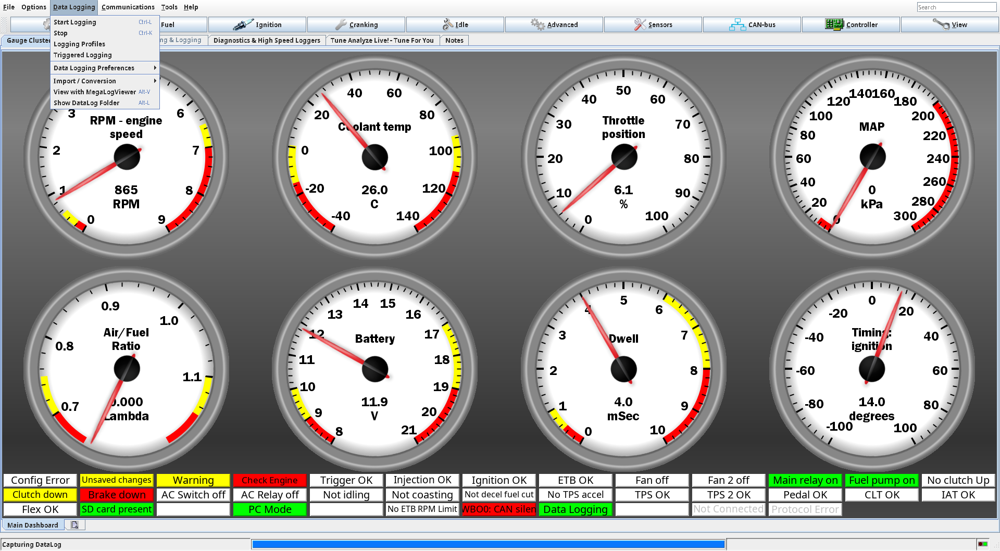
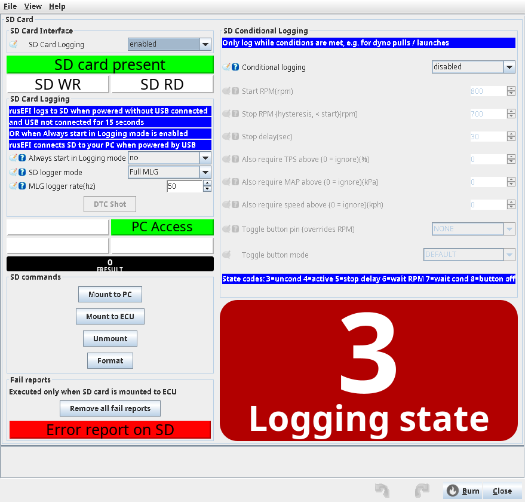
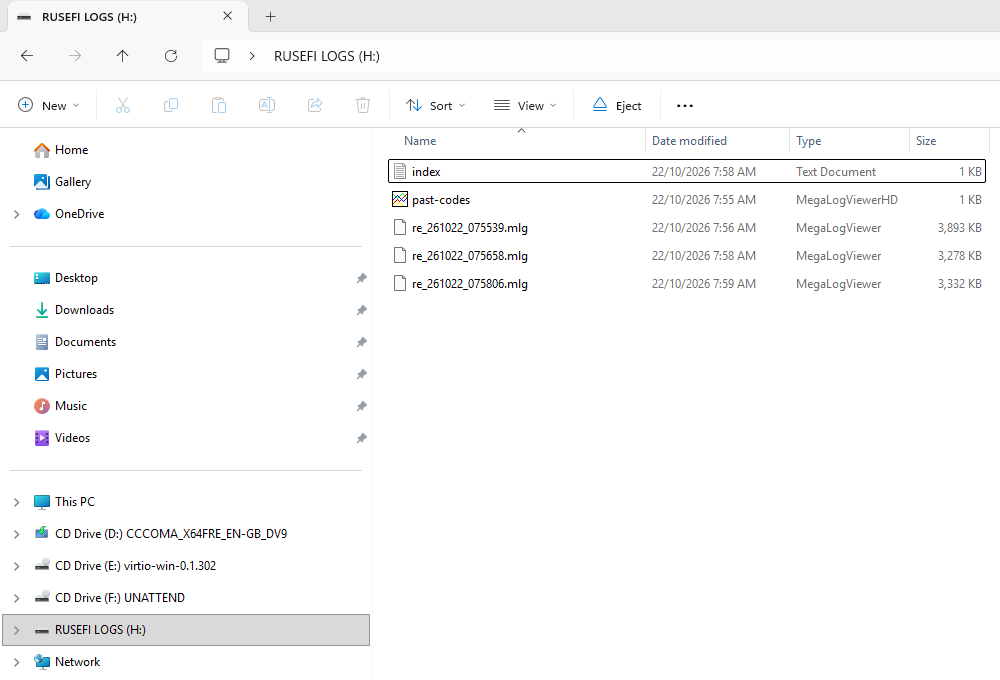
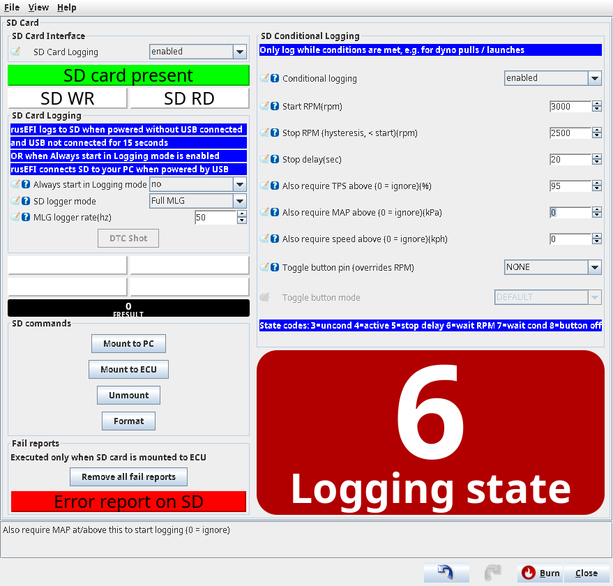
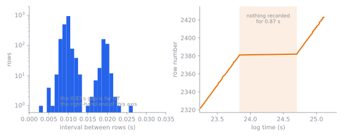

# Datalogging and log analysis

:material-circle:{ .level-basic } Basic → :material-circle:{ .level-advanced } Advanced

> **In one sentence:** a datalog is a recording of everything the ECU was measuring and doing, row
> after row, and it is the only honest way to find out how the engine really ran when you were not
> looking at it.

This chapter covers how to get a log — from TunerStudio on your laptop, or from the ECU's own SD card
with no laptop in the car — and how to read one in MegaLogViewer HD. It assumes TunerStudio and
MegaLogViewer HD are installed (see *Installing the software*), and that the engine is configured well
enough to run. What to log for fuel and for ignition is in the *Tuning fuel* and *Tuning ignition*
chapters; this chapter is about the recording and the reading.

## What a datalog is

:material-circle:{ .level-basic } Basic

A **datalog** is a table. Each **row** is one moment in time; each **column** is one engine value —
engine speed, manifold pressure, lambda, injector pulse width, a fault flag — recorded at that moment.
Nothing about a log is a picture or a graph: the graphs are what you and your analysis program make of
it afterwards.

rusEFI records logs in the **`.mlg`** format (MegaLogViewer binary log, version 2), which both
TunerStudio and MegaLogViewer read. There are two ways to get one:

- **TunerStudio records it on your PC** while it is connected to the ECU over USB. You watch the gauges
  live, you start and stop the recording from TunerStudio, and the file lands on your laptop.
- **The ECU records it on an SD card** in its own box, with no PC attached. When you next connect USB,
  the ECU normally hands the card to your computer as a USB drive and you copy the files off.
<!-- src: firmware/console/binary_mlg_log/binary_mlg_logging.cpp (the mlg file the ECU writes itself); firmware/hw_layer/mmc_card.cpp (sdModeSelector: USB connected gives the card to the computer as a drive) -->

<figure markdown>
  
  <figcaption>Figure 1 — Two ways to record the same engine. Blue is the TunerStudio path, orange the
  ECU's own SD path; both end up in MegaLogViewer.</figcaption>
</figure>

The set of columns is decided by rusEFI, not by you. rusEFI's TunerStudio configuration hands
TunerStudio a list of loggable channels — the official Proteus F7 file lists **1 090** of them, from
**RPM** and **MAP** through **Lambda**, **Knock: Retard** and **Trigger Error Counter** to the state of
every controller — and every one of them appears in every TunerStudio log of that ECU. The ECU's own SD
log writes its own generated list of the same kind, built for that build of the firmware.
<!-- src: firmware/tunerstudio/tunerstudio.template.ini ([Datalog] section, the entry list and labels); firmware/console/binary/generated/log_fields_generated.h (the field list the ECU's SD logger writes); firmware/console/binary/output_channels.txt (the channels both lists are generated from) -->

A 25-second bench log of a Proteus F7, taken for the *Electronic throttle* chapter's
auto-calibration figure, is a useful idea of the scale: **2 424 rows**, **1 091 columns**, about
**3 200 bytes per row**, **8 MB** of file. That is why logging rates and file sizes matter, and why a
drive-long log is usually the ECU's job rather than a laptop's.

## Inside the file

:material-circle:{ .level-advanced } Advanced

You will never edit one of these by hand, but knowing the shape of the file explains what you see in
MegaLogViewer. The file is:

- a 24-byte header: the tag `MLVLG`, format version 2, a start offset, the length of one row and the
  number of columns;
- one 89-byte **descriptor per column**: the column's name (34 characters), its units (10 characters),
  its display style, its storage type, and the scale and offset used to turn the stored integer into the
  value you see — `value = (raw + offset) × scale`;
- then a stream of fixed-size rows: a 4-byte prefix (a block marker, a rolling counter, and a 16-bit
  timestamp in 10 µs steps), then one value per column, then a one-byte checksum for that row. Values
  are stored big-endian. Notes written into the log get their own 50-byte record type.

Because the names and units are inside the file, MegaLogViewer needs no separate "log definition" file
for a rusEFI log: open it and the columns are already labelled the way TunerStudio labels them.
<!-- src: firmware/console/binary_mlg_log/mlg_types.h (header layout, 89-byte descriptors, types and display styles); firmware/console/binary_mlg_log/mlg_field.h (field descriptor); firmware/console/binary_mlg_log/binary_mlg_logging.cpp (record prefix, rolling counter, checksum) -->

Two details that catch people out:

- The 16-bit timestamp in each row's prefix counts 10 µs steps, so it **wraps every 655.36 ms**. Use the
  **Time** column, in seconds, for anything longer than that. In a TunerStudio log **Time** is
  TunerStudio's own clock; in an SD-card log it is the ECU's counter (`packedTime`), in seconds with
  millisecond resolution.
- The ECU writes a **zero** into the header's start-time field. The start time of an SD log comes from
  its file name, not from its header.
<!-- src: firmware/console/binary_mlg_log/binary_mlg_logging.cpp (writeFileHeader writes a zero start timestamp, and the 10 us prefix timestamp) -->

## Logging with TunerStudio

:material-circle:{ .level-basic } Basic → :material-circle:{ .level-intermediate } Intermediate

1. Connect TunerStudio to the ECU with the engine's own **12 V** supply on, not USB power alone
   (*Installing the software*, and the rule repeated below).
2. Open TunerStudio's **Data Logging** menu and press **Start Logging**, then **Save** to accept the
   file name it suggests (the date and time). TunerStudio's own *Data Logging* indicator on the front
   page tells you it is recording; press **Stop** in the same menu at the end.
3. TunerStudio writes one `.mlg` file per logging session, into the **DataLogs** folder inside your
   TunerStudio project folder. Copy important ones somewhere you will find them again.
4. Open the file in MegaLogViewer, or in TunerStudio's log viewer, when the run is over.
<!-- src: firmware/tunerstudio/tunerstudio.template.ini ([FrontPage] comment listing the system indicators TunerStudio appends itself, Data Logging among them) -->

<!-- shot: img/ts/datalogging-data-logging-menu.png | Data Logging (TunerStudio's own menu) | state: connected to a Proteus F7 on 12 V with the Ardu-Stim feeding a 60-2 crank signal at about 860 rpm, the menu open showing Start Logging and Stop, the front-page Data Logging indicator lit after a session was started, no dropdowns open | Recording on the PC: TunerStudio's Data Logging menu, with every channel in rusEFI's list going into the file. -->

<figure markdown>
  
  <figcaption>Figure 2 — Recording on the PC: TunerStudio's <b>Data Logging</b> menu. Every channel in
  rusEFI's list goes into the file, whether you want it or not.</figcaption>
</figure>

!!! warning "A bench log taken on USB power records wrong values"
    With only USB connected the firmware runs and logs, but the 5 V sensor supplies cannot reach 5 V, so
    every ratiometric sensor — TPS, the pedal, MAP, the wideband reference — reads low. A log like that
    is worthless for tuning, and it is easy to make by accident on the bench. Do the logging with the
    ignition on.
    <!-- src: firmware/controllers/ignition_controller.cpp (isIgnVoltage); firmware/tunerstudio/tunerstudio.template.ini (hasIgnitionVoltage enable conditions) -->

!!! tip "Log the bench session too"
    Before you go for a drive, log ten seconds of idle and a snap of the throttle on the bench and read
    it back. It teaches you what your columns look like, proves the wideband is actually recording, and
    gives you something to compare a road log against.

## Logging to the ECU's SD card

:material-circle:{ .level-basic } Basic → :material-circle:{ .level-intermediate } Intermediate

The ECU can record without a laptop. On a Proteus F7 the SD card interface is enabled in the factory
configuration (the card sits on the ECU's SPI bus 3, with its select line on D2), and everything you
set is on one page: **Controller ▸ SD Card Logger** (`sdCard`).

<!-- shot: img/ts/datalogging-sd-card-logger.png | Controller ▸ SD Card Logger | state: Proteus F7, ignition on (12 V), engine stopped, USB connected so the card is mounted to the ECU for this shot, SD Card Logging enabled, SD logger mode Full MLG, MLG logger rate 50, Conditional logging disabled, SD card present and ECU logging indicators green, SD WR blinking, Logging state readout 3, FRESULT readout 0, Mount to PC / Mount to ECU / Unmount / Format buttons visible, every dropdown closed | The whole SD logging page: what the ECU records by itself and the buttons that hand the card to the computer. -->

<figure markdown>
  
  <figcaption>Figure 3 — <b>Controller ▸ SD Card Logger</b>: what the ECU records by itself, and the
  buttons that hand the card to your computer.</figcaption>
</figure>

### Which mode the card is in

:material-circle:{ .level-intermediate } Intermediate

The ECU owns the card, and it can only do one thing with it at a time: log to it, show it to your
computer, or leave it alone. It moves between those states through a neutral middle state, so a change
is never instantaneous.

<figure markdown>
  
  <figcaption>Figure 4 — How the ECU chooses. A press of <b>Mount to PC</b> or <b>Mount to ECU</b>
  wins until the next power-up; otherwise USB and ignition voltage decide.</figcaption>
</figure>

Read that figure as the answer to "why is there no log?" With USB connected and the ignition on, the
card is normally in **PC** mode — the drive on your computer — and the ECU writes **nothing**. That is
by design, so you can always read the card without pulling it out. Two consequences worth remembering:

- To log with a laptop plugged in, switch **Always start in Logging mode** (`alwaysWriteSdCard`) on. The
  ECU then keeps the card and never shows it as a drive, so unmount it from your computer before you
  press **Mount to ECU**.
- If the ECU has neither USB nor ignition voltage, it unmounts the card on purpose: a power cut is
  coming, and an unmounted card is a card whose files are intact.
<!-- src: firmware/hw_layer/mmc_card.cpp (sdModeSelector: user request wins, then UNMOUNT / alwaysWriteSdCard / USB PC / ECU; sdModeSwitcher and sdModeSwitchToIdle pass through IDLE); firmware/tunerstudio/tunerstudio.template.ini (the SD Card Logging panel notes and Always start in Logging mode) -->

### Setting it up

:material-circle:{ .level-basic } Basic

1. **Switch it on**: set **SD Card Logging** (`isSdCardEnabled`) to *enabled*. It is already enabled in
   the Proteus F7 factory configuration; changing it needs a power cycle to take effect.
2. **Choose what to write**: set **SD logger mode** (`sdLoggerMode`) to **Full MLG** — "a standard MLG
   of sensors, engine function, etc. similar to the one captured in TunerStudio". The factory
   configuration leaves this **Off**, which is the other reason a card sits in the ECU with nothing on
   it. The other choices are for special jobs: **Trigger bin** and **Trigger CSV** write a very fast log
   of trigger and injector events (space-hungry, and not something MegaLogViewer plots as an engine
   log), and **DTC Freeze Frame** writes one row plus a short trigger note each time the ECU sets a
   diagnostic code.
3. **Choose the rate**: **MLG logger rate** (`sdCardLogFrequency`) is the number of rows a second, 1 to
   250, **50** by default. Fifty rows a second is enough for anything except a misfire or trigger
   investigation; a dyno pull at 100 Hz costs twice the space.
   <!-- src: firmware/tunerstudio/tunerstudio.template.ini (SD Card Logging panel: isSdCardEnabled, sdLoggerMode choices and help, sdCardLogFrequency, requiresPowerCycle on isSdCardEnabled); firmware/config/boards/proteus/board_configuration.cpp (isSdCardEnabled default on Proteus, setupSdCard); firmware/controllers/algo/engine_configuration.cpp (setDefaultSdCardParameters, the 50 Hz default); firmware/controllers/modules/dtc_manager/dtc_manager.cpp (the DTC freeze-frame logger started by sdLoggerStart) -->
4. **Fit a card** and power up. With no USB connected and the ignition on, the dialog's
   **SD card present** and **ECU logging** indicators go green and **SD WR** blinks while a row is being
   written. Run the engine.
5. **Stop, then read**: stop the engine, then press **Mount to PC** (`cmd_mount_pc`). Wait for the
   **PC Access** indicator, and open the card on your computer (next subsection).
6. **Give it back**: press **Mount to ECU** (`cmd_mount_ecu`) when you want the ECU logging again — for
   example before you unplug the laptop and drive.

<!-- shot: img/ts/datalogging-sd-pc-mode.png | Controller ▸ SD Card Logger, after pressing Mount to PC | state: Proteus F7, ignition on, engine stopped, PC Access indicator green, ECU logging indicator off, SD card present green, Logging state readout unchanged, FRESULT 0 | The card after Mount to PC: the ECU has stopped logging and the files are readable from the computer. -->

<figure markdown>
  
  <figcaption>Figure 5 — Card handed to the computer. The ECU stops logging; the files on the card are
  yours to copy.</figcaption>
</figure>

The file names tell you what is on the card: **`re_yymmdd_HHMMSS.mlg`** when the ECU's clock knows a
sane date (its own rule is 2016 to 2030), and **`re_<index>.mlg`** otherwise, where the next index is
kept in a small file `index.txt` on the card so numbers are never reused. A log file is closed and a
new one started every 32 MB, so one drive becomes several files, oldest first.
<!-- src: firmware/hw_layer/mmc_card.cpp (prepareLogFileName, LOGGER_MAX_FILE_SIZE 32 MB and the rollover in sdLoggerMlg, F_SYNC_FREQUENCY, SD_CARD_LABEL); firmware/hw_layer/mmc_card_util.cpp (incLogFileName and LOG_INDEX_FILENAME "index.txt"); firmware/hw_layer/rtc_helper.cpp (dateToStringShort: the 2016 to 2030 range) -->

!!! warning "**Format** erases the card"
    **Format** (`cmd_format`) builds a new FAT volume on the card and labels it `rusEFI logs` (FAT keeps labels in capitals, so a
    PC shows **RUSEFI LOGS**). It takes
    your logs with it, and also the ECU's own records on that card — the diagnostic-code history
    `past-codes.csv` and any crash reports. Only press it for a card you do not need, or for a card the
    ECU refuses to write to.
    <!-- src: firmware/hw_layer/mmc_card.cpp (sdFormat: f_mkfs then f_setlabel with SD_CARD_LABEL); firmware/hw_layer/past_codes_storage.cpp (past-codes.csv on the card) -->

!!! warning "Pulling a logging card out loses the last rows"
    The ECU buffers rows and commits them to the card every tenth row, not after each one — at 50 rows a
    second, up to about 0.2 seconds of log is still in the buffer at any moment. It pre-allocates each
    file to its full 32 MB when it creates the file, so a power cut can lose that tail but should not
    wreck the filesystem; a file whose 32 MB is mostly zeros was never closed cleanly. Stop the engine,
    or press **Mount to PC**, before you remove a card.
    <!-- src: firmware/hw_layer/mmc_card.cpp (sdLoggerCreateFile with f_expand, sdLoggerCloseFile with f_truncate, F_SYNC_FREQUENCY, mlgLogger pacing at sdCardLogFrequency); firmware/controllers/system/file_writer.h (FileBufferedWriter, 512-byte buffered writes) -->

!!! warning "Mounting the card back to the ECU usually drops the USB connection"
    The ECU's USB device changes when the card moves between the ECU and your computer, so
    TunerStudio's connection normally falls over when you press **Mount to ECU**. That is expected:
    reconnect afterwards. A TunerStudio log is on your PC already, so it is not lost — but a TunerStudio
    session that was still recording has stopped.
    <!-- src: firmware/hw_layer/mmc_card.cpp (sdModeSwitchToIdle detaches mass storage before ECU mode); docs/AI/sd_card_logging.md (the CDC plus mass-storage caveat: PC to ECU usually drops the console connection) -->

### Reading the card as a USB drive

:material-circle:{ .level-basic } Basic

With **PC Access** lit, the card is an ordinary removable drive on your computer. Copy the `re_*.mlg`
files out; you do not need to keep them on the card, and the ECU does not delete log files unless you

=== "Windows"

    File Explorer shows a new drive, labelled **RUSEFI LOGS** if the ECU formatted it. Open it, select
    the `re_*.mlg` files, and copy them somewhere you can find them again. Use **Safely Remove
    Hardware** before unplugging the ECU's USB cable.

    <!-- shot: img/windows/datalogging-sd-drive.png | Windows 11 File Explorer, This PC, removable drive | state: a Proteus F7 with the SD card mounted to the PC, the drive labelled RUSEFI LOGS, three files named re_YYMMDD_HHMMSS.mlg of a few MB each from one-minute bench sessions (Ardu-Stim at about 860 rpm) plus index.txt and past-codes.csv, Details view with file sizes and dates; crop to the Explorer window | The ECU's SD card as Windows sees it after Mount to PC: a normal folder of dated mlg files. -->

    <figure markdown>
      
      <figcaption>Figure 6 — The ECU's SD card as Windows sees it after <b>Mount to PC</b>: a normal
      folder of dated `.mlg` files.</figcaption>
    </figure>

=== "Linux"

    The card appears as a removable block device and your file manager mounts it; `lsblk` and
    `udisksctl mount` do the same from a terminal. The files are plain files — `tools`-style command
    readers work on them, and so does `cp`. Unmount the volume before the cable comes out.

=== "macOS"

    The volume appears on the desktop and in Finder. Copy the files out, then **Eject** the volume
    before unplugging USB.

### Only log the interesting part

:material-circle:{ .level-intermediate } Intermediate

A road trip at 50 rows a second is a huge file mostly full of idle. **Conditional logging**
(`sdCardConditionalLogging`) makes the ECU log only while conditions are met, and closes the file when
they stop — so a dyno pull, or a wide-open-throttle run up a hill, arrives as its own file, ready to
open.

<!-- shot: img/ts/datalogging-sd-conditional.png | Controller ▸ SD Card Logger (the SD Conditional Logging panel on the right of the dialog) | state: Proteus F7, ignition on, Conditional logging enabled, Start RPM 3000, Stop RPM (hysteresis, < start) 2500, Stop delay 20, Also require TPS above 95, Also require MAP above 0, Also require speed above 0, Toggle button pin unset, Logging state readout 6 | Conditional logging set for dyno pulls, with the state readout that says why the ECU is or is not writing. -->

<figure markdown>
  
  <figcaption>Figure 7 — Conditional logging for dyno pulls. The <b>Logging state</b> readout is the
  reason it is or is not writing.</figcaption>
</figure>

How it behaves, in the order the firmware applies it:

1. A configured **Toggle button pin** wins over everything: each press of the button turns logging on or
   off, and the RPM and sensor conditions are ignored. The pin is registered like a start/stop button, so
   a clash with another feature is reported rather than silently shared.
2. Otherwise, logging starts at **Start RPM** and only if every extra condition you set is met at that
   moment: **Also require TPS above**, **Also require MAP above**, **Also require speed above** (0 means
   "do not require this one"). Those conditions gate the *start* only.
3. Logging stops when engine speed falls below **Stop RPM (hysteresis, < start)** and stays below it for
   **Stop delay** seconds. Setting Stop below Start gives the hysteresis that keeps a gear change from
   ending the log; if you set Stop at or above Start, the firmware treats the two as one threshold.

The defaults — Start 800 RPM, Stop 700 RPM, Stop delay 30 s, everything else off — mean "log whenever
the engine is running" once you switch conditional logging on. The **Logging state** readout
(`sdLoggingState`) tells you where it stands:

| Shows | Meaning |
|---|---|
| 0 | conditional logging switched off |
| 1 | logging suppressed |
| 2 | the logger failed (see the **FRESULT** readout) |
| 3 | logging all the time — conditions not required |
| 4 | logging, conditions met |
| 5 | still logging during the stop delay |
| 6 | waiting: below **Start RPM** |
| 7 | waiting: at RPM but a TPS, MAP or speed condition is not met |
| 8 | waiting: the toggle button has logging switched off |
<!-- src: firmware/controllers/modules/sd_log_trigger/sd_log_trigger.cpp (onSlowCallback: button first, then RPM and secondary conditions, stop delay), (the state codes); firmware/controllers/modules/sd_log_trigger/sd_log_trigger.h (shouldLog); firmware/controllers/algo/engine_configuration.cpp (setDefaultSdCardParameters: 800 / 700 / 30 s and the zero conditions); firmware/controllers/generated/rusefi_generated_proteus_f7.h (the SD_LOG_* state values) -->

!!! tip "One file per pull"
    Because conditional logging closes the file when the conditions stop, each pull is its own file.
    Loading one 20-second file in MegaLogViewer is far easier than hunting a pull out of a two-hour
    drive, and the row count the analyser works from is exactly the rows you meant.

## Checking what you got

:material-circle:{ .level-intermediate } Intermediate → :material-circle:{ .level-advanced } Advanced

Before you trust a log, check the grid it is made of. This is a two-second job and it stops you tuning
against a recording that is not what you think.

- **Are the rows where they should be?** An SD log is written at **MLG logger rate** (50 rows a second
  by default). The TunerStudio bench log below was recorded on a 0.010 s grid — about 96 rows a second —
  and it has one **0.87 s hole** near the end, where no rows were written at all.
- **Does the first row make sense?** Engine warm or cold, the battery voltage, and the state flags tell
  you the log started where you think it did.
- **Is the column you need actually there?** A column that is not in rusEFI's list cannot be in the log,
  and a `.teeth` trigger log from **Trigger bin** or **Trigger CSV** mode is not an engine log at all.

<figure markdown>
  
  <figcaption>Figure 8 — The same log's sampling grid, measured. Left: rows are 0.010 s apart (a few
  share a timestamp because **Time** is only written to the nearest millisecond). Right: row number
  against time — the flat step is 0.87 s with no rows at all.</figcaption>
</figure>

## Reading a log in MegaLogViewer

:material-circle:{ .level-basic } Basic → :material-circle:{ .level-advanced } Advanced

MegaLogViewer HD is the manual's tool for reading logs deeply; TunerStudio can replay one for a quick
look. rusEFI's logs need no extra setup: the columns, their labels and their units are inside the
file, so MegaLogViewer shows them as TunerStudio names them — **Lambda**, **Air/Fuel Ratio**,
**Fuel: target lambda**, **MAP**, **Effective MAP**, **Fuel: Load**, **Knock: Retard**,
**Fuel: injector duty cycle**, **Engine Mode**, **LTFT: Bank 1**, **Trigger Error Counter**.
<!-- src: firmware/console/binary/generated/data_logs.ini (the resolved log labels); firmware/console/binary/output_channels.txt (the channel names behind them); firmware/console/binary_mlg_log/mlg_types.h (names and units stored in the file) -->

Start with the **time traces**: pick two or three channels, plot them against time, zoom into the event
you care about, and drag across a stretch of the time scale to get the average of that stretch. Then
move to the two views that turn thousands of rows into a decision: **scatter plots**, which show how two
values relate to each other, and **histograms / table generators**, which average one channel inside
each cell of an engine-speed and load grid. MegaLogViewer also lets you define calculated fields
(vacuum, boost, rate of change), filter rows, and overlay a second log to compare two runs.

### Scatter plots

:material-circle:{ .level-intermediate } Intermediate

A scatter plot draws every row as a point placed by two (or three) of its values. The point cloud is
where your engine actually lives; the interesting rows are the ones away from the crowd.

For a fuel log, plot engine speed on one axis and load (**MAP** or **Fuel: Load**) on the other, with
**Lambda** as the plotted value. You get the tune's map drawn by the engine itself: the idle and cruise
clusters, a ribbon of rows along the open-throttle edge, and — if you are unlucky — a handful of points
coloured lean at high speed and high load. Same plot with **Knock: Retard** instead: where the ECU is
pulling timing out of your way. Same plot with **Fuel: injector duty cycle**: whether you have any
headroom left.

<!-- shot: img/ts/datalogging-mlv-scatter.png | MegaLogViewer HD scatter plot (this is a MegaLogViewer window, not a TunerStudio dialog) | state: MegaLogViewer HD 4.6.14, Scatter Plots tab, a 22,844-row SD-card road log from a warm drive (re_251202_141127.mlg), X axis RPM, Y axis Fuel: Load, Z axis Lambda on the automatic colour scale 0.70 (blue, rich) to 1.37 (red, lean); idle and cruise clusters dense at the bottom left, the full-load ribbon climbing to about 230 kPa in blue, red specks along the bottom at 3000 to 5500 RPM from closed-throttle overrun (throttle about 6 %, injector pulse near zero) | MegaLogViewer HD scatter plot of a rusEFI log: every row is one point, and the tune's map appears drawn by the engine. -->

<figure markdown>
  
  <figcaption>Figure 9 — Engine speed against load, coloured by lambda, from a 22,844-row road log. The
  clusters are where you drive; the blue ribbon is full throttle, rich as the target asks. The red specks
  along the bottom are closed-throttle overrun with the injectors almost off: the sensor is reading air,
  not a lean tune.</figcaption>
</figure>

!!! note "Filter before you judge"
    A scatter averages trustworthy and untrustworthy rows together. Exclude the rows where the engine was
    cold, the wideband was still warming, the throttle was moving, or fuel was cut — MegaLogViewer's
    filters and calculated fields are for exactly this. A cluster of lean points during gear changes is
    not a tune problem.

### Histograms and the table generator

:material-circle:{ .level-intermediate } Intermediate → :material-circle:{ .level-advanced } Advanced

MegaLogViewer's histogram and table-generator views do the summing-up for you: they split the log into
bins — usually engine speed against load, matching the shape of your VE and target tables — and report
the average, minimum, maximum and count of a chosen channel in each bin. EFI Analytics describe it as
showing "exactly how far off every cell of your fuel table is".

Read it against the ECU's own tables:

| Table | Column to average per cell | What a wrong cell shows as |
|---|---|---|
| **Target lambda** / **Target AFR** | **Lambda**, then subtract the correction that was active | a cell averaging lean or rich of its target |
| **VE Table** | **STFT: Bank 1** and **LTFT: Bank 1** | the trim that was needed to hold target *is* the VE error |
| ignition table | **Knock: Retard** | the advance you cannot run |
| nothing — reliability | row count per cell | where the engine actually spends its time |

<!-- shot: img/ts/datalogging-mlv-histogram.png | MegaLogViewer HD histogram / table generator (this is a MegaLogViewer window, not a TunerStudio dialog) | state: the same road log, Histogram / Table Generator tab, X RPM, Y Fuel: Load, Z Lambda, 16 x 16 cells with Auto-Generate axis High at top, Color based on Hit Weight (red many rows, green few, white none), Weighted Averages; the cell at 5273 RPM and 221 kPa selected (average 0.89), Data Details showing Total Records 22844 and Cell Hit Count 120 | MegaLogViewer HD's table generator: the average lambda per engine-speed and load cell, beside the sample counts that say how much each number is worth. -->

<figure markdown>
  
  <figcaption>Figure 10 — The same log averaged into cells, coloured by row count (red many, green few).
  Click a cell and <b>Data Details</b> shows its <b>Cell Hit Count</b>: the selected full-load cell
  averages 0.89 over 120 rows, the 0.71 at the right-hand edge over three. A cell with three rows is an
  anecdote, a cell with three thousand is a fact.</figcaption>
</figure>

TunerStudio's **VE Analyze** does the same job inside TunerStudio, and rusEFI supplies it with the
lambda channel, the target table and the correction channel; that procedure is in the *Tuning fuel*
chapter. Use MegaLogViewer when you want the arithmetic done across many logs at once, or when the log
came off an SD card and you would rather not re-open TunerStudio.

### Finding lean spots

:material-circle:{ .level-intermediate } Intermediate → :material-circle:{ .level-advanced } Advanced

!!! danger "Lean under load is the failure that costs an engine"
    This section is about finding the mixture faults that hurt pistons, which is why they matter — but
    the work itself is done on a log, away from the engine. Never diagnose or change fuelling from the
    driver's seat, and do the confirming run on a dyno or a closed course with a wideband in the log and
    someone else watching the gauge. Stop at the first sign of knock or of lambda going lean of target.
    See *Safety*.

The procedure:

1. **Prove the measurement.** Was the wideband believed? Check the O2 heater flag, **Error: Active** and
   the sensor's own state, and that coolant was above **Minimum CLT** (**60 °C** by default) if closed
   loop was on. A column sitting at zero, at its stop, or at a fixed value the whole drive is a sensor
   problem, not a fuelling problem.
   <!-- src: firmware/controllers/sensors/sensor_checker.cpp (sensor fault reporting and the Error flags); firmware/controllers/math/closed_loop_fuel.cpp (the closed-loop enable conditions) -->
2. **Decide whether the loop was hiding it.** With short term fuel trim running, the ECU is *pushing*
   measured lambda back to target, so measured lambda sits near 1.00 and the fault shows up as a trim
   instead. Look at **STFT: Bank 1** and **LTFT: Bank 1** in that cell: a trim parked at
   the loop's limit means the table is the problem, not the loop. For mapping work, turn the trim off
   deliberately and say so in your notes (the *Tuning fuel* chapter).
   <!-- src: firmware/controllers/math/closed_loop_fuel.cpp (ShortTermFuelTrim::getCorrection); firmware/controllers/algo/defaults/default_fuel.cpp (the Minimum CLT default); firmware/console/binary/output_channels.txt (stftCorrection, ltftCorrection) -->
3. **Throw away the rows that cannot represent an operating point**: accelerator events, deceleration
   fuel cut, gear changes, cold engine, tuning edits (**isTuningNow** is set for a while after you write a table).
4. **Look for the gap between measured and target**, cell by cell. In the histogram view average
   **Lambda** per engine-speed and load cell and compare with **Fuel: target lambda** in the same cell.
   Measured 0.79 where the target is 0.85 is about 8 % lean; measured 1.05 where the target is 1.00 is
   5 % rich.
5. **Decide where the error belongs** — one cell of the VE table, a warm-up or transient correction, the
   fuel pressure or injector flow you based the tune on, or a blend table. The *Tuning fuel* chapter's
   five-way decision applies here; the mistake is fixing a cold-engine or transient error in the VE
   table.
6. **Change one thing, re-log, and prove it.** The second log must show the cell fixed and its
   neighbours untouched. That is the whole point of datalogging: the before-and-after, not the feeling.

!!! info "Advanced"
    A lean spot that only appears for a few rows at the top of the rev range can be missed entirely by a
    50 Hz recording — the event may be three rows long. Raise **MLG logger rate** for the diagnostic run,
    or use TunerStudio's faster PC-side logging, and check the grid (Figure 8) afterwards so you know
    what you recorded.

### Trigger errors

:material-circle:{ .level-intermediate } Intermediate

The ECU counts problems with its own position sensing, and the count is in every log:

| Column | Internal name | What it is |
|---|---|---|
| **Trigger Error Counter** | `totalTriggerErrorCounter` | a running count that only goes up; it restarts when the trigger decoders are set up again, in practice when the ECU powers up |
| **orderingErrorCounter** | `orderingErrorCounter` | counts edges that arrived in an impossible order — the same edge twice in a row |
| **Trigger ERR** on the front page, **Error: Trigger** in the log | `isTriggerError` | an error in the last 0.3 s, or errors frequent over the last few seconds |
<!-- src: firmware/controllers/trigger/trigger_decoder.cpp (setTriggerErrorState and the counting sites), (orderingErrorCounter for a repeated edge); firmware/controllers/trigger/trigger_decoder.h (someSortOfTriggerError: the 0.3 s window); firmware/controllers/trigger/trigger_central.cpp (isTriggerDecoderError: errors over a recent window; the counters are zeroed in resetState); firmware/console/status_loop.cpp (isTriggerErrorNow driving the Error flag and the warning LED) -->

What moves the counter, and what each one usually means:

- **+100 at once** — the gap between two teeth was far bigger than the wheel's own pattern allows, which
  is what a burst of electrical noise on the trigger line looks like.
- **+1 and the ECU stops trusting its position** — it found something that looked like the synchronising
  gap but the number of teeth since the last one did not fit the pattern; a dropped tooth or noise.
- **+1 with "too many teeth"** — more events than the wheel has, so a tooth was counted twice.
- **orderingErrorCounter climbing** — a raw signal problem: a bouncing or floating input, usually a
  wiring, pull-up or threshold matter. See the *Trigger* and *Shielding and noise* chapters.

In the log, plot **Trigger Error Counter** against time: it should be a flat line. Each step is one
fault, and the size of the step tells you which kind. Note the value at the start of the log — the
counter is cumulative, so a log that starts at 300 already has 300 faults of history. Then read the
other columns at each step: an RPM and load that repeats is a mechanical or electrical fault at a
certain engine speed (a loose tone wheel, a cracked ring, a shield that stopped shielding); steps that
appear only at high RPM with no pattern are usually noise.

!!! warning "A trigger fault under load is not a log curiosity"
    When the decoder loses the plot the ECU no longer knows where the engine is: it stops trusting its
    own position until it re-synchronises, and the front page indicator reads **Trigger ERR** while the ECU's
    warning LED lights. Repeated faults under load mean uncontrolled timing and fuelling. Find the cause
    before the next fast run.

## Worked examples

:material-circle:{ .level-intermediate } Intermediate

### Example 1 — a dyno pull with no laptop in the car

Proteus F7, ignition on, a FAT card fitted. **Controller ▸ SD Card Logger**:

| Setting | Value | Why |
|---|---|---|
| **SD Card Logging** | enabled | factory default on Proteus F7 |
| **SD logger mode** | Full MLG | the ordinary engine log; the factory configuration leaves it Off |
| **MLG logger rate** | 100 | short events at high RPM need rows; 100 Hz costs twice 50 Hz |
| **Conditional logging** | enabled | no two-hour file of idling to the dyno |
| **Start RPM** | 3 000 | below this the pull has not started |
| **Stop RPM (hysteresis, < start)** | 2 500 | a lift between gears does not end the file |
| **Stop delay** | 20 s | keep the tail of the pull, and the shutoff |
| **Also require TPS above** | 95 % | a pull is full throttle; this is what excludes everything else |
| **Also require MAP above** | 0 | ignored — TPS is enough |

Before the run: check **Logging state** reads **7** (at RPM, waiting for a condition) or **6** (below
**Start RPM**) rather than **2** (failed — then read the **FRESULT** number and fix the card). After the
run: **Mount to PC**, copy the newest `re_*.mlg`, **Mount to ECU** for the road, and reconnect
TunerStudio. In MegaLogViewer the file should start at the moment TPS hit 95 %, run for the length of
the pull, and hold WOT throughout — check the grid first, then send **Lambda** and **Knock: Retard** to
the histogram view per cell.
<!-- src: firmware/controllers/modules/sd_log_trigger/sd_log_trigger.cpp (the conditions and the state); firmware/hw_layer/mmc_card.cpp (the file name and the 32 MB rollover, PC and ECU modes); firmware/tunerstudio/tunerstudio.template.ini (the sdCard dialog: fields, Mount to PC and Mount to ECU buttons, sdLoggingState readout) -->

### Example 2 — a lean hole at high load from a road log

A logged drive, warm engine, short term fuel trim **off** for the session. The lambda scatter (engine
speed against **Fuel: Load**, colour **Lambda**) is unremarkable until 4 000–4 600 RPM above about
160 kPa, where measured lambda runs at **0.79** while **Fuel: target lambda** in that corner of the
target table is **0.85** — about 8 % lean — and **Knock: Retard** is running 4° to 7°.

The order of work, not the number, is the point:

1. Check the rows are honest: the wideband was warm and believed, TPS was steady, no deceleration cut.
2. Check what could make the whole corner lean before blaming the table: logged **Fuel: Last inj pulse
   width** against what the table asked for, fuel pressure, and the injector flow and reference pressure
   the tune was built on. A corner that is lean everywhere is usually supply, not a table cell.
3. Only then change the corner: 0.85 / 0.79 says about **+8 %** on the VE cells in that corner, in one
   step, and nothing anywhere else.
4. Re-log the same run. The corner should read 0.84–0.86, its neighbours should be unchanged, and
   **Knock: Retard** should be near zero.
<!-- src: firmware/console/binary/output_channels.txt (lambdaValue, targetLambda, m_knockRetard, fuelingLoad, actualLastInjection); firmware/controllers/algo/fuel/injector_model.cpp (the injector flow and reference pressure the table is measured against) -->

### Example 3 — a trigger fault you only get on the road

The road log shows **Trigger Error Counter** flat at 0 for the first ten minutes, then steps of **+100**
at roughly 2 400 RPM, twice, both at high load; **Error: Trigger** is set for a few rows at each step.
That +100 signature is the "gap far larger than the wheel allows" path, which is what noise on a trigger
line does. Check the crank sensor's screening and its route away from coil leads, the sensor gap and the
trigger input's thresholds (the *Trigger* and *Shielding and noise* chapters), then log the counter
again on the same road. The fix is proven when the line stays flat.
<!-- src: firmware/controllers/trigger/trigger_decoder.cpp (setTriggerErrorState(100) for a too-large gap ratio while synchronised), (isTriggerError window) -->

## Pitfalls and troubleshooting

:material-circle:{ .level-basic } Basic → :material-circle:{ .level-advanced } Advanced

| Symptom | Likely cause | Check |
|---|---|---|
| A card has been in the ECU all day and there are no log files | USB was connected, so the card was in **PC** mode; or **SD logger mode** is still **Off** | the dialog's indicators: **ECU logging** green means the ECU owns the card, **PC Access** green means your computer does; set **Full MLG**, or switch **Always start in Logging mode** on |
| Nothing logged although the card is enabled and the engine ran | the ECU had neither USB nor ignition voltage for part of the session, so it unmounted the card | the **SD card present** indicator and the **FRESULT** readout |
| **No SD card** indicator, or the **FRESULT** readout is not 0 | card not fitted, not a FAT volume the ECU can mount, or too slow / too large | try another card, or **Format** (it erases everything on it); the ECU labels it `rusEFI logs` |
| Logging stops and starts by itself | **Conditional logging** on, and the conditions come and go | the **Logging state** code: 6 below **Start RPM**, 7 a TPS/MAP/speed condition missing |
| Huge files full of idle | conditional logging left off | set it, with **Also require TPS above** |
| A file is 32 MB with a long tail of zeros | the file was never closed cleanly — power cut, or the card was pulled | expect a lost tail; stop the engine or press **Mount to PC** before removing the card |
| MegaLogViewer opens the file with no useful columns | it is a `.teeth` trigger log from **Trigger bin** or **Trigger CSV** mode | set **Full MLG** for an engine log |
| Every sensor value in a bench log looks wrong, and lambda reads high or low by a constant | the ECU was powered from USB only, so the 5 V references were low | run the log with the ignition on |
| The last fraction of a second of a run is missing | the card came out while the ECU was still logging | rows are committed every tenth row; let the ECU close the file |
| TunerStudio disconnects when you press **Mount to ECU** | the ECU's USB device changed; expected | reconnect TunerStudio after the change |
| A column you wanted is not in the log | it is not in rusEFI's list of loggable channels | check the list in rusEFI's TunerStudio configuration; the console is the tool for values TunerStudio cannot see |
| **Trigger Error Counter** climbing | trigger noise, wiring, thresholds, or a mechanical fault | the Trigger section above, then the *Trigger* and *Shielding and noise* chapters |

## Settings reference

### SD Card Logger (Controller ▸ SD Card Logger)

--8<-- "reference/settings/_sdCard.table.md"

## Related

- Part I — *Installing the software* (TunerStudio MS and MegaLogViewer HD), *The rusEFI system at a
  glance* (where a datalog sits in the system)
- Part IV — *Tuning principles*, *Tuning fuel*, *Tuning ignition*: which channels to log for each job,
  and TunerStudio's VE Analyze
- Part III — *Closed-loop lambda*: why a logged lambda can be sitting on target for the wrong reason
- Part III — *Trigger*: wheel shapes, synchronisation and input thresholds
- Part II — *Shielding and noise*: the cause behind trigger errors
- Getting help — the crash reports and diagnostic-code history the ECU also keeps on the card
