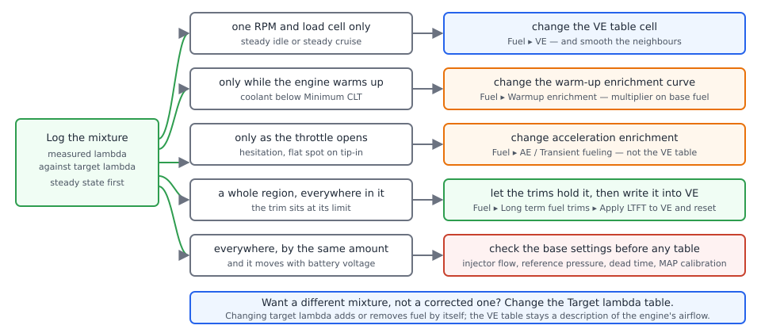
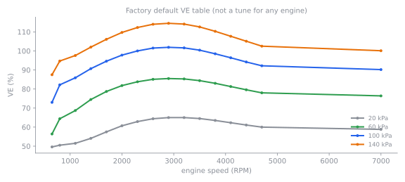
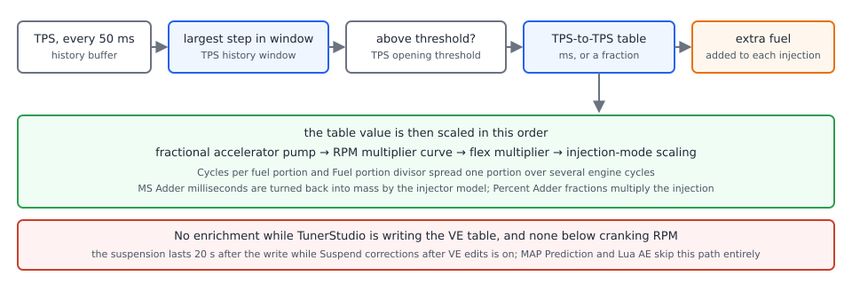
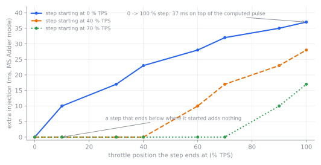

# Tuning fuel

:material-circle:{ .level-basic } Basic → :material-circle:{ .level-advanced } Advanced

> **In one sentence:** fill in the VE table from logged wideband readings, keep the cold and transient
> corrections out of it, and let the fuel trims tell you what you missed when you were not looking.

This chapter is the procedure. The mechanism — how a VE cell becomes an injector pulse — is in the
[Fuel chapter](../part3/fuel.md), and the order of work across fuel and ignition is in
[Tuning principles](tuning-principles.md). It assumes the engine already starts and runs on the factory
tune, with trigger, injector outputs, MAP, CLT and IAT sensors configured and believed.

## What you are tuning

:material-circle:{ .level-basic } Basic

rusEFI multiplies three things to get a pulse width, and tuning means changing the right one of them:

- **The air estimate.** In Speed Density that is the **VE Table** (`veTable`) at the current engine
  speed and load. With a MAF it is the MAF transfer function, with Alpha-N it is the VE table read
  against throttle position.
- **The corrections multiplied onto it:** warm-up enrichment against coolant temperature, the intake-air
  temperature multiplier, barometric pressure, after-start, the acceleration enrichments, and the short
  and long term fuel trims.
- **The injector model:** **Injector flow**, **Injector reference pressure** and the dead-time table.
  These are not tuning knobs — they are the ruler the rest is measured against.

Two rules follow from that structure, and the whole chapter hangs on them:

- **The VE table describes airflow, not mixture.** If injectors, pressure and sensors are right, a
  correct VE table is the reason the measured lambda equals the target everywhere.
- **The target table sets the mixture on its own.** Change a **Target lambda** cell from 1.00 to 0.87 and
  rusEFI adds about 15 % fuel there without touching the VE table.

<figure markdown>
  
  <figcaption>Figure 1 — Before you change a number, decide which of these five the error belongs to.
  The most common tuning mistake is fixing a cold-engine or tip-in error in the VE table, which then
  makes the warm steady-state part wrong.</figcaption>
</figure>

You change these numbers in TunerStudio, and you decide what to change from a **log**, not from how the
engine felt. Everything below assumes a wideband lambda sensor is fitted, calibrated and logged; the
[Closed-loop lambda chapter](../part3/closed-loop-lambda.md) covers installing, wiring and proving one.

!!! danger "A lean mixture under load kills engines in seconds"
    Do load and full-throttle fuelling work on a dyno or a closed course, never on a public road. Keep a
    wideband and, if the engine has it, knock retard in the log, and stop the moment measured lambda goes
    lean of target or knock appears. Rich is not safe either — it overheats the catalytic converter and
    fouls plugs — but lean under load is the one that costs you a piston. Read
    [Safety](../safety.md) first.

## Before you start

:material-circle:{ .level-basic } Basic

- **Fix the base settings first.** Injector flow, fuel reference pressure, the dead-time table, MAP sensor
  calibration and trigger/timing must be right, because the VE table absorbs any error in them. If VE
  needs a very different number at idle and at cruise for no good reason, or shifts with battery voltage,
  go back to those settings (the Fuel chapter, steps 1 to 6).
  <!-- src: firmware/controllers/algo/fuel/injector_model.cpp (InjectorModelBase::prepare, getBaseFlowRate, getDeadtime); firmware/controllers/algo/airmass/speed_density_airmass.cpp (SpeedDensityAirmass::getAirmass) -->
- **Take readings with the ignition on**, never with the ECU powered from USB alone: on USB the 5 V sensor
  supplies do not reach 5 V, so MAP, TPS and the wideband reference are all wrong.
  <!-- src: firmware/controllers/ignition_controller.cpp (isIgnVoltage); firmware/tunerstudio/tunerstudio.template.ini (hasIgnitionVoltage enable conditions) -->
- **Get the engine hot.** Coolant at least **Minimum CLT** (60 °C by default) so closed loop is capable of
  running, and warm-up enrichment is nearly out of the way (the factory curve is 1.03 at 60 °C and 1.00
  from 80 °C up).
  <!-- src: firmware/controllers/math/closed_loop_fuel.cpp (ShortTermFuelTrim::getCorrectionState: minClt); firmware/controllers/algo/defaults/default_fuel.cpp (setDefaultStftSettings) -->
- **Save a restore point** (File ▸ Save Tune As… with a new name) before each session, and **Burn** when
  you are happy with a change: TunerStudio edits the ECU's working copy, and only **Burn** writes them to
  flash. The **Unsaved changes** indicator on the front page tells you which state you are in.
  <!-- src: firmware/tunerstudio/tunerstudio.template.ini (needBurn indicator on FrontPage) -->
- **Pick your units.** **Setup ▸ Vehicle Information** has **Lambda display** (`useLambdaOnInterface`): off,
  TunerStudio shows air-fuel ratio; on, it shows lambda — including in the target table, the VE Analyze
  window and the trims. Lambda is the better unit because the number does not change with fuel.
  <!-- src: firmware/tunerstudio/tunerstudio.template.ini (useLambdaOnInterface, afrLambdaLabels, veAnalyzeAfrLambda1) -->

<!-- shot: img/ts/tuning-fuel-vehicle-information.png | Setup ▸ Vehicle Information | Proteus F7, ignition on, Number of cylinders 4, Displacement 2.0, Firing order 1-3-4-2, Fuel strategy Speed Density, Lambda display set to lambda, Temperature and Pressure display metric | The strategy and unit choices that decide how every dialog in this chapter reads -->

!!! tip "Decide what the trims are doing before you edit a cell"
    The short term trim moves the mixture you are trying to measure. Either switch **Short term fuel trim**
    off (**Fuel ▸ Short term fuel trim/Closed loop**) while you work on cells and read the raw error, or
    leave it on and always log **STFT: Bank 1** so you can subtract its effect mentally. rusEFI also pauses
    both trims for 20 seconds after any TunerStudio write that touches the VE table, when
    **Detect Tuning and Suspend** / **Suspend corrections after VE edits**
    (`isTuningDetectorEnabled`, on by default) is enabled.
    <!-- src: firmware/console/binary/tunerstudio.cpp (isTuningVeNow, onCalibrationWrite, isTouchingVe); firmware/controllers/math/closed_loop_fuel.cpp (stftDisabledTuning); firmware/controllers/algo/defaults/default_base_engine.cpp (isTuningDetectorEnabled default) -->

<!-- shot: img/ts/tuning-fuel-closed-loop-switch.png | Fuel ▸ Short term fuel trim/Closed loop | Proteus F7, engine idling warm with ignition on, Short term fuel trim switched off for the tuning session, Minimum CLT 60, Detect Tuning and Suspend on, the correction state indicator reading Not active: Settings, both bank gauges at zero | Where you decide whether the trims help you or hide your measurements -->

## Reading the cell you are in

:material-circle:{ .level-intermediate } Intermediate

Before you can change "that cell" you have to know which cell the engine is sitting in.

Open **Fuel ▸ VE**. rusEFI's factory table is 16 × 16: engine speed along the top from 650 to 7000 RPM,
load down the side. In Speed Density that load is manifold pressure, 10 to 160 kPa by default; the value
the table is being read at is logged as `veTableYAxis`, with **Fuel: Load** (`fuelingLoad`) beside it. The
number the table produced is logged as `currentVe`, the **Fuel: VE** gauge. **Fuel ▸ VE 3D view** shows the
same data as a surface, which makes steps and holes obvious.

<figure markdown>
  
  <figcaption>Figure 2 — The factory VE table. It is a shape to start from, not a calibration: note that
  the low-load rows are far below what a real engine produces at part throttle.</figcaption>
</figure>

Two things can be editing the number you think you are looking at, and both should be off while tuning:

- **Idle VE** (`useSeparateVeForIdle`, **Idle ▸ Idle VE**) blends a second table into the answer at small
  throttle openings, up to the **TPS threshold** field (`idlePidDeactivationTpsThreshold`) on
  **Idle ▸ Idle settings**.
- **VE blend tables** and **Second VE Table** add or replace VE on a condition such as a flex reading.
  <!-- src: firmware/controllers/algo/airmass/airmass.cpp (AirmassVeModelBase::getVe: idleVeTable blend, second VE table, veBlends) -->

If you work at very different altitudes, **Baro-compensated MAP load axis** (`useCompensatedMap`)
normalises the load axis by barometric pressure so the same cells are used at any elevation; the physical
air mass still uses the real MAP.

<!-- src: firmware/controllers/algo/defaults/default_fuel.cpp (setDefaultVETable); firmware/controllers/algo/engine_configuration.cpp (setFuelTablesLoadBin); firmware/util/containers/table_helper.h (setRpmBin); firmware/console/binary/output_channels.txt (currentVe, veTableYAxis, fuelingLoad) -->

## The base VE table, cell by cell

:material-circle:{ .level-intermediate } Intermediate

1. Get the engine to a steady operating point — warm idle, or a steady part-throttle road or dyno speed —
   and start logging: **Lambda**, **Fuel: target lambda**, **Fuel: VE**, **Fuel: base cycle mass**,
   **Fuel: CLT correction**, **STFT: Bank 1** and **Fuel: injector duty cycle**.
2. Read measured and target lambda. A wideband reading above target (for example λ 1.05 against a 1.00
   target) means the engine is getting too little fuel for the air the ECU thinks it is breathing.
3. Compute the new cell: `new = old × measured lambda ÷ target lambda`, then divide out whatever the
   closed loop was adding. With a 78 % cell, λ 1.05 against 1.00, and a trim sitting at +4 %, the new
   value is 78 × 1.05 ÷ 1.04 ≈ 79.
4. Type it into the VE cell and send the table. rusEFI notices the write: for 20 seconds the short and
   long term trims pause and throttle-position acceleration enrichment is suppressed, so the correction
   you asked for is not immediately undone or masked.
5. Log the same operating point again and check the reading moved the expected distance. Then adjust the
   neighbouring cells so the table has no step the engine can sit on.
6. Move to the next operating point. Work through idle rows, then light cruise, then higher load — and
   full throttle only on a dyno or closed course, with the target table already set where you want it.

<!-- src: firmware/controllers/algo/fuel_math.cpp (getBaseFuelMass); firmware/controllers/algo/fuel/fuel_computer.cpp (FuelComputerBase::getCycleFuel, getTargetLambda); firmware/console/binary/tunerstudio.cpp (isTuningVeNow); firmware/controllers/algo/accel_enrichment.cpp (TpsAccelEnrichment::getTpsEnrichment returns no enrichment while tuning) -->

<!-- shot: img/ts/tuning-fuel-ve-table.png | Fuel ▸ VE | Proteus F7, engine idling warm with ignition on, Fuel strategy Speed Density, the 16 by 16 grid filled with partly tuned values around 30 percent at idle and 80 percent at cruise, the TunerStudio cursor on the idle cell, gauges Fuel: VE and Air/Fuel Ratio beside the grid, dropdowns closed | The cursor sits on the cell the engine is using, which is the cell you change -->

!!! tip "One cell, one change"
    Never change a cell by more than the error you measured, and never change several cells at once. If
    λ 1.05 needs 5 % fuel, 5 % is the change; if the reading does not move, the cell is not the problem.

!!! warning "Do not chase a transient with the VE table"
    A cell edited while the engine was accelerating describes that acceleration, not the steady state.
    Tune steady state, and fix tip-in separately in acceleration enrichment.

## VE Analyze: filling the table from a log

:material-circle:{ .level-intermediate } Intermediate → :material-circle:{ .level-advanced } Advanced

rusEFI's TunerStudio configuration declares TunerStudio's **VE Analyze** feature for the VE table, giving it
four things: the VE table itself, a copy of your target lambda table, the measured lambda or air-fuel
channel, and the closed-loop correction as a 100-based value so the analyzer can subtract the trim that was
active at the time. The target table it analyses is the same ECU bytes as your **Target lambda** table, so
it can never drift out of step with it.

The analyzer only counts samples that pass its filters. rusEFI ships these defaults, and each one is there
to exclude a condition that makes the reading unrepresentative:

| Filter | Excludes a sample when | Default |
|---|---|---|
| **Minimum RPM** | RPM is below this | 500 |
| **Minimum CLT** | coolant is below this | 60 °C |
| **dTPS** | the selected TPS step is above this | 50 percentage points |
| **VBatt** | battery voltage is below this | 12 V |
| **Minimum TPS** | TPS is below this | 1 % |

The procedure:

1. Turn **Short term fuel trim** on or off deliberately, and know which; the analyzer subtracts whatever
   correction was active.
2. Drive or run the engine through the operating points you want filled, in steady state, with the wideband
   reading meaningful — a warm engine, no throttle movement, no fuel cut.
3. Open the analyzer window and let it process the log. It lists the cells it visited and the correction it
   suggests for each; the more samples in a cell, the more the suggestion is worth.
4. Review the suggestion before you accept it. Cells visited only briefly, or cells whose neighbours
   disagree wildly, are usually noise: fix them by hand instead.
5. Send the corrected table to the ECU, **Burn**, and repeat the drive. The second log should show the error
   gone.

<!-- src: firmware/tunerstudio/tunerstudio.template.ini ([VeAnalyze] veAnalyzeMap, veAnalyzeTargetTableTbl, veAnalyzeAfrLambda1, egoCorrectionForVeAnalyze, the filter list, Gego); firmware/console/binary/output_channels.txt (Gego, lambdaValue) -->

<!-- shot: img/ts/tuning-fuel-ve-analyze.png | the VE Analyze window (Analyze tools; the exact menu wording depends on your TunerStudio version) | Proteus F7, after a steady part-throttle drive logged with the wideband running, filters Minimum RPM 500, Minimum CLT 60, dTPS 50, VBatt 12, Minimum TPS 1, the cell list populated with visited cells and suggested corrections, table shown next to it | rusEFI supplies the table, the target, the lambda channel and the trim channel that this window works from -->

!!! info "Advanced"
    TunerStudio's AutoTune Wizard is not defined in rusEFI's configuration file, so it is not offered.
    The analyzer above, the short and long term trims, and the **Apply LTFT to VE and reset** button on
    **Fuel ▸ Long term fuel trims** are the autotune path in rusEFI.
    <!-- src: firmware/tunerstudio/tunerstudio.template.ini (no autotune definitions in the ini, and the fuelLTFCDialog buttons) -->

!!! warning "An analyzer cannot see a wrong injector"
    Everything the analyzer does assumes the fuel the ECU commands is the fuel that arrives. A wrong
    **Injector flow**, an **Injector reference pressure** that does not match the rail, or a mis-scaled MAP
    sensor produces a confidently wrong table.

## Warm-up enrichment

:material-circle:{ .level-intermediate } Intermediate

**Fuel ▸ Warmup enrichment** (`cltFuelCorr`, shown by the dialog as a multiplier: "1.00 means no
correction, 1.20 means 20 % extra fuel") is a single curve against coolant temperature, multiplied onto the
base fuel of every cylinder. It does not apply while cranking — cranking has its own coolant curve — and
the factory curve runs 1.50× at −40 °C, 1.28× at 0 °C, 1.12× at 20 °C, 1.06× at 40 °C, 1.03× at 60 °C and
1.00× from 80 °C up.
<!-- src: firmware/controllers/algo/fuel_math.cpp (getCltFuelCorrection); firmware/controllers/algo/engine2.cpp (EngineState::periodicFastCallback sets running.coolantTemperatureCoefficient); firmware/controllers/algo/defaults/default_fuel.cpp (setDefaultWarmupFuelEnrichment) -->

<figure markdown>
  
  <figcaption>Figure 3 — The factory warm-up curve, and the neutral intake-air multiplier next to it.</figcaption>
</figure>

A cold engine is the one case where the wideband tells you the whole truth: closed loop does not run below
**Minimum CLT**, so from a cold start until the coolant reaches that temperature the mixture is open loop,
set entirely by your curve.

1. Park the engine until the coolant is genuinely cold — the same temperature you want to tune, ideally
   nearer −10 °C than +20 °C if your climate goes there.
2. Log a cold start through warm-up at idle (and, if you can do it safely, at a steady light load):
   **Lambda**, **Fuel: target lambda**, **Fuel: CLT correction**, **Coolant**, **RPM**, **MAP** and the
   **Engine** channel, whose bits say when after-start and warm-up enrichment are active.
3. Decide what you want cold. The warm target is a reasonable choice at cold idle; a little richer is
   normal on a very cold engine.
4. For each coolant point on the curve, multiply: `new multiplier = old multiplier × measured ÷ target`.
   If at −10 °C the log shows λ 1.08 against a target of 1.00, the 1.36 factory point becomes
   1.36 × 1.08 ≈ 1.47.
5. Keep the curve monotonic — it must never get leaner as the engine gets colder — then log a second cold
   start to check.

<!-- src: firmware/console/binary/output_channels.txt (engine channel bits: after-start, warmup enrichment, TPS acceleration, deceleration or DFCO); firmware/controllers/math/closed_loop_fuel.cpp (getCorrectionState: stftDisabledClt) -->

<!-- shot: img/ts/tuning-fuel-warmup-enrichment.png | Fuel ▸ Warmup enrichment | Proteus F7, ignition on, engine cold at about 10 C, the 16-point curve at its factory values from 1.50 at -40 C to 1.00 from 80 C, the Fuel: CLT correction gauge reading about 1.15 and the Coolant gauge live | The dialog shows the multiplier as a curve and the value being applied right now -->

TunerStudio also has a dedicated warm-up analyzer, configured by rusEFI's file: it draws the curve the ECU
is using, in per cent, next to a **Recommended WUE** curve computed from the log, and it excludes samples
where after-start enrichment, throttle acceleration or deceleration enrichment, overrun, throttle above
15 % TPS or engine speed below 300 RPM were present. Its idea of the right mixture is your target AFR table
adjusted by an **AFR Target Temperature Adjustment** curve whose own defaults take the target about 1.5
AFR richer at −40 °C, easing to no adjustment at 110 °C — so read the recommendation against that, not
against the warm target.
<!-- src: firmware/tunerstudio/WueAnalyze.ini ([WueAnalyze] wueAnalyzeMap, the enrichment and overrun filters, highThrottle 15, lowRpm 300); firmware/tunerstudio/tunerstudio.template.ini (wueAnalyzer_warmup_curve, wueAnalRecommend, wueAfrTargetOffset defaults, disableLiveUpdates and burnOnSend options) -->

<!-- shot: img/ts/tuning-fuel-wue-analyze.png | the warm-up (WUE) analyzer window (Analyze tools; the exact menu wording depends on your TunerStudio version) | Proteus F7, after a logged cold start to full operating temperature at idle, the Warmup Correction and Recommended WUE curves both plotted against coolant from -40 to 110 C, filters After Start Enrich, TP Accel Enrich, Overrun, High Throttle 15 and Low RPM 300 listed | The recommended curve is a starting point for the manual edit above, not something to accept without checking -->

!!! warning "Do not lean a cold engine out to satisfy a log"
    Cold engines need rich mixtures to start and stay running: fuel that does not evaporate has to be
    supplied as liquid. Excessively lean cold running means stalling and hard starts; excessively rich
    fouls plugs and dilutes the oil. Change one temperature point at a time and re-check the whole
    warm-up on the next cold start.

## Acceleration enrichment

:material-circle:{ .level-intermediate } Intermediate → :material-circle:{ .level-advanced } Advanced

The VE table is a steady-state description. When you stamp on the throttle, manifold pressure rises faster
than the air model can follow and some of the fuel condenses on the walls of the inlet tract, so for a few
hundred milliseconds the engine is leaner than the table says. Acceleration enrichment is the correction
for that, and it is the last fuelling correction you tune.

<figure markdown>
  
  <figcaption>Figure 4 — Throttle-position enrichment in **MS Adder** and **Percent Adder** mode. Only the
  largest single step in the history window is used, once per event.</figcaption>
</figure>

### The settings that decide whether it happens at all

Open **Fuel ▸ AE / Transient fueling ▸ Acceleration enrichment settings** (`AccelEnrich`):

- **Accel Enrichment Mode** (`accelEnrichmentMode`) — *MS Adder* (default) adds milliseconds of extra
  injection, *Percent Adder* adds a fraction of the injection, *MAP Prediction* changes the manifold
  pressure the air model uses instead, and *Lua* takes grams per cylinder from a script.
- **TPS history window** (`tpsAccelLookback`) — how far back the detector looks for a throttle step, in
  seconds. **The factory configuration leaves it at 0, which turns the two adder modes off completely**;
  rusEFI's own engine presets set 0.3 s. If your enrichment appears to do nothing, check here first.
- **TPS opening threshold** (`tpsAccelEnrichmentThreshold`, default 40) — the step must exceed this many
  **TPS percentage points per 50 ms sample**. A step from 10 % to 55 % is 45 points and triggers it at the
  default; a step from 10 % to 30 % is 20 points and does not.
- **TPS closing threshold** (`tpsDecelEnleanmentThreshold`) and **Deceleration coefficient**
  (`tpsDecelEnleanmentMultiplier`) do the same job in reverse, taking fuel away as the throttle closes.
- **Pause STFT learning after acceleration** (`noFuelTrimAfterAccelTime`) — the factory value is 0, so
  learning is not paused after enrichment unless you set a second or two here; it is worth setting, because
  the wideband otherwise "corrects" the enrichment you just delivered.
- **Cycles per fuel portion** and **Fuel portion divisor** spread one enrichment over several engine
  cycles, imitating a carburettor's acceleration pump.
  <!-- src: firmware/controllers/algo/accel_enrichment.cpp (TpsAccelEnrichment::onNewValue, getMaxDelta, getTpsEnrichment, onConfigurationChange); firmware/controllers/algo/fuel_math.cpp (the accelEnrichmentMode switch in getInjectionMass); firmware/controllers/algo/defaults/default_fuel.cpp (tpsAccelEnrichmentThreshold, tpsTpsTable) -->

### The table

The values live in **Fuel ▸ AE / Transient fueling ▸ TPS / Lua AE calibration**: X is the throttle position
the step started at, Y where it ended, and the number is milliseconds in *MS Adder* mode or a fraction in
*Percent Adder* mode, where 0.20 means +20 % in sequential. A second, short curve multiplies the result by
engine speed; the factory curve is a flat 1.

!!! warning "Switching AE mode reinterprets the numbers you already have"
    The table does not convert when you change **Accel Enrichment Mode**: the factory value of 28 means
    28 ms in *MS Adder* and 2800 % in *Percent Adder*. Either stay in one mode or clear the table first.
    <!-- src: firmware/tunerstudio/tunerstudio.template.ini (tpsTpsAccelTable help text, "Changing modes reinterprets existing values") -->

<figure markdown>
  
  <figcaption>Figure 5 — The firmware's default enrichment table. A step from 0 % to 100 % asks for 37 ms
  on top of the computed pulse; a step that ends below where it started adds nothing. The default table
  bins are 0, 10, 30, 40, 60, 70, 90 and 100 % TPS.</figcaption>
</figure>

### Tuning it

1. Set **TPS history window** to 0.30 s, leave **TPS opening threshold** at 40 to start, and set the mode
   to *MS Adder*. **Burn**, since the history buffer is sized when the configuration changes.
2. Log at a steady part-throttle speed, then open the throttle hard and hold it. Log **TPS**,
   **AE: TPS change** (`deltaTps`), **AE: TPS enrich** (`tpsAccelFuel`), **Fuel: Last inj pulse width**
   (`actualLastInjection`), **Lambda**, **RPM** and **Fuel: injector duty cycle**. The dialog's own
   **Selected TPS event** panel shows the from, to and step the detector picked, which is the quickest way
   to understand what it is doing.
3. Read the transient: the lambda dip and its duration, and how far `tpsAccelFuel` moved. A hesitation, a
   lean dip well below target or a flat spot on tip-in means too little enrichment; a rich blackout,
   popping on overrun or a wet smell after tip-in means too much.
4. Change the table cell nearest the step you made — the row and column that bracket your from-and-to
   pair — by a small amount, re-run the same test, and repeat. Then move **TPS opening threshold** down if
   gentle road throttle should also be enriched, or up if the enrichment fires on small corrections.
5. Shape the tail if needed: **Cycles per fuel portion** and **Fuel portion divisor** spread the same fuel
   over more cycles, which usually feels smoother than one large shot.
6. Use the engine-speed curve last: if tip-in is right at 2000 RPM and wrong at 5000 RPM, that curve is
   where the difference belongs.

<!-- src: firmware/console/binary/output_channels.txt (deltaTps, tpsAccelFuel, actualLastInjection); firmware/tunerstudio/gauge_declarations.ini (the AE readout panels on the AccelEnrich dialog); firmware/controllers/algo/accel_enrichment.cpp (onConfigurationChange resizes the TPS history) -->

<!-- shot: img/ts/tuning-fuel-accel-enrich.png | Fuel ▸ AE / Transient fueling ▸ Acceleration enrichment settings | Proteus F7, ignition on, Accel Enrichment Mode MS Adder, TPS history window 0.30, TPS opening threshold 40, Pause STFT learning after acceleration 2, the Selected TPS event panel showing TPS from 15 to 65 and a dTPS above threshold with TPS opening detected green | The detector panel tells you which step the ECU selected -->

<!-- shot: img/ts/tuning-fuel-ae-table.png | Fuel ▸ AE / Transient fueling ▸ TPS / Lua AE calibration | Proteus F7, ignition on, Accel Enrichment Mode MS Adder, the 8 by 8 TPS-to-TPS table with the factory values rising along the diagonal to 37, the RPM correction curve flat at 1.00, live gauges for TPS and injection alongside | The enrichment table is indexed by where the throttle was and where it went -->

!!! danger "Tip-in leans the mixture no matter what the log says at steady state"
    An unenriched snap-open can briefly run far lean of anything the steady-state log shows. Test
    acceleration enrichment with the engine under no load first, and never practise tip-in at full load
    before the enrichment is known to be enough.

### MAP Prediction mode

:material-circle:{ .level-advanced } Advanced

In *MAP Prediction* mode there is no adder at all: rusEFI substitutes a predicted manifold pressure for the
measured one while the throttle opens, feeds it to the speed-density calculation, and blends back to the
real sensor over the duration in **Transition duration to measured MAP (s)** (default 1 s at all
speeds). The prediction stops early if the real sensor catches up or the throttle is released. It is a different way of
solving the same problem, and the diagnostic for it is the **AE: Map Prediction Active** indicator and the
`mapPredEventOver` counter.
<!-- src: firmware/controllers/algo/airmass/speed_density_airmass.cpp (SpeedDensityAirmass::getPredictiveMap); firmware/controllers/algo/defaults/default_fuel.cpp (setLinearCurve predictiveMapBlendDurationValues); firmware/console/binary/output_channels.txt (isMapPredictionActive, mapPredEventOver, effectiveMap) -->

!!! tip "Wall wetting instead of guessing"
    **Fuel ▸ AE / Transient fueling ▸ Wall wetting compensation** models the fuel film with an evaporation
    time constant and a deposition fraction and works alongside any AE mode. It is a better fit for an
    engine whose tip-in behaviour changes with coolant temperature. See the Fuel chapter.

## What to log, and what good looks like

:material-circle:{ .level-intermediate } Intermediate

| Channel | TunerStudio label | What good looks like |
|---|---|---|
| `lambdaValue`, `afrGasolineScale` | **Air/Fuel Ratio** | sitting on target in steady state, both cold and warm |
| `targetLambda` | **fuel: target lambda** | the value you expect from the table at this load |
| `currentVe` | **Fuel: VE** | smooth across neighbours; a real engine rarely needs more than about 100 % at part throttle |
| `running_baseFuel` | **Fuel: base cycle mass** | rises with load; the reference for every correction |
| `running_fuel` | **Fuel: running** | base × corrections; compare with base to see how much is being added |
| `running_coolantTemperatureCoefficient` | **Fuel: CLT correction** | 1.00 when warm; decaying smoothly on a cold start |
| `running_postCrankingFuelCorrection` | **Fuel: Post cranking mult** | decays to 1.00 within a few seconds of running |
| `stftCorrection1` | **Short Term Fuel Trim: Bank 1** | small, and near zero once your cells are right — a trim parked at **Max add** or **Max remove** means the table, not the loop, needs the change |
| `ltftCorrection1` | **Long Term Fuel Trim Bank 1** / **LTFT: Bank 1** | small after a drive; harvest it into VE rather than leaving it large |
| `tpsAccelFuel`, `deltaTps` | **AE: TPS enrich**, **AE: TPS change** | enrichment appears only on the step, and only in the mode you selected |
| `actualLastInjection` | **Fuel: Last inj pulse width** | the pulse you asked for; a step on tip-in is the enrichment arriving |
| `injectorDutyCycle` | **Fuel: injector duty cycle** | under about 85 % if you want headroom; rusEFI cuts fuel above 110 % at once or above 96 % for 0.5 s |
| `m_deadtime` | **Fuel: injector lag** | the dead time that was added, from the table at the current voltage and pressure |
| `fuelingLoad`, `veTableYAxis` | **Fuel: Load** | the load axis value — the row of the table you are actually in |
| `VBatt` | battery voltage | above 12 V under load; a sagging battery lengthens every pulse through dead time |
| `isTuningNow` | VE-edit indicator | set for 20 s after a VE table write; trims and enrichment are suspended while it is set |
| `engine` | **Engine** | bit flags for running, cranking, after-start, warm-up, acceleration and deceleration enrichment — the way to tell which correction was active |

<!-- src: firmware/console/binary/output_channels.txt (channel names and the engine bit comments); firmware/tunerstudio/gauge_declarations.ini and firmware/tunerstudio/tunerstudio.template.ini (the resolved gauge labels above); firmware/controllers/algo/defaults/default_fuel.cpp (maxInjectorDutyInstant, maxInjectorDutySustained) -->

The front page is worth watching while you drive: **Injection OK** or a *Fuel cut* message naming the
reason, **Idling**, **Decel fuel cut**, **TPS accel active**, the wideband's own state (preheat, warmup,
closed loop), and **Unsaved changes** so nothing is lost at the end of the session.
<!-- src: firmware/tunerstudio/tunerstudio.template.ini (FrontPage indicators: fuelCutReason, isIdling, dfcoActive, isAboveAccelThreshold, needBurn); firmware/tunerstudio/tunerstudio.template.ini (wboStateList) -->

!!! note "Tune one thing at a time"
    If the long term trims are set to **Apply Correction**, or a Lua script is adding fuel, or a VE blend
    table is active, the number you are editing is not the number the engine is using. Switch those off
    while tuning, and put them back afterwards.

## Worked examples

:material-circle:{ .level-intermediate } Intermediate

### Example 1 — a cruise cell that will not hold

A warm four-cylinder at 2300 RPM and 60 kPa, target λ 1.00, log shows λ 1.05 with
**Short Term Fuel Trim: Bank 1** pinned at +5 %, its **Max add** limit. The factory VE cell there is 83.8.
The loop has been asking for 5 % and cannot ask for more, so the table is where the fuel belongs:
83.8 × 1.05 ≈ 88. Enter 88, **Burn**, re-log the same point: lambda should sit near 1.00 with the trim back
near zero. Then blend the neighbours, which are still at 81.8 and 85.1 on either side, so the corrected row
has no step.

The trim was a symptom, not the fix. Leaving it at +5 % would have hidden a 5 % hole in the table that
every later measurement would have absorbed.

<!-- src: firmware/controllers/algo/defaults/default_fuel.cpp (setDefaultVETable, setDefaultStftSettings cell maxAdd); firmware/console/binary/output_channels.txt (stftCorrection1) -->

### Example 2 — cold running, two points on one curve

Same engine, cold soak at −10 °C, idle. The log shows λ 1.08 lean of the 1.00 target with
**Fuel: CLT correction** at 1.36 (the factory point at −10 °C) and the after-start correction long gone.
New point: 1.36 × 1.08 ≈ 1.47. At 0 °C the same log shows λ 1.03 against the factory 1.28, so 1.28 × 1.03 ≈
1.32. Both changes are small enough to be trustworthy, the curve is still monotonic, and closed loop was
out of the way the whole time because the coolant was below **Minimum CLT**. The check is a second cold
start the following morning.
<!-- src: firmware/controllers/algo/defaults/default_fuel.cpp (setDefaultWarmupFuelEnrichment); firmware/controllers/math/closed_loop_fuel.cpp (stftDisabledClt) -->

### Example 3 — flat spot on a snap

A naturally aspirated engine hesitates when the throttle goes from closed to wide open at 2500 RPM.
**Fuel: Last inj pulse width** shows no step, and `tpsAccelFuel` is flat at zero: **TPS history window** is
still 0, so the adders are off. Set it to 0.30 s and burn; the same test now produces the 37 ms the factory
table has for a 0 % to 100 % step, and the hesitation is much reduced but still there. Raise that cell from
37 to 45 ms, re-test, and stop when the lambda dip on tip-in is small and recovers inside about a second. A
rich puff out of the exhaust afterwards is the sign to go back down.

<!-- src: firmware/controllers/algo/accel_enrichment.cpp (tpsAccelLookback == 0 returns no enrichment); firmware/controllers/algo/defaults/default_fuel.cpp (tpsTpsTable); firmware/config/engines/gm_ls_4.cpp (tpsAccelLookback 0.3 in an engine preset) -->

## Pitfalls and troubleshooting

:material-circle:{ .level-basic } Basic → :material-circle:{ .level-advanced } Advanced

| Symptom | Likely cause | Check |
|---|---|---|
| Enrichment changes do nothing at all | **TPS history window** is 0, mode is *MAP Prediction* or *Lua*, or you are inside the 20 s VE-edit suspension | **Accel Enrichment Mode**, **TPS history window**, `isTuningNow` |
| Idle tuned, cruise lean (or the reverse) | dead time or **Injector reference pressure** wrong, so the error is a share of pulse length rather than a constant | Fuel chapter steps 1 to 6; **Fuel: injector lag** |
| VE cells climb above 100 % at light load | injector flow entered too low, MAP calibration, or an injector that is not what you think | injector flow and units, MAP sensor calibration |
| VE changes seem to be undone a minute later | closed loop, long term trims applying, or a Lua `fuelAdd` | **Short term fuel trim**, **Apply Correction**, the script |
| Analyzer suggests huge changes in a few cells | samples taken during enrichment, or a blend/second VE table or Idle VE is in use | the analyzer filters; the blend and idle tables |
| Table looks fine, engine still leans on tip-in | enrichment table, or the threshold is above the step you make | **TPS opening threshold**, the TPS-to-TPS cell |
| Cold idle wanders rich then lean | warm-up curve against a moving after-start taper | **Fuel: CLT correction** and the after-start correction together |
| Lambda wanders at a steady warm idle with everything closed | vacuum leak, or the trim hiding one | leak test; trim parked off zero |
| Lambda readings jump or read lean at idle only | exhaust leak upstream of the sensor, or a misfire | the Closed-loop lambda chapter, *Diagnostics* |
| Wideband reading frozen when cold | sensor still in preheat or warmup, or heater not powered | the wideband state indicator |
| A whole row of the table needs the same correction | load axis is not what you think it is | **Fuel: Load**, **Baro-compensated MAP load axis**, the AFR table load override |
| Changes disappear after the ignition is cycled | not burned | **Burn**; the **Unsaved changes** indicator |

## Settings reference

### Vehicle Information (Setup ▸ Vehicle Information)

--8<-- "reference/settings/_engineChars.table.md"

### VE (Fuel ▸ VE)

--8<-- "reference/settings/_veTableDialog.table.md"

### Target lambda (Fuel ▸ Target lambda)

--8<-- "reference/settings/_lambdaTableDialog.table.md"

### Target AFR (Fuel ▸ Target AFR)

--8<-- "reference/settings/_afrTableDialog.table.md"

### Acceleration enrichment settings (Fuel ▸ AE / Transient fueling ▸ Acceleration enrichment settings)

--8<-- "reference/settings/_AccelEnrich.table.md"

### Short term fuel trim/Closed loop (Fuel ▸ Short term fuel trim/Closed loop)

--8<-- "reference/settings/_fuelClosedLoopDialog.table.md"

### Long term fuel trims (Fuel ▸ Long term fuel trims)

--8<-- "reference/settings/_fuelLTFCDialog.table.md"

### CAN O2 sensors (Sensors ▸ CAN O2 sensors)

--8<-- "reference/settings/_egoSettings.table.md"

### Analog O2 sensor (Sensors ▸ Analog O2 sensor)

--8<-- "reference/settings/_analogEgoSettings.table.md"

The VE table, the target table, the TPS-to-TPS enrichment table, the warm-up curve and the dead-time table
are grid or curve dialogs whose dialogs carry no scalar settings of their own, so the tables above cover the
switches beside them; the values themselves live in the firmware tables `veTable`, `lambdaTable`,
`tpsTpsAccelTable`, `cltFuelCorr` and `injector_battLagCorrTable`.

## Related

- [Fuel](../part3/fuel.md) — the calculation chain, the injector model, injection mode and phase
- [Closed-loop lambda](../part3/closed-loop-lambda.md) — short and long term trims, lambda protection, proving the sensor
- [Cranking](../part3/cranking.md) — priming, cranking fuel and the after-start taper
- [Idle](../part3/idle.md) — the separate idle VE table and idle airflow
- [Knock](../part3/knock.md) — the safety net you must not tune into the fuelling
- [Sensors](../part3/sensors.md) — MAP, IAT and CLT calibration
- [Tuning principles](tuning-principles.md) — where fuel tuning sits in the order of work
- Tuning ignition, and Datalogging and log analysis — the next two chapters in this part
