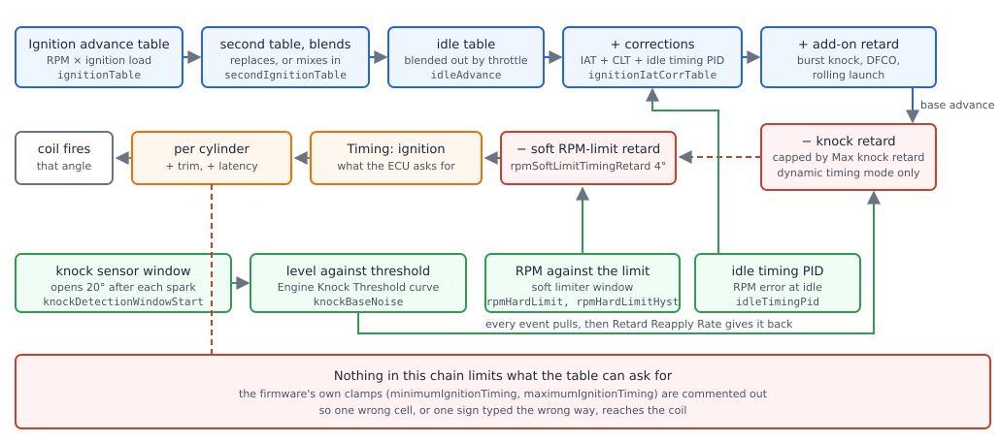
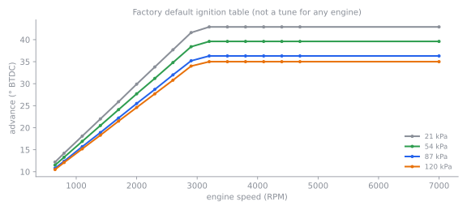
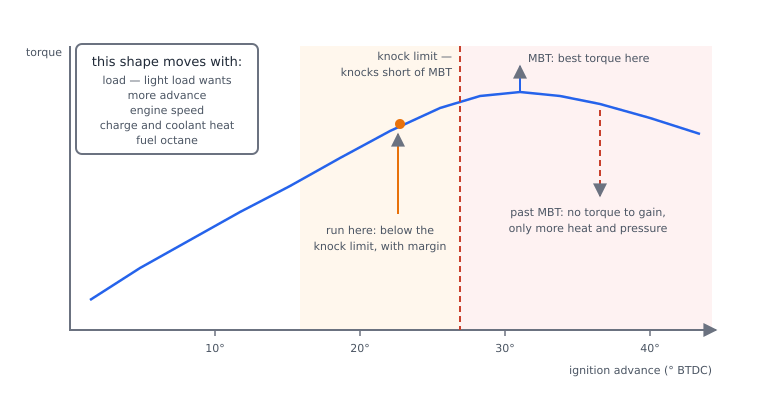
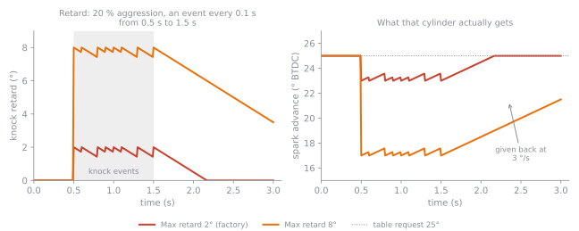
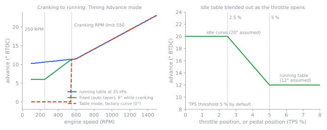

# Tuning ignition

:material-circle:{ .level-basic } Basic → :material-circle:{ .level-advanced } Advanced

> **In one sentence:** fill the ignition table from what the engine tells you — torque, lambda, exhaust
> temperature and knock — working from light load to full load, in one or two degree steps, stopping where
> knock starts rather than where the table says you should.

This chapter is the procedure. How the advance is assembled and fired is in the
[Ignition chapter](../part3/ignition.md), how knock is sensed and answered is in the
[Knock chapter](../part3/knock.md), and where ignition tuning sits in the order of work is in
[Tuning principles](tuning-principles.md). It assumes the engine starts, idles and drives on a
conservative tune; that the mode, outputs and dwell are right; and that the trigger offset has been
proven with a timing light (Ignition chapter, *Setting it up*, step 6). Everything here is done in
TunerStudio.

!!! danger "Over-advance kills engines, and it is often silent"
    Advance beyond what the fuel and the charge temperature allow produces knock, and knock under load can
    break a piston, a ring land or a head gasket in seconds — often with no sound you can hear over the
    exhaust. Never tune timing at full load on a public road. Have a wideband lambda sensor and at least one
    knock channel in the log before you add a degree, and read [Safety](../safety.md) first.

## What you are tuning

:material-circle:{ .level-basic } Basic

rusEFI's advance for one cylinder is assembled from a table and a chain of adders and subtractions. The
table is the part you tune; the rest describes conditions, and is tuned only when the condition itself
needs it.

<figure markdown>
  
  <figcaption>Figure 1 — The whole chain, from the table to the coil. Blue is what is asked for, red is
  what the ECU takes back for its own protection, green is what measures the engine and changes the
  answer, orange is what the output does.</figcaption>
</figure>

Two facts in that chain decide how you work:

- **Knock retard and the soft RPM-limit retard are taken off after your table**, so the number in the log
  channel *Timing: ignition* is your cell plus corrections minus those retard amounts. The channel
  *Timing: base ignition* is the number before them.
  <!-- src: firmware/controllers/algo/engine2.cpp (periodicFastCallback: baseIgnitionAdvance before knock retard and getLimitingTimingRetard, both applied only in TM_DYNAMIC, correctedIgnitionAdvance after them) -->
- **Nothing clamps the result.** rusEFI defines **Maximum timing advance** and **Minimum timing advance**
  (`maximumIgnitionTiming`, `minimumIgnitionTiming`, factory 60° and −10°) with help text promising that no
  spark will ever fire outside them — but both the TunerStudio fields and the clamp in the firmware are
  commented out, each line pointing at the same upstream issue. A cell typed as `50` instead of `15` reaches
  the coil exactly as written.
<!-- src: firmware/controllers/engine_cycle/spark_logic.cpp (prepareIgnitionSchedule: the minimumIgnitionTiming / maximumIgnitionTiming clamp commented out, issue 5894); firmware/tunerstudio/tunerstudio.template.ini (the Maximum timing advance and Minimum timing advance fields commented out of the ignition dialogs); firmware/integration/rusefi_config.txt (maximumIgnitionTiming and minimumIgnitionTiming help text) -->

### The table and its axes

**Ignition ▸ Ignition advance** holds a 16 × 16 grid. Engine speed runs along the top from **650 to
7000 RPM** in steps of 300 (650, 800, 1100 … 4700, then 7000); load runs down the side, 21 to 120 kPa in
rusEFI's factory configuration. Load is the same figure the fuel strategy uses — manifold pressure in Speed
Density — unless you change **Override ignition table load axis** (`ignOverrideMode`) to *MAP*, *TPS*,
*Acc Pedal* or *Cyl Filling %*. The two axes are ordinary configuration arrays of 16 values each — the RPM
bins go up to 18000 — so they can be re-spaced for your engine, and rusEFI only ships the default spacing.

Outside the axis the firmware **holds the last value rather than extrapolating**: below 650 RPM it uses the
650 column, above 120 kPa it uses the 120 kPa row. On a boosted engine that means every point above the
last row is the same number, which is usually the first thing to fix before tuning a turbo car — move the
load bins up so the row you use is inside the table.

There is no 3D view for the ignition table — TunerStudio's 3D view is declared for the VE table only — so
the flat grid with the TunerStudio cursor is what you work from. The dot on that dialog is the ECU's own
answer: the firmware logs `rpmForIgnitionTableDot` and `loadForIgnitionTableDot` for it, and when the idle
table has taken over the indicator reads *Using idle ignition table* and the dot moves to the idle curve
(`rpmForIgnitionIdleTableDot`) instead of sitting in your main table.
<!-- src: firmware/controllers/algo/defaults/default_ignition.cpp (setTimingRpmBin 800 and 7000, setLinearCurve ignitionLoadBins 20 to 120 rounded to 3); firmware/util/containers/table_helper.h (setRpmBin: first bin is idleRpm minus 150); firmware/libfirmware/util/include/rusefi/interpolation.h (priv::getBin off-scale low and high); firmware/controllers/algo/ignition/ignition_state.cpp (getInterpolatedIgnitionAngle, rpmForIgnitionTableDot, rpmForIgnitionIdleTableDot); firmware/console/binary/generated/data_logs.ini (the dot channels are loggable); firmware/tunerstudio/tunerstudio.template.ini (table ignitionTableTbl, panel ignitionTableIndicators, dialog ignitionOverrideModeSelector, veTableMap as the only 3D view) -->

<figure markdown>
  
  <figcaption>Figure 2 — rusEFI's factory ignition table, computed as the firmware computes it. It is a
  shape to start from, not a tune: note that above 3000 RPM every row is flat, and that the rows above
  100 kPa are identical.</figcaption>
</figure>

!!! tip "Correct the table, not the corrections"
    A hole in the table shows as the same error every time the engine visits that RPM and load. An error
    that follows coolant temperature belongs in the CLT correction, one that follows intake temperature
    belongs in the IAT correction, one that only appears while idling belongs in the idle handling. Putting
    a temperature error into the table makes the warm engine wrong.

## Before you start

:material-circle:{ .level-basic } Basic

- **Prove the timing the ECU asks for is the timing the engine gets.** Set **Timing Mode** to *fixed* with
  **Fixed Timing** at an angle you can read, check it with a timing light and correct **Trigger Angle
  Advance** if it is out (Ignition chapter, step 6). Every number in this chapter is meaningless until this
  is true.
  <!-- src: firmware/controllers/algo/ignition/ignition_state.cpp (IgnitionState::getAdvance: TM_FIXED returns fixedTiming with no corrections) -->
- **Take readings with the ignition on**, never with the ECU on USB power alone: on USB the 5 V sensor
  supplies do not reach 5 V, so MAP and TPS are wrong and the load cell you are tuning is the wrong cell.
  <!-- src: firmware/controllers/ignition_controller.cpp (isIgnVoltage); firmware/tunerstudio/tunerstudio.template.ini (hasIgnitionVoltage enable conditions) -->
- **Have the knock path running and understood.** Proteus F7 enables **Knock sensing** by default. Before
  tuning, set the knock threshold and **Max knock retard** as the Knock chapter describes, and know what
  *Knock: Count* and *Knock: Retard* do in a log.
  <!-- src: firmware/config/boards/proteus/board_configuration.cpp (proteus_boardDefaultConfiguration: enableSoftwareKnock); firmware/controllers/engine_cycle/knock_controller.cpp (onKnockSenseCompleted, getMaximumRetard) -->
- **Log first, decide second.** Run with the channels in *What to log* below, so each change is compared
  against a run rather than against a feeling.
- **Save a restore point and burn.** TunerStudio edits the ECU's working copy; only **Burn** writes to
  flash, and the **Unsaved changes** indicator on the front page tells you which state you are in. A timing
  session without a saved tune file is a session you cannot undo.
  <!-- src: firmware/tunerstudio/tunerstudio.template.ini (needBurn indicator on FrontPage) -->
- **Have the fuelling right before you chase torque with spark.** If lambda is off target under load, fix
  the fuelling first: advancing a lean engine is how a tuning session ends early. See
  [Tuning fuel](tuning-fuel.md).

<!-- shot: img/ts/tuning-ignition-advance-table.png | Ignition ▸ Ignition advance | Proteus F7, engine idling warm with ignition on, the 16 by 16 grid with partly tuned values around 12 to 14 degrees at idle and 30 to 35 degrees mid-range, TunerStudio cursor on the idle cell, indicator reading Using normal ignition table, Override ignition table load axis set to None, dropdowns closed | The cursor sits on the cell the engine is using, and the indicator tells you when the idle table has taken over -->

!!! warning "The ECU will not save you from your own table"
    rusEFI applies knock retard and the RPM-limit retard to whatever the table asks for, but it does not
    clamp the table itself. One wrong cell, one wrong sign, or one cell pasted into the wrong column is
    delivered to the coil exactly as written, at once, on the running engine. Change one cell at a time,
    and read the value back before you press **Send**.

## MBT and the knock limit

:material-circle:{ .level-intermediate } Intermediate

The burning mixture needs time to build pressure, so the spark fires before top dead centre. **MBT**
(minimum advance for best torque) is the least advance that gives the most torque at one RPM and load.
Before MBT, more advance buys torque. At and past MBT it buys nothing measurable, and costs cylinder
pressure, cylinder temperature and exhaust gas temperature. That is the whole reason a timing table exists:
MBT moves with load, engine speed, charge temperature and fuel quality, so the table holds a different
number everywhere.

<figure markdown>
  
  <figcaption>Figure 3 — One operating point. On a cool, lightly loaded engine the knock limit sits past
  MBT and the table can reach the peak. Hot, heavily loaded or low-octane, knock arrives first and the
  usable advance is set by knock.</figcaption>
</figure>

Where the two limits fall depends on the engine. Two practical consequences:

- **At light load the limit is MBT, not knock.** Most of the table can be advanced until the engine stops
  responding, and knock rarely appears.
- **At high load the limit is knock.** There the question is never "how much advance gives more torque" but
  "how much advance can this charge take without knocking". Boost, hot intake air, a hot engine and weak
  fuel all move the knock limit towards retard, and they are exactly the conditions in which the damage
  happens.

### What rusEFI does when it hears knock

Knock control is a safety net, and it is worth knowing its arithmetic so you can read it in a log:

- each knock event pulls **that cylinder's current advance plus 20°, multiplied by Retard Aggression**
  (factory 20 %), and the total is clamped to the **Max knock retard** table (factory 2° everywhere);
- the retard is given back at **Retard Reapply Rate** (factory 3 °/s);
- below **Suppress Min Tps** (factory 10 %) the retard and its fuel trim are reset to zero, which is why
  *Knock: Retard* reads 0 at a closed-throttle idle even if the sensor is busy;
- retard is applied only while **Timing Mode** is *dynamic* — in fixed timing mode the sensor still counts
  events, but nothing is taken back.

<figure markdown>
  
  <figcaption>Figure 4 — The knock controller's own arithmetic, with factory aggression and reapply rate.
  The factory 2° cap means one event is enough to reach it: knock retard pinned at its limit for a whole
  operating point is the ECU telling you the table is too advanced there.</figcaption>
</figure>
<!-- src: firmware/controllers/engine_cycle/knock_controller.cpp (KnockControllerBase::onKnockSenseCompleted: retard amount, clamp to m_maximumRetard; onFastCallback: reapply rate and knockSuppressMinTps reset); firmware/controllers/algo/defaults/default_base_engine.cpp (knockRetardAggression 20, knockRetardReapplyRate 3, knockSuppressMinTps 10, maxKnockRetardTable 2); firmware/controllers/algo/engine2.cpp (knock retard applied only when timingMode is TM_DYNAMIC) -->

<!-- shot: img/ts/tuning-ignition-knock-control.png | Ignition ▸ Knock Control | Proteus F7, engine idling warm with ignition on, Sense panel: Knock sensing on, Cylinder Bore 86, Estimated Knock Frequency 0, Detection mode second harmonic, Detection Window Start 20, Sampling Duration 45, Response panel: Retard Aggression 20, Retard Reapply Rate 3, Suppress Min Tps 10, Fuel Trim 0, the Engine Knock Threshold curve with its live knock level gauge | The two panels you set knock from, and the threshold you set against the logged noise floor -->
<!-- shot: img/ts/tuning-ignition-max-knock-retard.png | Ignition ▸ Max knock retard | Proteus F7, ignition on, the 6 by 6 grid with 2 degrees at light load and 6 degrees from 60 percent load up, RPM axis 700 to 7000 | How far the ECU is allowed to pull timing, which is a limit you set, not a safety feature you grow into -->

!!! danger "Do not tune up until the knock controller catches you"
    Retard of a few degrees at one point is a symptom, not a margin. If *Knock: Retard* sits at its limit,
    or *Knock: Count* climbs steadily at a steady operating point, the table there is too advanced: reduce
    it and re-log. Raising **Max knock retard**, lowering the threshold or adding timing to "see what
    happens" is how ring lands and holes in pistons get made. See the Knock chapter before changing any
    knock setting.

## The table, cell by cell

:material-circle:{ .level-intermediate } Intermediate

1. **Write a safe full-load row first.** Before any tuning, put a known-safe number in every full-load cell
   across the RPM range — from the engine's own history, the maker's figure, or a conservative number for
   its compression and fuel. It is safer to start with less advance and add it than to start with a
   factory-generic number and hope.
2. **Warm the engine and settle it** at a light-load operating point: steady throttle, steady RPM, coolant
   fully warm so warm-up enrichment and the cold corrections are out of the way.
3. **Log the point** for 20–30 seconds and read *Timing: ignition*, *Timing: base ignition*,
   *Knock: Retard*, *Knock: Count*, lambda and EGT if fitted. Note the RPM and load the cursor is on.
4. **Change one cell by 1–2°, Send, and re-log the same point.** Look for three things: does the engine
   respond (torque, throttle response, a steadier or leaner part-throttle reading), does knock appear, and
   does exhaust temperature move the wrong way.
5. **Keep a margin when you stop.** Back the cell off by a couple of degrees from wherever the response
   stopped or knock first appeared. The engine's conditions on the day you tune are not the conditions next
   month.
6. **Blend the neighbours** so no cell steps on its neighbours by more than a few degrees, then move to the
   next operating point and repeat. Work across light load and mid load before touching full load.
7. **Full load last, on a dyno or a closed course only.** Richer mixture, watch *Knock: Count* and EGT as
   well as lambda, 1° at a time, and end the run the moment knock appears and stays.
8. **Burn, and save the tune file**, at the end of every session — and more often if the session is going
   somewhere interesting.

<!-- src: firmware/controllers/algo/ignition/ignition_state.cpp (getRunningAdvance reads the table by interpolation at RPM and ignition load); firmware/console/binary/output_channels.txt (correctedIgnitionAdvance, baseIgnitionAdvance, knock channels); firmware/controllers/algo/defaults/default_ignition.cpp (factory table shape, flat above 3000 RPM) -->

!!! note "Nothing notices an ignition-table edit"
    rusEFI's tuning detector suspends the fuel trims and throttle-position enrichment for 20 seconds after
    a **VE table** write, so a cell you just edited is not immediately corrected. There is no equivalent for
    the ignition table: your change is live the moment TunerStudio sends it, and every correction keeps
    working around it.

!!! tip "How big a step"
    1° is enough to tell on almost any engine at any operating point, and 2° is the most you should change
    in one run. If a change makes no difference either way, the cell is not the limit there — move on
    rather than stacking up changes you cannot attribute.

!!! warning "Do not fix knock with the mixture"
    Running richer does hide knock, and it is also how a wideband reading gets ignored while the charge
    keeps getting hotter. If knock is the limit, the answer is less advance in that cell (or the cause:
    carbon, hot soak, wrong fuel, a lean condition). Leaning a knocking engine to "clean up" the reading
    accelerates the damage.

## Dyno or road

:material-circle:{ .level-intermediate } Intermediate

The table has to be right everywhere, and the two places you can work have different strengths. Neither
replaces the other.

| | Dyno | Road |
|---|---|---|
| Full load, safely | yes — this is the main reason to use one | no |
| Repeated, comparable pulls | yes, with the same charge temperature | only if you can find a steady hill or cruise |
| Real intake temperature | often worse than the car sees on the road (hot bay, little airflow) | real, and it changes as you drive |
| Real transients and driveline | not really | yes |
| Torque as a measurement | yes, so MBT can be found rather than guessed | no, only what you feel |
| Part-throttle cells | possible but boring and unrealistic | this is where most driving, and most of the table, lives |

Working the road safely means working at light load: a steady part-throttle speed where a 2° change cannot
produce knock, with the log running, and the same stretch of road each time so RPM and load repeat. Note
the intake temperature in each run — two runs an hour apart on the same road are not the same tune point.
On a dyno, watch the charge temperature between pulls and let the intercooler or intake recover, or you
will tune the cell for hot soak and leave the car too advanced when the air is cold.

!!! danger "Full-load pulls on the road are not tuning, they are a risk"
    A full-load run needs a dyno or a closed course, a second person watching the log, knock and wideband
    channels visible, and a plan for aborting. On public roads you also have traffic, and a mis-timed
    engine under full load is an engine that may not answer when you need it to.

## Cranking and idle: the two blends

:material-circle:{ .level-intermediate } Intermediate

Both of these are blends between a special small setting and the main table, and both are easy to get wrong
in opposite directions.

<figure markdown>
  
  <figcaption>Figure 5 — Left: the factory cranking blend, 6° rising to the running table's value at the
  **Cranking RPM limit** of 550 RPM, and what **Table** mode does with the factory curve — no advance at
  all. Right: the idle table's fade-out between half the **TPS threshold** and the threshold itself
  (20° and 12° are assumed, to show the shape).</figcaption>
</figure>

### Cranking timing

Below the **Cranking RPM limit** (`cranking_rpm`, factory 550) the engine is on cranking logic. In
**Timing Advance mode** *Fixed (auto taper)* (factory), rusEFI starts at **Fixed cranking advance**
(`crankingTimingAngle`, factory 6°) from the lowest RPM it saw turning the engine, and blends that into the
running table's value at the Cranking RPM limit. In *Table* mode it uses the **Cranking ignition advance**
curve against RPM instead — and that curve is **0° at every point in the factory configuration**, so
switching to *Table* without filling it leaves the engine no advance while it cranks.
Cranking dwell is separate: **Fixed Cranking Dwell**, factory 6 ms.
**Use Advance Corrections for cranking** is off, and the help says you probably do not need it: while
cranking there is no IAT, CLT or idle-timing correction unless you switch it on.
<!-- src: firmware/controllers/algo/ignition/ignition_state.cpp (getCrankingAdvance: crankingAdvance curve or interpolateClamped from minCrankingRpm to cranking.rpm); firmware/controllers/algo/defaults/default_cranking.cpp (cranking.rpm 550, crankingTimingAngle, crankingAdvance array all zero with bins 0, 200, 400, 1000); firmware/controllers/engine_cycle/rpm_calculator.cpp (isCranking, minCrankingRpm); firmware/controllers/algo/ignition/ignition_state.cpp (getSparkDwell: ignitionDwellForCrankingMs while cranking) -->

<!-- shot: img/ts/tuning-ignition-cranking.png | Cranking ▸ Cranking settings | Proteus F7, ignition on, engine stopped, Cranking RPM limit 550, Ignition panel: Timing Advance mode Fixed (auto taper), Fixed cranking advance 6, Fixed Cranking Dwell 6, Advanced panel: Use Advance Corrections for cranking no | Cranking timing and the switch that changes where it comes from -->

<!-- shot: img/ts/tuning-ignition-cranking-advance-curve.png | Cranking ▸ Cranking ignition advance | Proteus F7, ignition on, engine stopped, Timing Advance mode set to Table so the menu entry appears, the 4-point curve at its factory 0 degrees at 0, 200, 400 and 1000 RPM with the RPM gauge live beside it | Table mode reads this curve directly; at factory values it asks for no advance at all while cranking -->

Cranking timing is a starting-quality setting, and the starting problem is usually fuel rather than spark
(see the Cranking chapter). What cranking advance does buy you is a faster catch; what it can cost is a
kickback.

!!! danger "Too much advance while cranking can kick back"
    Advance high enough to make the engine fire hard while it is still being turned over by the starter can
    drive the crank backwards against the starter. That can break the starter, damage the flywheel or bend
    a component, and it can catch your hand on the crank pulley or wrench. Keep cranking advance near the
    factory 6° unless you have a specific reason, and keep clear of the rotating assembly while a cold
    engine is being cranked by hand or on stands.

### Idle timing

Three separate things live here, and you usually need one of them.

- **Enable closed loop idle ignition timing** (**Idle ▸ Closed-loop Ignition idle timing**) adds a PID on
  RPM error to the advance while the idle controller is in its **Idling** phase. The factory gains are a
  **Proportional gain** of 0.1 — 10 degrees per 100 RPM of error — limited to **Min adjustment (retard)**
  −10° and **Max adjustment (advance)** +10°, with integral and derivative at 0. It resets the moment the
  engine is not idling, and **Soft entry time** fades it in after a start. It is quick, which is exactly why
  it should be limited: 10 degrees at idle is the difference between a steady idle and a stall or a race.
- **Separate idle ignition table** (**Idle ▸ Idle settings**) replaces the main table with the
  **Idle Ignition advance** curve (8 points against RPM, each allowed between −20° and +90°) while the
  throttle is at or below **TPS threshold**, blending back to the main table between half that threshold and
  the threshold itself. With an electronic throttle that threshold reads the pedal and should be 1–2 %.
- **Use idle ignition table while coasting** extends the same curve into the coasting-idle phase.

The idle timing PID and the idle air controller do the same job at different speeds: air is slow, spark is
fast. If the timing PID sits at one limit all the time at a warm idle, the idle *air* is wrong — fix the air
in the Idle chapter rather than widening the timing limits.

<!-- src: firmware/controllers/algo/ignition/ignition_state.cpp (useSeparateAdvanceForIdle, idleAdvance blend against idlePidDeactivationTpsThreshold, isCoastingAdvance); firmware/controllers/algo/engine_configuration.cpp (idlePidDeactivationTpsThreshold 5); firmware/controllers/actuators/idle_thread.cpp (IdleController::getIdleTimingAdjustment: only in the Idling phase, PID reset, soft entry); firmware/controllers/actuators/idle_thread_io.cpp (setDefaultIdleParameters: idleTimingPid pFactor 0.1, minValue minus 10, maxValue 10); firmware/tunerstudio/tunerstudio.template.ini (idleTimingPidCorrDialog fields, idleAdvanceCurve menu entry) -->

<!-- shot: img/ts/tuning-ignition-idle-settings.png | Idle ▸ Idle settings | Proteus F7, ignition on, Extra Idle Features panel: Separate idle ignition table enabled, Use idle ignition table while coasting disabled, TPS threshold 5 | The switch that puts the idle curve into the chain -->
<!-- shot: img/ts/tuning-ignition-idle-advance-curve.png | Idle ▸ Idle Ignition advance | Proteus F7, ignition on, engine idling warm, the 8-point curve with about 20 degrees at the idle RPM points tapering towards the running table value by 1500 RPM, the current angle readout live against the RPM gauge | The idle curve; it only appears once the separate idle ignition table is enabled -->
<!-- shot: img/ts/tuning-ignition-idle-timing-pid.png | Idle ▸ Closed-loop Ignition idle timing | Proteus F7, engine idling warm, Enable closed loop idle ignition timing on, Proportional gain 0.1, Integral gain 0, Derivative gain 0, Min adjustment -10, Max adjustment 10, Soft entry time 0 | The idle timing PID, its gain and the limits that keep it honest -->

## Temperature, blends and per-cylinder trims

:material-circle:{ .level-intermediate } Intermediate → :material-circle:{ .level-advanced } Advanced

The corrections in Figure 1 are the ones you may have to set; none of them should carry a steady-state
table error.

- **CLT timing correction** (**Ignition ▸ CLT timing correction**) is a curve of degrees against coolant
  temperature at each load row. It is **all zeros by default**, which is the right answer for most engines:
  a cold engine that pings or rattles for the first minute is usually better served by cold-start fuelling
  or by the mechanical noise floor than by permanent retard. It is not applied while cranking unless
  **Use Advance Corrections for cranking** is on, and not at all in fixed timing mode.
- **IAT timing correction** (**Ignition ▸ IAT timing correction**) retards as the intake charge gets hot.
  rusEFI's factory curve is 0° up to 30 °C and pulls to −3° at 60 °C (−2° on the highest load row). Tune it
  with the knock channels in the log: it is the correction that protects the car on a hot afternoon, and it
  is the one people leave at zero and then blame on the fuel.
- **Ignition blend tables** (**Ignition ▸ Ignition blend tables**) add a table of degrees whose effect is
  faded in by a **bias** table against a chosen parameter — a flex reading, a gear, a digital input. This is
  the right place for an advance that belongs to a *condition* rather than to an operating point, for example
  a second fuel: the bias scales how much of the blend table is mixed in.
- **Second Ignition Table** (**Ignition ▸ Second Ignition Table**) is different: a digital input either
  replaces the main table outright or blends it in by its own bias table. Use it for a hard, complete
  change — a different fuel, a different map — not for trim.
- **Cylinder ign trims** (**Ignition ▸ Cylinder ign trims ▸ Ignition trim cyl N**) add degrees to one
  cylinder, after everything else, and rusEFI's default axes for a four-cylinder are 1000, 3000, 5000 and
  7000 RPM against 20, 50, 80 and 100 % of load. A cylinder that pings where its neighbours do not is
  usually a mechanical or fuelling difference, so check the Knock chapter's per-cylinder gain tables and the
  cylinder's fuelling before you trim timing.
<!-- src: firmware/controllers/algo/ignition/ignition_state.cpp (getAdvanceCorrections: IAT, CLT, idle timing PID, minus DFCO and burst knock retard, not applied while cranking unless useAdvanceCorrectionsForCranking, getCltTimingCorrection); firmware/controllers/algo/defaults/default_ignition.cpp (setDefaultIatTimingCorrection, setDefaultCltTimingCorrection all zero, ignTrimRpmBins and ignTrimLoadBins for four cylinders); firmware/controllers/algo/ignition/ignition_state.cpp (getRunningAdvance: ignBlends loop, secondIgnitionTableInput pin and secondIgnitionBlendParameter); firmware/controllers/algo/engine2.cpp (cylinderIgnitionAdvance and getSparkHardwareLatencyCorrection); firmware/tunerstudio/tunerstudio.template.ini (ignAdder1Cfg bias explanation, ignTrimTblN) -->

<!-- shot: img/ts/tuning-ignition-iat-corr.png | Ignition ▸ IAT timing correction | Proteus F7, ignition on, the grid with its factory values: intake temperature bins -40, 10, 30 and 60 C (the 8-point default squeezed onto 4 bins), 0 degrees up to 30 C and -3 at 60 C, the highest load row -2 at 60 C | The correction that does the hot-afternoon work -->
<!-- shot: img/ts/tuning-ignition-clt-corr.png | Ignition ▸ CLT timing correction | Proteus F7, ignition on, the grid all zeros with coolant bins -20 to 60 and load bins 0 to 140, Ign: CLT correction gauge reading 0 | All zeros by default, which is where it should stay unless a cold engine says otherwise -->
<!-- shot: img/ts/tuning-ignition-blend-bias.png | Ignition ▸ Ignition blend tables ▸ Ignition blend 1 bias | Proteus F7, ignition on, Blend parameter set to a flex or aux input rather than None, the bias curve shown against it and the matching Ignition blend table 1 entry in the menu | A blend adds degrees for a condition, faded in by the bias -->

!!! note "Burst Knock is not knock sensing"
    **Ignition ▸ Burst Knock** pulls timing during a fast throttle opening, using the throttle-position
    acceleration detector. It never listens to the knock sensor, and it is a different problem from the one
    this chapter is about. If you are seeing a retard you cannot explain, check whether it is burst knock,
    DFCO retard or the soft RPM limiter rather than your table.

## What to log

:material-circle:{ .level-intermediate } Intermediate

| Channel (TunerStudio name) | What it tells you |
|---|---|
| **Timing: ignition** (`correctedIgnitionAdvance`) | the angle the ECU is asking for, after knock and limiter retard |
| **Timing: base ignition** (`baseIgnitionAdvance`) | the same before those two retard paths — the difference is what the ECU is taking back |
| **Ign: Timing Cyl 1 …** (`ignitionAdvanceCyl`) | the per-cylinder angle, including that cylinder's trim |
| **Knock: Retard** / **Knock: Max retard** | what is being pulled, and the limit it is pulled to |
| **Knock: Count** | knock events since start-up — watch the slope, not the number |
| **Knock: Current level** / **Knock: Threshold** | the noise floor and the line it is judged against |
| **Idle: Timing adjustment** (`timingPidCorrection`) | what the idle timing PID is adding, right now |
| **Ign: CLT correction** / **Ign: IAT correction** | the temperature corrections at this moment |
| **RPM**, **MAP**, **TPS**, **IAT**, **CLT** | which cell you are actually in, and what the limits depend on |
| **Lambda** and target lambda | a lean condition under load is a reason to stop advancing |
| **EGT**, if fitted | rising EGT at constant load and lambda is a sign to stop adding advance |
| **Ignition: coil charge time** / **Ignition: coil duty cycle** | dwell is a limit on advance at high RPM: a weak spark misfires first |
| **VBatt** | low voltage shortens effective dwell on most coils |
<!-- src: firmware/console/binary/output_channels.txt (correctedIgnitionAdvance, baseIgnitionAdvance, ignitionAdvanceCyl, knock channel names, timingPidCorrection, timingIatCorrection, cltTimingCorrection); firmware/tunerstudio/tunerstudio.template.ini and firmware/tunerstudio/gauge_declarations.ini (the resolved gauge labels) -->

## Worked examples

:material-circle:{ .level-intermediate } Intermediate

### Example 1 — part-throttle cruise that pings on a hill

A warm naturally aspirated four-cylinder at 2500 RPM and 60 kPa: the factory table asks about 33°, and on a
long steady incline *Knock: Count* climbs by about one every few seconds while *Knock: Retard* sits at its
factory 2° limit. The engine is being held back by the ECU, all day, at the point you drive most.
Take that cell from 33 to 30°, blend the two neighbours, send it, re-log the same hill: the count stops
climbing and *Knock: Retard* returns to zero after about a second of quiet
(3° at the factory 3 °/s reapply rate). Do not raise **Max knock retard** to "get the power back" —
the pull is the engine's answer, and 30° is now the honest number for that cell.

### Example 2 — a boosted engine's WOT column on the dyno

A turbo four making 1.4 bar sits at 4000 RPM on the dyno with the throttle pinned. Its factory load axis
stops at 120 kPa, so every point above that is reading the last row — the table cannot describe boost at
all. First move the load bins so the rows cover the manifold pressures the engine actually makes; then
start that row well below what the engine took before (say 15° where it ran on 28°) and add 1° per pull,
watching *Knock: Count*, lambda and EGT, and stop two or three degrees short of the first sustained knock.
Save the tune after every pull, so a pull that goes wrong is one pull and not one session.

### Example 3 — an idle that only holds when the timing PID is working

Warm idle at 750 RPM target; the log shows **Idle: Timing adjustment** parked near +8° all day, with the
idle air controller's own output also high. The timing PID is not misbehaving — it is doing an air
controller's job with faster hardware. The fix is the idle airflow and target (Idle chapter), after which
the PID should sit near 0 and ±10° should be plenty. Leaving it at +8° means the idle is being held up with
spark that the moment the throttle opens belongs to the main table, and that the moment the PID limit is
reached the idle drops.

## Pitfalls and troubleshooting

:material-circle:{ .level-basic } Basic → :material-circle:{ .level-advanced } Advanced

| Symptom | Likely cause | Check |
|---|---|---|
| *Knock: Retard* sits at its limit at one operating point | that cell is too advanced | cut the cell, do not raise the limit |
| *Knock: Count* climbs with no sound and no retard | threshold too low for the noise floor, or the wrong knock frequency | Knock chapter: threshold curve, bore, harmonic, gains |
| *Knock: Retard* reads 0 at a rattling idle | TPS is below **Suppress Min Tps** (10 %), so retard is reset there | expected behaviour; also check the mechanical cause |
| Timing changed in TunerStudio but the engine did not react | **Timing Mode** is *fixed*, or you edited the wrong table (idle table active) | **Timing Mode**; the *Using idle ignition table* indicator |
| Timing gauge does not match the timing light | trigger offset, per-cylinder trim, or **Spark hardware latency correction** | Trigger chapter; Ignition chapter's fixed-timing check |
| Engine cranks but will not catch, timing looks fine | **Timing Advance mode** set to *Table* with the factory 0° curve | fill **Cranking ignition advance**, or go back to *Fixed (auto taper)* |
| Starter shatters a bolt, or the engine kicks back | too much cranking advance | **Fixed cranking advance**, factory 6° |
| Idle hunts slowly, timing and air fighting | idle timing PID gain or limits too wide, idle air wrong | **Min/Max adjustment**, then the Idle chapter |
| One cylinder pings where others do not | that cylinder's fuelling or mechanics, or its knock gain | cylinder fuel trims, **Knock gain cyl N** |
| Part-throttle tune was good, hot afternoon brings knock | IAT correction left at zero | **IAT timing correction** |
| Boosted engine behaves identically at all boost levels | load axis stops at 120 kPa and the firmware holds the last row | move the load bins into boost |
| Idle cells change character when you touch the throttle slightly | idle table blending between half **TPS threshold** and the threshold | **TPS threshold** (1–2 % with an electronic throttle) |
| Advance at high RPM misfires | dwell too short for the RPM, or coil duty too high | Ignition chapter, dwell and *Ignition: coil duty cycle* |
| Changes vanish after the ignition is cycled | not burned | **Burn**, the **Unsaved changes** indicator |

## Settings reference

### Ignition advance (Ignition ▸ Ignition advance)

--8<-- "reference/settings/_IgnitionTableDialog.table.md"

### Ignition hardware (Ignition ▸ Ignition hardware)

--8<-- "reference/settings/_ignitionSettings.table.md"

### Cranking settings (Cranking ▸ Cranking settings)

--8<-- "reference/settings/_crankingDialog.table.md"

### Idle settings (Idle ▸ Idle settings)

--8<-- "reference/settings/_idleSettings.table.md"

### Closed-loop Ignition idle timing (Idle ▸ Closed-loop Ignition idle timing)

--8<-- "reference/settings/_idleTimingPidCorrDialog.table.md"

### Knock Control (Ignition ▸ Knock Control)

--8<-- "reference/settings/_softwareKnock.table.md"

### Second Ignition Table (Ignition ▸ Second Ignition Table)

--8<-- "reference/settings/_secondIgnitionTableDialog.table.md"

### Ignition blend 1 bias (Ignition ▸ Ignition blend tables ▸ Ignition blend 1 bias)

--8<-- "reference/settings/_ignAdder1Cfg.table.md"

The menu entries whose whole content is a grid or a curve carry no scalar settings of their own, so there is
no generated table for them: **Ignition ▸ CLT timing correction**, **Ignition ▸ IAT timing correction**,
**Ignition ▸ Max knock retard**, **Cranking ▸ Cranking ignition advance** and
**Idle ▸ Idle Ignition advance**. The values live in the firmware tables `ignitionCltCorrTable`,
`ignitionIatCorrTable`, `maxKnockRetardTable`, `crankingAdvance` and `idleAdvance`, and the grid on
**Ignition ▸ Ignition advance** above is the firmware table `ignitionTable`, read at the RPM and load bins
the ECU keeps as configuration arrays.

## Related

- [Ignition](../part3/ignition.md) — mode, outputs, dwell, the timing-light check, the factory table
- [Knock](../part3/knock.md) — sensing, threshold, gains, the analyzer
- [Idle](../part3/idle.md) — idle airflow, the idle timing PID and the idle tables
- [Cranking](../part3/cranking.md) — priming, cranking fuel and the crank-to-run taper
- [Tuning fuel](tuning-fuel.md) — the mixture that sets how much advance is safe
- [Tuning principles](tuning-principles.md) — the order of work across fuel and ignition
- [Limits and engine protection](../part3/limits-protection.md) — the RPM limiter whose retard sits in the chain
- [Boost](../part3/boost.md) — the load that moves the knock limit
