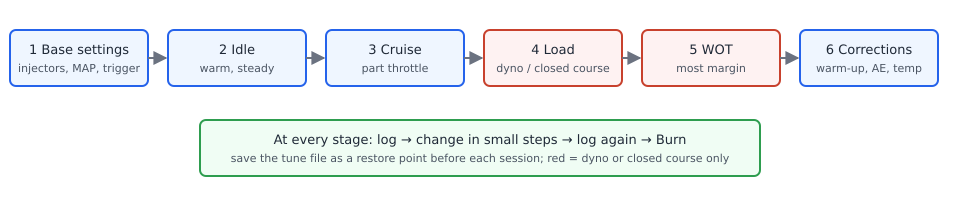

# Tuning principles

:material-circle:{ .level-basic } Basic → :material-circle:{ .level-advanced } Advanced

> **In one sentence:** tuning is filling in the ECU's tables so the engine gets the fuel and spark it
> needs everywhere it runs — in a safe order, in small steps, checked against logs.

!!! danger "A bad tune destroys engines"
    A lean mixture or too much ignition advance under load can melt a piston, crack a ring land or
    bend a rod within seconds. Do load tuning only where it is safe to do so — on a dyno or a closed
    course, never on a public road — with a wideband lambda sensor fitted and logged, and with a
    second person driving or watching if you are in the car. Read the Safety page first
    ([Safety](../safety.md)).

## Overview

:material-circle:{ .level-basic } Basic

rusEFI decides two things for every combustion event: **how much fuel** to inject and **when to
fire the spark**. Both come mostly from tables you fill in TunerStudio — the VE table and the target
lambda table for fuel, the ignition table for spark — plus corrections for temperature, starting
and transients. This chapter explains the ideas behind those tables and the order in which you
work through them. The Tuning fuel and Tuning ignition chapters give the procedures.

This chapter assumes the engine is already set up and starts: trigger, sensors, injectors and
coils configured as described in Parts II and III.

## Concepts

:material-circle:{ .level-basic } Basic → :material-circle:{ .level-intermediate } Intermediate

### VE: how much air the engine takes in

**Volumetric efficiency (VE)** is how well a cylinder fills with air, as a percentage of what its
swept volume would hold at the measured manifold pressure and temperature. An engine at 85 % VE
traps 85 % of that theoretical air. VE changes with engine speed and load because of valve timing,
intake and exhaust tuning and restrictions.

rusEFI works in **mass**. With the default *Speed Density* fuel strategy it calculates the air mass
in each cylinder from manifold pressure (MAP), the estimated charge temperature, the cylinder
volume and the VE looked up from the **VE Table** at the current RPM and load. It then divides
that air mass by the **target AFR** (target lambda × the fuel's stoichiometric ratio) to get the
fuel mass, and only then turns fuel mass into an injector pulse using the injector flow rate and
dead time. The Fuel chapter describes this chain in full.
<!-- src: firmware/controllers/algo/airmass/speed_density_airmass.cpp (SpeedDensityAirmass::getAirmass); firmware/controllers/algo/airmass/airmass.cpp (AirmassVeModelBase::getVe); firmware/controllers/algo/fuel/fuel_computer.cpp (FuelComputerBase::getCycleFuel); firmware/controllers/algo/fuel_math.cpp (getBaseFuelMass, getInjectionMass) -->

Two consequences matter for tuning:

- **The VE table describes the engine's airflow, not the mixture.** If the injectors, dead time
  and fuel pressure are right, a correct VE table gives the measured lambda equal to the target at
  every point.
- **The target lambda table sets the mixture separately.** Changing a target from 1.00 to 0.85
  adds fuel by itself; you do not touch the VE table to run richer.
<!-- src: firmware/controllers/algo/fuel/fuel_computer.cpp (FuelComputer::getTargetLambda, getCycleFuel: airmass / (stoich * lambda)) -->

### Lambda and AFR

**Lambda** (λ) is the actual air-fuel ratio divided by the stoichiometric ratio of the fuel — the
ratio at which all the fuel and all the oxygen are used. λ = 1.00 is stoichiometric, below 1 is
rich, above 1 is lean. **AFR** is the same thing expressed as mass of air per mass of fuel; for
petrol stoichiometric is about 14.7:1, so λ 0.85 ≈ 12.5:1 AFR. Lambda is the same number for every
fuel, which is why it is the better unit. rusEFI's **Stoichiometric ratio** defaults to 14.7 and,
with a flex-fuel sensor, blends towards the E100 ratio (default 9.0). TunerStudio shows the target
table as **Target lambda** or **Target AFR** depending on the units chosen for the interface.
<!-- src: firmware/controllers/algo/rusefi_types.h (STOICH_RATIO); firmware/controllers/algo/defaults/default_fuel.cpp (setDefaultFuel: stoichRatioPrimary, stoichRatioSecondary); firmware/controllers/algo/fuel/fuel_computer.cpp (FuelComputer::getStoichiometricRatio); firmware/tunerstudio/tunerstudio.template.ini (lambdaTableDialog, afrTableDialog, useLambdaOnInterface) -->

As general guidance for petrol engines: about λ 1.00 at idle and light cruise, richer as load
rises, around λ 0.85–0.90 at full load naturally aspirated and richer (λ 0.75–0.80) under boost.
The factory default target table follows the same idea: λ 1.00 up to 70 kPa, falling to 0.90 at
100 kPa and 0.73 at 250 kPa.
<!-- src: firmware/controllers/algo/engine_configuration_defaults.h (DEFAULT_LAMBDA_LOAD_BINS, DEFAULT_LAMBDA_TABLE_ROW) -->

### MBT and the knock limit

The burning mixture needs time to build pressure, so the spark fires before top dead centre.
**MBT** (minimum advance for best torque) is the smallest advance that gives the most torque at a
given speed and load. More advance than MBT gives no more torque, only more heat and cylinder
pressure. On many engines — especially at high load, with boost, poor fuel or hot intake air — the
engine **knocks** (the end gas auto-ignites) before MBT is reached. There the usable advance is
**knock limited**, and you run a safety margin below the first knock. Knock is covered in the
Knock chapter; rusEFI's knock retard is a safety net, not a way to find timing.

### Safety margins

Leave margin where the consequences are worst: a little richer and a little less advance at high
load, high intake temperature and high coolant temperature. It costs a few percent of power and
saves the engine when fuel quality, weather or a sensor is not what it was during tuning.

## Procedure

:material-circle:{ .level-intermediate } Intermediate

<figure markdown>
  
  <figcaption>Figure 1 — The order of work. Each stage relies on the one before it.</figcaption>
</figure>

1. **Base settings.** Get everything that is not a table right first: engine displacement and
   cylinder count, injector flow and dead time, fuel pressure, trigger and a timing-light check of
   the ignition timing, sensor calibrations (MAP, IAT, CLT, TPS, wideband). A wrong injector dead
   time or a wrong MAP calibration makes every VE number wrong.
2. **Idle.** Make the engine start and idle steadily when warm. Idle is where you spend the most
   time and where the base settings show up first.
3. **Part-throttle cruise.** Steady light-load cells, where most driving happens. These are safe to
   tune and give the largest share of the VE table.
4. **Load.** Higher manifold pressure at moderate engine speed — on a dyno or closed course only.
5. **WOT.** Full load across the rev range, last, with the most margin.
6. **Corrections.** Warm-up, after-start and acceleration enrichment, temperature timing
   corrections: these need a correct base table to be tuned against.

Throughout:

- **Log everything.** Make a change, log, look at the log, then make the next change. Decide from
  the log, not from what you felt.
- **Small steps.** Change cells by a few percent of fuel or one or two degrees of timing at a time,
  and smooth neighbouring cells so the table has no steps the engine can fall into.
- **Burn and keep restore points.** Changes in TunerStudio go to the ECU's working copy at once;
  **Burn** stores them in the ECU's flash. Save the tune file (File ▸ Save Tune As…) with a new
  name before every session, so you can go back to the last good tune.

<!-- shot: img/ts/tuning-principles-ve-table.png | Fuel ▸ VE | VE Table with factory defaults, engine running so the operating-point cursor is visible | The VE table, with the cursor showing the current RPM and load -->

### What to watch

| Watch | Why |
|---|---|
| Lambda (and target lambda) | the mixture, against what was asked for |
| Knock (level, count, retard) | the engine is near or over its timing limit |
| EGT, if fitted | too lean or too late timing heats the exhaust |
| IAT | hot intake air brings knock closer; IAT also corrects fuel and timing |
| CLT | warm-up corrections, and overheating |
| Injector duty cycle | above roughly 85–90 % the injectors are running out |

rusEFI cuts fuel if injector duty goes above 110 % at once or above 96 % for 0.5 s.
<!-- src: firmware/controllers/algo/defaults/default_fuel.cpp (setDefaultFuel: maxInjectorDutyInstant, maxInjectorDutySustained, maxInjectorDutySustainedTimeout) -->

## Examples

:material-circle:{ .level-intermediate } Intermediate

!!! example "Running richer at full load"
    At 100 kPa and 5000 RPM the log shows λ 0.90 against a 0.90 target, and you want 0.87. Change
    the target lambda cell to 0.87 — not the VE cell. rusEFI adds about 3.4 % fuel there
    (0.90 / 0.87) and the VE table stays a true description of the engine.

!!! example "A lean cruise cell"
    At 2500 RPM and 50 kPa the target is λ 1.00 and the log shows 1.05. The air estimate is low by
    about 5 %: raise that VE cell by about 5 %, log again, and adjust the neighbours to keep the
    table smooth.

## Pitfalls / troubleshooting

:material-circle:{ .level-basic } Basic → :material-circle:{ .level-intermediate } Intermediate

| Symptom | Likely cause | Check |
|---|---|---|
| VE needs very different values at idle and cruise for no reason | injector dead time or MAP calibration wrong | base settings first |
| Mixture changes with battery voltage | dead time table wrong | Tuning fuel, dead time |
| Changes "do nothing" after a power cycle | not burned | Burn after each session |
| Every cell drifts while you tune | closed-loop trims correcting at the same time | the Closed-loop lambda chapter |
| Lambda reading jumps around at idle | exhaust leak, misfire, or sensor too far downstream | wideband installation |

## Related

- Tuning fuel — the VE, lambda, dead time and enrichment procedures
- Tuning ignition — base timing, MBT and corrections
- Fuel — how rusEFI calculates fuel mass
- Knock — knock sensing and retard
- Closed-loop lambda — short- and long-term fuel trims
- Datalogging and log analysis
