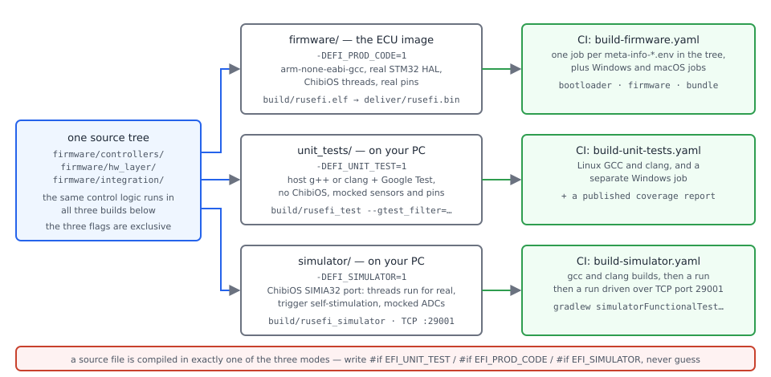
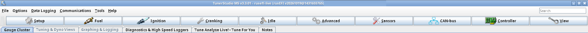
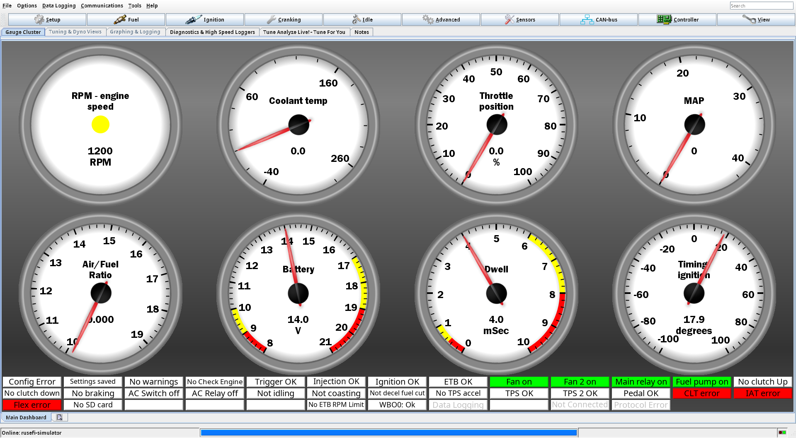

# Building rusEFI yourself

:material-circle:{ .level-intermediate } Intermediate → :material-circle:{ .level-advanced } Advanced

> **In one sentence:** rusEFI is one source tree that the same Makefiles build four ways — the firmware
> for your ECU, a simulator that runs on your PC, a unit-test binary that runs on your PC, and the tool
> that generates the TunerStudio `.ini` — so you can prove a change does what you think before it is
> anywhere near an engine.

!!! note "You do not need to build rusEFI in order to run rusEFI"
    Ready-built firmware, the matching TunerStudio `.ini` and the console come in the bundle for every
    official board, and that is what a installer or a tuner uses. This chapter is for the reader who
    wants to change behaviour: fix a bug, add a feature, or step through the firmware with a debugger.

## What building gives you

:material-circle:{ .level-intermediate } Intermediate

<figure markdown>
  
  <figcaption>Figure 1 — One tree, one pipeline. Blue is what you control, orange is what the build
  produces, green is what gates it, red is what stops it outright. Note that the TunerStudio `.ini` is an
  <i>output</i> of the build, not a file you edit.</figcaption>
</figure>

There are four things you can build from the same checkout, and each answers a different question:

| Build | Started from | Runs on | Use it for |
|---|---|---|---|
| **Firmware for a board** | `firmware/config/boards/proteus/compile_proteus_f7.sh` | the STM32F7 in a Proteus ECU | your fix, on the bench and then on the engine |
| **Unit tests** | `unit_tests/test.sh` | your PC, as a normal program | proving a behaviour before and after a change |
| **Simulator** | `make` in `simulator/` | your PC | watching real firmware logic with no hardware at all |
| **Settings and TunerStudio layout** | `make config` in `firmware/` | your PC | seeing what a settings change does to the `.ini`, the Lua value list and the stored tune |

Everything compiles from the same C and C++ sources, and every build starts with the same code-generation
step (Figure 1) — which is why changing a setting and changing the code that uses it move together, and
why a settings change cannot be tested on the ECU alone.

You need a 64-bit Linux or macOS machine, or Windows with a Unix-like shell, roughly 3 GB of disk for the
source and its build output, and network access the first time (the submodules and the Java tool
distribution are downloaded). No ECU, no engine and no wiring is needed for the unit tests or the
simulator; you only touch hardware when you decide to flash what you built.

!!! danger "Your own build has no safety net, and the wrong board image destroys hardware"
    A firmware image belongs to one board. Its pin assignment, its 5 V supplies and its H-bridges come
    from that board's files — flash firmware built for another board into a Proteus and the outputs that
    should drive injectors drive whatever is on those Proteus pins instead, which can put 12 V where a
    sensor expects 5 V, or coil current where a logic input is. Build with the `proteus` meta-info file,
    and read the board name in the file name before you flash it.
    <!-- src: firmware/config/boards/proteus/board.mk (HW_PROTEUS, STATIC_BOARD_ID_PROTEUS_F7, FIRMWARE_ID); firmware/config/boards/proteus/connectors/black23.yaml (pin functions for this board only) -->

    Second: run your own build on a bench, with the coil and injector connectors unplugged, until the unit
    tests, the simulator and a bench test all agree. Save your tune first — a change to the settings
    layout can reset it. See the Tunes and backups chapter and the [safety rules](../safety.md).

## How the build works

:material-circle:{ .level-intermediate } Intermediate → :material-circle:{ .level-advanced } Advanced

### Code generation runs before the compiler

rusEFI's settings are not written as C structs by hand. `firmware/integration/rusefi_config.txt` describes
every stored value — its type, units, default and the help text TunerStudio shows as a tooltip — and
`firmware/tunerstudio/tunerstudio.template.ini` plus the board's `prepend.txt`, `prepend_<board>.txt` and
`board_*.ini` files describe the menus and dialogs. A Java tool turns both into:

- the C/C++ headers the firmware compiles against, in `firmware/controllers/generated/`;
- the TunerStudio `.ini` for the board, in `firmware/tunerstudio/generated/`;
- the Java enum of settings the console uses, and the Lua value-lookup table;
- the RAM-disk image used for logging and settings backups.

The Makefiles run that tool themselves — for the firmware, the unit tests and the simulator alike — so
there is no reason to call `gen_config.sh` by hand. `make config` runs just that step. **Never edit a
generated file and never commit one:** the next build overwrites it, and a stale copy that looks newer
than its inputs makes the next build skip generation and fail.
<!-- src: firmware/rusefi_config.mk (CONFIG_INPUTS and CONFIG_FILES: which input regenerates which output); firmware/gen_config_common.sh (set_board_file: the per-board .ini fragments the generator reads); firmware/gen_config.sh; unit_tests/unit_test_rules.mk (unit tests include the same config rules) -->

The same step gives the build its **signature**: `gen_signature.sh` writes a string of the form
`rusEFI <branch>.<date>.<board>.<hash>`, and the matching number `SIGNATURE_HASH` is compiled into the
firmware. TunerStudio's `.ini` declares that signature, and the firmware sends it back when TunerStudio
asks at connection time — it is how the ECU and the `.ini` recognise each other. A firmware you built and
a `.ini` from a different commit are not a pair.
<!-- src: firmware/gen_signature.sh (TS_SIGNATURE format); firmware/bundle.mk (SIGNATURE_HASH_FILE, and the comment pairing an update artifact with its .ini); firmware/console/binary/tunerstudio.cpp (handleQueryCommand sends getTsSignature during protocol start-up); firmware/tunerstudio/tunerstudio.template.ini (signature= and versionInfo= in [BaseTable]) -->

### One source tree, three compile modes

<figure markdown>
  
  <figcaption>Figure 2 — The three modes are mutually exclusive: a source file is compiled in exactly one
  of them, so code that must behave differently on the PC says so with `#if EFI_UNIT_TEST` or
  `#if EFI_SIMULATOR`.</figcaption>
</figure>

That is why unit tests are worth writing: they run the real controller code — the same fuel and ignition
calculations, the same scheduler — but on your PC, with sensors mocked and virtual time you can advance by
hand. The simulator keeps ChibiOS itself running, so threads and timers are real, and replaces the
hardware: the trigger is self-stimulated and the analog inputs are mocked.
<!-- src: firmware/Makefile (-DEFI_UNIT_TEST=0 -DEFI_PROD_CODE=1 -DEFI_SIMULATOR=0); unit_tests/unit_test_rules.mk (-DEFI_UNIT_TEST=1); simulator/Makefile (-DEFI_SIMULATOR=1, ChibiOS SIMIA32 rules and port) -->

Each unit has its own continuous-integration job, and a pull request has to satisfy all of them
(Figure 5): the firmware matrix, the unit tests on two host operating systems, and the simulator.
<!-- src: .github/workflows/build-firmware.yaml; .github/workflows/build-unit-tests.yaml; .github/workflows/build-unit-tests-windows.yaml; .github/workflows/build-simulator.yaml -->

### The toolchain, and why the build refuses yours

The firmware is cross-compiled with **GCC for Arm** (`arm-none-eabi-gcc`); the host builds use your
normal C++ compiler. rusEFI checks the compiler version before it compiles anything: `gcc_version_check.c`
fails the build below **GCC 11.3.1** and above 15.0 with the message *"Looks like we support only
11-14?"*. rusEFI's own helper downloads **14.2.Rel1** into `~/.rusefi-tools` and links it as
`gcc-arm-none-eabi`; the repository's pixi manifest pins the same major version.
<!-- src: firmware/gcc_version_check.c (the version bounds and the error text); firmware/provide_gcc.sh (the 14.2.rel1 archive, its checksum, and ~/.rusefi-tools); pixi.toml (arm-gnu-toolchain >=14,<15) -->

The ARM compiler is not the only requirement. The build also needs:

- **a JDK**, because the settings generator is a Java program built by the repository's Gradle wrapper
  (`gradle-8.14.5`); rusEFI's CI jobs install Java 17;
- **the FAT image tools** `mkfs.fat`, `fatlabel`, `mcopy`, `zip`, `7z` and `xxd`, used to build the
  RAM-disk image that is compiled into the firmware;
- **`flock`** (Linux and Cygwin have it, macOS needs `brew install flock`), which serialises the Gradle
  runs that a parallel `make -j12` would otherwise start at the same time.
<!-- src: gradle/wrapper/gradle-wrapper.properties; .github/actions/setup-java/action.yml (Java 17 for the CI jobs); misc/actions/ubuntu-install-tools.sh (the apt packages, and the check that the FAT tools are present); java_tools/java_tools.mk (FLOCK and why Gradle must not run in parallel) -->

You can point the build at a different cross compiler with `make CROSS_COMPILE=<prefix>-`.
<!-- src: firmware/Makefile (TRGT defaults to arm-none-eabi-, overridden by CROSS_COMPILE) -->

### Which board you are building

Each board variant has a `meta-info-<variant>.env` file naming the short board name, the CPU family and
the options — for a Proteus F7: `SHORT_BOARD_NAME=proteus_f7`, `PROJECT_CPU=ARCH_STM32F7`,
`USE_OPENBLT=yes` and `EFI_LUA_LOOKUP=TRUE`. The `compile_<board>.sh` scripts in the board directory are
one-line wrappers that call `firmware/bin/compile.sh` with that file; run it with no arguments and it
presents every board variant in the tree as a numbered menu. If you run a bare `make` in `firmware/`,
you get the default board — `f407-discovery`, not Proteus.
<!-- src: firmware/config/boards/proteus/meta-info-proteus_f7.env; firmware/config/boards/proteus/compile_proteus_f7.sh; firmware/bin/compile.sh (meta-info selection and the -b bundle flag); firmware/rusefi.mk (BOARD_DIR and PROJECT_BOARD default to f407-discovery) -->

The targets step up from each other, and you can call any of them directly from `firmware/`:

| Target | What it does |
|---|---|
| `make docs-enums` | generate the documentation and enum-to-string tables |
| `make config` | the code generation of Figure 1 for the selected board |
| `make` | configs, then the firmware image |
| `make bootloader` | the OpenBLT bootloader for the board, separately |
| `make bundle` | bootloader, firmware, and the full zip a user downloads |
| `make autoupdate` | the smaller zip the console's update path uses |

The build compiles with `-j4` unless you ask for more; `-j12` is what the repository's own guidance uses.
<!-- src: firmware/Makefile (the target list in its header comment, NUMJOBS defaulting to -j4) -->

## Getting the source and the tools

:material-circle:{ .level-intermediate } Intermediate

### 1 · Clone with the submodules

The tree is only complete together: `firmware/ChibiOS`, `firmware/ChibiOS-Contrib`, the Lua interpreter,
the OpenBLT bootloader sources, `hex2dfu`, Google Test and the rest — seventeen submodules in all.

```bash
git clone --recursive https://github.com/rusefi/rusefi.git
```

If you cloned without `--recursive`, run `git submodule update --init` once from the repository root.
A tarball or "Download ZIP" of the repository does **not** work: the firmware Makefile stops with
*"We expect source code to be cloned not downloaded as zip file"* when there is no `.git`, and the
submodules are not in a zip at all.
<!-- src: README.md (Cloning the repository: git submodule update --init); .gitmodules (the submodule list); firmware/Makefile (the ../.git check) -->

### 2 · Install the toolchain for your operating system

=== "Windows"

    The repository ships a [pixi](https://pixi.sh) manifest that pins everything the build needs —
    `make`, the Arm GNU toolchain, OpenJDK 17, Python, the FAT image tools and, on Windows, the Unix
    userland (`sed`, `awk`, `grep`, `flock`) that the Makefiles shell out to:

    ```powershell
    pixi install          # one-time: resolve and download the toolchain
    pixi run build-fw     # == make -j12 in firmware/
    pixi run test         # == ./test.sh in unit_tests/
    ```

    Run the build through `pixi run` or `pixi shell`: a bare `make` in PowerShell or `cmd` fails with
    *"'sed' is not recognized"* because those shells have no Unix userland on the path. WSL and Cygwin
    work too — the repository's own note is that Linux is faster because NTFS is slow for this build.
    <!-- src: pixi.toml (the pinned dependencies, the m2-* Windows userland, and the build-fw and test tasks); firmware/readme.md (Windows supported with Cygwin or WSL; Linux recommended for NTFS speed) -->

=== "Linux"

    On Debian or Ubuntu, the repository's setup script does all of it — submodules, apt packages, the Arm
    toolchain, the `PATH` line and permission for the serial ports:

    ```bash
    bash firmware/setup_linux_environment.sh
    ```

    It installs the multilib and MinGW compilers, `zip`, `7zip`, `xxd` and the FAT tools, checks that the
    image tools it needs are present, then runs `provide_gcc.sh` and adds
    `~/.rusefi-tools/gcc-arm-none-eabi/bin` to your `PATH` in `~/.profile`. Open a new shell afterwards so
    the path and the group membership take effect.
    <!-- src: firmware/setup_linux_environment.sh (submodule init, apt list, provide_gcc.sh, the PATH line, usermod -aG dialout); misc/actions/ubuntu-install-tools.sh (what gets installed, and the image-tool check) -->

=== "macOS"

    Install the host tools with Homebrew — GNU `make` and `coreutils` (macOS ships an ancient `make`),
    `mtools`, `dosfstools`, `flock`, Python and a JDK — and install the Arm toolchain **from Arm, not from
    Homebrew**: the Homebrew `arm-none-eabi-gcc` formula has no newlib, so it has no target `stdint.h` and
    cannot compile the firmware. The scripts pick up `gmake`, `grealpath` and `gnproc` automatically.
    <!-- src: docs/macos-local-build.md (the brew package list, why the brew cross compiler is unusable, and the gmake/grealpath handling) -->

### 3 · Check it with a board build

The next section builds a Proteus F7 image. A first build compiles several thousand files and downloads
the Gradle distribution, so expect it to take a while; the builds after that are incremental.

## Building a Proteus F7

:material-circle:{ .level-intermediate } Intermediate

1. **Run the board's compile script**:

   ```bash
   cd firmware/config/boards/proteus
   ./compile_proteus_f7.sh
   ```

   That script is one line: it changes to the repository root and calls
   `bash bin/compile.sh config/boards/proteus/meta-info-proteus_f7.env`. The meta-info file selects the
   STM32F7 build with OpenBLT, and the board's `board.mk` adds what the Proteus hardware needs —
   `HW_PROTEUS=1`, the static board id, the firmware id `proteus`, the 5 V VR supply, ADC3 and the software
   knock configuration.
    <!-- src: firmware/config/boards/proteus/compile_proteus_f7.sh; firmware/config/boards/proteus/board.mk (HW_PROTEUS, STM32_ADC_USE_ADC3, EFI_SOFTWARE_KNOCK, VR_SUPPLY_VOLTAGE, FIRMWARE_ID) -->

2. **Read what the build says about itself.** Before compiling it prints the selection —
   `PROJECT_BOARD`, `BOARD_DIR`, `PROJECT_CPU`, `SHORT_BOARD_NAME`, the linker script it will use — so a
   wrong board is visible in the first three lines rather than in the wiring afterwards. After the link it
   prints the region usage from the linker (`--print-memory-usage`) and a total line read back from the
   map file.
    <!-- src: firmware/Makefile (the $(info ...) lines, USE_LDOPT --print-memory-usage, and the POST_MAKE_ALL_RULE_HOOK that prints the map totals); firmware/hw_layer/ports/stm32/stm32f7/STM32F7.ld (the memory regions the report is about) -->

3. **Know where the results are.**

   | You built | Where it is | What it is |
   |---|---|---|
   | firmware (`make`) | `firmware/build/rusefi.elf`, `.hex`, `.bin`, `.map`, `.list` | the program, plus the debugger's and the memory report's inputs |
   | full image | `firmware/deliver/rusefi.bin` (and `rusefi.dfu`) | bootloader **and** firmware merged — for a blank ECU or a DFU flash |
   | update image | `firmware/build/rusefi.srec`, and `rusefi_…_proteus_f7_…_update.srec` inside the bundle | firmware only — for the normal console update |
   | bundle (`-b` / `make bundle`) | `firmware/artifacts/rusefi_bundle_proteus_f7.zip`, staged as `firmware/rusefi.snapshot.proteus_f7/` | everything a user downloads: firmware, console, `.ini`, flashing tools |
   | TunerStudio layout | `firmware/tunerstudio/generated/rusefi_proteus_f7.ini` | the `.ini` that belongs to **this** build |

   The `deliver/rusefi.bin` image is assembled by `hex2dfu` from the bootloader hex and the firmware hex,
   and the build then stamps the bootloader version marker into it; the update `.srec` is produced from a
   CRC-tagged image and re-addressed to the firmware's start address.
    <!-- src: firmware/bundle.mk (DBIN, DFU, BOOTLOADER_HEX, the .h2d-sentinel rule, SREC_NAME, BIN_TARGET, ARTIFACTS, FOLDER); firmware/bin/set_bl_bin_version.sh (stamping the bootloader version marker) -->

4. **Build the bundle if you intend to flash it.** The full-image and update images are separate targets,
   so a plain `make` does not produce them:

   ```bash
   cd firmware
   bash bin/compile.sh -b config/boards/proteus/meta-info-proteus_f7.env
   ```

   or `make bundle` once the board is selected in your environment. The bundle step also runs a validator
   over the generated `.ini` and refuses to package it if it is inconsistent — that check catches a
   generated `.ini` that refers to a page or gauge the firmware will not serve.
    <!-- src: firmware/bin/compile.sh (-b selects the bundle target and passes extra make arguments); firmware/bundle.mk (bundle target, validate-bundle-ini and GeneratedIniValidator) -->

5. **Flash it, then confirm which firmware is running.** This is done in the rusEFI console: TunerStudio
   cannot write firmware, so use the console's update path exactly as the Flashing firmware chapter
   describes, choosing the update image for a normal update or the full image for a blank ECU. Then open
   TunerStudio with the `.ini` from your own tree — `firmware/tunerstudio/generated/rusefi_proteus_f7.ini`
   — and read its title bar: TunerStudio shows the version string the firmware reports, and it matched
   your `.ini` to the signature the ECU sent.
    <!-- src: firmware/console/eficonsole.cpp (the hello line with rusEFI v<version>@<SIGNATURE_HASH>); firmware/controllers/engine_controller.cpp (getRusEfiVersion returns VCS_DATE); firmware/controllers/date_stamp.h (VCS_DATE); firmware/tunerstudio/tunerstudio.template.ini (versionInfo and signature) -->

<!-- shot: img/ts/building-rusefi-ts-title.png | TunerStudio main window title bar of a rusEFI Proteus F7 project | Proteus F7 connected over USB with 12 V ignition on, project opened with firmware/tunerstudio/generated/rusefi_proteus_f7.ini; crop to the window title bar and the top status strip so the firmware version string and the ini's signature are readable; no dialog or dropdown open | TunerStudio shows the firmware's own version string in its title bar, and matches its .ini to the signature the ECU reports — a build and an .ini from different trees are not a pair. -->
<!-- pending-figure
<figure markdown>
  
  <figcaption>Figure 3 — After flashing a build of your own: the title bar carries the firmware's own
  version string, and the connection only works because the <code>.ini</code>'s signature matches what the
  ECU reports.</figcaption>
</figure>

pending-figure -->

!!! warning "The *_debug compile scripts are pointed at disabled board files"
    `compile_proteus_f7_debug.sh` names `meta-info-proteus_f7_debug.env`, but in this revision the
    directory only holds `meta-info-proteus_f7_debug._disabled_env` — the leading underscore in
    `.env`'s place keeps it out of the CI matrix. The script therefore stops with *"Could not find …"*.
    For an unoptimised build, set the compiler flags yourself instead: `make DEBUG_LEVEL_OPT="-O0 -ggdb -g"`.
    <!-- src: firmware/config/boards/proteus/compile_proteus_f7_debug.sh; firmware/config/boards/proteus/meta-info-proteus_f7_debug._disabled_env; firmware/Makefile (DEBUG_LEVEL_OPT, and the note that unoptimised configurations may not fit in flash) -->

## Unit tests

:material-circle:{ .level-intermediate } Intermediate → :material-circle:{ .level-advanced } Advanced

The unit tests are the firmware's own logic built as an ordinary program with Google Test. They do not
know about ChibiOS, ARM or timing hardware: the pins, the ADC and the flash are replaced by mocks, and
time is virtual — a test can advance it by microseconds and check what the scheduler did.

```bash
cd unit_tests
./test.sh                 # build and run everything
./test.sh MapAveraging    # build, then run only matching tests
```

`test.sh` runs `make` and then `build/rusefi_test`; with an argument it passes it to Google Test as a name
filter, so `./test.sh Knock` runs every test whose suite or name contains *Knock*. To use Google Test's
own options, run the binary yourself: `build/rusefi_test --gtest_filter=*Knock*`.

!!! tip "Catching test-order problems"
    `test.sh` accepts only a name filter. When a test passes alone and fails in the full run, run the
    binary directly with `--gtest_shuffle --gtest_random_seed=<n> --gtest_repeat=3`, note the failing
    iteration's seed, and replay it with the same test selection — changing the filter changes the
    shuffled order.
    <!-- src: unit_tests/test.sh (make, then build/rusefi_test with --gtest_filter); unit_tests/readme.md (running one test; running the binary directly for shuffling) -->

Writing one is short: construct an engine helper, set the inputs, advance time, assert the output.

```cpp
TEST(ModuleName, TestDescription) {
    EngineTestHelper eth(engine_type_e::TEST_ENGINE);
    Sensor::setMockValue(SensorType::Clt, 80.0f);
    ASSERT_NEAR(80.0f, Sensor::get(SensorType::Clt), 0.1f);
}
```

`EngineTestHelper` builds a full engine controller with the `TEST_ENGINE` configuration, and its
`moveTimeForwardMs()` and `moveTimeForwardUs()` advance the virtual clock so scheduled events actually
happen. A new test file has to be added to the source list in `unit_tests/tests/tests.mk` — the build
does not pick files up by name.
<!-- src: unit_tests/readme.md (the basic test setup, mocking sensor inputs, advancing time); unit_tests/test-framework/engine_test_helper.h (EngineTestHelper and the time helpers); firmware/controllers/sensors/core/sensor.cpp (Sensor::setMockValue); unit_tests/tests/tests.mk (TESTS_SRC_CPP lists every test file) -->

Two build details that catch people:

- the host build enables **AddressSanitizer** on Linux, which is incompatible with Valgrind — rebuild with
  `make clean && make -j12 SANITIZE=no` before Valgrind;
- the coverage build (`./run_coverage.sh`, which sets up its own Python environment and runs `gcovr`) is a
  different set of compiler flags, and the build system does not notice flag changes: run `make clean`
  when you switch between coverage and normal test builds, or coverage comes out near zero.
<!-- src: unit_tests/unit_test_rules.mk (SANITIZE defaulting to yes, and the -fsanitize flags); unit_tests/run_coverage.sh; unit_tests/readme.md (the make clean gotcha and the published CI coverage report) -->

Test code has to build on Linux (GCC and clang), macOS (clang) and Windows (MSVC and MinGW), because that
is what the CI jobs cover — prefer portable C++ over platform-specific path APIs, and do not use
POSIX-only calls without a guard.
<!-- src: .github/workflows/build-unit-tests.yaml; .github/workflows/build-unit-tests-windows.yaml; unit_tests/unit_test_rules.mk (clang detection and USE_CLANG) -->

## The simulator

:material-circle:{ .level-intermediate } Intermediate → :material-circle:{ .level-advanced } Advanced

The simulator is the same firmware compiled for your PC, with ChibiOS running for real and the hardware
replaced: the trigger is self-stimulated, the analog inputs are mocked, and the outputs go nowhere. On
start-up it writes its simulated flash — the settings image — into `simulator/generated/`, together with a
default tune for every engine type, and it starts its trigger emulator at **1200 RPM**, so the engine
state machine, fuel and ignition calculations all run with nothing connected.
<!-- src: simulator/readme.md (what the simulator mocks and its purpose); simulator/main.cpp (creating generated/, the optional seconds argument); simulator/simulator/rusEfiFunctionalTest.cpp (rusEfiFunctionalTest: writing the tune images, setTriggerEmulatorRPM(DEFAULT_SIM_RPM)) -->

```bash
cd simulator
make -j12                                  # or from firmware/: see below
./build/rusefi_simulator                   # runs until you stop it
./build/rusefi_simulator 10                # runs for 10 seconds, then exits
```

A bare `make` in `simulator/` uses the default board, `f407-discovery`. For a Proteus-shaped simulator,
build it through the board's meta-info file:

```bash
cd firmware
bash bin/compile.sh config/boards/proteus/meta-info-proteus_f7.env \
    ../simulator/build/rusefi_simulator.linux
```

<!-- src: firmware/rusefi.mk (the default board), simulator/Makefile (PROJECT_CPU=simulator, its own board include), firmware/Makefile (the documented bin/compile.sh invocation with the simulator target), firmware/bundle.mk (the simulator build rules) -->

**Connecting.** This is done in the rusEFI console: the console scans the local TCP port **29001**, finds
the running simulator and connects to it by itself — its title bar then names the connection as a
simulator. TunerStudio can drive the simulator too, but the simulator's own readme notes that a licensed
TunerStudio is needed to connect to it.

<!-- src: java_console/io/src/main/java/com/rusefi/io/tcp/TcpConnector.java (DEFAULT_PORT is the local TCP port 29001); java_console/connectivity/src/main/java/com/rusefi/SerialPortScanner.java (TCP ports included in the port scan); java_console/ui/src/main/java/com/rusefi/ui/console/TitleBarPanel.java (connectionLabel renders a simulator connection by its TCP port); simulator/readme.md (the simulator listens on local TCP ports, licensed TS needed) -->

<!-- shot: img/ts/building-rusefi-simulator-front-page.png | TunerStudio front page of a rusEFI Proteus F7 project connected to the PC simulator | simulator/build/rusefi_simulator built from this tree and running on the same PC, TunerStudio connected to it over TCP port 29001, the simulated engine running on its own trigger self-stimulation at 1200 RPM so RPM, MAP and the calculated fuel values are live with no ECU hardware present; crop to the front page, no dropdown open | The simulator is the same firmware with the hardware mocked: it self-stimulates its trigger at 1200 RPM, so the front page runs with no engine connected. -->
<figure markdown>
  
  <figcaption>Figure 4 — A simulator session: the values come from real firmware logic and a
  self-stimulated trigger, not from an engine.</figcaption>
</figure>


This is done in the rusEFI console: with it connected you can drive the simulator from the command line.
`set_sensor_mock CLT 85.5` sets a mocked sensor **by name**, and `reset_sensor_mocks` clears the mocks
again. That is the quickest way to see how a cold-start or a wide-open-throttle strategy behaves without
warming anything up.
<!-- src: firmware/init/sensor/init_sensors.cpp (addConsoleActionSS set_sensor_mock, reset_sensor_mocks); firmware/CHANGELOG.md (set_sensor_mock now takes the sensor by name) -->

The simulator's stored tune is a file, not a chip: `simulator/generated/simulator_tune_image.bin` is its
simulated flash, and `simulator/write_tune.sh <ini file>` turns a tune image into a TunerStudio tune file.
<!-- src: simulator/flash_storage.cpp (the simulator's flash as files in its working directory); simulator/write_tune.sh (WriteSimulatorConfiguration with an .ini argument); java_tools/tune-tools/src/main/java/com/rusefi/tools/tune/WriteSimulatorConfiguration.java (binary tune in, TunerStudio tune file out) -->

!!! warning "What the simulator cannot tell you"
    There is no real ADC, no SD card, no CAN transceiver and no pin timing: outputs are stubs and the
    analog inputs are mocks. Anything about when a signal edge happens, how long an injector takes, or how
    the ECU behaves under electrical noise has to be tested on hardware — see the Bench testing chapter.

## Contributing a fix

:material-circle:{ .level-advanced } Advanced

<figure markdown>
  
  <figcaption>Figure 5 — The route from your branch to a bundle someone else downloads. rusEFI keeps a
  stable master with no release branches, so a merged change is in the next nightly build.</figcaption>
</figure>

rusEFI's development model is **stable master**: no release branches, and each pull request is expected to
be complete and not to break anything that works today. A change that is not ready is marked **[WIP]** in
its title, and the repository's own guidance is to discuss a proposal before writing the pull request.
<!-- src: misc/SoftwareDevelopmentProcess.md (stable master, complete pull requests, the [WIP] convention, discussing changes first) -->

1. **Describe the problem first.** A bug report or a forum thread with your log and what you expected gets
   an answer about whether the behaviour is a bug at all — and it is where someone may already have a fix
   in progress. See the Getting help chapter for the evidence to include.

2. **Branch, and keep the change to one subject.**

   ```bash
   git checkout -b fix-map-averaging-warning
   ```

3. **Write the test first — and let it pass.** rusEFI's practice is two steps: first a commit that adds
   coverage asserting **today's** behaviour, even when that behaviour is wrong, then a second change that
   fixes the code *and changes the test's expectation*. That is what proves the test is really watching the
   fix. Add the test to the existing file for that module where one exists, or add a new file and list it in
   `unit_tests/tests/tests.mk`.
    <!-- src: unit_tests/readme.md (Two-step TDD); firmware/controllers/modules/map_averaging/map_averaging.cpp and unit_tests/tests/controllers/modules/map_averaging/test_map_averaging.cpp (a module and its test file); unit_tests/tests/tests.mk (TESTS_SRC_CPP) -->

4. **Make the change.** Follow the surrounding code: always use curly braces for `if`, keep the three
   compile-mode guards explicit, and put a shared feature flag in each of the feature headers that applies
   to your build — the firmware's, the simulator's and the unit tests' are separate files.
    <!-- src: CLAUDE.md (curly braces for if statements, and the separate efifeatures.h files for firmware, simulator and unit tests); firmware/config/stm32f4ems/efifeatures.h; simulator/simulator/efifeatures.h; unit_tests/efifeatures.h -->

5. **Run the gates yourself**, before CI does: the unit tests, a firmware build for the board you care
   about, the simulator build, and the formatter.

   ```bash
   cd unit_tests && ./test.sh && cd ..
   cd firmware && bash bin/compile.sh config/boards/proteus/meta-info-proteus_f7.env && cd ..
   cd simulator && make -j12 && cd ..
   ./format.sh        # clang-format over firmware/ and unit_tests/, excluding ext and generated code
   ```

   CI has a formatting job for `format.sh check`, but the check step in that workflow is currently
   switched off — run the formatter yourself rather than relying on it.
    <!-- src: format.sh (the file list, the exclusions, the check mode); .github/workflows/clang-format.yaml (the check step guarded off) -->

6. **If your change touches settings**, they live in `firmware/integration/rusefi_config.txt`, and the
   generated headers, the `.ini` and the console's Java all come from it — regenerate with `make config`.
   Three consequences:

   - the configuration **signature** changes, so your firmware needs the `.ini` from the same tree;
   - an existing tune has a zero in your new field. Design it so zero is safe, or migrate it in
     `applyDefaultsOrFixAfterBurn()`; a genuinely incompatible layout change is what
     `FLASH_DATA_VERSION` exists for, and bumping it resets every existing tune to defaults;
   - a field only a particular board needs belongs in that board's `board_engine_configuration.txt`
     rather than in the shared structure.
    <!-- src: firmware/integration/rusefi_config.txt (the settings definitions, FLASH_DATA_VERSION); firmware/controllers/algo/defaults/default_base_engine.cpp (applyDefaultsOrFixAfterBurn); firmware/controllers/flash_main.cpp (the stored version and size check at start-up); docs/calibration-compatibility.md (keeping old tunes working when a parameter is added); CLAUDE.md (board_engine_configuration.txt for board-only fields) -->

7. **Add a changelog line** under *Unreleased* in `firmware/CHANGELOG.md` — Added, Fixed or Breaking
   Changes. That file is where users look before they update, and its own header asks for a forum post for
   anything interesting or breaking.
    <!-- src: firmware/CHANGELOG.md (the header instructions and the Unreleased section) -->

8. **Open the pull request.** Two hard rules:

   - **at most 35 changed files.** A pull request touching more than that is commented on and closed by CI,
     with a request to split it;
   - a pull request that is not finished is titled **[WIP]**, or closed rather than left open.

   Keep generated files out of the commit — `firmware/build/`, the `.dep` directory,
   `firmware/controllers/generated/`, `firmware/tunerstudio/generated/` and the generated Java are build
   output. Equally, do not `git checkout` a build-regenerated file back to its committed state afterwards:
   that makes it look newer than its inputs, and the next build skips regenerating it and fails.
    <!-- src: .github/workflows/auto-close-large-prs.yaml (the 35-file limit and the automatic close); firmware/rusefi_config.mk (which files are generated output); CLAUDE.md (do not revert build-regenerated files) -->

9. **Let the gates run, and read them.** On a pull request, CI builds every board variant found in the
   tree, runs the unit tests on Linux (GCC and clang) and on Windows, builds the simulator in both gcc and
   clang configurations and drives a functional test against a running simulator over TCP port 29001, and
   runs hardware CI on two real boards — an STM32F4 Discovery and an STM32F767 Nucleo. Proteus is not in
   the hardware-CI matrix, so Proteus-specific behaviour is your responsibility and the bench.
   On a plain push, boards whose `meta-info` file sets `SKIP_RATE` are built only sometimes, and a line
   `only:proteus_f7` in the commit message narrows a push build to that one variant.
    <!-- src: .github/workflows/build-firmware.yaml (the matrix, the only: convention and SKIP_RATE); firmware/bin/generate_matrix.sh (the matrix scan, SKIP_RATE, only:, and H7 being skipped); .github/workflows/build-unit-tests.yaml; .github/workflows/build-simulator.yaml (USE_CLANG matrix and the functional test); .github/workflows/hardware-ci.yaml (the f407-discovery and nucleo_f767 matrix, and Proteus commented out) -->

10. **After the merge**, the nightly build produces the bundles, the binaries and the `.ini` that users
    download, and the changelog entry you wrote becomes part of the release notes. That is the point at
    which your change reaches someone's engine — which is why the tests come first.
    <!-- src: .github/workflows/build-firmware.yaml (the nightly schedule and the release job); firmware/bundle.mk (the bundle names that the build server publishes); firmware/CHANGELOG.md (the release template) -->

## Examples

:material-circle:{ .level-advanced } Advanced

### Example 1 — a first clean Proteus F7 build on Ubuntu

```bash
git clone --recursive https://github.com/rusefi/rusefi.git
cd rusefi
bash firmware/setup_linux_environment.sh          # submodules, apt packages, GCC 14.2, PATH, dialout
exec bash -l                                      # a login shell, so PATH and the group take effect
cd firmware
bash bin/compile.sh -b config/boards/proteus/meta-info-proteus_f7.env
```

You should end up with `firmware/deliver/rusefi.bin`, `firmware/artifacts/rusefi_bundle_proteus_f7.zip`
and `firmware/rusefi.snapshot.proteus_f7/`, and the console must show the board name and version you
expect after flashing. If the compiler is too old, the very first thing you see is
`GCC compiler >= 11.3.1 required` — that is `gcc_version_check.c`, deliberately first in the source list.
<!-- src: firmware/setup_linux_environment.sh; firmware/config/boards/proteus/compile_proteus_f7.sh; firmware/bin/compile.sh (-b); firmware/bundle.mk (deliver, artifacts and the snapshot folder names); firmware/Makefile (gcc_version_check.c first in CSRC) -->

### Example 2 — the smallest useful contribution: a stale help line

`simulator/readme.md` shows mocking a sensor as `set_sensor_mock 4 90`, by numeric index. The command has
since been changed to take the sensor **by name** — `set_sensor_mock CLT 85.5` — and the changelog records
it. The contribution is two lines of documentation, it cannot break a gate, and it stops the next reader
guessing at sensor ordinals. That is a real example of the shape most first pull requests should take:
small, verifiable against the code, and obviously better.
<!-- src: simulator/readme.md (the outdated numeric-index example); firmware/init/sensor/init_sensors.cpp (addConsoleActionSS("set_sensor_mock", …) takes a name); firmware/CHANGELOG.md (the change to name-based mocking) -->

### Example 3 — checking a theory without flashing

You want to know whether a knock-retard idea will do what you think at 3000 RPM. Both answers are cheap
and neither touches an engine:

- a **unit test** in `unit_tests/tests/` — construct `EngineTestHelper`, mock the inputs, advance the
  virtual clock, and assert what the retard did;
- the **simulator** — build it, run it, connect the console, then set the mocked sensors to your scenario
  and watch the logged channels.

Only when both agree does it earn a place on the bench.
<!-- src: unit_tests/readme.md (the test setup, sensor mocks and advancing time); firmware/init/sensor/init_sensors.cpp (set_sensor_mock, reset_sensor_mocks); simulator/simulator/rusEfiFunctionalTest.cpp (the running simulated engine at 1200 RPM) -->

## Pitfalls and troubleshooting

:material-circle:{ .level-intermediate } Intermediate → :material-circle:{ .level-advanced } Advanced

| Symptom | Cause | Fix |
|---|---|---|
| *"We expect source code to be cloned not downloaded as zip file"* | the tree came from a zip or tarball, so there is no `.git` | clone with `git clone --recursive` |
| Compile errors about missing `ch.h`, Lua or OpenBLT headers | submodules were not initialised | `git submodule update --init` from the repository root |
| *"Could not find …"* straight after a compile script | the script's `meta-info` file is disabled or misspelled | check the file exists in that board directory; the `_disabled_env` variants are not built |
| `GCC compiler >= 11.3.1 required`, or *"Looks like we support only 11-14?"* | your cross compiler is out of the supported range | `firmware/provide_gcc.sh`, or `make CROSS_COMPILE=` pointing at 14.2.Rel1 |
| Linker errors about `cannot move location counter backwards` | static data no longer fits the memory region | look at the memory report for **both** SRAM and the CCM region before removing features |
| A build "succeeds" but no image changed | the compile wrapper can exit 0 even when `make` failed | read the log, or check that `firmware/build/rusefi.elf` has a new timestamp |
| `No rule to make target '<old path>.cpp'` after a file move | stale dependency files | `make clean`, or remove the `.dep` directory |
| The RAM-disk step fails (`mkfs.fat`, `mcopy`, `xxd`, `7z`) | the image tools are missing | install the packages listed in `misc/actions/ubuntu-install-tools.sh` |
| Gradle fails oddly during a parallel build | several Gradle runs started at once, or `flock` is missing | install `flock`; build with a lower `-j` |
| Tests pass alone, fail in the full run | test order dependence | `build/rusefi_test --gtest_shuffle --gtest_repeat=3` |
| Coverage near zero after a normal test run, or a slow test run after coverage | compiler flags changed but the objects did not | `make clean` in `unit_tests/` when switching |
| Valgrind refuses to start | the host test build has AddressSanitizer on | `make clean && make -j12 SANITIZE=no` |
| TunerStudio will not connect to firmware you just built | the `.ini` is not the pair of that build (signatures differ) | use `firmware/tunerstudio/generated/rusefi_<board>.ini` from the same tree |
| Your settings are gone after flashing your build | a settings layout change, or a different board image | keep a saved tune, and expect `FLASH_DATA_VERSION` changes to reset settings |
| Your pull request was closed by a bot | more than 35 changed files | split it into focused pull requests |
<!-- src: firmware/Makefile (the ../.git check, gcc_version_check.c first in the source list, DEBUG_LEVEL_OPT); firmware/bin/compile.sh (the "Could not find" error for a missing meta-info file); firmware/provide_gcc.sh (the toolchain helper); misc/actions/ubuntu-install-tools.sh (the image tools it insists on); java_tools/java_tools.mk (flock, and why Gradle must not overlap); unit_tests/unit_test_rules.mk (SANITIZE, clang detection); unit_tests/readme.md (shuffled tests, and make clean between coverage and normal builds); firmware/bundle.mk (validate-bundle-ini); firmware/gen_signature.sh (the signature pairing a build with its .ini); firmware/controllers/flash_main.cpp (the stored settings version and size check); CLAUDE.md (the compile wrapper's exit code, the stale dependency directory, and the location-counter linker message) -->

## Related

- Flashing firmware — the console's update paths, and which image (full or update) each one takes
- Recovering an ECU — when a build of your own leaves the ECU not starting
- Tunes and backups — save the tune before you flash a development build
- Bench testing — what to test on hardware once the simulator and the unit tests agree
- Lua scripting — the simulator is the fastest place to iterate on a script
- Getting help — the evidence to bring when behaviour looks wrong
