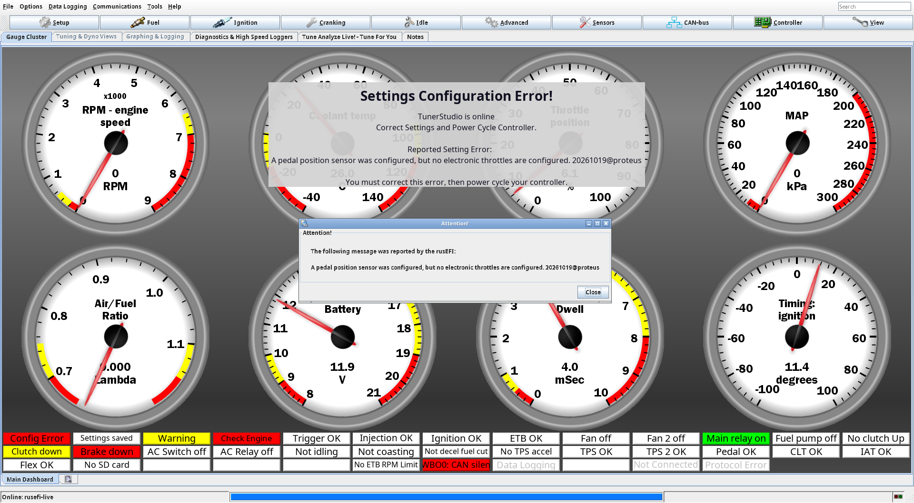
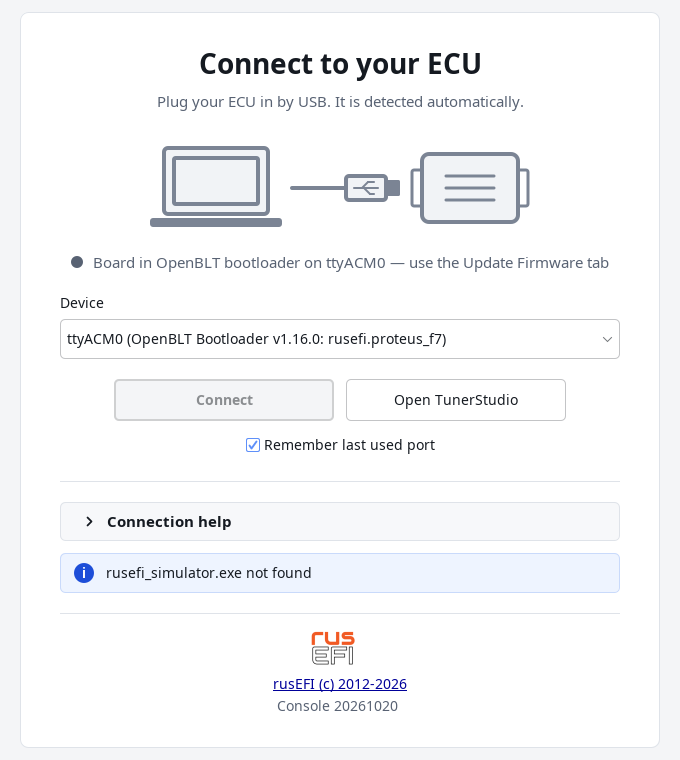
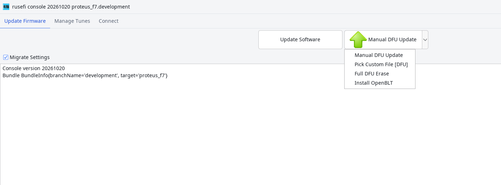

# Recovering an ECU

:material-circle:{ .level-basic } Basic → :material-circle:{ .level-advanced } Advanced

> **In one sentence:** an ECU that will not run its firmware is very rarely dead — one of three doors
> is still open (the running firmware, the OpenBLT bootloader, or the STM32's own DFU bootloader), and
> your tune lives in its own area of flash above the firmware, so it usually survives whatever killed
> the program.

## Overview

:material-circle:{ .level-basic } Basic

"Bricked" almost never means broken hardware. It means the program in the processor's flash is not
running, and that leaves you with one of three situations, each with its own way back in:

| Door | You know it by | What you can write through it |
|---|---|---|
| **The running firmware** | TunerStudio connects and shows settings | everything, including the settings |
| **The OpenBLT bootloader** | the rusEFI console lists the port as **OpenBLT Bootloader**, the board's LEDs blink together | the firmware (not the bootloader, not the settings) |
| **The STM32 DFU bootloader** | a USB device called **STM32 BOOTLOADER** appears and the serial port is gone | the whole flash: bootloader, firmware and — if you erase it all — your settings |

Almost nothing in this chapter touches your tune. The settings (the tune) have their own area of
flash, above the firmware's, and the firmware keeps **two copies** of them, each with a checksum, a
settings version number and a size. Flashing firmware writes the firmware area and nothing else.

!!! danger "Never start an engine on factory settings"
    A recovered ECU often comes back with factory defaults: engine type
    `MINIMAL_PINS`, the board's factory pin assignment, and empty default tables. On a Proteus that
    means the firmware will happily put spark and fuel wherever the factory map says, which is not
    where your coils and injectors are. Recover the ECU with the coil and injector connectors
    unplugged, reload your saved tune, and only then reconnect them. If you have no saved tune,
    rebuild the configuration from the Quick start chapter before touching the engine.

Start with what you can see. This chapter's procedures are named after the state the ECU is in:

<figure markdown>
  
  <figcaption>Figure 1 — Which procedure you need, decided by what the tools see. The evidence strip in
  the middle is worth collecting before you change anything.</figcaption>
</figure>

| What you see | What it means | Go to |
|---|---|---|
| TunerStudio connects, but values are nonsense, or **Config Error** / **Warning** is lit | firmware fine, settings damaged or shifted | Procedure A, then B |
| Console says *"Board is in the OpenBLT bootloader"* | firmware missing or invalid, OpenBLT intact | Procedure C |
| A **STM32 BOOTLOADER** USB device, or nothing at all | OpenBLT damaged too | Procedure D |
| The ECU restarts every few seconds, then goes quiet | the bootloader's reset-loop protection has taken over | *When the ECU keeps restarting* |
| The ECU runs but refuses to save settings | a write problem, not a settings problem | *Pitfalls and troubleshooting* |

!!! note "This chapter fixes the ECU, not the engine"
    A running engine that runs badly is a tuning or wiring problem — see the Troubleshooting guide.
    Here the ECU itself is the problem: it will not start, will not answer on USB, or will not keep
    its settings.

## How it works

:material-circle:{ .level-intermediate } Intermediate

<figure markdown>
  
  <figcaption>Figure 2 — How a Proteus F7 starts, and where it can stop. Blue is the decision the
  bootloader makes, red is the protective state it stays in, green is normal running, orange is the
  separate way in through the chip's ROM.</figcaption>
</figure>

### The OpenBLT bootloader decides, in this order

At every power-on and every reset, the 32 KB OpenBLT bootloader at `0x0800 0000` runs first. It stays
in itself — and gives you a flashable device — when any of these is true:

1. **The firmware asked it to.** The console's **Switch to OpenBLT Mode**, or the console command
   `reboot_openblt`, writes a flag into a small shared RAM area and resets; the bootloader reads the
   flag, clears it, and stays.
2. **It smells a reset loop.** It counts resets by cause: more than **10 watchdog resets** in a row, or
   more than **15 software resets** in a row, and it stops starting the firmware. A power-on or a
   reset through the chip's reset pin clears those counters, and so does five seconds of healthy
   running inside rusEFI.
3. **The firmware image is not valid.** It checks that the first words at the firmware's start address
   are not blank, reads the image size stored in the image header, rejects impossible sizes, and
   compares a CRC-32 stored in the image against a CRC over the image itself. Any failure and the
   image is never started.

Otherwise it jumps to the firmware at `0x0800 8000`.

On a Proteus the bootloader's "back door" wait is **0 ms**, so it makes its decision immediately:
a valid image is started before you notice the board was ever in its bootloader. If the image fails
the check, the ECU stays in OpenBLT and its LEDs blink at the slower of the bootloader's two blink
rates, because the bootloader has already stopped trying to start anything. A host that connects to
the OpenBLT port also keeps the bootloader in place, which is how an update can be started at any
moment.
<!-- src: firmware/bootloader/bootloader_main.cpp (maxWdRebootCounter, maxSwRebootCounter, checkIfResetLoop, checkIfRebootIntoOpenBltRequested, BlinkyThread delay and waitedLongerThanTimeout, ComIsConnected); firmware/bootloader/openblt_chibios/openblt_chibios.cpp (CpuStartUserProgram and NvmVerifyChecksum); firmware/bootloader/openblt_chibios/openblt_flash.cpp (FlashVerifyChecksum: blank check, stored size, CRC over the image); firmware/hw_layer/openblt/blt_conf.h (BOOT_BACKDOOR_ENTRY_TIMEOUT_MS default); firmware/config/boards/proteus/board.mk (BOOT_BACKDOOR_ENTRY_TIMEOUT_MS=0); firmware/controllers/engine_controller.cpp (errorHandlerResetCounters after five seconds of running); firmware/hw_layer/ports/stm32/stm32_common.cpp (jump_to_openblt writes the shared-parameters flag) -->

!!! info "Advanced"
    rusEFI cannot ask the chip to enter its DFU bootloader directly — a software reset runs the
    program in flash again. So `reboot_dfu` writes the value `0xDEADBEEF` to a fixed RAM address (`0x2001 FFF0`) and
    then resets. The startup code that runs before any C checks that word: if it is there, startup
    jumps into the system memory bootloader in ROM instead of starting ChibiOS.
    <!-- src: firmware/hw_layer/ports/stm32/stm32_common.cpp (jump_to_bootloader breadcrumb); firmware/hw_layer/ports/stm32/rusEfiStartup.S (the check and the jump); firmware/hw_layer/ports/stm32/stm32f7/dfu_init.h -->

### What the LEDs say on a Proteus F7

While it is in its bootloader, the OpenBLT build drives four board LEDs directly:

| LED | Proteus pin | In the bootloader |
|---|---|---|
| Red (critical error) | E3 | blinks, but is **constantly on** if the reason for staying is a watchdog reset |
| Blue (communications) | E4 | blinks while the bootloader reports the board as OK |
| Green (running) | E5 | blinks |
| Yellow (warning) | E6 | blinks |

All four blink at the same rate: every 125 ms on a dual-bank chip, every 40 ms otherwise, and at half
that rate once the bootloader has stopped trying to start the firmware. So on a Proteus: **all four
LEDs blinking in step = the ECU is in its bootloader and flashable**; **red solid = it is in the
bootloader because the firmware keeps crashing into the watchdog**.
<!-- src: firmware/bootloader/bootloader_main.cpp (BlinkyThread: efiSetLed, red for wdReset, isFlashDualBank delay); firmware/config/boards/proteus/board.mk (LED_CRITICAL_ERROR_BRAIN_PIN); firmware/config/boards/proteus/board_configuration.cpp (getCommsLedPin, getRunningLedPin, getWarningLedPin) -->

### The DFU door, and where your settings live

Every STM32 also has a bootloader burnt into read-only memory by the chip maker. It cannot be erased,
it needs neither OpenBLT nor rusEFI, and it writes flash from `0x0800 0000` — the bootloader's own
address — which is why it is the way back in when OpenBLT itself is damaged. Entering it takes the
BOOT0 pin held high at reset, or one of rusEFI's two software routes (see Procedure D).

Your settings live above all of this. On a 2 MB STM32F7 the first copy starts at `0x0810 0000`, with
its backup 32 KB later in the same bank; on a 1 MB part they are at `0x080C 0000` and `0x080E 0000`.
The firmware's own area is limited to 736 KB by the linker script. That separation is the reason a
firmware recovery normally leaves your tune alone — and the reason a **full** chip erase is the one
operation that does not.
<!-- src: firmware/hw_layer/ports/stm32/stm32f7/mpu_util.cpp (getFlashAddrFirstCopy, getFlashAddrSecondCopy, determineDevice); firmware/hw_layer/ports/stm32/stm32f7/STM32F7.ld (bootloader size and image size); firmware/controllers/flash_main.cpp (writeToFlashNowImpl: two copies) -->

### What the firmware does with the settings at start-up

`readFromFlash()` reads the first copy, checks it, and falls back to the second copy if the first is
bad. The Flashing firmware chapter covers the same checks in front of an update; here is what each
outcome looks like from the recovery side:

| What it finds | What it does, and what it prints |
|---|---|
| CRC, version and size all match | uses them — `Read valid configuration from flash!` |
| version number or size changed | factory defaults, **keeping your engine type** — `Resetting due to version mismatch but preserving engine type` |
| CRC wrong | factory defaults, engine type included, plus a *flash CRC failed* warning with code **6141** — `Need to reset flash to default due to CRC mismatch` |
| blank or unreadable | factory defaults |

For a Proteus the default engine type is `MINIMAL_PINS`: firmware defaults plus the board's own
factory configuration, not an engine preset.
<!-- src: firmware/controllers/flash_main.cpp (readConfiguration, validatePersistentState, readFromFlash: CrcFailed, IncompatibleVersion, NotFound); firmware/controllers/algo/obd_error_codes.h (CUSTOM_ERR_FLASH_CRC_FAILED); firmware/controllers/algo/engine_configuration.h (DEFAULT_ENGINE_TYPE); firmware/controllers/algo/engine_configuration.cpp (resetConfigurationExt: defaults then board configuration); firmware/controllers/algo/engine_type_impl.cpp (MINIMAL_PINS does nothing extra) -->

!!! warning "Same size is not the same layout"
    The check compares a checksum, a version string and a size — not what each byte means. If a new
    firmware moved settings around without changing the size or bumping the version, or if firmware
    for a different board happens to have settings of the same size, the old bytes are loaded into
    the wrong places: the ECU starts happily, with a tune whose values are quietly in the wrong
    slot. That is why you save your tune before every flash.
    <!-- src: firmware/controllers/flash_main.cpp (validatePersistentState compares crc, version and size only); firmware/controllers/algo/persistent_configuration.h (persistent_config_container_s) -->

## Before you start

:material-circle:{ .level-basic } Basic

- **The bundle for your board** — the same board, not merely a similar one. The console refuses to
  write a firmware file built for a different board, and asks before writing one it cannot verify.
- **A USB cable that carries data.** Many cables are charge-only.
- **A saved tune**, if there is one left to save (**File ▸ Save Tune As** in TunerStudio). The console
  also keeps its own backups under `console/state/` — see the Flashing firmware chapter.
- **Close TunerStudio** before working with the rusEFI console: the ECU's USB port serves one program
  at a time.
- **12 V with the ignition on** for anything done in TunerStudio. USB power alone runs the ECU but
  leaves the 5 V sensor supplies short of 5 V.

!!! warning "Flashing firmware for the wrong board"
    It can leave the ECU running a program whose settings layout and pin drivers do not match the
    hardware, and it damages things: outputs driven where you have sensors, injectors driven where
    you have a coil. If you are recovering from exactly that, use Procedure D with the bundle for
    your actual board, and check the board name in the file name before you press anything.

## Procedure A · The firmware runs, the settings are wrong

:material-circle:{ .level-basic } Basic → :material-circle:{ .level-intermediate } Intermediate

Everything here is done in TunerStudio. Use it when the ECU connects and shows a tune that is not the
one you gave it.

**Symptoms:** values you never set (cylinder count, pin assignments, whole tables at odd values);
**Config Error** red on the front page with the ECU's message; **Warning** yellow and code 6141
*flash CRC failed*; the engine type is no longer yours; settings that change again after every power
cycle.

<!-- shot: img/ts/recovering-frontpage-config-error.png | TunerStudio front page of a rusEFI project for the Proteus F7 | connected to a Proteus F7 with 12 V ignition on and the engine stopped, a firmware warning present (flash CRC failed, code 6141) plus a configuration error message: Config Error indicator red, Warning yellow, Unsaved changes yellow, the ECU message dialog or status text visible, gauges live, no dropdown open | The three front-page indicators that matter during recovery: Config Error means the ECU has a fatal or configuration error and TunerStudio has fetched its message. -->
<!-- pending-figure
<figure markdown>
  
  <figcaption>Figure 3 — The three front-page indicators that matter during recovery. <b>Config
  Error</b> means the ECU has a fatal or configuration error and TunerStudio has fetched its
  message.</figcaption>
</figure>

pending-figure -->

1. **Read what the ECU says.** The front page **Config Error** indicator appears when the firmware has
   a fatal error, a configuration error, or a warning that comes with a message; TunerStudio asks the
   ECU for that message and shows it. The message names the setting or subsystem, and it is a far
   faster way in than guessing. Note also **Warning** (a warning is present) and **Check Engine** (a
   stored code).
    <!-- src: firmware/tunerstudio/tunerstudio.template.ini (FrontPage indicators hasCriticalError, isWarnNow, checkEngine, and the retrieveConfigError command in [Constants]); firmware/console/status_loop.cpp (updateFlags: needBurn); firmware/controllers/core/error_handling.h (configError, firmwareError and warning are three different severities) -->

2. **Rule out the harmless look-alike: a mismatched `.ini`.** If TunerStudio's `.ini` is not the one
   that belongs to the firmware on the ECU, TunerStudio reads and writes the wrong bytes and the tune
   *looks* corrupted while the ECU is fine. Check the signature in TunerStudio's title bar against
   the bundle you are using, and start from the `.ini` inside the bundle of the firmware that is
   actually flashed. See the First connection chapter.
    <!-- src: firmware/tunerstudio/tunerstudio.template.ini ([TunerStudio] signature line); java_console/io/src/main/java/com/rusefi/ts/TsProjectUpdater.java (project .ini must follow the firmware) -->

3. **If you have a saved tune: put it back.** Connect TunerStudio with the right `.ini`. Because the
   tune in the ECU and the tune in your project differ, it shows the **Difference Report**; choose
   **Send Current TunerStudio Settings** so your file wins, then press **Burn**. With the engine
   running, rusEFI postpones the flash write until the engine is stopped, so **Unsaved changes** stays
   yellow until then — stop the engine and wait for **Settings saved** before switching off.
    <!-- src: firmware/tunerstudio/tunerstudio.template.ini (crc32CheckCommand in [Constants]: TunerStudio compares the settings block on connection); firmware/console/binary/tunerstudio.cpp (handleBurnCommand, requestBurn, finishPendingBurn); firmware/controllers/storage.cpp (storageAllowWriteID: the write waits for the engine to stop); firmware/console/status_loop.cpp (needBurn indicator) -->

4. **With nothing to restore, or when the values in flash are garbage and TunerStudio is arguing with
   you: reset the settings in the ECU.** Open **Controller ▸ Bench test** and press **Reset firmware
   settings**. This replaces every setting — pin assignment, trigger wheel, tables, calibrations —
   with the firmware's defaults, sets the engine type to the firmware's own default
   (`MINIMAL_PINS` on a Proteus), and forces a settings write.
   The dialog itself tells you to reconnect TunerStudio afterwards, because the ECU has changed the
   settings underneath it.
    <!-- src: firmware/controllers/bench_test.cpp (TS_SET_DEFAULT_ENGINE calls applyPreset); firmware/controllers/settings.cpp (setEngineType calls resetConfigurationExt and writeToFlashNow); firmware/console/binary/tunerstudio.cpp (onApplyPreset and needToTriggerTsRefresh); firmware/tunerstudio/tunerstudio.template.ini (testOther: "Reset firmware settings", and the Base Tunes reconnect note) -->

5. **Check, then burn, then prove it.** With defaults in place, look over **Controller ▸ Base Tunes**,
   the trigger and sensor dialogs and the outputs before anything is connected to the engine. **Burn**,
   switch the ECU off and on, and confirm the values are still there.

<!-- shot: img/ts/recovering-bench-test-misc.png | Controller ▸ Bench test | Proteus F7 connected, ignition on, engine stopped: the Other panel with Reset firmware settings and the bench pulse fields Count, On Time, Off Time, and the Misc panel with Stop Engine, Write Config, Reboot ECU, Reset to DFU, No flash Burn mode; annotate 1 = Reset firmware settings, 2 = Reset to DFU, 3 = Write Config; every dropdown closed | Controller Bench test: the ECU's own maintenance buttons, including Reset firmware settings and Reset to DFU. -->
<figure markdown>
  
  <figcaption>Figure 4 — <b>Controller ▸ Bench test</b>. The buttons in the Misc panel are the ECU's
  own maintenance commands; <b>Reset firmware settings</b> is the TunerStudio route to a clean
  configuration.</figcaption>
</figure>

<figure markdown>
  
  <figcaption>Figure 5 — What each recovery action touches. Blue moves values between the stores,
  green is the normal Burn and start-up path, orange wipes or reloads the ECU's copy, red destroys
  everything in flash.</figcaption>
</figure>

!!! tip "Defaults are a starting point, not a finished configuration"
    A factory-default Proteus configuration carries the board's own factory pin assignment, so the
    ECU is drivable again from the bench — but it is not your engine. Restoring your saved `.msq` is
    always better than rebuilding from defaults.

## Procedure B · From the console: what happened at the last start, and rewriting the settings

:material-circle:{ .level-intermediate } Intermediate → :material-circle:{ .level-advanced } Advanced

This is done in the rusEFI console. Use it when you need to know what the firmware decided about your
settings at start-up, or when the ECU's own flash copy has to be replaced from the ECU side — neither
of which TunerStudio can do.

1. **Read the start-up log.** Connect, open the **Messages** tab, type `reset` and watch the ECU
   restart. Its first lines tell you the whole history:

   | Line | What it tells you |
   |---|---|
   | `Reset Cause: Power on/power-down reset` (or `Reset from NRST pin`, `NVIC_SystemReset or by debugger`, `Independent hardware watchdog`, `Window watchdog`, `BOR reset`) | how the last start was caused |
   | `WD resets: N` / `SW resets: N` | the bootloader's loop counters right now |
   | `Power cycle count: N` | how many power-ups since the counter was last cleared |
   | `Last error type HardFault` with a type and address, or `Last error type firmware` with a message, or `Deliberate reboot: jump to OpenBLT bootloader` | what happened just before the last reset |
   | `Read valid configuration from flash!` / `Resetting due to version mismatch but preserving engine type` / `Need to reset flash to default due to CRC mismatch` | what it did with your settings |

    <!-- src: firmware/controllers/core/error_handling.cpp (errorHandlerShowBootReasonAndErrors: printResetReason, printResetCounters, printErrorState, printErrorStack); firmware/hw_layer/ports/stm32/stm32_reset_cause.cpp (getMCUResetCause names); firmware/controllers/flash_main.cpp (the three configuration messages); firmware/console/eficonsole.cpp (the reset console command); firmware/controllers/core/error_handling.cpp (logDeliberateReboot and rebootReasonToName) -->

2. **Reload the flash copy into memory** with `readconfig`. This is how you tell a RAM problem from a
   flash problem: if the settings change after `readconfig`, the flash copy is what is wrong. It
   discards anything you changed without burning, and if the flash copy is invalid it loads defaults.
3. **Clear the settings inside the ECU** with `resetconfig`: defaults in memory, engine type kept, and
   **nothing written to flash** — power-cycle and the old (possibly damaged) settings come straight
   back.
4. **Write defaults to flash now** with `rewriteconfig`: it does the reset and then forces a settings
   write. Use it when the flash copy is the thing you want rid of — after a firmware whose settings
   layout no longer matches what is stored, or when a bad copy keeps coming back at every start.

!!! danger "rewriteconfig destroys the tune that is in the ECU"
    `rewriteconfig` and **Reset firmware settings** overwrite both flash copies with defaults, and
    there is no undo. Have the `.msq` open in TunerStudio before you type it, and put the tune back
    and **Burn** immediately afterwards.

| Command | Memory | ECU flash | Engine type |
|---|---|---|---|
| `readconfig` | replaced by the flash copy | untouched | whatever the flash copy holds |
| `resetconfig` | defaults | untouched | kept |
| `rewriteconfig` | defaults | **defaults written at once** | kept |
| **Reset firmware settings** (TunerStudio) | defaults | **written at once** | reset to the firmware's default |
| `writeconfig` | unchanged | current memory written now | unchanged |
<!-- src: firmware/controllers/flash_main.cpp (initFlash registers readconfig, writeconfig, resetconfig and rewriteconfig; doResetConfiguration keeps the current engine type; doRewriteConfig; writeToFlashNow forces the write); firmware/controllers/bench_test.cpp (TS_SET_DEFAULT_ENGINE passes the firmware's DEFAULT_ENGINE_TYPE); firmware/controllers/settings.cpp (setEngineType calls resetConfigurationExt and writeToFlashNow) -->

## Procedure C · The ECU sits in the OpenBLT bootloader

:material-circle:{ .level-basic } Basic → :material-circle:{ .level-intermediate } Intermediate

This is the usual outcome of an interrupted or failed update, and it is a normal, recoverable state:
the ECU is in its bootloader, waiting for a firmware image.

1. **Recognise it.** With the console open, the port is listed as **OpenBLT Bootloader**, the log says
   *"Board is in the OpenBLT bootloader — click Update Firmware to flash."* and the main button reads
   **Manual OpenBLT Update**. On the board itself, all four LEDs blink in step. There is nothing for TunerStudio to talk to
   there: the port does not answer the TunerStudio protocol, and TunerStudio cannot write firmware.
    <!-- src: java_console/connectivity/src/main/java/com/rusefi/SerialPortType.java (OpenBlt friendly string); java_console/ui/src/main/java/com/rusefi/DevicePane.java (bootloaderGuidance text); java_console/ui/src/main/java/com/rusefi/maintenance/ProgramSelector.java (mainButtonModeFor: a board in OpenBLT is flashed with Manual OpenBLT Update); java_console/connectivity/src/main/java/com/rusefi/updater/OpenbltDetectorStrategy.java (how a port is positively identified as OpenBLT) -->

2. **Flash it.** This is done in the rusEFI console — press **Manual OpenBLT Update**. The console
   writes the bundle's **update image** (`…_update.srec`, firmware only, from `0x0800 8000`) and
   verifies it. It refuses a file built for another board. The arrow beside the button offers the same
   entry if it is not already the main button.
    <!-- src: java_console/ui/src/main/java/com/rusefi/maintenance/UpdateMode.java (OPENBLT_MANUAL display text); java_console/ecu_shared/src/main/java/com/rusefi/maintenance/FirmwareOperations.java (flashOpenbltSerial); java_console/ecu_shared/src/main/java/com/rusefi/maintenance/MaintenanceUtil.java (confirmFirmwareMatchesBoard) -->

3. **Do not interrupt it — but do not fear it either.** OpenBLT refuses to erase or write anything
   below the firmware's start address, so an interrupted OpenBLT update can never damage the
   bootloader: the ECU simply stays in the bootloader and you try again.
    <!-- src: firmware/bootloader/openblt_chibios/openblt_flash.cpp (FlashWrite and FlashErase refuse addresses below FlashGetUserProgBaseAddress) -->

4. **Watch what happens to the tune.** Because the update image does not touch the settings area, the
   settings usually survive and the ECU prints `Read valid configuration from flash!` when it starts.
   When the console does an update itself it also backs up your tune and writes it back afterwards —
   see the Flashing firmware chapter.

<!-- shot: img/console/recovering-openblt-bootloader.png | rusEFI console start window ▸ Update Firmware tab | Proteus F7 sitting in its OpenBLT bootloader after an interrupted update: the port combo lists an OpenBLT Bootloader port, the log line reads "Board is in the OpenBLT bootloader - click Update Firmware to flash.", the main button reads Manual OpenBLT Update, Migrate Settings visible | A board in its OpenBLT bootloader: the console has detected it and offers to write the update image. -->
<!-- pending-figure
<figure markdown>
  
  <figcaption>Figure 6 — A board in its bootloader. The console has detected OpenBLT and offers to
  write the update image.</figcaption>
</figure>

pending-figure -->

### Parking a misbehaving ECU in its bootloader on purpose

A live ECU can be sent into its bootloader deliberately: the arrow beside the main button,
**Switch to OpenBLT Mode**, or `reboot_openblt` in the **Messages** tab. Do this when the firmware
keeps crashing — while it is parked in the bootloader it stops crashing, stops feeding the watchdog,
and can be flashed calmly. To come back out, flash it, or power-cycle it: the stay-in flag is cleared
when the bootloader reads it, and the loop counters are cleared by a power-on reset.
<!-- src: java_console/ui/src/main/java/com/rusefi/maintenance/ProgramSelector.java (OPENBLT_SWITCH menu entry); firmware/hw_layer/ports/stm32/stm32_common.cpp (jump_to_openblt); firmware/bootloader/bootloader_main.cpp (checkIfRebootIntoOpenBltRequested clears the flag) -->

!!! info "Advanced"
    Some bundles carry an **EMERGENCY WIPE INTERNAL FLASH** entry in the same menu, which erases the
    firmware and the settings from inside OpenBLT and leaves the ECU in its bootloader; it exists for
    a half-written image that cannot be overwritten normally. It only appears when the bundle ships a
    wipe profile (`bin/wipe/` with a `*_wipe.srec` and `openblt_wipe.properties`), and the official
    Proteus F7 bundle does not: its board settings define no wipe range. On a Proteus, use DFU
    (Procedure D) instead.
    <!-- src: java_console/ui/src/main/java/com/rusefi/maintenance/UpdateMode.java (OPENBLT_EMERGENCY_WIPE display text); java_console/ui/src/main/java/com/rusefi/maintenance/ProgramSelector.java (the entry is offered only when an artefact exists for the detected port); java_console/ecu_shared/src/main/java/com/rusefi/maintenance/OpenBltWipeArtifact.java (the artefact, its profile and the confirmation text); java_console/shared_io/src/main/java/com/rusefi/core/FindFileHelper.java (hasOpenBltWipeArtifact looks for bin/wipe); firmware/bundle.mk (OPENBLT_WIPE_FOLDER and its manifest); firmware/config/boards/proteus/meta-info-proteus_f7.env (no wipe range defined for proteus_f7) -->

## Procedure D · Nothing answers: the DFU door

:material-circle:{ .level-intermediate } Intermediate

Use DFU when OpenBLT itself is damaged — typically after an interrupted **DFU** or ST-Link write,
which is the one thing that can break both the bootloader and the firmware at once. DFU is also how
you put a fresh bootloader on an ECU.

1. **Get the ECU into DFU.**
   - **Firmware still runs, TunerStudio route:** **Controller ▸ Bench test** → **Reset to DFU**.
   - **Firmware still runs, console route:** the arrow beside the main button → **Switch to DFU
     Mode**, or `reboot_dfu` in the **Messages** tab, or the bundle's `bin/switch_to_dfu.sh`
     (`bin\switch_to_dfu.bat` on Windows).
   - **Nothing runs:** the chip enters its ROM bootloader when its **BOOT0** pin is high at reset.
     Some boards have a **PROG** or **BOOT0** button for this. The Proteus board files in the rusEFI
     repository document no such button and no BOOT0 pin, so check your board's own documentation
     before counting on it — on a Proteus the software routes are the supported way in.
    <!-- src: firmware/controllers/bench_test.cpp (JUMP_DFU_COMMAND calls jump_to_bootloader); firmware/rusefi.cpp (the reboot_dfu console command); firmware/hw_layer/ports/stm32/stm32_common.cpp (jump_to_bootloader); java_console/bin/switch_to_dfu.sh; firmware/tunerstudio/tunerstudio.template.ini (testMisc "Reset to DFU"); firmware/config/boards/proteus/connectors/white35.yaml (the documented Proteus pins include no BOOT0 or PROG pin) -->

2. **Recognise it.** The serial port disappears and a **STM32 BOOTLOADER** device (USB id `0483:df11`)
   appears. The console notices: *"Board is in the DFU bootloader…"* and its main button becomes
   **Manual DFU Update**. On Windows the first time you may need the DFU driver — the console's
   **Install Drivers** button, or `drivers\silent_st_drivers2.exe` in the bundle.
    <!-- src: java_console/ecu_shared/src/main/java/com/rusefi/maintenance/DfuFlasher.java (STM32 DFU USB id); java_console/ui/src/main/java/com/rusefi/DevicePane.java (the DFU guidance line); java_console/ui/src/main/java/com/rusefi/maintenance/ProgramSelector.java (DFU_MANUAL); java_console/ui/src/main/java/com/rusefi/maintenance/DriverInstall.java -->

3. **Write the full image.** This is done in the rusEFI console — press **Manual DFU Update** and pick
   the bundle's **full image** (`rusefi_…_proteus_f7_….bin`: OpenBLT **and** firmware, written from
   `0x0800 0000`). The file name must belong to your board: the console checks it, and a mismatched
   file is the most common way to make a recovery worse. The note at the end of this procedure covers
   the command-line equivalents and which operating systems can do DFU at all.
    <!-- src: java_console/ecu_shared/src/main/java/com/rusefi/maintenance/DfuFlasher.java (getDfuWriteCommand); java_console/ecu_shared/src/main/java/com/rusefi/maintenance/MaintenanceUtil.java (confirmFirmwareMatchesBoard); firmware/bundle.mk (the merged full image and its name) -->

4. **DFU writes only what the image covers.** The full image covers the bootloader and the firmware,
   so both are replaced; the settings area above them is left alone unless you erase the whole chip.
   Afterwards the console can confirm the bootloader is the one this firmware expects: in the
   **Messages** tab, `show_blt_version` answers **CURRENT** (see the Flashing firmware chapter).
    <!-- src: java_console/ecu_shared/src/main/java/com/rusefi/maintenance/DfuFlasher.java (the write command erases no whole chip); firmware/console/eficonsole.cpp (show_blt_version); firmware/hw_layer/ports/mpu_util.h (BLT_CURRENT_VERSION and the version marker address) -->

5. **Full DFU Erase is a last resort.** The same menu holds **Full DFU Erase**, which erases
   *everything*: firmware, bootloader and **both copies of your settings**. The ECU then boots on
   factory defaults with the engine type reset — so do it only with your `.msq` in hand, and expect
   to rebuild the configuration (Procedure A, step 4) rather than simply reload a tune.
    <!-- src: java_console/ecu_shared/src/main/java/com/rusefi/maintenance/DfuFlasher.java (the erase command erases all of flash); java_console/ui/src/main/java/com/rusefi/maintenance/UpdateMode.java (DFU_ERASE menu entry) -->

<!-- shot: img/console/recovering-dfu-detected.png | rusEFI console start window ▸ Update Firmware tab ▸ arrow beside the main button | Proteus F7 in the STM32 DFU bootloader: main button reads Manual DFU Update, log line "Board is in the DFU bootloader", the arrow menu open showing Manual DFU Update, Install OpenBLT and Full DFU Erase | A board in the chip's ROM bootloader: this door writes the full image, so it can also repair a damaged OpenBLT. -->
<!-- pending-figure
<figure markdown>
  
  <figcaption>Figure 7 — A board in the chip's ROM bootloader. This door writes the full image, so it
  can also repair a damaged OpenBLT.</figcaption>
</figure>

pending-figure -->

!!! note "Command line, and which systems"
    `Manual DFU Update` runs ST's command-line programmer (`STM32_Programmer_CLI`), which the bundle
    carries on Windows (`console/STM32_Programmer_CLI/bin/STM32_Programmer_CLI.exe`), or `dfu-util` on
    Linux; the same commands are written out in the Flashing firmware chapter's Method B, and both write
    the full image from `0x0800 0000` and verify it. The console counts the write good only when the tool
    reports *Download verified successfully*, then says **SUCCESS!** and *Please power cycle device to
    exit DFU mode* — so power-cycle before looking for the serial port again. DFU programming is
    supported on Windows and Linux only: **on macOS use OpenBLT (Procedure C) or a debug probe
    (Procedure E)**.
    <!-- src: java_console/ecu_shared/src/main/java/com/rusefi/maintenance/DfuFlasher.java (getDfuWriteCommand, getDfuUtilWriteCommand, isDfuProgrammingSupported, "Download verified successfully", "Please power cycle device to exit DFU mode"); firmware/bundle.mk (the programmer and the ST drivers go into the bundle); firmware/bin/assemble_universal_bundle.sh (STM32_Programmer_CLI is copied into console/); java_console/bin/st.rules -->

## Procedure E · Last resort: a debug probe

:material-circle:{ .level-advanced } Advanced

An ST-Link or other SWD probe talks to the processor directly and can rewrite flash when no
bootloader works. It needs the probe, physical access to the board's debug pads, and vendor
programming software; the Proteus board files in the rusEFI repository document no debug connector, so
check your board's documentation. The command and file are the same as in DFU step 3: the full image,
at `0x0800 0000`. See Method C in the Flashing firmware chapter.
<!-- src: java_console/ecu_shared/src/main/java/com/rusefi/maintenance/StLinkFlasher.java; java_console/bin/flash_stlink.sh -->

## When the ECU keeps restarting

:material-circle:{ .level-intermediate } Intermediate

An ECU whose firmware crashes over and over is a hazard to your patience and to your data: settings
edited during the good moments may never reach flash, and the chip's watchdog may reset it mid-write.

rusEFI starts the chip's independent watchdog early in start-up and keeps feeding it from its own
threads. If the firmware hangs, the watchdog resets the chip; the bootloader counts those resets, and
after more than **10** of them in a row it stops starting the firmware and stays in the bootloader,
with the **red LED solid**. Fewer than that and the ECU may look like it works, then vanish from USB.

Break the loop like this:

1. **Power-cycle the ECU** — a real power-off, not just a reset. A power-on or pin reset clears the
   bootloader's counters, so the ECU will try the firmware again.
2. **Read the evidence** before you change anything: the console's start-up log lines (Procedure B)
   and, if an SD card is fitted, the report the ECU wrote to it. A watchdog reset with no fault record
   of its own produces `Watchdog Reset detected! Check SD card for report file.` and a file such as
   `00042_fail_Watchdog.txt`; the **Error report on SD** indicator lives in **Controller ▸ SD Card
   Logger**. Copy the file out before clearing it. See the Getting help chapter for reading the card.
3. **Park the ECU in its bootloader** (**Switch to OpenBLT Mode**, or `reboot_openblt` — with the
   firmware not running it cannot crash) and flash a known-good firmware from the bundle for your
   board.
4. **If the loop started right after you changed the tune**, the configuration is the likely cause:
   the firmware rejects some configurations with a fatal error at start-up. Recover the settings
   (Procedure A or B), then rebuild.

!!! warning "Do not diagnose a reset loop by re-flashing repeatedly"
    Each failed flash writes over the same area. Identify the state you are in first (Figure 1), then
    flash once, deliberately, with the right bundle.

<!-- src: firmware/hw_layer/ports/stm32/stm32f7/cfg/halconf.h (HAL_USE_WDG is enabled); firmware/bootloader/bootloader_main.cpp (maxWdRebootCounter, wdReset and the steady red LED, checkIfResetLoop clearing counters on power-on and pin reset); firmware/controllers/core/error_handling.cpp (errorHandlerRaiseWatchdogResetError, errorHandlerWriteReportFile: fail report file names, WATCHDOG_REPORT_NAME); firmware/rusefi.cpp (startWatchdog and setWatchdogResetPeriod); firmware/controllers/engine_controller.cpp (tryResetWatchdog); firmware/controllers/system/efi_gpio.cpp (initErrorLed for the critical error LED); firmware/tunerstudio/tunerstudio.template.ini (sdCardCommands and Remove all fail reports) -->

## Examples

:material-circle:{ .level-intermediate } Intermediate

### Example 1 — An OpenBLT update interrupted halfway

You press **Update Firmware**, and the USB cable comes out during the write. The ECU now runs nothing,
its four LEDs blink in step, and TunerStudio cannot connect.

1. Open the console: it says the board is in the OpenBLT bootloader and the button reads **Manual
   OpenBLT Update**.
2. Press it. OpenBLT erases and rewrites the firmware area from `0x0800 8000`; the bootloader at
   `0x0800 0000` is untouched because OpenBLT refuses to write below that address.
3. The ECU restarts. In most cases its settings never moved, so the console log ends with `Read valid
   configuration from flash!` and your tune is simply still there.
4. If instead the log says `Need to reset flash to default due to CRC mismatch`, the settings area was
   damaged too: connect TunerStudio and answer the Difference Report with **Send Current TunerStudio
   Settings**, then **Burn**.

### Example 2 — Settings shifted after a large firmware jump

A Proteus is updated from an old bundle to a much newer one. Afterwards the cylinder count is wrong,
the trigger wheel is not yours, and half the sensor inputs are *NONE* — but the engine type is still
yours, and TunerStudio connects normally.

1. The console's start-up log settles it: `Resetting due to version mismatch but preserving engine
   type` means the settings version or size changed and the firmware loaded defaults, keeping the
   engine type. Values are defaults, not shifted — nothing is damaged.
2. Restore: connect TunerStudio with the new bundle's `.ini`, answer the **Difference Report** with
   **Send Current TunerStudio Settings**, **Burn**, stop the engine, wait for **Settings saved**.
3. If the values are instead *nonsense* and different at every power cycle — a layout that changed
   without changing size or version — put clean defaults in first (`rewriteconfig`, or **Reset firmware
   settings**), then load the tune from your file. Never burn a tune that was saved with a different
   settings layout onto a firmware whose layout you have not checked.
4. Confirm with `Read valid configuration from flash!` after the next power cycle.

### Example 3 — A Proteus that a DFU write left truly blank

An interrupted DFU write leaves neither firmware nor bootloader; no serial port, no OpenBLT device.

1. The chip's ROM bootloader is still there: get in with **Reset to DFU** if any firmware still runs,
   otherwise with BOOT0 if your board provides it — and if it does not, that is the point where a
   debug probe (Procedure E) becomes the only door.
2. With a **STM32 BOOTLOADER** device visible, write the full image at `0x0800 0000`: bootloader and
   firmware in one file.
3. Power-cycle, then in the console's **Messages** tab `show_blt_version` answers **CURRENT**.
4. The settings above `0x0810 0000` were never in the erased range, so the tune is often still
   intact; check before rebuilding anything.

## Pitfalls and troubleshooting

:material-circle:{ .level-basic } Basic → :material-circle:{ .level-advanced } Advanced

| Symptom | Likely cause | Check |
|---|---|---|
| Console sees nothing at all | charge-only USB cable, no 12 V, missing driver, or a truly blank chip | another cable; **Install Drivers** on Windows; then DFU, Procedure D |
| Serial port gone, **STM32 BOOTLOADER** device present | the ECU is in DFU and no firmware is running | Procedure D step 3 |
| `show_blt_version` answers **UNEXPECTED** | the bootloader is older than this firmware expects, or came from **Install OpenBLT**, whose file carries no version marker | flash the full image over DFU |
| Settings are defaults after a flash | settings version or size changed | restore your `.msq`; Procedure A step 3 |
| Settings differ at every power cycle, values nonsense | settings bytes loaded into a layout that no longer matches | `rewriteconfig` or **Reset firmware settings**, then reload the tune |
| The tune looks corrupted but the ECU runs normally | TunerStudio is using another bundle's `.ini` | the `.ini` from the bundle of the flashed firmware; Procedure A step 2 |
| **Burn** seems to do nothing | with the engine running, rusEFI defers the write until the engine stops | stop the engine, wait for **Settings saved** |
| **Unsaved changes** stays yellow and the front page reports *Settings write keeps failing - your changes are NOT saved to flash* | the flash write keeps failing | stop the engine and **Burn** again, power-cycle, and if it persists treat the settings area as damaged: Procedure D step 5, then Procedure E |
| **No flash Burn mode** in the Bench test dialog | this firmware ignores that command (`COMMAND_X14_UNUSED_15`): the button does nothing, so **Burn** still writes flash | nothing to undo — see the Bench testing chapter for the other buttons |
| Settings vanish after a power cycle although you burned them | the write was queued but power was removed first | wait for **Settings saved** before switching off |
| ECU recovers, then immediately returns to the bootloader | the image fails its checksum again: wrong bundle, wrong file, or a damaged chip | the full image for your exact board; Procedure E |
| Red LED solid, ECU unreachable on USB | reset-loop protection after repeated watchdog resets | *When the ECU keeps restarting* |
| New `*_fail_*.txt` files keep appearing on the SD card | the firmware is crashing, and it is telling you so | copy the file, read its reset cause and error type, and share it — see the Getting help chapter |
| After **Full DFU Erase** everything is default, engine type included | that command erases both settings copies | rebuild from defaults (Procedure A step 4) or restore the `.msq` |
<!-- src: firmware/controllers/flash_main.cpp (configError: settings write keeps failing); firmware/controllers/bench_test.cpp (COMMAND_X14_UNUSED_15 returns without doing anything); firmware/controllers/algo/engine_types.h (the unused 0x15 command); firmware/console/status_loop.cpp (needBurn); firmware/controllers/storage.cpp (the deferred write); firmware/console/eficonsole.cpp (show_blt_version); firmware/bundle.mk (the version marker is stamped into the merged full image, not into the standalone bootloader file); firmware/bin/set_bl_bin_version.sh; firmware/bootloader/bootloader_main.cpp (the reset-loop state) -->

!!! info "Advanced"
    The settings area is written by the firmware itself, never by a flashing tool, and rusEFI writes
    to internal flash only when the engine is stopped unless the chip can flash while running. That is
    why **Burn** behaves differently with the engine running, and why a write interrupted by a power
    cut can leave one copy bad: the firmware then falls back to the second copy at the next start, or
    to defaults if both are bad.
    <!-- src: firmware/controllers/storage.cpp (storageAllowWriteID and mcuCanFlashWhileRunning); firmware/controllers/flash_main.cpp (readConfiguration falls back to the backup copy, writeToFlashNowImpl writes both copies) -->

## Settings reference

:material-circle:{ .level-advanced } Advanced

### Bench test (Controller ▸ Bench test)

The recovery buttons on that page — **Reset firmware settings**, **Write Config**, **Reboot ECU**,
**Reset to DFU** — are commands rather than settings, so they are not in the table.

--8<-- "reference/settings/_ioTest.table.md"

### SD Card Logger (Controller ▸ SD Card Logger)

Used to read the ECU's own crash reports. **Mount to PC**, **Mount to ECU**, **Unmount**, **Format**
and **Remove all fail reports** are commands, not settings.

--8<-- "reference/settings/_sdCard.table.md"

### Console commands used in this chapter

| Command | Where | What it does |
|---|---|---|
| `reset` | Messages tab | restarts the ECU so you can read its start-up log |
| `readconfig` | Messages tab | re-reads the settings from flash into memory |
| `resetconfig` | Messages tab | factory defaults in memory, engine type kept, flash untouched |
| `rewriteconfig` | Messages tab | defaults in memory **and written to flash at once** |
| `writeconfig` | Messages tab | writes current memory to flash now |
| `reboot_openblt` | Messages tab | sends the ECU into its OpenBLT bootloader |
| `reboot_dfu` | Messages tab | sends the ECU into the STM32 DFU bootloader |
| `show_blt_version` | Messages tab | reports whether the installed bootloader matches this firmware |
<!-- src: firmware/controllers/flash_main.cpp (initFlash: readconfig, writeconfig, resetconfig, rewriteconfig); firmware/console/eficonsole.cpp (reset, show_blt_version); firmware/rusefi.cpp (reboot_openblt, reboot_dfu) -->

## Related

- Flashing firmware — the bundle, the two firmware files, and the three ways to write them
- First connection — the `.ini` signature, the three copies of your settings, the Difference Report
- Diagnostics and error codes — warnings, codes and the check engine light
- Getting help — reading the `*_fail_*.txt` reports from the SD card
- Bench testing — the rest of the Bench test dialog
- Troubleshooting guide — when the engine misbehaves but the ECU is fine
- Tunes and backups — saving and restoring tunes
- Console commands appendix — the full command list
