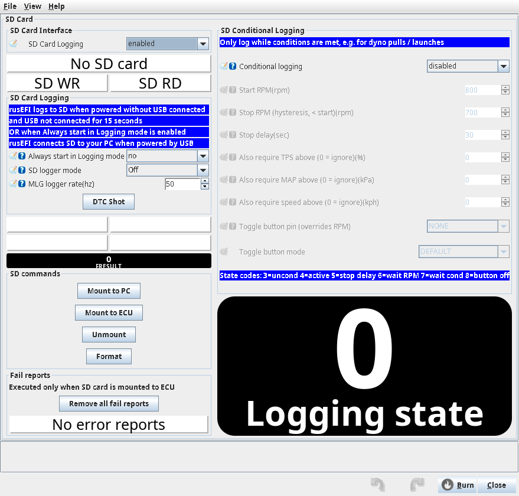
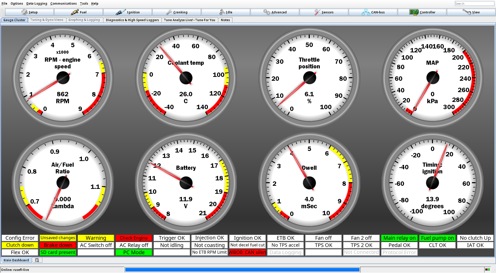
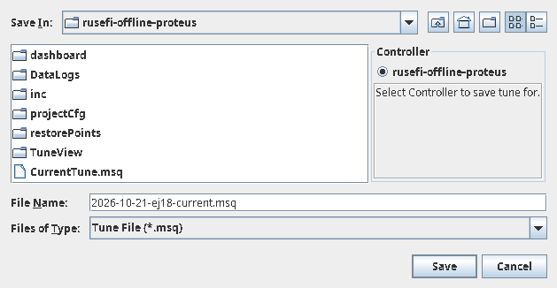
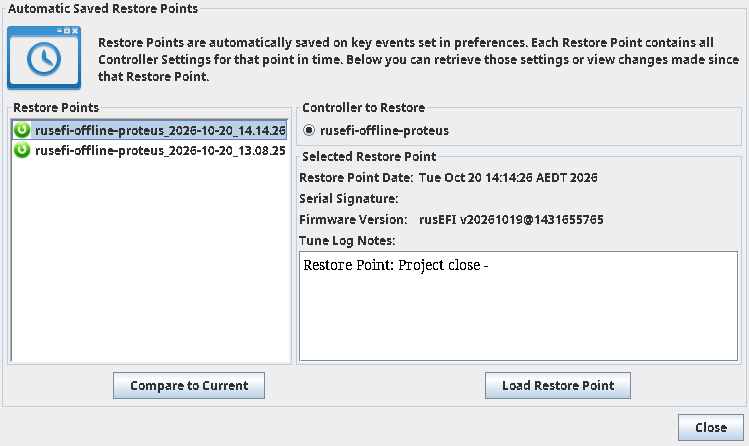
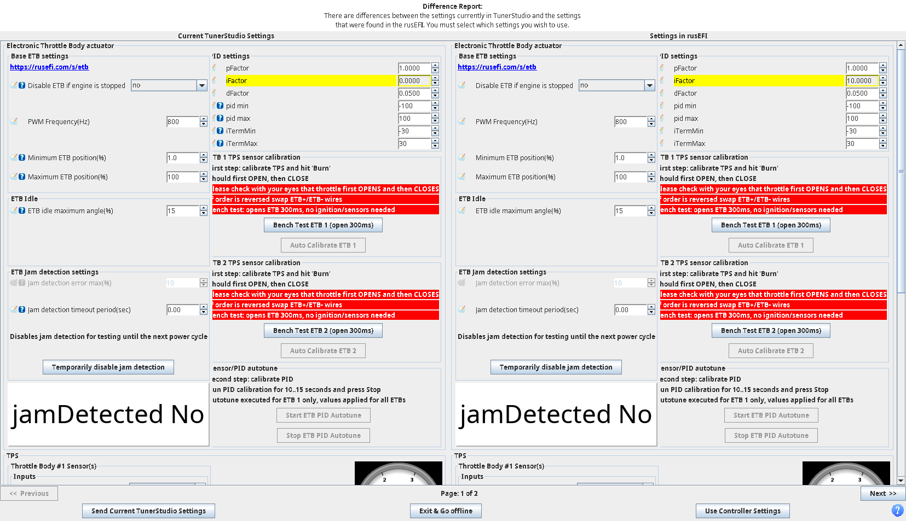
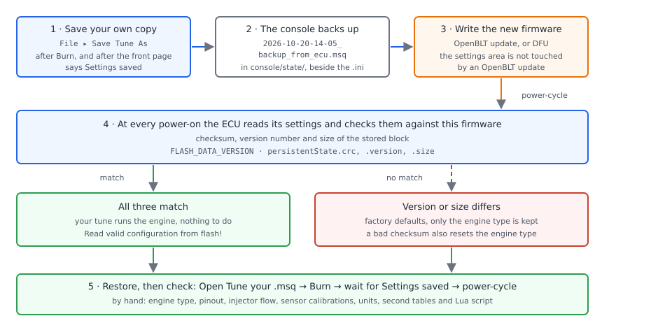
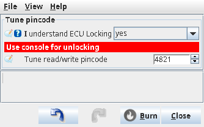

# Tunes and backups

:material-circle:{ .level-basic } Basic → :material-circle:{ .level-advanced } Advanced

> **In one sentence:** your tune — every setting that turns a blank ECU into *your* engine's ECU — lives in
> three places at once, and this chapter keeps those copies in step, saves one before every change, and moves
> it safely onto new firmware.

## What a tune is

:material-circle:{ .level-basic } Basic

A **tune** is the whole set of settings: which trigger wheel the ECU decodes, which connector each injector,
coil and sensor is on, every calibration curve, and every fuel and timing table. rusEFI keeps that set in one
structure while it runs, TunerStudio edits it over USB, and the ECU writes it to its own flash when you press
**Burn**.

TunerStudio also writes that set to a file for you: a **tune file**, extension `.msq`. It is plain XML text.
Each setting is one element carrying its internal name, its units and its value; each table is the same kind of
element with a row and column count added. The file also records the signature of the firmware and `.ini` it was
read with, which is how you tell, a year later, which build a tune belongs to.
<!-- src: java_tools/msq-file/src/main/java/com/rusefi/tune/xml/Msq.java (page, versionInfo, settings and userComments elements); java_tools/msq-file/src/main/java/com/rusefi/tune/xml/Constant.java (name, units, digits, rows and cols attributes); java_tools/msq-file/src/main/java/com/rusefi/tune/xml/VersionInfo.java (version, nPages, firmwareInfo, signature) -->

Three files are easy to confuse, and each does something different:

| What | File | What it is |
|---|---|---|
| Tune | `<name>.msq` | your values, one per setting |
| `.ini` project file | from the firmware bundle | the map of what each setting *is*: name, units, range, position. It must match the firmware on the ECU |
| Data log | `<name>.mlg` | what the engine did, not what it was told to do |

A tune opened with the wrong `.ini` is read at the wrong offsets, so it can look corrupt while the ECU is fine.
Always start from the `.ini` inside the bundle of the firmware that is actually flashed — see the First
connection chapter.

!!! danger "The engine runs what is in the ECU, not what is on your laptop"
    A tune file is only a safe copy once you have read it back. Restoring a `.msq` that belongs to another
    engine, or to a different board, puts another engine's pinout, injector data and timing tables into your
    car: outputs driven where you have sensors, fuel metered for different injectors, timing the engine will
    not tolerate. Restore a tune with the engine off and the fuel or ignition disabled, check the engine type,
    pinout and injector data before you crank it, and only then start it.

## Where every part of your tune lives

:material-circle:{ .level-intermediate } Intermediate

The ECU serves TunerStudio five pages of settings, and they are not stored the same way. Knowing which page a
value lives on tells you whether your tune file actually contains it.

<figure markdown>
  
  <figcaption>Figure 1 — One tune, three homes. The orange pages are stored as files on the SD card, and the
  long term fuel trim page is deliberately left out of the `.msq` file.</figcaption>
</figure>

| Page | Contents | Size | In the tune file? | Where the ECU keeps it |
|---|---|---:|---|---|
| Settings | everything: pinout, calibrations, tables | 17,816 B | yes | internal flash, **two copies** |
| High-speed offsets | how TunerStudio reads live data | 256 B | no | not stored — set up when TunerStudio reads live data |
| Long term fuel trims | what the ECU has learned | 2,048 B | **no** | SD card file `ltft.bin` |
| Second tables | second VE, second timing, blends, torque | 1,268 B | yes | SD card file `second_tables.bin` |
| Lua script | the whole script, as text | 48,000 B | yes | SD card file `lua_script.bin` |
<!-- src: firmware/tunerstudio/tunerstudio.template.ini (the page table generated from the enabled pages: nPages, pageIdentifier, pageSize, burnCommand); firmware/console/binary/tunerstudio.h (page identifiers such as TS_PAGE_SETTINGS); firmware/controllers/storage_sd.cpp (getIdFileName returns ltft.bin, second_tables.bin and lua_script.bin) -->

Some fields are left out of the tune file on purpose: the `.ini` marks them `noMsqSave`. rusEFI uses that mark
where the same ECU bytes appear in TunerStudio twice (the analyser's copy of the fuel tables, for example), and
for the long term fuel trim tables, which the ECU owns and maintains itself. So **your tune file does not
contain what the ECU has learned**, and it does not contain the high-speed offsets.

On a Proteus F7 the settings themselves live in the microcontroller's own flash, but the three records above
live on the SD card: this firmware build cannot keep them in the settings flash area, so it sends them to the
card. Three consequences matter before you trust a backup:

- The card must be present and held by the ECU for those writes to happen. While TunerStudio has the ECU on
  USB, the ECU normally hands the card to your computer, so the writes wait. rusEFI keeps the request queued
  and writes it once the card is back with the ECU — no card, no learned trims.
- With **SD Card Logging** switched off the ECU never touches the card at all — it does not even start the card
  thread — so none of those three records can be stored.
- A settings reset takes those pages with it: the firmware rebuilds the second tables and the Lua script from
  defaults whenever it resets the configuration. Your tune file is the only copy of them, because it does carry
  both pages.

<!-- src: firmware/controllers/storage_flash.cpp (getExtraPageFlashAddr returns 0 for an STM32F7 build without the 2 MB flash layout, with a compile-time note that such a build needs MFS or SD storage); firmware/config/boards/proteus/board.mk (includes neither 2mb_flash.mk nor use_higher_level_flash_api.mk); firmware/controllers/storage_sd.cpp (isReady requires SD_MODE_ECU); firmware/hw_layer/mmc_card.cpp (initMmcCard does not start the card thread when SD Card Logging is off, sdCardRequestMode refuses for the same reason, sdModeSelector exposes the card to the PC while USB is connected and logs otherwise); firmware/controllers/flash_main.cpp (doWriteLTFT keeps the request pending until a storage for it is ready); firmware/controllers/extra_flash_pages.cpp (resetExtraPages, burnExtraFlashPages) -->

**Controller ▸ SD Card Logger** is where you check this. **SD Card Logging** must be on, and the front page's
**ECU Mode** and **PC Mode** indicators say which way the card is connected. **Always start in Logging mode**
keeps the card with the ECU even on USB, which is also the simplest way to let a learned-trim write go through
while you tune on the bench.

<!-- shot: img/ts/tunes-backups-sd-card-logger.png | Controller ▸ SD Card Logger | Proteus F7 connected with 12 V ignition on, an SD card inserted and held by the ECU: the dialog shows SD Card Logging ticked, Always start in Logging mode, SD logger mode, MLG logger rate and the Mount to PC, Mount to ECU, Unmount and Format buttons, with the SD card present and ECU logging indicators green; annotate 1 = SD Card Logging, 2 = Always start in Logging mode, 3 = the ECU logging indicator; every dropdown closed | The SD card holds long term fuel trims, the second tables and the Lua script on this board, so its state is part of your backup story. -->
<figure markdown>
  
  <figcaption>Figure 2 — <b>Controller ▸ SD Card Logger</b>. The card is not only for logs: on this board it
  is also where learned trims, second tables and the Lua script are kept.</figcaption>
</figure>


## Burn: how an edit reaches the engine

:material-circle:{ .level-basic } Basic

While you type in a TunerStudio dialog, your change sits in the ECU's memory and in TunerStudio's copy: it
takes effect at once, and it is gone at the next power cycle. **Burn** is what commits it to the ECU's flash.

The front page tells you which state you are in: the indicator turns yellow and reads **Unsaved changes**
while the ECU has a settings write still to do, and goes back to a plain white **Settings saved** once it has
landed. It only counts writes you have asked for: an edit you have not burned yet does not light it, so a
white indicator after an edit means "nothing queued", not "safe in flash".
<!-- src: firmware/console/status_loop.cpp (needBurn = getNeedToWriteConfiguration()); firmware/controllers/storage.cpp (getNeedToWriteConfiguration: the pending settings-write bit); firmware/console/binary/tunerstudio.cpp (requestBurn is what sets it); firmware/tunerstudio/tunerstudio.template.ini (indicator { needBurn }, white / yellow) -->

<!-- shot: img/ts/tunes-backups-frontpage-burn-state.png | TunerStudio front page of a rusEFI project for the Proteus F7 | Proteus F7 connected with 12 V ignition on and the engine stopped, the Ardu-Stim turning the engine so the write is held (single-bank F7), one setting changed and Burn pressed: the Unsaved changes indicator yellow; crop below the title bar (registration name); annotate 1 = the Settings saved / Unsaved changes indicator; gauges live, no dropdown open | The front-page setting indicator is the only reliable sign that a change has reached the ECU's flash. -->
<!-- pending-figure
<figure markdown>
  
  <figcaption>Figure 3 — The front page's setting indicator: yellow while a settings write is still queued
  (here held back because the engine is turning), white <b>Settings saved</b> once the ECU has written flash.</figcaption>
</figure>

pending-figure -->

The commit is not always instant. rusEFI writes the settings flash while the engine is running only if the chip
can write flash without pausing execution; on hardware that pauses, the write is queued and happens when the
engine is stopped. Every burn also makes the ECU re-check the settings it has just received, and then write both
copies of them, so a short delay is normal and a long one means the engine is still turning over.

If the write keeps failing, the ECU says so instead of staying quiet: after ten seconds of failure it raises a
configuration error, and TunerStudio's **Config Error** indicator appears. A write also fails outright at low
battery voltage, which the firmware reports as a critical error.
<!-- src: firmware/console/binary/tunerstudio.cpp (handleBurnCommand, finishPendingBurn calling validateConfigOnStartUpOrBurn then requestBurn); firmware/controllers/storage.cpp (storageAllowWriteID defers internal-flash writes to a stopped engine when the MCU cannot flash while running); firmware/hw_layer/ports/stm32/stm32f7/mpu_util.cpp (mcuCanFlashWhileRunning); firmware/controllers/flash_main.cpp (writeToFlashNowImpl writes both copies, checkSettingsWriteFailure raises the message after ten seconds); firmware/controllers/storage_flash.cpp (erase, write, verify, and the low-voltage critical error) -->

Two details worth remembering:

- **Each page burns on its own.** The second tables and the Lua script have their own **Burn** buttons in their
  own dialogs, and burning one does not commit the settings page. The long term fuel trim page has no **Burn**
  at all: the ECU saves what it learns by itself.
- **The front page indicator is the ECU's own flag**, not TunerStudio's opinion about whether you pressed a
  button. Trust it before you switch the ECU off.
<!-- src: firmware/tunerstudio/tunerstudio.template.ini (per-page burnCommand: the settings, second-table and Lua pages can burn, the trim and high-speed pages cannot); firmware/console/status_loop.cpp (needBurn is set from the ECU's pending settings write); firmware/console/binary/output_channels.txt (needBurn); firmware/controllers/long_term_fuel_trim.cpp (the learning logic requests its own save) -->

!!! warning "Switching off before the write lands"
    Power off while that indicator is yellow and the change may never reach flash: you get the previous tune
    back at the next start, and you will not know which one you are running. Press **Burn**, wait for
    **Settings saved**, then switch off.

## Saving a tune

:material-circle:{ .level-basic } Basic

1. **Press Burn** in the last dialog you changed, and wait for the front page to say **Settings saved**.
2. **File ▸ Save Tune As**, into your project folder. TunerStudio suggests a name made of the date and
   time; add what you changed to it.

<!-- shot: img/ts/tunes-backups-save-tune-as.png | File ▸ Save Tune As | TunerStudio project for a Proteus F7 with the save-tune dialog open showing the project folder and a dated file name already typed in, for example 2026-10-21-ej18-current.msq, file type msq selected | A dated tune file in the project folder is the copy you will trust at two in the morning. -->
<figure markdown>
  
  <figcaption>Figure 4 — <b>File ▸ Save Tune As</b>. The name is the part people skip, and the part they need
  later.</figcaption>
</figure>


3. **Name it so it still means something later**: the date, the engine, and what changed —
   `2026-10-21-ej18-ve-warmup-cell-fixed.msq`. A folder of files called `tune.msq`, `tune1.msq` and `final.msq`
   documents nothing.
4. **Copy it somewhere else** — a second folder, a USB stick, a cloud drive. A tune file is small enough that
   there is no excuse, and losing one costs you a season.
5. **Close the project when you finish.** TunerStudio keeps its own history of the settings, and that history
   is written when a project closes with changes in it.
6. If you changed one thing, **compare the new file with the previous one** (section *Comparing tunes*) before
   you send it to anyone.

!!! example "A layout that works"
    One folder per engine, tune files named by date, and one file you always know is current:

    ```text
    garage/ej18/
        current.msq
        2026-10-21 e38 idle ve warmed up.msq
        2026-09-30 e38 new injectors 1000 cc per min.msq
        2026-08-14 base from tune day.msq
    ```

    Overwrite `current.msq` with **Save Tune As** each time and keep the dated ones. Before a firmware update,
    save a dated copy even if nothing has changed since the last one. rusEFI's own tooling uses the same habit:
    its automatic tune snapshots are named by date, with `_1`, `_2` added when a day produces more than one, and
    an existing snapshot is never overwritten.
    <!-- src: java_console/io/src/main/java/com/rusefi/util/TuneSnapshot.java (save: date-named msq files, _1 _2 suffixes, never replacing an existing file) -->

### TunerStudio's restore points

:material-circle:{ .level-intermediate } Intermediate

Beyond your own files, TunerStudio keeps **restore points** (**File ▸ Tune Restore Points**, Ctrl+R): automatic copies of your settings that TunerStudio
takes as you work. You can go back to one, in whole or in part, and see a difference report
between the current settings and the restore point you picked.

Treat restore points as your safety net inside a work session, and tune files as the record you keep. Restore
points live inside the project, on the same disk as everything else, so they do not protect you from a dead
laptop.

<!-- shot: img/ts/tunes-backups-restore-points.png | File ▸ Tune Restore Points | TunerStudio project for a Proteus F7: a few settings edited and burned, the project closed and reopened so automatic restore points exist, and the list showing several dated entries with the current settings and one saved point selectable and a difference report available | Restore points are TunerStudio's automatic history of your settings — a safety net for a session, not a substitute for a saved tune file. -->
<figure markdown>
  
  <figcaption>Figure 5 — Restore points for one project. Entries appear on key events, and the difference
  report shows what changed since the one you select.</figcaption>
</figure>


## Restoring a tune

:material-circle:{ .level-basic } Basic → :material-circle:{ .level-intermediate } Intermediate

1. **Check the `.ini` first.** It must be the one from the bundle of the firmware on the ECU. With a mismatched
   `.ini`, restoring a tune writes correct values into the wrong places.
2. **File ▸ Load Tune (msq)**, and pick your file.
3. **Let the difference report decide.** On connection TunerStudio compares its copy with the ECU's and shows
   what differs. To put your file into the ECU, choose the option that sends the TunerStudio settings to the
   controller. To leave the ECU alone, take the controller's copy instead — and save it before you touch
   anything.
4. **Burn**, then wait for **Settings saved**.
5. **Power-cycle and check.** Reconnect, open a few dialogs, and confirm the values are the ones you restored. A
   tune that only survived until the next power cycle was never burned.
6. **Check what the tune file does not carry**: long term fuel trims, and after any settings reset also the
   second tables and the Lua script (section *Where every part of your tune lives*).
<!-- src: firmware/tunerstudio/tunerstudio.template.ini (the settings block is checksum-compared on connection via crc32CheckCommand, and the firmware signature is in the TunerStudio section); firmware/console/binary/tunerstudio.cpp (finishPendingBurn, and the delay after a burn before the new page is live) -->

<!-- shot: img/ts/tunes-backups-difference-report.png | TunerStudio difference report on connect, after File ▸ Load Tune (msq) with an older tune file for the same engine | Proteus F7 connected, ignition on, engine stopped: the difference report comparing the loaded tune with the controller, a handful of rows highlighted with values side by side (for example injector reference pressure and two VE cells), with the option to send the TunerStudio settings to the controller and the option to take the controller's settings; annotate 1 = send TunerStudio settings, 2 = a changed row | The difference report is where you decide, setting by setting, which copy of the tune wins. -->
<figure markdown>
  
  <figcaption>Figure 6 — The difference report. Read it before you choose: it is the last place where a wrong
  answer costs nothing.</figcaption>
</figure>


!!! tip "Restore the whole tune, not your memory of it"
    Rebuilding a configuration by hand after a failure is how safety settings get lost. Take a saved tune file
    first, then TunerStudio's restore points, and only then firmware defaults — the *Recovering an ECU* chapter
    covers the last of those.

## Saving before a firmware update

:material-circle:{ .level-basic } Basic

rusEFI does not promise that one firmware build's settings can be read by the next. The block of settings the
ECU stores carries a version number and a size alongside its checksum, and that version number is bumped
whenever the stored format changes incompatibly. If the new firmware disagrees about the version or the size,
the ECU refuses to use the old settings at all.

So save your tune before **every** update, however small. The update itself, and the console's own tune backup,
are in the *Flashing firmware* chapter. In short: the console reads the tune from the ECU and writes a dated
`…_backup_from_ecu.msq` in its own `state/` folder before it flashes, then can try to carry your values onto the
new firmware. Keep your own copy as well, because that is the one you know where to find.
<!-- src: firmware/integration/rusefi_config.txt (FLASH_DATA_VERSION, with the instruction to update it whenever the stored configuration format changes incompatibly); firmware/controllers/flash_main.cpp (writeToFlashNowImpl stamps version and size into the stored block, validatePersistentState rejects a mismatch); firmware/controllers/algo/persistent_configuration.h (persistent_config_container_s holds version, size, the configuration and the crc); java_console/ecu_shared/src/main/java/com/rusefi/maintenance/CalibrationsHelper.java (updateFirmwareAndRestorePreviousCalibrations writes backup_from_ecu and the merged tune into state) -->

Before you start an update, work through this:

1. **Burn**, and wait for **Settings saved**.
2. **File ▸ Save Tune As** with a dated name. This is the copy you will trust later.
3. **Write down the engine type.** It is the one setting the ECU tries to keep for you across a version change,
   and **Controller ▸ Base Tunes** shows the list of presets the firmware offers.
4. **Keep the bundle's `.ini` beside the tune file**, so tune and `.ini` stay a matched pair.
5. **Close TunerStudio** before opening the rusEFI console: the ECU's USB port serves one program at a time.

!!! warning "A settings reset takes more than the settings with it"
    When the ECU rejects the stored settings, the firmware rebuilds the defaults **and** regenerates the second
    tables and the Lua script page. If your Lua script exists only inside the ECU, that is the moment it is
    lost. Save your tune first — the tune file carries both of those pages.
    <!-- src: firmware/controllers/algo/engine_configuration.cpp (resetConfigurationExt calls setDefaultEngineConfiguration and then resetExtraPages); firmware/controllers/extra_flash_pages.cpp (resetExtraPages calls secondTablesSetDefaults and luaConfigPageSetDefaults) -->

## Migrating a tune to new firmware

:material-circle:{ .level-intermediate } Intermediate → :material-circle:{ .level-advanced } Advanced

<figure markdown>
  
  <figcaption>Figure 7 — A tune across a firmware update. The check at step 4 decides whether you have any
  work to do. Step 5 is what you owe the engine either way.</figcaption>
</figure>

At every power-on the ECU reads the first copy of its settings and checks three things against the firmware that
is now running; if the first copy fails, it tries the second copy the same way. Those three checks decide what
an update costs you:

| What the ECU finds | What happens | What the ECU prints |
|---|---|---|
| Checksum, version and size all match | the tune is used unchanged | `Read valid configuration from flash!` |
| Version or size differs | defaults for every setting, **engine type kept** | `Resetting due to version mismatch but preserving engine type` |
| Checksum wrong | defaults, engine type included, plus a warning | *flash CRC failed*, code **6141** |
| Blank, or a medium that cannot be read | defaults | nothing — erased flash reads as ones, and that is treated as a fresh chip |
<!-- src: firmware/controllers/flash_main.cpp (readConfiguration tries the first copy then the backup, validatePersistentState compares crc, version and size and reads an all-ones crc as blank flash, readFromFlash handles each outcome and prints its message); firmware/controllers/algo/obd_error_codes.h (CUSTOM_ERR_FLASH_CRC_FAILED) -->

!!! note "Same size is not the same layout"
    The check compares a checksum, a version number and a length. It does not know what each byte means. A tune
    that passes that check into a firmware whose settings were rearranged without a version bump lands values in
    the wrong fields — and the ECU runs it happily. That is the reason for saving before every flash, and the
    reason to read the checklist below after any large version jump.
    <!-- src: firmware/controllers/flash_main.cpp (validatePersistentState compares crc, version and size only) -->

### What the firmware fixes for you

rusEFI expects old tunes to arrive in new firmware, and patches the gaps: at start-up and after every burn, a
setting that is still at zero — which is what a field that did not exist in the old tune ends up as — is filled
with a default. Real examples: the engine shutdown period becomes 3 s, the main relay disable time 1 s, the
minimum vehicle speed for slip detection 5 in the configured speed units, and tunes that predate the cranking
and priming **flex** tables get those tables seeded from the existing coolant curve, so switching the flex
feature on stays neutral until you calibrate it.

Validation runs in the same pass and stops the ECU on settings that cannot work: a zero or unphysical injector
flow is a fatal error, as is a knock frequency that looks like hertz where the firmware now wants kilohertz —
an old-tune habit worth knowing about.
<!-- src: firmware/controllers/algo/defaults/default_base_engine.cpp (applyDefaultsOrFixAfterBurn sets engineShutDownPeriod, mainRelayDisableTime and transmissionSlipMinVss when they are zero, and seeds crankingFuelFlexBins and primeFlexBins); firmware/controllers/engine_controller.cpp (validateConfig calls applyDefaultsOrFixAfterBurn, then fatal errors for injector flow and for a knock frequency in hertz); docs/calibration-compatibility.md (the same pattern for firmware contributors) -->

### What you check by hand

Treat a migrated tune as unsafe until these have been looked at. Most of the time nothing has moved, and you are
proving it.

| Check | Where | Why it matters |
|---|---|---|
| Engine type | **Controller ▸ Base Tunes**, and the base settings dialog | it selects a whole set of starting values |
| Pin assignments | the outputs and sensor dialogs | the damage case: a coil driver where you have a sensor |
| Injector flow, reference pressure, dead time, stoichiometric | the injector dialogs | every injector pulse is computed from these |
| Sensor calibrations: TPS, pedal, CLT, IAT, MAP | the sensor dialogs | a wrong TPS closed voltage changes everything the ECU believes |
| Units | the project's metric or imperial choice | kPa against psi, °C against °F |
| Rev limit, hard limit, lambda protection | the limits and protection dialogs | your last line of defence |
| Second tables and Lua script | their dialogs, and the Lua editor | they live on the SD card, and a settings reset resets them |
| Long term fuel trims | **Fuel ▸ Long term fuel trims** | learned trims are not in your tune file |

!!! info "Advanced"
    Sensor calibrations show why you read values rather than trust them. TunerStudio shows TPS closed and open
    voltages in volts, while the firmware stores them as 10-bit ADC counts — volts × 200. The pedal voltages, by
    contrast, are stored as volts. Hand-editing a tune file, or reading it as text, is where that difference
    bites.
    <!-- src: firmware/controllers/sensors/tps.h (convertVoltageTo10bitADC); firmware/controllers/actuators/electronic_throttle_impl.h (auto-calibration converts the measured volts into ADC counts for tpsMin and tpsMax); docs/AI/engine_presets.md (the same units warning for TPS against PPS) -->

### The migration, step by step

1. **Update with the console's tune migration left enabled.** It matches your old values to the new firmware's
   settings **by name** and tells you when it cannot: a message naming how many fields it could not migrate.
   Those fields stay at firmware defaults, which is why the checklist above matters.
2. **Power-cycle**, and read what the front page says. Defaults or warning code 6141 mean the tune did not
   survive the version change, and you are restoring from a file.
3. **Restore your dated tune file** (section *Restoring a tune*) with the new `.ini`, and **Burn**.
4. **Work through the checklist.** With the engine off, walk the dialogs.
5. **Prove it on the engine.** Log a short run and compare the key channels — lambda, injector pulse, timing —
   against what the old firmware produced. See the Datalogging chapter.
6. **Save the migrated tune under a new name**, and leave the old file untouched where it was, in case you go
   back.
<!-- src: java_console/ecu_shared/src/main/java/com/rusefi/maintenance/CalibrationsHelper.java (the migrate path, its count of fields that could not be migrated, and the merged tune written to state); java_console/io/src/main/java/com/rusefi/maintenance/migration/migrators/ComposedTuneMigrator.java (migrateTune runs the per-field migrators); firmware/tunerstudio/tunerstudio.template.ini (engineTypeDialog Base Tunes: the buttons apply preset values, and the dialog asks you to reconnect afterwards) -->

!!! warning "A base tune is not a migration tool"
    The buttons in **Controller ▸ Base Tunes**, and **Reset firmware settings**, replace your configuration with
    firmware defaults for a chosen engine, and the settings button writes flash at once. Use them when you want
    a starting point — never as a way to "fix" a tune you have not saved.
    <!-- src: firmware/controllers/settings.cpp (setEngineTypeAndSave applies the preset and writes flash immediately); firmware/console/binary/tunerstudio.cpp (needToTriggerTsRefresh and onApplyPreset: a burn right after a preset is skipped so the preset survives) -->

## Comparing tunes

:material-circle:{ .level-intermediate } Intermediate

Three ways to see what changed, and they answer different questions.

**The difference report** answers "what is different between this tune and that one?". It appears on connection,
between the project's tune and the ECU's, and you can also compare the tune you have loaded against any other
tune file, values side by side with the mismatches highlighted. Use this one when a tune is about to go into a
running engine: it is the only comparison that shows what TunerStudio is about to send.

**Restore points** answer "what have I done since I started?". The same side-by-side view, against an automatic
snapshot instead of a file.

**A text diff of two tune files** answers "what did a big version jump, or a migration, actually touch?". A tune
file is XML with one element per setting, so an ordinary diff tool works. The internal names appear, not the
dialog labels:

```text
$ diff -u 2026-09-30.msq 2026-10-21.msq | grep '^[+-].*constant'
-  <constant name="rpmHardLimit" units="rpm" digits="0">6800</constant>
+  <constant name="rpmHardLimit" units="rpm" digits="0">6500</constant>
-  <constant name="mainRelayDisableTime" units="s" digits="0">0</constant>
+  <constant name="mainRelayDisableTime" units="s" digits="0">1</constant>
```

The second pair is worth reading carefully: the change there is not something you typed, it is the firmware
filling in a setting your old tune left at zero. A field your old `.ini` did not have at all appears only as an
added line — and that is the moment to look up what the new default does.
<!-- src: java_tools/msq-file/src/main/java/com/rusefi/tune/xml/Constant.java (name, units, digits, rows and cols attributes per constant); java_tools/msq-file/src/main/java/com/rusefi/tune/xml/Page.java (page number and size attributes, constants per page); firmware/integration/rusefi_config.txt (rpmHardLimit in rpm and mainRelayDisableTime in s, the names and units used above); docs/AI/engine_presets.md (reading a tune file as XML, one constant per tunable) -->

!!! tip "Compare the settings that hurt, first"
    Injector flow and reference pressure, target lambda or AFR, the VE and timing cells inside your normal
    operating range, rev limits, knock thresholds, and the pin assignments. If those are unchanged, forty other
    diff lines are noise you can skim.

## Protecting a tune

:material-circle:{ .level-advanced } Advanced

rusEFI can hide a tune from being read. **Controller ▸ Tune Lock** holds a **Tune read/write pincode**
(`tuneHidingKey`) behind an acknowledgement checkbox, **I understand ECU Locking**. While a pincode is set the
ECU refuses to serve the settings page — TunerStudio reads zeros — and raises a critical error, which the front
page shows as **Config Error**.

Two consequences: a tune file saved from a locked ECU is a file full of zeros, and unlocking is not a
TunerStudio job. This part is done in the rusEFI console:

```text
unlock <pincode>
```

A wrong pincode reboots the ECU. A right one clears the lock and burns the settings. Lose the pincode and the
way back in is a settings reset, which means losing the tune — so write the pincode down with the tune file.

<!-- src: firmware/controllers/algo/engine2.cpp (isLockedFromUser raises the critical error, unlockEcu compares the pincode, reboots on a mismatch and clears tuneHidingKey plus requests a burn on success); firmware/console/binary/tunerstudio.cpp (handlePageReadCommand answers a locked settings page with zeros); firmware/controllers/settings.cpp (the console unlock command); firmware/tunerstudio/tunerstudio.template.ini (ecuPasswordPanel: I understand ECU Locking, Tune read/write pincode, and the note that unlocking uses the console) -->

!!! warning "Locking a tune locks you out of your own work"
    With a pincode set you cannot back the tune up, and you cannot work on it in TunerStudio. Set one to stop a
    stranger reading your numbers — not to protect a tune you still intend to tune.

<!-- shot: img/ts/tunes-backups-tune-lock.png | Controller ▸ Tune Lock | Proteus F7 connected with ignition on, engine stopped, the dialog open with the I understand ECU Locking checkbox ticked and a four-digit Tune read/write pincode entered, the warning line about using the console for unlocking visible, every dropdown closed | Tune Lock stops the tune being read out of the ECU — and stops you backing it up. -->
<figure markdown>
  
  <figcaption>Figure 8 — <b>Controller ▸ Tune Lock</b>. Useful against a curious stranger, costly if you lose
  the pincode.</figcaption>
</figure>


## Pitfalls and troubleshooting

:material-circle:{ .level-basic } Basic → :material-circle:{ .level-advanced } Advanced

| Symptom | Likely cause | Check |
|---|---|---|
| **Unsaved changes** still yellow long after you pressed **Burn** | the ECU is deferring an internal-flash write until the engine is stopped, or the write keeps failing | stop the engine and wait; if it stays yellow, look for a configuration error about the settings write |
| Changes gone after a power cycle | **Burn** never pressed, or power cut before the write landed | the front page indicator before you switch off |
| Second VE table, second timing table or the Lua script back to defaults | those pages live on the SD card, and a settings reset regenerated them | card present and held by the ECU; restore the tune file, which carries both pages |
| Long term fuel trims back to zero after a restore | the trim page is not saved into a tune file | expected. **Fuel ▸ Long term fuel trims** holds **Reset LTFT trims** and **Apply LTFT to VE and reset** if you want them gone or kept |
| A restored tune shows absurd values everywhere | the project's `.ini` is not the one for this firmware | use the `.ini` from the bundle of the flashed firmware |
| Fine until the next power cycle, then settings are defaults | the version or size check failed, so the ECU rejected the stored settings | restore your tune file, burn, and read the front page and the warning list |
| The whole configuration is defaults and the engine type changed too | the stored settings failed their checksum | restore from a file, see *Recovering an ECU* |
| Some settings sensible, others at firmware defaults after an update | the console's migration could not match those fields | read the console's count of fields it could not migrate, then set them by hand |
| The ECU stops with a fatal error after loading an old tune, or injector flow reads zero | a setting the old tune never had | set the injector data, and check the knock frequency units |
| A tune file full of zeros | the ECU was tune-locked when you saved it | unlock from the console, then save again |
| TPS calibration wrong after hand-editing a tune file | volts in the file, ADC counts in the ECU | enter sensor calibrations in TunerStudio rather than editing those fields |
| Two laptops, two tunes, same ECU | nobody burned last | the front page indicator, then a difference report on connection |

## Settings reference

:material-circle:{ .level-advanced } Advanced

### Long term fuel trims (Fuel ▸ Long term fuel trims)

--8<-- "reference/settings/_fuelLTFCDialog.table.md"

### SD Card Logger (Controller ▸ SD Card Logger)

--8<-- "reference/settings/_sdCard.table.md"

### Tune Lock (Controller ▸ Tune Lock)

--8<-- "reference/settings/_ecuPasswordPanel.table.md"

**Controller ▸ Base Tunes** (`engineTypeDialog`) carries no settings, only buttons that tell the ECU to apply a
preset, so there is no table for it here.

Console commands named in this chapter: `unlock <pincode>` and `sdmode`, both covered here, plus `readconfig`,
`writeconfig`, `resetconfig` and `rewriteconfig`, which belong to the *Recovering an ECU* chapter.

## Related

- Flashing firmware — the update itself, the console's tune backup and its setting migration
- Recovering an ECU — when the settings in flash are damaged, and resetting them
- First connection — matching the `.ini` to the firmware, and the difference report
- Datalogging and log analysis — proving a migrated tune behaves
- Lua scripting — the script lives on its own page, and on the SD card
- Sensors and calibration — the values you re-check after a migration
- [Safety](../safety.md) — before any work that can start the engine
