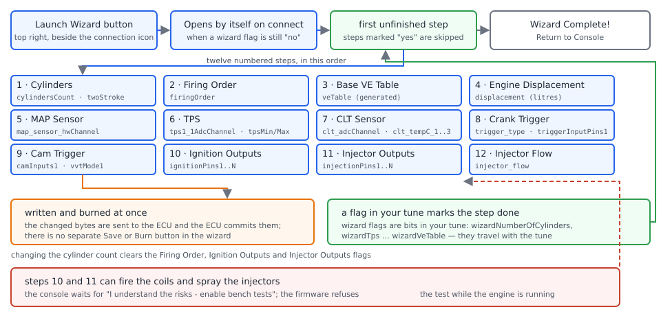
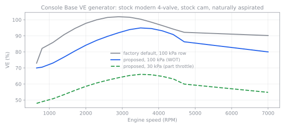

# Appendix: tuning in the rusEFI console

:material-circle:{ .level-basic } Basic → :material-circle:{ .level-advanced } Advanced

> **In one sentence:** the rusEFI console can walk a new engine through twelve setup questions (its
> **Setup Wizard**) and edit most settings itself (its **Tuning** tab); this appendix explains what each
> one does to your tune, so that if you try them you know what happened and where to check.

!!! note "Why this appendix exists"
    Every setup and tuning procedure in this manual is written and shown in **TunerStudio**, and no
    other chapter uses the console's **Setup Wizard** or **Tuning** tab. This appendix is the one place
    they are described, for readers who want to try them.
    <!-- src: java_console/ui/src/main/java/com/rusefi/ConsoleUI.java (the tabs it adds, including Tuning, and the Launch Wizard button) -->

    Both features work today, and both are still being built out: the wizard covers a fixed list of
    twelve topics and nothing else, and the Tuning tab shows the dialogs the board's `.ini` describes.
    Neither has TunerStudio's datalogging, dashboards or tuning workflows. Whatever either one changes,
    you can inspect and change in TunerStudio afterwards.

## What the console is for

:material-circle:{ .level-basic } Basic

The rusEFI console is the other program that talks to the ECU. Part I's *Your two tools* chapter
explains the split: use the console for firmware update and recovery, the engine sniffer, Lua editing,
the pinout view, the knock analyzer, SD-card log download and AI-assisted troubleshooting, and use
TunerStudio for configuration and tuning. Only one program can hold the ECU's serial port at a time, so
close one before you connect the other.

Once connected, the console shows a row of tabs — **Gauges**, **Lua Scripting**, **Live Data**, **Engine
Sniffer**, **Tuning**, **Knock Analyzer**, **Pinout**, **Manage Tunes**, **Device**, **OBD Codes**,
**Logs Manager**, **AI Troubleshooting**, **rusEFI Online** — with a **Launch Wizard** button at the
right end of that row, beside the connection icon. Not every console build shows every tab: a few are
switched off by console settings. Two of them are the subject of this appendix.
<!-- src: java_console/ui/src/main/java/com/rusefi/ConsoleUI.java (tabbedPane.addTab calls; cornerPanel with connectionStatus and launchWizardButton; tab conditions) -->
<!-- src: java_console/ecu_shared/src/main/java/com/rusefi/UiProperties.java (isEngineSnifferEnabled, isPinoutEnabled, isKnockAnalyzerEnabled) -->

## The Setup Wizard

:material-circle:{ .level-basic } Basic

The **rusEFI Setup Wizard** asks a fixed sequence of numbered questions, and each answer is written
into the ECU's tune as you go. It is aimed at an engine that has never run on rusEFI: cylinders, firing
order, a first VE table, engine size, and the sensors and outputs that have to be right before the
engine will start.

<figure markdown>
  
  <figcaption>Figure 1 — How the Setup Wizard runs. Blue is what it asks, orange is what is written to
  the ECU, green is the memory that lets it resume, red is the safety path.</figcaption>
</figure>

<!-- shot: img/console/console-appendix-launch-wizard.png | rusEFI console main window | connected to a Proteus F7 on 12 V with the engine stopped: the full tab row and the Launch Wizard button at its right end beside the connection icon | Figure 2 — The Launch Wizard button, where the wizard starts. -->

### Starting and stopping it

**Launch Wizard** opens the wizard across the whole console window. If you are not connected it says so
instead — *Please connect to an ECU before launching the wizard* — and while a firmware update is
running the button is disabled.

The console also opens the wizard by itself shortly after connecting, whenever at least one of the
wizard's progress flags in the tune is still **no**: that is what you see on a freshly flashed ECU. In
that case the bottom of the window offers **Cancel** and **Don't Show Again**; when you open the wizard
yourself the button reads **Exit Wizard** and there is no **Don't Show Again**. Choosing **Don't Show
Again** changes a setting of the console program, not of the ECU.
<!-- src: java_console/ui/src/main/java/com/rusefi/ConsoleUI.java (getLaunchWizardButton; auto-launch on connect when hasIncompleteSteps; AUTO_LAUNCH_WIZARD and setOnDontShowAgain) -->
<!-- src: java_console/ui/src/main/java/com/rusefi/ui/wizard/WizardContainer.java (configureExitButtons: Cancel versus Exit Wizard; hasIncompleteSteps) -->
<!-- src: java_console/ecu_shared/src/main/java/com/rusefi/UiProperties.java (isLaunchWizardEnabled, isWizardAutoLaunchEnabled) -->

Across the top are numbered pills, one per step, marked completed, current or coming up; a completed
pill can be clicked to go back to that step. When no step is left, the wizard shows **Wizard Complete!**
with a **Return to Console** button.
<!-- src: java_console/ui/src/main/java/com/rusefi/ui/wizard/WizardProgressPanel.java (Item numbers and states, setOnCompletedSelected) -->
<!-- src: java_console/ui/src/main/java/com/rusefi/ui/wizard/WizardContainer.java (the "rusEFI Setup Wizard" title; showCompletionCard with "Wizard Complete!" and "Return to Console") -->

<!-- shot: img/console/console-appendix-wizard-cylinders.png | rusEFI console ▸ Launch Wizard ▸ Cylinders | step 1 of 12, 4 Stroke selected, the numbered progress strip across the top and Exit Wizard at the bottom right | Figure 3 — Step 1, and the progress strip that takes you back to a completed step. -->

<!-- shot: img/console/console-appendix-wizard-complete.png | rusEFI console ▸ Launch Wizard | the Wizard Complete! card, progress strip all marked done, Return to Console | Figure 4 — The end of the wizard: every flag in the tune is now yes. -->

### What it asks, and where those settings live in TunerStudio

Each step writes ordinary rusEFI settings. Nothing is stored "in the wizard": everything it sets is
visible and editable in TunerStudio, in the dialog named in the last column.

| # | Step | Settings it writes | Check it in TunerStudio |
|---|---|---|---|
| 1 | Cylinders | `cylindersCount`, `twoStroke` | **Setup ▸ Vehicle Information** |
| 2 | Firing Order | `firingOrder` | **Setup ▸ Vehicle Information** |
| 3 | Base VE Table | the VE table (`veTable`) | **Fuel ▸ VE** |
| 4 | Engine Displacement | `displacement` (litres) | **Setup ▸ Vehicle Information** |
| 5 | MAP Sensor | `map_sensor_hwChannel`, `map_sensor_type`, `mapLowValueVoltage`, `map_sensor_lowValue`, `mapHighValueVoltage`, `map_sensor_highValue` | **Sensors ▸ MAP sensor** |
| 6 | TPS | `tps1_1AdcChannel`, `tpsMin`, `tpsMax` | **Sensors ▸ TPS** |
| 7 | CLT Sensor | `clt_adcChannel`, `clt_tempC_1`…`clt_tempC_3`, `clt_resistance_1`…`clt_resistance_3`, `clt_bias_resistor`, `useLinearCltSensor` | **Sensors ▸ CLT sensor** |
| 8 | Crank Trigger | `twoStroke`, `trigger_type`, `triggerInputPins1` and `2`, `invertPrimaryTriggerSignal`, `globalTriggerAngleOffset` | **Setup ▸ Trigger ▸ Primary Trigger** |
| 9 | Cam Trigger | `vvtMode1` and `2`, `camInputs1`…`4`, and the cam edge and VVT offset fields | **Setup ▸ Trigger ▸ Cam Inputs** |
| 10 | Ignition Outputs | `ignitionPins1`…`n`, `firingOrder` | **Ignition ▸ Ignition hardware** |
| 11 | Injector Outputs | `injectionPins1`…`n`, `firingOrder` | **Fuel ▸ Injector Setup ▸ Injection hardware** |
| 12 | Injector Flow | `injector_flow`, `injectorFlowAsMassFlow` | **Fuel ▸ Injector Setup ▸ Injection configuration** |

<!-- src: java_console/ui/src/main/java/com/rusefi/ui/wizard/WizardCatalog.java (the twelve flagged steps in order, with their titles) -->
<!-- src: java_console/ui/src/main/java/com/rusefi/ui/wizard/TpsPanel.java (the TPS fields); java_console/ui/src/main/java/com/rusefi/ui/wizard/MapSensorTypePanel.java (the MAP fields); java_console/ui/src/main/java/com/rusefi/ui/wizard/CltSensorPanel.java (the CLT fields); java_console/ui/src/main/java/com/rusefi/ui/wizard/OutputAssignmentPanel.java (ignitionPins and injectionPins); java_console/ui/src/main/java/com/rusefi/ui/wizard/InjectorFlowPanel.java (injector_flow and injectorFlowAsMassFlow) -->
<!-- src: firmware/tunerstudio/tunerstudio.template.ini (the same fields in engineChars, mapSensorAnalog, clt_thermistor, trigger_primary, trigger_cams, ignitionOutputs, injectorOutputSettings and injChars, and the menu entries that name those dialogs) -->

!!! warning "The wizard saves as you go"
    Completing a step sends the change and commits it: the console patches the changed bytes into the
    ECU and then burns, and the wizard has no **Burn** button and no undo. Steps 3 and 4 change how much
    fuel the engine makes. Work through the wizard with the engine stopped, expect the tune to be
    different when you finish, and save a tune backup in TunerStudio first if you have a tune worth
    keeping.
    <!-- src: java_console/ui/src/main/java/com/rusefi/ui/wizard/WizardContainer.java (onStepCompleted uploads the modified image) -->
    <!-- src: java_console/io/src/main/java/com/rusefi/binaryprotocol/BinaryProtocol.java (uploadChanges patches the changed ranges and then burns) -->

### How it remembers

The tune itself carries one flag per step — `wizardNumberOfCylinders`, `wizardFiringOrder`,
`wizardMapSensorType`, `wizardCrankTrigger`, `wizardCamTrigger`, `wizardInjectorFlow`,
`wizardDisplacement`, `wizardCltSensor`, `wizardTps`, `wizardIgnitionOutputs`, `wizardInjectorOutputs`
and `wizardVeTable` — each a **no** / **yes** choice stored with your settings. Finishing a step sets
its flag to **yes**; the wizard starts at the first step whose flag is still **no** and skips the rest.
It resumes where you left off.

Skipping is not the same as leaving: **Skip / Use Default** on the two trigger steps, and **Skip** on
the VE step, still set that step's flag and burn it, so a skipped step counts as done and is not
offered again. Press **Exit Wizard** instead if you want a step to come back, and re-open a finished
step from the progress strip if you need to change its answer.

Because the flags are part of the tune, a step also counts as done when the board's `.ini` does not
declare that flag, or when the step does not apply to that board.

Two answers deliberately undo other people's progress: changing the cylinder count clears the Firing
Order, Ignition Outputs and Injector Outputs flags, and the VE table step clears the Displacement flag
so that engine size is confirmed after it. For a one- or two-cylinder engine the firing order follows
from the cylinder count, and the Firing Order step is not shown at all.
<!-- src: firmware/integration/rusefi_config.txt (the wizard bit fields) -->
<!-- src: java_console/ui/src/main/java/com/rusefi/ui/wizard/WizardContainer.java (onStepCompleted sets the step flag even when the step was skipped, isStepSatisfied, clearDependentWizardFlags, completeImplicitFiringOrder, hideImplicitFiringOrderStep) -->

### Working through the steps

**1 · Cylinders.** A **4 Stroke** / **2 Stroke** choice and a grid of buttons: 1 to 10, 12 and 16. The
button sets `cylindersCount`, and the two-stroke choice sets `twoStroke`. Three buttons — 7, 9 and 16 —
are a joke about exotic engines and set nothing.
<!-- src: java_console/ui/src/main/java/com/rusefi/ui/wizard/NumberOfCylindersPanel.java (the option list, the four-stroke and two-stroke choice, the joke buttons) -->

**2 · Firing Order.** A list of firing orders for the cylinder count you chose, read from the board's
`.ini`, most of them annotated with a typical engine: *1-3-4-2 (typical inline 4)*,
*1-8-7-2-6-5-4-3 (GM Gen. 3, 4, 5 LT1)*.
<!-- src: java_console/ui/src/main/java/com/rusefi/ui/wizard/FiringOrderPanel.java (orders filtered by cylinder count, the engine notes) -->

**3 · Base VE Table.** This step can generate a first VE table — see *Generating a first VE table*
below. If the console cannot use your engine's air model the step says why, and **Skip** leaves the
table alone.
<!-- src: java_console/ui/src/main/java/com/rusefi/ui/wizard/VeTableWizardStep.java (embeds the generator, Apply and Continue or Skip) -->

**4 · Engine Displacement.** **Total displacement (litres)**, with the hint *Example: 1998 cc =
1.998 L*. Litres, not cubic centimetres: entering `1998` describes a 1998-litre engine.
<!-- src: java_console/ui/src/main/java/com/rusefi/ui/wizard/DisplacementPanel.java (the label, the hint and the Save and Continue button) -->

**5 · MAP Sensor.** Two dropdowns — the analog input and the sensor model — plus a live readout of the
input voltage and of the pressure the present calibration implies, under a **Good MAP Input** /
**BAD Map Input** strip. A named model hides the calibration boxes; **Custom** reveals **Low point
voltage**, **Low point pressure**, **High point voltage** and **High point pressure**, which is what you
enter from the sensor's datasheet.
<!-- src: java_console/ui/src/main/java/com/rusefi/ui/wizard/MapSensorTypePanel.java (the two dropdowns, the calibration fields shown only for Custom, the live readouts) -->
<!-- src: java_console/ui/src/main/java/com/rusefi/ui/wizard/TpsPanel.java (the Grab buttons and the live readouts) -->
<!-- src: java_console/ui/src/main/java/com/rusefi/ui/wizard/CltSensorPanel.java (the live voltage and temperature readouts) -->
<!-- src: firmware/tunerstudio/tunerstudio.template.ini (the map_sensor_type list, starting with Custom, and map_sensor_hwChannel) -->

<!-- shot: img/console/console-appendix-wizard-map.png | rusEFI console ▸ Launch Wizard ▸ MAP Sensor | Sensor model set to Custom so the four calibration boxes show; the live VOLTAGE and MAP readouts show the sensor at atmospheric pressure, Good MAP Input strip | Figure 5 — The MAP step with Custom chosen: two calibration points and a live readout. -->

**6 · TPS.** The analog input, and **Closed voltage** and **Open voltage (WOT)**, each with a **Grab**
button that records the voltage being read right now, plus live voltage and TPS-percentage readouts. It
rejects an input of *None*, a voltage outside 0–5 V, or two voltages less than 0.1 V apart. The values
are stored on a 5 mV grid, so a third decimal place is rounded away.
<!-- src: java_console/ui/src/main/java/com/rusefi/ui/wizard/TpsPanel.java (the fields, the Grab buttons, the validation rules and their messages) -->
<!-- src: firmware/tunerstudio/tunerstudio.template.ini (tpsMin and tpsMax scaling and range) -->

!!! danger "The TPS step is not electronic-throttle calibration"
    This step writes one TPS channel and two voltages. An electronic throttle needs both sensor tracks
    calibrated and the controller's own auto-calibration, and a wrong TPS calibration can make the
    controller drive the throttle hard against its stop. With an electronic throttle body, stop the
    wizard at this step and follow the Electronic throttle chapter instead — calibrating first with the
    throttle connector unplugged, and with hands clear of the bore.

<!-- shot: img/console/console-appendix-wizard-tps.png | rusEFI console ▸ Launch Wizard ▸ TPS | analog input set to Analog Volt 2, the live VOLTAGE readout about 0.55 V with the throttle shut, both Grab buttons visible | Figure 6 — The TPS step: Grab records the voltage the ECU is reading at this instant. -->

**7 · CLT Sensor.** The analog input, then either a preset from the list the board's `.ini` offers
(*Common CLT Sensors*: **GM CLT**, **Miata NA**, **Miata NB**, **Bosch Various**) or **three**
temperature-and-resistance pairs. Custom points are checked: temperatures must increase from point 1 to
point 3, stay between −55 °C and 200 °C, resistances must be between 0 and 1 000 000 Ω, all three
different, and they must produce a valid thermistor curve. Where the board declares one, the pull-up
resistor can be entered here too; the value already stored for the board is normally the right one.
<!-- src: java_console/ui/src/main/java/com/rusefi/ui/wizard/CltSensorPanel.java (the preset selector, the three pairs, the validation rules and messages) -->
<!-- src: firmware/tunerstudio/tunerstudio.template.ini (the "Common CLT Sensors" selector and its four options, and clt_bias_resistor) -->

<!-- shot: img/console/console-appendix-wizard-clt.png | rusEFI console ▸ Launch Wizard ▸ CLT Sensor | preset mode selected with the Common CLT Sensors list open, live VOLTAGE and CLT readouts | Figure 7 — A CLT preset writes three temperature and resistance pairs in one go. -->

**8 · Crank Trigger and 9 · Cam Trigger.** These two steps show the same fields as the TunerStudio
trigger dialogs: trigger type, input pins, primary and secondary edge and angle offset, then cam modes,
cam inputs, cam edges and VVT offsets. **Save and Continue** writes them; **Skip / Use Default** moves
on without touching them.
<!-- src: java_console/ui/src/main/java/com/rusefi/ui/wizard/CrankTriggerPanel.java (the trigger_primary dialog fields, Save and Continue, Skip / Use Default) -->
<!-- src: java_console/ui/src/main/java/com/rusefi/ui/wizard/CamTriggerPanel.java (the trigger_cams dialog fields) -->

**10 · Ignition Outputs and 11 · Injector Outputs.** One dropdown per cylinder, a warning line, a
checkbox and a **Test** button beside each row. The Test buttons are not decoration — see the danger box
below.

**12 · Injector Flow.** On a Proteus F7 this step asks for one number: **Injector flow (cc/min)**, and
it also sets the flow units to **cc/min**. The step has a second form for a board whose `.ini` declares
a `hardcoded_injectors` list of injector models; the Proteus `.ini` does not, so the list is not
offered. Where the list is available, picking a model also asks the ECU to apply its own injector
preset.
<!-- src: java_console/ui/src/main/java/com/rusefi/ui/wizard/InjectorFlowPanel.java (the two forms keyed on hardcoded_injectors, the cc/min field and units, the preset command and re-read) -->
<!-- src: firmware/tunerstudio/tunerstudio.template.ini (injector_flow, injectorFlowAsMassFlow, and no hardcoded_injectors field) -->

!!! danger "The output steps can fire the coils and spray the injectors"
    The Ignition Outputs step warns *"Ignition tests produce hazardous voltage."* and the Injector
    Outputs step warns *"Injector tests can release fuel. Ensure the fuel system is safe before
    continuing."* Both add *The engine must be stopped.* The **Test** buttons stay disabled until you
    tick **I understand the risks - enable bench tests**, and a test applies the assignments on screen
    before pulsing that one output. The firmware itself refuses an ignition or injector bench test
    while the engine is turning — treat that as a backstop, not a permission. Coil packs produce
    voltages that can kill; fuel in a hot engine bay ignites; a starter-cranking engine takes clothing
    and fingers with it. Leave the checkbox alone unless the engine is stopped, the fuel system is
    closed, and you have a reason to pulse one output.
    <!-- src: java_console/ui/src/main/java/com/rusefi/ui/wizard/OutputAssignmentPanel.java (the warning texts, the enable-bench-tests checkbox, applyAndTest) -->
    <!-- src: firmware/controllers/bench_test.cpp (executeTSCommand refuses TS_IGNITION_CATEGORY and TS_INJECTOR_CATEGORY while the engine is not stopped) -->

<!-- shot: img/console/console-appendix-wizard-injector-outputs.png | rusEFI console ▸ Launch Wizard ▸ Injector Outputs | four cylinder dropdowns filled, the warning line visible, the bench-tests checkbox unticked and the Test buttons disabled | Figure 8 — Steps 10 and 11: the Test buttons sit behind an explicit acknowledgement. -->

### Generating a first VE table

The Base VE Table step, and the **Generate base VE...** button on the VE table in the console's Tuning
tab, build a whole table from a short questionnaire: **Head archetype**, **Cam profile**,
**Aspiration**, **VVT present**, **Idle RPM** and **Max RPM**. The rules are the "archetype-base-ve-v1"
profile: a peak VE for the head type (85 % restrictive legacy 2-valve, 92 % good ported 2-valve, 98 %
stock modern 4-valve, 104 % high-flow 4-valve), a peak placed 48 % of the way from idle to maximum for a
stock cam (58 % mild, 68 % aggressive), drops at idle, low RPM and redline that an engine with VVT is
credited for, and a load factor rising from 0.60 at 10 kPa to 1.00 at 100 kPa and above. Values stay
inside 35–125 %, and two weighted 3×3 smoothing passes soften the surface.

The panel shows **Current**, **Proposed** and **Delta** tabs before you commit anything, with **Apply
and Continue** and **Skip** at the bottom of the wizard step. It refuses to run unless the engine is
Speed Density with a plain VE table, and it warns that on a boosted engine only wastegate or minimum
boost is a safe starting point.

<!-- shot: img/console/console-appendix-ve-generator.png | rusEFI console ▸ Launch Wizard ▸ Base VE Table | questionnaire filled with Stock modern 4-valve, Stock, Naturally aspirated, idle 800 and max 6500, the Proposed tab showing a generated table, Apply and Continue and Skip at the bottom | Figure 9 — The Base VE generator: a questionnaire in, a whole table out, with Current, Proposed and Delta to compare. -->

<figure markdown>
  
  <figcaption>Figure 10 — What the generator produces for a naturally aspirated engine with a stock
  modern 4-valve head and a stock cam, 800 to 6500 RPM, on the firmware's factory table axes. The points
  are the table's RPM bins, so the line stretches between 4700 and 7000 RPM, and the smoothing passes
  pull the peak a little below the headline 98 %.</figcaption>
</figure>
<!-- src: java_console/models/src/main/java/com/rusefi/tune/ve/ArchetypeBaseVeV1.java (peak VE per head, cam peak position and drops, the MAP factor table, VVT multipliers, the boosted warning) -->
<!-- src: java_console/models/src/main/java/com/rusefi/tune/ve/BaseVeGenerator.java (the clamp bounds 35 to 125 percent and the weighted 3x3 smoothing pass) -->
<!-- src: java_console/models/src/main/java/com/rusefi/tune/ve/VeTableBinding.java (binding veTableTbl, and the Speed Density and plain VE requirement) -->
<!-- src: java_console/ui/src/main/java/com/rusefi/ui/widgets/tune/VeTableGeneratorPanel.java (the questionnaire fields, the Current Proposed and Delta tabs, the refusal message) -->
<!-- src: java_console/ui/src/main/java/com/rusefi/ui/widgets/tune/CalibrationDialogWidget.java (the Generate base VE button on the VE table) -->

A generated table is a starting shape, not a tune. It knows nothing about your camshaft, your injector
flow or your fuel pressure. Use it to get near enough to start, then tune from a log, as the Fuel and
Ignition chapters describe.

### What the wizard does not set

The wizard's twelve topics are all it touches. Before a first start these still need TunerStudio (or the
console's **Tuning** tab), and each has its own chapter:

- the second TPS track, the accelerator pedal, and everything about an electronic throttle
- injector dead time, injection mode, and the small-pulse corrections
- dwell, ignition mode, and the timing tables
- idle settings, cranking fuel and cranking timing
- the wideband sensor, and the limits and protection you want active

## The Tuning tab

:material-circle:{ .level-intermediate } Intermediate

The console's **Tuning** tab shows rusEFI's own dialogs, built from the same `.ini` file TunerStudio
reads, and edits them against the connected ECU. It is a settings editor: no gauges of its own, and no
datalogging.

<figure markdown>
  
  <figcaption>Figure 11 — The Tuning tab's path from your keystroke to flash. Blue is what you edit,
  orange is what the console sends, green is how it tells you where you stand, red is what is not
  saved.</figcaption>
</figure>

### The menu, and what you can click

Down the left is a tree of the same menus TunerStudio has — **Setup**, **Fuel**, **Ignition**,
**Cranking**, **Idle**, **Advanced**, **Sensors**, **CAN-bus**, **Controller** — and a search box above
it that finds a dialog or a setting by name. Entries whose `.ini` expression is false are drawn greyed
and cannot be opened: a dialog that needs a feature you have switched off, or one that the **Tuning
View** choice in **Setup ▸ Vehicle Information** hides.
<!-- src: java_console/ui/src/main/java/com/rusefi/ui/widgets/tune/MainMenuTreeWidget.java (the tree built from the ini menus, the search field, nodes disabled from expressions) -->
<!-- src: java_console/ui/src/main/java/com/rusefi/ConsoleUI.java (the Tuning tab is built the first time you open it) -->

On the right is the dialog you selected: fields, tables and curves. A pin dropdown carries a small
**Wiring/Pinout** button that switches to the **Pinout** tab with that pin highlighted. Any panel can be
detached into its own window (*Detach this panel into a separate window*, then **Split panel** in its
title bar), and detached panels come back the next time you open the console.

<!-- shot: img/console/console-appendix-tuning-tab.png | rusEFI console main window ▸ Tuning | connected to a Proteus F7 on 12 V, engine stopped, menu tree open on the left with the search box empty, a dialog open on the right, toolbar showing Burn to ECU, Discard changes, Undo, Redo and no state text | Figure 12 — The Tuning tab: TunerStudio's dialogs and menus inside the console. -->

### Edits, burning, and undo

The toolbar holds **Burn to ECU**, **Discard changes**, **Undo** and **Redo**, plus a state label.

An edit is sent to the ECU about a tenth of a second after your last keystroke — only the bytes that
changed, uploaded *without* a burn. That is what makes the tab different from TunerStudio's habit of
deliberate burning: a change is live in the running engine before it is saved anywhere. The state label
then reads **Pending changes not burned**; it clears when you press **Burn to ECU**, and offline it
reads **Offline tune** or **Local changes not burned to ECU**.

**Burn to ECU** commits the tune to flash. **Discard changes** returns to the image the console last
loaded or burned. **Undo** and **Redo** keep fifteen steps, coalescing a run of keystrokes into one. If
you close the console with unburned changes it says so — *The tune has changes that have not been burned
to the ECU.* — and offers **Burn to ECU and Exit** or **Save Tune and Exit**.
<!-- src: java_console/ui/src/main/java/com/rusefi/ui/widgets/tune/TuningToolbarWidget.java (the upload timer delay with uploadChangesWithoutBurn, Burn to ECU, Discard changes, Undo and Redo with MAX_UNDO, stateLabelText) -->
<!-- src: java_console/io/src/main/java/com/rusefi/binaryprotocol/BinaryProtocol.java (uploadChangesWithoutBurn patches only the differing ranges, burn commits) -->
<!-- src: firmware/console/binary/tunerstudio.cpp (the write-chunks-then-burn model, handleBurnCommand and finishPendingBurn) -->
<!-- src: java_console/ui/src/main/java/com/rusefi/ui/TuningPane.java (the unsaved-changes prompt offering Burn to ECU and Exit or Save Tune and Exit) -->
<!-- src: java_console/ui/src/main/java/com/rusefi/ui/widgets/tune/CalibrationPanelWorkspace.java (detaching a panel, Split panel, remembered detached panels) -->
<!-- src: java_console/ui/src/main/java/com/rusefi/ui/widgets/tune/CalibrationFieldFactory.java (the Wiring/Pinout button on a pin dropdown) -->

!!! danger "The Tuning tab edits a running engine in real time"
    Because a change reaches the ECU within a tenth of a second, editing fuel, timing, a rev limit or an
    output pin while the engine runs changes what the engine does immediately — and **Burn to ECU** only
    decides whether that change survives the next restart. Make calibration changes with the engine off,
    or on a lift with the wheels unpowered and someone at the kill switch. With any ECU powered, keep
    hands, tools and loose clothing away from the engine, the belts and the hot exhaust, and never
    disconnect an injector or coil connector by feel alone.

Under the toolbar the tab can also show the indicator row from the `.ini` front page — the same "this
looks wrong" indicators TunerStudio shows on its front page.
<!-- src: java_console/ui/src/main/java/com/rusefi/ui/TuningPane.java (the front-page indicator panel built from the ini front page indicators) -->

### Tables and curves

Tables behave roughly as TunerStudio's do: click a cell and type, or select a block and use **Up** and
**Down** with a delta box, **=** to set the selection to one value, **Interpolate**, **Smooth**, and
**H** and **V** to interpolate along an axis. There is a **3D view** checkbox and a small rotatable 3D
preview, and the axis values themselves are editable. Curves are edited by typing values. The VE table
carries the **Generate base VE...** button described above.
<!-- src: java_console/ui/src/main/java/com/rusefi/ui/widgets/tune/TuningTableView.java (Up, Down and the delta box, the set-to-value button, Interpolate, Smooth, H and V, the 3D view checkbox and mini 3D preview, the axis editors) -->
<!-- src: java_console/ui/src/main/java/com/rusefi/ui/widgets/tune/CurveWidget.java (typing a curve value, Enter and Esc, selection with Shift and the arrows) -->

<!-- shot: img/console/console-appendix-tuning-pending.png | rusEFI console main window ▸ Tuning ▸ Fuel ▸ VE | the VE table open, two changed cells, the state label reading "Pending changes not burned" | Figure 13 — Edits are already in the ECU; Burn to ECU decides whether they survive the next restart. -->

### Tune files, and editing with no ECU

The console's **File ▸ Load Tune** and **File ▸ Save Tune** read and write the same `.msq` files as
TunerStudio, so a tune can be started in one program and finished in the other. You can also load a
tune with no ECU connected and work offline; when an ECU appears, the console asks what to do with your
local edits — keep them and write them to that ECU, migrate only the fields that also exist on it, or
use the ECU's tune. Read that dialog carefully: it decides whether your edits or the ECU's win.
<!-- src: java_console/ui/src/main/java/com/rusefi/ui/console/MainFrame.java (the File menu with Load Tune, Save Tune and Exit) -->
<!-- src: java_console/ui/src/main/java/com/rusefi/ui/widgets/tune/TuningToolbarWidget.java (the .msq file chooser used by Load Tune and Save Tune) -->
<!-- src: java_console/ui/src/main/java/com/rusefi/ui/TuningPane.java (offline editing and reconcileOfflineEditsOnConnect with Keep Local and Burn to ECU, Migrate to ECU, Use ECU Tune) -->

While a firmware update is in progress the Tuning tab stops uploading edits and refuses to load a tune.
<!-- src: java_console/ui/src/main/java/com/rusefi/ui/widgets/tune/TuningToolbarWidget.java (setFirmwareUpdateInProgress stops the upload timer and disables Load Tune) -->

## Worked examples

:material-circle:{ .level-intermediate } Intermediate

### Example 1 — a bare Proteus F7, wizard end to end

A Proteus F7 with freshly flashed firmware, engine stopped, ECU on 12 V with the ignition on (never on
USB power alone when a sensor is being read), four cylinders, one coil per cylinder, one MAP sensor and
a cable-drawn throttle. The wizard is offered on connect; these answers are typical for that engine.

| Step | Answer | Why this |
|---|---|---|
| Cylinders | **4 Stroke**, **4** | `cylindersCount`, and `twoStroke` decides the trigger and cam screens |
| Firing Order | **1-3-4-2** | *typical inline 4* in the wizard's own list |
| Base VE Table | **Stock modern 4-valve**, **Stock**, **Naturally aspirated**, idle 800, max 6500, then Apply and Continue | a shape to start from, not a tune |
| Engine Displacement | **1.998** | litres: 1998 cc |
| MAP Sensor | *Analog Volt 1*, **Custom**, 0.5 V at 20 kPa and 4.5 V at 250 kPa | *Analog Volt 1* is White 13, the input the board files label for MAP |
| TPS | *Analog Volt 2*, closed 0.55 V with **Grab**, wide open 4.42 V with **Grab** | *Analog Volt 2* is White 24, the board files' suggested TPS input |
| CLT Sensor | *Analog Temp 3*, preset **Bosch Various** | *Analog Temp 3* is White 20, the board files' coolant sensor input |
| Crank Trigger | **36-1**, crank sensor on its event input, primary edge as the wheel requires, offset 0 | a common wheel; **Skip / Use Default** is fine if the defaults are already right |
| Cam Trigger | **Skip / Use Default** | no cam wheel fitted yet |
| Ignition Outputs | *Ign 1* to *Ign 4* — Black35 pins 35, 34, 22, 33 — and no **Test** presses | four of the board's twelve ignition outputs |
| Injector Outputs | *Lowside 1* to *Lowside 4* — Black35 pins 3, 15, 4, 16 | four of the board's twelve injector outputs, one per cylinder |
| Injector Flow | **305** cc/min | the injectors' flow at the pressure the car runs |

<!-- src: firmware/config/boards/proteus/connectors/white35.yaml (Analog Volt 1 with its MAP function text, Analog Volt 2 as suggested TPS on pin 24, Analog Temp 3 as the coolant input on pin 20) -->
<!-- src: firmware/config/boards/proteus/connectors/black35.yaml (Ign 1 to 4 on pins 35, 34, 22 and 33, Lowside 1 to 4 on pins 3, 15, 4 and 16) -->
<!-- src: java_console/ui/src/main/java/com/rusefi/ui/wizard/FiringOrderPanel.java (the firing-order list and its engine notes) -->
<!-- src: java_console/ui/src/main/java/com/rusefi/ui/wizard/CltSensorPanel.java (the preset list) -->

Then close the wizard and check the result in TunerStudio: that is the habit to keep, because the
wizard writes ordinary settings and TunerStudio is where you confirm them. **Sensors ▸ TPS** and
**Sensors ▸ MAP sensor** are the two worth re-opening — a typo in those is the one most likely to make
the engine run badly rather than not start.

<!-- shot: img/ts/console-appendix-vehicle-information.png | Setup ▸ Vehicle Information | Proteus F7 connected on 12 V, engine stopped, after the wizard: Number of cylinders 4, Displacement 1.998, Firing order 1-3-4-2 | Figure 14 — The wizard's first answers, seen in TunerStudio. -->

### Example 2 — the generated table against the factory default

Figure 10 puts the generated table next to the firmware's factory VE table on the same axes. Two things
to notice:

- the generated wide-open row peaks in the middle of the range and falls away towards redline, where
  the factory row keeps climbing;
- the 30 kPa row is the wide-open row multiplied by about 0.69, which is the generator's load factor at
  that pressure — real part-throttle VE usually differs from that by more than the wide-open row does.

After applying a generated table and logging, expect the low-load rows to move most as long-term trims
settle and the wide-open rows to move least. That is normal, and it is why a generated table deserves
the same treatment as the factory default: a starting point, to be corrected from a log.

### Example 3 — one VE cell, then a burn

A running, warmed-up engine that pulls lean just past idle cruise, worked on the console's **Tuning**
tab:

1. Open the tree **Fuel ▸ VE**. The table shows the tune as the console last read it.
2. Click the cell near 30 kPa and 2000 RPM and type a value 2 % lower. Press Enter.
3. Watch the state label: **Pending changes not burned**. With the engine running, the fueling change
   is already in effect — that is the point of the tenth-of-a-second upload, and it is also the risk.
4. If it went the wrong way, press **Undo**: one step back, and the undone value is uploaded the same
   way.
5. When the trace looks better, press **Burn to ECU**. The label clears and the value now survives a
   restart. If you close the console before that, it stops and asks.

A/B comparison of the change needs a log, and logging in this manual is done in TunerStudio — which is
the practical limit of the Tuning tab: it is quick for edits, and it is not where you measure the result.

## Pitfalls and troubleshooting

:material-circle:{ .level-basic } Basic → :material-circle:{ .level-advanced } Advanced

| Symptom | Likely cause | Check |
|---|---|---|
| The wizard opens every time you connect | a step is still unanswered, so its flag is still **no** | finish it, or press **Don't Show Again** in the auto-launched wizard |
| A step you answered comes back | its flag was cleared deliberately: the cylinder count clears three flags, and the VE step clears the displacement flag | re-answer it |
| A step you **skipped** never comes back | skipping still sets that step's flag and burns it | re-open it from the progress strip, or set the fields in TunerStudio |
| A step says the firmware does not support it, with greyed fields | the board's `.ini` does not declare those fields | use the TunerStudio dialog, or update firmware and bundle together |
| The MAP step shows **BAD Map Input** | the entered calibration does not match the voltage being read | sensor wiring and supply, the two points, the sensor model |
| The CLT step refuses your three points | temperatures not increasing, outside −55…200 °C, repeated resistances, or no valid curve | three increasing temperatures with three different resistances |
| The TPS step will not continue | no input chosen, a voltage outside 0–5 V, or closed and wide-open less than 0.1 V apart | step 6 above |
| The Base VE step says it cannot generate | the engine is not Speed Density with a plain VE table | the air model in the Fuel chapter; the generator is for speed density |
| The wizard wrote something wrong and you cannot undo it | the wizard burns as it goes and has no undo | fix the setting in TunerStudio, or restore a tune backup |
| **Test** does nothing on the output steps | the checkbox is unticked, or the engine is running | the firmware refuses ignition and injector bench tests while the engine turns |
| A Tuning tab change took effect but is gone after a restart | it was uploaded to RAM and never burned | **Burn to ECU**, and watch the state label |
| A Tuning tab entry is greyed in the tree | its `.ini` expression is false, or **Tuning View** hides it | the feature it needs, or **Setup ▸ Vehicle Information** |
| **Burn to ECU** is disabled | not connected, or a firmware update is running | the connection icon, and the update progress |
| Neither program can connect | both want the same serial port | close one — see *Your two tools* |
| The engine still does not start after the wizard | the wizard covers twelve topics only: dwell, injection mode, cranking fuel and timing, idle and outputs are not among them | the Cranking, Fuel and Ignition chapters |

## Settings reference

These are the TunerStudio dialogs behind the wizard's answers and behind the Tuning tab edits this
appendix discusses. The console writes the same settings.

### Vehicle Information (Setup ▸ Vehicle Information)

--8<-- "reference/settings/_engineChars.table.md"

### Primary Trigger (Setup ▸ Trigger ▸ Primary Trigger)

--8<-- "reference/settings/_trigger_primary.table.md"

### Cam Inputs (Setup ▸ Trigger ▸ Cam Inputs)

--8<-- "reference/settings/_trigger_cams.table.md"

### MAP sensor (Sensors ▸ MAP sensor)

--8<-- "reference/settings/_mapSettings.table.md"

### TPS (Sensors ▸ TPS)

--8<-- "reference/settings/_tpsSensor.table.md"

### CLT sensor (Sensors ▸ CLT sensor)

--8<-- "reference/settings/_cltSensor.table.md"

### Ignition Outputs (Ignition ▸ Ignition hardware)

--8<-- "reference/settings/_ignitionOutputs.table.md"

### Injector Outputs (Fuel ▸ Injector Setup ▸ Injection hardware)

--8<-- "reference/settings/_injectorOutputSettings.table.md"

### Injector Settings (Fuel ▸ Injector Setup ▸ Injection configuration)

--8<-- "reference/settings/_injChars.table.md"

## Related

- *Your two tools* — why TunerStudio is this manual's tuning tool, and one-program-at-a-time serial
  connections
- *First connection* and *Flashing firmware* — the console jobs this appendix does not cover
- Electronic throttle — the throttle and pedal calibration that the wizard's TPS step does not do
- Fuel and Ignition — what has to be set, and then tuned, after the wizard
- Every setting, by dialog — the full reference for the dialogs named above
